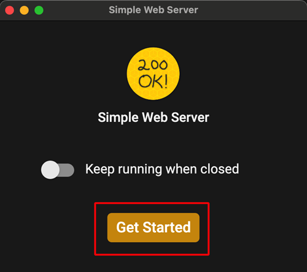
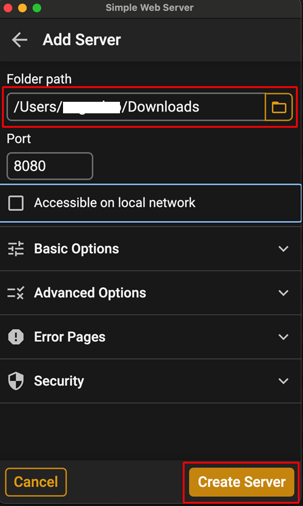

(aaps-ci-option2-computer)=

# Opció 2 · Ordinador – Pujar el vostre magatzem de claus existent

```{note}
[Opció 2](BrowserBuildO2.md) (pujar un magatzem de claus existent) en un **ordinador** (Windows / Mac / Linux).
```

## 1. Descarregueu el fitxer de preparació

:::{include} BrowserBuildDownloadPrep.md
:::

## 2. Inicieu un servidor local i pugeu el magatzem de claus

Feu servir un ordinador (Windows/Mac/Linux)

<!--crowdin: exclude-->
<div align="center" style="max-width: 360px; margin: auto; margin-bottom: 2em;">
  <div style="position: relative; width: 100%; aspect-ratio: 9/16;">
    <iframe
      src="https://geo.dailymotion.com/player/x9rdyc6.html?video=x9rdyc6&loop=true&mute=true"
      loading="lazy"
      style="position: absolute; top: 0; left: 0; width: 100%; height: 100%;"
      frameborder="0"
      allowfullscreen>
    </iframe>
  </div>
</div>

Instal·leu Simple Web Server<br/><br/> Si feu servir Windows o Mac, el podeu instal·lar des de Microsoft Store o des de Mac App Store. Si el navegador us pregunta si voleu obrir l'aplicació de la botiga, permeteu-ho.<br/><br/> <br/><br/>

Exemple en un Mac:

- get → install → open<br/><br/> <br/><br/>

- Feu clic a «Get Started»<br/><br/> <br/><br/>

- Feu clic a «New Server»<br/><br/> <br/><br/>

- A «Folder Path», seleccioneu la carpeta on hi ha el fitxer aaps-ci-preparation.html i després feu clic a «Create Server».<br/><br/> <br/><br/>

- Si veieu aquesta pantalla, el servidor s'ha iniciat.<br/><br/> <br/><br/>

- No tanqueu Simple Web Server. Torneu al navegador i obriu<br/><br/> [http://127.0.0.1:8080/aaps-ci-preparation.html](http://127.0.0.1:8080/aaps-ci-preparation.html)<br/><br/>

- Per als passos següents, mireu el vídeo de sota, a partir del minut 2 i 18 segons.<br/><br/>
  <!--crowdin: exclude-->
  <div align="center" style="max-width: 360px; margin: auto; margin-bottom: 2em;">
    <div style="position: relative; width: 100%; aspect-ratio: 9/16;">
      <iframe
        src="https://geo.dailymotion.com/player/x9rdvt0.html?video=x9rdvt0&startTime=138&loop=true&mute=true"
        loading="lazy"
        style="position: absolute; top: 0; left: 0; width: 100%; height: 100%;"
        frameborder="0"
        allowfullscreen>
      </iframe>
    </div>
  </div>

----

**Següent: [Pas 3 – Autoritzeu Google Drive](BrowserBuildGoogleDrive.md) →**
