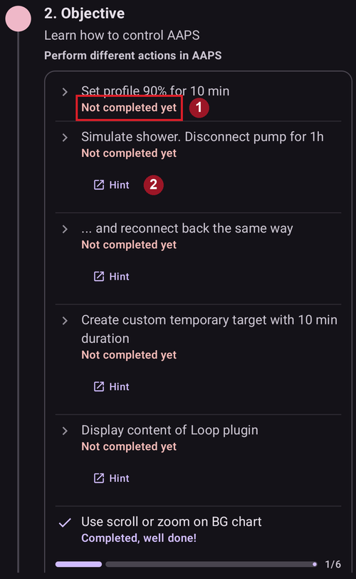
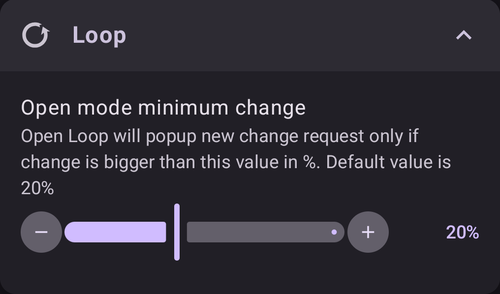
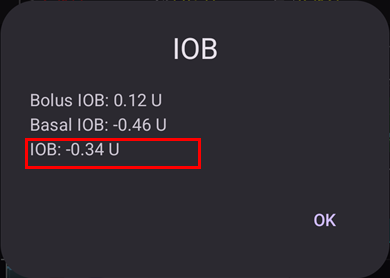
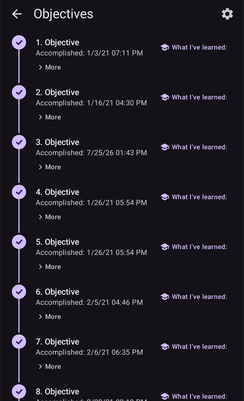
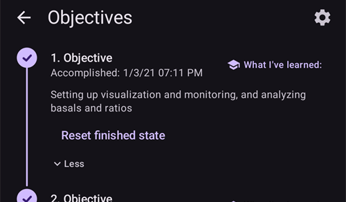
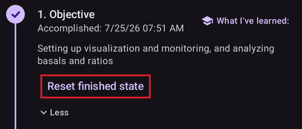

# Completar els objectius

**AAPS** té una sèrie d'**Objectius** que cal completar. Ajuden l'usuari a avançar des del llaç obert bàsic fins al llaç tancat híbrid i totes les funcions d'**AAPS**. Completar els **Objectius** serveix per assegurar que:

* Heu configurat correctament tot el vostre **AAPS**;
* Heu après les funcions essencials d'**AAPS**; i
* Enteneu el bàsic del que pot fer el vostre sistema, per tenir més confiança quan feu servir **AAPS**.

Quan instal·leu **AAPS** per primera vegada, heu de completar cada objectiu abans de passar al següent. Les funcions noves es desbloquegen a poc a poc a mesura que avanceu per cada **Objectiu**.

Els **Objectius 1 a 8** us guien des de la configuració d'**AAPS** al telèfon fins al llaç tancat híbrid «bàsic». Això triga unes 6 setmanes. Podeu avançar fins a l'**Objectiu 5** amb una bomba virtual (i mentrestant fer servir un altre mètode per administrar la insulina). Els **Objectius 9 i 10** serveixen per provar funcions més avançades d'**AAPS** per controlar millor la diabetis. Poden trigar fins a 3 mesos a completar-se, potser més. Trobareu més detalls sobre una estimació del temps necessari aquí: [Quant de temps cal?](#preparing-how-long-will-it-take)

A més d'avançar pels **Objectius**, si cal, també podeu esborrar el progrés i [tornar a un objectiu anterior](#CompletingTheObjectives-go-back-in-objectives).

## Feu una còpia de seguretat de la configuració

```{admonition} Note
:class: note

Es recomana exportar la configuració d'**AAPS** després de completar cada **Objectiu**!
```

Es recomana molt [exportar la configuració](../Maintenance/ExportImportSettings.md) després de completar cada objectiu, per no perdre el progrés fet a **AAPS**. Aquesta exportació crea un **fitxer de configuració** (.json) del qual heu de guardar una còpia en un o més llocs segurs (per exemple Google Drive, un disc dur, un adjunt de correu electrònic _etc._). Així es desa tot el progrés fet a **AAPS**. Si perdeu el telèfon o esborreu el progrés per error, podeu tornar a carregar el fitxer json a **AAPS** important un fitxer de configuració recent. També necessiteu una còpia del **fitxer de configuració** si per algun motiu necessiteu un telèfon nou per a **AAPS** (telèfon nou, perdut, trencat _etc._)

El fitxer de **configuració** no només desa el vostre progrés als **Objectius**, sinó també tota la configuració d'**AAPS**, com ara el **bolus màxim** _etc._

Si no teniu una còpia de la configuració i li passa alguna cosa al telèfon d'**AAPS**, haureu de tornar a començar els **Objectius** des del principi. Avançar pels **Objectius** requereix temps, i és millor evitar haver-los de tornar a fer, per exemple perquè heu perdut el telèfon.

(objectives-objective1)=
## Objectiu 1: Configuració de visualització i monitorització, així com anàlisi de basals i ràtios

L'**Objectiu 1** demana a l'usuari que faci la configuració tècnica bàsica a **AAPS**. No podeu avançar fins que no hàgiu completat aquest pas.

- Seleccioneu el CGM/FGM correcte a [Configurador → Origen glucèmia](#Config-Builder-bg-source). Vegeu [Origen glucèmia](../Getting-Started/CompatiblesCgms.md) per a més informació.
- Seleccioneu la bomba correcta a [Configurador → Bomba](#Config-Builder-pump) perquè la bomba es pugui comunicar amb **AAPS**. Seleccioneu la **bomba virtual** si feu servir un model de bomba sense controlador d'**AAPS** per fer llaç, o si voleu fer els primers **Objectius** mentre feu servir un altre sistema per administrar la insulina. Vegeu [bomba d'insulina](../Getting-Started/CompatiblePumps.md) per a més informació.
- Si feu servir Nightscout:
  - Seguiu les instruccions de la pàgina [Nightscout](../SettingUpAaps/Nightscout.md) perquè **Nightscout** pugui rebre i mostrar les dades d'**AAPS**.
  - Tingueu en compte que l'URL a **NSClientV3** ha de ser **_sense_ «/api/v1/»** al final; vegeu [Configuració → NSClientV3](#Preferences-nsclient).
- Si feu servir Tidepool:
  - Seguiu les instruccions de la pàgina [Tidepool](../SettingUpAaps/Tidepool.md) perquè **Tidepool** pugui rebre i mostrar les dades d'**AAPS**.

Nota: *Potser haureu d'esperar la lectura següent de glucèmia del sensor abans que **AAPS** ho reconegui.*

(objectives-objective2)=
## Objectiu 2: Aprendre a controlar AAPS

L'**Objectiu 2** demana fer diverses «tasques», com mostra la captura de sota. Cada tasca mostra el seu estat (**1**): el text taronja «**No finalitzat encara**» canvia a «**Completat, ben fet!**» tan bon punt **AAPS** ha registrat l'acció. Premeu **Pista** (**2**) sota una tasca per obrir la documentació corresponent, si encara no coneixeu bé una acció.



Les tasques per completar l'**Objectiu 2** són:
- Poseu el vostre **perfil** al 90% durant 10 min.
  - _Pista_: premeu el nom del perfil a la pantalla principal per obrir la pantalla **Perfil**, després feu servir el botó **Activar** (▶) i poseu el percentatge i la durada. Més informació a [Canvi de perfil i percentatge del perfil](../DailyLifeWithAaps/ProfileSwitch-ProfilePercentage.md).
  - _Nota_: **AAPS** no accepta taxes basals per sota de 0,05 U/h. Si el vostre **perfil** té taxes de 0,05 U/h o menys, haureu de crear un **perfil** temporal amb taxes basals més altes abans de completar aquesta tasca. Després de completar aquesta tasca, torneu al vostre **perfil** normal.
- Simuleu una «dutxa» [desconnectant la bomba](#AapsScreens-loop-status) a **AAPS** durant 1 h.
  - _Pista_: premeu la icona del llaç a la pantalla principal per obrir el diàleg del llaç, i després trieu una durada a **Desconnectar bomba**.
- Acabeu la «dutxa» tornant a connectar la bomba.
  - _Pista_: premeu la icona «desconnectat» per tornar a obrir el diàleg del llaç i trieu **Reconnectar bomba**.
- Establiu un [**objectiu temporal**](../DailyLifeWithAaps/TempTargets.md) personalitzat amb una durada de 10 min.
  - _Pista_: premeu el rang objectiu a la pantalla principal per obrir la pantalla d'objectiu temporal.
- Mostreu el contingut del plugin **Llaç**.
  - _Pista_: obriu **Configurador → Llaç** i premeu «**Obrir plugin**».
- Feu servir el desplaçament o el zoom al gràfic de glucèmia per veure períodes de temps més llargs o més curts.


(objectives-objective3)=
## Objectiu 3: Demostreu els vostres coneixements

L'**Objectiu 3** demana a l'usuari que aprovi un examen tipus test, pensat per comprovar els seus coneixements d'**AAPS**.

Alguns usuaris troben que l'**Objectiu 3** és el més difícil de completar. Llegiu la documentació d'**AAPS** al mateix temps que les preguntes. Si de debò us quedeu encallats després de buscar a la documentació d'**AAPS**, cerqueu «Objective 3» al grup de [Facebook](https://www.facebook.com/groups/AndroidAPSUsers) o de [Discord](https://discord.gg/4fQUWHZ4Mw) (és probable que algú ja hagi fet la vostra pregunta i que el grup ja l'hagi respost). Aquests grups us poden donar pistes amables o enviar-vos a la part corresponent de la documentació d'**AAPS**.

Mentrestant:
- Per tenir menys avisos / decisions per prendre (taxes basals temporals) en llaç obert, poseu un rang objectiu ampli al vostre **perfil**, _per exemple_ 90 - 150 mg/dl o 5,0 - 8,5 mmol/l.
- A la nit potser voldreu posar un límit superior més ampli, o fins i tot desactivar el llaç obert.

Per continuar amb l'**Objectiu 3**, premeu una fila de pregunta per obrir-la. Llegiu amb atenció cada pregunta i seleccioneu la resposta o les respostes.

Cada pregunta pot tenir més d'una resposta correcta! Si seleccioneu una resposta incorrecta, la pregunta queda bloquejada durant 1 hora abans que hi pugueu tornar a respondre. Tingueu en compte que l'ordre de les respostes pot canviar la vegada següent. Així us assegureu que les llegiu amb atenció i que enteneu de debò si cada resposta és correcta o no.

```{admonition} __What happens if new question(s) are added to an Objective when I update to a newer version of AAPS?__
:class: note
De tant en tant s'afegeixen funcions noves a **AAPS** i pot caldre afegir una pregunta nova als **Objectius**, sobretot a l'**Objectiu 3**. Per això, qualsevol pregunta nova afegida a l'**Objectiu 3** es marcarà com a «no completada», perquè **AAPS** us demanarà que la respongueu. No us preocupeu: com que cada **Objectiu** és independent, **no perdreu les funcions d'AAPS que ja teniu**, sempre que els altres **Objectius** continuïn completats.
```

## Objectiu 4: Iniciant llaç obert

L'**Objectiu 4** serveix per veure amb quina freqüència **AAPS** compara la taxa basal de l'usuari amb la glucèmia i recomana canvis de taxa basal temporal. En aquest **Objectiu** activareu el llaç obert per primera vegada i acceptareu 20 canvis de taxa basal temporal proposats. Si cal, els aplicareu manualment a la bomba. També observareu l'efecte dels [**objectius temporals**](../DailyLifeWithAaps/TempTargets.md). Si encara no sabeu establir un canvi de taxa basal temporal a **AAPS**, vegeu les accions de la bomba al full **Gestionar** ([On és la pestanya Accions?](#screens-action-tab)).

Temps mínim per completar aquest objectiu: **7 dies**. És un temps d'espera obligatori. No podeu passar a l'**Objectiu** següent, encara que ja hàgiu aplicat tots els canvis de taxa basal.

- Seleccioneu el llaç obert prement la [icona del llaç](#AapsScreens-loop-status) a la pantalla principal i triant **Llaç obert** com a mode de funcionament.
- Apliqueu manualment almenys 20 de les propostes de taxa basal temporal durant un període de 7 dies: introduïu-les a la vostra bomba (física) i confirmeu a AAPS que les heu acceptat. Comproveu que aquests canvis de taxa basal apareixen a **AAPS** i a **Nightscout**.
- Feu servir [**objectius temporals**](../DailyLifeWithAaps/TempTargets.md) quan calgui. Després de tractar una hipo, feu servir l'objectiu temporal predefinit «Hipo» perquè el sistema no corregeixi massa quan la glucèmia torni a pujar.
- Si en aquest moment encara feu servir el [Mode simple](#preferences-simple-mode), ara és probablement un bon moment per desactivar-lo.

Per tenir menys canvis de taxa basal proposats en llaç obert, encara podeu fer servir els consells de l'[**Objectiu 3**](#objectives-objective3). A més, podeu canviar el percentatge mínim dels canvis de basal recomanats amb el paràmetre «**Canvi mínim en mode obert**» a **Configuració → Llaç**. Com més alt sigui el valor, menys avisos de canvi rebreu.



```{admonition} Note
:class: note

No cal que apliqueu totes i cadascuna de les recomanacions del sistema!
```
(objectives-objective5)=
## Objectiu 5: Entendre el vostre llaç obert, recomanacions de basals temporals incloses

A l'**Objectiu 5** començareu a entendre d'on surten les recomanacions de basal temporal. Això inclou la [lògica per decidir la basal](#aaps-screens-how-predictions-become-a-dosing-decision), analitzar l'efecte observant les [línies de predicció al **Resum d'AAPS**](#aaps-screens-prediction-lines) (o a Nightscout) i mirar els càlculs detallats que es mostren a la pantalla del plugin **OpenAPS SMB** (**Configurador → APS → Obrir plugin**).

Temps estimat per completar aquest objectiu: **7 dies**.

En aquest **Objectiu** heu de determinar i configurar el valor de la «Taxa basal màxima» (max-basal), com es descriu a [Funcions d'OpenAPS](#Open-APS-features-max-u-h-a-temp-basal-can-be-set-to). Aquest valor es pot configurar a [Configuració → OpenAPS SMB](#Preferences-openaps-smb-settings). En [mode simple](#preferences-simple-mode), **AAPS** posa aquest valor automàticament i no cal que el canvieu. Si encara feu servir una bomba virtual, assegureu-vos que aquest paràmetre de seguretat està configurat tant a **AAPS** com a la vostra bomba d'insulina.

Potser voldreu posar l'[objectiu de glucèmia del **perfil**](#profile-glucose-targets) més alt que de costum fins que us sentiu còmodes amb els càlculs i la configuració d'**AAPS**. Podeu provar d'ajustar l'**objectiu de glucèmia** del vostre **perfil** a un rang més estret (per exemple, d'1 mmol/l o menys [20 mg/dl o menys] d'amplada) i observar què passa.


```{admonition} If you have been using a virtual pump, change to a real insulin pump now!
:class: note

Si feu llaç obert amb una bomba virtual, **atureu-vos aquí**. Premeu **Verificar** al final d'aquest **Objectiu** només quan ja feu servir una bomba «real» que lliura insulina.

```


(objectives-objective6)=
## Objectiu 6: Començar a tancar el llaç amb la suspensió per glucèmia baixa (LGS)


```{admonition} Closed loop will not correct high **BG** values in **Objective 6** as it is limited to **Low Glucose Suspend** only!
:class: note
Encara haureu de corregir les glucèmies altes vosaltres mateixos (manualment, amb correccions amb la bomba o la ploma)!
```

A l'**Objectiu 6** tancareu el llaç i activareu el mode **Suspensió per glucèmia baixa** (LGS) mentre la [IOB màxima](#Open-APS-features-maximum-total-iob-openaps-cant-go-over) és zero. Heu de quedar-vos en mode LGS durant 5 dies per completar aquest **objectiu**. Aprofiteu aquest temps per comprovar si la configuració del vostre **perfil** és correcta i si els esdeveniments LGS no s'activen massa sovint.

Temps mínim per completar aquest objectiu: **5 dies**. És un temps d'espera obligatori. No podeu passar a l'**Objectiu** següent abans que s'acabi aquest temps.

És molt important que el vostre **perfil** actual (basal, ISF, IC) estigui ben provat abans de tancar el llaç en mode **LGS**. Una configuració incorrecta del **perfil** us pot portar a hipoglucèmies que haureu de tractar manualment. Un **perfil** correcte ajuda a necessitar menys tractaments de glucèmia baixa durant aquests 5 dies.

**Si encara teniu glucèmies baixes freqüents o greus, penseu a ajustar millor la [DIA del vostre tipus d'insulina](#Config-Builder-insulin-dia), la basal, l'ISF i les ràtios de carbohidrats.** Consulteu el grup de [Facebook](https://www.facebook.com/groups/AndroidAPSUsers) o de [Discord](https://discord.gg/4fQUWHZ4Mw), on se n'ha parlat molt.


Durant l'**Objectiu 6**, **AAPS** posa el paràmetre maxIOB a zero. **Això s'acaba quan passeu a l'Objectiu 7.**

Això vol dir que a l'**Objectiu 6**, si la glucèmia del sensor baixa, **AAPS** reduirà per vosaltres el lliurament d'insulina basal. Però, si la glucèmia del sensor puja, **AAPS** només augmentarà la taxa basal per sobre del valor del **perfil** si la **IOB basal** és negativa a causa d'una **LGS** anterior. En cas contrari, **AAPS** no augmentarà la basal per sobre del valor del perfil actual, encara que la glucèmia pugi. Aquesta precaució és per evitar hipoglucèmies mentre apreneu a fer servir **AAPS**.

**Per tant, heu de tractar les glucèmies altes amb bolus de correcció manuals.**

- Si la vostra IOB és negativa (vegeu la captura de sota), a l'**Objectiu 6** es pot activar una taxa basal temporal (TBR) > 100%.



- Poseu el rang objectiu una mica més alt del que faríeu normalment, per seguretat i per tenir un marge de seguretat.
- Activeu el mode «Suspensió per glucèmia baixa» prement la icona del llaç a la pantalla principal i triant **Suspensió per glucèmia baixa (LGS)** com a mode de funcionament.
- Seguiu les basals temporals actives mirant el text turquesa de la basal a la pantalla RESUM o la basal turquesa dibuixada al gràfic del RESUM.
- Pot ser que temporalment tingueu pics després de tractar una hipo, perquè el sistema no pot augmentar la basal quan la glucèmia torna a pujar.

(objectives-objective7)=
## Objectiu 7: Ajustar el llaç tancat, augmentar la maxIOB per sobre de 0 i baixar a poc a poc els objectius de glucèmia

Per completar l'**Objectiu 7** heu de tancar el llaç i augmentar la [maxIOB](#Open-APS-features-maximum-total-iob-openaps-cant-go-over). La **maxIOB** es posava a zero automàticament a l'**Objectiu 6**, pel mode de suspensió per glucèmia baixa. Ara ja no és així. **AAPS** començarà a fer servir el valor de maxIOB que heu definit per corregir les glucèmies altes. En [mode simple](#preferences-simple-mode), **AAPS** posa la maxIOB automàticament i no cal que la canvieu.

Temps mínim per completar aquest objectiu: **1 dia**. És un temps d'espera obligatori. No podeu passar a l'**Objectiu** següent fins que no hagi passat aquest temps.

- Seleccioneu **Llaç tancat** prement la [icona del llaç](#AapsScreens-loop-status) a la pantalla principal i triant **Llaç tancat** com a mode de funcionament. Quedeu-vos en **llaç tancat** durant 1 dia.

- Augmenteu a poc a poc la «IOB màxima per a SMB» (a OpenAPS es diu «max-iob») per sobre de 0, fins que trobeu la configuració que us funciona millor.

La recomanació per defecte per a aquest paràmetre és «**bolus d'àpat mitjà + 3x basal diària màxima**», on «basal diària màxima» és el valor horari més alt de qualsevol franja del dia.


Aquesta recomanació és només un punt de partida. Si feu servir aquesta regla però veieu que AAPS lliura massa insulina quan la glucèmia puja, potser haureu de:
* baixeu el valor d'«IOB màxima per a SMB»;
* revisar la configuració del vostre **perfil**, fent només un canvi cada vegada.

Si sou molt resistents a la insulina, també podeu augmentar el valor de **maxIOB** amb molta precaució.

Quan sapigueu bé quina **maxIOB** s'adapta al vostre llaç, baixeu els vostres **objectius de glucèmia** fins al nivell que vulgueu.

(objectives-objective8)=
## Objectiu 8: Ajustar basals i ràtios si cal, i després activar Autosens

En aquest **objectiu** tornareu a revisar com funciona el vostre **perfil** i fareu servir la funció [Autosens](#Open-APS-features-autosens) com a indicador de configuració incorrecta.

Temps mínim per completar aquest objectiu: **7 dies**. És un temps d'espera obligatori. No podeu passar a l'**Objectiu** següent fins que no hagi passat aquest temps.

Activeu [Autosens](../DailyLifeWithAaps/KeyAapsFeatures.md) durant 7 dies (en [mode simple](#preferences-simple-mode) està activat per defecte) i mireu la [línia blanca del gràfic del **Resum**](#AapsScreens-section-g-additional-graphs), que mostra com puja o baixa la vostra sensibilitat a la insulina per l'esport, les hormones, etc. Vigileu la pantalla del plugin **OpenAPS SMB** (**Configurador → APS → Obrir plugin**), que mostra com **AAPS** ajusta la sensibilitat, les basals i els objectius.

És un bon moment per revisar la configuració de la [Detecció de sensibilitat](#Config-Builder-sensitivity-detection). Podeu veure la vostra sensibilitat a la pantalla principal en un [gràfic addicional](#AapsScreens-section-g-additional-graphs).

A més, podeu fer servir [Autotune](#autotune-how-autotune-calculates-adjustments) una sola vegada per comprovar que les basals continuen sent correctes, o fer un test de basal tradicional.

(objectives-objective9)=
## Objectiu 9: Activar funcions addicionals d'oref1 per a l'ús de dia, com el super micro bolus (SMB)

A l'**Objectiu 9** aprendreu i fareu servir el **«Super Micro Bolus (SMB)»** com a funció principal. Després de les lectures obligatòries entendreu bé què són els SMB, com funcionen i per què la basal es posa temporalment a zero després de donar un SMB (zero-temping).

Temps mínim per completar aquest objectiu: **28 dies**. És un temps d'espera obligatori. No podeu passar a l'Objectiu següent abans que s'acabi aquest temps.

- La [secció SMB d'aquesta documentació](#Open-APS-features-super-micro-bolus-smb) i la [part sobre oref1 de la documentació d'OpenAPS](https://openaps.readthedocs.io/en/latest/docs/Customize-Iterate/oref1.html) són lectures obligatòries per entendre els **SMB** i el concepte de **zero-temping**.
- Després podeu [augmentar la maxIOB](#Open-APS-features-maximum-total-iob-openaps-cant-go-over) perquè els **SMB** funcionin millor. Ara maxIOB inclou tota la **IOB**, no només la basal acumulada. Aquest llindar posa en pausa els **SMB** fins que la IOB baixa per sota d'aquest valor (_per exemple_, la **maxIOB** és de 7 U i es dona un bolus de 8 U per a un àpat: els SMB es posen en pausa i no es donen fins que la **IOB** baixa per sota de 7 U). Un bon començament és posar **maxIOB** = **bolus d'àpat mitjà + 3x basal diària màxima**, on «basal diària màxima» és el valor horari més alt de qualsevol franja del dia. Vegeu l'[objectiu 7](#objectives-objective7) com a referència.
- Avalueu la velocitat d'absorció dels carbohidrats i penseu a canviar el paràmetre «min_5m_carbimpact» a [Configuració → Configuració absorció → min_5m_carbimpact](#Preferences-min_5m_carbimpact) si us sembla massa lenta o massa ràpida.

(objectives-objective10)=
## Objectiu 10: Automatització

L'**Automatització** està disponible quan s'inicia l'**Objectiu 10**.

Temps mínim per completar aquest objectiu: **28 dies**. És un temps d'espera obligatori. No podeu passar a l'Objectiu següent abans que s'acabi aquest temps.

Primer llegiu la pàgina de la documentació [Automatització](../DailyLifeWithAaps/Automations.md).

Configureu la regla d'automatització més senzilla; per exemple, que mostri una notificació d'Android d'aquí a uns minuts:
- Obriu **Gestionar → Automatització** i premeu el botó **+** (**Afegir tasca**).
- Escriviu un **Nom de la tasca**, per exemple «La meva primera notificació d'automatització».
- A **Condició**, premeu «**EDITAR**».
  - Premeu «**Afegir activador**» i seleccioneu «**Hora**». **AAPS** crea una entrada per a avui a l'hora actual.
  - Canvieu l'hora perquè s'activi d'aquí a uns minuts.
  - Premeu la icona **Desar** (a dalt a la dreta) per tornar a la regla.
- A **Acció**, premeu «**AFEGIR**» i seleccioneu «**Avís**».
  - Escriviu un missatge a la targeta de l'acció, per exemple «La meva primera automatització».
- Premeu la icona **Desar** (a dalt a la dreta) i comproveu que l'opció **Activat** de la regla està activada.
- Espereu fins que l'hora activi l'avís (segons el telèfon, pot arribar uns minuts tard)

Després podeu provar de configurar una **automatització** més útil. La pàgina de la documentació dona alguns exemples, i podeu cercar captures de pantalla d'«Automation» al grup de [Facebook](https://www.facebook.com/groups/AndroidAPSUsers). També hi ha un canal específic a la comunitat de [Discord](https://discord.gg/4fQUWHZ4Mw).

Per exemple, si cada matí esmorzeu el mateix a la mateixa hora abans d'anar a l'escola o a la feina, podeu crear una **automatització** com ara «objectiu-abans-d'esmorzar» que estableixi un **objectiu temporal** una mica més baix 30 minuts abans d'esmorzar. En aquest cas, la condició probablement inclourà «Temps recurrent», on se seleccionen dies concrets de la setmana (dilluns, dimarts, dimecres, dijous, divendres) i una hora concreta (06:30). L'acció serà «Iniciar objectiu temporal» amb un valor objectiu més baix que l'habitual i una durada de 30 minuts.

## Quan tots els objectius estan completats

Quan hàgiu completat tots els **Objectius**, la llista els mostra tots amb una marca i la data en què es van completar. L'element **Objectius** desapareix de la barra de navegació inferior; encara podeu obrir la llista amb **Configurador → Restriccions → Objectius → Obrir plugin**.



Premeu «**Més**» sota un objectiu per tornar a veure'n les tasques:



(CompletingTheObjectives-go-back-in-objectives)=
## Tornar enrere als objectius

Si per algun motiu voleu tornar enrere als **Objectius**, obriu l'**Objectiu** acabat amb «**Més**» i premeu «**Restablir estat finalitzat**»:



De la mateixa manera, podeu reiniciar l'**Objectiu** en què esteu treballant amb «**Restablir estat iniciat**».
