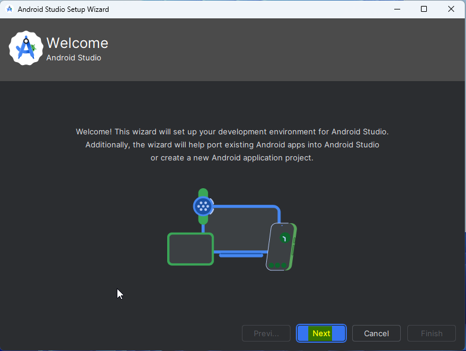
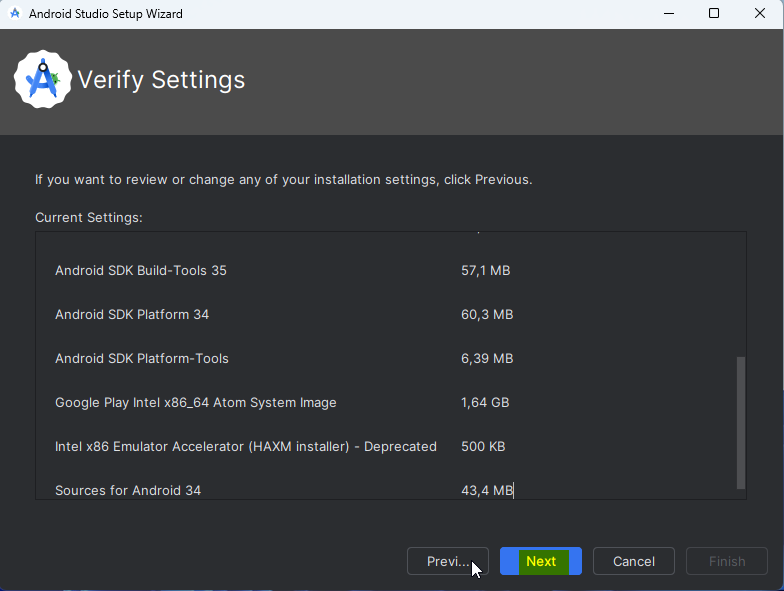
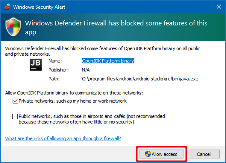
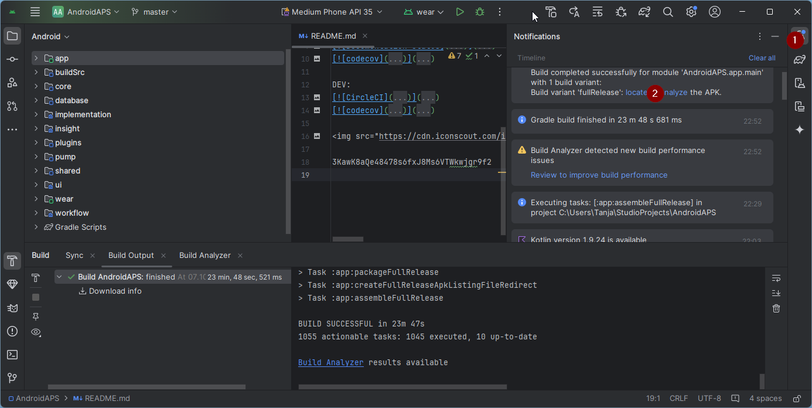

<!-- Android Studio Build, FKA Computer Build. Preserve filenames to avoid breaking URLs. -->

# Compilació amb Android Studio

Aquest és el mètode tradicional per compilar la vostra aplicació AAPS.

Podeu compilar l'aplicació sense ordinador amb el mètode de [Compilació al navegador](./BrowserBuild.md).

## Compileu-la vosaltres mateixos en lloc de descarregar-la

**L'aplicació AAPS (un fitxer apk) no es pot descarregar, per les normes sobre dispositius mèdics. És legal compilar l'aplicació per al vostre ús propi, però no en podeu donar una còpia a altres persones!**

Vegeu la [pàgina de preguntes freqüents](../UsefulLinks/FAQ.md) per a més detalls.

---

(Building-APK-recommended-specification-of-computer-for-building-apk-file)=
## Requisits de l'ordinador i del programari per compilar AAPS

* Pot ser que calgui una versió concreta d'**[Android Studio](https://developer.android.com/studio/)** per compilar l'apk. Vegeu la taula següent:

| Versió d'AAPS           | Versió<br/>d'Android Studio<br/>preferida | Versió<br/>d'Android Studio<br/>alternativa | Gradle | JVM |
| ----------------------- | ----------------------------------------------------- | ------------------------------------------------------- | ------ |:--- |
| 2.6.2                   | 3.6.1                                                 |                                                         | 5.6.4  | 11  |
| 2.8.2.1                 | 4.1.1                                                 |                                                         | 6.1.1  | 13  |
| [3.1.0.3](#version3100) | 2020.3.1                                              | provat fins a Quail 4                                   | 7.3.3  | 17  |
| [3.2.0.4](#version3204) | Hedgehog (2023.1.1)                                   | provat fins a Quail 4                                   | 8.2    | 17  |
| [3.3.1.3](#version3300) | Ladybug Feature Drop (2024.2.2)                       | provat fins a Quail 4                                   | 8.10   | 21  |
| [3.3.2](#version3300)   | Meerkat (2024.3.1)                                    | provat fins a Quail 4                                   | 8.11.1 | 21  |
| [3.3.2.1](#version3321) | Narwhal (2025.1.2)                                    | provat fins a Quail 4                                   | 8.13   | 21  |
| [3.4.2.6](#version3426) | Panda 2 (2025.3.2)                                    | provat fins a Quail 4                                   | 9      | 21  |
| [4.0.0](#version400)    | Rabbit 2 (2026.2.2)                                   | Latest                                                  | 9.8    | 21  |

La «versió preferida» inclou la versió de JVM adequada. La versió preferida també és la versió mínima que podeu fer servir per compilar **AAPS**. **NO** podreu compilar amb una versió més antiga que la «preferida». Si feu servir una altra versió, pot ser que tingueu problemes amb la versió de JVM. Consulteu la pàgina [Resolució de problemes d'Android Studio](#troubleshooting_androidstudio-uncommitted-changes) per resoldre aquests problemes. Si la vostra versió actual d'Android Studio no és a la taula, primer l'heu d'actualitzar.

La versió de Gradle va lligada al codi font: sempre tindreu la versió de Gradle correcta quan descarregueu o actualitzeu el codi font. Només s'indica aquí com a referència, no cal que hi feu res.

* Android Studio no admet els [sistemes Windows de 32 bits](#troubleshooting_androidstudio-unable-to-start-daemon-process). Tingueu en compte que **una CPU de 64 bits i un sistema operatiu de 64 bits són condicions obligatòries.** Si el vostre sistema NO compleix aquesta condició, haureu de canviar el maquinari o el programari afectat, o tot el sistema.

<table class="tg">
<tbody>
  <tr>
    <th class="tg-baqh">Sistema operatiu (només 64 bits)</th>
    <td class="tg-baqh">Windows 10 or higher</td>
    <td class="tg-baqh">macOS 12 or higher</td>
    <td class="tg-baqh">Any Linux distribution that supports Gnome, KDE, or Unity DE;&nbsp;&nbsp;GNU C Library (glibc) 2.31 or later</td>
  </tr>
  <tr>
    <th class="tg-baqh"><p align="center">CPU (només 64 bits)</th>
    <td class="tg-baqh">x86_64 CPU from 2017 or newer (Intel 8th generation Core i5, AMD Ryzen, or newer) with <a href="https://developer.android.com/studio/install" target="_blank" rel="noopener noreferrer">virtualization support</a> (Intel VT-x or AMD-V) enabled in the BIOS</td>
    <td class="tg-baqh">Apple Silicon (M1 or newer), or 6th generation Intel Core or newer (support for Intel Macs is being phased out)</td>
    <td class="tg-baqh">x86_64 CPU from 2017 or newer (Intel 8th generation Core i5, AMD Ryzen, or newer) with virtualization support (Intel VT-x or AMD-V) enabled in the BIOS</td>
  </tr>
  <tr>
    <th class="tg-baqh"><p align="center">RAM</th>
    <td class="tg-baqh" colspan="3"><p align="center">16GB or more (8GB is the strict minimum for Android Studio alone, 32GB is recommended)</td>
  </tr>
  <tr>
    <th class="tg-baqh"><p align="center">Disc</th>
    <td class="tg-baqh" colspan="3"><p align="center">At least 32GB free space. Es recomana un SSD.</td>
  </tr>
  <tr>
    <th class="tg-baqh"><p align="center">Resolució</th>
    <td class="tg-baqh" colspan="3"><p align="center">1280 x 800 minimum (1920 x 1080 recommended)<br></td>
  </tr>
  <tr>
    <th class="tg-baqh"><p align="center">Internet</th>
    <td class="tg-baqh" colspan="3"><p align="center">Banda ampla</td>
  </tr>
</tbody>
</table>

**Es recomana molt (no és obligatori) fer servir un SSD (disc d'estat sòlid) en lloc d'un HDD (disc dur), perquè la compilació del fitxer apk d'AAPS trigarà menys.**  També podeu fer servir un HDD per compilar el fitxer apk d'**AAPS**. En aquest cas, la compilació pot trigar molt, però un cop ha començat, la podeu deixar funcionant sola.

## Ajuda i suport durant la compilació

Si teniu dificultats durant la compilació de l'aplicació **AAPS**, hi ha una secció específica de [**Resolució de problemes d'Android Studio**](../GettingHelp/TroubleshootingAndroidStudio.md). Consulteu-la primer.

Si creieu que alguna cosa de les instruccions de compilació és incorrecta, hi falta o és confusa, o si encara teniu problemes, contacteu amb el grup d'usuaris d'**AAPS** a [Facebook](https://www.facebook.com/groups/AndroidAPSUsers) o a [Discord](https://discord.gg/4fQUWHZ4Mw). Si voleu canviar alguna cosa vosaltres mateixos (actualitzar captures de pantalla, _etc._), envieu una [pull request (PR)](../SupportingAaps/HowToEditTheDocs.md).

## Guia pas a pas per compilar l'aplicació AAPS

```{admonition} WARNING
:class: warning
Si ja heu compilat AAPS abans, no cal que torneu a fer tots els passos següents.
Aneu directament a la [guia d'actualització](../Maintenance/UpdateToNewVersion.md)!
```

```{contents} The overall steps for building the **AAPS** apk file
:depth: 1
:local: true
```

En aquesta guia trobareu captures de pantalla d'_exemple_ de la compilació del fitxer apk d'**AAPS**. **Android Studio**, el programari que fem servir per compilar l'apk d'**AAPS**, s'actualitza sovint. Per això, aquestes captures de pantalla poden no ser idèntiques a la vostra instal·lació, però les hauríeu de poder seguir igualment.

Since **Android Studio** runs on Windows, Mac OS X and Linux platforms, there might also be minor differences in the steps for the different  platforms.

(install-git-if-you-dont-have-it)=
### Instal·lar Git

```{admonition} Why Git? 
:class: dropdown

Git és un «_sistema de control de versions_» (VCS, de l'anglès *Versioning Control System*).\
Git és un programa que permet seguir els canvis del codi i col·laborar amb altres persones. Fareu servir Git per fer una còpia del codi font d'**AAPS** del lloc web de GitHub al vostre ordinador. Then, you will use Android Studio on your computer to build the **AAPS** application (apk). 
```

(BuildingAaps-steps-for-installing-git)=
#### Passos per instal·lar Git

1.  Comproveu que no tingueu ja **Git** instal·lat. You can do this by typing “git” in the Windows search bar – if you see **“Git bash”** or some other form of Git, it is already installed and you can go straight to [installing Android Studio](#Building-APK-install-android-studio):


2. If you don’t have Git installed, download and install the latest version for your system from the "Download" section [**here**](https://git-scm.com/downloads). Qualsevol versió recent de Git hauria de funcionar. Seleccioneu la versió correcta per al vostre sistema: Mac, Windows o Linux.

**Nota per als usuaris de Mac:** la pàgina web de Git també us guiarà per instal·lar un programa addicional anomenat «homebrew» que ajuda en la instal·lació. Si instal·leu Git amb homebrew, no cal canviar cap preferència.

(Make_a_note_of_Git_path)=

* Durant la instal·lació, quan se us demani «select destination location», anoteu _on_ s'instal·la Git (el «**camí d'instal·lació**»). L'haureu de comprovar al pas següent. Serà semblant a «C:\Program Files\Git\cmd\git.exe»

*  Durant els diversos passos de la instal·lació de Git, accepteu totes les opcions per defecte.

*  Després de la instal·lació, si us heu oblidat d'anotar on s'ha instal·lat Git, ho podeu trobar així: escriviu «git» a la barra de cerca del PC, feu clic amb el botó dret a «Git bash», seleccioneu «open file location» i passeu el ratolí per sobre de la icona «Git bash». Així veureu on està instal·lat.

* Reinicieu l'ordinador abans del pas següent.

(Building-APK-install-android-studio)=
### Instal·lar Android Studio

- **Durant els passos següents heu d'estar connectats a internet tot el temps, perquè Android Studio descarrega diverses actualitzacions**

```{admonition} What is Android Studio?
:class: dropdown
Android Studio és un programa que funciona al vostre ordinador. Permet descarregar codi font d'internet (amb Git) i compilar aplicacions per a telèfons intel·ligents (i rellotges intel·ligents). No podeu «trencar» la versió actual d'**AAPS** que funciona en llaç al vostre telèfon si compileu una aplicació nova o actualitzada al PC amb Android Studio. Són processos totalment separats. 
```

Una de les coses més importants quan instal·leu Android Studio és **tenir paciència!** Durant la instal·lació i la configuració, Android Studio descarrega moltes coses, i això porta temps.

```{admonition} Different UI
:class: warning
Important note: Android Studio changed its UI during the last releases. Aquesta guia mostra els passos amb la *interfície nova*. Les captures de pantalla es van fer amb «Ladybug», així que les versions més noves poden ser una mica diferents. Si encara feu servir la interfície antiga, potser primer voldreu canviar Android Studio a la interfície nova seguint [aquestes instruccions](#computerbuild-NewUI).
```

La versió d'Android Studio és molt important. Vegeu les [instruccions anteriors](#Building-APK-recommended-specification-of-computer-for-building-apk-file) per triar la versió correcta d'Android Studio.

Descarregueu la [versió actual d'Android Studio](https://developer.android.com/studio) o una versió més antiga dels [**arxius (Archives)**](https://developer.android.com/studio/archive) i accepteu els acords de descàrrega.


Quan acabi la descàrrega, obriu l'aplicació descarregada per instal·lar-la a l'ordinador. És possible que hàgiu d'acceptar o confirmar alguns avisos de Windows sobre aplicacions descarregades!

Instal·leu Android Studio fent clic a «Next», com es mostra a les captures de pantalla següents. **No** cal que canvieu cap opció!


If you want to save hard disk space, you can uncheck Android Virtual Device: it is not used for building **AAPS**.


Ara feu clic a «Install»:


Quan acabi, premeu «Next»


In the last step, click on "Finish" to start Android Studio for the first time.


Se us preguntarà si voleu ajudar a millorar Android Studio. Trieu l'opció que vulgueu. No canvia res per als passos següents.


La pantalla de benvinguda us dona la benvinguda a la instal·lació d'Android Studio. Premeu «Next».



Seleccioneu «Standard» com a tipus d'instal·lació.


Verifiqueu la configuració fent clic de nou a «Next».



Ara heu d'acceptar els acords de llicència. A l'esquerra hi ha dues seccions (1 + 3). Seleccioneu-les una després de l'altra i, per a cadascuna, seleccioneu «Accept» (2 + 4) a la dreta.

Després podeu fer clic al botó «Finish» (5).


Ara es descarregaran i s'instal·laran alguns paquets d'Android. Tingueu paciència i espereu.

Quan acabi, veureu la pantalla següent, on podeu tornar a seleccionar «Finish».


Ara veureu la pantalla de benvinguda (Welcome) d'Android Studio.


(Building-APK-download-AAPS-code)=
### Descarregar el codi d'AAPS

```{admonition} Why can it take a long time to download the AAPS code?
:class: dropdown

La primera vegada que es descarrega **AAPS**, Android Studio es connecta per internet al lloc web de GitHub per descarregar el codi font d'**AAPS**. Això hauria de trigar aproximadament 1 minut. 

Després, Android Studio fa servir **Gradle** (una eina de desenvolupament per a aplicacions Android) per identificar altres components que calen per compilar-ho tot al vostre ordinador. 
```

A la pantalla de benvinguda d'Android Studio, comproveu que «**Projects**» (1) estigui ressaltat a l'esquerra.

Després feu clic a «**Clone Repository**» (2) a la dreta:


Ara direm a Android Studio d'on ha d'obtenir el codi:


* «Repository URL» hauria d'estar seleccionat (per defecte) a l'esquerra (1).
* «Git» hauria d'estar seleccionat (per defecte) com a control de versions (2).
* Ara copieu aquest URL:
    ```
    https://github.com/nightscout/AndroidAPS.git
    ```
    i enganxeu-lo al quadre de text de l'URL (3).

* Comproveu que el directori (per defecte) on es desarà el codi clonat no existeixi ja al vostre ordinador (4). El podeu canviar per un altre directori, però recordeu on l'heu desat!
* Ara feu clic al botó «Clone» (5).

```{admonition} INFORMATION
:class: note
Anoteu el directori. És on es desa el vostre codi font!
```

Ara veureu una pantalla que indica que s'està clonant el repositori:


En algun moment, Android Studio es tancarà i es tornarà a obrir. És possible que se us pregunti si confieu en el projecte. Feu clic a «Trust project»:

  


Només per als usuaris de Windows: si el tallafoc demana permís, concediu-li l'accés:

 

Quan el repositori s'hagi clonat correctament, Android Studio obrirà el projecte clonat.

(computerbuild-NewUI)=
```{admonition} New UI
:class: note
Android Studio ha canviat la seva interfície fa poc. Les instal·lacions noves d'Android Studio fan servir la interfície nova (New UI) per defecte!

Només si el vostre Android Studio es veu diferent, potser haureu de canviar a la interfície nova:
Feu clic al menú hamburguesa de la part superior esquerra i seleccioneu **Settings** (o **Preferences** als ordinadors d'Apple).
A **Appearance & Behavior**, aneu a **New UI** i marqueu **Enable new UI**. Després reinicieu Android Studio per començar a fer-lo servir.

Si no trobeu l'opció **New UI**, no us preocupeu: ja la feu servir!
```


Quan s'obri Android Studio, espereu amb paciència (pot trigar uns minuts) i, sobretot, **no** actualitzeu el projecte com suggereix la finestra emergent.

Android Studio iniciarà automàticament una «Gradle project sync» (sincronització del projecte Gradle), que trigarà un parell de minuts a acabar. Podeu veure que (encara) està en marxa:


```{admonition} NEVER UPDATE GRADLE!
:class: warning

Android Studio pot recomanar actualitzar el sistema gradle. **No actualitzeu mai gradle!** Això provocaria problemes.
```

Només en ordinadors Windows: és possible que rebeu un avís que Windows Defender està en marxa. Feu clic a **Automatically** i confirmeu-ho. Així la compilació serà més ràpida!


Podeu deixar la sincronització de gradle en marxa i seguir ja els passos següents.

(Building-APK-set-git-path-in-preferences)=
### Definir el camí de Git a les preferències d'Android Studio

Ara direm a Android Studio on trobar Git, que heu instal·lat [abans](#install-git-if-you-dont-have-it).

* Només per als usuaris de Windows: assegureu-vos que heu reiniciat l'ordinador després d'[instal·lar Git](#install-git-if-you-dont-have-it). Si no ho heu fet, reinicieu-lo ara i torneu a obrir Android Studio

A l'angle superior esquerre d'**Android Studio**, obriu el menú hamburguesa i aneu a **File** > **Settings** (a Windows) o **Android Studio** > **Preferences** (a Mac). S'obre la finestra següent. Feu clic per desplegar la llista anomenada **Version Control** (1) i seleccioneu **Git** (2)


Check if **Android Studio** can automatically locate the correct **Path to Git executable** by clicking the button "Test" (1):


Si la configuració automàtica funciona, la vostra versió actual de **Git** es mostrarà al costat del camí.

   


Si **git.exe** no es troba automàticament, o si en fer clic a «Test» surt un error, podeu:
* introduir a mà el camí que heu anotat [abans](#BuildingAaps-steps-for-installing-git), o bé
* click on the folder icon (1) and manually navigate to the directory where **git.exe** was installed [earlier](#BuildingAaps-steps-for-installing-git)
* Comproveu la configuració amb el botó **Test**!

  

(Building-APK-generate-signed-apk)=
### Compilar l'APK «signat» d'AAPS

```{admonition} Why does the AAPS app need to be "signed"?
:class: dropdown

Android exigeix que cada aplicació estigui _signada_, per garantir que més endavant només es pugui actualitzar des de la mateixa font de confiança que va publicar l'aplicació original. Per a més informació sobre aquest tema, seguiu [aquest enllaç](https://developer.android.com/studio/publish/app-signing.html#generate-key). 

Per al nostre cas, això només vol dir que generem un fitxer de signatura o «keystore» (magatzem de claus) i el fem servir quan compilem l'aplicació **AAPS**.
```


**Important: assegureu-vos que la sincronització de gradle s'ha acabat correctament abans de continuar!**


Feu clic al menú hamburguesa de la part superior esquerra per obrir la barra de menú. Seleccioneu **Build** (1) i després **Generate Signed App Bundle / APK** (2)


Seleccioneu «APK» (1) en lloc d'«Android App Bundle» i feu clic a «Next» (2):


A la pantalla següent, assegureu-vos que «Module» estigui definit com a «AndroidAPS.app» (1). La part abans de «.app» és el nom de la carpeta on heu clonat el codi.

(Building-APK-wearapk)=
```{admonition} INFORMATION!
:class: note
Si voleu crear l'apk per al rellotge, ara heu de seleccionar AndroidAPS.wear!
```


Feu clic a «Create new...» (2) per començar a crear el vostre magatzem de claus.

```{admonition} INFORMATION!
:class: note
Només cal que creeu el magatzem de claus una vegada.
If you have built AAPS before, do NOT create a new keystore but select your existing one and enter its passwords!
```

**_Nota:_** el magatzem de claus (keystore) és un fitxer on es desa la informació per signar l'aplicació. Està xifrat, i la informació està protegida amb contrasenyes.


* Feu clic al símbol de la «carpeta» (1) per seleccionar un camí a l'ordinador per al vostre magatzem de claus.

  **No** feu servir el directori on heu desat el codi font, sinó un directori que també passaríeu a un ordinador nou.

```{admonition} WARNING!
:class: warning
Anoteu on es desa el vostre magatzem de claus. You will need it when you build the next AAPS update!
```

* Ara trieu una contrasenya senzilla (i anoteu-la), escriviu-la al quadre de contrasenya (2) i confirmeu-la (2).

  Les contrasenyes del magatzem de claus i de la clau no cal que siguin complicades. Si en el futur perdeu la contrasenya, vegeu [Reinstal·lar AAPS amb un nou magatzem de claus](#reinstall-aaps).

```{warning}
**Eviteu els caràcters especials a les contrasenyes.** Feu servir només lletres i xifres per a les contrasenyes del magatzem de claus i de la clau. En concret, no feu servir `$`, l'accent greu (backtick), `"` ni `\`. Si més endavant canvieu a la [Compilació al navegador](#aaps-ci-option2) i hi reutilitzeu aquest magatzem de claus, aquests caràcters poden fer fallar el pas de signatura. Vegeu [Compilació al navegador: resolució de problemes](#aaps-ci-password-special-characters).
```

* L'àlies per defecte (3) de la vostra clau és «key0». Deixeu-lo sense canviar.

* Ara necessiteu una contrasenya per a la clau. Per fer-ho senzill, si voleu, podeu fer servir la mateixa contrasenya que heu fet servir abans per al magatzem de claus. Introduïu una contrasenya (4) i confirmeu-la.

```{admonition} WARNING!
:class: warning
Anoteu aquestes contrasenyes! Les necessitareu quan compileu la propera actualització d'AAPS!
```

* La validesa és de 25 anys per defecte. Deixeu-la tal com està.

* Introduïu el vostre nom i cognoms (5). No cal afegir cap altra informació, però ho podeu fer si voleu (6-7).

* Feu clic a «OK» (8) per continuar:


A la pàgina **Generate signed App Bundle or APK** ara es mostrarà el camí del vostre magatzem de claus. Ara torneu a introduir la contrasenya del magatzem de claus (Key Store password) (1) i la contrasenya de la clau (Key password) (2), i marqueu la casella (3) per recordar les contrasenyes. Així no les haureu de tornar a introduir la propera vegada que compileu l'apk (és a dir, quan actualitzeu a una nova versió d'AAPS). Feu clic a «Next» (4):


A la pantalla següent, seleccioneu la variant de compilació «fullRelease» (1) i feu clic a «Create» (3). Recordeu la carpeta de destinació que es mostra a (2), perquè més endavant hi trobareu el fitxer apk compilat!

   

Ara Android Studio compilarà l'apk d'**AAPS**. Mostrarà «Gradle Build running» (2) a la part inferior dreta. El procés triga una estona, segons l'ordinador i la connexió a internet, així que **tingueu paciència!** Si voleu seguir el progrés de la compilació, feu clic al petit martell «build» (1) a la part inferior d'Android Studio:


Ara podeu seguir el progrés de la compilació:


Quan acabi la compilació, Android Studio mostrarà el missatge «BUILD SUCCESSFUL». És possible que vegeu un avís emergent on podeu fer clic per seleccionar «locate». Si no el veieu, feu clic a la icona de notificacions (1) per obrir les notificacions (Notifications) i després a **locate** (2):



**_Si la compilació no ha funcionat, consulteu la secció [Resolució de problemes d'Android Studio](../GettingHelp/TroubleshootingAndroidStudio.md)._**

Al quadre de notificacions (Notifications), feu clic a l'enllaç blau «locate»:

 S'obrirà el gestor de fitxers i us mostrarà el fitxer apk que acabeu de compilar.

   

Enhorabona! Ara ja heu compilat el fitxer apk d'**AAPS**. A la secció següent de la documentació el passareu al vostre telèfon.

```{tip}
Si penseu que en el futur potser voldreu fer servir un rellotge intel·ligent Android Wear, ara és el millor moment per compilar l'apk d'AAPS per a Wear, per assegurar-vos que estigui sincronitzat amb l'apk d'AAPS.
```

Passeu a l'etapa següent: [Transferir i instal·lar **AAPS** al vostre telèfon](../SettingUpAaps/TransferringAndInstallingAaps.md).


