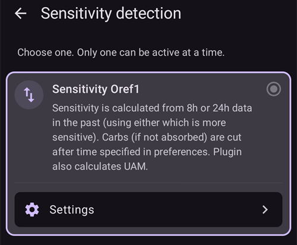
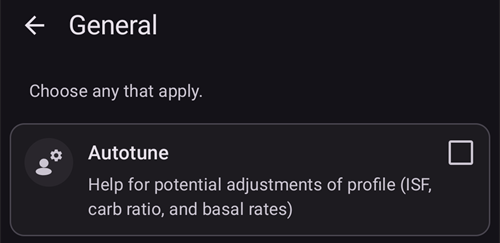

# Configurador (Config Builder)

```{admonition} Coming from AAPS v3?
:class: note
El **Config Builder** ara es diu **Configurador** i és al **menú** (☰). Vegeu [Què ha canviat a AAPS v4](#v4-changes).
```

Al **Configurador** trieu quins plugins estan actius (CGM, bomba, algoritme APS, sensibilitat, sincronització, …) i obriu cada plugin i la seva configuració. La [guia pas a pas](#configuration-v4) és més avall; la resta d'aquesta pàgina descriu cada secció en detall.

(configuration-v4)=
## El Configurador a AAPS v4

A **AAPS** v4, toqueu el **menú** (☰) a la cantonada **de dalt a l'esquerra** de la pantalla principal i trieu **Configurador** (_«Configureu els vostres dispositius (CGM, bomba, ...) i activeu funcions»_).


Els plugins s'agrupen per **categoria**, per exemple _Suavitzat_, _Calibració_, _Detecció de sensibilitat_, _APS_, _Comunicació_ i _General_. Cada fila mostra el nom de la categoria i el plugin **actiu actualment** (p. ex. _APS → OpenAPS SMB_). Toqueu una fila per obrir una categoria.


Dins d'una categoria veieu els plugins que hi ha disponibles. A les categories d'una sola opció trieu l'activa; algunes categories permeten triar-ne diverses (_«Trieu tots els que calguin»_). Cada plugin ofereix dues accions:

- **Obrir plugin**: obre la pantalla pròpia del plugin.
- **Configuració**: obre la configuració del plugin (pot estar agrupada en seccions que es poden desplegar).


(configuration_sync_icon)=
### La icona del mòbil: «sincronitzat des del telèfon principal»

Una petita **icona de mòbil (telèfon)** al costat d'una categoria o d'una opció vol dir que aquest element està **sincronitzat des del telèfon principal**: el seu valor o la seva selecció arriba a aquest dispositiu pel canal NSClientV3 (Nightscout).

En un **client** (**AAPSClient**) aquests elements **es mantenen sincronitzats amb el principal**. La icona només es mostra en un client, i per això no apareix a la captura de pantalla de dalt, que es va fer a l'aplicació **AAPS** principal. En un client sol aparèixer a _Suavitzat_, _Calibració_, _Detecció de sensibilitat_ i _APS_. Com es mantenen alineats el principal i els clients, i quins paràmetres podeu canviar des de cada costat, s'explica a [Control principal ↔ client](#client-master-config-prefs).

La mateixa icona també apareix **dins de la configuració**, al costat de cada preferència que es sincronitza. A l'exemple de sota, _Límit d'absorció_ porta la icona; les opcions sense la icona es configuren a cada dispositiu:


Els elements **sense** la icona es configuren **a cada dispositiu**. L'exemple més important és la mateixa connexió **NSClientV3 (Comunicació)**: l'**URL de Nightscout**, el **token d'accés** i els **websockets** es configuren a cada telèfon per separat, per això **no** mostren la icona del mòbil.

---

(Config-Builder-tab-or-hamburger-menu)=
## Obrir la pantalla d'un plugin

Cada pantalla de plugin s'obre d'una d'aquestes maneres (les pestanyes i la casella de l'ull d'**AAPS** v3 ja no hi són, vegeu [Què ha canviat a AAPS v4](#v4-changes)):

- **Configurador** → la categoria del plugin → **Obrir plugin**,
- el full **Gestionar** de la navegació inferior, per a les pantalles que feu servir més (Perfil, Configuració d'insulina, Bomba, Automatització, Aliments...),
- un botó d'[Accés ràpid](../DailyLifeWithAaps/QuickLaunch.md) que afegiu vosaltres mateixos,
- la **barra de cerca** de la pantalla principal.

```{contents}
:backlinks: entry
:depth: 2
```

(ConfigBuilder_Profile)=

## Perfil

Aquest mòdul no es pot desactivar perquè és una part central d'**AAPS**.

Vegeu [El vostre perfil d'AAPS](../SettingUpAaps/YourAapsProfile.md) per entendre els conceptes bàsics del que conté el vostre **Perfil**.

(insulin)=
(Config-Builder-insulin)=
## Insulina


A **AAPS** 4 la insulina ja no és un plugin que se selecciona al **Configurador**. Obriu **Gestionar → Configuració d'insulina** per configurar la insulina que feu servir.

L'editor d'insulina us permet:

- doneu a la insulina un **Àlies de la insulina** perquè sigui fàcil de reconèixer,
- configureu el **Pic** (temps fins a l'activitat màxima de la insulina, en minuts) i la **DIA** (durada de l'acció de la insulina, en hores), escrivint el valor o amb els botons **–** / **+**,
- toqueu un botó predefinit de **Carregar el pic de** (**Novorapid** (75 min), **Fiasp** (55 min) o **Lyumjev** (45 min)) per omplir en un sol pas el temps de pic estàndard d'aquella insulina.

Els intervals permesos són els mateixos sigui quina sigui la insulina que feu servir:

- **DIA**: de 5 a 9 hores (de 5 a 10 hores si el tipus de pacient és **Embaraç**). Vegeu [Durada de l'acció de la insulina (DIA) i pic](#Config-Builder-insulin-dia) per triar un valor.
- **Pic**: de 35 a 120 minuts.

Les corbes d'**IOB** (insulina a bord) i d'**Activitat** que es mostren a la part de baix de l'editor s'actualitzen quan canvieu els valors. Així veieu de seguida com la vostra configuració canvia l'acció de la insulina.

Més informació per entendre el perfil de la insulina tal com el mostra **AAPS** [aquí](#AapsScreens-insulin-profile).

(Config-Builder-insulin-change-active)=
### Canviar la insulina en ús (DIA o pic)

La insulina marcada com a **ACTIU** és la que fa servir el perfil en ús. Els seus camps estan en gris: no la podeu editar ni eliminar. Així, el nom de la insulina que es mostra al perfil actiu sempre coincideix amb la configuració que realment s'utilitza.

Per canviar la DIA o el pic que feu servir:

1. Obriu **Gestionar → Configuració d'insulina**. Si la pantalla s'obre només de lectura (un **✏️ llapis** a la barra superior), toqueu el llapis i desbloquegeu la configuració.
2. Toqueu **+** (_Afegir insulina nova_). **AAPS** crea una còpia de la insulina que es mostra a la pantalla.
3. Configureu el nou **Pic** i/o la nova **DIA**, i després toqueu la icona de desar (a dalt a la dreta).
4. Toqueu **▶** (_Activar insulina_) i confirmeu. La insulina nova queda marcada com a **ACTIU**.

```{admonition} The name includes peak and DIA
:class: note
**AAPS** afegeix automàticament el pic, la DIA i la concentració al nom de la insulina (per exemple _Fiasp 55m 8h U100_), i així podeu distingir les vostres configuracions d'un cop d'ull.
```

Podeu eliminar la insulina antiga quan ja no estigui activa.

### Els botons predefinits de «Carregar el pic de»

A **AAPS** 4 no hi ha cap llista de tipus d'insulina per triar. Totes les insulines fan servir la mateixa corba d'activitat exponencial; només en canvien el **Pic** i la **DIA**. Els valors predefinits de **Carregar el pic de** a l'editor d'insulina omplen amb un sol toc el pic recomanat per a les insulines més habituals (la petita ⓘ al costat de **Carregar el pic de** les mostra amb els seus valors de pic). Després encara podeu ajustar el **Pic** i la **DIA**.

Canvieu el pic respecte al valor recomanat només si enteneu quin efecte té. El [gràfic de la corba d'insulina](#AapsScreens-insulin-profile) us ajuda a entendre les corbes.

#### Novorapid


- recomanat per a Humalog, Novolog i Novorapid (s'anomenava _Rapid-Acting Oref_ a **AAPS** v3)
- Pic = 75 minuts després de la injecció

#### Fiasp


- recomanat per a Fiasp (s'anomenava _Ultra-Rapid Oref_ a **AAPS** v3)
- Pic = 55 minuts després de la injecció

(Config-Builder-lyumjev)=
#### Lyumjev


- recomanat per a Lyumjev
- Pic = 45 minuts després de la injecció

#### Pic personalitzat

- A **AAPS** 4 no hi ha cap tipus d'insulina «Oref sense pic» a part: introduïu qualsevol **Pic** (de 35 a 120 minuts) directament a l'[editor de la insulina](#Config-Builder-insulin), sense fer servir cap valor predefinit.
- Un pic personalitzat és útil si feu servir una insulina que no és a la llista, o una barreja de diferents insulines.

(Config-Builder-insulin-dia)=
### Durada de l'acció de la insulina (DIA) i pic

```{warning}
Amb el llaç, baixar la DIA o el pic sempre augmenta la insulina administrada. La DIA funciona de manera diferent a AAPS que als sistemes AID comercials, i els canvis fets sense cura en aquesta configuració poden canviar la dosi d'insulina molt més o molt menys del que s'espera.
```

AAPS modela l'evolució de l'acció de la insulina amb una fórmula matemàtica, que es configura amb la **DIA** i amb l'opció **pic**, molt relacionada. La DIA és la durada teòrica fins que l'IOB arriba a zero, i el pic és el moment en què l'efecte de la insulina és més fort. D'aquí surt una corba d'IOB i una corba d'activitat, que és simplement la **velocitat** a què baixa l'IOB.

Tingueu en compte que quan AAPS funciona en llaç, és normal tenir períodes de [basal temporal zero](#Open-APS-features-super-micro-bolus-smb). Aquesta insulina basal que falta es resta completament de l'IOB; per això, a la pràctica, l'IOB arriba a zero moltes hores abans que la DIA configurada. Podeu mirar l'[IOB de bolus i l'IOB basal](#aaps-screens-iob-cob-basal-sens) per separat des de la pantalla principal.

Per configurar la DIA i el pic, toqueu **Gestionar** a la pantalla principal i després toqueu **Configuració d'insulina**. AAPS mostra la configuració d'insulina activa així:


En aquest exemple, el pic és de 55 minuts, la DIA és de 8 hores i la [concentració de la insulina](#Insulin-Concentration) és l'estàndard de 100 U/ml.

A causa de l'efecte de les basals temporals a zero explicat més amunt i de la fórmula que AAPS fa servir per a la reducció de l'IOB, la majoria d'usuaris configuren una DIA clarament més alta que en els sistemes comercials. En general, a moltes persones els va bé una **DIA** de 9 h. Quan tingueu més experiència amb AAPS i un perfil ben ajustat, podeu provar de trobar una DIA i un pic personalitzats amb la informació següent.

````{admonition} Details on the impact of DIA and peak configuration
:class: dropdown

Com que la taxa basal té una influència indirecta en la baixada de l'IOB a AAPS, unes taxes basals massa altes poden amagar una DIA massa alta, i al revés. Té sentit ajustar primer amb cura les taxes basals abans d'ajustar la DIA i el pic. A més, tingueu en compte que la DIA i el pic s'influeixen l'un a l'altre: l'efecte de la DIA depèn del pic, i al revés.

Aquests gràfics mostren l'efecte exacte de la DIA i el pic sobre les corbes d'IOB, per a tot el rang de valors permesos.

Ajust de la DIA:

```{image} ../images/Profile/iob_remaining_static_peak.png
:width: 400px
```

Ajust del pic:

```{image} ../images/Profile/iob_remaining_static_dia.png
:width: 400px
```

Finalment, una comparació ajustant la DIA i el pic alhora. La idea és que tots dos valors s'ajusten en la mateixa proporció, de manera que `49/35 ~ 7/5`. O de la mateixa manera, `120/93 ~ 9/7`. Els intervals són iguals sigui quina sigui la DIA o el pic de partida, sempre que el canvi relatiu sigui el mateix per a tots dos.

```{image} ../images/Profile/iob_remaining_uniform.png
:width: 400px
```

Tingueu en compte que quan la DIA i el pic s'ajusten d'aquesta manera, cada punt de la corba es desplaça en la mateixa proporció.

````

#### Més lectures sobre la configuració de la DIA i el pic

- [Detalls tècnics i història d'OpenAPS, el predecessor d'AAPS](https://openaps.readthedocs.io/en/latest/docs/While%20You%20Wait%20For%20Gear/understanding-insulin-on-board-calculations.html#understanding-the-new-iob-curves-based-on-exponential-activity-curves) (en anglès).
- [Why we are regularly wrong in the duration of insulin action (DIA) times we use, and why it matters…](https://www.diabettech.com/insulin/why-we-are-regularly-wrong-in-the-duration-of-insulin-action-dia-times-we-use-and-why-it-matters/) (per què sovint fem servir una DIA equivocada i per què és important) a Diabettech.
- [Exponential Insulin Curves + Fiasp](https://web.archive.org/web/20220630154425/http://seemycgm.com/2017/10/21/exponential-insulin-curves-fiasp/) (corbes d'insulina exponencials i Fiasp) a See My CGM (arxiu).
- [Revised Humalog model in a closed loop](https://bionicwookiee.com/2022/04/13/revised-humalog-model-in-a-closed-loop/) (model revisat d'Humalog en un llaç tancat) i altres articles a Bionic Wookie, que recomanen una DIA de 9 h per a Lyumjev, Fiasp, NovoRapid i Humalog.

(Config-Builder-bg-source)=
## Origen glucèmia
Seleccioneu l'origen de glucèmia que feu servir. Vegeu la pàgina [Origen glucèmia](../Getting-Started/CompatiblesCgms.md) per a més informació sobre la configuració.


Desplaceu-vos cap avall per veure els altres orígens:


- [Glucèmia xDrip+](../CompatibleCgms/xDrip.md): també per a aplicacions compatibles com [Juggluco](../CompatibleCgms/Juggluco.md)
- [Glucèmia NSClient](../CompatibleCgms/CgmNightscoutUpload.md): només si sabeu el que feu, vegeu [Origen glucèmia](../Getting-Started/CompatiblesCgms.md).
- [MM640g](../CompatibleCgms/MM640g.md)
- Glimp: només s'admeten la versió 4.15.57 i les més noves
- [BYODA (Build Your Own Dexcom App)](#DexcomG6-if-using-g6-with-build-your-own-dexcom-app).
- App de CGM MicroTech: per al CGM Aidex / LinX
- [Poctech](../CompatibleCgms/PocTech.md)
- Tomato (MiaoMiao): app Tomato per al dispositiu MiaoMiao
- [Glunovo](https://infinovo.com/): app Glunovo per al sistema CGM Glunovo
- Intelligo: app Intelligo
- Syai/Ottai: per a les apps Syai i Ottai (vegeu [Syai Tag](../CompatibleCgms/SyaiTagX1.md) i [Ottai](../CompatibleCgms/OttaiM8.md))
- SI App: SI App modificada o app Sibionics per al CGM Sibionics
- Sino App: app modificada per al CGM Sinocare
- Lector de notificacions: llegeix els valors de glucèmia de les notificacions que mostren les apps oficials de CGM (Dexcom, Medtronic, Eversense, etc.)
- Instara: app Instara
- Glucèmia aleatòria: genera dades de glucèmia aleatòries per fer proves. Només es pot activar en una compilació d'enginyeria (desenvolupador) amb la **Bomba virtual**, de manera que en una instal·lació normal d'**AAPS** no es pot fer servir.

## Suavitzat


Vegeu [Suavitzat de les dades de glucèmia](../CompatibleCgms/SmoothingBloodGlucoseData.md).

## Calibració

Trieu com tracta **AAPS** els valors que rep del vostre sensor:

- **Sense calibració**: els valors del sensor es fan servir tal com són. Feu-lo servir quan el sensor ja ve calibrat de fàbrica i és precís. Aquesta és l'opció per defecte.
- **Calibració lineal**: **AAPS** corregeix els valors del sensor amb un pendent i un desplaçament que calcula a partir de les vostres glucèmies manuals.

Com fer servir la **Calibració lineal**:

1. Seleccioneu **Calibració lineal** a la categoria **Calibració**.
2. Quan inseriu un sensor nou, registreu el canvi de sensor: feu servir **Registrar canvi de sensor** a la pantalla de calibració, o introduïu una inserció de sensor CGM al Portal de cures. Així **AAPS** sap quan va començar la sessió del sensor. Si **AAPS** detecta un buit de més de 30 minuts en les lectures, us pot demanar que marqueu un canvi de sensor; aquest avís només apareix al principal, no en un client.
3. Obriu el plugin i toqueu **Afegir calibració**. Introduïu el valor de glucèmia capil·lar. **AAPS** l'aparella amb el valor del sensor dels últims 10 minuts.

Una calibració només s'accepta quan:

- s'ha registrat un canvi de sensor i han passat almenys **2 hores** des de llavors (escalfament),
- la vostra glucèmia és estable. Si canvia massa de pressa, el diàleg us ho diu i mostra el límit,
- hi ha una lectura del CGM dels darrers 10 minuts,
- és per al moment actual. No podeu introduir valors de glucèmia capil·lar més antics.

Com funciona la correcció:

- **AAPS** traça una línia recta a través de les parelles del sensor actual: `corrected value = slope × sensor value + offset` (valor corregit = pendent × valor del sensor + desplaçament).
- Les parelles més noves compten més que les antigues: una parella de 2 dies compta un 37% aproximadament, i una de 4 dies un 14% aproximadament. Per això la línia segueix el sensor quan aquest es desvia.
- Calen almenys **2 parelles**.
- Si les parelles són molt properes (menys de 54 mg/dl / 3 mmol/l de diferència), només es desplacen els valors (desplaçament, sense pendent).
- El pendent es manté entre 0,55 i 1,6. Un pendent fora d'aquest rang es limita al valor més proper.
- Límit de seguretat: si la correcció a 100 mg/dl (5,5 mmol/l) fos de més de ±30 mg/dl (1,7 mmol/l), no s'aplica cap correcció. Això us protegeix d'una entrada errònia.

Què canvia:

- El valor corregit es fa servir a tot arreu: la glucèmia de la pantalla principal, el gràfic i el llaç. Les lectures del sensor no es modifiquen. La correcció s'aplica a sobre, també a les lectures anteriors del sensor actual.
- Un canvi de sensor nou comença de zero. Els parells de sensors anteriors ja no compten.
- Al gràfic, una calibració es mostra com una marca al valor de la glucèmia manual.
- Les calibracions se sincronitzen a través de Nightscout, i així els vostres clients mostren els mateixos valors corregits.

Comprovar i eliminar entrades:

- **Obrir plugin** mostra l'estat (per exemple _Pendent 0,85, correcció al mig del rang -0,4_), un gràfic de les vostres parelles amb la línia, i la llista d'entrades.
- Si una entrada és incorrecta (per exemple, teníeu sucre al dit), toqueu la icona de la paperera que hi ha al costat. La línia es torna a calcular immediatament.

```{admonition} Using xDrip+ as BG source?
:class: note
xDrip+ té la seva pròpia calibració. Calibreu només en un lloc, perquè els valors del sensor no es corregeixin dues vegades.
```

```{admonition} Calibrate with care
:class: warning
Un valor de glucèmia manual incorrecte porta a valors de glucèmia incorrectes i, per tant, a una dosi d'insulina incorrecta. Renteu-vos les mans abans de mesurar, i no calibreu mentre la vostra glucèmia canvia de pressa.
```


(Config-Builder-pump)=
## Bomba
Seleccioneu la bomba que feu servir. Vegeu la pàgina [Bombes compatibles](../Getting-Started/CompatiblePumps.md) per a més informació de configuració.


Desplaceu-vos cap avall per veure tots els controladors de bomba:


Quan seleccioneu una altra bomba, **AAPS** us demana que confirmeu el canvi:


- [Dana R](../CompatiblePumps/DanaR-Insulin-Pump.md)
- Dana R Korean (per a la bomba DanaR coreana)
- Dana Rv2 (bomba DanaR amb una actualització de firmware no oficial)
- [Dana-i/RS](../CompatiblePumps/DanaRS-Insulin-Pump.md)
- [Accu Chek Insight](../CompatiblePumps/Accu-Chek-Insight-Pump.md)
- [Accu Chek Combo](../CompatiblePumps/Accu-Chek-Combo-Pump-v2.md)
- Omnipod per a [Omnipod Eros](../CompatiblePumps/OmnipodEros.md)
- Dash per a [Omnipod DASH](../CompatiblePumps/OmnipodDASH.md)
- [Medtronic](../CompatiblePumps/MedtronicPump.md)
- [Diaconn G8](../CompatiblePumps/DiaconnG8.md)
- [EOPatch2](../CompatiblePumps/EOPatch2.md)
- [Medtrum](../CompatiblePumps/MedtrumNano.md)
- [Equil 5.3](../CompatiblePumps/Equil5.3.md)
- [Carelevo](../CompatiblePumps/CareLevo.md)
- Bomba virtual: llaç obert, **AAPS** només fa suggeriments
  - quan feu els primers passos amb **AAPS**, durant els primers [objectius](../SettingUpAaps/CompletingTheObjectives.md)
  - per a bombes que encara no tenen cap controlador

(config-builder-wrong-pump-data)=
### Missatge: «Dades procedents d'una altra bomba»

**AAPS** recorda la bomba a la qual està connectat (tipus de bomba i número de sèrie). Si rep dades d'una altra bomba, per exemple després de substituir la vostra bomba per una de nova del mateix model, mostra aquest missatge i ignora les dades d'aquesta bomba:


Per fer servir la bomba nova, canvieu el controlador de la bomba: seleccioneu **Bomba virtual**, confirmeu, i després torneu a seleccionar la vostra bomba. Llavors **AAPS** registra la bomba a la qual està connectat ara.

(Config-Builder-sensitivity-detection)=

## Detecció de sensibilitat



Seleccioneu el tipus de detecció de sensibilitat. Per a més detalls sobre els diferents tipus, [llegiu aquí](../DailyLifeWithAaps/SensitivityDetectionAndCob.md). Analitza les dades històriques sobre la marxa i fa ajustos si detecta que sou més sensibles a la insulina que de costum (o, al contrari, més resistents). Trobareu més detalls sobre com es calcula la ràtio de sensibilitat a [Funcions principals d'AAPS > Autosens](#Open-APS-features-autosens).

Podeu veure la vostra sensibilitat a la pantalla principal en un [gràfic addicional](#AapsScreens-section-g-additional-graphs): seleccioneu SENS% i mireu la línia blanca. Tingueu en compte que heu d'estar a l'[Objectiu 8](#objectives-objective8) perquè la Detecció de sensibilitat/[Autosens](#Open-APS-features-autosens) pugui ajustar automàticament la quantitat d'insulina lliurada. Abans d'arribar a aquest objectiu, el percentatge d'Autosens / la línia del gràfic només es mostra a títol informatiu.

### Configuració absorció
Si feu servir Oref1 amb **SMB**, heu de canviar **min_5m_carbimpact** a 8. El valor només es fa servir quan falten lectures del **CGM** o quan l'activitat física «consumeix» tota la pujada de glucèmia que, si no, faria que **AAPS** reduís el COB. Quan l'[absorció de carbohidrats](../DailyLifeWithAaps/CobCalculation.md) no es pot calcular de manera dinàmica a partir de la reacció de la vostra glucèmia, s'aplica una reducció per defecte als vostres carbohidrats. Bàsicament, és una mesura de seguretat.

(Config-Builder-aps)=
## APS


Seleccioneu l'algoritme APS que voleu per als ajustos de la teràpia. Podeu veure els detalls actius de l'algoritme triat amb **Obrir plugin**.
- OpenAPS AMA
  - Advanced Meal Assist: algoritme antic que ja no es recomana.
  - En poques paraules, l'avantatge és que, després de posar-vos un bolus d'àpat, el sistema pot pujar la basal temporal més ràpidament SI introduïu els carbohidrats de manera fiable.
- [OpenAPS SMB](#Open-APS-features-super-micro-bolus-smb)
  - Super Micro Bolus: l'algoritme més recent, recomanat per a tots els usuaris.
  - A diferència d'AMA, SMB no fa servir basals temporals per controlar la glucèmia, sinó sobretot petits **Super Micro Bolus**.
  - Nota: es recomana fer servir aquest algoritme des del principi, encara que no rebreu SMB de veritat fins a l'[Objectiu 9](#objectives-objective9).
- [Auto ISF](#Open-APS-features-auto-isf)
  - Algoritme experimental per a usuaris avançats. Només apareix a la llista quan s'han completat els objectius.

Si canvieu de l'algoritme AMA a SMB, heu de canviar a mà _min_5m_carbimpact_ a **8** (valor per defecte per a SMB) a [Configuració → Configuració absorció](#Preferences-min_5m_carbimpact).

## Llaç

Aquest mòdul no es pot desactivar perquè és una part central d'**AAPS**.


## Restriccions


### Objectius

**AAPS** té un programa d'aprenentatge (una sèrie d'objectius) que heu de completar pas a pas. Us ha de guiar de manera segura en la configuració d'un sistema de llaç tancat.

Vegeu la pàgina [Objectius](../SettingUpAaps/CompletingTheObjectives.md) per a més informació.

## Comunicació

En aquesta categoria (que a **AAPS** v3 es deia **Sincronització**) trieu si voleu que **AAPS** enviï les vostres dades i on.


Desplaceu-vos cap avall per veure la resta de la llista:


### NSClientV3

Es pot fer servir com a [servidor d'informes](../SettingUpAaps/SettingUpTheReportingServer.md) i/o per al [monitoratge remot](../RemoteFeatures/RemoteMonitoring.md) i el [control remot](../RemoteFeatures/RemoteControl.md).

Vegeu [Sincronització amb el servidor d'informes](#SetupWizard-synchronization-with-the-reporting-server-and-more) per configurar la sincronització NSClientV3.

### Tidepool

Es pot fer servir com a [servidor d'informes](../SettingUpAaps/SettingUpTheReportingServer.md).

Vegeu [Tidepool](../SettingUpAaps/Tidepool.md).

### xDrip

Es fa servir per **enviar** dades, com els valors de glucèmia i els tractaments, a xDrip+ al mateix telèfon. La seva configuració també conté **Enviar estat a xDrip+**, una línia d'estat amb IOB i COB que mostren xDrip+ i algunes apps complementàries per a rellotges.

### Open Humans

Vegeu [Open Humans](../SupportingAaps/OpenHumans.md).

(Config-Builder-wear)=
### Wear
Vigileu i controleu **AAPS** des d'un rellotge Wear OS. La configuració del rellotge s'explica a [Configurar AAPS al vostre rellotge Wear OS](../WearOS/WearOsSmartwatch.md). Després d'activar el plugin, trieu les seves opcions a [Configuració > Wear](#preferences-wear). L'ús del rellotge s'explica a [Controlar AAPS amb el vostre rellotge Wear OS](../RemoteFeatures/RemoteControlWearOS.md).

(external-companion-apps)=
### Apps complementàries externes

Difon les dades d'estat d'**AAPS** dins del telèfon perquè altres apps instal·lades les puguin mostrar, per exemple apps complementàries per a rellotges o widgets. L'emissió inclou la glucèmia i la tendència, IOB, COB, basal i basal temporal, nom del perfil, estat del llaç, bateria del telèfon i pila de la bomba, nivell del reservori i progrés del bolus. Activeu-ho només si una aplicació complementària que feu servir demana aquestes dades.

Les apps que llegeixen aquesta difusió són [WatchDrip+](https://bigdigital.home.blog/) (rellotges Xiaomi i Amazfit), [GlucoDataHandler](https://github.com/pachi81/GlucoDataHandler) (complicacions i widgets de Wear OS, i Android Auto amb GlucoDataAuto) i l'app G-Watch. La seva configuració es descriu a [Rellotges intel·ligents i AAPS](#watches-external-companion-apps). Algunes també fan servir **Enviar estat a xDrip+** del plugin **xDrip** de dalt per a una línia d'estat amb IOB i COB.

En versions anteriors aquest plugin es deia **Samsung Tizen**, per l'[app G-Watch per a rellotges Samsung Tizen](#Watchfaces-tizen), per a la qual es va fer al principi.

### Garmin

Connexió amb un dispositiu Garmin (Fenix, Edge...)
## Tractaments
Obriu el **menú** (☰) i seleccioneu [Historial de tractaments](#aaps-screens-treatments) per veure els tractaments que s'han registrat. Si voleu editar o eliminar una entrada (p. ex. heu menjat menys carbohidrats del que esperàveu), seleccioneu «Eliminar» i introduïu el valor nou (canvieu l'hora si cal) a **Tractaments → Carbs** a la navegació inferior (vegeu [Carbs](#screens-bolus-carbs)).

## General

A **AAPS** 4 la categoria **General** del **Configurador** només conté **Autotune**. Les altres funcions descrites a continuació estan sempre disponibles i ja no cal activar-les aquí; cada paràgraf indica on trobar-les.



### Resum

La [pantalla principal](#AapsScreens-the-homescreen) d'**AAPS** ja no és un plugin i no té configuració pròpia al **Configurador**. Les opcions que hi havia aquí ara són a **Configuració** (icona de l'engranatge): [Mostrar notes als diàlegs](#Preferences-show-notes-field-in-treatments-dialogs), [Llums d'estat](#Preferences-status-lights) i el [Percentatge del bolus](#Preferences-deliver-this-part-of-bolus-wizard-result) que fa servir la calculadora de bolus. L'opció de superbolus d'**AAPS** 3.x [no està disponible com a opció de configuració](#Preferences-advanced-settings-overview) a **AAPS** 4.

(Config-Builder-actions)=
### Accions

La pestanya Accions d'**AAPS** 3.x ja no existeix. Els seus botons ara són al full **Gestionar**: vegeu [On és la pestanya Accions?](#screens-action-tab).

### Automatització

**Gestionar → Automatització** us permet gestionar les vostres [automatitzacions](../DailyLifeWithAaps/Automations.md), a partir de l'[Objectiu 10](#objectives-objective10).

(Config-Builder-sms-communicator)=
### Comunicador SMS
Permet als cuidadors a distància controlar algunes funcions d'**AAPS** per SMS. Vegeu [Ordres SMS](../RemoteFeatures/SMSCommands.md) per a més informació de configuració.

### Aliments
**Gestionar → Aliments** mostra els aliments predefinits a la base de dades d'aliments de Nightscout. Vegeu el [Readme de Nightscout](https://github.com/nightscout/cgm-remote-monitor#food-custom-foods) per a més informació de configuració.

Nota: les entrades no es poden fer servir a la calculadora d'**AAPS**. (només visualització)

(Config-Builder-autotune)=
### Autotune

Podeu activar Autotune, vegeu [aquí](../AdvancedOptions/Autotune.md).

### Manteniment

Obriu el **menú** (☰) i seleccioneu **Manteniment** per exportar / importar la configuració i gestionar els fitxers de registre.


### Configurador

Ara es diu **Configurador**: és aquesta mateixa pàgina.