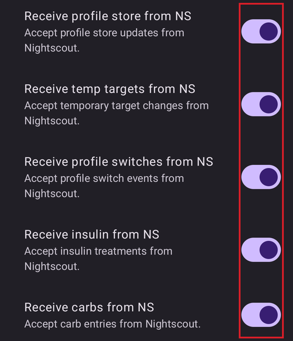
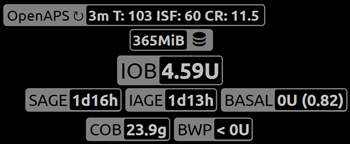

# Nightscout

(Nightscout-security-considerations)=

## Aspectes de seguretat

Nightscout és el servidor d'informes i de monitoratge d'**AAPS**: **AAPS** hi envia les vostres dades, i vosaltres o els vostres cuidadors les mireu al lloc web de Nightscout o en aplicacions de seguiment. Conté les vostres dades mèdiques, els perfils i els tractaments, per això val la pena pensar com protegir el vostre lloc web de Nightscout.

A **AAPS** 4, el control remot no passa pel lloc web de Nightscout. Mentre el control des del client està activat ([mode reforçat](#client-master-control-hardened-mode)), **AAPS** **no aplica** els tractaments ni els objectius escrits directament a Nightscout. Les ordres remotes arriben en canvi des d'un **AAPSClient** emparellat; vegeu [Control principal ↔ client (control remot signat)](#client-master-control).

Aneu amb molt de compte si feu servir Nightscout com a font de glucèmia d'AAPS.

### Configuració de Nightscout

Podeu bloquejar l'accés públic al vostre lloc Nightscout amb els [rols d'autenticació](https://nightscout.github.io/nightscout/security): compartiu el vostre URL només amb un token `readable`, mai amb un token `admin`.

L'`API_SECRET` de Nightscout és la contrasenya principal del vostre lloc: no la compartiu públicament.

(Nightscout-aaps-settings)=

### Configuració d'AAPS

Acceptar dades de Nightscout (canvis de perfil, tractaments, ...) és opcional i està desactivat per defecte. Els interruptors que es descriuen a continuació estan amagats mentre el control des del client està activat (mode reforçat) i en [mode simple](#preferences-simple-mode).

* Obriu la configuració de **Sincronització** del plugin NSClientV3 d'una d'aquestes maneres: 1) **Configuració** (icona de l'engranatge a la pantalla principal) -> **NSClientV3** -> **Sincronització**, o 2) **Configurador** (menú ☰) -> **Comunicació** -> «**Configuració**» sota NSClientV3.
* Activeu «Enviar dades a NS».
* «Enviar dades de glucèmia a NS» és a la configuració del vostre origen de glucèmia (**Configurador → Origen glucèmia → Configuració**). Activeu-ho, tret que la font de glucèmia d'AAPS sigui Nightscout: en aquest cas **no** ho activeu.
* No activeu «Rebre dades de CGM de NS» tret que Nightscout sigui la vostra font de glucèmia.

#### No sincronitzar des de Nightscout

Si manteniu desactivades totes les opcions «Rebre … de NS», AAPS no farà servir cap canvi de Nightscout:

#### Acceptar canvis de Nightscout

Si activeu aquestes opcions, podeu canviar la configuració d'AAPS des de Nightscout, per exemple modificar i canviar perfils, objectius temporals i afegir carbohidrats que AAPS tindrà en compte. Només es mostren quan el control des del client i el mode simple estan desactivats.  
Tingueu en compte que els tractaments d'insulina només s'utilitzaran per als càlculs, com «No fer bolus, només registrar».

### Altres opcions de seguretat

Mantingueu el telèfon actualitzat com s'explica a [la seguretat, el primer](#preparing-safety-first).

(Nightscout-manual-nightscout-setup)=

## Configuració manual de Nightscout

Se suposa que ja teniu un lloc Nightscout; si no, visiteu la pàgina de [Nightscout](http://nightscout.github.io/nightscout/new_user/) per a les instruccions completes de configuració. Les instruccions següents són la configuració que també heu d'afegir al vostre lloc Nightscout. El vostre lloc Nightscout ha de tenir com a mínim la versió 15; comproveu que feu servir la [darrera versió](https://nightscout.github.io/update/update/#updating-your-site-to-the-latest-version), si no, rebreu un missatge d'error a l'aplicació AAPS.

* [Editeu les vostres variables](https://nightscout.github.io/nightscout/setup_variables/#nightscout-configuration)

* Afegiu o editeu les variables així:
  
  * `ENABLE` = `careportal boluscalc food bwp cage sage iage iob cob basal dbsize pushover pump openaps`
  * `DEVICESTATUS_ADVANCED` = `true`
  * `SHOW_FORECAST` = `openaps`
  * `PUMP_FIELDS` = `reservoir battery clock`
  * Podeu configurar diverses alarmes per [vigilar la bomba](https://github.com/nightscout/cgm-remote-monitor#pump-pump-monitoring); es recomana sobretot la del % de bateria: 
    * `PUMP_WARN_BATT_P` = `51`
    * `PUMP_URGENT_BATT_P` = `26` 

* Deseu els canvis. Ara el vostre lloc Nightscout hauria de poder mostrar les píndoles. Podeu fer que es mostrin per defecte si les afegiu a `SHOW_PLUGINS`.
  
  * `SHOW_PLUGINS` = `careportal boluscalc food bwp cage sage iage iob cob basal dbsize pushover pump openaps`
  
  

## Nightscout com a SaaS de pagament (programari com a servei)

Feu servir la interfície web del proveïdor per configurar les variables. Si cal, contacteu amb el servei d'assistència del proveïdor.