# Configuració

A **AAPS** v4 la configuració es troba a la pantalla **Configuració**. Hi ha tres maneres d'arribar-hi; vegeu [Fer canvis a la configuració d'AAPS](../SettingUpAaps/ChangeAapsConfiguration.md) per als detalls:

1. Premeu la icona **Configuració** (engranatge) a la cantonada superior dreta de la pantalla principal: tota la configuració, agrupada en seccions que es poden desplegar.
2. A **Configurador**, premeu «**Configuració**» sota un plugin actiu: només la configuració d'aquell plugin.
3. Feu servir la **barra de cerca** a la part superior de la pantalla principal: només cal que comenceu a escriure una part del text que busqueu. Així trobareu opcions concretes (fins i tot les que no es veuen a la pantalla Configuració), diàlegs i documentació.

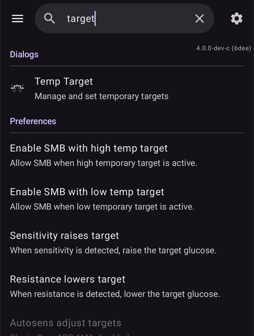

- Les **seccions** s'obren i es tanquen en prémer-les. Les seccions que veieu depenen dels plugins que tingueu activats i del [mode simple](#preferences-simple-mode).


```{contents}
:backlinks: entry
:depth: 2
```

(Preferences-general)=
## General

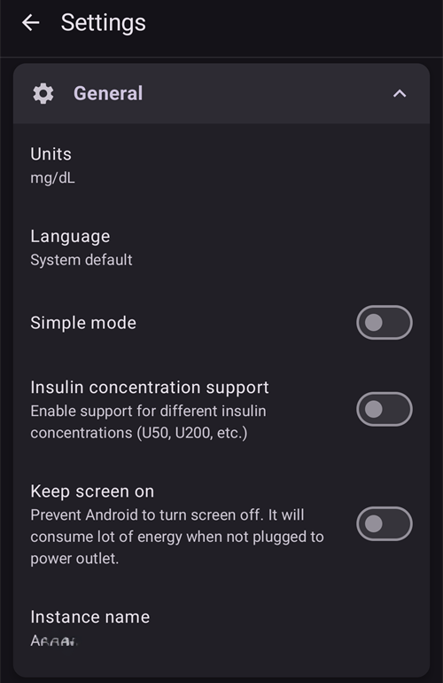

**Unitats**

- Definiu les unitats en mmol/l o mg/dl segons les vostres preferències.

**Idioma**

- By default **AAPS** follows the language of the phone (recommended).

- If you want **AAPS** in another language than the phone, choose it here. On Android 13 and newer, **AAPS** registers it as its own app language in Android, so all its screens, the main screen, the widgets and the way numbers are written follow it.

- Quan canvieu l'idioma, els textos d'**AAPS** passen al nou idioma de seguida. Si alguns textos encara es mostren en l'idioma anterior, reinicieu **AAPS**.
- On Android 12 this setting is not shown: **AAPS** always uses the language of the phone.
- Opció amagada en [mode simple](#preferences-simple-mode).

(preferences-simple-mode)= **Mode simple**

El **mode simple** està activat per defecte quan instal·leu **AAPS** per primera vegada. En **mode simple**, s'amaguen moltes opcions i la configuració es substitueix per valors predefinits. Quan ja conegueu bé la interfície i la configuració d'**AAPS**, desactiveu el mode simple.

**Suport per a concentracions d'insulina**

- Activa el suport per a diferents concentracions d'insulina (U50, U200, ...). Activeu-ho només si realment feu servir una concentració diferent d'U100, i llegiu els avisos amb atenció.
- Opció amagada en [mode simple](#preferences-simple-mode).

**Mantenir la pantalla encesa**

- Obliga Android a mantenir la pantalla sempre encesa. És útil per a presentacions, etc. Però gasta molta bateria. Per això es recomana connectar el telèfon a un cable de càrrega.

**Nom de la instància**

- El nom de la persona que fa servir aquest telèfon. Distingeix aquesta instància d'**AAPS** als informes i a la sincronització, per exemple si dos infants amb diabetis tipus 1 de la vostra família fan servir **AAPS**.
- Es fa servir en els noms dels fitxers de configuració exportats.
- Es mostra a la [watchface Dual](../WearOS/WearOsSmartwatch.md).

(Preferences-skin)=
### Aspecte (skin)

La selecció d'aspecte (skin) d'**AAPS** 3.x (Original, Baixa resolució, Pantalla gran...) ja no existeix a **AAPS** 4. La nova interfície s'adapta automàticament a la vostra pantalla, i l'esquema de colors es pot canviar a [Aparença](#preferences-appearance).

(preferences-appearance)=
## Aparença

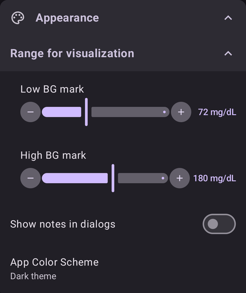

(Preferences-range-for-visualization)=
### Rang de visualització

Trieu els límits alt i baix del gràfic de glucèmia a la pantalla principal d'**AAPS** i al rellotge intel·ligent. És només la visualització, no el rang objectiu de la vostra glucèmia. Exemple: 70 - 180 mg/dl o 3,9 - 10 mmol/l

(Preferences-show-notes-field-in-treatments-dialogs)=
### Mostrar notes als diàlegs

Us permet afegir notes curtes als tractaments (calculadora de bolus, carbohidrats, insulina...)

Opció amagada en [mode simple](#preferences-simple-mode).

### Esquema de colors de l'app

Trieu entre el tema clar, el tema fosc o seguir la configuració del sistema del telèfon.

(Preferences-protection)=
## Protecció

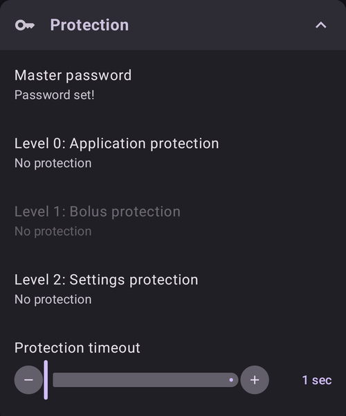

(Preferences-master-password)=
### Clau mestra

És obligatòria per poder [exportar la configuració](../Maintenance/ExportImportSettings.md), ja que des de la versió 2.7 es xifra.

If you forgot your master password, see [How to reset the master password?](#FAQ-reset-master-password)

**És possible que la protecció biomètrica no funcioni en telèfons OnePlus. És un problema conegut d'OnePlus en alguns telèfons.**

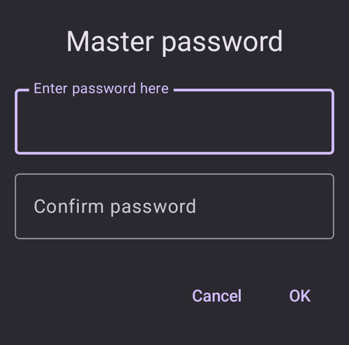

(Preferences-settings-protection)=
### Protecció de la configuració

- Protegiu la configuració amb una contrasenya o amb l'autenticació biomètrica del telèfon (p. ex. si [un infant fa servir **AAPS**](../RemoteFeatures/RemoteMonitoring.md)). Si activeu aquesta funció, se us demanarà autenticació cada vegada que vulgueu obrir qualsevol pantalla relacionada amb la configuració.

- Les pantalles de gestió (**Perfil**, **Configuració d'insulina**, **Objectiu temporal**, **Assistent ràpid**) s'obren llavors en **només lectura**. Encara podeu activar o fer servir una entrada, però les opcions d'afegir, editar, clonar i eliminar estan amagades fins que desbloquegeu la configuració. Vegeu [La protecció de la configuració ara també bloqueja les pantalles de gestió](#v4changes-read-only-management).

- Feu servir una contrasenya pròpia si voleu fer servir la clau mestra només per protegir la [configuració exportada](../Maintenance/ExportImportSettings.md) i una altra per editar la configuració.

- Si feu servir una contrasenya pròpia, premeu la línia «Contrasenya de configuració» per definir-la com s'explica [més amunt](#Preferences-master-password).

### Protecció de l'aplicació

Si l'aplicació està protegida, heu d'introduir la contrasenya o fer servir l'autenticació biomètrica del telèfon per obrir **AAPS**, i també quan hi torneu després del [temps d'espera de la protecció](#Preferences-password-and-pin-retention).

**AAPS** es tancarà immediatament si s'introdueix una contrasenya incorrecta, però continuarà funcionant en segon pla si abans s'havia obert correctament.

### Protecció del bolus

- La protecció del bolus pot ser útil si **AAPS** el fa servir un infant petit i vosaltres [feu bolus per SMS](../RemoteFeatures/SMSCommands.md).

- La **Protecció del bolus** només es pot seleccionar quan la **Protecció de la configuració** (nivell 2) està definida.

- A l'exemple de sota, la protecció del bolus fa servir la **Clau mestra**: **AAPS** la demana abans d'obrir un diàleg de tractament com **Insulina**. Amb **Biomètrica**, si l'autenticació biomètrica no funciona, podeu introduir la clau mestra.

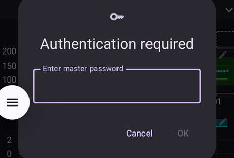

(Preferences-password-and-pin-retention)=
### Retenció de contrasenya i PIN

**Temps d'espera de la protecció** defineix quant de temps (en segons) la configuració o les funcions de bolus queden desbloquejades després d'introduir correctament la contrasenya.

## Seguretat dels tractaments

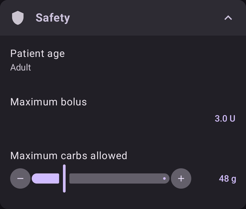

(preferences-patient-type)=
### Edat del pacient

- Els límits de seguretat es fixen segons l'edat que seleccioneu en aquesta opció.
- Si comenceu a arribar sovint a aquests límits fixos (com el bolus màxim), és el moment de pujar un nivell.
- It's a bad idea to select higher than real age because it can lead to overdosing by entering the wrong value in the insulin dialog (by skipping the decimal separator, for example).
- Si voleu conèixer els valors concrets d'aquests límits de seguretat fixos, aneu a la funció de l'algoritme que feu servir a [aquesta pàgina](../DailyLifeWithAaps/KeyAapsFeatures.md).

(Preferences-maximum-bolus)=
### Bolus màxim

- Defineix la quantitat màxima d'insulina de bolus, en unitats d'insulina, que **AAPS** pot lliurar d'una sola vegada.
- Aquesta opció és un límit de seguretat per evitar el lliurament d'un bolus enorme per una entrada accidental o un error de l'usuari.
- Es recomana posar-hi un valor raonable que correspongui més o menys a la quantitat màxima d'insulina de bolus que pugueu necessitar mai per a un àpat o una correcció.
- Aquest límit també s'aplica als resultats de la calculadora de bolus.

### Màxim de carbohidrats permesos

- Defineix la quantitat màxima de carbohidrats, en grams, per a la qual la calculadora de bolus d'**AAPS** pot calcular una dosi.
- Aquesta opció és un límit de seguretat per evitar el lliurament d'un bolus enorme per una entrada accidental o un error de l'usuari.
- Es recomana posar-hi un valor raonable que correspongui més o menys a la quantitat màxima de carbohidrats que pugueu necessitar mai per a un àpat.

## Origen glucèmia

La configuració de l'[origen de glucèmia](#Config-Builder-bg-source) que heu seleccionat apareix com a secció pròpia. Per exemple amb **Glucèmia xDrip+**:

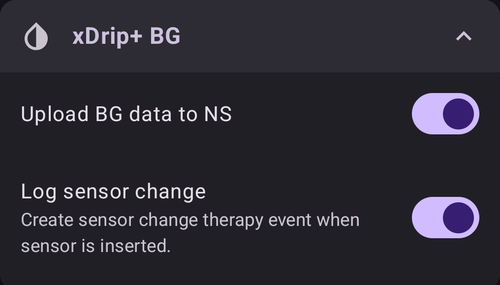

- **Enviar dades de glucèmia a NS**: **AAPS** envia a Nightscout els valors de glucèmia que rep. Activeu-ho només si l'aplicació del CGM no els envia ja.
- **Registrar canvi de sensor**: crea automàticament un esdeveniment de teràpia de canvi de sensor quan s'insereix el sensor.

## La pantalla principal

A **AAPS** 3.x aquestes opcions estaven agrupades en una secció «Resum». A **AAPS** 4 es configuren directament des dels elements de la pantalla principal on pertanyen.

(Preferences-buttons)=
### Botons d'accés ràpid

Definiu quins botons d'acció es veuen a la pantalla principal: premeu el petit **engranatge** a la part inferior central de la pantalla principal («Configurar l'accés ràpid») i premeu **Afegir** per a les accions que voleu tenir a mà (tractaments, accions del CGM, entrades del portal de cures...).

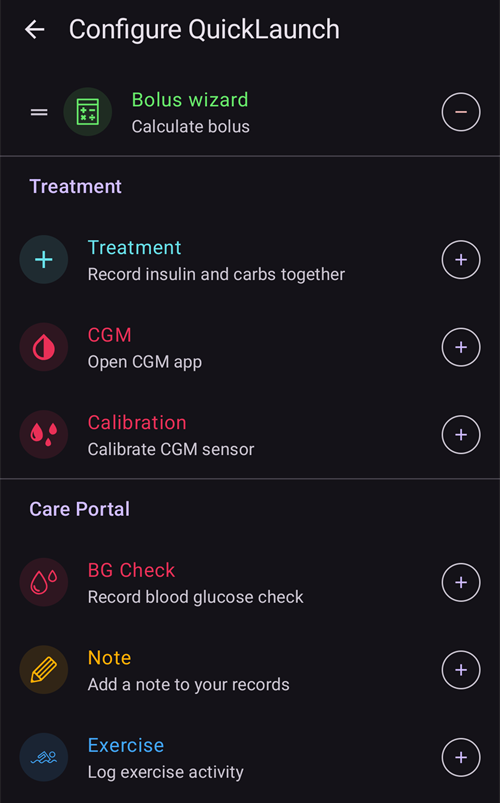

(Preferences-quick-wizard)=
### Assistent ràpid

Creeu botons personalitzats per a certs àpats o snacks habituals, que es mostraran a la pantalla principal. Útil per als àpats habituals que mengeu sovint.

Per a cada botó definiu els carbohidrats i el mètode de càlcul del bolus. Després definiu durant quin interval horari el botó es veurà a la pantalla principal; només un botó per interval. El botó no es veurà fora de l'interval horari indicat o si ja teniu prou IOB per cobrir els carbohidrats definits al botó de l'Assistent ràpid. Si definiu horaris diferents per als diferents àpats, sempre tindreu a la pantalla principal el botó d'àpat adequat segons l'hora del dia.

Per gestionar els vostres predefinits de l'Assistent ràpid, escriviu «Assistent ràpid» a la barra de cerca de la pantalla principal i obriu **Assistent ràpid - Gestionar predefinits de l'assistent ràpid**.

Si premeu el botó de l'Assistent ràpid, **AAPS** calcularà i us proposarà un bolus per a aquests carbohidrats segons les vostres ràtios actuals (tenint en compte la glucèmia o la insulina a bord, si està configurat).

Cal confirmar la proposta abans de lliurar la insulina.

(Preferences-default-temp-targets)=
### Objectius temporals per defecte

Els [objectius temporals (OT)](../DailyLifeWithAaps/TempTargets.md) us permeten canviar el vostre objectiu de glucèmia durant un temps determinat. Amb uns OT per defecte, podeu canviar fàcilment el vostre objectiu per a activitat, menjar aviat, etc.

Premeu el **rang objectiu** a la pantalla principal per obrir la pantalla **Objectiu temporal**. Passeu per les targetes predefinides (Menjar aviat, Activitat, Hipo) i canvieu l'objectiu i la durada de cada predefinit a **Configuració predefinida**. Els valors predefinits són:

* Menjar aviat: objectiu 90 mg/dl / 5,0 mmol/l, durada 45 min
* Activitat: objectiu 140 mg/dl / 7,8 mmol/l, durada 90 min
* Hipo: objectiu 160 mg/dl / 8,9 mmol/l, durada 60 min

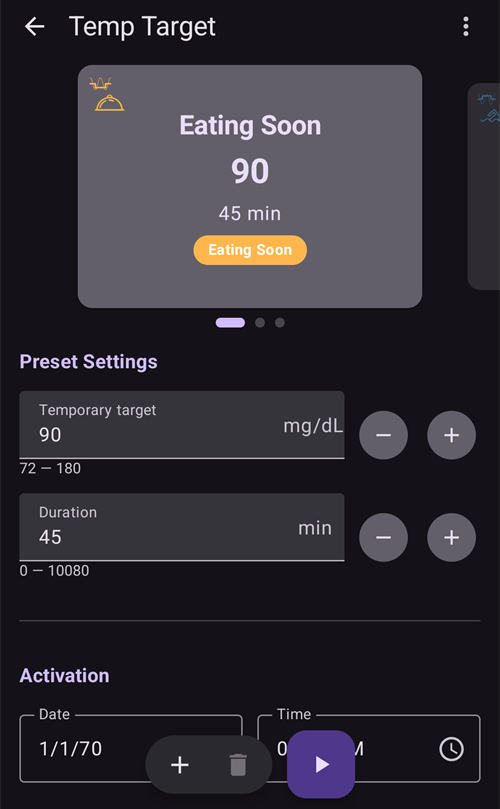

Aprengueu com [activar objectius temporals aquí](#TempTargets-where-can-i-select-a-temp-target).

### Quantitats estàndard d'insulina per encebar/omplir

Si voleu omplir el tub o encebar la cànula des d'**AAPS**, ho podeu fer amb els botons **Encebar** del panell d'estat desplegat de la pantalla principal.

Les quantitats per defecte dels tres botons d'omplir es poden definir a la configuració d'**Encebar**, segons la llargada del vostre catèter. Escriviu «Encebar» a la barra de cerca de la pantalla principal per obrir-la.

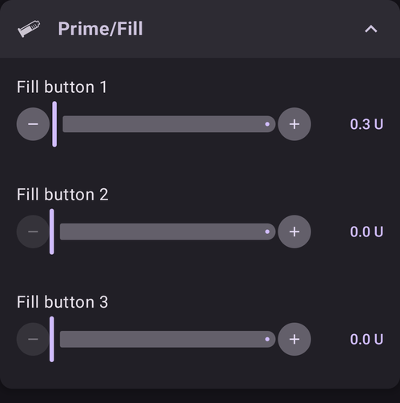

(Preferences-status-lights)=
### Llums d'estat

Els llums d'estat donen un avís visual per a:

- Edat del sensor
- Edat de la insulina (dies que fa que s'utilitza el reservori)
- Nivell del reservori (unitats)
- Edat de la cànula
- Edat de la pila de la bomba
- Nivell de la pila de la bomba (%)

Si se supera el llindar d'avís, els valors es mostraran en groc. Si se supera el llindar crític, els valors es mostraran en vermell.

Per canviar els llindars, desplegueu el panell d'estat a la pantalla principal (fletxa a la dreta de la fila d'estat) i premeu la petita icona **Configuració** al costat d'«Estat»:

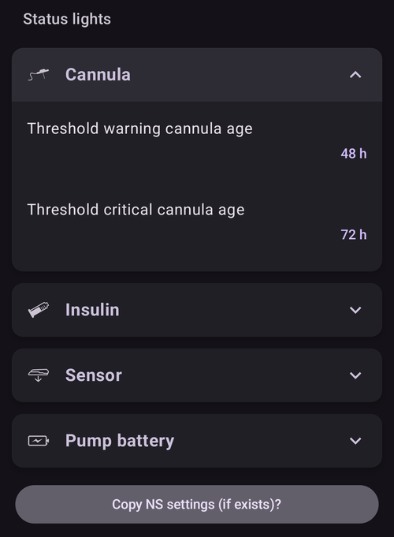

Premeu un element (**Cànula**, **Insulina**, **Sensor** o **Pila de la bomba**) per obrir-ne els llindars d'avís i crítics:

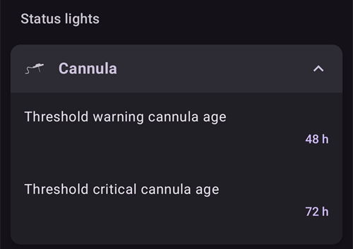

L'última opció us permet importar aquests valors de Nightscout, si hi estan definits. Vegeu la [documentació de Nightscout](https://nightscout.github.io/nightscout/setup_variables/#age-pills) per a més informació.

(Preferences-deliver-this-part-of-bolus-wizard-result)=
### Configuració de la calculadora de bolus

Escriviu «bolus» a la barra de cerca de la pantalla principal per obrir la configuració de la **Calculadora de bolus**:

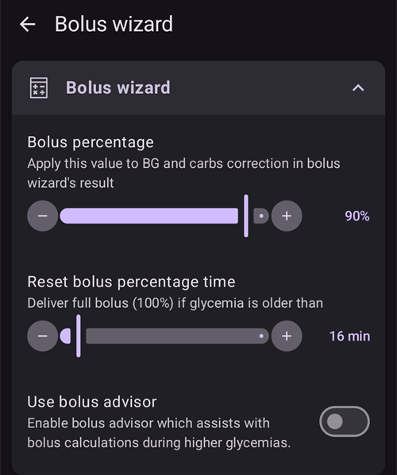

**Percentatge del bolus** defineix el [percentatge per defecte](#AapsScreens-section-j) del bolus calculat quan feu servir la calculadora de bolus.

El valor per defecte és 100%: sense correcció. Encara que poseu un altre valor aquí, el podeu canviar cada vegada que feu servir la calculadora de bolus. Si aquest valor és 75% i calia un bolus de 10 U, la calculadora de bolus proposarà un bolus d'àpat de només 7,5 unitats.

Quan fan servir [SMB](#objectives-objective9), moltes persones no fan el bolus d'àpat amb el 100% de la insulina necessària, sinó només amb una part (p. ex. 75%), i deixen que l'SMB amb UAM (detecció d'àpats no anunciats) faci la resta. Fer servir aquí un valor inferior al 100% pot ser útil:
* per a persones amb digestió lenta: lliurar tot el bolus per avançat pot causar una hipoglucèmia, perquè la insulina actua més ràpid que la digestió.
* per deixar més marge a **AAPS** perquè gestioni tot sol la **pujada de glucèmia**. En tots dos casos, **AAPS** compensarà la part del bolus que falta amb SMB, si ho considera adequat i quan ho consideri.

**Utilitzar l'assessor de bolus**

Si està activat i feu servir la calculadora de bolus quan esteu en hiperglucèmia, rebreu un avís que us pregunta si voleu fer el bolus abans i menjar més tard, quan la vostra **glucèmia** torni a estar dins del rang.

(Preferences-advanced-settings-overview)=
### Superbolus

L'opció Superbolus d'**AAPS** 3.x no està disponible com a opció de configuració a **AAPS** 4.

## Llaç

Vegeu [Pantalles d'AAPS > La pantalla principal > Estat del llaç](#AapsScreens-loop-status) per canviar ara el mode del llaç.

(Preferences-minimal-request-change)=
### Canvi mínim en mode obert

Quan feu servir el **Llaç obert**, rebreu un avís cada vegada que **AAPS** recomani ajustar la taxa basal. Per reduir el nombre d'avisos, podeu fer servir un [rang objectiu de glucèmia més ampli](#profile-glucose-targets) o augmentar el percentatge de l'opció «**Canvi mínim en mode obert**». Defineix el canvi relatiu necessari per generar un avís.

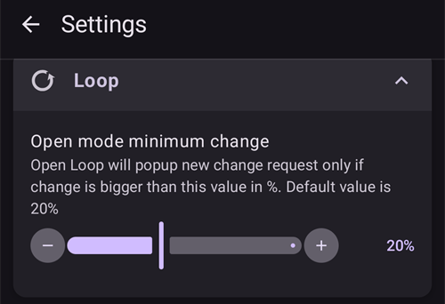

## Advanced Meal Assist (AMA) o Super Micro Bolus (SMB)

Segons la vostra configuració a [Configurador > APS](../SettingUpAaps/ConfigBuilder.md), podeu triar entre dos algoritmes:

- [Advanced Meal Assist (OpenAPS AMA)](#Open-APS-features-advanced-meal-assist-ama): l'estat de l'algoritme el 2017
- [Super Micro Bolus (OpenAPS SMB)](#Open-APS-features-super-micro-bolus-smb): l'algoritme més recent, recomanat per a principiants

As of [**AAPS** version 3.3](#version3300), the [Dynamic ISF](../DailyLifeWithAaps/DynamicISF.md) feature has been moved into OpenAPS SMB.

### OpenAPS AMA

Tota la configuració d'OpenAPS AMA es descriu a la secció dedicada de [Funcions principals d'AAPS > Advanced Meal Assist (AMA)](#Open-APS-features-advanced-meal-assist-ama).

(Preferences-openaps-smb-settings)=
### OpenAPS SMB

Tota la configuració d'OpenAPS SMB es descriu a la secció dedicada de [Funcions principals d'AAPS > Super Micro Bolus (SMB)](#Open-APS-features-super-micro-bolus-smb).

La llista d'opcions que veieu depèn del vostre progrés als [Objectius](../SettingUpAaps/CompletingTheObjectives.md) i del [mode simple](#preferences-simple-mode). En una instal·lació nova només es mostra **Utilitzar sensibilitat dinàmica**. Quan s'han completat els objectius, la secció es veu així:

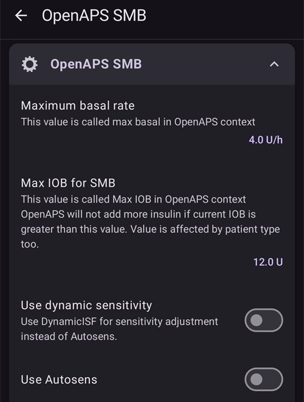

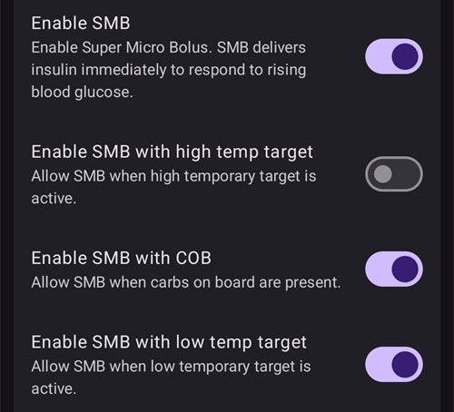

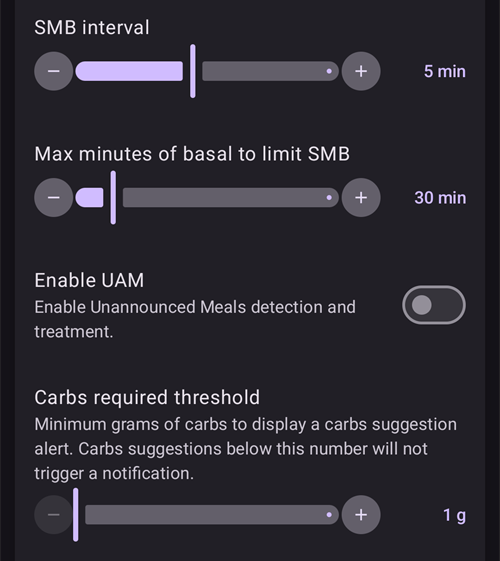

La **Configuració avançada**, al final de la secció, conté valors que normalment no cal canviar:

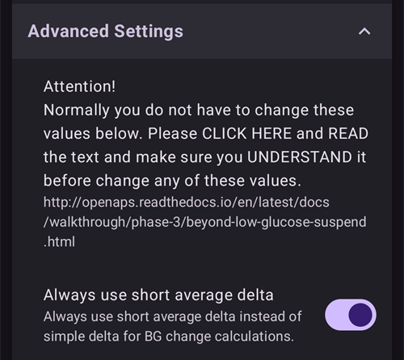

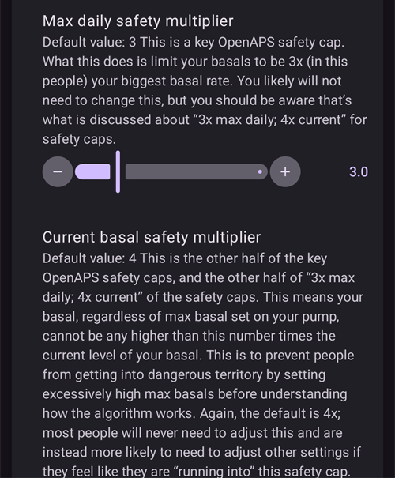

## Configuració absorció

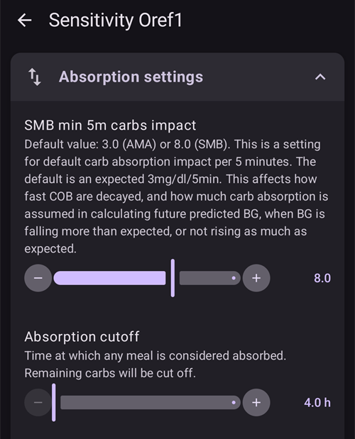

(Preferences-min_5m_carbimpact)=
### Impacte mínim dels carbohidrats en 5 min per a SMB (min_5m_carbimpact)

Opció amagada en [mode simple](#preferences-simple-mode).

L'algoritme fa servir el BGI (impacte en la glucèmia) per determinar quan [s'absorbeixen els carbohidrats](../DailyLifeWithAaps/CobCalculation.md).

Quan l'absorció de carbohidrats no es pot calcular de manera dinàmica a partir de la reacció de la vostra glucèmia, **AAPS** aplica als carbohidrats una disminució per defecte. Bàsicament, és una mesura de seguretat. Aquest valor només es fa servir quan falten lectures del **CGM** o quan l'activitat física «gasta» tota la pujada de glucèmia que, si no, faria que **AAPS** reduís el COB.

Dit de manera senzilla: l'algoritme «sap» com *hauria* de comportar-se la vostra glucèmia sota l'efecte de la dosi actual d'insulina, etc. Sempre que hi ha una desviació positiva respecte del comportament esperat, es considera que s'han absorbit/reduït alguns carbohidrats. Canvi gran = molts carbohidrats, etc.

El min_5m_carbimpact defineix l'impacte per defecte de l'absorció de carbohidrats cada 5 minuts. Per a la referència completa dels paràmetres, vegeu la [documentació d'OpenAPS sobre preferències i configuració de seguretat](https://openaps.readthedocs.io/en/latest/docs/While%20You%20Wait%20For%20Gear/preferences-and-safety-settings.html?highlight=carbimpact#min-5m-carbimpact).

El valor estàndard per a AMA és 3, per a SMB és 8.

El gràfic de COB de la pantalla principal indica quan es fa servir min_5m_carbimpact posant punts taronja a la part superior de la corba de COB.

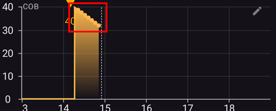

### Límit d'absorció

Temps després del qual es considera que qualsevol àpat s'ha absorbit; els carbohidrats que queden s'eliminen. Si sovint mengeu àpats rics en greix o proteïna, haureu d'augmentar el temps d'absorció dels àpats.

### Configuració avançada: ràtio d'Autosens


- Definiu la ràtio mínima i màxima d'[Autosens](#Open-APS-features-autosens).
- Normalment no cal canviar els valors estàndard (màx. 1,2 i mín. 0,7).

## Bomba


### BT Watchdog

Activeu el BT Watchdog si cal (p. ex. per a bombes Dana). Desactiva el Bluetooth durant un segon si no es pot connectar amb la bomba. Això pot ajudar en alguns telèfons on el sistema Bluetooth es bloqueja.

## Configuració de la bomba

Les opcions d'aquí canvien segons el controlador de bomba que hàgiu seleccionat a [Configurador > Bomba](#Config-Builder-pump). Emparelleu i configureu la bomba segons les [instruccions de cada bomba](../Getting-Started/CompatiblePumps.md).

Per exemple, amb la **Bomba virtual**, la secció es diu **Configuració bomba virtual**. Hi trieu el **Tipus de bomba** que imita la bomba virtual, i si el seu estat s'envia a Nightscout:

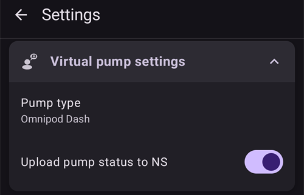

## Tidepool

Més informació a la pàgina dedicada [Tidepool](../SettingUpAaps/Tidepool.md).

(Preferences-nsclient)=
## NSClientV3


El plugin NSClient (que es mostra com a **NSClientV3** al menú de configuració) sincronitza les vostres dades amb Nightscout. Fa servir l'API v3 de Nightscout.

```{admonition} Data uploaders
:class: warning

Quan feu servir NSClientV3, tots els programes que envien dades han de fer servir l'API v3 de Nightscout. If another uploader (for example your CGM app) is not API v3 compliant, **let AAPS upload all data** (BG, treatments, ...) to Nightscout and disable that uploader.
```

- Set your *Nightscout URL* (i.e. <https://yoursitename.yourplatform.dom>).
- **Assegureu-vos que l'URL NO acaba amb /api/v1/.**
- A Nightscout, creeu un *[token d'administrador](https://nightscout.github.io/nightscout/security/#create-a-token)* (cal [Nightscout 15](https://nightscout.github.io/update/update/) per fer servir l'API V3) i introduïu-lo a **Token d'accés de Nightscout** (no el vostre API Secret!). A l'**AAPSClient** podeu escanejar en canvi el codi QR del telèfon principal, que configura un token propi del client. Un client emparellat amb el PIN rep el seu propi token del telèfon principal després de l'emparellament. Vegeu [El token de Nightscout propi del client](#client-master-control-own-token).
- Això permet llegir i escriure dades entre el lloc web de Nightscout i **AAPS**.
- Si us heu quedat encallats a l'Objectiu 1, comproveu bé que no hi hagi errors d'escriptura aquí.
- Leave "Use websockets" enabled (recommended). Websockets are **mandatory** for remote control from **AAPSClient**, on both phones.

(Preferences-nsclient-synchronization)=
### Sincronització


Les opcions de sincronització depenen de com vulgueu fer servir **AAPS**.

Podeu seleccionar quines dades voleu [enviar a Nightscout i descarregar-ne](#Nightscout-aaps-settings).

Mentre el control des del client està activat (sempre en mode simple), aquestes opcions estan amagades: llavors **AAPS** està en [mode reforçat](#client-master-control-hardened-mode), no accepta canvis fets directament a Nightscout i envia totes les seves dades.

### Configuració alarmes

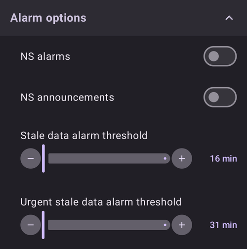

- Configuració alarmes us permet triar quines alarmes de Nightscout voleu fer servir a l'aplicació. **AAPS** farà sonar una alarma quan salti una alarma de Nightscout.
- Perquè les alarmes sonin, heu de definir els valors d'alarma Urgent High, High, Low i Urgent Low a les vostres [variables de Nightscout](https://nightscout.github.io/nightscout/setup_variables/#alarms).
- Només funcionen mentre hi ha connexió amb Nightscout i estan pensades per a pares i cuidadors.
- Si teniu l'origen del **CGM** al telèfon (p. ex. xDrip o BYODA), feu servir les seves alarmes en lloc de les alarmes de Nightscout.
- Avisos de NS mostra els [anuncis](https://nightscout.github.io/nightscout/discover/#announcement) de Nightscout als avisos d'**AAPS**.
- Podeu canviar el llindar de les alarmes de dades antigues i de dades antigues urgents, que sonen quan no arriben dades de Nightscout després d'un cert temps.

### Control remot

L'interruptor «**Permetre el control des dels clients**» ja no és en aquesta configuració: és a la part superior de **Gestionar → Clients autoritzats**, on es gestionen els clients emparellats. Vegeu la pàgina dedicada [Control principal ↔ client (control remot signat)](../RemoteFeatures/ClientMasterControl.md), que també explica el [mode reforçat](#client-master-control-hardened-mode), que aquest interruptor activa.

### Configuració de connexió

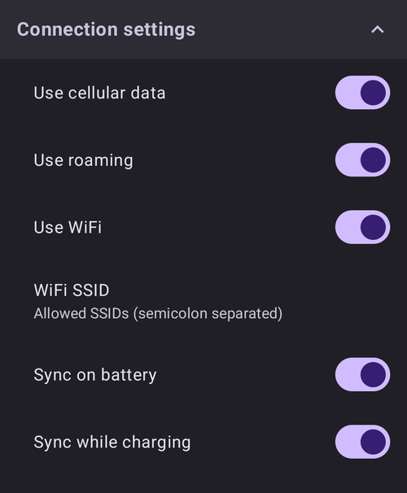

- Configuració de connexió defineix quan s'activarà la connexió amb Nightscout.
- Limiteu l'enviament a Nightscout només a la Wi-Fi, o fins i tot a certs SSID de Wi-Fi.
- Si voleu fer servir només una xarxa Wi-Fi concreta, podeu escriure el seu SSID.
- Podeu separar diversos SSID amb punt i coma.
- Per esborrar tots els SSID, escriviu un espai en blanc al camp.

(Preferences-advanced-settings-nsclient)=
### Advanced settings (NSClientV3)

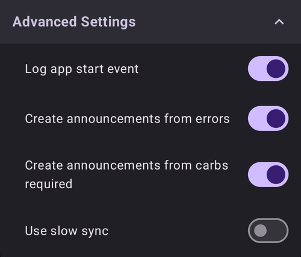

Les opcions de la configuració avançada s'expliquen per si soles.

## Comunicador SMS

Més informació a la pàgina dedicada [Ordres SMS](../RemoteFeatures/SMSCommands.md).

(preferences-wear)=
## Wear

Aquesta secció es mostra quan el plugin **Wear** està activat a [Configurador > Comunicació](#Config-Builder-wear). Més informació a les pàgines dedicades [Configurar AAPS al vostre rellotge Wear OS](../WearOS/WearOsSmartwatch.md) i [Controlar AAPS amb el vostre rellotge Wear OS](../RemoteFeatures/RemoteControlWearOS.md).

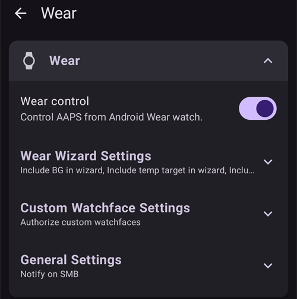

- **Control des de Wear**: permet enviar tractaments i altres accions des del rellotge. Sense aquesta opció, el rellotge només mostra dades: el telèfon rebutja qualsevol ordre del rellotge, i si premeu una complicació que obriria una pantalla de control, s'obre en canvi el menú d'**AAPS** al rellotge.

**Configuració de l'assistent de Wear** defineix quins càlculs s'inclouen al resultat de la calculadora de bolus del rellotge. Al rellotge només introduïu els carbohidrats; aquests interruptors substitueixen les opcions que triaríeu a la calculadora de bolus del telèfon:

- **Incloure glucèmia a la calculadora**: afegeix una correcció per la diferència entre la vostra glucèmia actual i el vostre objectiu.
- **Incloure objectiu temporal a la calculadora**: fa servir l'objectiu temporal actiu en lloc de l'objectiu del perfil per a aquesta correcció.
- **Incloure tendència a la calculadora**: té en compte la tendència actual de la glucèmia.
- **Incloure COB a la calculadora**: afegeix insulina per als carbohidrats que encara queden a bord.
- **Incloure IOB a la calculadora**: resta la insulina que encara queda a bord.

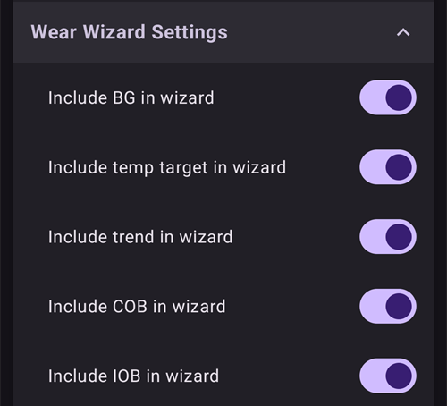

**Configuració del watchface personalitzat** conté **Autoritzar watchfaces personalitzats**. Un fitxer de watchface personalitzat pot incloure valors per a algunes opcions del rellotge. Quan aquest interruptor està activat, carregar un watchface així pot canviar aquestes opcions al rellotge; quan està desactivat, el watchface es carrega però les opcions es queden com estan:

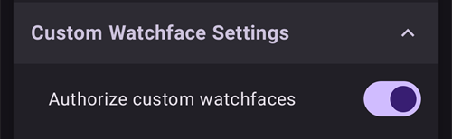

**Configuració general** conté **Avisar quan hi ha SMB**, per rebre un avís al rellotge cada vegada que es lliura un SMB:

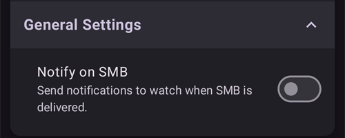

## Autotune

Aquesta secció es mostra quan el plugin **Autotune** està activat a [Configurador > General](#Config-Builder-autotune). La configuració es descriu a la pàgina dedicada [Com utilitzar el plugin Autotune](../AdvancedOptions/Autotune.md).


## Automatització

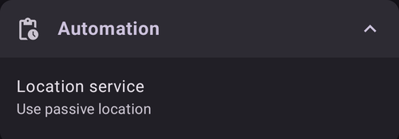

Seleccioneu quin servei d'ubicació s'ha de fer servir:

- Utilitzar ubicació passiva: **AAPS** només agafa ubicacions quan altres aplicacions les demanen
- Utilitzar ubicació de la xarxa: ubicació de la vostra Wi-Fi
- Utilitzar ubicació GPS (Atenció! Pot gastar molta bateria!)

## Alertes locals


Aquestes opcions s'expliquen per si soles.

**Override Do Not Disturb mode** (on by default): the **AAPS** alarms ring even when the phone is silent or in Do Not Disturb. Turn it off if **AAPS** should respect those modes: the alarms do not ring then, and in Do Not Disturb they only vibrate, on the phone and on the watch. Loop suggestions that arrive during Do Not Disturb are shown without a sound.

When an alarm rings, the alarm screen offers **Mute for 5 minutes**, **Silence alarm** (the screen stays open, so you can read the message) and **Silence and close**. Swiping the alarm notification away in the notification tray mutes the alarm. When you open **AAPS** later, an alarm you did not answer is shown again.

(preferences-alarm-sound-volume-vibration)=
### Alarm sound, volume and vibration

- **Sound**: the **AAPS** alarm sounds are built in and cannot be changed.
- **Volume**: **AAPS** has no volume setting of its own. With **Override Do Not Disturb mode** on, the alarms follow the phone's alarm volume. With it off, they follow the notification volume.
- **Gradually increase notification volume** (on by default): the alarm starts quietly and gets louder. Turn it off to ring at full volume right away.
- **Vibration**: in the phone's settings, go to **Apps** > **AAPS** > **Notifications**. The **AAPS alarms** list appears there after the first alarm. Tap an alarm to turn its **Vibration** on or off. Keep these alarms turned on.

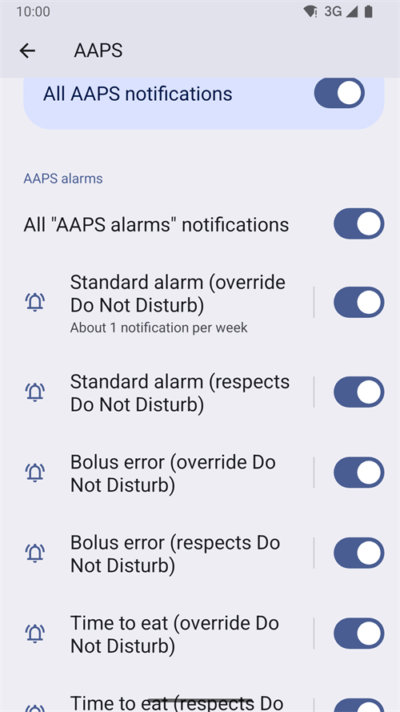 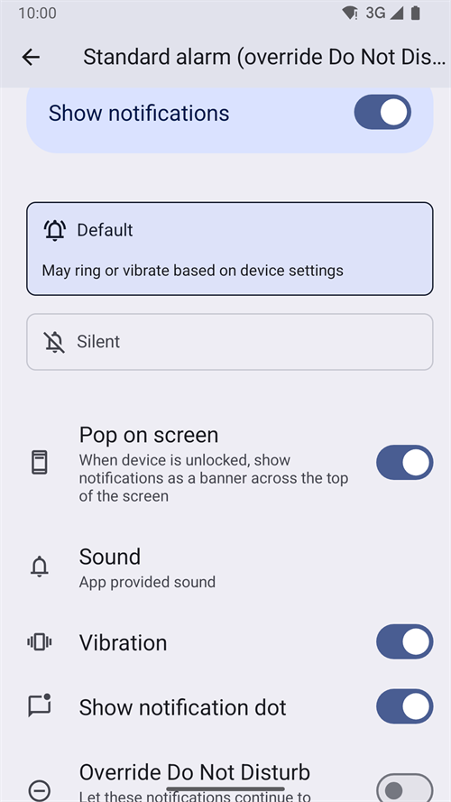

- Glucose alarms (high, low, no data) come from your CGM app or Nightscout: set their sound and vibration there.

(preferences-maintenance-settings)=
## Configuració de manteniment

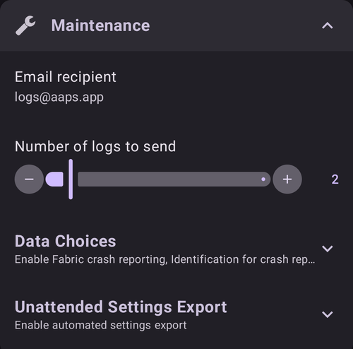

**Destinatari del correu electrònic**: el destinatari estàndard dels registres és <logs@aaps.app>.

**Nombre de registres a enviar**: quants dels fitxers de registre més recents s'adjunten quan envieu els registres.

**Opcions de dades**

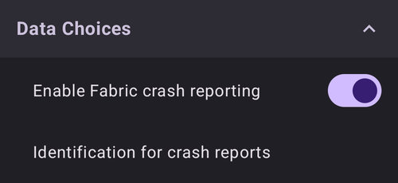

Podeu ajudar a millorar **AAPS** enviant informes d'error als desenvolupadors.

**Exportació automàtica de la configuració**<br/> Si activeu aquesta funció, permeteu que **AAPS** exporti la configuració sense intervenció de l'usuari. For this the master password is securely stored on your phone (only) at the next manual export. La contrasenya desada es farà servir durant un màxim de 4 setmanes. Després de 4 setmanes rebreu un avís que la contrasenya està a punt de caducar. Durant un període de gràcia d'1 setmana, podeu renovar la contrasenya exportant la configuració manualment des del menú de manteniment.

Quan ha passat el període de gràcia d'1 setmana, la contrasenya desada caduca i qualsevol exportació automàtica de la configuració s'aturarà i avisarà l'usuari, demanant-li que torni a introduir la contrasenya. [(**Exportacions automàtiques de la configuració**)](../DailyLifeWithAaps/Automations.md#automating-preference-settings-export) es registraran a les llistes «Portal de cures» i «Entrada d'usuari» d'**AAPS**, a Tractaments.

Després d'activar aquesta opció, feu una exportació manual de la configuració, on se us demanarà la contrasenya, perquè **AAPS** la pugui desar.

### Arxius de registre

AAPS desa registres per a la resolució de problemes.

No desactiveu aquesta funció: ajudarà a entendre les causes si alguna cosa va malament.

Si heu d'enviar els registres als desenvolupadors, descriviu bé el problema al correu electrònic. És millor enviar els registres només quan us ho demanin, després d'un [informe d'incidència a GitHub](https://github.com/nightscout/AndroidAPS/issues).

Trobareu els registres d'AAPS a la memòria del telèfon -> Android -> data -> info.nightscout.androidaps -> files.

La gestió dels registres (configuració, enviament i eliminació de registres) i la gestió d'arxius es troben a la pantalla **Manteniment**, que s'obre des del **menú** (☰) a la cantonada superior esquerra de la pantalla principal:

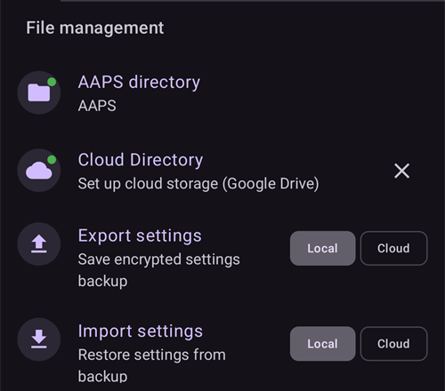

(preferences-maintenance-logdirectory)=

### Definir el directori local d'AAPS

La pantalla **Manteniment** també inclou **Directori d'AAPS**. Aquesta opció permet a l'usuari triar un directori del telèfon on **AAPS** desarà la configuració, els registres i altres fitxers. Quan heu triat un directori, el seu camí (per exemple `Documents/AAPS`) es mostra sota **Directori d'AAPS**, de manera que sempre podeu veure on es desen els vostres fitxers.

Es recomana molt fer servir un directori directament a l'arrel de la memòria del telèfon. El valor per defecte és AAPS.

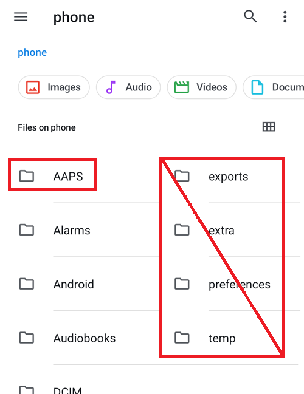

Si seleccioneu un subdirectori d'AAPS, veureu un missatge d'error. Premeu «OK» i torneu-ho a provar seleccionant el directori correcte (un nivell més amunt). No seleccioneu «IGNORAR» tret que sapigueu clarament què feu.

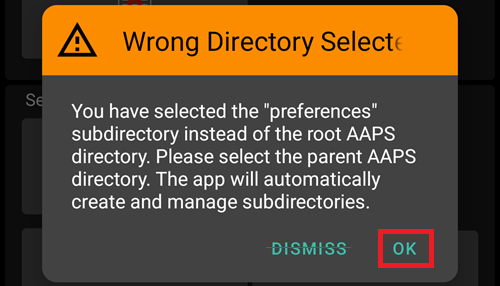

Android pot retirar el permís del directori sense avisar, per exemple després de reinstal·lar **AAPS** o d'esborrar-ne l'emmagatzematge. Quan passa això, **AAPS** mostra un avís permanent **S'ha perdut l'accés al directori AAPS** i l'exportació local de la configuració deixa de funcionar fins que torneu aquí i seleccioneu de nou el directori. Feu-ho de seguida; si no, les còpies de seguretat del telèfon ja no s'actualitzen.

(preferences-maintenance-cloud)=

### Definir un directori al núvol

Podeu exportar la configuració, els registres i les dades CSV a un servei al núvol.

1. Obriu el **menú** (☰), seleccioneu **Manteniment** i premeu **Carpeta al núvol** (a **Gestió d'arxius**).

   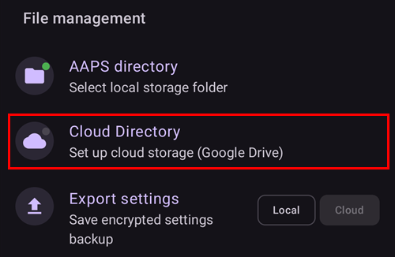

2. A **Seleccionar tipus d'emmagatzematge**, seleccioneu **Google Drive**.

   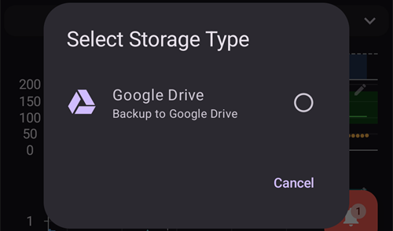

3. S'obre una pàgina d'inici de sessió de Google. Trieu el compte de Google que guardarà les vostres còpies de seguretat (podeu fer servir un [compte de Google dedicat](../UsefulLinks/DedicatedGoogleAccountForAaps.md)).

   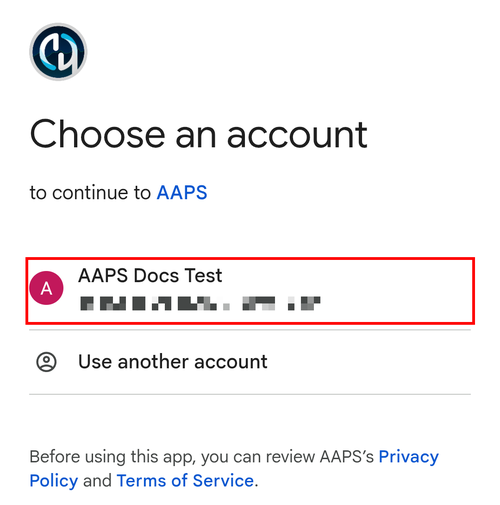

4. Comproveu que el compte és el correcte i premeu **Continue** per donar accés a **AAPS**. Si ja havíeu configurat la carpeta al núvol abans, la pàgina diu que **AAPS** ja té cert accés.

   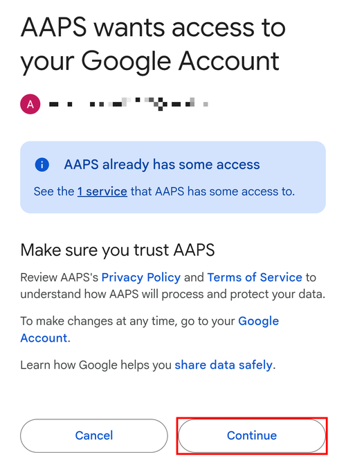

5. De tornada a **AAPS**, apareix el missatge **Autenticació de l'emmagatzematge al núvol correcta** a la part inferior de la pantalla principal:

   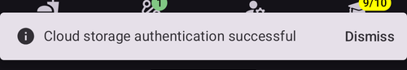

   Al menú **Manteniment**, **Carpeta al núvol** ara té un punt verd, i els botons **Núvol** al costat d'**Enviar registres**, **Exportar configuració**, **Importar configuració** i **Exportar entrades d'usuari a Excel (csv)** estan disponibles.

   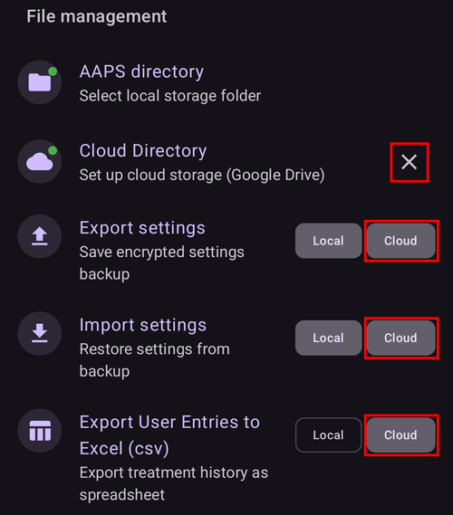

Per deixar d'exportar al núvol, premeu la icona **✕** (**Esborrar configuració**) al final de la fila **Carpeta al núvol** del menú **Manteniment** (es mostra quan hi ha un servei al núvol configurat) i confirmeu **Esborrar configuració del núvol**. Això torna a l'emmagatzematge local i esborra l'autorització.

## Open Humans

Podeu ajudar la comunitat donant les vostres dades a projectes de recerca! Els detalls es descriuen a la pàgina [Open Humans Uploader](../SupportingAaps/OpenHumans.md).

A **Configuració → Open Humans**, podeu definir quan s'han d'enviar les dades
- només si està connectat a la Wi-Fi
- només si es carrega
