# Assistent de configuració d'AAPS

```{contents} In this page
:backlinks: entry
:depth: 2
```

Quan inicieu **AAPS** per primera vegada, l'«**Assistent de configuració**» us guia per fer ràpidament, d'una sola vegada, tota la configuració bàsica de l'aplicació. L'**Assistent de configuració** us guia perquè no oblideu res important. Per exemple, la **configuració dels permisos** és fonamental per configurar **AAPS** correctament.

Però no és obligatori configurar-ho tot del tot la primera vegada que feu servir l'**Assistent de configuració**. Podeu sortir fàcilment de l'assistent i tornar-hi més tard. Després de l'**Assistent de configuració** hi ha tres camins per millorar o canviar més la configuració. Ho expliquem a la secció següent. Per tant, no passa res si us salteu alguns punts de l'assistent de configuració. Els podeu configurar fàcilment més tard.

Durant l'ús de l'**Assistent de configuració** i just després, potser no veureu cap canvi important a **AAPS**. Per activar el llaç d'**AAPS**, heu de seguir els **Objectius** per activar una funció darrere l'altra. Començareu l'**Objectiu 1** al final de l'assistent de configuració. Vosaltres manegeu **AAPS**, no al revés.

```{admonition} Preview Objectives
:class: note
Si voleu conèixer l'estructura dels objectius, llegiu [Completar els objectius](../SettingUpAaps/CompletingTheObjectives.md), però després torneu aquí per fer primer l'assistent de configuració.

```

Per experiència sabem que els usuaris nous sovint es pressionen per configurar **AAPS** tan ràpid com sigui possible. Això pot portar frustració, perquè cal aprendre molt.

Per tant, preneu-vos el temps necessari per configurar el vostre llaç. Els beneficis d'un llaç d'**AAPS** que funciona bé són enormes.

```{admonition} Ask for Help
:class: note
Si hi ha un error a la documentació o teniu una idea millor per explicar alguna cosa, podeu demanar ajuda a la comunitat, com s'explica a [Contacteu amb altres usuaris](../GettingHelp/WhereCanIGetHelp.md).
```
## Missatge de benvinguda

Quan s'obre l'assistent de configuració, us dona la benvinguda amb un missatge curt i de seguida mostra un panell «**Permisos necessaris**» a la part de baix de la pantalla (vegeu la secció següent).

Quan hàgiu concedit els permisos, el panell es tanca i la pantalla de benvinguda mostra un botó «**Següent**». Premeu «**SEGÜENT**» per continuar:

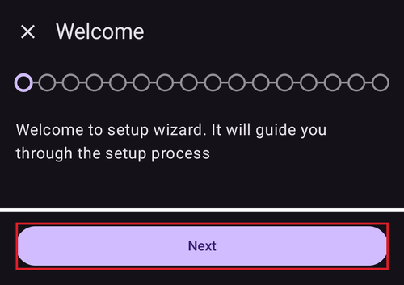

## Permisos necessaris

**AAPS** necessita alguns permisos per funcionar correctament. L'assistent els agrupa en un sol panell «**Permisos necessaris**», cadascun amb el seu botó «**Concedir**». Concediu-los un per un: la icona del costat de cada element es converteix en una marca de verificació quan està fet.

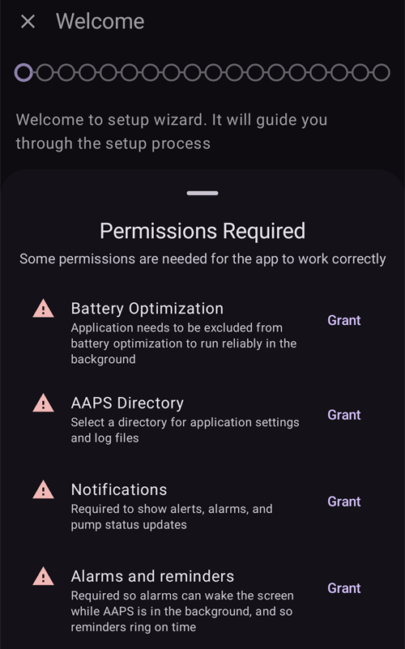

### Optimització de la bateria

El consum de bateria dels telèfons és important, perquè el rendiment de les bateries encara és força limitat. Per això, el sistema operatiu Android del vostre telèfon limita les aplicacions que s'executen i consumeixen temps de CPU i, per tant, bateria.

Però **AAPS** s'ha d'executar regularment, _p. ex._ per rebre els valors de glucèmia cada pocs minuts i després aplicar l'algoritme per decidir què cal fer amb els vostres nivells de glucèmia, segons la vostra configuració. Per això s'ha d'excloure de l'optimització de la bateria.

Premeu «**Concedir**» al costat d'«**Optimització de la bateria**» i després seleccioneu «**Permet**» al diàleg «Vols permetre que l'aplicació s'executi sempre en segon pla?»:

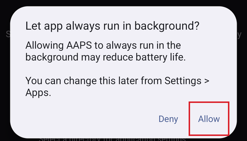

(SetupWizard-StoragePermission)=

### Directori AAPS

**AAPS** ha de desar la seva configuració i la informació de registre a l'emmagatzematge permanent del vostre telèfon. Emmagatzematge permanent vol dir que les dades continuen disponibles després de reiniciar el telèfon. La resta d'informació es perd, perquè no es desa a l'emmagatzematge permanent.

Premeu «**Concedir**» al costat de «**Directori AAPS**». S'obre el sistema de fitxers del telèfon i podeu triar on **AAPS** desa la seva informació.

```{tip}
Es recomana triar el directori AAPS per defecte.</br>
**No** seleccioneu un subdirectori d'AAPS.
```

El directori per defecte és **AAPS**, però podeu fer servir qualsevol directori propi que vulgueu. Si cal, creeu el directori, entreu-hi i trieu «**UTILITZA AQUESTA CARPETA**»:

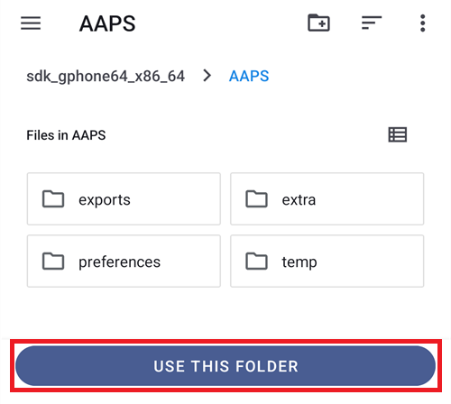

Confirmeu amb «**PERMET**» que voleu donar accés a **AAPS** al directori seleccionat:

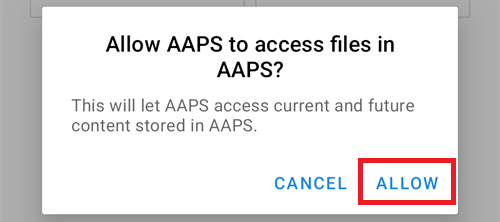

### Notificacions

Android demana un permís especial a les aplicacions que us volen enviar notificacions.

Desactivar les notificacions, _p. ex._ de les aplicacions de xarxes socials, és una bona funció, però és imprescindible que permeteu que **AAPS** us enviï notificacions.

Premeu «**Concedir**» al costat de «**Notificacions**» i seleccioneu «**Permet**» a la pregunta del sistema:

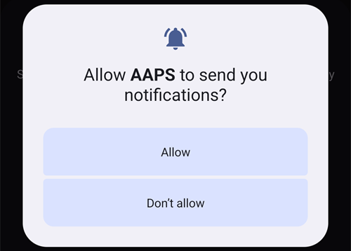

### Alarmes i recordatoris

A **Android 14 i posterior**, **AAPS** necessita el permís «**Alarmes i recordatoris**» perquè les alarmes puguin encendre la pantalla mentre **AAPS** funciona en segon pla, i perquè els recordatoris (per exemple, d'una **Automatització**) sonin a l'hora.

Aquest element només es mostra quan cal. Quan **AAPS** està exclòs de l'optimització de la bateria (vegeu més amunt), Android concedeix automàticament les alarmes exactes i l'element desapareix. Si encara surt a la llista, premeu «**Concedir**» al costat d'«**Alarmes i recordatoris**». S'obre una pantalla de configuració del sistema per a **AAPS**. Activeu l'interruptor i torneu a **AAPS**. A Android 13 i anteriors aquest element no apareix i no cal fer res.

Quan tots els permisos mostren una marca de verificació (tres, o quatre a Android 14 i posterior), el panell «**Permisos necessaris**» es tanca sol i podeu prémer «**SEGÜENT**» a la pantalla de benvinguda per continuar.

(setup-wizard-bluetooth-battery-optimisation)=
### Optimització de la bateria del Bluetooth

```{admonition} Extra Android setting, not part of the Wizard
:class: note
El que segueix és configuració addicional d'Android que es fa fora de l'assistent de configuració. No és cap dels botons «Concedir» d'abans, però és important perquè la connexió amb la bomba sigui fiable.
```

Les versions noves d'Android també han afegit optimització de la bateria a l'aplicació de sistema Bluetooth.

A més de desactivar l'optimització de la bateria per a **AAPS**, probablement també l'haureu de desactivar per a l'aplicació de sistema Bluetooth. Si no ho feu, la connexió amb la bomba es pot tallar i pot donar problemes.

***NOTA: La documentació de xDrip explica com fer-ho aquí: [documentació de xDrip](https://navid200.github.io/xDrip/docs/BluetoothBatteryOpt.html)***

Seguiu aquests passos a Android 16. En altres versions pot ser una mica diferent de les captures de pantalla:

1. Obriu la configuració d'Android, cerqueu **Aplicacions** i obriu la configuració d'aplicacions.

   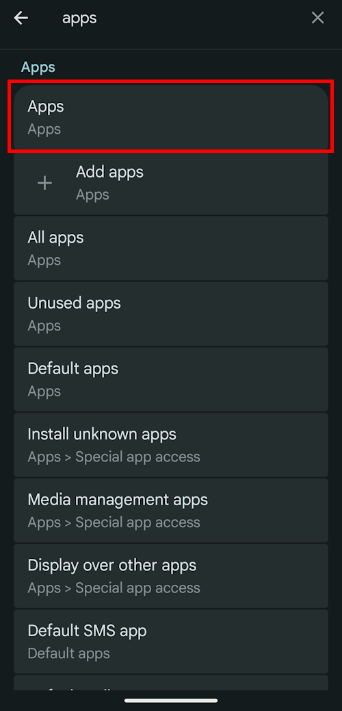

2. Veureu la configuració d'aplicacions, però cal desplegar-la per veure totes les aplicacions. Feu clic a **Mostra totes les aplicacions** (See all apps) per desplegar-la.

   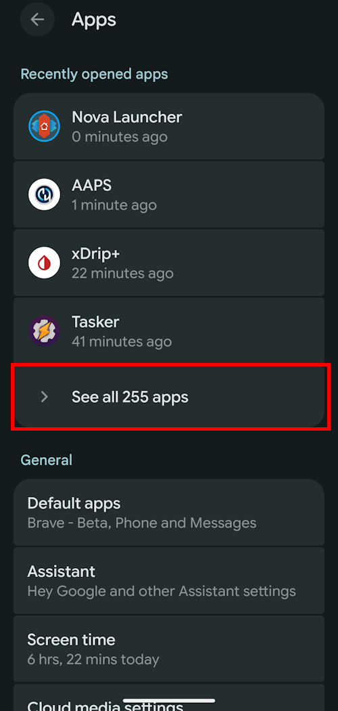

3. Com que l'aplicació Bluetooth és una aplicació de sistema, per defecte està amagada. Per tant, cal mostrar les aplicacions de sistema. Feu clic als **tres punts** (⋮) a dalt a la dreta (1). Després feu clic a **Mostra el sistema** (Show system) (2).

   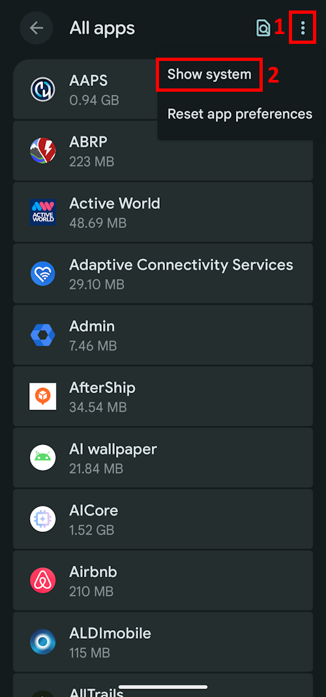

4. Cerqueu l'aplicació `Bluetooth` i feu clic a `Bluetooth` i/o `Legacy Bluetooth`. Si hi ha les dues, feu el procediment per a totes dues.

   ***NOTA: Podeu ignorar sense problema `Bluetooth MIDI Service`. AAPS no el fa servir.***

   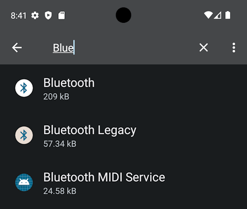    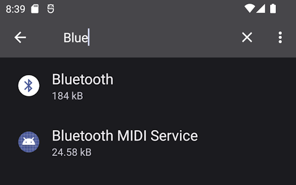    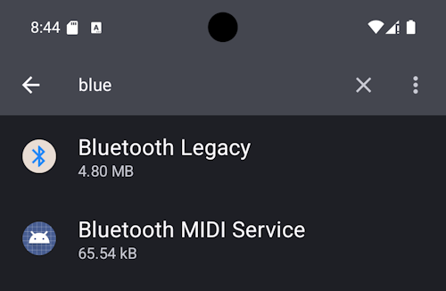

   1. A Android 12 feu clic a `Bateria`, a Android 13 o posterior feu clic a `Ús de la bateria de l'aplicació` (App battery usage).

   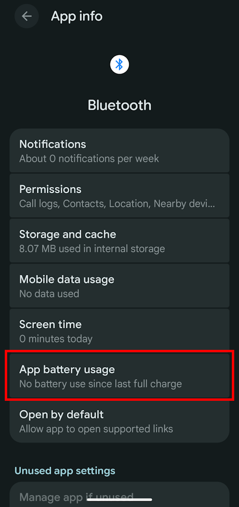   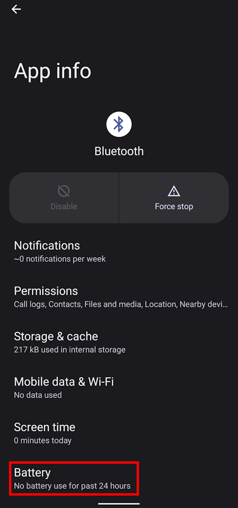

5. A Android 12 o posterior, seleccioneu l'opció `Sense restriccions` (Unrestricted). A Android 15 o posterior, cal desplegar l'opció `Permet l'ús en segon pla` (Allow background usage): feu clic a la part marcada en vermell i després seguiu el pas 6 per acabar.

   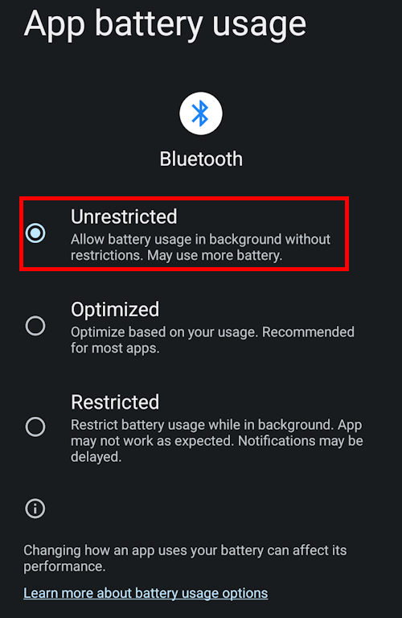    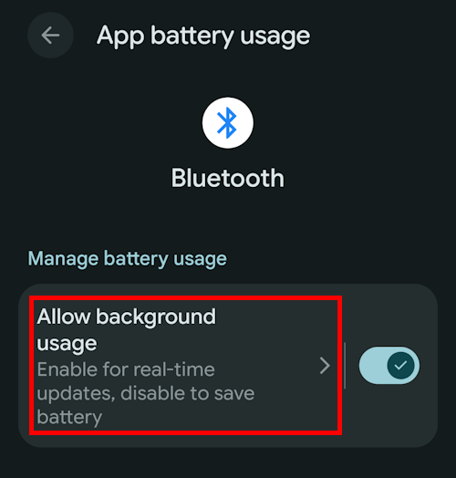

6. A Android 16, seleccioneu `Sense restriccions` (Unrestricted)

   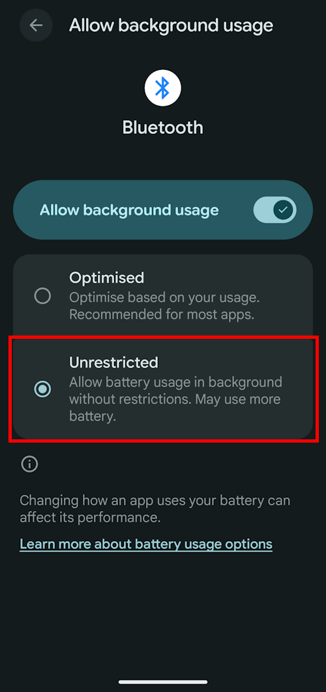

## Acord de llicència

L'acord de llicència per a l'usuari final conté informació important sobre els aspectes legals de l'ús d'**AAPS**. Llegiu-lo amb atenció.

Si no enteneu l'acord de llicència per a l'usuari final o no hi esteu d'acord, no feu servir **AAPS** de cap manera!

Si ho enteneu i hi esteu d'acord, premeu el botó «**ENTENC I ACCEPTO**» i seguiu l'assistent de configuració:

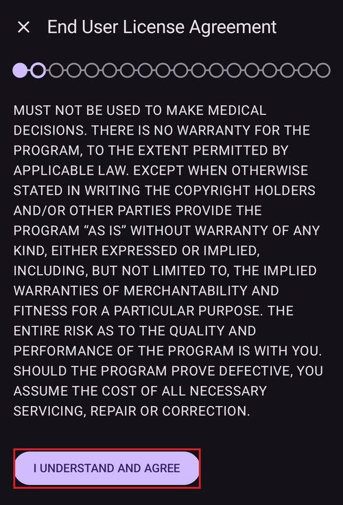

Quan hàgiu acceptat, apareix un botó «**Següent**». Premeu «**SEGÜENT**».

La pantalla següent, «**Permisos**», torna a mostrar els permisos. Tots haurien de tenir una marca de verificació, perquè els vau concedir al principi. Si en falta algun, premeu «**Concedir**» al seu costat. Premeu «**SEGÜENT**» per continuar:

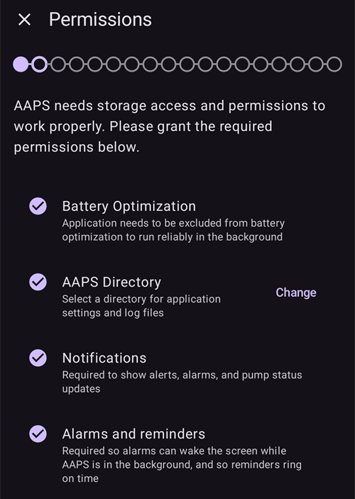

## Clau mestra

Com que la configuració d'**AAPS** conté algunes dades sensibles (_p. ex._ el token d'accés al vostre servidor Nightscout), es xifra amb una contrasenya que definiu aquí.

L'assistent mostra «**Contrasenya no establerta**». Premeu «**Establir**»:

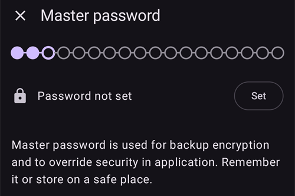

S'obre la pantalla «**Protecció**». Premeu «**Clau mestra**» (es mostra com a «Contrasenya no establerta»):

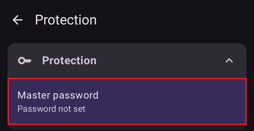

Escriviu la mateixa contrasenya als dos camps i premeu «**OK**»:

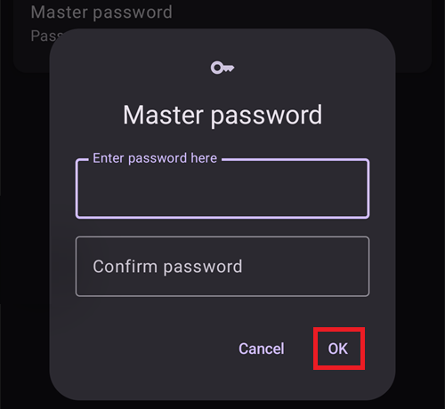

Torneu enrere amb la fletxa de la cantonada superior esquerra. Ara l'assistent mostra «**Contrasenya establerta!**»:

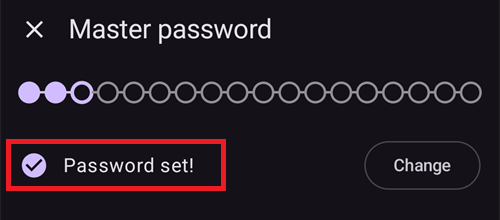

```{admonition} Do not lose your Master Password
:class: danger
**NO PERDEU LA VOSTRA CLAU MESTRA**. Anoteu-la en algun lloc, _p. ex._ a Google Drive, que és un bon lloc perquè Google en fa còpies de seguretat per vosaltres. El vostre telèfon o ordinador es pot espatllar i és possible que no tingueu cap còpia actual. Si oblideu la clau mestra, més endavant pot ser difícil recuperar la configuració del perfil i el vostre progrés als **Objectius**. Vegeu [Com es restableix la clau mestra?](#FAQ-reset-master-password)
```

Quan acabeu, premeu «**SEGÜENT**» per anar a la pantalla següent.

(setup-wizard-import-settings)=
## Importar configuració

Aquesta pantalla només es mostra quan **AAPS** troba una configuració exportada abans al directori d'**AAPS** («Trobada configuració emmagatzemada»), per exemple quan reinstal·leu l'aplicació o canvieu a un telèfon nou.

- To restore your previous configuration, press "**Import settings**" — see [Export & import settings](../Maintenance/ExportImportSettings.md). After a successful import the Setup Wizard closes: the imported settings replace the remaining steps.
- Per començar amb una configuració nova, premeu «**SEGÜENT**» i continueu amb l'assistent.

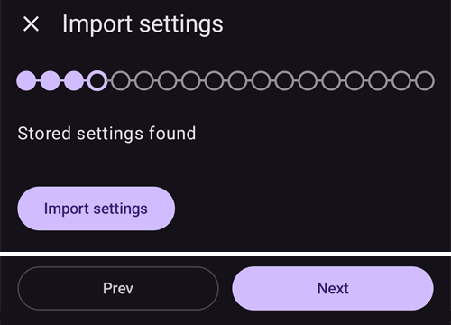

## Unitats (mg/dl <-> mmol/l)

Seleccioneu si els vostres valors de glucèmia són en mg/dl o en mmol/l i després premeu el botó «**SEGÜENT**»:

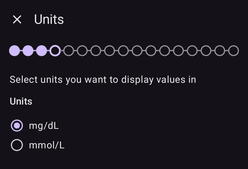

## Configuració pantalla

Aquí definiu el «**Límit BAIX**» i el «**Límit ALT**» per mostrar la glucèmia del sensor. Els valors de glucèmia entre aquests dos límits es mostren com a «dins del rang». De moment podeu deixar els valors per defecte (72 i 180 mg/dl) i canviar-los més tard.

Els valors que trieu només canvien la presentació gràfica del diagrama, res més.

El vostre objectiu de glucèmia, _p. ex._, es configura per separat al vostre perfil.

El rang per analitzar el TIR (temps en rang) es configura per separat al vostre servidor d'informes.

Si cal, ajusteu els límits amb els botons «−» / «+» i després premeu el botó «**SEGÜENT**»:

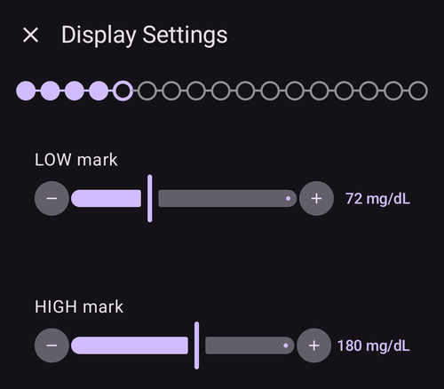

(SetupWizard-synchronization-with-the-reporting-server-and-more)=
## Comunicació

La pantalla «**Comunicació**» mostra els plugins que serveixen per enviar, sincronitzar i difondre les vostres dades:

- **Comunicador SMS**: control remot d'**AAPS** amb ordres SMS
- **NSClientV3**: sincronitza les vostres dades amb Nightscout amb l'API v3
- **Tidepool**: envia dades a Tidepool
- **xDrip**: envia dades a xDrip
- **Open Humans**: enviar i donar les vostres dades de diabetis a projectes científics
- **Wear**: veure i controlar **AAPS** des d'un rellotge Wear OS
- **Apps complementàries externes**: difusió de dades a diverses aplicacions externes
- **Garmin**: connexió amb un dispositiu Garmin

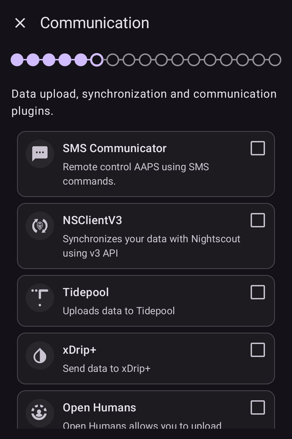

Desplaceu-vos cap avall per veure la resta de la llista:

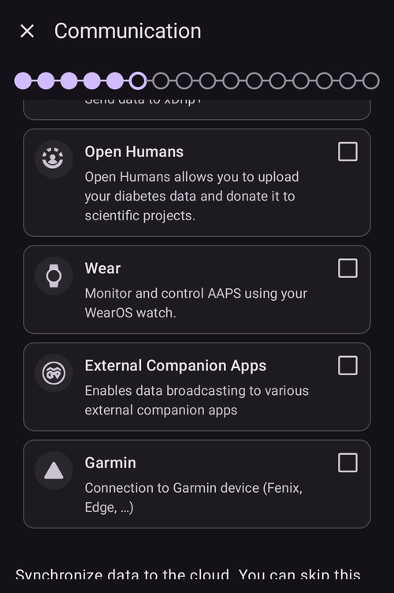

Ara en podríeu configurar diversos, però en aquesta primera vegada només ens centrarem en el servidor d'informes. Si ara no el podeu configurar, salteu-vos-el de moment. El podeu configurar més tard.

En aquest exemple fem servir Nightscout com a servidor d'informes. Marqueu la casella a la dreta de «**NSClientV3**» per activar-lo. Per a Tidepool és encara més senzill, perquè només necessiteu les vostres dades personals d'inici de sessió.

Quan estigui activat, premeu «**Configuració**» a sota de NSClientV3 per configurar-lo:

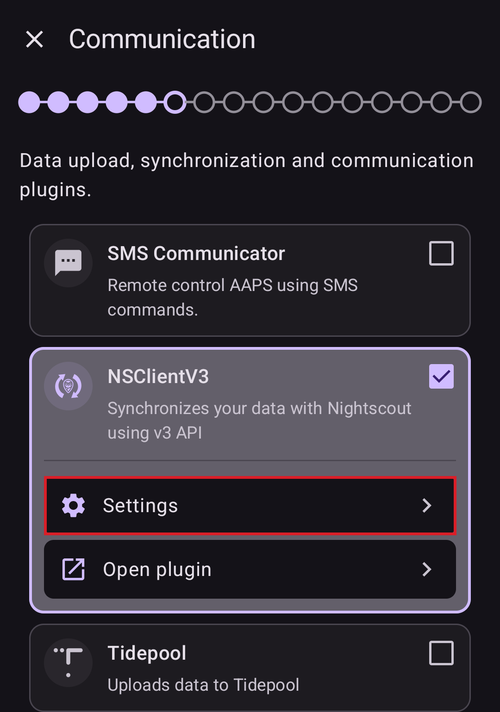

Aquí configureu el servidor d'informes Nightscout. La configuració de NSClientV3 es mostra en una sola pàgina que es pot desplaçar:

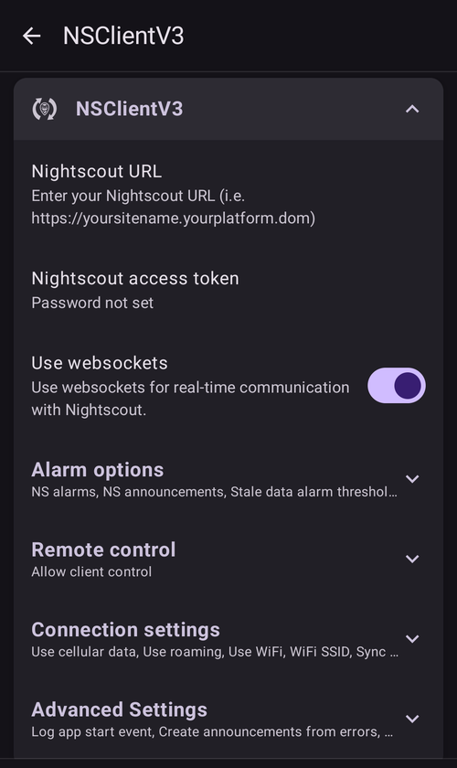

Premeu «**URL de Nightscout**» i escriviu l'adreça del vostre servidor Nightscout personal (l'URL que heu configurat vosaltres o que us ha donat el vostre proveïdor del servei). Confirmeu amb «**OK**».

Premeu «**Token d'accés de Nightscout**» i escriviu el token d'accés del vostre servidor Nightscout. Sense aquest token, l'accés no funciona. Si encara no el teniu, consulteu la documentació sobre com configurar el servidor d'informes.

Deixeu activat «**Utilitzar websockets**» per a la comunicació en temps real amb Nightscout. Els websockets són **obligatoris** per al control remot des d'**AAPSClient**, als dos telèfons.

De moment podeu deixar les altres seccions amb els valors per defecte. Les expliquem aquí perquè sapigueu on trobar-les més tard:

**Configuració alarmes**: alarmes i anuncis de Nightscout i límits per a dades antigues. De moment deixeu els interruptors desactivats. Només les obrim perquè conegueu les opcions.

**Configuració de connexió**: trieu com es transfereixen les dades. Els cuidadors han d'activar «**Utilitzar dades mòbils**». Si no, el telèfon de la persona que cuiden (_p. ex._ un nen) no pot enviar dades fora de l'abast de la wifi, _p. ex._ de camí a l'escola. Els altres usuaris poden desactivar la transferència per dades mòbils per estalviar dades o bateria. Si teniu dubtes, deixeu-ho tot activat.

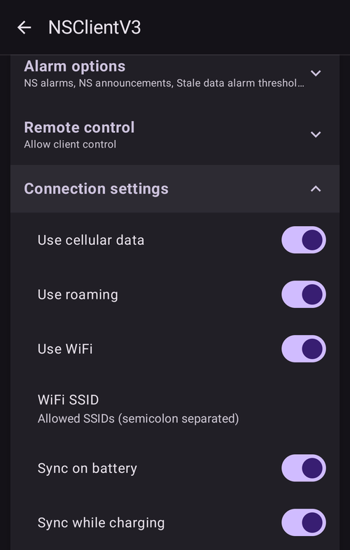

**Configuració avançada**: activeu «**Registrar l'inici de l'app**» si voleu veure a Nightscout quan es reinicia l'aplicació (útil per als cuidadors). Deixeu activats «**Crear avisos a partir d'errors**» i «**Crear avisos quan calen carbohidrats**». Deixeu desactivat «**Utilitzar sincronització lenta**». Només el faríeu servir si el servidor Nightscout és lent per processar moltes dades.

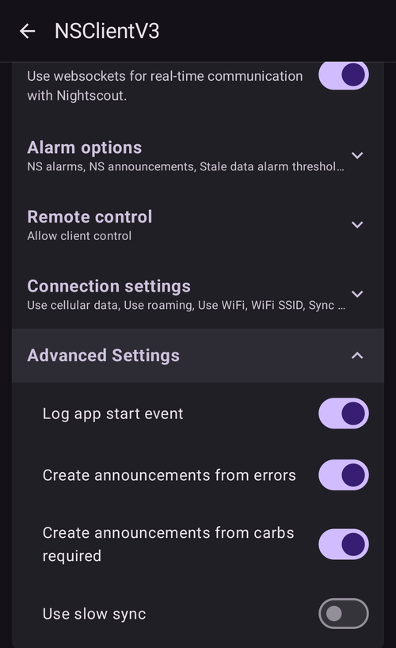

Torneu a la llista de plugins i premeu «**SEGÜENT**» per anar a la pantalla següent.

## Control des de clients

Des de la versió 4 d'**AAPS**, els dispositius client amb **AAPSClient** es poden **emparellar** amb aquest telèfon (el **principal**) i controlar-lo amb ordres signades enviades a través de Nightscout. Aquesta és la nova manera recomanada de controlar **AAPS** a distància. Vegeu [Control principal ↔ client (control remot signat)](../RemoteFeatures/ClientMasterControl.md) per a l'explicació completa i la configuració.

En aquesta pantalla ara no cal configurar res. Podeu emparellar clients en qualsevol moment més tard des de **Gestionar → Clients autoritzats**. Allà afegiu un client amb un **codi QR** (també configura Nightscout al client) o amb un **PIN**, i li doneu un **rol**.

- «**Clients autoritzats**»: gestioneu els dispositius client emparellats que poden controlar aquest telèfon principal.
- «**Acceptació de dades de Nightscout**»: ara, per defecte, està desactivat acceptar tractaments i dades introduïts directament a Nightscout (la manera antiga, menys segura). Obriu aquesta configuració només si encara ho necessiteu, _p. ex._ per introduir dades a través de Nightscout o d'aplicacions de tercers.

Quan el control des de clients ja està activat (sempre en [Mode simple](#preferences-simple-mode)), aquest telèfon està en [mode reforçat](#client-master-control-hardened-mode): només accepta canvis de clients emparellats. Per això la pantalla explica el mode reforçat en lloc d'oferir la configuració «**Acceptació de dades de Nightscout**».

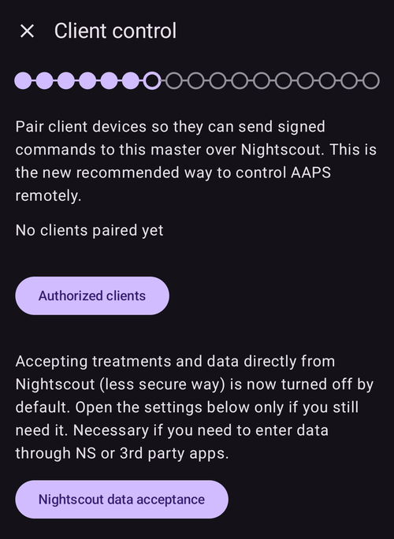

«**Acceptació de dades de Nightscout**» obre la configuració «**Sincronització**», on cada tipus de dades rebudes de Nightscout té el seu propi interruptor:

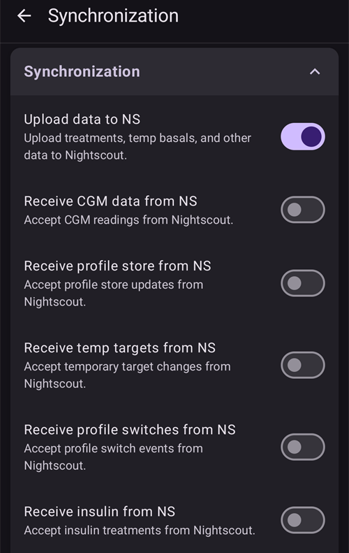

Premeu «**SEGÜENT**» per anar a la pantalla següent.

(setup-wizard-instance-name)=
## Qui fa servir aquest telèfon?

Aquí escriviu el nom de la persona que fa servir aquest telèfon. Serveix per distingir aquesta instància d'**AAPS** de les altres als informes i en sincronitzar, per exemple si dos nens de la vostra família fan servir **AAPS**. També es fa servir als noms dels fitxers de configuració exportats i es mostra al rellotge.

Pot ser qualsevol cosa. Ho podeu canviar més tard a **Configuració → General → Nom de la instància**.

Premeu «**SEGÜENT**» per anar a la pantalla següent.

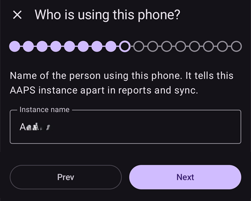

## Tipus de pacient

Aquí seleccioneu el vostre «Tipus de pacient». És important, perquè el programari **AAPS** té límits diferents segons l'edat del pacient. Això és important per motius de seguretat.

Aquí també configureu el **bolus màxim permès** per a un àpat. És a dir, el bolus més gran que necessiteu per cobrir els vostres àpats habituals. És una funció de seguretat que ajuda a evitar una sobredosi per error quan us poseu un bolus per a un àpat.

El segon límit és similar, però es refereix a la quantitat màxima de carbohidrats que preveieu menjar.

Després de definir aquests valors, premeu «**SEGÜENT**» per anar a la pantalla següent:

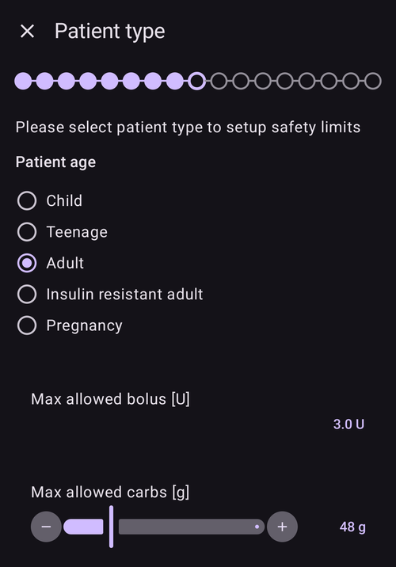

## Insulina

Aquí configureu la insulina que feu servir a la bomba. Els perfils d'insulina nous necessiten una **DIA d'almenys 5 h**.

Premeu el botó «**Insulina**» per obrir l'editor d'insulina:

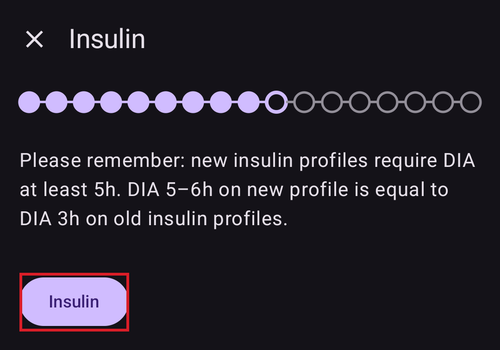

A l'editor podeu donar un **àlies** a la insulina i definir-ne el **Pic** (en minuts) i la **DIA** (en hores). La manera més ràpida és carregar un valor predefinit amb «**Carregar el pic de**». Trieu **Novorapid**, **Fiasp** o **Lyumjev** i el pic s'omple automàticament. El gràfic de la part de baix mostra una vista prèvia de la corba d'activitat de la insulina que en resulta.

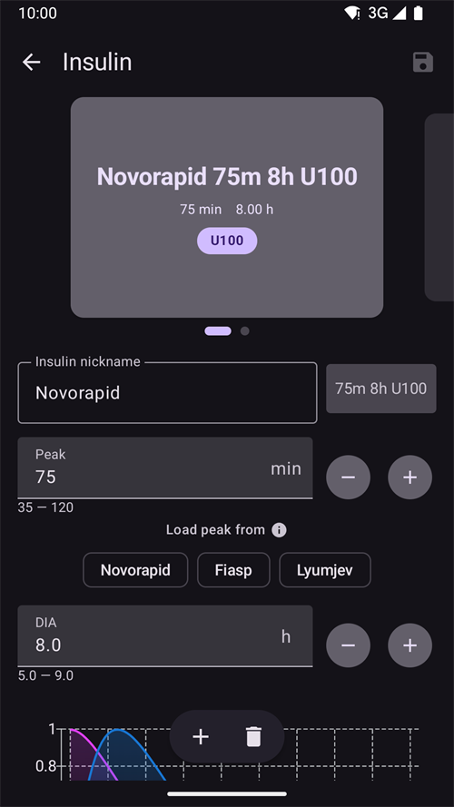

Trieu el valor predefinit que correspon a la vostra insulina, per exemple **Fiasp**:

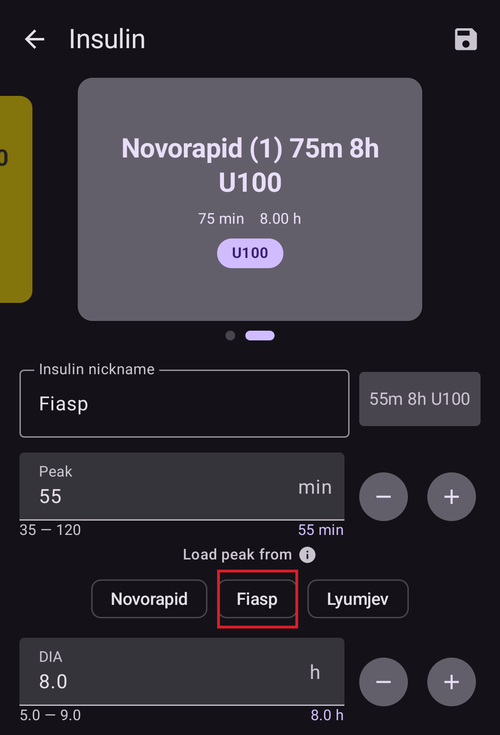

```{admonition} Use your insulin brand's preset peak
:class: danger
No canvieu el pic si no sou experts. Normalment els valors predefinits funcionen bé per a cada marca d'insulina.
```

Si sou usuaris nous d'**AAPS**, poseu la **DIA** a 9 hores. Vegeu [Durada de l'acció de la insulina (DIA) i pic](#Config-Builder-insulin-dia) per entendre per què.

```{admonition} "Insulin configuration changed" dialog
:class: note
Si un client emparellat (_p. ex._ un altre telèfon) ha canviat la configuració de la insulina, apareix un diàleg. Premeu **OK** per carregar els seus canvis, o **Cancel·lar** per continuar editant (quan torneu a desar, sobreescriureu els seus canvis).
```

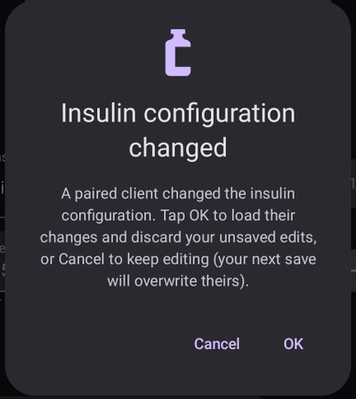

Premeu la icona de desar (a dalt a la dreta) i després premeu «**SEGÜENT**» per anar a la pantalla següent.

## Origen de la glucèmia

Aquí seleccioneu d'on obté **AAPS** les dades de glucèmia. Llegiu la documentació del vostre [origen de glucèmia](../Getting-Started/CompatiblesCgms.md).

Hi ha moltes fonts disponibles. Desplaceu-vos per la llista i seleccioneu la que feu servir:

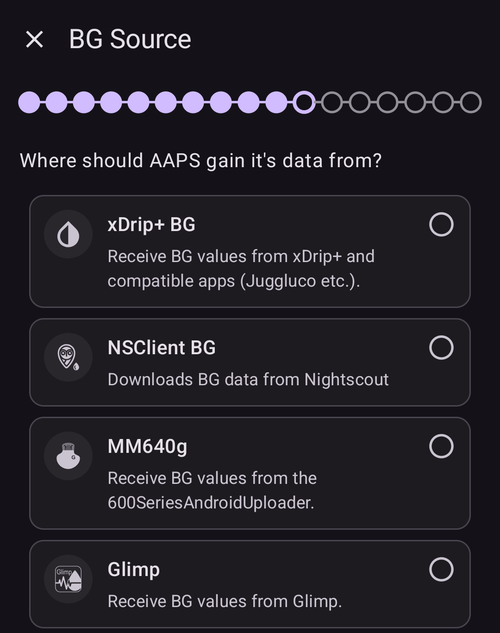

Quan seleccioneu una font, la seva targeta es desplega i mostra dos botons: «**Configuració**», per ajustar com es reben les dades, i «**Obrir plugin**», per obrir la pantalla pròpia de la font. A l'exemple de sota hi ha seleccionat **BYODA**. Algunes fonts no tenen res a configurar en aquest pas, així que normalment podeu anar directament a la pantalla següent:

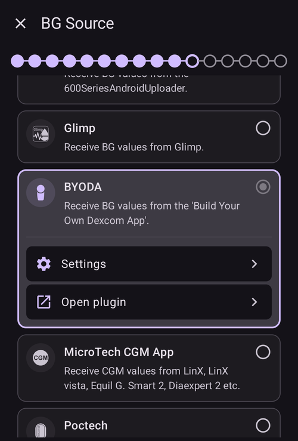

Després de fer la selecció, premeu «**SEGÜENT**» per anar a la pantalla següent.

(setup-wizard-profile)=
## Perfil

Ara entrem en una part molt important de l'assistent de configuració.

Llegiu la documentació sobre els [perfils](../SettingUpAaps/YourAapsProfile.md) abans d'introduir les dades del vostre perfil a la pantalla següent.

```{admonition} Working profile required - no exceptions here !
:class: danger
Cal un perfil exacte perquè **AAPS** actuï de manera segura.

Cal que hàgiu determinat i parlat el vostre perfil amb el vostre metge, i que s'hagi demostrat que funciona amb proves correctes de la taxa basal, l'ISF i la ràtio I:C!

Si un robot rep dades incorrectes, fallarà, sempre. **AAPS** només pot treballar amb la informació que rep. Si el vostre perfil és massa fort, teniu risc d'hipoglucèmia, i si és massa feble, teniu risc d'hiperglucèmia. 
```

Premeu el botó «**Perfil**» per obrir l'editor de perfils:

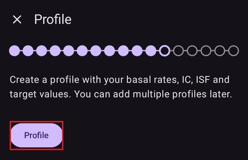

L'editor s'obre buit («No hi ha registres disponibles»). Premeu el botó «**+**» de la part de baix per crear un perfil nou:

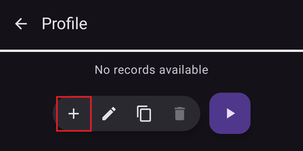

Si cal, a la llarga podeu tenir diversos perfils. Aquí només en creem un.

```{admonition} Profile only for tutorial - not for your usage
:class: note
El perfil d'aquest exemple només serveix per mostrar-vos com introduir les dades.

No pretén ser un perfil exacte ni gaire ben optimitzat, perquè les necessitats de cada persona són molt diferents.

No el feu servir per fer funcionar el llaç de veritat!
```

El perfil nou (per exemple «**LocalProfile1**») té quatre pestanyes: **IC**, **ISF**, **BAS** i **OBJ**. Premeu el llapis del costat del nom del perfil per canviar-li el nom. Ompliu totes les pestanyes. Una pestanya es manté vermella i mostra un missatge d'error fins que conté valors vàlids:

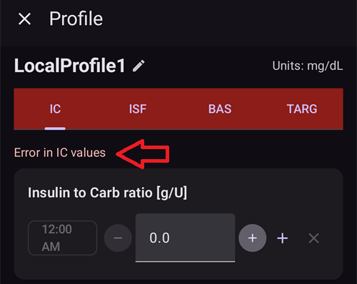

Premeu «**IC**» i escriviu els vostres valors d'[IC](#your-aaps-profile-insulin-to-carbs-ratio). Feu servir el botó «**+**» per afegir més franges horàries:


Premeu «**ISF**» i escriviu els vostres [valors d'ISF](#your-aaps-profile-insulin-sensitivity-factor):

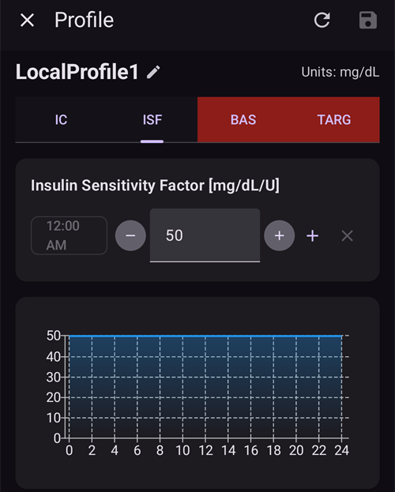

Premeu «**BAS**» i escriviu els vostres [valors de basal](#your-aaps-profile-basal-rates):

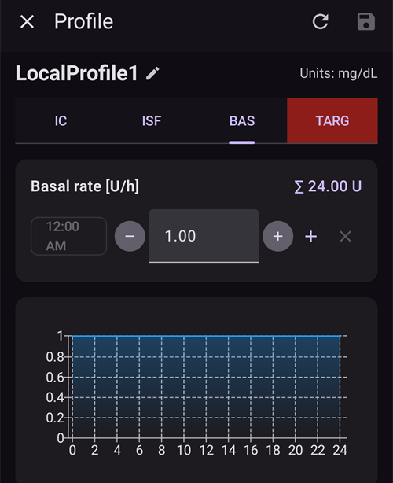

Premeu «**OBJ**» i escriviu els vostres valors d'objectiu de glucèmia.

En llaç obert, aquest objectiu pot ser un rang més ampli. Si no, **AAPS** us avisa contínuament perquè canvieu la basal temporal o una altra configuració, i això pot ser esgotador.

Més endavant, en llaç tancat, normalment tindreu un sol valor per al límit superior i per a l'inferior. Així és més fàcil per a **AAPS** arribar a l'objectiu i donar-vos un millor control general de la diabetis.

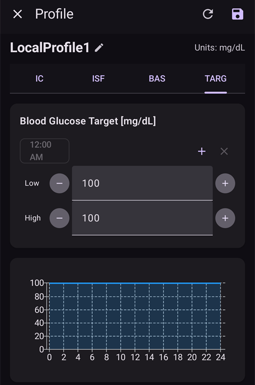

Quan les quatre pestanyes són vàlides, la **icona de desar** (a dalt a la dreta) s'activa. Premeu-la per desar el perfil:

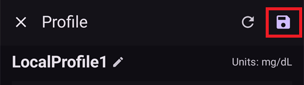

Tanqueu l'editor amb la «**X**» de la cantonada superior esquerra. Aleshores el resum del perfil mostra el nom, la basal diària total (∑), les unitats i els valors d'IC i d'ISF amb els seus gràfics:

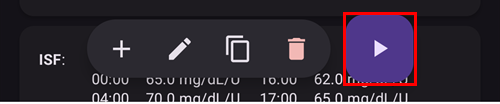

```{admonition} Several defined but only one active profile
:class: note
Podeu tenir diversos perfils definits, però només un perfil actiu en cada moment.
```

Premeu el botó «**▶**» (activar) de la part de baix a la dreta. S'obre la pantalla «**Activar**». Com que encara no hi ha cap insulina en ús, primer us demana que seleccioneu la insulina que feu servir, perquè el canvi de perfil la pugui registrar. El botó «**Activar**» queda en gris fins que ho feu:


Premeu «**Seleccionar insulina**» i trieu la insulina que heu configurat abans. Deixeu el percentatge al 100% i premeu «**Activar**»:


Apareix un diàleg de canvi de perfil. En aquest cas, deixeu-ho com està i confirmeu amb «**OK**»:

```{admonition} Profile switch dialog
:class: note
Més endavant aprendreu a fer servir aquest diàleg general en situacions com malaltia o esport, quan cal canviar el perfil segons les circumstàncies.
```


Ara el vostre perfil està actiu. Premeu «**SEGÜENT**» per anar a la pantalla següent.

## Bomba d'insulina

Ara seleccioneu la vostra bomba d'insulina. Llegiu la documentació de la vostra [bomba d'insulina](../Getting-Started/CompatiblePumps.md).

Desplaceu-vos per la llista i seleccioneu la vostra bomba. En aquest exemple fem servir la «**Bomba virtual**», que és útil mentre encara apreneu i encara no heu connectat una bomba real:


Hi ha moltes bombes compatibles. Desplaceu-vos cap avall per trobar la vostra:


Quan seleccioneu una bomba real, **AAPS** us demana una confirmació, perquè copiarà les taxes basals del vostre perfil a la bomba i sobreescriurà les taxes basals que hi ha desades. Premeu «**OK**» només si les taxes basals del vostre perfil d'**AAPS** són correctes. Si no, premeu «**Cancel·lar**» i canvieu a la bomba més tard:


Si la bomba que seleccioneu es comunica per Bluetooth, **AAPS** us demana permís per connectar-se a dispositius propers quan acabeu l'assistent (vegeu [Permís de Bluetooth](#setup-wizard-bluetooth-permission)).

Si ja heu configurat el vostre perfil i sabeu com connectar la bomba, podeu connectar-la ara. Si no, de moment deixeu-ho en **Bomba virtual**. Ho podeu canviar en qualsevol moment, o sortir de l'assistent de configuració amb la fletxa de la cantonada superior esquerra i deixar que **AAPS** us mostri primer alguns valors de glucèmia.

Premeu «**SEGÜENT**» per anar a la pantalla següent.

## Algoritme APS

Feu servir l'algoritme OpenAPS SMB com a algoritme APS. Malgrat el nom, la funció SMB de l'algoritme està desactivada fins que conegueu bé AAPS i hàgiu completat els primers objectius. De totes maneres, OpenAPS SMB és més nou i en general millor que OpenAPS AMA.

SMB està desactivat al principi perquè la funció SMB reacciona més ràpid quan puja la glucèmia: fa servir un super micro bolus en lloc d'augmentar el percentatge de la taxa basal. Com que al principi el vostre perfil normalment no és tan bo com després d'una mica d'experiència, la funció està desactivada al principi.

```{admonition} Only use the older algorithm **OpenAPS AMA** if you know what you are doing
:class: note
OpenAPS AMA és l'algoritme més bàsic. No admet micro bolus per corregir valors alts. Hi pot haver situacions en què sigui millor fer servir aquest algoritme, però no és la recomanació.
```

Seleccioneu «**OpenAPS SMB**» i després premeu «**Configuració**» per veure'n els detalls:


L'única opció aquí és «**Utilitzar sensibilitat dinàmica**». Deixeu-la desactivada i de moment no canvieu res. Només llegiu el text.

Per les limitacions que imposen els **Objectius**, de moment igualment no podeu fer servir ni el «llaç tancat» ni les «funcions SMB».

Torneu enrere i premeu «**SEGÜENT**» per anar a la pantalla següent:


## Detecció de sensibilitat

Deixeu seleccionat «**Sensibilitat Oref1**» com a plugin de sensibilitat estàndard:


Si premeu «**Configuració**», podeu revisar la configuració d'absorció. Els valors per defecte (_p. ex._ un límit d'absorció de 6 h) de moment estan bé.


Premeu «**SEGÜENT**» per anar a la pantalla següent.

## Iniciar l'Objectiu 1

Ara entreu als Objectius, el camí per tenir accés a més funcions d'**AAPS**.

Premeu «**Obrir Objectius**»:


Aquí iniciem l'Objectiu 1, encara que ara mateix la nostra configuració no està del tot preparada per completar aquest objectiu. Però és el començament.

Premeu el botó «**Començar**» de l'**Objectiu 1**:


L'objectiu es desplega i mostra les seves comprovacions una per una. Podeu veure que ja heu avançat una mica, mentre que altres elements encara estan pendents:


Torneu enrere i després premeu «**FINALITZAR**» per completar l'assistent de configuració:


Després de prémer «**FINALITZAR**», arribeu a la pantalla principal d'**AAPS**. Pot ser que s'obri un panell «**Avís**» amb missatges d'informació, per exemple sobre el canvi de perfil que acabeu de fer. Premeu «**Ignorar**» a sota de cada missatge per esborrar-lo.

Si sortiu de l'assistent de configuració per error en qualsevol moment, podeu simplement tornar a iniciar l'assistent o canviar manualment la [configuració del llaç d'AAPS](../SettingUpAaps/ChangeAapsConfiguration.md).

(setup-wizard-bluetooth-permission)=
## Permís de Bluetooth

Si seleccioneu una bomba que es connecta per Bluetooth (per exemple **Omnipod Dash**), un bàner us recorda que **AAPS** necessita el permís de Bluetooth. De moment podeu prémer «**Ignorar**». El permís es concedeix quan acabeu l'assistent:


Quan l'assistent de configuració ha acabat, la pantalla principal d'**AAPS** mostra un panell «**Permisos necessaris**». Els altres permisos ja estan concedits. Premeu «**Concedir**» al costat de «**Bluetooth**»:


Seleccioneu «**Permet**» perquè **AAPS** pugui trobar la vostra bomba i connectar-s'hi:


Si el vostre llaç d'**AAPS** ja està completament configurat, continueu amb la secció següent, [«Completar els objectius»](../SettingUpAaps/CompletingTheObjectives.md).
