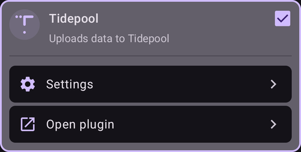
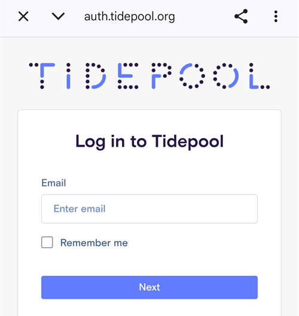
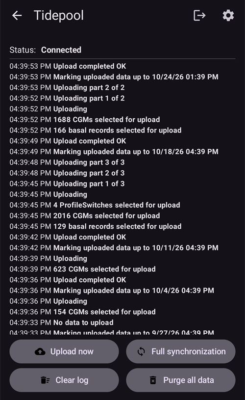
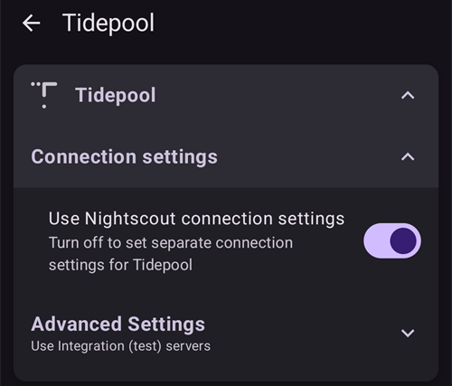
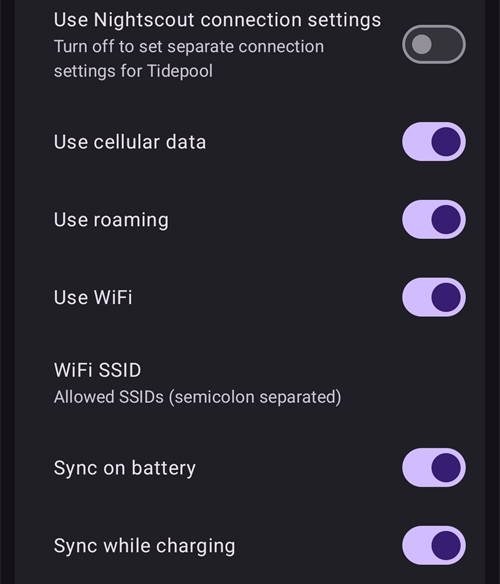
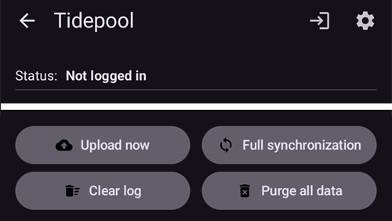

# Tidepool

Tidepool és una eina d'un tercer que recull dades de glucèmia, insulina i carbohidrats (i les notes que afegiu als tractaments) i que es pot fer servir per analitzar aquestes dades i compartir-les amb el vostre equip clínic. Des de la versió 3.2 d'AAPS, es pot fer servir en lloc de Nightscout per complir una part de l'Objectiu 1. També es pot fer servir juntament amb Nightscout, com una plataforma d'informes alternativa que s'integra bé amb l'entorn clínic. Pot ser l'opció preferida per a nens que fan servir AAPS i volen les funcions de monitoratge i control remot de Nightscout, però també una plataforma d'informes amb què el seu equip clínic se senti més còmode.

És important entendre que Tidepool serveix només per a informes. NO és una aplicació de seguiment en temps real. Si necessiteu seguidors a part del telèfon principal amb AAPS, també heu de configurar Nightscout.

Nota: l'organització Tidepool ha portat al mercat el producte Loop per a iOS amb l'aprovació de la FDA. Aquest projecte no té res a veure amb la seva plataforma d'informes de dades ni amb AAPS.

## Pas 1 – Creeu un compte de Tidepool

- Aneu a [tidepool.org](https://www.tidepool.org/)

- Seleccioneu «Personal Sign Up» o «Sign Up»

- Creeu un correu electrònic i una contrasenya i apunteu-los

- Seleccioneu «Personal Account» i feu clic a «Continue»

- Completeu la secció d'informació del pacient i accepteu les condicions d'ús

- Verifiqueu la vostra adreça de correu electrònic seguint les instruccions que rebreu per correu

## Pas 2 – Connecteu AAPS a Tidepool

- Obriu el **menú** (☰) a la cantonada superior esquerra de la pantalla principal i seleccioneu «**Configurador**»

- Obriu la categoria «**Comunicació**» i activeu «**Tidepool**»:

- Toqueu «**Obrir plugin**» a sota de Tidepool i després toqueu la icona **Iniciar sessió** (una fletxa que entra en una porta) a la cantonada superior dreta

- S'obre una finestra del navegador amb la pàgina d'inici de sessió de Tidepool. Inicieu la sessió amb l'adreça de correu electrònic i la contrasenya que heu creat al pas 1:

- Quan l'inici de sessió és correcte, el navegador es tanca i la pantalla de Tidepool mostra l'estat «**Connectat**»; el registre de sota mostra els enviaments de dades. Si l'inici de sessió falla, comproveu que les vostres dades d'accés són correctes i que heu verificat la vostra adreça de correu electrònic a Tidepool.

- A la «**Configuració**» del plugin Tidepool, obriu «**Configuració de connexió**». Per defecte, «**Fer servir la configuració de connexió de Nightscout**» està activat, de manera que Tidepool envia les dades en les mateixes condicions que heu definit per a Nightscout. Desactiveu-ho si voleu condicions diferents per a Tidepool, per exemple per enviar a Tidepool només amb Wi-Fi i mentre el telèfon es carrega, mentre Nightscout també fa servir dades mòbils.

 

Per obtenir més ajuda sobre com fer servir les vostres dades un cop enviades a Tidepool, visiteu: [https://www.tidepool.org/viewing-your-data](https://www.tidepool.org/viewing-your-data)

(tidepool-menu)=
## Els botons de Tidepool

A la cantonada superior dreta de la pantalla de Tidepool:

- La icona **Iniciar sessió** o **Tancar sessió**: connectar-vos al vostre compte de Tidepool o desconnectar-vos-en. Només se'n mostra una: **Iniciar sessió** quan no teniu la sessió iniciada, **Tancar sessió** quan la teniu iniciada. **AAPS** us demana que ho confirmeu abans de tancar la sessió.
- La icona de la roda dentada: la configuració de Tidepool.

Els botons de la part de baix de la pantalla de Tidepool:

- «**Enviar ara**»: enviar les dades noves immediatament en lloc d'esperar el següent enviament automàtic.
- «**Sincronització completa**»: tornar a enviar totes les dades guardades a **AAPS**.
- «**Esborrar totes les dades**»: eliminar **totes** les dades que **AAPS** ha enviat al vostre compte de Tidepool. Això no es pot desfer. Feu-lo servir només per eliminar dades incorrectes o duplicades, i després executeu «**Sincronització completa**» per tornar a enviar les vostres dades.
- «**Buidar log**»: buidar el registre que es mostra a la pantalla de Tidepool.

A Tidepool, les dades enviades per **AAPS** 4 es mostren amb el nom de dispositiu **AAPS**. Vegeu [Què ha canviat a AAPS v4](#v4changes-tidepool) si fèieu servir Tidepool amb una versió anterior. 
