# Transferir i instal·lar AAPS al vostre telèfon

A la secció anterior, [Compilar **AAPS**](../SettingUpAaps/BuildingAaps.md), heu compilat l'aplicació **AAPS** (que és un fitxer .apk) en un ordinador.

Els passos següents són **transferir** el fitxer APK d'**AAPS** (i altres aplicacions que potser necessiteu, com BYODA, xDrip o una altra aplicació receptora del CGM) al vostre telèfon Android, i després **instal·lar** les aplicacions. Quan hàgiu instal·lat **AAPS** al telèfon, podreu passar a la [**configuració del llaç d'AAPS**](../SettingUpAaps/SetupWizard.md).

Aquesta pàgina també explica la [verificació de desenvolupadors d'Android](#android-developer-verification), un canvi que Google aplica a partir de setembre de 2026 i que afecta la instal·lació d'aplicacions compilades per un mateix, i els [mètodes d'instal·lació gratuïts](#android-developer-verification-free-methods) que continuen funcionant després del canvi.

```{contents} Table of contents
:depth: 1
:local: true
```

## Instal·lar AAPS tocant el fitxer APK

Avui, instal·leu **AAPS** transferint el fitxer APK al telèfon i obrint-lo («tocant-lo»). Hi ha diverses maneres de transferir el fitxer APK d'**AAPS** de l'ordinador al telèfon. Aquí n'expliquem dues:

* Opció 1 - Feu servir el vostre Google Drive (Gdrive)
* Opció 2 - Feu servir un cable USB

Tingueu en compte que transferir el fitxer per correu electrònic pot donar problemes i no es recomana.

```{admonition} Android developer verification
:class: warning
Google aplica la [verificació de desenvolupadors d'Android](#android-developer-verification) a poc a poc a partir de setembre de 2026 (primer al Brasil, Indonèsia, Singapur i Tailàndia; a tot el món el 2027). On s'aplica, no es pot instal·lar un APK tocant el fitxer, com es descriu en les dues opcions de més avall. En aquest cas, feu servir un dels [mètodes d'instal·lació gratuïts](#android-developer-verification-free-methods) que trobareu més avall en aquesta pàgina.
```

### Opció 1. Feu servir Google Drive per transferir fitxers

Obriu [Google.com](https://www.google.com/) al navegador web i inicieu la sessió al vostre compte de Google.

A la part superior dreta, seleccioneu l'aplicació Drive al menú de Google.

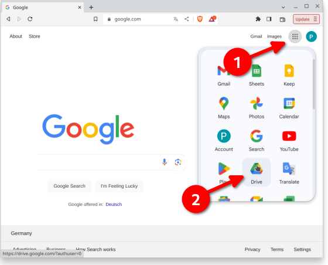

Feu clic a **New** (Nou) a dalt a l'esquerra (o feu clic amb el botó dret en una zona buida sota els fitxers i carpetes) i seleccioneu **File upload** (Pujar fitxer).

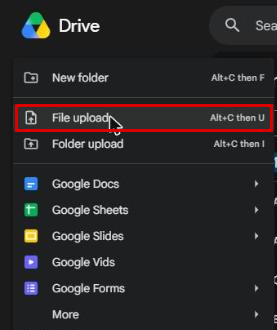

Ara el fitxer apk ja hauria d'estar pujat a Google Drive.

#### Feu servir l'aplicació Google Drive per obrir el fitxer apk i instal·lar-lo

Passeu al telèfon i obriu l'aplicació Google Drive. És una aplicació preinstal·lada. La trobareu on hi ha les altres aplicacions de Google, o cercant el nom de l'aplicació.

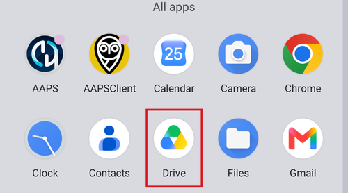

Inicieu la instal·lació de l'apk tocant el nom del fitxer a l'aplicació Google Drive del telèfon.

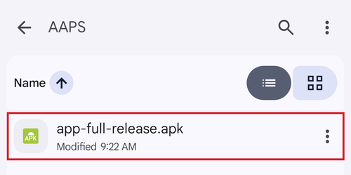

Si rebeu un avís de seguretat que diu que ara no podeu instal·lar aplicacions des de Google Drive, toqueu "Configuració" i permeteu-ho només per a aquest moment. Després torneu-ho a prohibir, perquè deixar-ho sempre activat és un risc de seguretat.

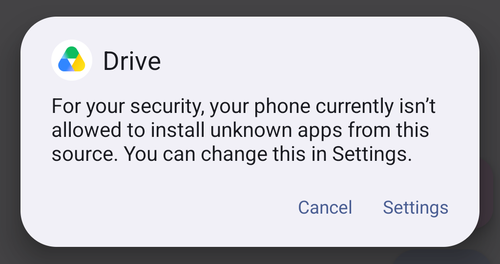

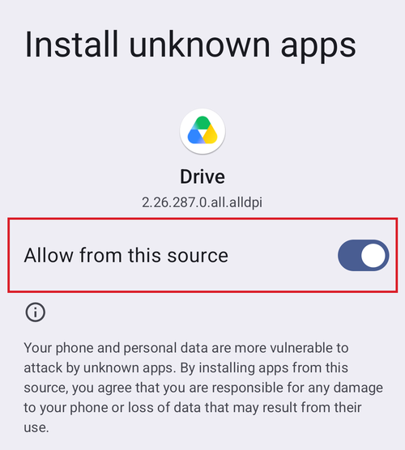

Quan acabi la instal·lació, haureu acabat aquest pas.

Hauríeu de veure la icona d'**AAPS** i poder obrir l'aplicació.

```{warning}
**AVÍS DE SEGURETAT IMPORTANT**
Us heu recordat de tornar a prohibir la instal·lació des de Google Drive?
```

Continueu amb la [configuració del llaç d'AAPS](../SettingUpAaps/SetupWizard.md).

### Opció 2. Feu servir un cable USB per transferir fitxers

La segona manera de transferir el fitxer apk d'AAPS és amb un [cable USB](https://support.google.com/android/answer/9064445?hl=en).

Transferiu el fitxer des de la seva ubicació a l'ordinador fins a la carpeta "downloads" (baixades) del telèfon.

Al telèfon, haureu de permetre la instal·lació des d'orígens desconeguts. Trobareu explicacions de com fer-ho a internet (_p. ex._ [aquí](https://www.expressvpn.com/de/support/vpn-setup/enable-apk-installs-android/) o [aquí](https://www.androidcentral.com/unknown-sources)).

Quan hàgiu transferit el fitxer arrossegant-lo, obriu la carpeta "Baixades" (Downloads) del telèfon i premeu el fitxer apk d'AAPS:

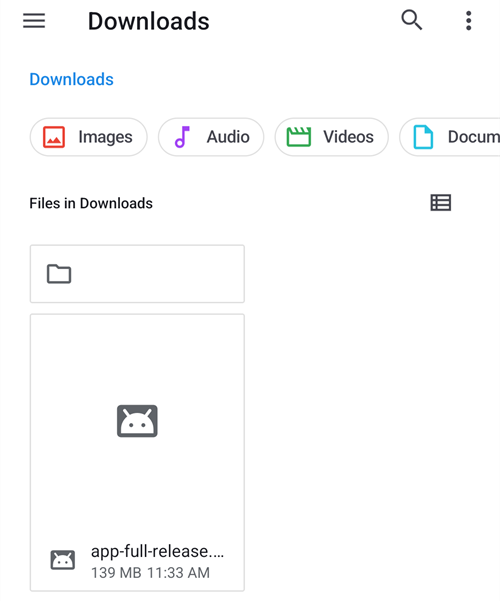

La primera vegada, Android us diu que el telèfon no pot instal·lar aplicacions desconegudes d'aquesta font. Premeu "**Configuració**":

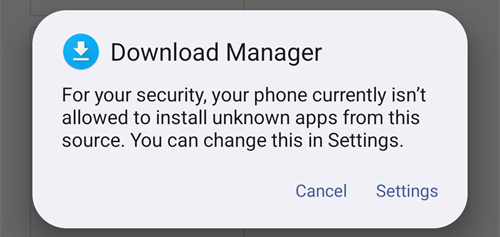

Activeu "**Permet d'aquesta font**" i torneu enrere:

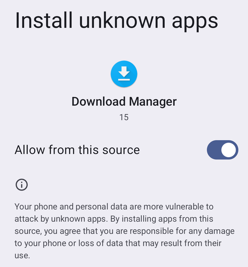

Torneu a prémer el fitxer apk i seleccioneu "**Instal·la**":

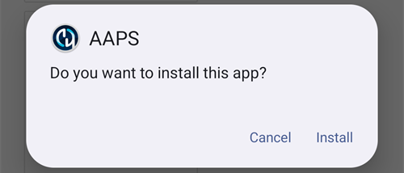

Quan acabi la instal·lació, premeu "**Obre**" per iniciar **AAPS**, o "**Fet**" per obrir-lo més tard:

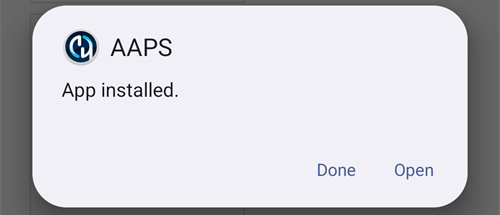

```{warning}
**AVÍS DE SEGURETAT IMPORTANT**
Recordeu tornar a desactivar "Permet d'aquesta font" després de la instal·lació, perquè deixar-ho sempre activat és un risc de seguretat.
```

Continueu amb la [configuració del llaç d'AAPS](../SettingUpAaps/SetupWizard.md).

(transferring-installing-play-protect-warning)=
## Avís de Google Play Protect

Quan instal·leu **AAPS**, Google Play Protect us pot avisar que l'aplicació no és segura, que es va crear per a una versió antiga d'Android i que no inclou les proteccions de privadesa més recents.

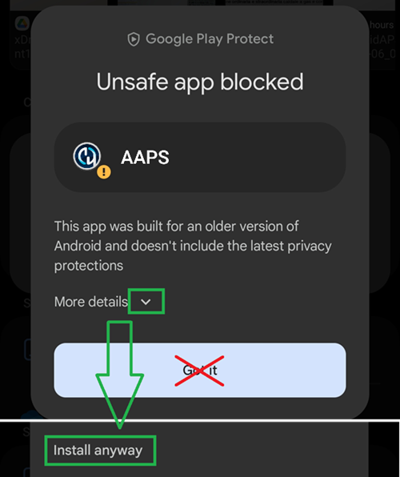

Això és normal en una aplicació que heu compilat vosaltres mateixos. Toqueu **Més detalls** i després **Instal·la igualment**.

Si la instal·lació queda **bloquejada** amb un missatge sobre un desenvolupador no verificat (no només un avís), vegeu més avall [Verificació de desenvolupadors d'Android](#android-developer-verification).

(android-developer-verification)=

## Verificació de desenvolupadors d'Android

Google introdueix la **verificació de desenvolupadors d'Android**: a la majoria de telèfons Android, només es podran instal·lar aplicacions que un desenvolupador verificat hagi registrat a Google. Això també s'aplica a les aplicacions instal·lades des d'un fitxer APK («sideloading»), que és com instal·leu l'aplicació **AAPS** que heu compilat vosaltres mateixos.

### Què canvia

Quan instal·leu **AAPS** en un telèfon amb serveis de Google (un dispositiu Android «certificat», gairebé tots els telèfons que es venen amb Play Store), Android comprovarà si l'aplicació ve d'un desenvolupador registrat a Google. Si no és així, la instal·lació normal tocant el fitxer APK queda bloquejada.

**La comprovació es fa quan s'instal·la o s'actualitza una aplicació.** No elimina les aplicacions que ja estan instal·lades i funcionant.

Google ho aplica a poc a poc:

| Quan                   | Què passa                                                                                                                                                         |
| ---------------------- | ----------------------------------------------------------------------------------------------------------------------------------------------------------------- |
| Agost de 2026          | Els comptes de desenvolupador gratuïts de «distribució limitada» s'obren a tot el món, i el «procés avançat» (advanced flow) comença a arribar als telèfons       |
| 30 de setembre de 2026 | La verificació s'aplica al **Brasil, Indonèsia, Singapur i Tailàndia**, per a aplicacions instal·lades des de Google Play i algunes altres botigues d'aplicacions |
| 2027                   | La verificació obligatòria s'estén a la **resta del món** i a **totes les instal·lacions**, incloent-hi els fitxers APK                                           |

Google publica els detalls a les pàgines de [verificació de desenvolupadors d'Android](https://developer.android.com/developer-verification), amb unes [preguntes freqüents](https://developer.android.com/developer-verification/guides/faq). Google encara pot canviar dates i detalls; aquesta pàgina s'actualitzarà a mesura que avanci el desplegament.

### M'afecta a mi?

- **La compilació d'AAPS no queda afectada gens.** La [compilació al navegador](#browser-build), la [compilació amb Android Studio](ComputerBuild.md) i la [compilació des de la línia d'ordres](CLIBuild.md) funcionen exactament com abans, i el vostre magatzem de claus no canvia.
- **El vostre AAPS actual continua funcionant.** La verificació només es comprova quan s'instal·la o s'actualitza una aplicació.
- **Si viviu al Brasil, Indonèsia, Singapur o Tailàndia:** a partir del 30 de setembre de 2026, la verificació s'aplica a les aplicacions instal·lades des de Google Play i algunes altres botigues d'aplicacions. Google diu que la instal·lació directa d'un fitxer APK no entra en aquest primer pas, de manera que **AAPS** s'hauria de continuar instal·lant com sempre. Tot i així, prepareu ara un dels [mètodes d'instal·lació gratuïts](#android-developer-verification-free-methods) de més avall, perquè no us agafi per sorpresa si això canvia.
- **Si viviu en qualsevol altre país:** per a vosaltres no canvia res abans del 2027, i no fer res de moment és una opció vàlida. Però configureu un dels [mètodes d'instal·lació gratuïts](#android-developer-verification-free-methods) de més avall ara que tot funciona: descobrir el bloqueig el dia que una actualització és rebutjada, amb les 24 hores d'espera del [procés avançat](#android-developer-verification-advanced-flow) per davant, és el pitjor moment.
- **Telèfons antics:** la verificació s'aplica als telèfons amb Android 7 o superior, és a dir, a tots els telèfons que poden fer funcionar **AAPS**.

(android-developer-verification-free-methods)=

## Maneres gratuïtes d'instal·lar AAPS

**No** heu de pagar res a Google per continuar fent servir **AAPS**. Hi ha diversos mètodes gratuïts; trieu el que s'adapti a la vostra situació.

```{admonition} Which method should I use?
:class: tip
- Teniu un **ordinador** (sigui quina sigui la manera com heu compilat **AAPS**): feu servir [ADB](#android-developer-verification-adb) o, si preferiu evitar la línia d'ordres, l'[instal·lador web](#android-developer-verification-web). Tots dos estan exempts de la verificació, no tenen límits i no necessiten cap compte de Google.
- **No teniu cap ordinador**: feu servir el [procés avançat](#android-developer-verification-advanced-flow) al telèfon.
- Preferiu registrar-vos a Google perquè la instal·lació normal «tocant l'APK» continuï funcionant: hi ha un [compte gratuït de distribució limitada](#android-developer-verification-limited-account), però no s'ha provat amb **AAPS**.
```

(android-developer-verification-adb)=

### Opció 1: Instal·lar amb ADB (cal un ordinador)

ADB (Android Debug Bridge) és l'eina oficial de Google per instal·lar aplicacions des d'un ordinador a un telèfon amb un cable USB. Google ha confirmat que **les aplicacions instal·lades amb ADB no necessiten verificació**: no hi ha temps d'espera, ni límit de dispositius, ni registre.

Preparació (només una vegada):

1. Al telèfon, activeu les opcions per a desenvolupadors, que estan amagades: aneu a **Configuració** > **Informació del telèfon** (en alguns telèfons **Informació del programari**) i toqueu **Número de compilació** set vegades, fins que el telèfon confirmi que sou desenvolupadors.
1. Torneu a la pantalla principal de **Configuració**, obriu la nova entrada **Opcions per a desenvolupadors** i activeu **Depuració per USB**.
1. A l'ordinador, comproveu que teniu ADB:
   - Si feu servir **Android Studio**, ADB ja s'hi ha instal·lat.
   - Si no, descarregueu les [SDK Platform Tools](https://developer.android.com/tools/releases/platform-tools) gratuïtes de Google i descomprimiu la carpeta. No cal instal·lar res; ADB és el programa `adb` que hi ha dins d'aquesta carpeta.

Instal·lar (i més endavant actualitzar) **AAPS**:

1. Connecteu el telèfon a l'ordinador amb un cable USB. No cal transferir primer el fitxer APK al telèfon: ADB l'envia directament des de l'ordinador.
1. Al telèfon, accepteu el missatge **Vols permetre la depuració per USB?** (només la primera vegada).
1. A l'ordinador, obriu un terminal (símbol del sistema) a la carpeta on hi ha ADB i el fitxer APK d'**AAPS**, i executeu:

   ```
   adb install -r app-full-release.apk
   ```

   Substituïu `app-full-release.apk` pel nom real del vostre fitxer APK. L'opció `-r` actualitza un **AAPS** ja instal·lat i en conserva totes les dades i la configuració.

1. Espereu fins que es mostri `Success`. Ara **AAPS** ja està instal·lat al telèfon.

Feu servir la mateixa ordre per a totes les actualitzacions futures. Les [pàgines de Wear OS](../WearOS/WearOsSmartwatch.md) ja fan servir ADB de la mateixa manera per instal·lar l'aplicació del rellotge.

Si no voleu fer servir cap cable: a Android 11 i posteriors, la **depuració sense fil** (també a **Opcions per a desenvolupadors**) pot fer el mateix per Wi-Fi, després d'un emparellament únic amb un codi que es mostra al telèfon.

(android-developer-verification-web)=

### Opció 2: Instal·lar des d'una pàgina web (ordinador, sense línia d'ordres)

Si la línia d'ordres no és per a vosaltres, una pàgina web pot fer exactament el mateix que ADB, directament des del navegador. Com que es comunica amb el telèfon pel mateix mecanisme que ADB, té la **mateixa exempció de la verificació**, però no cal descarregar res, ni descomprimir cap carpeta, ni escriure cap ordre.

És el camí més fàcil si heu fet servir la [compilació al navegador](#browser-build) i no heu obert mai una línia d'ordres.

1. Activeu la **Depuració per USB** al telèfon (passos 1 i 2 del [mètode ADB](#android-developer-verification-adb) de més amunt; només cal fer-ho una vegada).
1. Obriu l'**[Instal·lador web d'AAPS](#web-installer)** al navegador.
1. Connecteu el telèfon amb un cable USB i seguiu les instruccions de la pàgina: connectar, triar el fitxer APK i instal·lar.

Tres coses que cal saber:

- Només funciona a **Chrome, Edge o Opera**. Firefox i Safari no es poden comunicar amb dispositius USB.
- Només un programa alhora pot fer servir la connexió ADB del telèfon, així que **tanqueu Android Studio** (o qualsevol altre programa que faci servir ADB) abans de connectar.
- Una pàgina web connectada d'aquesta manera obté el control total del vostre telèfon. **Feu servir només l'adreça de més amunt**, de la documentació d'**AAPS**, i mai una pàgina d'instal·lació trobada amb un cercador. L'instal·lador web d'**AAPS** funciona completament al navegador: el vostre fitxer APK no es puja enlloc.

```{admonition} No computer? A second phone works too
:class: tip
L'instal·lador web també funciona des de **Chrome en un altre telèfon Android** amb un cable USB-C a USB-C, de manera que un pare o una mare pot instal·lar **AAPS** al telèfon d'un fill sense cap ordinador a casa.
```

(android-developer-verification-advanced-flow)=

### Opció 3: El «procés avançat» al telèfon (no cal ordinador)

Google ofereix una sortida per a usuaris amb experiència que entenen els riscos d'instal·lar aplicacions no verificades, anomenada **procés avançat** (advanced flow). Google va començar a fer-lo arribar als telèfons l'agost de 2026, abans que la verificació sigui obligatòria, així que ja el podeu configurar ara. És una configuració que es fa una sola vegada al mateix telèfon, i **tarda 24 hores** a completar-se:

1. Activeu les opcions per a desenvolupadors amagades (vegeu el pas 1 del mètode ADB de més amunt) i després obriu **Configuració** > **Opcions per a desenvolupadors** > **Apps from unverified developers** (aplicacions de desenvolupadors no verificats).
1. Activeu **Allow apps from unverified developers** (permetre aplicacions de desenvolupadors no verificats). El telèfon us demana el bloqueig de pantalla per confirmar que sou vosaltres.
1. El telèfon pregunta si algú us demana que activeu aquesta opció, i explica que els bancs, les administracions públiques o la policia no us ho demanarien mai. Llegiu l'avís i confirmeu que ningú us pressiona ni us guia (és una protecció contra estafadors).
1. **Reinicieu el telèfon.** Això inicia un **temps d'espera de 24 hores**, només una vegada.
1. Al cap de 24 hores, torneu a **Configuració** > **Opcions per a desenvolupadors** > **Apps from unverified developers** per acabar la configuració.
1. Trieu si voleu permetre aplicacions no verificades durant **7 dies** o **indefinidament**. Per a **AAPS**, trieu **indefinidament**; si no, la propera actualització quedarà bloquejada quan passin els 7 dies.

Després d'aquesta configuració, instal·lar o actualitzar l'APK d'**AAPS** funciona com avui, amb un avís més que diu que l'aplicació és d'un desenvolupador no verificat: toqueu **Instal·la igualment**.

Bo de saber:

- Després podeu tornar a desactivar les **Opcions per a desenvolupadors**: el procés avançat continua activat. Google tampoc no dona a les aplicacions (com les aplicacions dels bancs) cap manera de detectar que el procés avançat està activat.
- Si desactiveu el procés avançat, instal·lar **o actualitzar** **AAPS** torna a quedar bloquejat (l'**AAPS** instal·lat continua funcionant). Teniu 10 minuts per tornar-lo a activar; després, el temps d'espera de 24 hores torna a començar.
- Canviar l'hora del telèfon no escurça el temps d'espera, i ADB no el pot saltar.
- Google diu que la vostra elecció segueix el vostre compte de Google als altres dispositius, de manera que un telèfon nou no hauria de suposar una altra espera de 24 hores.
- Si no trobeu **Apps from unverified developers** a les opcions per a desenvolupadors, el vostre telèfon encara no ha rebut aquesta funció. L'aporta un component del sistema anomenat **Android Developer Verifier**, que Google distribueix a poc a poc a través de Play Store. Podeu ajudar que arribi abans obrint **Android Developer Verifier** a Play Store.

```{note}
Google diu que aquesta és una primera versió i que encara pot canviar les pantalles i els passos; aquesta secció s'actualitzarà amb captures de pantalla quan hi hagi la versió final.
```

(android-developer-verification-limited-account)=

### Opció 4: Registrar-se a Google (compte gratuït de distribució limitada)

Google ofereix un tipus de compte de desenvolupador **gratuït** per a aficionats i ús personal, anomenat **compte de distribució limitada**, obert a tothom des d'agost de 2026:

- **Sense document d'identitat oficial** i **sense cap quota** (a diferència del compte de desenvolupador de pagament, que no cal per a l'ús personal d'**AAPS**). Sí que cal un compte de Google amb verificació en dos passos, un perfil de pagaments de Google amb el vostre nom legal i la vostra adreça, i una adreça de correu electrònic de contacte.
- Registreu el nom de paquet de l'aplicació a l'Android Developer Console de Google i autoritzeu els telèfons on es pot instal·lar, fins a **20 dispositius**, amb una vinculació entre el telèfon i la consola feta amb un codi QR o un enllaç.
- Un cop registrada, la instal·lació normal (tocant el fitxer APK) torna a funcionar als telèfons autoritzats, sense ADB i sense el procés avançat.
- Un compte de distribució limitada es pot passar més endavant a un compte complet, però no al revés.

```{warning}
Google no ha explicat com funciona el registre quan moltes persones compilen la mateixa aplicació de codi obert: tots els **AAPS** compilats per un mateix fan servir el mateix nom de paquet (`info.nightscout.androidaps`) amb una clau de signatura diferent, i les preguntes freqüents de Google diuen que un nom de paquet que ja fan servir altres no es pot reclamar directament i necessita una revisió addicional. No se sap quin serà el resultat d'aquesta revisió, i el compte de desenvolupador de pagament (25 $ i un document d'identitat oficial) no hi ajuda: pagar només treu el límit de 20 dispositius, no la revisió del nom de paquet.

Per aquest motiu, encara no es poden escriure instruccions pas a pas. Aquesta secció es completarà quan s'hagi provat el registre amb **AAPS**. Mentrestant, ADB, l'instal·lador web i el procés avançat de més amunt són alternatives fiables.
```

## Què no canvia

- Compilar **AAPS** vosaltres mateixos, amb qualsevol dels tres [mètodes de compilació](BuildingAaps.md).
- El vostre compte de GitHub, el vostre repositori de compilació (AAPS Builder) o fork, i el vostre magatzem de claus.
- La vostra aplicació **AAPS** instal·lada, la vostra configuració i els vostres [objectius](CompletingTheObjectives.md).
- Els telèfons sense serveis de Google i, en general, les [instal·lacions amb ADB](#android-developer-verification-adb).

## On trobar ajuda

1. **Llegiu** les [preguntes freqüents sobre la verificació de desenvolupadors](https://developer.android.com/developer-verification/guides/faq) de Google si teniu preguntes sobre la verificació en si.
2. **Pregunteu** al canal *#AAPS* de [Discord](https://discord.gg/4fQUWHZ4Mw), o en un dels altres [canals de la comunitat](../GettingHelp/WhereCanIGetHelp.md), si una instal·lació queda bloquejada.
3. Quan demaneu ajuda, indiqueu la marca i el model del telèfon, la versió d'Android, el vostre país i el missatge exacte que es mostra quan falla la instal·lació.

```{toctree}
:hidden:

Instal·lador web d'AAPS <WebInstaller.md>
```
