# El vostre perfil d'AAPS

El vostre **Perfil d'AAPS** és un conjunt de quatre paràmetres clau que defineixen com ha de lliurar insulina **AAPS** segons els nivells de glucèmia del sensor. Aquests són els paràmetres principals en què es basa **AAPS**. A mesura que avanceu pels **Objectius**, desbloquejareu més paràmetres que podeu canviar (com la configuració de SMB), però el bon funcionament d'aquestes funcions depèn que el vostre **Perfil** de base sigui correcte. El **Perfil** inclou:
* [objectius de glucèmia](#profile-glucose-targets),
* [taxes basals](#your-aaps-profile-basal-rates) (BR),
* [factors de sensibilitat a la insulina](#your-aaps-profile-insulin-sensitivity-factor) (ISF) i
* [ràtios insulina-carbohidrats](#your-aaps-profile-insulin-to-carbs-ratio) (IC o ICR).

```{admonition} Where did DIA go?
:class: note
La **durada de l'acció de la insulina (DIA)** ja no forma part del vostre **Perfil**. Ara es configura per a cada insulina: vegeu [Gestionar → Configuració d'insulina](#Config-Builder-insulin-dia).
```

Com a part de la gestió d'**AAPS**, els usuaris han de revisar contínuament i amb atenció si la configuració del seu **Perfil** és correcta. Es recomana ajustar els paràmetres en l'ordre en què es presenten aquí. Intenteu tenir bé un paràmetre abans de canviar-ne un altre. Feu passos petits en lloc de grans canvis de cop. No oblideu activar el perfil nou després de cada canvi. Feu regularment una [còpia de seguretat de la configuració del vostre **Perfil**](#YourAapsProfile_Profile-backup) exportant la configuració.

Els paràmetres del vostre **Perfil** s'influeixen entre ells: podeu tenir paràmetres «incorrectes» que funcionen bé junts en algunes situacions, però no en altres. Per exemple, si una basal massa alta coincideix amb una **CR** massa alta. Això vol dir que heu de mirar cada paràmetre per separat i comprovar que funcionen bé junts en situacions diferents.

Podeu fer servir [Autotune](https://autotuneweb.azurewebsites.net/) com a ajuda per pensar, però no l'heu de seguir a cegues: pot no funcionar bé per a vosaltres o en totes les situacions.

```{admonition} Your diabetes may vary
:class: note
Els **Perfils** canvien molt d'una persona a una altra.

Per a les taxes basals (BR), els factors de sensibilitat a la insulina (ISF) i les ràtios insulina-carbohidrats (IC o ICR), els valors absoluts i les tendències de les necessitats d'insulina canvien molt d'una persona a una altra, segons la vostra biologia, sexe, edat, forma física, etc., i també per factors de curt termini com una malaltia o l'esport recent. Per a més orientació sobre això, el llibre [“Bright Spots and Landmines”](https://diatribe.org/bright-spots-and-landmines/) d'Adam Brown és un llibre excel·lent.

```

Els quatre últims paràmetres (objectius de glucèmia, taxes basals, factors de sensibilitat a la insulina i ràtios insulina-carbohidrats) es poden posar a valors diferents durant les 24 hores, amb canvis cada hora si cal.


A sota es mostren captures de pantalla d'**AAPS** amb un perfil d'_exemple_. Tingueu en compte que aquest perfil d'exemple de sota té molts punts horaris. Quan comenceu amb **AAPS**, el vostre perfil probablement serà molt més simple.

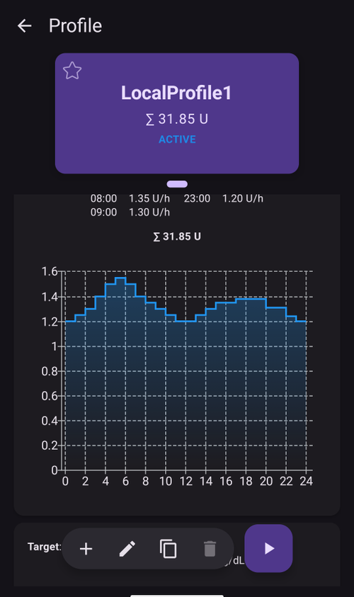

(profile-glucose-targets)=
## Objectius de glucèmia

### Descripció

El vostre **objectiu de glucèmia** és un valor bàsic i tots els càlculs d'**AAPS** s'hi basen. És diferent del rang objectiu en què normalment voleu mantenir els valors de glucèmia. L'objectiu es fa servir en els càlculs d'**AAPS**: si **AAPS** preveu que la vostra **glucèmia** quedarà fora del rang objectiu, actuarà per tornar-vos a aquest rang.

Els objectius es poden definir dins d'aquests límits:

|       | Objectiu _Baix_       | Objectiu _Alt_          |
| ----- | --------------------- | ----------------------- |
| Mínim | 4,4 mmol/l o 80 mg/dl | 5 mmol/l o 90 mg/dl     |
| Màxim | 10 mmol/l o 180 mg/dl | 11,1 mmol/l o 200 mg/dl |

### Impacte

Si l'objectiu del vostre **Perfil** és molt ampli (per exemple, 3 mmol/l o més [50 mg/dl o més]), sovint veureu que **AAPS** actua poc. Això és perquè es preveu que la **glucèmia** estigui en algun punt d'aquest rang ampli, i per això és poc probable que **AAPS** posi basals temporals.

### Com configurar-lo

La **figura de sota** mostra un exemple de com es pot configurar l'objectiu en un perfil d'**AAPS**.

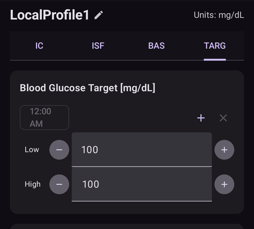

Els objectius de **glucèmia** es posen segons les vostres preferències i necessitats personals. Per exemple, si us preocupen les hipoglucèmies de nit, podeu posar l'objectiu una mica més alt, a 117 mg/dl (6,5 mmol/l), de 21:00 a 7:00. Si voleu tenir prou insulina a bord (IOB) al matí abans del bolus d'esmorzar, podeu posar un objectiu més baix de 81 mg/dl (4,5 mmol/l) de 7:00 a 8:00.

En [llaç obert](#KeyAapsFeatures-OpenLoop), sobretot mentre avanceu pels [primers objectius](../SettingUpAaps/CompletingTheObjectives.md), un objectiu amb un rang ampli pot ser una bona opció mentre aprengueu com es comporta **AAPS** i ajusteu el vostre **Perfil**.<br/> En [llaç tancat](#KeyAapsFeatures-ClosedLoop) (a partir de l'**[Objectiu 6](#objectives-objective6)**), es recomana reduir el rang fins a tenir un sol objectiu per a cada hora del dia (objectiu _Baix_ = objectiu _Alt_), perquè **AAPS** reaccioni ràpid als canvis de **glucèmia**.

(your-aaps-profile-basal-rates)=

## Taxes basals

### Descripció

La vostra taxa basal d'insulina (unitats/hora) dona insulina de fons i manté estables els nivells de glucèmia quan no hi ha menjar ni esport.

La bomba d'insulina lliura petites quantitats d'insulina ràpida cada pocs minuts, perquè el fetge no alliberi massa glucosa i perquè la glucosa entri a les cèl·lules del cos. La insulina basal sol ser entre el 40 i el 50% de la vostra dosi diària total (TDD), segons la vostra dieta, i normalment segueix un ritme circadià, amb un pic i una vall en les necessitats d'insulina durant les 24 hores. Per a més informació, el capítol 6 de [“Think like a Pancreas”](https://amzn.eu/d/iVU0RGe) de Gary Scheiner és molt útil.

La majoria d'educadors en diabetis tipus 1 (i de persones amb diabetis tipus 1!) coincideixen que primer heu d'ajustar bé les taxes basals, abans d'intentar optimitzar l'ISF i la ICR.

### Impacte

Unes taxes basals correctes us permeten despertar-vos dins del rang i saltar-vos àpats (o menjar) més d'hora o més tard, sense pujar ni baixar massa.

Una taxa basal massa alta pot provocar glucèmies baixes. I a l'inrevés.

**AAPS** pren com a referència la taxa basal per defecte. Si la taxa basal és massa alta, una «basal temporal zero» comptarà com una IOB negativa més gran del que hauria de ser. Això farà que **AAPS** doni després més correccions de les que caldria per portar finalment la IOB a zero.

Per tant, una taxa basal massa alta provoca **glucèmies** baixes tant amb la taxa per defecte com unes hores després, quan **AAPS** corregeix cap a l'objectiu.

Al contrari, una taxa basal massa baixa pot provocar glucèmies altes i que els nivells no baixin fins a l'objectiu.

### Com configurar-lo

La **figura de sota** mostra un exemple de com es poden configurar les taxes basals en un perfil d'**AAPS**.

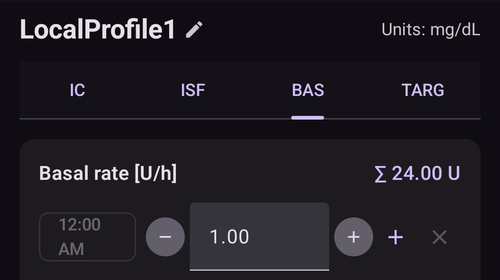

Les taxes basals s'ajusten per prova i error, i cal fer-ho d'acord amb el vostre equip de diabetis.

Hi ha mètodes de prova de la basal que normalment consisteixen a observar les taxes basals i les necessitats d'insulina durant un dejuni <u>intermitent</u> en un període de 24 hores. Encara que heu de provar les taxes basals de tot el dia, no es recomana dejunar 24 h seguides. Això és perquè el cos activa mecanismes, com les hormones, per compensar-ho. Una manera recomanada és dejunar 8 hores en 3 dies diferents.

El mètode recomanat és suspendre el llaç (per seguretat podeu posar AAPS en [**LGS**](#KeyAapsFeatures-LGS) per evitar hipoglucèmies, com es fa per completar l'[objectiu 6](#objectives-objective6)); així es torna a la vostra taxa basal de fons per defecte. Observeu com canvia la vostra **glucèmia**: si baixa, la taxa basal és massa alta. I a l'inrevés.<br/> Un altre mètode (pot ser més difícil) és deixar el llaç en marxa i mirar com canvia la **IOB**. Si la **IOB** és negativa, la vostra taxa basal és massa alta. I a l'inrevés. Tingueu en compte que aquest mètode depèn de l'**ISF** per corregir la **glucèmia**, i per tant cal que altres paràmetres estiguin raonablement bé perquè funcioni.<br/> Una altra manera d'ajustar les taxes basals és observar què fa el llaç durant la nit, quan ja no queda COB. Aquest mètode és especialment útil per als nens, quan dejunar és difícil o les necessitats d'insulina canvien sovint. El [Dr. Saleh Adi de Tidepool](https://www.youtube.com/watch?v=-fpWnGRhLSo) explica maneres útils d'analitzar les línies de glucèmia de la nit per optimitzar les taxes basals.

Vegeu [aquí](../GettingHelp/ProfileTuning.md) com ajustar el vostre perfil basal analitzant els patrons amb el llaç tancat.

Quan actueu segons el resultat de la prova de la basal, els canvis al **Perfil** s'han de fer d'1 a 2 hores (segons el vostre tipus d'insulina) abans de la pujada o la baixada. Repetiu la prova tantes vegades com calgui fins que estigueu segurs de la configuració de les **taxes basals**.

(your-aaps-profile-basal-not-compatible)=
#### Missatge: «La taxa basal no és compatible amb la bomba actual»

Cada bomba té límits: una taxa basal mínima i una de màxima que pot lliurar i, en algunes bombes (per exemple Dana, Accu-Chek Combo, Medtronic i Diaconn G8), taxes basals que només poden canviar a l'hora en punt. **AAPS** comprova el vostre perfil amb la bomba que feu servir, **després** d'aplicar el percentatge que trieu.

Si una taxa basal està fora d'aquests límits, la pantalla **Activar** mostra aquest missatge i el botó **Activar** es queda gris:

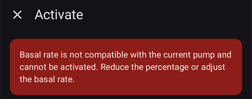

Per exemple, amb una taxa basal de 0,10 U/h a la nit i un percentatge del perfil del 35%, **AAPS** hauria de lliurar 0,035 U/h. Això és menys del que pot lliurar una bomba Dana (0,04 U/h).

Per solucionar-ho, podeu:

* triar un altre percentatge: un de **més alt** si una taxa basal queda massa baixa, un de **més baix** si una taxa basal queda massa alta, o
* [editar el perfil](#your-aaps-profile-create-and-edit-profiles) i canviar la taxa basal.

L'editor de perfils només us deixa començar taxes basals a l'hora en punt. Una taxa basal que comença, per exemple, a les 06:30 només pot venir d'un perfil antic, per exemple després de canviar a una bomba que no ho admet.

(your-aaps-profile-insulin-sensitivity-factor)=

## Factor de sensibilitat a la insulina (ISF)

### Descripció

El factor de sensibilitat a la insulina (de vegades anomenat factor de correcció) indica quant baixarà la vostra glucèmia amb 1 unitat d'insulina.

**En unitats mg/dl:** Si teniu un **ISF** de 40, cada unitat d'insulina baixarà la vostra glucèmia uns 40 mg/dl (per exemple, la glucèmia baixarà de 140 mg/dl a 100 mg/dl).

**En unitats mmol/l:** Si teniu un **ISF** d'1,5, cada unitat d'insulina baixarà la vostra glucèmia uns 1,5 mmol/l (per exemple, de 8 mmol/l a 6,5 mmol/l).

Amb aquests exemples podeu veure que, com _més petit_ és el valor de l'**ISF**, menys sensibles sou a la insulina. Per tant, si baixeu l'ISF de 40 a 35 (mg/dl) o d'1,5 a 1,3 (mmol/l), sovint es diu que feu més fort el vostre **ISF**. Al contrari, augmentar el valor de l'**ISF** de 40 a 45 (mg/dl) o d'1,5 a 1,8 (mmol/l) fa més feble el vostre **ISF**.

### Impacte

Un **ISF més baix / més fort** (per exemple 40 en lloc de 50) vol dir que la insulina baixa menys la vostra **glucèmia** per unitat. Això fa que el llaç faci una correcció més agressiva / més forta amb **més insulina**. Si el vostre **ISF** és massa fort (valor petit), pot provocar una **glucèmia** baixa.

Un **ISF més alt / més feble** (per exemple 45 en lloc de 35) vol dir que la insulina baixa més la vostra **glucèmia** per unitat. Això fa que el llaç faci una correcció menys agressiva / més feble amb **menys insulina**. Si el vostre **ISF** és massa feble (valor gran), pot provocar una **glucèmia** alta.

**Exemple:**
* La **glucèmia** és de 190 mg/dl (10,5 mmol/l) i l'objectiu és de 100 mg/dl (5,6 mmol/l).
* Per tant, voleu una correcció de `190 - 100 = 90 mg/dL` o `10.5 - 5.6 = 4.9 mmol/L`
* Si `ISF = 30` -> `90 / 30 = 3` o `ISF = 1.63` -> `4.9 / 1.63 = 3`: 3 unitats d'insulina
* Si `ISF = 45` -> `90 / 45 = 2` o `ISF = 2.45` -> `4.9 / 2.45 = 2`: 2 unitats d'insulina

Un **ISF** massa baix (i per tant més agressiu, cosa que passa sovint) pot provocar «correccions excessives», perquè **AAPS** calcula que l'usuari necessita més insulina de la que realment cal per corregir una **glucèmia** alta. Això pot provocar glucèmies en «muntanya russa» (sobretot en dejú), com mostra la imatge de sota. En aquest cas, cal augmentar el valor de l'**ISF** perquè **AAPS** sigui menys agressiu. Així **AAPS** lliurarà dosis de correcció més petites i evitarà corregir massa una **glucèmia** alta, cosa que acabaria en una **glucèmia** baixa.

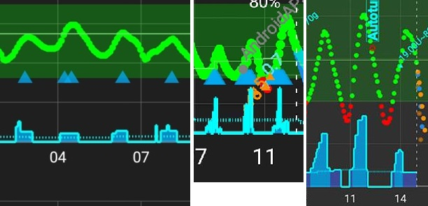

Al contrari, un **ISF** massa alt pot provocar correccions insuficients, és a dir, la vostra **glucèmia** es queda per sobre de l'objectiu, cosa que es nota sobretot a la nit.

### Com configurar-lo

Vegeu la **figura de sota** per a un exemple de com es poden configurar els valors d'ISF en un perfil d'**AAPS**.

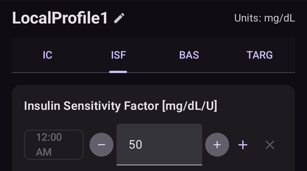

Un punt de partida bàsic per calcular el vostre ISF de dia és basar-lo en la vostra dosi diària total (TDD) amb la regla del 1700 (94). Trobareu més detalls al capítol 7 de [“Think like a Pancreas”](https://amzn.eu/d/iVU0RGe) de Gary Scheiner.

| 1700 (si mesureu en mg/dl) o 94 (mmol/l) / TDD = ISF aprox.<br/><br/>Exemple: TDD = 40 U<br/>ISF aprox. (mg/dl) = 1700/40 = 43<br/>ISF aprox. (mmol/l) = 94/40 = 2,4 |
| -------------------------------------------------------------------------------------------------------------------------------------------------------------------------------------------- |
|                                                                                                                                                                                              |

Si les vostres basals són correctes, podeu provar-ho suspenent el llaç, comprovant que la **IOB** és zero i prenent unes quantes pastilles de glucosa per arribar a un nivell «alt» estable.

Després poseu-vos una quantitat estimada d'insulina (segons l'1/ISF actual) per arribar al vostre objectiu de glucèmia.

Aneu amb compte, perquè sovint es posa massa baix. Massa baix vol dir que 1 U baixarà la glucèmia més de pressa del que s'espera.

(your-aaps-profile-insulin-to-carbs-ratio)=

## Ràtio insulina-carbohidrats (ICR)

### Descripció

La **ICR** indica quants grams de carbohidrats cobreix una unitat d'insulina.

Algunes persones també fan servir **I:C** com a abreviatura en lloc d'**ICR**, o parlen de ràtio de carbohidrats: **CR**.

Per exemple, una ràtio insulina-carbohidrats d'1 a 10 (1:10) vol dir que us poseu 1 U d'insulina per cada 10 grams de carbohidrats que mengeu. Un àpat de 25 g de carbohidrats necessitaria 2,5 U d'insulina.

Si la vostra **ICR** és més feble (valor més alt), per exemple 1:20, només necessitaríeu 0,5 U d'insulina per cobrir 10 g de carbohidrats. Un àpat de 25 g de carbohidrats necessitaria 25/20 = 1,25 U d'insulina.

És habitual tenir **ICR** diferents a diferents hores del dia, per les hormones i l'activitat física. Moltes persones veuen que tenen la **ICR** més baixa / més forta cap a l'hora d'esmorzar, perquè solen ser més resistents a la insulina. Per exemple, la **ICR** d'un usuari adult podria ser 1:8 per a l'esmorzar, 1:10 per al dinar i 1:10 per al sopar, però aquests patrons no són universals, i algunes persones són més resistents a la insulina a l'hora de sopar i llavors necessiten una **ICR** més forta / més petita.

> **NOTA:**
> 
> En alguns països europeus es feien servir les unitats de pa per calcular quanta insulina cal per al menjar. Al principi 1 unitat de pa equivalia a 12 g de carbohidrats; després alguns ho van canviar a 10 g de carbohidrats.
> 
> En aquest model la quantitat de carbohidrats era fixa i la quantitat d'insulina era variable. («Quanta insulina cal per cobrir una unitat de pa?»)
> 
> Amb la **ICR**, la quantitat d'insulina és fixa i la quantitat de carbohidrats és variable. («Quants g de carbohidrats es poden cobrir amb una unitat d'insulina?»)
> 
> Exemple:
> 
> Factor d'unitat de pa (BU = 12 g de carbohidrats): 2,4 U/BU -> Necessiteu 2,4 unitats d'insulina quan mengeu una unitat de pa.
> 
> **ICR** corresponent: 12 g / 2,4 U = 5,0 g/U -> 5,0 g de carbohidrats es poden cobrir amb una unitat d'insulina.
> 
> Factor BU 2,4 U / 12 g   ===>   IC = 12 g / 2,4 U = 5,0 g/U
> 
> Hi ha taules de conversió a internet, per exemple [aquí](https://www.mylife-diabetescare.com/files/media/03_Documents/11_Software/FAS/SOF_FAS_App_KI-Verha%CC%88ltnis_MSTR-DE-AT-CH.pdf).

### Impacte

Una **ICR més baixa / més forta** vol dir menys menjar per unitat, és a dir, rebeu més insulina per a una quantitat fixa de carbohidrats. També es pot dir «més agressiu». Si la vostra IC és massa forta, rebeu massa insulina, i això pot provocar **glucèmies** baixes.

Una **ICR més alta / més feble** = més menjar per unitat, és a dir, rebeu menys insulina per a una quantitat fixa de carbohidrats. També es pot dir «menys agressiu». Si la vostra IC és massa feble, rebeu menys insulina de la que necessiteu, i això pot provocar **glucèmies** altes.

### Com configurar-lo

La **figura de sota** mostra un exemple de la **ICR** d'un usuari i de com es pot configurar en un **Perfil d'AAPS**. Quan introduïu aquests valors, introduïu la part final de la ràtio; per tant, una ràtio insulina-carbohidrats d'1:3,5 s'introdueix simplement com «3,5».

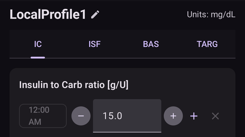

Si, després de digerir un àpat i quan la **IOB** ha tornat a zero, la vostra **glucèmia** queda més alta que abans de menjar, probablement la vostra **ICR** és massa feble (_és a dir_, el número és massa alt i s'ha d'anar baixant a poc a poc). Al contrari, si la vostra **glucèmia** és més baixa que abans de menjar, la **ICR** és massa forta (_és a dir_, el número és massa petit i s'ha d'anar pujant a poc a poc).

Si les vostres taxes basals són correctes, podeu fer la prova així: comproveu que la **IOB** és zero i que esteu dins del rang, mengeu una quantitat de carbohidrats ben coneguda i poseu-vos una quantitat estimada d'insulina segons la ràtio insulina-carbohidrats actual. El millor és menjar el que mengeu normalment a aquella hora del dia i comptar-ne els carbohidrats amb precisió.

## Preguntes freqüents sobre el perfil

```{contents} Common questions related to the Profile
:depth: 1
:local: true
```

### Per què és important tenir el perfil correcte

**Per què he d'intentar tenir bé la configuració del perfil? El llaç no ho pot arreglar tot sol?**

Un llaç tancat híbrid _pot_ intentar ajustar el lliurament d'insulina per reduir el mal control de la glucèmia que provoquen uns valors del **Perfil** incorrectes. Ho pot fer, per exemple, aturant el lliurament d'insulina si aneu cap a una hipoglucèmia. Tot i així, podeu aconseguir un control de la glucèmia molt millor si la configuració del vostre **Perfil** ja és el més a prop possible del que necessita el vostre cos. Aquesta és una de les raons per les quals **AAPS** fa servir objectius per etapes per passar del llaç obert al llaç tancat híbrid. A més, hi haurà moments en què haureu d'obrir el llaç (escalfament del sensor, error del sensor _etc._), de vegades a mitja nit, i voldreu tenir la configuració correcta per a aquestes situacions.

Si comenceu amb **AAPS** després de fer servir un altre sistema de bomba amb llaç obert o tancat, ja tindreu una idea raonable de quins valors fer servir per a les taxes basals (**BR**), els factors de sensibilitat a la insulina (**ISF**) i les ràtios insulina-carbohidrats (**ICR**).

Si passeu d'injeccions (MDI) a **AAPS**, és bona idea llegir primer com fer el canvi de MDI a bomba, i planificar i fer el canvi amb cura, d'acord amb el vostre equip de diabetis. ["Pumping insulin"](https://amzn.eu/d/iaCsFa2) de John Walsh i Ruth Roberts i [“Think like a Pancreas”](https://amzn.eu/d/iVU0RGe) de Gary Scheiner són molt útils.

### Què provoca pics alts després dels àpats amb el llaç tancat?
Primer de tot, comproveu la vostra taxa basal i feu una prova de taxa basal sense carbohidrats. Si és correcta i la vostra **glucèmia** baixa fins a l'objectiu quan els carbohidrats s'han absorbit del tot, proveu de posar un objectiu temporal «Menjar aviat» a **AAPS** una estona abans de l'àpat, o parleu amb el vostre endocrinòleg d'un temps de prebolus adequat. <br/> Si la vostra **glucèmia** és massa alta després de l'àpat i continua massa alta quan els carbohidrats s'han absorbit del tot, penseu a baixar la vostra **ICR** amb el vostre endocrinòleg. Si la vostra **glucèmia** és massa alta mentre hi ha **COB** i massa baixa quan els carbohidrats s'han absorbit del tot, penseu a pujar la vostra **ICR** i a fer un prebolus en un moment adequat, amb el vostre endocrinòleg.

### Tinc la glucèmia alta i el llaç no la fa baixar
Els motius possibles pels quals **AAPS** no dona prou insulina són:
* L'**ISF** no és prou fort
* Pot ser que la taxa basal no sigui prou forta
* Pot actuar un límit de seguretat, com **maxIOB**. O el **SMB** està desactivat en aquell moment, segons la vostra configuració.
* S'ha configurat una automatització que ha passat per sobre d'**AAPS**.

Vegeu també [Ajustar el perfil d'AAPS](../GettingHelp/ProfileTuning.md).

### Tinc IOB negativa, és un problema?
Una **IOB** negativa vol dir que la quantitat absoluta d'insulina (basal + bolus) al vostre cos és menor que la basal. Farà que **AAPS** enviï més insulina tan bon punt la **glucèmia** comenci a pujar, perquè considera que falta insulina, i això pot provocar una **glucèmia** baixa més tard.

Aquí teniu alguns motius pels quals podeu tenir IOB negativa, i què cal fer:
* una basal massa forta: ajusteu el vostre **Perfil**
* massa bolus a l'àpat anterior: ajusteu el vostre **Perfil** o comproveu si us poseu el bolus en el moment correcte.
* DIA massa curta per al vostre tipus d'insulina, cosa que provoca acumulació d'insulina: ajusteu-la a [Gestionar → Configuració d'insulina](#Config-Builder-insulin-dia)
* activitat física: la propera vegada, penseu a fer servir un [percentatge del perfil](../DailyLifeWithAaps/ProfileSwitch-ProfilePercentage.md) més baix durant l'activitat, per tenir en compte la sensibilitat més alta.

## Gestionar els perfils

```{contents} Operations that you can perform on your **Profiles** in **AAPS**
:depth: 1
:local: true
```
(your-aaps-profile-create-and-edit-profiles)=
### Crear i editar perfils

A **AAPS** v4 els vostres perfils són a la pantalla **Gestionar** (navegació inferior) → **Perfil**, que es mostra com un carrusel de targetes que podeu lliscar, amb una barra d'accions (**➕ Afegir**, **✏️ Editar**, **⧉ Duplicar**, **🗑️ Eliminar**, **▶ Activar**). Per gestionar i activar un perfil, vegeu [Gestionar i activar perfils](#ProfileSwitch-manage-v4). Veniu d'**AAPS** v3, on els perfils tenien la seva pròpia pestanya? Vegeu [Què ha canviat a AAPS v4](#v4changes-manage).

Si toqueu **✏️ Editar**, s'obre l'editor. Poseu el **nom** i les **unitats** del perfil i després ompliu els quatre horaris amb les pestanyes:

- **IC** — ràtio insulina-carbohidrats (g/U)
- **ISF** — factor de sensibilitat a la insulina
- **BAS** — taxes basals
- **OBJ** — rang objectiu


Cada horari és una llista de **blocs horaris**: afegiu un bloc, poseu-hi l'hora d'inici i el valor, i després premeu **Desar**.

Si feu canvis al vostre **Perfil**, assegureu-vos que editeu el **Perfil** correcte: la targeta del perfil en ús porta la marca **ACTIU**, però la targeta seleccionada a la pantalla pot ser una altra.

(your-aaps-profile-profile-from-scratch-for-a-kid)=
### Crear un perfil des de zero per a un nen

L'[Assistent de perfil](#aaps-screens-profile-helper) (menú ☰ → **Assistent de perfil**) us pot ajudar a crear un perfil per a un nen (fins a 18 anys).

**Nota important:**

**L'Assistent de perfil està pensat per ajudar-vos a trobar el perfil inicial per al vostre fill. Encara que es basa en dades de dos hospitals diferents, parleu sempre amb el vostre equip mèdic abans de fer servir un perfil nou!**

L'Assistent de perfil ofereix dades de dos hospitals diferents per trobar el perfil inicial per a nens fins a 18 anys.

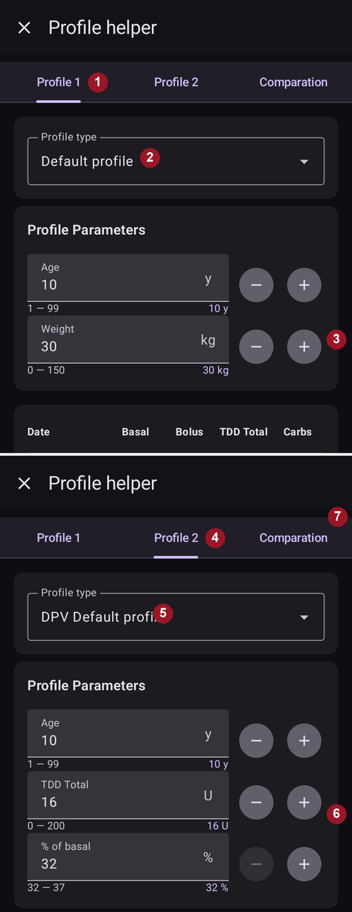

1. Assegureu-vos que sou a la pestanya **Perfil 1**.
2. A **Tipus de perfil**, assegureu-vos que teniu seleccionat «Perfil per defecte».
3. Ajusteu el perfil per defecte (basat en les dades d'un hospital) introduint l'edat del nen i el TDD Total **o** el pes.
4. Canvieu a la pestanya **Perfil 2**.
5. Premeu **Tipus de perfil** i seleccioneu «Perfil DPV per defecte».
6. Ajusteu el perfil DPV per defecte (basat en les dades d'un altre hospital) introduint l'edat del nen, el TDD Total i el percentatge de basal. Tingueu en compte que les dades DPV només donen **taxes basals**, per això IC i ISF es mostren com a zero en aquest perfil.
7. Obriu la pestanya **Comparació**. Es mostrarà la comparació dels dos perfils ajustats (vegeu la captura de pantalla de sota).
8. Si voleu començar a ajustar el vostre perfil a partir d'una d'aquestes propostes, feu servir el botó **Duplicar** a la part de sota de la comparació.

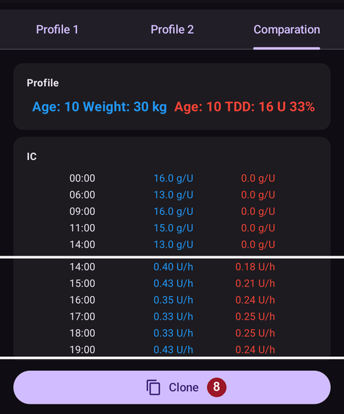

### Canviar de perfil

Vegeu [Canvi de perfil i percentatge del perfil](../DailyLifeWithAaps/ProfileSwitch-ProfilePercentage.md).

(your-aaps-profile-clone-profile-switch)=
### Duplicar un canvi de perfil en un perfil nou


L'[Historial de tractaments](#aaps-screens-treatments) mostra tots els **Canvis de perfil** anteriors. A la pestanya **Canvi de perfil**, podeu fer servir un **Canvi de perfil** anterior com a base per crear un **Perfil** nou. En aquest cas, el desplaçament horari i el percentatge s'aplicaran al nou perfil local. Feu servir el botó **Duplicar** que es mostra a la línia **2**.

Ara podeu anar a la [pantalla Perfil](#your-aaps-profile-create-and-edit-profiles) (**Gestionar → Perfil**) per editar el perfil nou.

(YourAapsProfile_Profile-backup)=
### Còpia de seguretat del perfil

Com que són un paràmetre bàsic del vostre sistema de llaç, els vostres **Perfils** són molt importants i no els voleu perdre de cap manera.

* Els vostres **Perfils** es desen a la base de dades d'**AAPS**.
* Quan **NSClientV3** està configurat (vegeu [Sincronització](#SetupWizard-synchronization-with-the-reporting-server-and-more)), els vostres **Perfils** també s'envien automàticament a Nightscout.
* També formen part de la [configuració exportada](../Maintenance/ExportImportSettings.md). Per tant, assegureu-vos de tenir una còpia de seguretat en un lloc segur.

### Editar perfils des de Nightscout

Si ho activeu, **AAPS** pot rebre els canvis de **Perfil** fets directament a Nightscout. L'opció es diu «**Rebre el magatzem de perfils de NS**» i forma part de les opcions d'**Acceptació de dades de Nightscout** (acceptar dades de Nightscout està desactivat per defecte, vegeu el [pas Control des de clients de l'Assistent de configuració](../SettingUpAaps/SetupWizard.md)); la podeu trobar ràpidament amb la **barra de cerca** de la pantalla principal. Mentre el control des de clients està activat, l'opció està amagada i **AAPS** no accepta canvis de perfil de Nightscout ([mode reforçat](#client-master-control-hardened-mode)); en lloc d'això, editeu el perfil en un client emparellat, o carregueu-lo una vegada amb **Sincronització completa**.

Això pot ser útil quan aneu a fer canvis grans en un **Perfil** més complex. Es poden introduir més fàcilment des de la interfície web, _per exemple_ per copiar a mà dades d'un full de càlcul.

Per fer-ho, però, és important duplicar tot el **registre de la base de dades**, que conté diversos perfils, a l'editor de Nightscout (fletxa blava a la captura de pantalla de sota). Els registres nous de la base de dades porten llavors la data actual. Després de desar, el **Perfil** canviat o nou es pot activar a **AAPS** amb un [canvi de perfil](../DailyLifeWithAaps/ProfileSwitch-ProfilePercentage.md) normal.

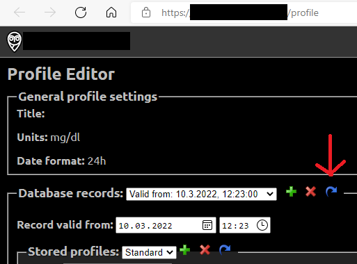

(your-aaps-profile-compare-profiles)=
### Comparar dos perfils

També podeu fer servir l'[Assistent de perfil](#aaps-screens-profile-helper) (menú ☰ → **Assistent de perfil**) per comparar dos perfils o canvis de perfil diferents (el percentatge d'un dels vostres perfils fet servir abans en un [canvi de perfil](../DailyLifeWithAaps/ProfileSwitch-ProfilePercentage.md)).

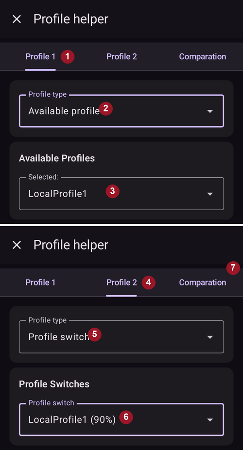

1. Assegureu-vos que sou a la pestanya **Perfil 1**.
2. A **Tipus de perfil**, seleccioneu «Perfil disponible» per triar entre tots els **Perfils** desats.
3. Trieu el **Perfil** des del qual voleu comparar.
4. Canvieu a la pestanya **Perfil 2**.
5. A **Tipus de perfil**, seleccioneu «Canvi de perfil» per triar a l'historial de tots els vostres **Canvis de perfil**.
6. Trieu el **Canvi de perfil** amb el qual voleu comparar.
7. Obriu la pestanya **Comparació**. Es mostrarà la comparació dels dos perfils (vegeu la captura de pantalla de sota).

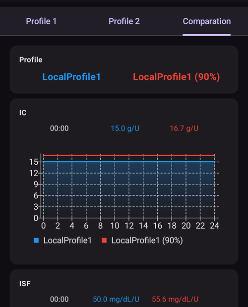
