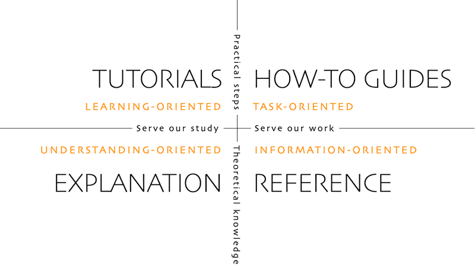

# Com editar la documentació

**Aquesta descripció només serveix per editar la documentació en anglès. Tota la informació nova s'ha d'afegir primer en anglès. Si voleu traduir a altres idiomes (gràcies), feu servir [Crowdin](https://crowdin.com/project/androidapsdocs).**

Per veure com donar format al text (títols, negreta...) i posar enllaços, vegeu la secció ["Sintaxi del codi"](#edit-the-docs-code-syntax) d'aquesta pàgina.

## General

Per a qualsevol pregunta, comentari o idea nova, podeu contactar amb l'equip de documentació a [Discord](https://discord.gg/4fQUWHZ4Mw).

En algun moment us proposaran que feu una pull request (PR). Així és com els vostres canvis a la documentació arriben de debò a les pàgines web d'AAPS, que es desen a GitHub. De fet, fer una PR no és gaire difícil i és una molt bona manera de col·laborar. Ara mateix esteu llegint aquesta documentació perquè persones com vosaltres han fet PR. No us preocupeu per fer un error o per editar els documents equivocats. Els vostres canvis es revisen abans de fusionar-los amb el repositori "oficial" de la documentació d'AAPS. No podeu fer malbé els originals per cap error durant el procés. El procés general és:

- Feu canvis i millores al codi o a la documentació editant el contingut que ja existeix.
- Comproveu bé que els vostres canvis us semblen correctes.
- Escriviu unes quantes notes sobre què ha canviat perquè la gent pugui entendre els canvis.
- Creeu una pull request, que demana als administradors que facin servir els vostres canvis.
- Ells la revisaran i (1) fusionaran els vostres canvis, (2) us escriuran un comentari sobre els vostres canvis, o (3) començaran un document nou amb els vostres canvis.

(Nota: si apreneu millor amb imatges, hi ha un vídeo de YouTube [aquí](https://youtu.be/4b6tsL0_kzg) que mostra el procés d'una PR.)

Com a exemple, farem un canvi a AndroidAPSdocs. Això es pot fer en qualsevol ordinador Windows, Mac, etc. (qualsevol ordinador amb accés a Internet).

1. Aneu a <https://github.com/openaps/AndroidAPSdocs> i premeu Fork a la part superior dreta per fer la vostra pròpia còpia del repositori.


2. Aneu a qualsevol pàgina i navegueu fins a la pàgina que voleu editar. Podeu fer clic a l'enllaç "Edit in GitHub" a la cantonada superior dreta. Això només és possible a les pàgines en anglès. 


O feu clic a la icona del llapis que apareix a la barra superior del contingut de la pàgina que voleu editar. Per fer-ho, cal que ja hàgiu iniciat la sessió al vostre compte de GitHub (si no en teniu cap, és fàcil crear-ne un).


3. Qualsevol de les dues opcions del pas 2 crearà una branca nova al VOSTRE repositori, on es desaran els vostres canvis. Feu els vostres canvis al fitxer.

Fem servir markdown per a les pàgines de la documentació. Els fitxers tenen l'extensió ".md". L'especificació de Markdown no és fixa, i ara mateix fem servir myst_parser per als nostres fitxers markdown. Feu servir la sintaxi correcta, tal com es [descriu més avall](#edit-the-docs-code-syntax).


4. Heu estat treballant a la pestanya "<>Edit file". Seleccioneu la pestanya "Preview changes" per tornar-ho a mirar i assegurar-vos que tot el que heu canviat es veu com volíeu (comproveu que no hi ha errors d'escriptura). Si veieu que cal alguna millora, torneu a la pestanya d'edició per fer més millores. 


5. Quan hàgiu acabat els canvis, desplaceu-vos fins a la part inferior de la pàgina. Al quadre de la part inferior, escriviu els vostres comentaris al camp de text que diu "Add an optional extended description...". El títol per defecte conté el nom del fitxer. Intenteu afegir una frase que expliqui el **motiu** del canvi. Explicar el motiu ajuda els revisors a entendre què voleu fer amb la PR.


6. Feu clic al botó verd "Propose file changes" o "Commit changes". A la pàgina que apareix, feu clic a "Create Pull Request" i, a la pàgina següent, torneu a fer clic a "Create Pull Request".


7. Amb això heu obert una pull request (PR). GitHub dona un número a la PR, que es troba després del títol i d'un símbol #. Torneu a aquesta pàgina per veure si hi ha comentaris (o, si rebeu les notificacions de GitHub per correu electrònic, rebreu correus que us avisaran de qualsevol activitat a la PR). Ara el canvi serà a la llista de PR que l'equip revisarà i potser comentarà abans d'afegir-lo a la documentació principal d'AAPS! Si voleu veure com avança la PR, podeu fer clic a la icona de la campana a la cantonada superior dreta del vostre compte de GitHub i veure totes les vostres PR.


PD: El vostre fork i la vostra branca es quedaran al vostre compte personal de GitHub. Quan rebeu un avís que la vostra PR s'ha fusionat, podeu eliminar la vostra branca si ja no la necessiteu (la zona d'avisos del pas 7 us donarà un enllaç per eliminar la branca quan s'hagi tancat o fusionat). Per a canvis futurs, si seguiu aquest procediment, els canvis sempre començaran amb una versió actualitzada dels repositoris d'AndroidAPSdocs. Si feu servir un altre mètode per començar una PR (per exemple, editant a partir de la branca master del vostre repositori fork), primer us haureu d'assegurar que el vostre repositori està actualitzat fent un "compare" i fusionant tots els canvis que hi ha hagut des de l'última vegada que vau actualitzar el fork. Com que la gent sovint s'oblida d'actualitzar els seus repositoris, us recomanem que feu servir el procés de PR descrit més amunt fins que estigueu familiaritzats amb les comparacions ("compares").

(edit-the-docs-code-syntax)=

## Sintaxi del codi

Fem servir markdown per a les pàgines de la documentació. Els fitxers tenen l'extensió ".md".

Markdown és un llenguatge molt senzill per donar format al text, que separa el contingut del text del seu format.

Qui escriu només marca, per exemple, un títol com a títol de nivell 1, i el processador de markdown genera el codi HTML necessari per mostrar el títol en HTML.

La idea és que

- qui escriu ha de pensar primer en el text i no en el format,
- el text markdown es pot fer servir en diferents eines de markdown, en lloc d'eines propietàries com Microsoft Word, i
- es poden generar diversos formats de sortida a partir d'un sol fitxer markdown.

Markdown no és un estàndard 100% fix, i intentem mantenir-nos tan a prop de l'estàndard com sigui possible per

- podem seguir sent flexibles per canviar d'eines de markdown quan calgui o quan ho imposi l'evolució de les eines i dels serveis SaaS de markdown, i
- poder fer servir serveis de traducció per traduir l'anglès a un altre idioma, com el francès o l'alemany. Aquests serveis funcionen amb markdown, però no amb codis de format complexos, perquè no poden separar el contingut del disseny, cosa que podria ser greu.

### Títols

- Títol 1: `# headline`
- Títol 2: `## headline`
- Títol 3: `### headline`
- Títol 4: `#### headline`

Intentem evitar més nivells de títols.

### Format del text

- **negreta**: `**text**`
- *cursiva*: `*text*`
- ***negreta i cursiva***: `***text***`

### Llista numerada

    1. primer
    1. segon
    1. tercer
    

1. primer
2. segon
3. tercer

### Llista sense numerar

    - un element
    - un altre element
    - i un altre element
    

- un element
- un altre element
- i un altre element

### Llista de diversos nivells

Podeu posar llistes dins de llistes si sagneu el nivell següent 4 espais més a la dreta que l'anterior.

    1. primer
    1. segon
    1. tercer
      1. un element
      1. un altre element
      1. i un altre element
    1. quatre
    1. cinc
    1. sis
    

1. primer
2. segon
3. tercer 
    1. un element
    2. un altre element
    3. i un altre element
4. quatre
5. cinc
6. sis

### Imatges

Per incloure imatges, feu servir aquesta sintaxi de markdown.

- imatges: ``

El tipus d'imatge ha de ser PNG o JPEG.

Els noms de les imatges han de seguir una d'aquestes regles. A l'exemple faig servir png com a extensió. Si feu servir JPEG, feu servir jpeg com a extensió.

- `filename-image-xx.png` on xx és un número únic de dues xifres per a les imatges d'aquest fitxer.
- `filename-image-xx.png` on xx és un nom amb sentit que tria l'autor del fitxer md.

Les imatges són a la carpeta images per a l'anglès, i Crowdin les copia automàticament als altres idiomes. No cal que feu res per a això!

Ara mateix no traduïm les imatges: les imatges han de tenir el **mínim text possible** perquè les puguin entendre els lectors que no parlen anglès.

(make-a-PR-image-size)= Feu servir una mida raonable per a les imatges, que s'han de poder llegir en un ordinador, una tauleta i un mòbil.

- Les captures de pantalla de pàgines web han de tenir com a màxim **1050 píxels d'amplada**.
- Els diagrames de processos han de tenir com a màxim **1050 píxels d'amplada**.
- Les captures de pantalla de l'aplicació han de tenir com a màxim **500 píxels d'amplada**. No les poseu una al costat de l'altra si no cal.
- Les captures de pantalla del rellotge (**Wear OS**) han de tenir com a màxim **360 píxels d'amplada**. No amplieu mai una captura de pantalla més petita.

### Enllaços

#### Enllaços externs

Els enllaços externs són enllaços a llocs web externs.

- enllaç extern: `[alt text](www.url.tld)`

#### Enllaços interns a l'inici d'un fitxer md

Els enllaços interns a pàgines són enllaços a l'inici d'un fitxer md que és al nostre propi servidor.

- enllaç intern a una pàgina .md: `[alt text](../folder/file.md)`

#### Enllaços interns a referències amb nom dins del text

Els enllaços interns a referències amb nom són enllaços a qualsevol punt d'un fitxer md que és al nostre propi servidor i on s'ha posat una referència per enllaçar-hi.

Afegiu una referència amb nom al lloc del fitxer md de destinació on voleu saltar.

`(name-of-my-md-file-this-is-my-fancy-named-reference)=`

La referència amb nom ha de ser única en tots els fitxers md d'AndroidAPSDocs, i no només dins del seu propi fitxer md!

Per això és una bona pràctica començar amb el nom del fitxer i després el nom de referència que trieu.

Feu servir només minúscules i separeu les paraules amb guions.

Després, enllaceu aquesta referència al text que escriviu amb un enllaç d'aquest tipus.

- Enllaços interns a referències amb nom: `[alt text](name-of-my-md-file-this-is-my-fancy-named-reference)`

### Notes, avisos i notes plegables

Podeu afegir quadres de nota i d'avís a la documentació.

A més, podeu afegir notes plegables per a informació detallada, perquè els usuaris que no volen els detalls no deixin de llegir el text. Feu-los servir amb compte, perquè la documentació ha de ser tan fàcil de llegir com sigui possible.

#### Notes

    ```{admonition} Note headline
    :class: note
    Això és una nota.
    ```
    

```{admonition} Note headline :class: note Això és una nota.

    <br />#### Avisos
    
    ````
    ```{admonition} Warning
    :class: warning
    Això és un avís.
    

    ```{admonition} Warning headline
    :class: warning
    Això és un avís.
    ```
    
    #### Notes plegables
    
    

    {admonition} further detailed readings for interested readers
    :class: dropdown
    
    Aquest quadre està plegat,
    això vol dir que hi podeu posar contingut més llarg,
    sense que ocupi massa espai a la pàgina.
    

````

```{admonition} further detailed readings for interested readers :class: dropdown Aquest quadre està plegat, això vol dir que hi podeu posar contingut més llarg, sense que ocupi massa espai a la pàgina.

```

## Taules

Eviteu les taules amb textos llargs, perquè el contingut és difícil de posar en Markdown, normalment no caben a l'amplada de la pantalla d'un mòbil i probablement no es veuran igual després de traduir-les.

## Guia d'estil

### Continguts

1. Consells per escriure en anglès

2. Notes d'escriptura específiques d'AAPS

3. Referències útils

###  1\. Consells per escriure en anglès

#### Feu servir un llenguatge adequat per al lector

Feu servir un anglès senzill sempre que pugueu. Això ajuda els lectors que no tenen l'anglès com a llengua materna i també facilita la traducció dels documents d'AAPS a altres idiomes. Escriviu com si parléssiu amb l'usuari: imagineu que esteu asseguts a l'altre costat de la taula de la persona per a qui escriviu. Recordeu que la majoria d'usuaris d'AAPS no tenen formació en programació. La diabetis també té moltes paraules tècniques i abreviatures. Tingueu en compte que algunes persones poden tenir un diagnòstic recent, poden tenir menys experiència que vosaltres amb la diabetis o poden haver rebut una formació diferent sobre la diabetis. Si feu servir una forma curta o una abreviatura, escriviu-la sencera la primera vegada que la feu servir i poseu l'abreviatura just després entre parèntesis, per exemple «super micro bolus (SMB)». També enllaceu-la al glossari. També podeu afegir entre parèntesis els termes tècnics que el lector potser no coneix.

En lloc de: *“Què causa pics postprandials alts de glucèmia en llaç tancat?”*

Feu servir: *“Què causa un pic alt de glucèmia **després de dinar** (postprandial) en llaç tancat?”*

##### Feu servir paraules senzilles que tothom pugui entendre

Trobareu aquí una llista de l'A a la Z de paraules alternatives per fer que el vostre text sigui més fàcil d'entendre:

<https://www.plainenglish.co.uk/the-a-z-of-alternative-words.html>

#### Privacitat i llicències:

Sobretot si graveu vídeos o feu captures de pantalla, assegureu-vos de no mostrar les vostres dades privades (clau API, contrasenyes). Assegureu-vos que el contingut de YouTube no és públic a les llistes i que només es pot veure amb un enllaç des de la documentació. No crideu l'atenció sobre materials que infringeixen drets d'autor (BYODA, etc.).

#### Feu frases curtes i aneu al gra

- Un text clar té frases de 15 a 20 paraules de mitjana.

- Això no vol dir que totes les frases hagin de tenir la mateixa llargada. Sigueu directes. Varieu el text barrejant frases curtes (com l'anterior) amb frases més llargues (com aquesta).

- Poseu una sola idea principal a cada frase, i potser un altre punt relacionat.

- És possible que de tant en tant escriviu alguna frase llarga, sobretot quan intenteu explicar una cosa complicada. Però la majoria de frases llargues es poden dividir d'alguna manera.

- Traieu les paraules febles: “you can” (podeu), “there is/are/were” (hi ha/hi havia), “in order to” (per tal de).

- Poseu les paraules clau a prop de l'inici dels títols, de les frases i dels paràgrafs.

- Sigueu visuals! Sempre que pugueu, afegiu un diagrama breu, una captura de pantalla o un vídeo.

#### No tingueu por de donar instruccions

Les ordres són la manera més ràpida de donar instruccions, però de vegades qui escriu té por de donar ordres i escriu “hauríeu de fer això” en lloc de simplement “feu això”. Potser hi ha qui pensa que les ordres sonen massa dures. Sovint ho podeu resoldre posant davant la paraula «si us plau». Però si una cosa s'ha de fer sí o sí, és millor no dir «si us plau», perquè dona al lector l'opció de dir que no.

En lloc de: *“Hauríeu de pensar-hi simplement com en una frase completa.”*

Feu servir: *“Penseu-hi com en una frase completa.”*

#### Feu servir sobretot verbs en veu activa, i no en veu passiva

Exemple de **verb en veu activa**:

- *“La bomba (subjecte) lliura (verb) la insulina (objecte).”*

Aquí, “lliura” és un verb en veu activa. La frase diu primer qui fa el lliurament i després què es lliura.

Exemple de **verb en veu passiva**:

- *“La insulina (subjecte) és lliurada (verb) per la bomba (objecte).”*

Aquí, *“és lliurada”* és un verb en veu passiva. El subjecte i l'objecte han canviat de lloc, comparat amb la frase en veu activa. Hem hagut de fer la frase més llarga afegint “és” i “per la”. També penseu a començar amb el verb en veu activa.

En lloc de: *“Podeu connectar la vostra bomba amb el telèfon des del menú de la bomba d'AAPS, i hi ha diverses bombes disponibles que podeu connectar.”*

Feu servir: *“Connecteu la bomba que vulgueu al telèfon des del menú de la bomba d'AAPS.”*

Els verbs en veu passiva poden causar problemes:

- Poden confondre.

- Sovint fan el text més llarg del necessari.

- Fan el text menys viu.

##### Bons usos de la veu passiva

De vegades pot ser adequat fer servir la veu passiva.

- Per fer una cosa menys agressiva: «aquesta factura no ha estat pagada» (passiva) és més suau que «no heu pagat aquesta factura» (activa).

- Per evitar donar la culpa: «s'ha comès un error» (passiva) en lloc de «Heu comès un error» (activa).

- Quan no sabeu qui o què fa l'acció: «l'equip d'Anglaterra ha estat seleccionat».

- Si simplement sona millor.

#### Eviteu les nominalitzacions

Una nominalització és el nom d'una cosa que no és un objecte físic, com ara un procés, una tècnica o una emoció. Les nominalitzacions es formen a partir de verbs.

Per exemple:

| Verb         | Nominalització |
| ------------ | -------------- |
| completar    | compleció      |
| introduir    | introducció    |
| proporcionar | provisió       |
| fallar       | fallada        |

Sovint es fan servir **en lloc** dels verbs d'on vénen, però poden fer que sembli que no passa res de debò. Si n'hi ha massa, el text pot ser molt avorrit i pesat.

En lloc de: *“La implementació del mètode ha estat feta per un equip.”*

Feu servir: *“Un equip ha implementat el mètode.”*

#### Feu servir llistes quan convingui

Les llistes són excel·lents per dividir la informació. Hi ha dos tipus principals de llista:

- Una frase seguida amb diversos punts destacats al principi, al mig o al final.

- Punts separats amb una frase d'introducció.

A la llista de punts de més amunt, cada punt és una frase completa, per això cada un comença amb majúscula i acaba amb punt. Feu servir punts en lloc de números o lletres, perquè criden l'atenció sobre cada punt sense donar informació extra que calgui processar.

#### Falsos mites

- Podeu començar una frase amb **i, però, perquè, així que o tanmateix**.

- En anglès, podeu separar l'infinitiu (split infinitive). Així, podeu dir **“to boldly go”**.

- En anglès, podeu acabar una frase amb una preposició. De fet, és una cosa **we should stand up for** (que hem de defensar).

- I **podeu** fer servir la mateixa **paraula** dues vegades en una frase si no **podeu** trobar una **paraula** millor.

#### Adaptar l'estil d'escriptura a l'objectiu

Per mantenir la documentació clara i curta, escrivim les diferents seccions de la documentació en estils diferents.

L'estil d'“explicació” es fa servir per a les seccions d'introducció, de context i d'aprenentatge.

L'estil de “guia pràctica” (amb el mínim d'explicació) es fa servir per a la compilació, la configuració d'AAPS i algunes seccions de resolució de problemes.

Un tutorial ajuda l'alumne a aconseguir uns coneixements bàsics. L'usuari **aprendrà fent**.



#####  Tutorials (per exemple, ensenyar a un nen a muntar clares d'ou)

- el narrador parla directament al lector: En aquest tutorial **aprendreu** a en alguns casos poc freqüents, es pot fer servir «nosaltres» per transmetre la idea de «fem això junts»

- Futur -> per mostrar l'objectiu final

- Imperatiu -> per fer les tasques -> passos concrets; eviteu els conceptes abstractes

- Passat -> per mostrar les tasques fetes -> resultats visibles, ràpids i immediats

- Explicacions mínimes -> només el necessari per completar la tasca: **què i per què**

- No parleu d'opcions ni d'alternatives…. Sense ambigüitats

- Transicions entre passos: acabeu cada pas amb una frase que porti al pas següent de manera lògica. Exemple: *Ara heu instal·lat el client de Let’s Encrypt, però abans d'obtenir els certificats, heu d'assegurar-vos que tots els ports necessaris estan oberts. Per fer-ho, actualitzareu la configuració del tallafoc al pas següent.*

- Títol del **tutorial** (títol de nivell 1)

- Introducció (sense títol)

- Requisits previs (títol de nivell 2)

- Passos:

- Pas 1 — Fer la primera cosa (títol de nivell 2)

- Pas 2 — Fer la cosa següent (títol de nivell 2)

- Pas n — Fer l'última cosa (títol de nivell 2)

- Conclusió (títol de nivell 2)
    
    - **El llenguatge dels tutorials**
        
        *En aquest tutorial, fareu…*
        
        Descriviu què aconseguirà l'alumne (atenció: no «aprendreu…»).
        
        *Primer, feu x. Ara, feu y. Ara que heu fet y, feu z.*
        
        No deixeu lloc per a l'ambigüitat ni el dubte.
        
        *Sempre hem de fer x abans de fer y perquè… (vegeu l'explicació per a més detalls).*
        
        Expliqueu les accions el mínim possible i amb el llenguatge més senzill possible. Enllaceu a una explicació més detallada.
        
        *El resultat hauria de ser semblant a això…*
        
        Doneu a l'alumne unes expectatives clares.
        
        *Fixeu-vos que… Recordeu que…*
        
        Doneu a l'alumne moltes pistes perquè pugui confirmar que va pel bon camí i orientar-se.
        
        *Heu construït un motor d'estasi hilomòrfic segur de tres capes…*
        
        Descriviu (i admireu, amb moderació) què ha aconseguit l'alumne (atenció: no «heu après…»)

#####  Guies pràctiques (per exemple, una recepta)

L'objectiu d'una guia pràctica és ajudar un usuari que ja té coneixements a fer bé una tasca concreta.

- COM FER-HO

- el narrador parla directament al lector: En aquesta guia **aprendreu** a

- Futur -> per mostrar l'objectiu final

- Imperatiu condicional -> per obtenir X, feu Y -> passos concrets; eviteu els conceptes abstractes

- Explicacions mínimes -> només el necessari per completar la tasca -> **què i per què**

- No parleu d'opcions ni d'alternatives…. Sense ambigüitats, però podeu enllaçar a l'entrada de referència o d'explicació

- **Guia pràctica**: títol (títol de nivell 1)

- Paràgraf d'introducció

- Requisits previs opcionals (paràgraf, o títol de nivell 2 si n'hi ha més d'un)

- Passos:

- Pas 1 — Fer la primera cosa (títol de nivell 2)

- Pas 2 — Fer la cosa següent (títol de nivell 2)

- Pas n — Fer l'última cosa (títol de nivell 2)

- Paràgraf de conclusió
    
    - **El llenguatge de les guies pràctiques**
        
        *Aquesta guia us mostra com…*
        
        Descriviu clarament el problema o la tasca que la guia ensenya a resoldre.
        
        *Si voleu x, feu y. Per aconseguir w, feu z.*
        
        Feu servir imperatius condicionals.
        
        *Vegeu la guia de referència de x per a una llista completa d'opcions.*
        
        No ompliu la vostra guia pràctica amb totes les coses possibles que l'usuari podria fer relacionades amb x.

#####  Explicació (per exemple, la ciència que explica per què les clares d'ou es posen fermes quan les munteu)

Una explicació aclareix, aprofundeix i amplia el que el lector entén d'un tema.

- PER QUÈ

- Comenceu amb **Sobre**

- Doneu context i enllaceu TOTES les referències importants

- Parleu de les opcions i les alternatives

- No doneu instruccions ni informació de referència (enllaceu-hi)

- Indiqueu el que és desconegut, els objectius que canvien, etc.…

- Títol **Sobre** (títol de nivell 1)

- Introducció (sense títol)

- Requisits previs opcionals (títol de nivell 2)

- Subtema 1 (títol de nivell 2)

- Conclusió (títol de nivell 2)
    
    - **El llenguatge de l'explicació**
    
    *El motiu de x és que, històricament, y…*
    
    Expliqueu.
    
    *W és millor que z, perquè…*
    
    Doneu valoracions i fins i tot opinions quan convingui.
    
    *Una x al sistema y és com una w al sistema z. Tanmateix…*
    
    Doneu context que ajudi el lector.
    
    *Alguns usuaris prefereixen w (perquè z). Pot ser una bona manera de fer-ho, però…*
    
    Compareu les alternatives.
    
    *Una x interactua amb una y de la manera següent:…*
    
    Mostreu com funciona el mecanisme per dins, per ajudar a entendre per què una cosa fa el que fa.

### 2\. Notes per escriure i actualitzar la documentació d'AAPS

#### Autor i editor

Per escriure o actualitzar la documentació d'AAPS, penseu que el procés té dues etapes. Les pot fer la mateixa persona en moments diferents, o més d'una persona.

Un **autor (per exemple, vosaltres!)** escriu o edita una secció de la documentació en un to breu i proper, i després la passa a l'editor.

L'**editor (per exemple, un altre usuari d'AAPS, o la persona que rep la pull request)** revisa que es compleixi la guia d'estil i edita la secció perquè sigui clara i accessible, traient tantes paraules com pugui (sobretot a les seccions de tutorial i de guia pràctica). Llegir el text en veu alta pot ajudar.

#### Punts generals d'AAPS

- Per als valors de glucèmia, indiqueu sempre mg/dl i mmol/l cada vegada (si és possible, també a les captures de pantalla).

- Per ser coherents, feu servir “AAPS” i no “Android APS”.

- Indiqueu clarament la versió d'Android Studio o d'AAPS per a la qual escriviu, o de la qual són les captures de pantalla.

### 3\. Referències útils

<https://dev.readthedocs.io/en/latest/style-guide.html>

[Diátaxis (diataxis.fr)](https://diataxis.fr/)

[Technical Writer Style Guide Examples | Technical Writer HQ](https://technicalwriterhq.com/writing/technical-writing/technical-writer-style-guide/)

[DigitalOcean's Technical Writing Guidelines | DigitalOcean](https://www.digitalocean.com/community/tutorials/digitalocean-s-technical-writing-guidelines)

[Top 10 tips for Microsoft style and voice - Microsoft Style Guide | Microsoft Learn](https://learn.microsoft.com/en-us/style-guide/top-10-tips-style-voice?source=recommendations)

<https://www.plainenglish.co.uk/how-to-write-in-plain-english.html>

<https://developers.google.com/style>

<https://www.mongodb.com/docs/meta/style-guide/screenshots/screenshot-guidelines/>