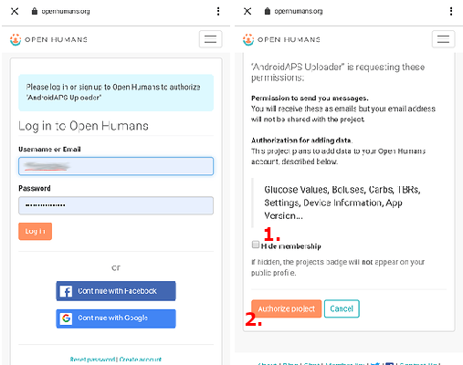

# Open Humans Uploader

## Doneu les vostres dades a la ciència

Podeu ajudar la comunitat donant les vostres dades a projectes de recerca! This helps scientists to pay it forward, develop new scientific ideas and make open source closed loop systems better known. AAPS està preparat per sincronitzar les vostres dades amb [Open Humans](https://www.openhumans.org), una plataforma que us permet enviar, connectar i desar les vostres dades personals, com ara dades genètiques, d'activitat i de salut.

Manteniu el control total sobre què passa amb les vostres dades i sobre quins projectes voleu donar suport, ja que sou vosaltres qui els doneu accés a les dades. Segons el projecte al qual us heu unit, les dades s'avaluen i es fan servir de maneres i en mesures diferents.

Les dades següents s'enviaran al vostre compte d'Open Humans:

- Valors de glucèmia
- Esdeveniments del Portal de cures (excepte les notes)
- Bolus estesos
- Canvis de perfil
- Dosis diàries totals
- Basals temporals
- Objectius temporals
- Configuració
- Versió de l'aplicació
- Model del dispositiu
- Mida de la pantalla

No s'envia cap informació secreta o privada, com ara l'URL de Nightscout o l'API secret.

## Configuració

1. Creeu el vostre compte a [Open Humans](https://www.openhumans.org) si encara no en teniu. Si voleu, podeu fer servir els vostres comptes de Google o Facebook que ja teniu.
2. Enable the **Open Humans** plugin in [**Configuration** > **Communication**](../SettingUpAaps/ConfigBuilder.md).


3. Tap **Settings** on the **Open Humans** card. You can restrict uploads to times when the phone uses Wi-Fi (**WiFi only**) and/or is charging (**Charging only**).


4. Tap **Open plugin** on the **Open Humans** card, then tap **Setup**.


5. On the **Welcome to Open Humans** screen, tap **Next**. Read the **Consent** screen carefully: it shows the terms of use and which data is uploaded and not uploaded.
6. Switch on **I understand and agree.** (1) and tap **Login to Open Humans** (2).


7. S'obrirà el lloc web d'Open Humans. Inicieu la sessió amb les vostres credencials.
8. Decide whether you want to hide your AAPS Uploader membership in your public Open Humans profile (1).
9. Click **Authorize project** (2).



```{admonition} Older screenshot
:class: note
The screenshots above show an earlier version of the Open Humans website and still use the old project name **AndroidAPS Uploader**. The steps are the same.
```

10. Back in **AAPS**, the **Final touches** screen asks whether you want to proceed. Tap **Proceed**.
11. Wait until **We're done!** appears, then tap **Close**. From now on, your phone uploads data in the background from time to time.
12. The **Open Humans** plugin screen now shows your **Project Member ID**. Tap **Upload now** if you want to start an upload right away.
13. Tap **Logout** if you want to stop uploading data to Open Humans.
14. Una notificació d'Android us informarà quan s'estiguin enviant dades.


```{admonition} Older screenshot
:class: note
The screenshot above is from an earlier **AAPS** version. In **AAPS** 4 the confirmation screens are **Final touches** and **We're done!**, there is no queue size, and the buttons are **Upload now** and **Logout**.
```

15. Podeu gestionar les vostres dades iniciant la sessió al [lloc web d'Open Humans](https://www.openhumans.org).


## Oportunitats per compartir

### [El projecte «OPEN»](https://www.open-diabetes.eu/)

El projecte «OPEN» reuneix un consorci internacional i intersectorial de pacients innovadors, metges, científics socials, informàtics i organitzacions de defensa dels pacients per investigar diversos aspectes dels sistemes de pàncrees artificial fets per un mateix (DIY APS), que fan servir cada vegada més persones amb diabetis. Per a més detalls, vegeu el seu [lloc web](https://www.open-diabetes.eu/).

In September 2020 the 'OPEN' project launched a [survey](https://survey.open-diabetes.eu/) including the option to donate data you uploaded to Open Humans. Al seu lloc web i dins de la mateixa enquesta hi ha un [tutorial](https://open-diabetes.eu/en/open-survey/survey-tutorials/) que explica com donar les vostres dades al projecte «OPEN».

### [OpenAPS Data Commons](https://www.openhumans.org/activity/openaps-data-commons/)

L'OpenAPS Data Commons es va crear per oferir una manera senzilla de compartir conjunts de dades de la comunitat DIYAPS per a la recerca. Les dades es comparteixen tant amb investigadors tradicionals, que faran estudis de recerca tradicionals, com amb grups o persones de la comunitat que volen revisar dades com a part dels seus propis projectes de recerca. L'OpenAPS Data Commons fa servir la plataforma «Open Humans» perquè les persones puguin enviar i compartir fàcilment les seves dades dels sistemes DIYAPS, com ara AAPS, Loop i OpenAPS.

Podeu portar les vostres dades a Open Humans de tres maneres:

1. feu servir l'opció d'enviament d'AAPS per portar les vostres dades a Open Humans
2. feu servir el Nightscout Data Transfer per portar les vostres dades a Open Humans
3. envieu manualment fitxers de dades a Open Humans.

Quan hàgiu creat un compte i les vostres dades ja arribin a Open Humans, uniu-vos també a l'OpenAPS Data Commons per donar les vostres dades a la recerca, si així ho decidiu.

## Condicions d'ús

Aquesta és una eina de codi obert que copiarà les vostres dades a [Open Humans](https://www.openhumans.org). No tenim cap dret a compartir les vostres dades amb tercers sense la vostra autorització explícita. Les dades que reben el projecte i l'aplicació s'identifiquen amb un ID d'usuari aleatori i només s'envien de manera segura a un compte d'Open Humans si vosaltres autoritzeu aquest procés. Podeu deixar d'enviar dades i eliminar les dades enviades en qualsevol moment a [www.openhumans.org](https://www.openhumans.org). Tingueu en compte que alguns projectes que reben dades potser no ho permeten.

Vegeu també les [condicions d'ús d'Open Humans](https://www.openhumans.org/terms/).

## Privadesa de les dades

Open Humans protegeix la vostra privadesa i us assigna un ID numèric per a cada projecte. This allows projects to recognize but not identify you. L'ID de l'aplicació que envia AAPS és similar i només ajuda a administrar les dades. Trobareu més informació aquí:

- [Política d'ús de dades d'Open Humans](https://www.openhumans.org/data-use/)
- [Open Humans i el RGPD](https://www.openhumans.org/gdpr/)
