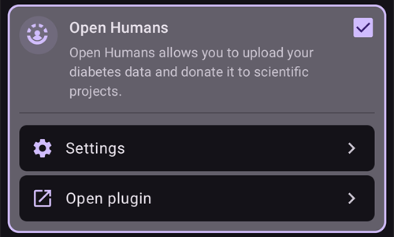
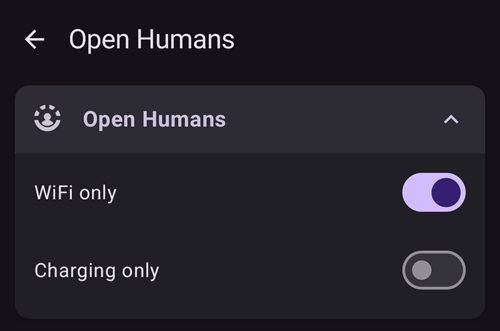
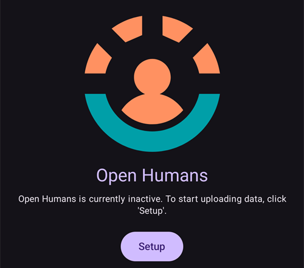
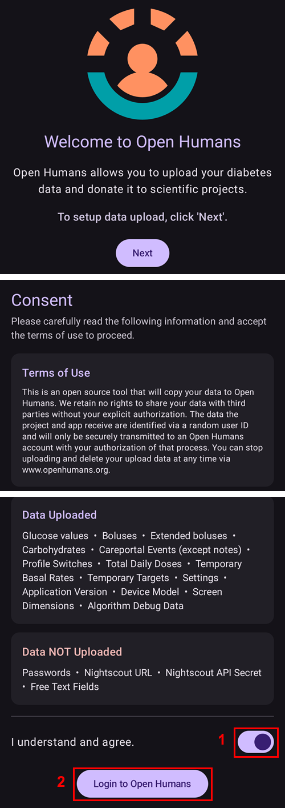
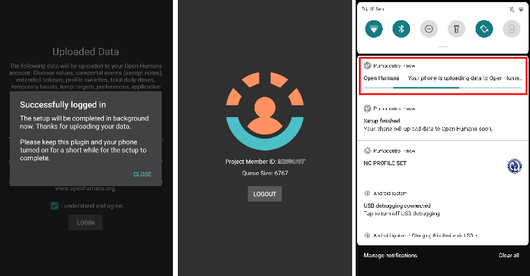
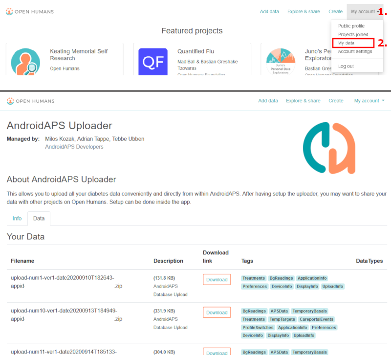

# Open Humans Uploader

## Doneu les vostres dades a la ciència

Podeu ajudar la comunitat donant les vostres dades a projectes de recerca! Això ajuda els científics a retornar el que reben, a desenvolupar noves idees científiques i a fer més coneguts els sistemes de llaç tancat de codi obert. AAPS està preparat per sincronitzar les vostres dades amb [Open Humans](https://www.openhumans.org), una plataforma que us permet enviar, connectar i desar les vostres dades personals, com ara dades genètiques, d'activitat i de salut.

Manteniu el control total sobre què passa amb les vostres dades i sobre quins projectes voleu donar suport, ja que sou vosaltres qui els doneu accés a les dades. Segons el projecte al qual us heu unit, les dades s'avaluen i es fan servir de maneres i en mesures diferents.

Les dades següents s'enviaran al vostre compte d'Open Humans:

- Valors de glucèmia
- Esdeveniments del Portal de cures (excepte les notes)
- Bolus estesos
- Canvis de perfil
- Dosis diàries totals
- Basals temporals
- Objectius temporals
- Configuració
- Versió de l'aplicació
- Model del dispositiu
- Mida de la pantalla

No s'envia cap informació secreta o privada, com ara l'URL de Nightscout o l'API secret.

## Configuració

1. Creeu el vostre compte a [Open Humans](https://www.openhumans.org) si encara no en teniu. Si voleu, podeu fer servir els vostres comptes de Google o Facebook que ja teniu.
2. Activeu el plugin **Open Humans** a [**Configurador** > **Comunicació**](../SettingUpAaps/ConfigBuilder.md).



3. Premeu **Configuració** a la targeta **Open Humans**. Podeu limitar els enviaments als moments en què el telèfon fa servir la Wi-Fi (**Només WiFi**) i/o està carregant (**Només en càrrega**).



4. Premeu **Obrir plugin** a la targeta **Open Humans** i després premeu **Configurar**.



5. A la pantalla **Benvinguts a Open Humans**, premeu **Següent**. Llegiu amb atenció la pantalla **Consentiment**: mostra les condicions d'ús i quines dades s'envien i quines no.
6. Activeu **Entenc i accepto.** (1) i premeu **Iniciar sessió a Open Humans** (2).



7. S'obrirà el lloc web d'Open Humans. Inicieu la sessió amb les vostres credencials.
8. Decidiu si voleu amagar que sou membre d'AAPS Uploader al vostre perfil públic d'Open Humans (1).
9. Feu clic a **Authorize project** (autoritzar el projecte) (2).


```{admonition} Older screenshot
:class: note
Les captures de pantalla de dalt mostren una versió anterior del lloc web d'Open Humans i encara fan servir el nom antic del projecte, **AndroidAPS Uploader**. Els passos són els mateixos.
```

10. De nou a **AAPS**, la pantalla **Últims detalls** us pregunta si voleu continuar. Premeu **Continuar**.
11. Espereu fins que aparegui **Ja està!** i després premeu **Tancar**. A partir d'ara, el telèfon envia dades en segon pla de tant en tant.
12. La pantalla del plugin **Open Humans** ara mostra el vostre **ID de membre del projecte**. Premeu **Enviar ara** si voleu començar un enviament de seguida.
13. Premeu **Tancar sessió** si voleu deixar d'enviar dades a Open Humans.
14. Una notificació d'Android us informarà quan s'estiguin enviant dades.



```{admonition} Older screenshot
:class: note
La captura de pantalla de dalt és d'una versió anterior d'**AAPS**. A **AAPS** 4 les pantalles de confirmació són **Últims detalls** i **Ja està!**, no hi ha mida de la cua i els botons són **Enviar ara** i **Tancar sessió**.
```

15. Podeu gestionar les vostres dades iniciant la sessió al [lloc web d'Open Humans](https://www.openhumans.org).



## Oportunitats per compartir

### [El projecte «OPEN»](https://www.open-diabetes.eu/)

El projecte «OPEN» reuneix un consorci internacional i intersectorial de pacients innovadors, metges, científics socials, informàtics i organitzacions de defensa dels pacients per investigar diversos aspectes dels sistemes de pàncrees artificial fets per un mateix (DIY APS), que fan servir cada vegada més persones amb diabetis. Per a més detalls, vegeu el seu [lloc web](https://www.open-diabetes.eu/).

El setembre de 2020 el projecte «OPEN» va llançar una [enquesta](https://survey.open-diabetes.eu/) que inclou l'opció de donar les dades que heu enviat a Open Humans. Al seu lloc web i dins de la mateixa enquesta hi ha un [tutorial](https://open-diabetes.eu/en/open-survey/survey-tutorials/) que explica com donar les vostres dades al projecte «OPEN».

### [OpenAPS Data Commons](https://www.openhumans.org/activity/openaps-data-commons/)

L'OpenAPS Data Commons es va crear per oferir una manera senzilla de compartir conjunts de dades de la comunitat DIYAPS per a la recerca. Les dades es comparteixen tant amb investigadors tradicionals, que faran estudis de recerca tradicionals, com amb grups o persones de la comunitat que volen revisar dades com a part dels seus propis projectes de recerca. L'OpenAPS Data Commons fa servir la plataforma «Open Humans» perquè les persones puguin enviar i compartir fàcilment les seves dades dels sistemes DIYAPS, com ara AAPS, Loop i OpenAPS.

Podeu portar les vostres dades a Open Humans de tres maneres:

1. feu servir l'opció d'enviament d'AAPS per portar les vostres dades a Open Humans
2. feu servir el Nightscout Data Transfer per portar les vostres dades a Open Humans
3. envieu manualment fitxers de dades a Open Humans.

Quan hàgiu creat un compte i les vostres dades ja arribin a Open Humans, uniu-vos també a l'OpenAPS Data Commons per donar les vostres dades a la recerca, si així ho decidiu.

## Condicions d'ús

Aquesta és una eina de codi obert que copiarà les vostres dades a [Open Humans](https://www.openhumans.org). No tenim cap dret a compartir les vostres dades amb tercers sense la vostra autorització explícita. Les dades que reben el projecte i l'aplicació s'identifiquen amb un ID d'usuari aleatori i només s'envien de manera segura a un compte d'Open Humans si vosaltres autoritzeu aquest procés. Podeu deixar d'enviar dades i eliminar les dades enviades en qualsevol moment a [www.openhumans.org](https://www.openhumans.org). Tingueu en compte que alguns projectes que reben dades potser no ho permeten.

Vegeu també les [condicions d'ús d'Open Humans](https://www.openhumans.org/terms/).

## Privadesa de les dades

Open Humans protegeix la vostra privadesa i us assigna un ID numèric per a cada projecte. Això permet que els projectes us reconeguin, però no que us identifiquin. L'ID de l'aplicació que envia AAPS és similar i només ajuda a administrar les dades. Trobareu més informació aquí:

- [Política d'ús de dades d'Open Humans](https://www.openhumans.org/data-use/)
- [Open Humans i el RGPD](https://www.openhumans.org/gdpr/)
