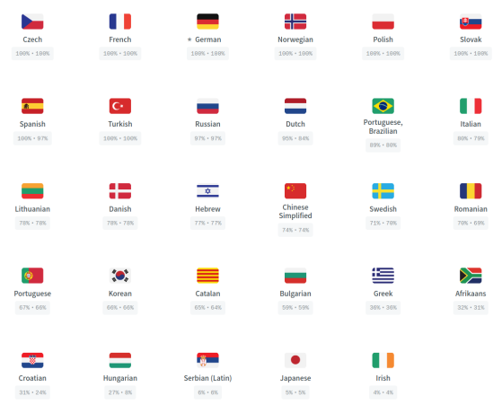
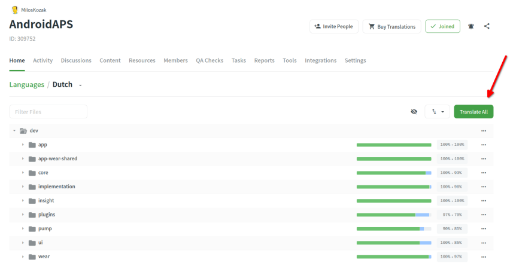
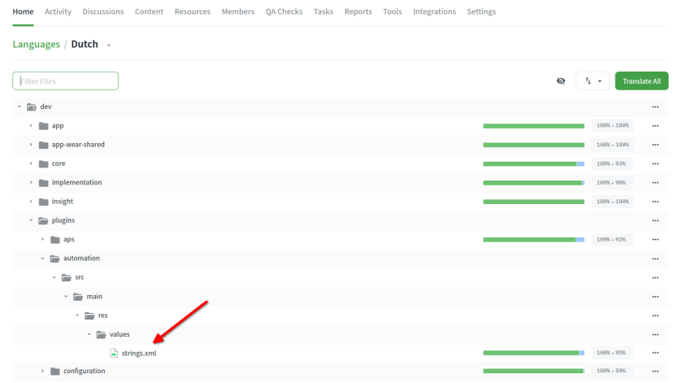
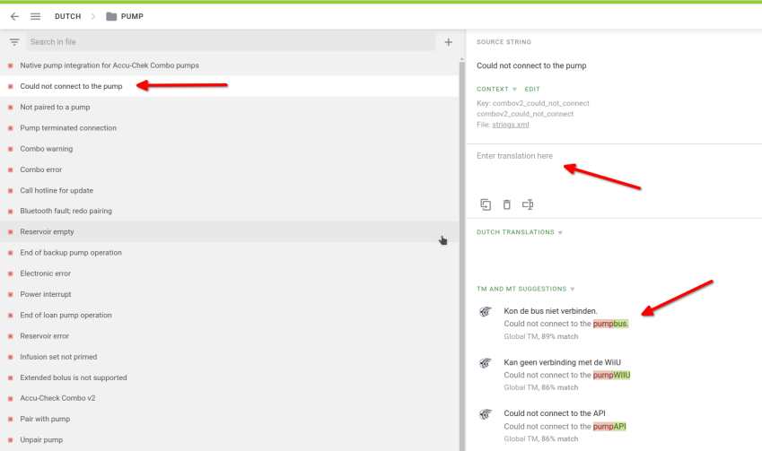
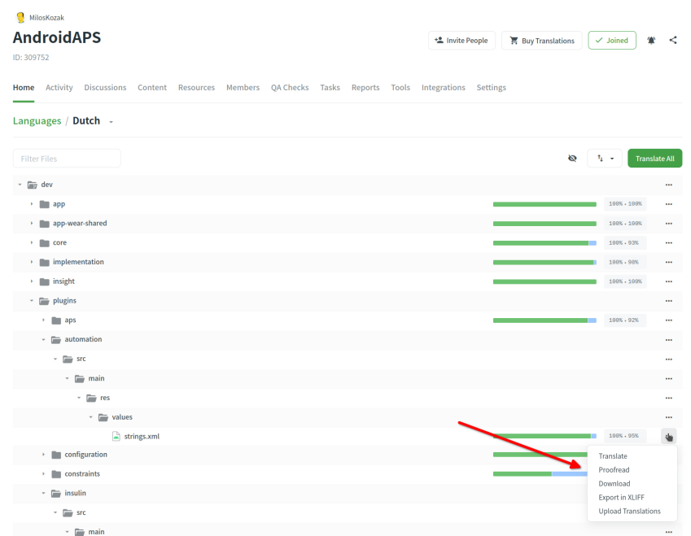
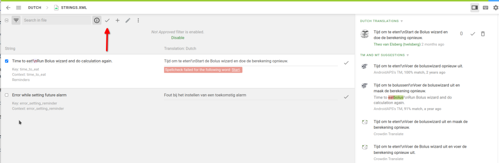
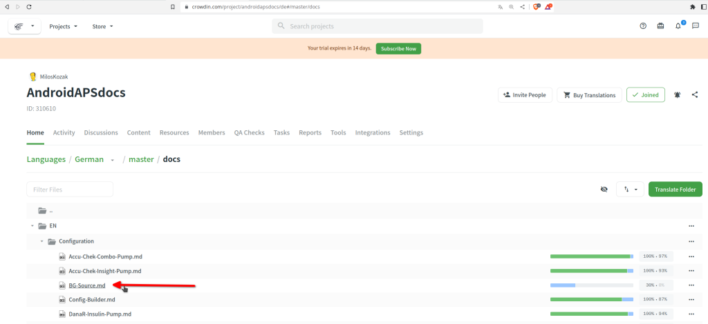
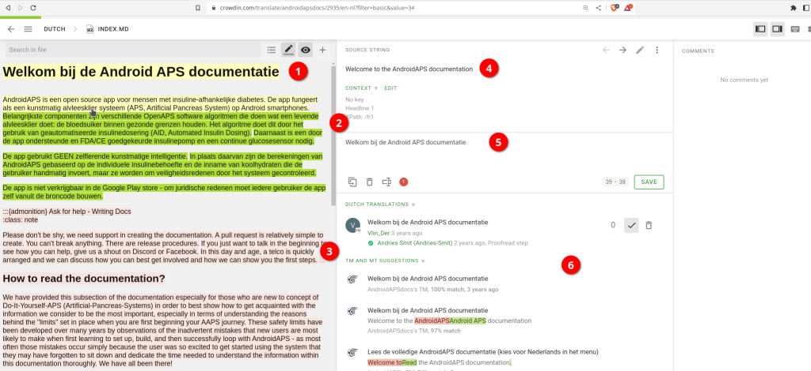
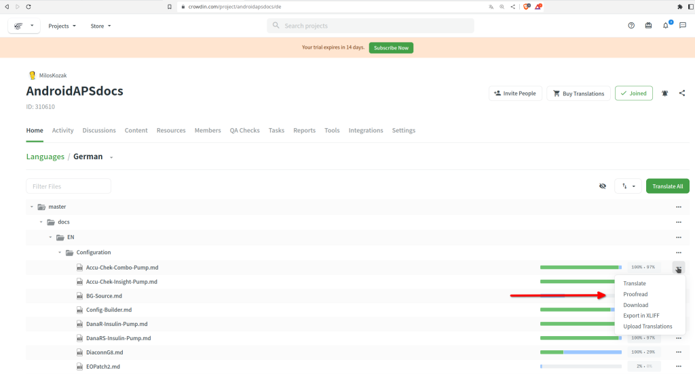

# Com traduir textos de l'aplicació AAPS o de la documentació

* Per als textos de l'aplicació, aneu a <https://crowdin.com/project/androidaps> i inicieu la sessió amb el vostre compte de GitHub
* Per a la documentació, aneu a <https://crowdin.com/project/androidapsdocs> i inicieu la sessió amb el vostre compte de GitHub

* Envieu una sol·licitud per unir-vos a l'equip de la documentació. Per fer-ho, feu clic a la bandera de l'idioma que vulgueu i després al botó «Join» a la cantonada superior dreta de la pàgina següent. Indiqueu l'idioma, doneu una mica d'informació sobre vosaltres i la vostra experiència amb AAPS, i si voleu ser traductors o revisors (només persones amb experiència en traducció i usuaris avançats d'AAPS).

```{admonition} Temps d'aprovació :class: note

L'aprovació és un pas manual. Com a organització sense ànim de lucre no oferim cap termini garantit (SLA), però en general l'aprovació es fa en menys d'1 dia. Si no és així, contacteu amb l'equip de la documentació per Facebook o Discord.

    <br />* Quan us aprovem, feu clic a la bandera
       
    
    ## Traducció de l'aplicació
    
    (translations-translate-strings-for-AAPS-app)=
    ### Traduir textos de l'aplicació AAPS
    
    * Si no teniu preferència pels textos que traduïu, seleccioneu el botó «Translate All» per començar. Us mostrarà els textos que cal traduir.
    
       
    
    * Si voleu traduir un fitxer concret, cerqueu-lo amb el diàleg de cerca o amb l'estructura en arbre i feu clic al nom del fitxer per començar a traduir els textos d'aquest fitxer.
    
       
    
    * Traduïu les frases a la part esquerra afegint un text traduït nou, o feu servir i editeu un suggeriment
    
       
    
    
    ### Revisar textos de l'aplicació AAPS
    
    * Els revisors comencen seleccionant «Proofread» des de la pantalla inicial de l'idioma.
    
       
    
    
      i aproven els textos traduïts
    
       
    
    Quan un revisor aprova una traducció, s'afegeix a la propera versió d'AAPS.
    
    (translations-translation-of-the-documentation)=
    ## Traducció de la documentació
    
    * Feu clic al nom de la pàgina de la documentació que voleu traduir
    
    
    
    
    * Traduïu frase per frase
    
        1. El text groc és el text en què esteu treballant ara.
    
        1. El text verd ja està traduït. No cal que el torneu a traduir.
    
        1. El text vermell és el text que encara s'ha de traduir.
    
        1. Aquest és el text original en què esteu treballant ara
    
        1. Aquesta és la traducció que esteu preparant. Podeu copiar el text de dalt o triar un dels suggeriments de sota.
    
        1. Aquests són els suggeriments de traducció. En particular, podeu veure com de bé encaixa segons Crowdin, o si ja es va traduir abans i només ha tornat perquè el text s'ha mogut, no canviat.
        1. Premeu el botó «Save» per desar una proposta de traducció. Després passarà a un revisor per a la comprovació final.
    
    
    
    * Una pàgina traduïda no es publicarà a la documentació abans que
    
        1. la traducció s'ha revisat
    
        1. la sincronització entre Crowdin i GitHub ha acabat (un cop cada hora), i això crea una PR per a GitHub.
    
        1. la PR a GitHub s'ha aprovat.
    
    En general això triga 1–3 dies, però durant les vacances pot trigar una mica més.
    
    ### Traducció dels enllaços
    
    ```{admonition} Els enllaços ja no es tradueixen
    :class: note
    
    Els enllaços ja no es tradueixen. Abans hi havia un apartat aquí, però ja no existeix: amb la migració a Markdown i myst_parser creem etiquetes de manera explícita al text anglès i les passem automàticament als altres idiomes.
    
    

Traduïu el text que representa l'enllaç. Aneu amb compte de **no** eliminar l'enllaç, que es representa amb una parella d'etiquetes `<0></0>` (o altres números, si hi ha més enllaços en un paràgraf).

Els revisors hi han de prestar una atenció especial!

### Revisió

* Els revisors han de canviar al mode de revisió (Proofreading)
    
    
    
    i aprovar els textos traduïts
    
    

* Quan un revisor aprova una traducció, s'afegeix a la propera compilació de la documentació, que es fa quan cal, sense un calendari fix, però més o menys un cop per setmana, excepte durant les vacances. Per accelerar el procés, podeu informar l'equip de la documentació de les traduccions noves.