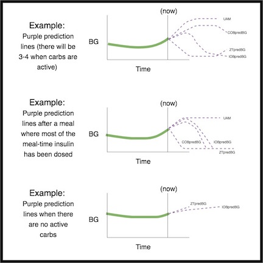
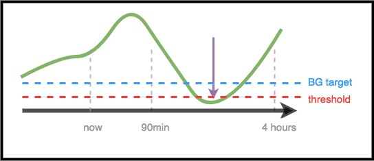
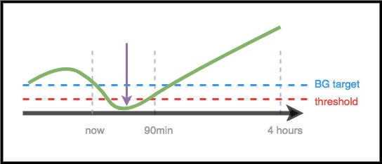
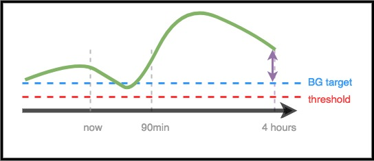
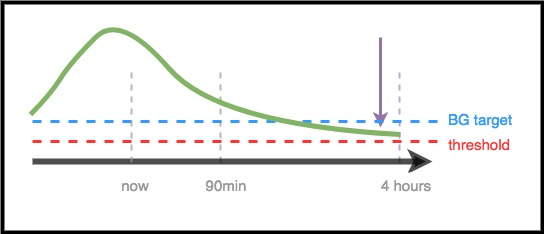

# Per a professionals sanitaris – Introducció general i guia d'AAPS

```{note}
This page is a high-level introduction for clinicians. It was last reviewed in June 2026. AAPS develops continuously, so for the most accurate and up-to-date detail always refer to the [main AAPS documentation](../index.md).
```

Aquesta pàgina és per a professionals sanitaris interessats en tecnologies de pàncrees artificial de codi obert com AAPS, o per a pacients que volen compartir aquesta informació amb els seus professionals sanitaris.

Aquesta guia dona informació general sobre els llaços tancats DIY i, en concret, sobre com funciona AAPS. Per a més detalls sobre tots aquests temes, consulteu la [documentació completa d'AAPS en línia](../index.md). Si teniu preguntes, demaneu més detalls al vostre pacient, o no dubteu a contactar amb la comunitat. (If you’re not on social media (e.g. [Twitter](https://twitter.com/kozakmilos) or Facebook), feel free to email developers@aaps.app). [També podeu trobar aquí alguns dels estudis i resultats més recents](https://openaps.org/outcomes/).

## Els passos per crear un llaç tancat DIY:

Per començar a fer servir AAPS, cal seguir aquests passos:

* Trobar una [bomba compatible](../Getting-Started/CompatiblePumps.md), un [dispositiu Android compatible](../Getting-Started/Phones.md) i una [font de CGM compatible](../Getting-Started/CompatiblesCgms.md).
* [Descarregar el codi font d'AAPS i compilar el programari](../SettingUpAaps/BuildingAaps.md).
* [Configurar el programari perquè es comuniqui amb els dispositius per a la diabetis i definir la configuració i les preferències de seguretat](../SettingUpAaps/SetupWizard.md).

## Com funciona un llaç tancat DIY

Sense un sistema de llaç tancat, una persona amb diabetis recull les dades de la bomba i del CGM, decideix què ha de fer i actua.

Amb el lliurament automàtic d'insulina, el sistema fa el mateix: recull dades de la bomba, del CGM i de qualsevol altre lloc on es registra informació (com Nightscout), fa els càlculs amb aquesta informació, decideix quanta insulina més o menys cal (per sobre o per sota de la taxa basal programada) i fa servir basals temporals per fer els ajustos necessaris i mantenir la glucèmia dins del rang objectiu o portar-la-hi.

If the device running AAPS breaks or goes out of range of the pump, once the latest temporary basal rate ends, the pump falls back to being a standard pump with the preprogrammed basal rates running.

## Com es recullen les dades:

Amb AAPS, un dispositiu Android executa una aplicació especial que fa els càlculs, i el dispositiu es comunica per Bluetooth amb una bomba compatible. AAPS can communicate with other devices and to the cloud via Wi-Fi or mobile data to gather additional information, and to report to the patient, caregivers, and loved ones about what it’s doing and why.

El dispositiu Android ha de:

* comunicar-se amb la bomba i llegir-ne l'historial - quanta insulina s'ha lliurat
* comunicar-se amb el CGM (directament o a través del núvol) - per veure com evoluciona i ha evolucionat la glucèmia

Quan el dispositiu ha recollit aquestes dades, l'algoritme s'executa i pren decisions segons la configuració (ISF, ràtio de carbohidrats, DIA, objectiu, etc.). Si cal, després envia ordres a la bomba per modificar la taxa de lliurament d'insulina.

També recull tota la informació sobre bolus, carbohidrats ingerits i objectius temporals des de la bomba o des de Nightscout, i la fa servir per calcular la taxa de lliurament d'insulina.

## Com sap què ha de fer?

El programari de codi obert està dissenyat perquè el dispositiu faci fàcilment la feina que abans feien les persones (en mode manual) per calcular com s'ha d'ajustar el lliurament d'insulina. It first collects data from all the supporting devices and from the cloud, prepares the data and runs the calculations, makes predictions of what BG levels are expected to do during the next hours in different scenarios, and calculates the needed adjustments to keep or bring BG back into target range. Després envia a la bomba els ajustos necessaris. Llavors torna a llegir les dades, i ho repeteix una vegada i una altra.

Com que el paràmetre d'entrada més important és la glucèmia que ve del CGM, és important tenir dades de CGM de bona qualitat.

AAPS està dissenyat per registrar de manera transparent totes les dades d'entrada que recull, la recomanació que en resulta i qualsevol acció que fa. Per això, en qualsevol moment és fàcil respondre la pregunta «per què fa X?» revisant els registres.

## Exemples de com pren decisions l'algoritme d'AAPS:

AAPS fa servir el mateix algoritme bàsic i el mateix conjunt de funcions que OpenAPS. L'algoritme fa diverses prediccions (segons la configuració i la situació) que representen diferents escenaris del que pot passar en el futur. A Nightscout, es mostren com a «línies liles». AAPS fa servir colors diferents per distingir aquestes [línies de predicció](#aaps-screens-prediction-lines). Als registres, indica quines d'aquestes prediccions i quin interval de temps determinen les accions necessàries.

### Aquí teniu exemples de les línies de predicció liles i de com poden ser diferents:



(clinicianguide-dosing-scenarios)=

### Aquí teniu exemples de diferents intervals de temps que influeixen en els ajustos necessaris del lliurament d'insulina:

### Escenari 1 - Basal temporal zero per seguretat

En aquest exemple, la glucèmia puja a curt termini; però es preveu que estarà baixa a més llarg termini. De fet, es preveu que baixarà per sota de l'objectiu *i* del llindar de seguretat. Per seguretat, per evitar la hipo, AAPS posarà una basal temporal zero (basal temporal al 0%) fins que l'eventualBG (en qualsevol interval de temps) estigui per sobre del llindar.



### Escenari 2 - Basal temporal zero per seguretat

En aquest exemple, es preveu que la glucèmia baixarà a curt termini, però que finalment estarà per sobre de l'objectiu. Però com que la baixada a curt termini és realment per sota del llindar de seguretat, AAPS posarà una basal temporal zero fins que cap punt de la línia de predicció estigui per sota del llindar.



### Escenari 3 - Cal més insulina

En aquest exemple, una predicció a curt termini mostra una baixada per sota de l'objectiu. Però no es preveu que baixi per sota del llindar de seguretat. La glucèmia final prevista és per sobre de l'objectiu. Therefore, AAPS will refrain from adding any insulin that would contribute to a near-term low (by adding insulin that would make the prediction go below threshold). Llavors valorarà afegir insulina per portar fins a l'objectiu el punt més baix de la glucèmia final prevista, quan sigui segur fer-ho. *(Depending on settings and the amount and timing of insulin required, this insulin may be delivered via temp basals or SMBs (super micro boluses)).*



### Escenari 4 - Basal temporal baixa per seguretat

En aquest exemple, AAPS veu que la glucèmia puja molt per sobre de l'objectiu. Però, pel temps d'acció de la insulina, ja hi ha prou insulina al cos per portar finalment la glucèmia dins del rang. De fet, es preveu que la glucèmia acabarà per sota de l'objectiu. Per això, AAPS no donarà insulina extra, per no contribuir a una hipo a més llarg termini. Encara que la glucèmia sigui alta o pugi, aquí és probable una basal temporal baixa.



## Optimitzar la configuració i fer canvis

Com a professional sanitari que potser no té experiència amb AAPS o amb llaços tancats DIY, us pot resultar difícil ajudar el vostre pacient a optimitzar la seva configuració o a fer canvis per millorar els resultats. A la comunitat tenim diverses eines i [guies](https://openaps.readthedocs.io/en/latest/docs/Customize-Iterate/optimize-your-settings.html) que ajuden els pacients a fer ajustos petits i provats per millorar la seva configuració.

El més important per als pacients és fer un sol canvi cada vegada i observar-ne l'efecte durant 2–3 dies abans de decidir canviar o modificar una altra configuració (tret que sigui clarament un mal canvi que empitjora les coses; en aquest cas, han de tornar de seguida a la configuració anterior). La tendència humana és tocar tots els botons i canviar-ho tot alhora; però si algú ho fa, pot acabar amb una configuració encara menys bona per al futur, i li pot costar tornar a un estat que funcionava bé.

Una de les eines més potents per fer canvis a la configuració és una eina de càlcul automàtic de les taxes basals, l'ISF i la ràtio de carbohidrats. This is called “[Autotune](#autotune-how-autotune-calculates-adjustments)”. It is designed to allow the data to guide you or your patient in making incremental changes to settings. A la comunitat, la bona pràctica és executar (o revisar) primer els informes d'Autotune abans d'intentar fer ajustos manuals a la configuració. Autotune is built into AAPS as a plugin (**Configuration** → **General** → **Autotune**); see [Autotune](../AdvancedOptions/Autotune.md). It can be run on demand or automatically. Com que aquests paràmetres són necessaris tant per al lliurament d'insulina amb una bomba estàndard com per al lliurament d'insulina amb llaç tancat, parlar dels resultats d'Autotune i de l'ajust d'aquests paràmetres seria el punt de contacte natural amb el professional sanitari.

A més, el comportament humà (après durant el tractament manual de la diabetis) sovint influeix en els resultats, fins i tot amb un llaç tancat DIY. For example, if BG is predicted to go low and AAPS reduces insulin on the way down, only a small amount of carbs (e.g. 3-4g carbs) may be needed to bring BG up from 70 mg/dL (3.9 mmol/L). Però en molts casos, algú pot decidir tractar la hipo amb molts més carbohidrats (p. ex. seguint la regla dels 15), i això provoca una pujada més ràpida, tant per la glucosa extra com perquè la insulina s'havia reduït en el període abans de la hipo.

## OpenAPS

**This guide was adapted from [The clinician's guide to OpenAPS](https://openaps.readthedocs.io/en/latest/docs/Resources/clinician-guide-to-OpenAPS.html).** OpenAPS is a system developed to be run on a small portable computer (generally referred to as the "rig"). AAPS fa servir moltes de les tècniques implementades a OpenAPS i en comparteix gran part de la lògica i dels algoritmes; per això aquesta guia és molt semblant a la guia original. Gran part de la informació sobre OpenAPS es pot adaptar fàcilment a AAPS; la diferència principal és la plataforma de maquinari on s'executa cada part del programari.

## Resum

Això vol ser una visió general de com funciona AAPS. Per a més detalls, pregunteu al vostre pacient, contacteu amb la comunitat o llegiu la documentació completa d'AAPS disponible en línia.

Lectures addicionals recomanades:

* La [documentació completa d'AAPS](../index.md)
* El [disseny de referència d'OpenAPS](https://OpenAPS.org/reference-design/) (OpenAPS Reference Design), que explica com OpenAPS està dissenyat per ser segur: https://openaps.org/reference-design/
* La [documentació completa d'OpenAPS](https://openaps.readthedocs.io/en/latest/index.html) 
  * See [how AAPS turns predictions into a dosing decision](#aaps-screens-how-predictions-become-a-dosing-decision) in this documentation, or [OpenAPS's determine-basal documentation](https://openaps.readthedocs.io/en/latest/docs/While%20You%20Wait%20For%20Gear/Understand-determine-basal.html#understanding-the-determine-basal-logic) for the underlying algorithm in full technical detail