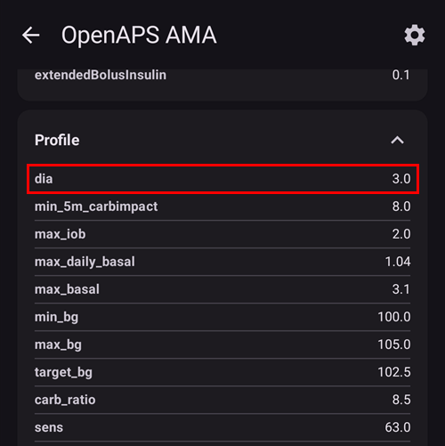

# Preguntes freqüents per a usuaris del llaç

How to add questions to the FAQ: Follow these [instructions](../SupportingAaps/HowToEditTheDocs.md)

## General

### Puc descarregar directament el fitxer d'instal·lació d'AAPS?

No. No hi ha cap fitxer apk d'AAPS per descarregar. L'heu de [compilar](../SettingUpAaps/BuildingAaps.md) vosaltres mateixos. Aquest és el motiu:

AAPS es fa servir per controlar la bomba i donar insulina. Segons la normativa actual a Europa, tots els sistemes de classe IIa o IIb són dispositius mèdics que necessiten una aprovació reglamentària (un marcatge CE), i aquesta aprovació demana diversos estudis i validacions. Distribuir un dispositiu no regulat és il·legal. En altres parts del món hi ha normes semblants.

Aquesta norma no es limita només a la venda (en el sentit de rebre diners per alguna cosa), sinó que s'aplica a qualsevol distribució (fins i tot regalar-lo). Compilar un dispositiu mèdic per a vosaltres mateixos és l'única manera de fer servir l'aplicació dins d'aquestes normes.

Per això no hi ha apks disponibles.

(FAQ-how-to-begin)=

### Com començar?

Start with [Preparing to start with AAPS](../Getting-Started/PreparingForAaps.md): it walks you through everything below in more detail.

Primer de tot, cal **aconseguir components de maquinari compatibles amb el llaç**:

* Una [bomba d'insulina compatible](../Getting-Started/CompatiblePumps.md), 
* un [telèfon intel·ligent Android](../Getting-Started/Phones.md) (AAPS no funciona amb Apple iOS; podeu mirar [iOS Loop](https://loopkit.github.io/loopdocs/)) i
* un [sistema de monitoratge continu de glucosa](../Getting-Started/CompatiblesCgms.md). 

En segon lloc, cal **configurar els components de programari**: [AAPS](../SettingUpAaps/BuildingAaps.md), la [font de CGM/FGM](../Getting-Started/CompatiblesCgms.md) i un [servidor d'informes](../SettingUpAaps/SettingUpTheReportingServer.md).

En tercer lloc, cal aprendre i **entendre el disseny de referència d'OpenAPS per comprovar els vostres factors de tractament**. El principi bàsic del llaç tancat és que la vostra [taxa basal i ràtio de carbohidrats](../SettingUpAaps/YourAapsProfile.md) siguin correctes. Totes les recomanacions suposen que la vostra basal està ben ajustada i que els pics o les baixades que veieu vénen d'altres factors (esport, estrès, etc.), que per això necessiten ajustos puntuals. Els ajustos que el llaç tancat pot fer per seguretat són limitats (vegeu la basal temporal màxima permesa a l'[OpenAPS Reference Design](https://openaps.org/reference-design/)). Per això no voleu gastar la dosi permesa a corregir una basal de base incorrecta. Per exemple, si sovint teniu basals temporals baixes abans d'un àpat, és probable que calgui ajustar la vostra basal. You can use [Autotune](#autotune-how-autotune-calculates-adjustments) to consider a large pool of data to suggest whether and how basals and/or ISF need to be adjusted, and also whether carb ratio needs to be changed. O podeu provar i ajustar la vostra basal de la [manera tradicional](https://integrateddiabetes.com/basal-testing/).

### Quins aspectes pràctics té viure amb el llaç?

#### Protecció amb contrasenya

If you don't want your settings to be easily changed, you can protect them with a password, a PIN or your phone's biometric authentication (fingerprint, face). Open **Settings** > **Protection** > **Settings protection** and choose the type of protection. You can also protect the whole app or only boluses in the same place. See [Settings protection](#Preferences-settings-protection) for details.

#### Rellotges intel·ligents Android Wear

If you use the AAPS watch app to bolus or change settings, every request has to be confirmed on the watch: after you send it, the watch shows a summary with a **CONFIRM** button. See [Remote control from a Wear OS watch](../RemoteFeatures/RemoteControlWearOS.md).

(FAQ-disconnect-pump)=

#### Desconnectar bomba

Si us traieu la bomba per dutxar-vos, banyar-vos, nedar, fer esport o altres activitats, heu de dir a AAPS que no es lliura insulina, perquè l'IOB sigui correcte.

The pump can be disconnected using the [loop icon](#AapsScreens-loop-status) on the AAPS main screen: press it and select **Disconnect pump** with the duration you need. If the activity takes longer than planned, press the icon again and pick a new duration: you don't need to reconnect first. See [Disconnecting the pump for showering or activity](#pumps-cannulas-disconnecting) for how to avoid a lack of insulin during long disconnections.

#### Recomanacions que no es basen en una sola lectura del CGM

Per seguretat, les recomanacions no es basen en una sola lectura del CGM, sinó en la delta mitjana. Per això, si perdeu algunes lectures, pot passar una estona després de recuperar les dades abans que AAPS torni a fer funcionar el llaç.

#### Més lectures

There are several blogs with good tips to help you understand the practicalities of looping. Some of them are no longer online: the links below marked "archived copy" open a saved copy on the Internet Archive.

    * [Fine-tuning Settings](https://web.archive.org/web/20171029031305/http://seemycgm.com/2017/10/29/fine-tuning-settings/) See my CGM (archived copy)
    * [Why DIA matters](https://web.archive.org/web/20231130035027/http://seemycgm.com/2017/08/09/why-dia-matters/) See my CGM (archived copy)
    * [Limiting meal spikes](https://diyps.org/2016/07/11/picture-this-how-to-do-eating-soon-mode/) #DIYPS
    * [Hormones and autosens](https://web.archive.org/web/20170902081839/http://seemycgm.com/2017/06/06/hormones-2/) See my CGM (archived copy)
    

(what-emergency-equipment-is-recommended-to-take-with-me)= (FAQ-emergency-equipment)=

### Quin material d'emergència es recomana portar?

Heu de portar el mateix material d'emergència que qualsevol altra persona amb DT1 amb tractament amb bomba d'insulina. Quan feu servir el llaç amb AAPS, es recomana molt tenir el material addicional següent amb vosaltres o a prop:

* Bateria externa i cables per carregar el vostre telèfon intel·ligent, el rellotge i (si cal) el lector BT o el dispositiu Link
* Piles de la bomba
* Access to your backups, both on the phone and in the cloud (e.g. Google Drive, Dropbox), so that you can set up AAPS again on another phone (see [Creating and restoring back-ups](../Maintenance/ExportImportSettings.md)): 
  * the current [apk](../SettingUpAaps/BuildingAaps.md) of AAPS and of any other apps you use (e.g. xDrip, Juggluco, BYODA).
  * your keystore file (from building the apk) and its password,
  * your latest settings export files from AAPS and your other apps,
  * your **AAPS** master password: you cannot import the settings file without it. If you forgot it, see [How to reset the master password?](#FAQ-reset-master-password)

(FAQ-organize-backups)=

#### How to organize my backups?

Export settings very regularly: after each pod or reservoir change, after modifying your profile, when you have validated an objective, if you change your pump… Even if nothing changes, export once a month. Guardeu diversos fitxers d'exportació antics.

**AAPS** can do this for you: it can export your settings automatically (for example with an [Automation](#ExportImportSettings-Automating-Settings-Export) after each pod change) and save the export directly to a cloud folder (Google Drive). See [Creating and restoring back-ups](../Maintenance/ExportImportSettings.md).

### Com puc subjectar el CGM/FGM de manera segura?

El podeu enganxar amb cinta. Hi ha diversos «overpatches» ja perforats per als sistemes CGM habituals (cerqueu a Google, eBay o Amazon). Alguns usuaris del llaç fan servir cinta de kinesiologia estàndard, més barata, o rocktape.

El podeu subjectar. També podeu comprar braçalets per a la part superior del braç que subjecten el CGM/FGM amb una cinta (cerqueu a Google, eBay o Amazon).

## Algoritme APS

### Why does OpenAPS AMA show "dia: 3" even though I have a different DIA in my profile?

With **OpenAPS AMA** selected in **Configuration** > **APS**, **Open plugin** shows the data sent to the algorithm. In its **Profile** section, `dia` is always 3.0 or less:

A l'AMA, la DIA en realitat no vol dir «durada de l'acció de la insulina». És un paràmetre que abans estava lligat a la DIA. Ara vol dir «en quant de temps s'ha d'acabar la correcció». No té res a veure amb el càlcul de l'IOB. A l'OpenAPS SMB aquest paràmetre ja no cal.

## Altres configuracions

### Configuració de Nightscout

(FAQ-nsclient-blocked)=

#### AAPSClient (or AAPS) does not upload data: "Blocked by…". Què puc fer?

The NSClient status shows why no data is sent:

* **Blocked by connectivity options**: the connection settings do not allow the current connection. For example, you are on cellular data but only Wi-Fi is allowed, or you are not on one of the allowed Wi-Fi networks (SSIDs).
* **Blocked by charging options**: the connection settings only allow syncing while the phone is charging (or only on battery), and this is not the case right now.
* **No connectivity**: the phone has no internet connection.

Check the [NSClient connection settings](#Preferences-nsclient): **Use cellular data**, **Use roaming**, **Use WiFi**, **WiFi SSID**, **Sync on battery** and **Sync while charging**.

### Configuració del CGM

(FAQ-advanced-filtering)=

#### Why does AAPS say 'SMB always and after carbs disabled because active BG source doesn't support advanced filtering'?

**Enable SMB always** and **Enable SMB after carbs** can only be used with a [trusted BG data source](#GettingStarted-TrustedBGSource): a sensor and CGM app that can tell **AAPS** which sensor the readings come from. With any other BG source, **AAPS** switches these two options off and shows this message. Check the list of trusted sources and, if your sensor is listed, make sure you use one of the CGM apps shown for it. See also [Smoothing blood glucose data](../CompatibleCgms/SmoothingBloodGlucoseData.md).

### Bomba

#### Piles

Looping can reduce the pump battery faster than normal use because the system interacts through Bluetooth far more than a manual user does. El millor és canviar la pila al 25%, perquè llavors la comunicació es torna difícil. Podeu configurar alarmes d'avís per a la pila de la bomba amb la variable PUMP_WARN_BATT_P al vostre lloc de Nightscout. Trucs per allargar la vida de la pila:

* reduïu el temps que la pantalla LCD queda encesa (al menú de configuració de la bomba)
* reduïu el temps que la retroil·luminació queda encesa (al menú de configuració de la bomba)
* configureu els avisos amb un bip en lloc de vibració (al menú de configuració de la bomba)
* premeu els botons de la bomba només per recarregar; feu servir AAPS per veure tot l'historial, el nivell de la pila i el volum del reservori.
* En alguns telèfons, l'aplicació AAPS es pot tancar sovint per estalviar energia o alliberar RAM. Quan AAPS es torna a iniciar, a cada arrencada estableix una connexió Bluetooth amb la bomba i torna a llegir la taxa basal actual i l'historial de bolus. Això gasta bateria. To see if this is happening, enable **Log app start event** in the NSClient **Advanced settings**: Nightscout will receive an event at every restart of AAPS, which makes it easy to track the issue. To reduce this happening, turn off battery optimization for AAPS so that the phone stops closing it down: see [battery savings](#FAQ-battery-savings) below.
* netegeu els contactes de la pila amb una tovalloleta d'alcohol, perquè no quedi cera ni greix de fàbrica.
* for [Dana R/RS pumps](../CompatiblePumps/DanaRS-Insulin-Pump.md) the startup procedure draws a high current across the battery to purposefully break the passivation film (prevents loss of energy while in storage) but it doesn't always work to break it 100%. Traieu i torneu a posar la pila 2-3 vegades fins que a la pantalla es vegi 100%, o feu servir la clau de la pila per fer un curtcircuit breu a la pila abans de posar-la: toqueu els dos contactes durant una fracció de segon.
* vegeu també més consells per a [tipus concrets de pila](#Accu-Chek-Combo-Tips-for-Basic-usage-battery-type-and-causes-of-short-battery-life)

#### Canvi de reservoris i cànules

The reservoir must be changed directly on the pump, then the change is recorded in **AAPS**. Follow the step-by-step [guide for changing the pump reservoir and cannula](#pumps-cannulas-changing-reservoir-and-cannula).

### Fons de pantalla

Trobareu el fons de pantalla d'AAPS per al vostre telèfon a la [pàgina de telèfons](#Phones-phone-wallpaper).

### Ús diari

Many of the situations below can be prepared once as a [scene](#scenes): a preset that switches profile, temp target and other settings with one tap. **AAPS** offers ready-made templates, for example *Exercise*, *Sleep*, *Alcohol* or *Bathing*.

#### Higiene

(what-to-do-when-taking-a-shower-or-bath)=

##### Què he de fer quan em dutxo o em banyo?

Podeu treure la bomba mentre us dutxeu o us banyeu. Durant aquest temps curt potser no la necessiteu, però heu de dir a AAPS que l'heu desconnectada perquè els càlculs de l'IOB siguin correctes. Vegeu la [descripció de dalt](#FAQ-disconnect-pump). The *Bathing* [scene](#scenes) template does this for you.

#### Feina

Segons la vostra feina, potser voleu fer servir factors de tractament diferents els dies laborables. Com a usuari del llaç, penseu en un [canvi de perfil](../DailyLifeWithAaps/ProfileSwitch-ProfilePercentage.md) per al vostre dia de feina habitual. Per exemple, podeu canviar a un perfil per sobre del 100% si teniu una feina poc activa (p. ex. assegut a una taula), o per sota del 100% si esteu actius i dempeus tot el dia. You could also consider a high or low temporary target or a [time shift of your profile](#ProfileSwitch-ProfilePercentage-time-shift-of-the-circadian-percentage-profile) when working much earlier or later than regular, or if you work different shifts. You can also create a second profile (e.g. 'home' and 'workday') and do a daily profile switch to the profile you actually need, or save your workday settings as a [scene](#scenes).

### Activitats de lleure

(FAQ-sports)=

#### Esport

Heu de revisar els vostres hàbits d'esport d'abans del llaç. Si simplement preneu un o més carbohidrats per a l'esport com abans, el sistema de llaç tancat els detectarà i els corregirà.

Així tindríeu més carbohidrats a bord, però al mateix temps el llaç hi reaccionaria i lliuraria insulina.

Quan feu servir el llaç, proveu aquests passos:

* Make a [profile switch](#ProfileSwitch-change-percentage) below 100%: tap the profile name on the main screen, tap the round **▶** button, then set **Percentage** and **Duration**.
* Poseu un [objectiu temporal d'activitat](#TempTargets-activity-temp-target) per sobre del vostre objectiu habitual. With a percentage below 100 % and a duration, the same **Activate** screen offers a **Temporary target / Activity** switch that starts both at once.
* Si feu servir SMB, assegureu-vos que [«Activar SMB amb objectiu temporal alt»](#Open-APS-features-enable-smb-with-high-temp-targets) i [«Activar SMB sempre»](#Open-APS-features-enable-smb-always) estan desactivats.

És important preparar aquesta configuració abans i ajustar-la després. Feu els canvis amb temps abans de l'esport i tingueu en compte l'efecte del reompliment dels músculs (glucogen).

The *Exercise* and *Post-exercise Night* [scene](#scenes) templates bundle these settings, so you can start them with one tap. If you do sports regularly at the same time (i.e. sports class in your gym) you can consider using [automation](../DailyLifeWithAaps/Automations.md) to start the profile switch and TT, or the scene. Una automatització basada en la ubicació també pot ser una idea, però fa més difícil la preparació.

El percentatge del canvi de perfil, el valor del vostre objectiu temporal d'activitat i el millor moment per als canvis són diferents per a cada persona. Comenceu pel cantó segur quan busqueu el valor correcte per a vosaltres (comenceu amb un percentatge més baix i un OT més alt).

#### Sexe

Podeu treure la bomba per estar «lliures», però ho heu de dir a AAPS perquè els càlculs de l'IOB siguin correctes. Vegeu la [descripció de dalt](#FAQ-disconnect-pump).

#### Beure alcohol

Beure alcohol és arriscat en mode de llaç tancat, perquè l'algoritme no pot predir bé la glucèmia afectada per l'alcohol. Heu de trobar el vostre propi mètode per tractar això amb les funcions següents d'AAPS:

* Desactivar el mode de llaç tancat i tractar la diabetis manualment, o
* setting high temp targets and deactivating UAM to avoid the loop increasing IOB due to an unannounced meal or
* do a [profile switch](#ProfileSwitch-change-percentage) to noticeably less than 100% 

The *Alcohol* [scene](#scenes) template is a starting point you can adapt to your own method.

Quan beveu alcohol, heu de vigilar sempre el CGM per evitar manualment una hipoglucèmia menjant carbohidrats.

#### Dormir

##### How can I loop during the night without mobile and Wi-Fi radiation?

Molts usuaris posen el telèfon en mode avió a la nit. If you want the loop to support you when you are sleeping, proceed as follows (this will only work if your CGM app runs on the same phone as AAPS, such as xDrip, Juggluco or BYODA; it will NOT work if you get the BG-readings via Nightscout):

1. Activeu el mode avió al vostre mòbil.
2. Espereu fins que el mode avió estigui actiu.
3. Activeu el Bluetooth.

Ara no rebeu trucades ni esteu connectats a internet. Però el llaç continua funcionant.

Some people have discovered problems with local broadcast (AAPS not receiving BG values from xDrip) when phone is in airplane mode. In xDrip, go to Settings > Inter-app settings > Identify receiver and enter `info.nightscout.androidaps`.

If you want different settings at night (for example a higher target), the *Sleep* [scene](#scenes) template is a good starting point.

#### Traveling

##### Com gestionar els canvis de fus horari?

Amb la Dana R i la Dana R coreana no cal fer res. For other pumps see [time zone traveling](../DailyLifeWithAaps/TimezoneTraveling-DaylightSavingTime.md) page for more details.

### Temes mèdics

#### Hospitalització

Si voleu compartir informació sobre AAPS i el llaç DIY amb els vostres professionals sanitaris, podeu imprimir la [guia d'AAPS per a professionals sanitaris](../UsefulLinks/ClinicianGuideToAaps.md).

#### Visita mèdica amb el vostre endocrinòleg

##### Informes

Podeu mostrar els vostres informes de Nightscout (https://YOUR-NS-SITE.com/report) o mirar [Nightscout Reporter](https://nightscout-reporter.zreptil.de/).

## Preguntes freqüents a Discord i les seves respostes...

### El meu problema no apareix aquí.

See [where to get help](../GettingHelp/WhereCanIGetHelp.md). If you found the solution yourself, **remind us to add it to this list!**

### Building and installing

(FAQ-build-errors)=

#### Tinc problemes o errors en compilar l'aplicació.

Please check the troubleshooting page for the way you build **AAPS** (see [Building AAPS](../SettingUpAaps/BuildingAaps.md)):

* building with a browser: [Browser build: troubleshooting](#aaps-ci-troubleshooting),
* building with Android Studio: [Troubleshooting Android Studio](../GettingHelp/TroubleshootingAndroidStudio.md).

(FAQ-build-error-file-name-too-long)=

#### Error de compilació: file name too long

This error can happen when building with Android Studio: the build stops with an error stating the file name is too long. Possible solutions: Move your sources to a directory closer to the root directory of your drive (e.g. "C:\src\AndroidAPS").

Des d'Android Studio: Assegureu-vos que «Gradle» ha acabat de sincronitzar i indexar després d'obrir el projecte i de fer pull des de GitHub. Executeu Build->Clean Project abans de fer Rebuild Project. Executeu File->Invalidate Caches and Restart a Android Studio.

(FAQ-running-dev-version)=

#### Alerta: Executant versió de desenvolupament. Llaç tancat no disponible

**AAPS** shows this message when you run a development (dev) version without engineering mode: in a dev version, closed loop only works in engineering mode.

The dev version is meant for testing, not for actual looping: read [Development branch](../AdvancedOptions/DevBranch.md) before going further.

To turn on engineering mode:

1. Place a file named `engineering_mode` in the `extra` subfolder of your AAPS directory (the folder you chose in the setup wizard, usually `AAPS/extra`). Serveix qualsevol fitxer, sempre que tingui el nom correcte.
2. Restart **AAPS** so that it finds the file.

Consell: feu una còpia d'un fitxer de registre que ja tingueu i canvieu-li el nom a «engineering_mode» (atenció: sense extensió de fitxer!).

### Objectius

#### M'he encallat en un objectiu i necessito ajuda.

First read [Completing the Objectives](../SettingUpAaps/CompletingTheObjectives.md). If you are still stuck, screen capture the question and answers and post them on the Discord AAPS channel. No oblideu explicar quines opcions trieu (o no) i per què. Rebreu pistes i ajuda, però les respostes les haureu de trobar vosaltres.

### Settings, passwords and backups

(FAQ-reset-master-password)=

#### How to reset the master password?

If you forgot your master password, you can reset it to your pump's serial number:

1. Create an empty file named `PasswordReset` (no file extension) in the `extra` subfolder of your AAPS directory (usually `AAPS/extra`).
2. Restart **AAPS**. Your pump must be connected: **AAPS** shows "Waiting for pump…" and needs to read the pump serial number within 30 seconds.
  
  To restart, quit **AAPS** with **menu** (☰) > **Exit**, then open it again. **AAPS** only looks for the file when it starts from scratch. Closing the screen or swiping the app away is not enough, because **AAPS** keeps running in the background. If "Waiting for pump…" does not appear, use **Force stop** in the Android **App info** of **AAPS**, or restart your phone. Installing your current **AAPS** apk again over the installed app also works: it keeps your settings.

3. **AAPS** shows "Password set!": your master password is now your **pump serial number**. The `PasswordReset` file is deleted automatically.

4. Open **Settings** > **Protection** > **Master password** and set a new password.

If the pump is not reached in time, nothing changes: check the pump connection and try again.

This only resets the master password. A settings, application or bolus password or PIN is not reset, but you can always use the master password instead of them.

    {admonition} Old settings files
    :class: warning
    Settings files exported with the old master password can only be imported with that old password.

(FAQ-where-are-settings-files)=

#### On puc trobar els fitxers de configuració?

Settings files are stored in the `preferences` subfolder of the AAPS directory you chose in the [setup wizard](#SetupWizard-StoragePermission) (for example `/internal storage/AAPS/preferences`). If you set up a cloud folder (Google Drive), your exports can also be saved there. See [Creating and restoring back-ups](../Maintenance/ExportImportSettings.md).

AVÍS: no perdeu la contrasenya, perquè sense ella no podreu importar un fitxer de configuració xifrat!

(FAQ-import-settings-earlier-versions)=

#### How do I import settings from earlier versions of AAPS into AAPS v3 or v4 ?

You can only import settings (in AAPS v3 or v4) that were exported using AAPS v2.8x or later. If you were using a version of AAPS older than v2.8x or you need to use setting exports older than v2.8x, then you need to install AAPS v2.8 first. Import the older settings of v2.x in v2.8. After checking that all is OK, you can export settings from v2.8. Install the current AAPS version and import v2.8 settings in it.

If you use the same key to build the old and the new version, you won't even have to import settings. You can install the new version over the old one.

S'han afegit alguns objectius nous. Els haureu de validar.

(FAQ-delete-treatments)=

#### Where can I delete treatments?

Open the **menu** (☰) and select **Treatments history**. Long press an entry to select it, tap more entries if needed, then tap the **trash can** icon and confirm. See [Treatments history](#aaps-screens-treatments).

### Phone and connection problems

(FAQ-aaps-stops)=

#### AAPS s'atura cada dia a la mateixa hora més o menys.

* Google Play Protect may shut down **AAPS** every morning on some phones. If this happens, go to the Google Play options and disable **Google Play Protect**.
* Comproveu si teniu aplicacions de «neteja» (p. ex. CCleaner) i desinstal·leu-les.
* Turn off all battery optimizations for **AAPS** (see [battery savings](#FAQ-battery-savings) below).

(FAQ-battery-savings)=

#### Com configurar l'estalvi de bateria?

Your phone may suspend **AAPS** and related apps (CGM app, Bluetooth) when you are not using it. **AAPS** then cannot do its work, and Bluetooth connections to the sensor and pump (or RileyLink) may be shut down, causing "pump unreachable" alerts and communication errors.

Turn off battery optimization for **AAPS**, your CGM app (e.g. xDrip) and the Bluetooth system app. The way to do this depends on the phone's brand, model and Android version:

* see [Battery optimization](#generaltroubleshooting-android-related-issues) for Pixel, Samsung and Huawei phones,
* in **AAPS**, open the **menu** (☰) > **About** and tap **Don't kill my app?**, or visit [Don't kill my app](https://dontkillmyapp.com/) for other brands.

If you are not sure that battery savings cause your problem, you can temporarily turn off all battery savings on the phone: your battery will drain faster, but you will quickly see if the problem goes away.

(FAQ-pump-unreachable-alerts)=

#### Alertes de bomba no accessible diverses vegades al dia o a la nit.

Your phone may be suspending **AAPS** or even Bluetooth, causing it to lose the connection to the pump or RileyLink (see [battery savings](#FAQ-battery-savings) above).

You can also change when the alert is raised: press the **Settings** (gear) icon on the top right of the main screen, then select **Local alerts** > **Pump unreachable threshold** (30 to 300 minutes). Check your pump's page: some recommend a value, e.g. 120 minutes for [Omnipod DASH](../CompatiblePumps/OmnipodDASH.md).

(FAQ-link-unresponsive)=

#### El meu link/bomba/pod no respon (RL/OL/EmaLink…)

With some phones, there are Bluetooth disconnects from the Links (RL/OL/EmaLink).

Some also have non responsive Links (AAPS says that they are connected but the Links can't reach or command the pump).

First try the **Reset RileyLink** button on the pump screen (see your pump's page: [Medtronic](#MedtronicPump-what-to-do-if-i-loose-connection-to-rileylink-and-or-pump), [Omnipod Eros](#OmnipodEros-reset-rileylink-config-notes)). If this does not help, the easiest way to get all these parts working together is:

1. Power off the Link.
2. Quit **AAPS** (**menu** (☰) > **Exit**).
3. Long press the **AAPS** icon, open the Android **App info**, tap **Force stop**, then **Storage** > **Clear cache** (do NOT clear storage/data!).
4. Rarely some phones may need a reboot here. Podeu provar-ho sense reiniciar.
5. Power on the Link.
6. Start **AAPS**.
7. On the pump screen, tap **Pair RileyLink** and select your Link again.

### Control remot

(FAQ-aapsclient)=

#### Configurar i fer servir l'aplicació remota AAPSClient

**AAPSClient** is a separate app that lets a caregiver follow and control **AAPS** remotely. Since **AAPS** v4, controlling **AAPS** from AAPSClient needs a one-time pairing between the two apps. See:

* [The AAPSClient app](#aapsclient-app): installing, first start and pairing,
* [Master ↔ Client control](#client-master-control): what can be controlled and how pairing works,
* [AAPSClient on a smartwatch](#remotecontrol-smartwatches).

(FAQ-hardened-mode)=

#### Treatments I enter on the Nightscout website are not applied

That is [hardened mode](#client-master-control-hardened-mode). While client control is on — always in Simple Mode — **AAPS** takes changes only from paired clients, not from the Nightscout website or other apps. Enter them on a paired **AAPSClient** instead.

### Alerts and warnings

#### I have a red warning badge (red triangle) / AAPS won't enable closed loop / Loop stays in LGS / I had a yellow triangle

The red warning badge on the BG source shortcut is a security feature in AAPS. See [BG warning sign](#aaps-screens-bg-warning-sign) for the full explanation.

A red warning badge on the BG source shortcut in the bottom bar (the red triangle of older versions) means that you have duplicate BGs and AAPS can't calculate precisely the deltas. A closed loop is switched to **Low Glucose Suspend** mode: it still reduces or suspends your basal to protect you against lows, but it gives no correction insulin. You need to delete one BG of each duplicated value in order to clear the warning. Tap the shortcut to open your [BG source screen](#aaps-screens-bg-source): the duplicate is highlighted in red. Long press one line you want to delete, check one of each lines that are doubled and tap the trash icon. Potser haureu de restablir les bases de dades d'AAPS si hi ha massa glucèmies duplicades. In this case, you'll also lose stats, IOB, COB, selected profile.

Once the warning is gone, AAPS does not go back to **Closed Loop** by itself. Press the loop icon on the main screen and select **Closed Loop** again.

Possible origen del problema: xDrip i/o NS que omplen glucèmies antigues (backfilling).

The yellow triangle of older versions meant unstable delay between each BG reading (BGs not received every 5 min regularly, or missing BGs), which often happens with Libre or after a G6 transmitter change. **AAPS** 4 no longer shows it: it recalculates the values in the background and the loop works correctly.

### Omnipod DASH

(FAQ-move-dash-pod)=

#### Can I move an active DASH Pod to another phone?

The Pod state is included in the exported settings, so an active Pod can be moved to another phone by exporting the settings right before the move and importing them on the other phone. This is not officially supported and there is a risk of losing the Pod: if possible, try it when your Pod is about to expire.

Read these sections first:

* [Export and import settings](#omnipod-dash-export-import) on the Omnipod DASH page, and [Tubeless pumps](#ExportImportSettings-tubeless-pumps): on the new phone, tick **Also replace pump settings** and use a file exported while wearing your current Pod,
* [Discarding a pod](#omnipod-dash-discard-pod), to remove the Pod from the old phone afterwards. Keep the old phone in airplane mode until the Pod is discarded, so that the two phones never talk to the Pod at the same time.