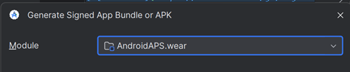
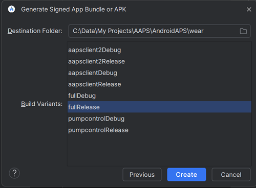

# Compilar l'aplicació AAPS per a Wear OS

L'aplicació **AAPS** per a un rellotge intel·ligent Wear OS (l'**apk de Wear**, `aaps-wear-….apk`) és un fitxer d'instal·lació separat de l'aplicació **AAPS** del telèfon. Necessiteu totes dues: l'aplicació del telèfon executa el llaç i l'aplicació del rellotge en mostra les dades i li pot enviar ordres. L'aplicació del rellotge s'instal·la des del telèfon, vegeu [Configurar AAPS al vostre rellotge Wear OS](WearOsSmartwatch.md).

Les dues aplicacions només funcionen juntes si coincideixen:

- **La mateixa versió d'AAPS** al telèfon i al rellotge.
- **El mateix magatzem de claus** per signar totes dues aplicacions.

La manera més senzilla de garantir-ho és compilar totes dues aplicacions **alhora**, en la mateixa compilació. La compilació al navegador ho fa per vosaltres: cada compilació genera l'apk del telèfon i l'apk de Wear junts. Amb Android Studio o la línia d'ordres, compileu l'apk de Wear com a segon pas just després de l'apk del telèfon.

```{note}
Ja feu servir **AAPS** al telèfon però no teniu cap apk de Wear de la mateixa compilació? Torneu a compilar totes dues aplicacions, amb el mateix magatzem de claus, i reinstal·leu també l'aplicació del telèfon. Un apk de Wear compilat mesos després, o amb una altra versió d'Android Studio, probablement no serà compatible amb l'aplicació del telèfon.
```

## Versions de Wear OS compatibles

**AAPS** funciona en rellotges amb **Wear OS 3.0, 3.2 o 3.5** (Android 11, nivell d'API 30) **o posterior** (Wear OS 4, 5 i 6). Els rellotges amb Wear OS 2 no són compatibles.

```{warning}
Els watchfaces d'AAPS estan disponibles per a rellotges intel·ligents Wear OS amb nivell d'API del 30 al 33 (Wear OS 3.0, 3.2, 3.5 i 4).<br>
Les versions més noves de Wear OS fan que els watchfaces d'AAPS deixin de funcionar a poc a poc: vegeu [Canvis dels watchfaces a Wear OS](#wearos-watchface-changes) i les [limitacions de Wear OS 5](#BuildingAapsWearOs-WearOS5).
```

(building-aaps-wear-os-method)=

## Obtenir l'apk de Wear segons el vostre mètode de compilació

Seguiu la secció del mètode que feu servir per [compilar AAPS](../SettingUpAaps/BuildingAaps.md).

(building-aaps-wear-os-browser)=

### Compilació al navegador (recomanada)

**No cal fer res més.** Cada compilació al navegador genera dos fitxers a partir del mateix codi font i del mateix magatzem de claus:

- `aaps-….apk`: l'aplicació del telèfon.
- `aaps-wear-….apk`: l'aplicació del rellotge.

L'apk de Wear segueix la [variant](#browserbuild-variant) que heu seleccionat per a la compilació: `fullRelease` dona l'aplicació **AAPS Wear**, `aapsclientRelease` l'aplicació **AAPSClient Wear** i `pumpcontrolRelease` l'aplicació **PumpControl Wear**. Cada aplicació de Wear només es comunica amb l'aplicació del telèfon que li correspon.

On trobar l'apk de Wear:

- **AAPS Builder**: a la pàgina de compilació, desplaceu-vos cap avall fins a **Artifacts** i descarregueu `aaps-wear-….apk`, al costat de l'aplicació del telèfon, com es mostra a [Pas 5 – Instal·leu l'aplicació al telèfon](#aaps-builder-step5). Descarregueu-lo al telèfon on funciona **AAPS** si instal·leu l'aplicació del rellotge des del telèfon (Wear Installer 2 o Easy Fire Tools), o a l'ordinador si feu servir ADB.

  

- **Fork amb Google Drive**: obriu el vostre Google Drive, la carpeta `AAPS` i després la carpeta de la versió que heu compilat. Conté l'apk del telèfon i l'apk de Wear, vegeu [Pas 4: Compileu l'APK](#github-build-apk).

  

Deseu l'apk de Wear juntament amb l'apk del telèfon a les vostres còpies de seguretat. Amb **AAPS Builder**, els fitxers només es queden a la pàgina de compilació durant 14 dies.

Següent pas: instal·leu l'apk de Wear al rellotge, vegeu [Configurar AAPS al vostre rellotge Wear OS](WearOsSmartwatch.md).

(building-aaps-wear-os-android-studio)=

### Android Studio

L'apk de Wear es compila com l'apk del telèfon, com una segona compilació signada. Feu-ho just després de l'apk del telèfon, amb la mateixa versió d'Android Studio i el mateix magatzem de claus.

- Seguiu les instruccions de [Compilació amb Android Studio](../SettingUpAaps/ComputerBuild.md).
- Quan arribeu a la [selecció del mòdul](#Building-APK-wearapk) a «Compilar l'apk signat d'AAPS», assegureu-vos de seleccionar **`AndroidAPS.wear`**.



Seleccioneu «**fullRelease**» per generar el fitxer apk d'**AAPS** per a Wear.



Si ho preferiu, podeu compilar **“pumpcontrolRelease”** des del menú desplegable. Així només podreu controlar la bomba a distància, però sense llaç.

Següent pas: instal·leu l'apk de Wear al rellotge, vegeu [Configurar AAPS al vostre rellotge Wear OS](WearOsSmartwatch.md).

(building-aaps-wear-os-troubleshooting)=

#### Resolució de problemes de la compilació amb Android Studio

Quan es compila l'aplicació **AAPS** completa (i de fet qualsevol aplicació signada), Android Studio genera un fitxer .json a la mateixa carpeta. Això causa després errors de [canvis no confirmats](#troubleshooting_androidstudio-uncommitted-changes) quan intenteu compilar la següent aplicació signada, com ara l'aplicació d'**AAPS** per a Wear. La manera més ràpida de resoldre-ho és anar a la carpeta on s'ha compilat l'aplicació AAPS completa. Probablement la vostra carpeta és semblant a:

`C:\Users\Your Name\AndroidStudioProjects\AndroidAPS\app\full\release.`

Elimineu el fitxer .json que no cal o moveu-lo fora de la carpeta. Després torneu a provar de compilar l'aplicació d'**AAPS** per a Wear. Si això no funciona, la [guia de resolució de problemes](../GettingHelp/TroubleshootingAndroidStudio.md) més detallada us ajudarà a trobar el fitxer concret que causa el problema, que també podria ser el fitxer del magatzem de claus.

(building-aaps-wear-os-cli)=

### Línia d'ordres

Seguiu les [Instruccions de compilació des de la línia d'ordres](../SettingUpAaps/CLIBuild.md) i repetiu els passos de compilar i signar per al mòdul `wear`, amb el mateix magatzem de claus:

```sh
./gradlew :wear:assembleFullRelease
```

L'apk de Wear sense signar es desa a `wear/build/outputs/apk/full/release/`. Signeu-lo amb `apksigner` exactament com l'apk del telèfon i després instal·leu-lo al rellotge, vegeu [Configurar AAPS al vostre rellotge Wear OS](WearOsSmartwatch.md).
