# Configurar AAPS al vostre rellotge Wear OS

Les instruccions següents s'apliquen a l'apk **AAPS Wear** que heu de compilar. Si encara no l'heu compilat, vegeu la guia enllaçada [aquí](../WearOS/BuildingAapsWearOS.md). Quan compileu, assegureu-vos d'utilitzar el mateix fitxer de magatzem de claus (keystore) que heu fet servir per a l'apk **AAPS** del telèfon.

També podeu fer servir part d'aquesta informació per a l'apk **Wear** d'**AAPSClient** i de **PumpControl**. Cada aplicació **Wear** es comunica amb l'aplicació del telèfon que li correspon. Per exemple: l'aplicació **AAPSClient Wear** es pot utilitzar per mostrar dades d'**AAPSClient** i no dades d'**AAPS**. Quan hi ha diverses variants de client (**AAPSClient**, **AAPSClient2**, **AAPSClient3**) instal·lades alhora, els mosaics de cadascuna tenen una petita capçalera amb el color d'accent d'aquesta variant, perquè les pugueu distingir mentre llisqueu.

## Versions de Wear OS i compatibilitat

(wearos-watchface-changes)=

### Canvis dels watchfaces a Wear OS (impacte en els watchfaces d'AAPS)

```{admonition} Why newer Wear OS watches break AAPS watchfaces
:class: warning

El juny de 2025 Google va [anunciar canvis](https://android-developers.googleblog.com/2025/06/upcoming-changes-to-wear-os-watch-faces.html) que retiren a poc a poc el motor antic de watchfaces (el motor AndroidX / Wearable Support Library, o «WSL») en favor del nou format declaratiu **Watch Face Format**. Els watchfaces personalitzats d'**AAPS** estan fets amb el motor antic. Per tant, com més nova és la versió de Wear OS, més probable és que un watchface d'AAPS funcioni malament o deixi de funcionar.

Això afecta específicament els **watchfaces**: les **complicacions**, els mosaics i les funcions de control remot d'AAPS no es veuen afectats. També és el motiu pel qual **una actualització del firmware/sistema d'un rellotge Wear OS pot fer que els watchfaces d'AAPS deixin de funcionar**, i després no es pot tornar el rellotge a una versió anterior de Wear OS. Si el vostre watchface d'AAPS funciona ara, **desactiveu les actualitzacions automàtiques del rellotge**.
```

La taula següent resumeix com afecta el canvi de Google als watchfaces d'AAPS (motor antic) segons la versió de Wear OS:

| Versió de Wear OS       | Android base | Nivell d'API | Impacte en els watchfaces d'AAPS (antics)                                                                                                                                                                                   |
| ----------------------- | ------------ | ------------ | --------------------------------------------------------------------------------------------------------------------------------------------------------------------------------------------------------------------------- |
| Wear OS 6               | Android 16   | 36           | **Els watchfaces antics ja no estan disponibles** — AAPS instal·la en el seu lloc un [watchface en Watch Face Format](#wearos-aaps-v4-watchface): el vostre watchface personalitzat o el watchface de complicacions AAPS V4 |
| Wear OS 5               | Android 14   | 34           | **Greu** — el mode actiu (interactiu) sovint falla, les complicacions es congelen, les animacions s'aturen                                                                                                                  |
| Wear OS 4               | Android 13   | 33           | **Moderat** — limitació de rendiment (throttling), actualitzacions perdudes, errors parcials                                                                                                                                |
| Wear OS 3.0 / 3.2 / 3.5 | Android 11   | 30           | **Baix** — el motor antic encara és compatible                                                                                                                                                                              |

Si el vostre rellotge té una versió en què els watchfaces d'AAPS no són fiables, podeu mostrar les dades d'AAPS amb **complicacions** en un watchface compatible, o fer servir [GlucoDataHandler](https://play.google.com/store/apps/details?id=de.michelinside.glucodatahandler) amb una complicació, alimentada pel plugin [Apps complementàries externes](#external-companion-apps) d'**AAPS**. A **Wear OS 6 i posteriors**, AAPS instal·la un watchface de substitució fet amb el nou format; vegeu més avall.

(wearos-aaps-v4-watchface)=

### Wear OS 6 i posteriors — el watchface que instal·la AAPS

Els rellotges amb **Wear OS 6 o posterior** no poden executar els watchfaces clàssics d'AAPS com a watchfaces. Per a aquests rellotges, l'aplicació AAPS del rellotge porta dos watchfaces fets amb el nou **Watch Face Format** de Google. Wear OS permet que una aplicació instal·li només **un** watchface. Per tant, heu de triar quin dels dos hi ha al rellotge:

- **Watchface personalitzat** (per defecte): mostra el watchface personalitzat que heu carregat des del telèfon amb **Carregar watchface** (vegeu [Canviar a un watchface d'AAPS](#WearOS_changing-to-AAPS-watchface)). El rellotge dibuixa el vostre disseny com una imatge, per tant tots els watchfaces personalitzats existents funcionen. Els espais de complicacions que pot definir un watchface personalitzat **no estan disponibles** en aquesta imatge, perquè Wear OS només envia dades de complicacions a un watchface real. Feu una pulsació llarga sobre el watchface per arribar a la seva única opció: si la pantalla sempre activa mostra un rellotge simple o el vostre propi disseny, enfosquit.
- **Watchface de complicacions** (el watchface **AAPS V4**): els seus **set espais de complicacions** venen **preconfigurats amb dades d'AAPS**: valor de glucèmia, IOB, COB, la [complicació Gràfic glucèmia](#Watchfaces-complications), taxa basal / objectiu temporal i la icona de **Mode de funcionament** a l'espai de dalt a l'esquerra (toqueu-la per canviar el mode del llaç des del rellotge). Toqueu l'hora a la part de dalt per obrir l'aplicació d'alarmes del rellotge. Podeu canviar què mostra cada espai a l'editor del watchface.

Ho trieu al telèfon: obriu el plugin **Wear** i, a **Watchface instal·lat al rellotge**, seleccioneu un dels dos. Aquesta targeta només es mostra mentre hi ha connectat un rellotge amb Wear OS 6 o posterior. **AAPS** us demana confirmació, perquè el rellotge canvia el watchface immediatament. Si deixeu el **Watchface de complicacions**, també es restableixen als valors per defecte les complicacions que heu canviat a l'editor del watchface, i la confirmació ho indica. Mentre el **Watchface de complicacions** està seleccionat, els botons del watchface personalitzat s'amaguen i es mostra una vista prèvia del watchface. Si carregueu un watchface personalitzat mentre el **Watchface de complicacions** està seleccionat, **AAPS** us recorda que heu de canviar a **Watchface personalitzat** per veure'l al rellotge.

- El watchface seleccionat s'**instal·la i s'activa automàticament** la primera vegada que l'aplicació AAPS s'executa en un rellotge d'aquest tipus, i s'**actualitza automàticament** juntament amb l'aplicació del rellotge.
- Si heu eliminat el watchface, apareix l'entrada **Instal·lar watchface** a la part de baix del **menú principal** d'AAPS del rellotge: toqueu-la per tornar-lo a instal·lar.

Mentre hi ha connectat un rellotge amb Wear OS 5 o anterior, la targeta **Watchface instal·lat al rellotge** no es mostra (el mecanisme que fa servir necessita Wear OS 6); els watchfaces clàssics hi funcionen com abans.

(wearos-complications-watchface-setup)=

### Watchface de complicacions — configuració recomanada

El **Watchface de complicacions** té set espais de complicacions. Feu una pulsació llarga sobre el watchface, toqueu **Customize** i trieu una font de dades per a cada espai. Els espais estan numerats com a l'editor del watchface: **1** esquerra, **2** centre, **3** dreta, **4** el gràfic, **5** a baix, **6** a dalt a l'esquerra i **7** a dalt a la dreta.

| Configuració per defecte                                                                                      | Configuració alternativa                                                                                          |
| ------------------------------------------------------------------------------------------------------------- | ----------------------------------------------------------------------------------------------------------------- |
|  | 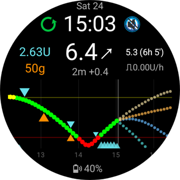 |

| Espai | Posició             | Per defecte                                                                     | Alternativa                                     |
| ----- | ------------------- | ------------------------------------------------------------------------------- | ----------------------------------------------- |
| 1     | Esquerra            | Icona IoB                                                                       | CoB i IoB                                       |
| 2     | Centre              | Glucèmia                                                                        | Glucèmia                                        |
| 3     | Dreta               | Icona CoB                                                                       | BR i objectiu                                   |
| 4     | Gràfic              | Gràfic glucèmia                                                                 | Gràfic glucèmia                                 |
| 5     | A baix              | BR i objectiu                                                                   | Bateria uploader/telèfon                        |
| 6     | A dalt a l'esquerra | Mode de funcionament                                                            | Mode de funcionament                            |
| 7     | A dalt a la dreta   | Bateria uploader/telèfon, o una drecera d'aplicació a **Postposar alerta AAPS** | Drecera d'aplicació a **Postposar alerta AAPS** |

La drecera **Postposar alerta AAPS** es tria entre les complicacions **App shortcut** del mateix rellotge. Si la toqueu, es postposa l'alarma que sona al telèfon.

```{tip}
Activeu **Always-on display** al rellotge (**Settings** > **Display**). Així el watchface continua mostrant la glucèmia quan baixeu el canell, en lloc d'una pantalla en blanc o un rellotge simple.
```

```{admonition} No complication data while the watch is locked
:class: note
Si heu definit un **Lock type** a **Settings** > **Security and privacy**, el rellotge amaga les dades de les complicacions mentre està bloquejat, i el watchface mostra els espais buits fins que el desbloquegeu. Per mantenir les dades visibles, desactiveu **Hide information** al mateix menú.
```

### Wear OS 3

Instal·leu l'apk **AAPS Wear** amb [Wear Installer 2](https://youtu.be/abgN4jQqHb0?si=5L7WUeYMSd_8IdPV), Easy Fire Tools (descrit més avall) o ADB.  
Cap limitació en el funcionament d'**AAPS Wear**.

(BuildingAapsWearOs-WearOS5)=

### Wear OS 4 i Wear OS 5

Exemple: Galaxy Watch 4, 5, 6, 7 i Ultra o Pixel Watch que encara **no** s'han actualitzat a Wear OS 6. Comproveu la versió a **Settings** > **About watch** > **Software**.

Instal·leu l'apk **AAPS Wear** amb [Wear Installer 2](https://youtu.be/abgN4jQqHb0?si=5L7WUeYMSd_8IdPV) (per a Wear OS 5, seguiu [aquest vídeo](https://www.youtube.com/watch?v=yef_qGvcCnk)). Totes les funcions d'**AAPS Wear** funcionen, però els watchfaces clàssics d'**AAPS** estan limitats com es descriu a la taula de dalt: limitats (throttling) a Wear OS 4 i sovint amb errors a Wear OS 5.

```{admonition} Wear OS 5
:class: warning
A Wear OS 5, el watchface d'AAPS s'ha de seleccionar amb Wear Installer 2 just després d'instal·lar l'aplicació Wear: l'instal·lador ofereix el watchface **AAPS(Personalitzat)** al final de la instal·lació. Si canvieu sense voler a un altre watchface, repetiu la instal·lació. És possible que no es puguin canviar les opcions del watchface (Fosc, Divisor invisible, etc.).

Si el watchface clàssic us funciona ara, **desactiveu les actualitzacions automàtiques del rellotge**: és probable que la propera actualització del firmware el faci deixar de funcionar. Si tot i així actualitzeu a Wear OS 6, llegiu la secció de dalt: llavors **AAPS** instal·la el seu propi watchface en el nou format.
```

Si el watchface és massa poc fiable, considereu fer servir [GlucoDataHandler](https://play.google.com/store/apps/details?id=de.michelinside.glucodatahandler) amb una complicació. Necessita el plugin [Apps complementàries externes](#external-companion-apps) activat a **AAPS**.

### Wear OS 6 i posteriors

Exemple: Galaxy Watch 4 i posteriors amb One UI 8 Watch, Pixel Watch després de l'actualització del 2025. La majoria dels rellotges Galaxy i Pixel han rebut aquesta actualització.

Instal·leu l'apk **AAPS Wear** amb [Wear Installer 2](https://youtu.be/abgN4jQqHb0?si=5L7WUeYMSd_8IdPV). Els watchfaces clàssics no estan disponibles; **AAPS** instal·la automàticament el watchface seleccionat al telèfon, vegeu [el watchface que instal·la AAPS](#wearos-aaps-v4-watchface). Cap limitació en el funcionament d'**AAPS Wear**.

## Com configurar un rellotge intel·ligent Samsung Galaxy Watch 4 amb **AAPS**

Aquesta secció suposa que sou completament nous en rellotges intel·ligents. Us dona una orientació bàsica sobre un rellotge popular, el **Galaxy Watch 4**, i després una guia pas a pas per configurar **AAPS** al rellotge.

_Aquesta guia es va escriure per a un Galaxy Watch amb Wear OS 3._ A Wear OS 4 i posteriors, el rellotge demana un **codi d'emparellament** quan un telèfon o un ordinador es connecta per ADB. Wear Installer 2 i el procediment amb el terminal [més avall](#BuildingAapsWearOs-WearOS5-TShoot) ho admeten tots dos.

Aquí teniu guies bàsiques de configuració per al [Galaxy Watch 5](https://www.youtube.com/watch?v=Y5upzOIxwTU) i el [Galaxy Watch 6](https://www.youtube.com/watch?v=D6bq20KzPW0)

## Familiarització bàsica amb el rellotge intel·ligent

Després de la configuració bàsica del rellotge segons el vídeo de dalt, aneu a la Play Store al telèfon i descarregueu les aplicacions següents: «Galaxy Wearable», «Samsung» i «Easy Fire tools» o bé «Wear Installer 2».

Hi ha molts vídeos de YouTube de tercers que us ajudaran a familiaritzar-vos amb el vostre nou rellotge intel·ligent, per exemple:

[https://www.youtube.com/watch?v=tSVkqWNmO2c](https://www.youtube.com/watch?v=tSVkqWNmO2c)

L'aplicació «Galaxy Wearable» també té una secció amb un manual d'instruccions. Obriu Galaxy Wearable al telèfon, cerqueu el rellotge i intenteu emparellar el rellotge amb el telèfon. Segons la vostra versió, potser se us demanarà instal·lar una altra aplicació, «galaxy watch 4 plugin», de la Play Store (triga una estona a descarregar-se). Instal·leu-la al telèfon i després torneu a intentar emparellar el rellotge i el telèfon a l'aplicació Wearable. Passeu per una sèrie de menús i marqueu diverses preferències.

## Configurar un compte de Samsung

Assegureu-vos que el compte de correu que feu servir per configurar el compte de Samsung té una data de naixement amb la qual l'usuari té 13 anys o més. Si no, és molt difícil aprovar els permisos de Samsung. Si heu donat al vostre fill menor de 13 anys un compte de Gmail i feu servir aquesta adreça de correu, no la podeu canviar simplement a un compte d'adult. Una solució és canviar la data de naixement actual perquè l'edat sigui de 12 anys i 364 dies. L'endemà, el compte es convertirà en un compte d'adult i podreu continuar amb la configuració del compte de Samsung.

(remote-control-transferring-the-aaps-wear-app-onto-your-aaps-phone)=

## Transferir l'aplicació Wear d'**AAPS** al vostre telèfon amb **AAPS**

Podeu carregar el Wear.apk des d'Android Studio al vostre telèfon de dues maneres:

a)  amb un cable USB, poseu el fitxer apk wear d'**AAPS** al telèfon i després instal·leu-lo manualment («side-load») al rellotge. Transferiu el Wear.apk al telèfon per USB a la carpeta de baixades; o bé

b)  retalleu i enganxeu el Wear.apk des d'Android Studio al vostre Google Drive.


Per instal·lar manualment («side-load») AAPS al rellotge podeu fer servir: 1) Wear Installer 2 2) Easy Fire tools 3) Android Debug Bridge (ADB) Aquí recomanem Wear Installer 2, perquè les instruccions i el procés del vídeo són molt clars i ben explicats. Si Wear Installer 2 no us funciona, proveu Easy Fire Tools o ADB, tots dos descrits més avall.

### Utilitzar Wear Installer 2 per instal·lar manualment **AAPS** Wear des del telèfon al rellotge

 

Wear Installer 2, desenvolupat per [Malcolm Bryant](https://www.youtube.com/@Freepoc), es pot descarregar de Google Play al vostre telèfon i es pot utilitzar per instal·lar manualment («side-load») l'aplicació Wear d'AAPS al rellotge. L'aplicació inclou un pràctic [vídeo](https://youtu.be/abgN4jQqHb0?si=5L7WUeYMSd_8IdPV) sobre com fer el «sideload».

```{tip}
Per als rellotges amb Wear OS 5, seguiu [aquest vídeo](https://www.youtube.com/watch?v=yef_qGvcCnk).
Vegeu els consells per resoldre problemes [més avall](#BuildingAapsWearOs-WearOS5-TShoot).
```

Aquí hi ha tots els detalls necessaris (és millor obrir el vídeo en un altre dispositiu, així el podeu mirar mentre configureu el telèfon).

Com es diu al vídeo, quan acabeu, desactiveu la depuració ADB al rellotge per no gastar la bateria del rellotge.

Com a alternativa, però no per a Wear OS 5, podeu:

### Utilitzar Easy Fire tools per instal·lar manualment **AAPS** wear al rellotge

1)   Descarregueu _[Easy Fire Tools](https://play.google.com/store/apps/details?id=de.agondev.easyfiretools&hl=en)_ de la Play Store al telèfon


2)  Activeu el mode de desenvolupador al rellotge (un cop configurat i connectat al telèfon):

Aneu a **Settings** > **System** > **About** > **Versions** (els noms dels menús varien segons la marca del rellotge; en alguns rellotges és **About watch** > **Software info** > **Software version**).

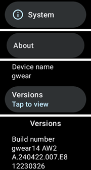

Toqueu ràpidament **Build number** (o **Software version**) diverses vegades fins que un missatge us digui que ara sou desenvolupadors.

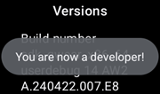

Torneu a **Settings** > **System**: ara es mostra un nou menú **Developer options**.

A **Developer options**, activeu **ADB debugging** i **Wireless debugging**, i confirmeu els avisos. Llavors Wireless debugging mostra l'**IP address & Port** del rellotge, per exemple: **192.168.1.214** : 5555. Només necessiteu l'adreça IP (aquí **192.168.1.214**), no el número de port després dels dos punts. Tingueu en compte que l'adreça IP pot canviar, per exemple cada vegada que canvieu a un telèfon nou per a AAPS.

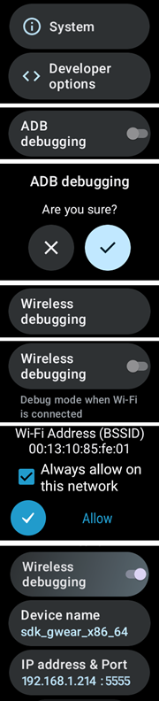

PAS 3)     Introduïu l'adreça IP, _p. ex._ **192.168.1.214**, a Easy Fire tools al telèfon (obriu el menú hamburguesa de l'esquerra, aneu a settings i introduïu l'adreça IP).

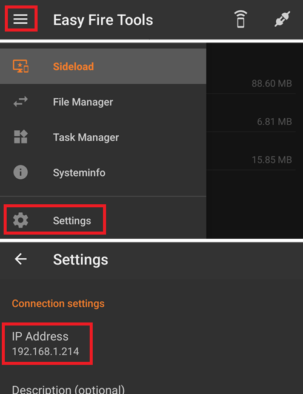

Després feu clic a la icona de l'endoll a dalt a la dreta. Es posarà de color verd quan estigui connectat.

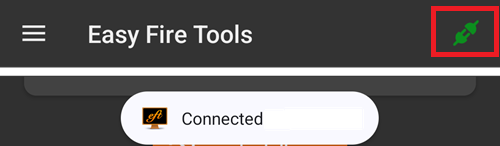


PAS 4) Seguiu les instruccions [aquí](https://wearablestouse.com/blog/2022/01/04/install-apps-apk-samsung-galaxy-watch-4/?utm_content=cmp-true) per instal·lar manualment (és a dir, transferir) aaps-wear.apk al rellotge amb Easy Fire tools


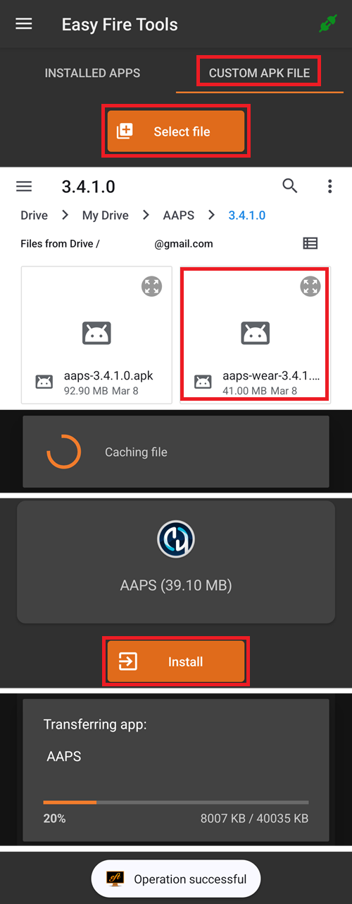


(BuildingAapsWearOs-WearOS5-TShoot)=

### Utilitzar el terminal
Connecteu el rellotge i l'ordinador a la mateixa xarxa Wi-Fi.

- Per instal·lar ADB, descarregueu-lo de: https://developer.android.com/tools/releases/platform-tools
- Obriu un terminal.
- A Windows, creeu una carpeta nova anomenada `adb` al disc `C:`. Obriu el fitxer `platform-tools-latest-windows.zip` que heu descarregat abans. Copieu tots els fitxers de dins de `platform-tools` a `C:\adb` i obriu aquesta carpeta amb un símbol del sistema (clic dret i Open in Terminal). Escriviu l'ordre següent per definir el camí de la carpeta on és ADB: `setx PATH "%PATH%;C:\adb"`
- A Mac, en lloc d'instal·lar-lo manualment, podeu fer servir homebrew: `brew install android-platform-tools`

Al rellotge:
- Aneu a Settings → About watch → **Software Information**
- Toqueu Software version 7 vegades fins que vegeu Developer mode enabled.
- Aneu a Settings → Developer options. Activeu **ADB debugging**
- Aneu a Settings → Developer options → Wireless debugging → **Pair new device**

Veureu que apareixen un codi d'emparellament Wi-Fi, l'adreça IP i el port:


- Al terminal: `adb pair ipaddress:port` Per exemple: `adb pair 10.10.1.125:36299`
- Se us demanarà el codi d'emparellament. Introduïu-lo.
- Veureu una resposta:<br> `Successfully paired to 10.10.1.125:36299 [guid=adb-RXXXW20LMKJY-eh5zBj]`<br>
- Al terminal escriviu: <br>`adb devices`.<br> Hauríeu de veure alguna cosa com:<br> `List of devices attached`<br> `10.10.1.125:36299  offline`<br> `adb-RFAW20LMKJY-eh5zBj._adb-tls-connect._tcp   device`<br>

- Ara aneu a la carpeta de l'ordinador on hi ha l'apk Wear i escriviu<br> `adb install wear-full.apk` <br>i substituïu wear-full.apk pel nom del vostre fitxer apk.
- Veureu:<br> `Performing Streamed Install`<br> `Success`


(wear-os-5-troubleshooting)=

### Recomanacions generals per resoldre problemes amb Wear OS 5

- No feu servir la compartició de xarxa per Wi-Fi (Wi-Fi Tethering). Això no funcionarà.
- No cal activar la depuració adb al telèfon (només al rellotge). Desactiveu la depuració adb al telèfon.
- Assegureu-vos que us connecteu a la vostra xarxa local, on el telèfon i el rellotge es poden veure (no feu servir la xarxa Wi-Fi de convidats per connectar-vos).
- Assegureu-vos que el rellotge i el telèfon són a la mateixa xarxa i al mateix dispositiu Wi-Fi. Sobretot els repetidors Wi-Fi o els punts d'accés poden crear problemes.
- Assegureu-vos que sou a prop del router principal i després reinicieu el telèfon i el rellotge.

**Emparellament:**

- Rellotge: Wireless Debugging (depuració sense fil): anoteu l'adreça IP.
- Wear Installer: introduïu la IP a l'aplicació Wear Installer.
- Seleccioneu Pair new i anoteu el codi d'emparellament i el número de port que es mostren.
- Wear Installer: introduïu el codi d'emparellament + espai + número de port.
- Wear Installer hauria d'indicar que l'emparellament ha funcionat. Si no és així, sortiu de Wear Installer i torneu-ho a provar.

Un cop emparellats, hauríeu de poder instal·lar l'apk wear d'AAPS:

- Sortiu/tanqueu i després torneu a obrir Wear Installer.
- A Wireless debugging, anoteu la IP i el número de port i assegureu-vos de comprovar/introduir la IP i el número de port a Wear Installer.
- Nota: el número de port és diferent del que s'ha fet servir per a l'emparellament!

## Configurar la connexió entre el rellotge i el telèfon des d'**AAPS**

L'últim pas és configurar **AAPS** al telèfon perquè interactuï amb el **Wear.apk** del rellotge. Per fer-ho, activeu el plugin Wear:

* Aneu a l'aplicació **AAPS** del telèfon

* Obriu el **menú** (☰) a dalt a l'esquerra i aneu a **Configurador** > **Comunicació**

* Marqueu la casella **Wear**


Per fer un bolus o altres accions des del rellotge, activeu també **Control des de Wear** a [Configuració > Wear](#preferences-wear).

Per canviar a un altre watchface d'**AAPS**, feu una pulsació llarga sobre el watchface a la pantalla d'inici del rellotge i toqueu **Customize**. Després llisqueu cap a la dreta fins que arribeu a tots els watchfaces d'**AAPS**.

Si el Wear.apk d'**AAPS** s'ha instal·lat correctament al rellotge, es veurà així:


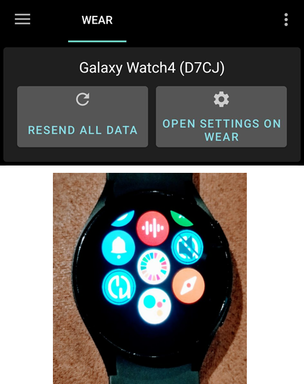


En alguns rellotges intel·ligents, com el Samsung Galaxy, cal **activar** «Remote Connection» a les funcions avançades (Advanced Features) del Samsung Galaxy per fer servir el **Wear.apk** i **AAPS** a distància per Wi-Fi.


(wear-os-watch-phone-communication)=

### Resolució de problemes de la comunicació entre el rellotge **AAPS** i el telèfon **AAPS**

1.  Si EasyFire tools no es connecta o si rebeu «authorisation failed» > comproveu que l'adreça IP s'ha introduït correctament.
2.  Comproveu que el rellotge està connectat a internet (i no només connectat al telèfon per Bluetooth).
3.  Comproveu que el telèfon amb **AAPS** i el rellotge estan emparellats o vinculats a l'aplicació de Samsung.
4.  També pot ajudar reiniciar completament el telèfon i el rellotge (és a dir, apagar i tornar a encendre el telèfon)
5.  Si heu aconseguit descarregar el Wear.apk al telèfon però no rebeu dades de glucèmia, _comproveu_ que heu instal·lat al rellotge l'apk Wear d'**AAPS** correcte: l'aplicació de rellotge d'una compilació al navegador és el fitxer `aaps-wear-….apk`, vegeu [Compilar l'aplicació AAPS per a Wear OS](../WearOS/BuildingAapsWearOS.md). Si el fitxer que heu instal·lat és un dels següents: a) un apk Wear d'**AAPSClient** (mentre el telèfon executa **AAPS**); b) un fitxer `.aab`; o c) un fitxer amb la paraula ‘debug’ al nom, no heu seleccionat l'apk de Wear OS correcte durant la compilació.
6.  Comproveu que el router no aïlla els dispositius entre ells.

Trobareu més consells per resoldre problemes [aquí](https://freepoc.org/wear-installer-help-page/#:~:text=If%20you%20are%20having%20problems,your%20phone%20and%20your%20watch.)

(WearOS_changing-to-AAPS-watchface)=

## Canviar a un watchface d'AAPS al vostre rellotge WearOS

Hi ha diversos watchfaces disponibles a la compilació estàndard de l'APK de Wear OS d'AAPS. Quan hàgiu instal·lat l'APK Wear d'AAPS al rellotge, estaran disponibles. Aquests són els passos per seleccionar-ne un:

1. Al rellotge (suposant que és WearOS), feu una pulsació llarga sobre el watchface actual per obrir la pantalla de selecció de watchfaces i desplaceu-vos del tot cap a la dreta fins que vegeu el botó «Add Watch Face». Seleccioneu-lo

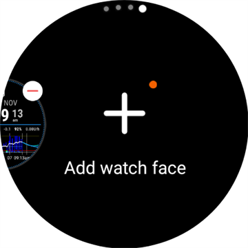

2. Desplaceu-vos per la llista fins que trobeu «AAPS(Personalitzat)» (segons el rellotge, els watchfaces de les aplicacions instal·lades apareixen en una secció «Downloaded» o agrupats per aplicació) i feu clic al mig de la imatge per afegir-lo a la vostra llista de watchfaces actuals. No us preocupeu per l'aspecte actual del watchface «AAPS(Personalitzat)»: al pas següent seleccionarem l'aspecte que preferiu.

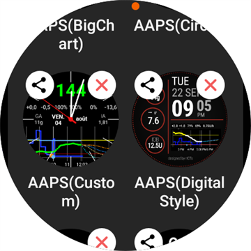

3. Ara obriu AAPS al telèfon i obriu el plugin Wear: **Configurador** > **Comunicació** > **Wear** > **Obrir plugin** (primer marqueu **Wear** si no està activat).

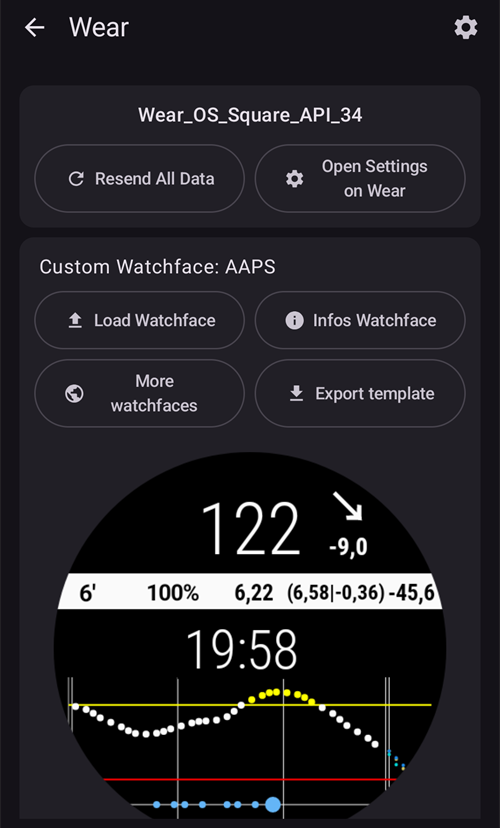

4. Feu clic al botó «Carregar watchface» i seleccioneu el watchface que us agradi

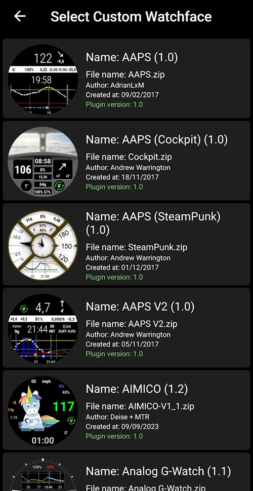

5. Mireu el rellotge: el watchface «AAPS(Personalitzat)» ara hauria de mostrar l'aspecte que heu seleccionat. Espereu uns segons perquè s'actualitzi. La pantalla **Wear** del telèfon ara mostra el nom del watchface carregat i una vista prèvia. **Informació del watchface** mostra els seus detalls i els camps que conté, i **Més watchfaces** obre el [lloc d'intercanvi](../ExchangeSiteCustomWatchfaces/index.md), on podeu descarregar altres watchfaces personalitzats. Ara podeu personalitzar les complicacions, etc. Feu una pulsació llarga sobre el watchface i després premeu el botó «Customize» de la imatge del watchface.

```{admonition} Complications on a custom watchface
:class: note
Els watchfaces personalitzats fets amb la versió 3.0 o posterior del format de watchface personalitzat poden contenir fins a cinc espais de complicacions, amb la posició i la mida definides pel watchface (**Disposició de les complicacions**). Al rellotge, feu una pulsació llarga sobre el watchface, toqueu **Customize** i toqueu de **Complicació 1** a **Complicació 5** per triar la font de dades que es mostra a cada espai. Les mateixes files apareixen a l'aplicació AAPS del rellotge a **Configuració** > **AAPS(Personalitzat)**; si en toqueu una, s'obre el mateix selector. **Prioritat del tipus de complicació** decideix si un espai prefereix un valor o un indicador, un text o una icona quan la font de dades n'ofereix diversos. Una prioritat canviada només s'aplica la propera vegada que trieu una font de dades per a aquest espai.

Aquests espais només funcionen en rellotges amb **Wear OS 5 o anterior**, on el watchface personalitzat funciona com un watchface real. A **Wear OS 6 i posteriors**, el watchface personalitzat es mostra com una imatge sense els seus espais de complicacions, i els passos 1 i 2 de dalt no calen: assegureu-vos que **Watchface personalitzat** està seleccionat a **Watchface instal·lat al rellotge** al plugin **Wear** del telèfon (vegeu [el watchface que instal·la AAPS](#wearos-aaps-v4-watchface)).
```

## Watchface AAPSv2 - Llegenda

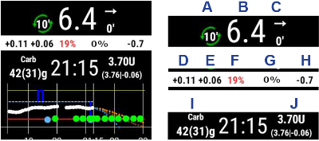

A - temps des de l'última execució del llaç

B - lectura del CGM

C - minuts des de l'última lectura del CGM

D - canvi respecte a l'última lectura del CGM (en mmol/l o mg/dl)

E - canvi mitjà de la lectura del CGM en els últims 15 minuts

F - bateria del telèfon

G - taxa basal (en U/h amb la taxa estàndard i en % durant una TBR)

H - BGI (impacte en la glucèmia) -> quant «hauria» de pujar o baixar la glucèmia només per l'activitat de la insulina.

I - carbohidrats (carbohidrats a bord | e-carbs en el futur)

J - insulina a bord (de bolus | de basal)
