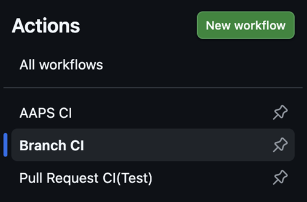

# Vývojová větev

```{warning}
Vývojová větev (dev) slouží pouze k dalšímu vývoji AAPS. Měla by se používat na samostatném telefonu k testování, <font color="#FF0000">**ne pro skutečné používání smyčky!**</font>
```

Nejstabilnější verze AAPS k používání je ta ve [větvi Master](https://github.com/nightscout/AndroidAPS/tree/master). Pro skutečné používání smyčky se doporučuje zůstat u větve Master.

Vývojová verze AAPS je pouze pro vývojáře a testery, kteří si poradí s výpisy zásobníku (stacktrace), procházením log souborů a případně spuštěním debuggeru, aby vytvořili hlášení o chybách užitečná pro vývojáře (zkrátka: pro lidi, kteří vědí, co dělají, a nepotřebují pomoc!). Proto je mnoho nedokončených funkcí vypnutých. K zapnutí těchto funkcí přejděte do **inženýrského režimu** vytvořením souboru s názvem `engineering_mode` v adresáři /AAPS/extra . Zapnutí inženýrského režimu může smyčku úplně rozbít.

Vývojová větev je však dobré místo, kde můžete vidět, jaké funkce se testují, pomoci odstranit chyby a dát zpětnou vazbu, jak nové funkce fungují v praxi. Lidé často testují vývojovou větev na starém telefonu a pumpě, dokud si nejsou jistí, že je stabilní – jakékoli použití je na vaše vlastní riziko. Při testování nových funkcí pamatujte, že se sami rozhodujete testovat funkci, která je stále ve vývoji. Dělejte to na vlastní riziko a s náležitou pečlivostí, abyste zůstali v bezpečí.

Pokud najdete chybu nebo si myslíte, že se při používání vývojové větve stalo něco špatně, podívejte se na [kartu issues](https://github.com/nightscout/AndroidAPS/issues), zda ji už někdo nenašel, a pokud ne, přidejte ji sami. Čím více informací zde uvedete, tím lépe (nezapomeňte, že možná budete muset sdílet své [log soubory](../GettingHelp/AccessingLogFiles.md). O nových funkcích se můžete bavit také na [Discordu](https://discord.gg/4fQUWHZ4Mw).

Vývojová verze má datum vypršení platnosti. Když ji používáte a jste spokojení, může to působit nepohodlně, ale má to svůj účel. Když je v oběhu jen jedna vývojová verze, je snazší sledovat chyby, které lidé hlásí. Vývojáři se nechtějí dostat do situace, kdy jsou mezi lidmi tři vývojové verze, v některých jsou chyby opravené a v jiných ne, a lidé dál hlásí ty už opravené.

(branch-ci-test)=

## Testování konkrétní větve (branch-ci)

Pro sestavení testovací větve zvolte branch-ci, který vám umožní vybrat konkrétní větev pro vytvoření APK. Tento postup můžete použít, když potřebujete testovat vývojovou větev.




(github-pr-test)=

## Testování změn z pull requestu (nasazení přes GitHub CI actions)

Dostupné od verze 3.3.2.1.dev

- Vhodné pro testery nebo pro ty, kdo s testováním pomáhají.

```{eval-rst}
.. raw:: html

    <!--crowdin: exclude-->
    <div align="center" style="max-width: 360px; margin: auto; margin-bottom: 2em;">
      <div style="position: relative; width: 100%; aspect-ratio: 9/16;">
        <iframe
          src="https://geo.dailymotion.com/player/x9rdx1q.html?video=x9rdx1q&loop=true&mute=true"
          loading="lazy"
          style="position: absolute; top: 0; left: 0; width: 100%; height: 100%;"
          frameborder="0"
          allowfullscreen>
        </iframe>
      </div>
    </div>
```


- Target repository: repozitář, který obsahuje PR, ve formátu owner/repo. Ponechte výchozí **nightscout/AndroidAPS**, pokud vám nebylo řečeno, abyste použili jiný repozitář (to by měli dělat jen vývojáři).

- PR number: Zadejte číslo PR, který chcete testovat.

- PR reference types: Typy odkazu na PR mají dvě možnosti:
    
    - head:
    - Stáhne skutečný obsah z větve autora PR (tj. původní historii commitů bez jakéhokoli sloučení).
    - To odpovídá původnímu stavu větve PR, jako by byla stažena přímo z forku nebo z větve s novou funkcí.
    
    - merge:
    
    - Stáhne výsledek sloučení PR do cílové větve (např. dev), které GitHub předem nasimuloval.
    - Jde o virtuální slučovací commit, který GitHub vytvoří automaticky.
    - Tento commit existuje jen tehdy, když PR nemá konflikty a lze ho sloučit.
    
    - variant:
    
    - Viz [variant](#browserbuild-variant)