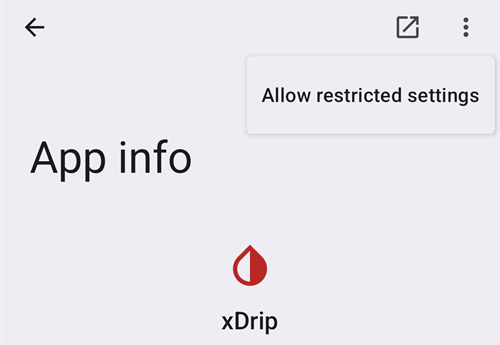

# Dexcom G7, ONE+ a Stelo


## Základní informace předem

Je důležité vědět, že systémy G7, ONE+ a Stelo na rozdíl od G6 hodnoty nevyhlazují, a to ani v aplikaci, ani ve čtečce. Více podrobností najdete [zde](https://www.dexcom.com/en-us/faqs/why-does-past-cgm-data-look-different-from-past-data-on-receiver-and-follow-app).

```{admonition} Smoothing method 
Přečtěte si doporučení, jakou [metodu vyhlazování](../CompatibleCgms/SmoothingBloodGlucoseData.md) použít pro Dexcom G7/ONE+/Stelo
```

## 1. xDrip (přímé spojení s G7, ONE+ nebo Stelo)

- xDrip se připojuje přímo k senzoru: odinstalujte aplikaci Dexcom, protože k senzoru se může připojit jen jedna aplikace. Pokud si chcete aplikaci Dexcom ponechat, použijte místo toho [xDrip jako doprovodnou aplikaci](#DexcomG7-xdrip-companion-app).
- Postupujte podle návodu zde: [xDrip G7, ONE+ a Stelo](https://navid200.github.io/xDrip/docs/Dexcom/G7.html). Je potřeba novější vydání xDrip – minimální verzi najdete na odkazované stránce.
- Vyberte xDrip v [**Konfigurace → Zdroj glykémie**](#Config-Builder-bg-source).

- Upravte nastavení xDrip podle vysvětlení na stránce [Nastavení xDrip](../CompatibleCgms/xDrip.md).

## 2. Build Your Own Dexcom App (jen G7)

```{admonition} Old app version
:class: warning
Dexcom BYODA je nyní velmi stará verze aplikace a nelze ji aktualizovat. Není k dispozici pro ONE+ ani Stelo.
```

-   [Build Your Own Dexcom App](https://docs.google.com/forms/d/e/1FAIpQLScD76G0Y-BlL4tZljaFkjlwuqhT83QlFM5v6ZEfO7gCU98iJQ/viewform?fbzx=2196386787609383750) (BYODA) podporuje místní vysílání do AAPS

-   Tato aplikace vám umožní používat Dexcom G7 s jakýmkoli chytrým telefonem s Androidem.
-   Odinstalujte originální aplikaci Dexcom
-   Nainstalujte stažený soubor apk
-   Zadejte kód senzoru v upravené aplikaci
-   Po krátké době by BYODA měla zachytit signál senzoru.

(DexcomG7-xdrip-companion-app)=

## 3. xDrip jako doprovodná aplikace (G7, ONE+ a Stelo)

Oficiální aplikace Dexcom zůstává se senzorem spojená. xDrip čte hodnoty glykémie z oznámení aplikace Dexcom a posílá je do **AAPS**.

```{admonition} Not a trusted data source
:class: note
**AAPS** does not consider xDrip in Companion App mode a [trusted BG data source](#GettingStarted-TrustedBGSource): SMBs are not allowed all the time.

To read the Dexcom app notifications without xDrip, as a trusted data source, use the [Notification Reader](#DexcomG7-notification-reader).
```

### Čtení oznámení aplikace Dexcom

- Aplikaci Dexcom nechte nainstalovanou a spojenou se senzorem. Její oznámení musí zůstat viditelná: neztlumujte je ani je neskrývejte.
- Stáhněte a nainstalujte [xDrip](https://github.com/NightscoutFoundation/xDrip). V xDrip používejte stejné jednotky glykémie jako v aplikaci Dexcom.
- V xDrip jděte do **Settings** > **Hardware Data Source** a vyberte **Companion App**.

  

- xDrip požádá o oprávnění číst oznámení. Klepněte na **OK**, pak v seznamu vyberte **xDrip** a zapněte **Povolit přístup k oznámením**.

  

- Pokud je **Povolit přístup k oznámením** šedé (*Ovládáno omezeným nastavením*), Android to blokuje, protože xDrip nebyl nainstalován z Obchodu Play:

  

  Otevřete informace o aplikaci xDrip (dlouze stiskněte ikonu xDrip > **Informace o aplikaci**), klepněte na nabídku se třemi tečkami vpravo nahoře a vyberte **Povolit omezená nastavení**. Pak se vraťte na obrazovku přístupu k oznámením a přístup povolte.

  

  

- Hodnoty se v xDrip objeví, když aplikace Dexcom zobrazí novou hodnotu. Pokud se nic neobjeví, možná musíte v xDrip spustit senzor: na skutečný senzor to nemá žádný vliv. Stelo v tomto režimu posílá hodnotu každých 15 minut.

### Companion Bluetooth (G7)

Když je aplikace Dexcom připojená k senzoru G7, xDrip může také poslouchat hodnoty, které senzor posílá aplikaci Dexcom přes Bluetooth. xDrip se se senzorem nepáruje a nemusíte zadávat kód senzoru: řízení zůstává na aplikaci Dexcom.

S **Companion Bluetooth** dostává xDrip ze senzoru přesný čas a trend každé hodnoty místo času, kdy se objevilo oznámení, a doplní mezery z doby, kdy byl telefon mimo dosah (backfill).

- V xDrip jděte do **Settings** > **Less common settings** > **Bluetooth Settings** a zapněte **Companion Bluetooth**.

  

- Nefunguje to na všech telefonech a verzích Androidu. Pokud uvidíte problémy, vypněte to.
- Pokud je starý senzor Dexcom stále v seznamu Bluetooth v telefonu, xDrip může poslouchat ten špatný: v Androidu v **Nastavení** > **Připojená zařízení** zapomeňte senzory, které už nepoužíváte.
- Companion Bluetooth je určený pro G7. U ONE+ a Stelo se spolehněte na oznámení.

### Konfigurace v AAPS

- Vyberte xDrip v [**Konfigurace → Zdroj glykémie**](#Config-Builder-bg-source).
- Upravte nastavení xDrip podle vysvětlení na stránce [Nastavení xDrip](../CompatibleCgms/xDrip.md).

## 4. Juggluco (G7 a ONE+)

Vyžaduje verzi 9.0 nebo novější

- Vypněte aplikaci, která byla se senzorem spojená dříve: odinstalujte ji nebo použijte „Vynutit ukončení“. V nastavení aplikace odeberte oprávnění „Zařízení v okolí“. Omezte využití baterie aplikací.

- Zapomeňte senzor v nastavení Bluetooth: v nastavení Androidu najděte senzor mezi spárovanými zařízeními a zvolte „Zapomenout“. Názvy senzorů Dexcom G7 začínají na DXCM.

- Zabraňte rušení jinými senzory: staré senzory Dexcom udržujte mimo dosah Bluetooth.

- Připojte senzor G7 k Juggluco: otevřete Juggluco → levá nabídka → Photo. Naskenujte datový kód (data matrix) na aplikátoru senzoru G7. Počkejte až 5 minut, než Juggluco senzor najde.

- Požadavky na párování: potvrďte spárování senzoru s Juggluco. Během párování nesmí být obrazovka zamčená. Pokud párování selže, počkejte 5 minut a zkuste to znovu.

- Výjimka: hodinky s Wear OS se mohou spárovat bez stisknutí tlačítka pro souhlas.

(DexcomG7-notification-reader)=

## 5. Notification Reader (G7, ONE+ and Stelo)

Oficiální aplikace Dexcom zůstává se senzorem spojená. **AAPS** reads the glucose value directly from the notification of the Dexcom app, without any other app in between.

```{admonition} Trusted data source
:class: note
Readings from the Dexcom G7, ONE+ and Stelo apps are a [trusted BG data source](#GettingStarted-TrustedBGSource): SMBs can be allowed all the time.
```

Compared to the other methods on this page, the Notification Reader has limits:

- **No trend arrow** and **no backfill**: readings missed while the phone was off or out of range are lost.
- Each reading gets the time the notification appeared, not the exact time of the sensor reading.
- Only values between 40 and 405 mg/dL (2.2 and 22.5 mmol/L) are read. "LOW" and "HIGH" are not read.
- Stelo gives a reading every 15 minutes.

### Set up the Dexcom app

- Aplikaci Dexcom nechte nainstalovanou a spojenou se senzorem.
- Make sure the Dexcom app shows the current glucose value in its notification. Její oznámení musí zůstat viditelná: neztlumujte je ani je neskrývejte.
- Use the same glucose units (mg/dL or mmol/L) in the Dexcom app as in **AAPS**. Otherwise **AAPS** cannot read the value.

### Konfigurace v AAPS

- Select **Notification Reader** in [**Configuration → BG Source**](#Config-Builder-bg-source) and confirm the switch.

  

- Back on the main screen, **AAPS** shows **Permissions Required**. Next to **Notification Access**, tap **Grant**.

  

- Android opens its notification access list (its name depends on your Android version, for example *Notification read, reply & control*). Select **AAPS**, turn on **Allow notification access** and confirm with **Allow**.

  

  Android warns that **AAPS** could read all your notifications. **AAPS** only reads the notifications of supported CGM apps and ignores all others.

  

- If **Allow notification access** is greyed out (*Controlled by Restricted Setting*), Android blocks it because **AAPS** was not installed from the Play Store. Open the **AAPS** app info (long press the **AAPS** icon > **App info**), tap the three dots menu at the top right and select **Allow restricted settings**. Pak se vraťte na obrazovku přístupu k oznámením a přístup povolte.
- Readings appear in **AAPS** when the Dexcom app shows a new value.

```{warning}
If the Dexcom app notification shows more than one glucose number, or none, **AAPS** skips that notification.
```
