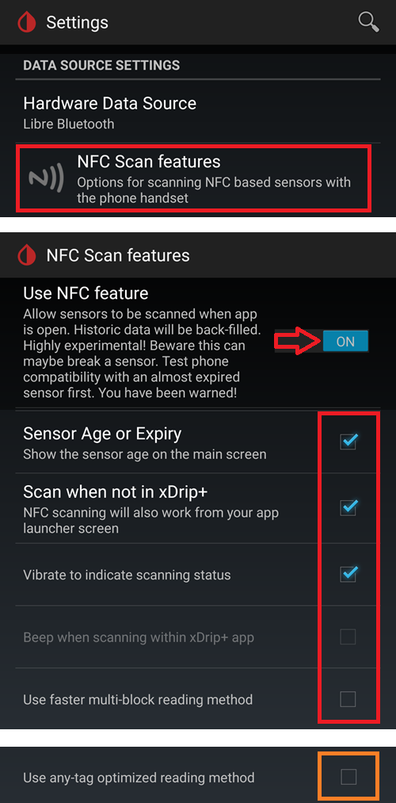
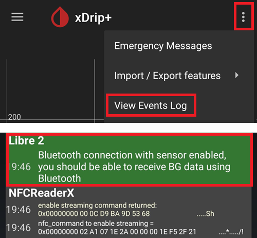

# Jak nastavit FSL 2 a OOP2 pro vestavěné Bluetooth spojení v xDrip

Převedeno z [MinimalL00per](https://www.minimallooper.com/post/how-to-setup-freestyle-libre-2-and-oop2-to-use-a-native-Bluetooth-connection-in-xdrip) do formátu markdown a **přepracováno/aktualizováno**: 25. 8. 2025, psonnera

Seznam definic najdete na konci tohoto dokumentu. Pokud neznáte některé pojmy nebo zkratky, můžete *[přejít níže](#minimallooper-definitions)*, kde jsou vysvětleny.

 

## Configuration

### Hardware

- *FSL2 a 2+* **POZNÁMKA: Verze pro USA, Kanadu, Nový Zéland a Austrálii NEJSOU podporovány**

**(VOLITELNĚ) Čtečka** (není kompatibilní s FSL2+)

- Čtečka 1 (s aktualizovaným firmwarem)

- Čtečka 2

*POZNÁMKA: Pokud chcete v tomto řešení používat čtečku, MUSÍTE senzor spustit NEJDŘÍVE ČTEČKOU. Pokud to neuděláte, nebudete moci čtečkou načítat hodnoty z aktivovaného senzoru. Po zahřátí senzoru můžete hodnoty načítat aplikací LL nebo xDrip.*

### Software

**OOP** – Out of Process Algorithm, externí aplikace pro Android (APK), která pomáhá získat surová data ze senzoru a z nich hodnoty glykémie. xDrip posílá nasbíraná surová data FSL2 z BT do OOP a hodnoty glykémie se vrací zpět do xDrip.

- **OOP2**

  - **Funguje jen s evropskými senzory FSL2/2+**

  - Uzavřený zdrojový kód (není dostupný na GitHubu)

  - Účelem je dešifrovat zašifrované surové hodnoty ze senzoru a vrátit je do xDrip. xDrip pak lze používat buď se surovými daty, která vyžadují kalibraci, nebo může poskytovat hodnoty glykémie podobné jako čtečka 1.

[***xDrip***](https://jamorham.github.io/)

- [*Nightly*](https://github.com/NightscoutFoundation/xDrip/releases) – nejnovější zdrojový kód, sestavený každou noc. Není důkladně otestováno

- [*Stable*](https://xdrip-plus-updates.appspot.com/stable/xdrip-plus-latest.apk) – nejnovější stabilní otestovaná verze.

- **POZNÁMKA: nové senzory vyžadují aktualizovanou aplikaci OOP2. Proto doporučujeme používat alespoň nejnovější verzi xDrip (Stable), která odpovídá nejnovější OOP2.**

 

## Postup

- *Nejdříve si stáhněte a nainstalujte níže uvedené aplikace*
- *Odinstalujte aplikace, které mohou způsobit konflikt*
- *Jak spustit senzor FSL2 ve vestavěném režimu Bluetooth pomocí LL a xDrip
  - [*Krok 1: Instalace a konfigurace aplikací*](#minimallooper-step1)
  - [*Krok 2: Konfigurace nastavení xDrip*](#minimallooper-step2)
  - [*Krok 3: Fyzicky zaveďte senzor*](#minimallooper-step3)
  - [*Krok 4: Spusťte aplikaci LL a spusťte senzor úplně prvním NFC skenem*](#minimallooper-step4)
  - [*Krok 5: Otevřete xDrip a naskenujte senzor FSL2 přes NFC*](#minimallooper-step5)
  - [*Krok 6: Spusťte nový senzor v xDrip*](#minimallooper-step6)
  - [*Krok 7: Počkejte 60 sekund a znovu naskenujte senzor přes NFC*](#minimallooper-step7)
  - [*Krok 8: Sběr dat trvá 3 až 15 minut*](#minimallooper-step8)
  - [*Krok 9: Zkontrolujte, že je senzor připojen a posílá data*](#minimallooper-step9)

- *[Poznámky](#minimallooper-notes)*
- *[Advantages](#minimallooper-advantages)*
- *[Disadvantages](#minimallooper-disadvantages)*
- <u>*\[Řešení problémů\](#minimallooper-troubleshooting)*</u>

## Než začnete

Důrazně doporučujeme provést tento postup s **novým senzorem**. Uživatelé sice hlásí, že se lze připojit i k již běžícímu senzoru (***viz [níže](#minimallooper-started-sensor)***), ale je velmi pravděpodobné, že aplikace LL nebo čtečka při připojení vytvoří nový soukromý sdílený klíč pro komunikaci. To znamená, že po bondingu xDrip o novém klíči neví a nebude moci se senzorem komunikovat. Připojení k běžícímu senzoru zkoušíte na vlastní riziko, nejlépe ke konci životnosti senzoru.

### Nejdříve si stáhněte a nainstalujte níže uvedené aplikace

(Libre2_OOP2)=

- **OOP2** – verze OOP2 najdete zde:

  (*Poznámka: pro přístup k odkazu musíte být přihlášeni ke Googlu.*)

*[oop2.apk](https://drive.google.com/file/d/1106h2s12b3Ev9gKCTU2G75q8h9ChHjcz/view?usp=sharing)* – OOP2_21_09_25 (05d1989) **2025.09.21** (nejnovější verze)

- **xDrip** – **<u>nejnovější verzi</u>** (minimálně verze 2025.09.26) najdete zde:

[*xDrip.apk*](https://github.com/NightscoutFoundation/xDrip/releases)

(minimallooper-started-sensor)=

### Co když už je můj senzor spuštěný? Mohu stále dostávat hodnoty v xDrip? ANO!

Mnoho lidí se ptalo, zda lze tento postup použít i s již aktivním senzorem. Odpověď je jasné **ANO**, můžete spustit i senzor, který už běží.

1.  **NEJDŘÍVE** se ujistěte, že jste provedli změny konfigurace a nastavení v xDrip a nainstalovali a nakonfigurovali OOP2, jak je popsáno níže.

2.  **POTOM** pokračujte *krokem 5* a před začátkem se **UJISTĚTE**, že jste aplikaci LL vynuceně ukončili. Pak postupujte až do konce.

*POZNÁMKA: Aktivovaný senzor FSL2 nebudete moci používat s čtečkou FSLReader, POKUD nebyl nejdříve spuštěn čtečkou FSLReader. Pokud BYL nejdříve spuštěn čtečkou FSLReader, budete moci senzor **skenovat** a načítat hodnoty jak čtečkou, tak aplikacemi jako LL a xDrip.*

## Jak spustit senzor FSL2 ve vestavěném režimu Bluetooth pomocí LL a xDrip

*POZNÁMKA: Pokud jsou na snímcích obrazovky nastavení, která nejsou výslovně označena RÁMEČKEM a jsou NEZAŠKRTNUTÁ (tj. vypnutá), PROSÍM NECHTE JE VYPNUTÁ. Snímky obrazovky ukazují funkční konfiguraci pro VŠECHNA zobrazená nastavení. Pokud chcete po zprovoznění senzoru zkoušet zapínat nebo vypínat další funkce, můžete, ale na vlastní riziko.*

(minimallooper-step1)=

### Krok 1: Instalace a konfigurace aplikací

**Nainstalujte a nakonfigurujte OOP2** a ověřte, že funguje – stačí aplikaci otevřít.


**Nastavení**

- *Use service* **zapnuto**

- *Use foreground service* **zapnuto**

- *Timer Duration* **5 minutes**

  - Pokud nedostáváte výsledky dost rychle, změňte na **1 sec** (snímek obrazovky níže ukazuje toto nastavení).

**Verze 2: 93e5cac-2020.12.08 (nejnovější verze)**


**Nainstalujte xDrip**, minimální verze: nejnovější vydání. Další dokumentaci k instalaci a nastavení xDrip najdete [*zde*](../CompatibleCgms/xDrip.md).

(minimallooper-step2)=

### Krok 2: Konfigurace nastavení xDrip

**Hardware Data Source**: Libre Bluetooth


**NFC Scan features**: *nastavení, která nejsou uvedena, mají být vypnutá.*

- *Use NFC feature*: **zapnuto**
- *Sensor Age or Expiry*: **zapnuto**
- *Scan when not in xDrip*: **zapnuto**
- *Use Any-tag optimized reading method*: **vypnuto**, ale při potížích se skenováním zkuste **zapnuto**



- *Starting Bluetooth connection with FSL2 sensor*: **Always connect to libre2 sensors**


- *Smooth libre 3 data when using xxx method*: ponechte výchozí hodnotu. U zašuměných senzorů hodnotu zvyšte, u stabilních ji snižte.


**Less Common Settings -\> Bluetooth Settings** (*tato nastavení jsou důležitá a mohou se lišit podle vašeho telefonu/nastavení*)

- *Turn Bluetooth on*: **zapnuto**
- *Trust Auto-Connect*: **zapnuto**
- *Use Background Scans*: **zapnuto**
- *Always discover services*: **zapnuto**

xDrip můžete nastavit pomocí QR kódu níže. Naskenujte ho (nebo načtěte obrázek) v xDrip -> Auto Configure.

```{admonition} QR Code
:class: dropdown


```


Po naskenování QR kódu výše, pokud máte telefon Samsung (užitečné je to ale i u mnoha čínských značek), naskenujte i další QR kód níže, který změní nastavení pro spolehlivější připojení:

- *Trust Auto-Connect*: **vypnuto**
- *Use Background Scans*: **vypnuto**

```{admonition} QR Code
:class: dropdown


```


**Advanced settings for FSL2** (*volitelné, ale užitečné*)

- *show Raw values in Graph*: **zapnuto**

- *show Sensor info in Status*: **zapnuto**


**Extra Logging Settings** (*potřebné pro ladění, pokud něco nefunguje správně*)

- *Extra tags for logging*: zadejte tuto hodnotu

`BgReading:d,jamorham librereceiver:v,LibreOOPAlgorithm:v,jamorham nsemulator:v,DexCollectionService:v`


(minimallooper-OOPsettings)=

**Less Common Settings -\> Other misc options**

> **Nastavení pro konfiguraci OOP2**

- *Out of process Libre algorithm*: **VYPNUTO**

(*U OOP2 MUSÍ BÝT TOTO **VYPNUTO**, JINAK NEBUDETE DOSTÁVAT HODNOTY!*)


(minimallooper-step3)=

### Krok 3: Fyzicky zaveďte senzor

(minimallooper-step4)=

### Krok 4: Spusťte aplikaci LL a spusťte senzor úplně prvním NFC skenem

Spusťte aplikaci LL, naskenujte nově zavedený senzor a pak aplikaci LL zavřete a zakažte nebo odinstalujte. **Než budete pokračovat a spustíte senzor v xDrip, musíte stále počkat celých 60 minut na zahřátí senzoru**. Na dřívější hodnoty se nespoléhejte, protože senzor se ještě interně kalibruje a hodnoty hodně kolísají.

#### Krok 4a (VOLITELNĚ, použití čtečky FSLReader):

**Spusťte senzor FSL2 (ne 2+) úplně prvním NFC skenem čtečkou FSLReader**

Pokud chcete hodnoty ze senzoru FSL2 načítat čtečkou **FSLReader** i aplikací LL nebo xDrip, **musíte nově zavedený senzor FSL2 NEJDŘÍVE naskenovat čtečkou FSL.** Po dokončení zahřívání senzoru pak můžete hodnoty skenovat aplikací LL nebo xDrip.

*POZNÁMKA: Aplikace LL je potřeba jen pro ÚPLNĚ PRVNÍ NFC sken po zavedení senzoru. Slouží k odeslání signálu pro zahájení zahřívání. Potom se aplikace MUSÍ zakázat (nastavení aplikace -\> vynutit ukončení) nebo odinstalovat. Můžete použít upravenou aplikaci 2.3 nebo oficiální verze, na tom nezáleží. Hlavní je zabránit tomu, aby aplikace LL běžela ve chvíli, kdy se xDrip snaží se senzorem zahájit BT bonding. Aplikace LL totiž narušuje komunikaci a ruší tak opětovné připojení přes Bluetooth.*

*Podle hlášení uživatelů stačí v systémovém nastavení Androidu pro aplikaci LL vypnout **oprávnění k poloze**, aby nerušila připojení. Několik uživatelů hlásí, že to funguje. Znovu opakuji: **doporučuji aplikaci zakázat nebo odinstalovat**, ale pokud chcete experimentovat, můžete to zkusit.*

(minimallooper-step5)=

### Krok 5: Otevřete xDrip a naskenujte senzor FSL2 přes NFC

(*Připomínka! Ujistěte se, že je LL zakázaná (poloha vypnutá) nebo odinstalovaná A že jste počkali celých 60 minut, než se senzor zahřál a interně zkalibroval.*)

Naskenujte senzor FSL2 aplikací xDrip **PŘES NFC**. Tím senzor dostane signál, aby zapnul párování přes Bluetooth a mohl začít proces bondingu. Po úspěšném NFC skenu senzoru FSL 2 se ve spodní části obrazovky Overview v xDrip krátce zobrazí malé oznámení s textem **Scanning** a pak oznámení **Scanned OK!**.


(minimallooper-step6)=

### Krok 6: Spusťte nový senzor v xDrip

Na **obrazovce Overview v xDrip** stiskněte **nabídku (☰)** v levém horním rohu. Pak zvolte **Start Sensor**.

Na obrazovce **Start New Sensor** stiskněte **Start Sensor**. Zobrazí se dotaz **Did you insert it today?** (Zavedli jste ho dnes?). Odpovězte stisknutím **NOT TODAY**.


*POZNÁMKA: Pokud jste omylem klepli na „YES, TODAY“, musíte v hlavní nabídce xDrip zvolit „stop sensor“ a pak „start sensor“, a pokračovat znovu krokem 5.*

(minimallooper-step7)=

### Krok 7: Počkejte 60 sekund a znovu naskenujte senzor přes NFC

Druhý NFC sken je potřeba k tomu, aby se senzor **PŘIDAL** jako zařízení Bluetooth, ze kterého bude xDrip načítat hodnoty. Po dokončení uvidíte oznámení **NEW SENSOR STARTED**.


Je nutné počkat 60 sekund, protože během tohoto procesu nelze senzor skenovat častěji než jednou za minutu. Pokud senzor naskenujete příliš brzy, zobrazí se na obrazovce Overview v xDrip varování **Not so quickly, wait 60 seconds**.


Otevřete v xDrip záznamy událostí (event logs) a zkontrolujte, že se senzor s xDrip správně spároval.



(minimallooper-step8)=

### Krok 8: Sběr dat trvá 3 až 15 minut

Za 3 až 15 minut se nasbírá dost dat pro zobrazení prvních hodnot. *Pokud ani v té době nedostáváte hodnoty, někdy pomůže restartovat telefon.*

Pokud používáte telefon Samsung (nebo telefon mnoha čínských značek) a máte potíže s příjmem dat, naskenujte QR kód níže v xDrip -> Auto Configure.

```{admonition} QR Code
:class: dropdown


```

Změní nastavení Bluetooth v xDrip na:

- *Trust Auto-Connect*: **vypnuto**
- *Use Background Scans*: **vypnuto**

(minimallooper-step9)=

### Krok 9: Zkontrolujte, že je senzor připojen a posílá data

Na obrazovce Overview v xDrip stiskněte nabídku (☰) vlevo nahoře a zvolte **System Status**. Na obrazovce System Status ukazuje pole aktivního zařízení **Bluetooth Device:** název senzoru FSL2 ve formátu **ABB___XXXXXXXXXXX**, kde XXX je sériové číslo senzoru. Pole **Connection Status** ukazuje **Connected** a pole **Sensor Start:** ukazuje čas, kdy byl senzor spuštěn.


Na obrazovce **BT Device** (přejeďte prstem doleva) můžete zkontrolovat další podrobnosti o připojení senzoru. Tato obrazovka slouží také k řešení problémů s připojením. Níže je seznam polí a jejich význam, který vám pomůže při řešení problémů s připojením.

*POZNÁMKA: V tomto okně se **<u>NEDOTÝKEJTE</u> položky Bluetooth Pairing a NEMĚŇTE ji z <u>Disabled</u>**. Tím byste zahájili přímé párování, které selže (Not bonded), a museli byste celý postup opakovat od kroku 5.*


- **Phone Service State:** Kdy se telefon naposledy připojil k senzoru přes BT (mělo by to být před méně než 5 minutami)
- **Bluetooth Device:** Ukazuje aktuální stav připojení (buď **Connected**, nebo **Disconnected**)
- **Device Mac Address**: Hardwarové ID senzoru
- **Bluetooth Pairing**: Mělo by zde být **<u>Disabled, tap to enable</u>**. Dejte pozor, abyste na to NEKLEPLI. Pokud na to omylem klepnete, klepejte znovu, dokud se to nevrátí na Disabled.
- **Slowest wake up**: Tuto položku můžete ignorovat. xDrip na hodnoty nečeká neustále: začne je očekávat po určité době (obvykle 5 minut). Pokud v tu chvíli žádná data nepřijdou, uvidíte „Woke up early“. To znamená, že xDrip čekal, že data budou připravena, ale žádná nejsou. Slowest wake up je nejdelší zpoždění, ke kterému došlo před běžným přijetím dat.
- **Next Wake up**: Mělo by zde být 5 minut


(minimallooper-notes)=

### Poznámky

- **Použití NFC skenů v LL PO dokončení bondingu/párování v xDrip**: NFC skeny můžete provádět, ale bonding/párování s xDrip musí být nejdříve dokončeno. Vždy se podívejte do xDrip, zda se neblíží čas 5minutové hodnoty (např. před 4 minutami). Pokud se blíží 5 min, počkejte, až přijde nová hodnota přes BT, a teprve pak proveďte NFC sken. Pokud trefíte špatnou chvíli, narušíte BT proces v xDrip a hodnoty přes BT nepřijdou. Nový bonding a obnovení přenosu může chvíli trvat a někdy může LL Bluetooth spojení se senzorem „ukrást“. Mezi těmito hodnotami přes BT jsem však neměl žádné problémy s NFC skenem a okamžitým zakázáním aplikace. Nejsem si jistý, zda je nutné LL zakázat pokaždé, ale pro jistotu ji zakazuji.

- - **Co se děje?** Při navázání spojení přes Bluetooth se vytvoří soukromý sdílený klíč, který je nutný pro komunikaci mezi senzorem a aplikací/zařízením, které se připojuje. Je velmi pravděpodobné, že aplikace LL nebo čtečka při připojení vytvoří nový soukromý sdílený klíč pro komunikaci. To znamená, že po bondingu xDrip o novém klíči neví a nebude moci se senzorem komunikovat.

  - Několik uživatelů hlásí, že aplikaci LL lze znovu spustit poté, co se senzor úspěšně spustil a v xDrip přicházejí hodnoty. V oprávněních Androidu pro aplikaci LL stačí vypnout nastavení **Povolit přístup k poloze**. Potom byste měli být schopni používat aplikaci LL a xDrip současně. Doporučuji nenastavovat výchozí aplikaci pro NFC skenování a při každém NFC skenu si vybrat, kterou aplikací chcete senzor načíst. A NEZAPOMEŇTE: při příští výměně senzoru po prvním zahřívacím NFC skenu nového senzoru aplikaci LL vynuceně ukončit. Až bude senzor nakonfigurovaný a v xDrip budou přicházet hodnoty, můžete aplikaci LL znovu spustit.

&nbsp;

- **Restart telefonu**: Po restartu, a po zakázání nebo vynuceném ukončení aplikace, NEZAPOMEŇTE zkontrolovat, že aplikace LL NEBĚŽÍ. Doporučuji vyzkoušet restart a podívat se, zda se LL znovu automaticky spustí. Můžete se podívat do nastavení aplikace LL v nastavení aplikací Androidu ve vašem telefonu. Pokud je stále povolená, aplikaci LL znovu zakažte. Odinstalování aplikace LL může být jediný způsob, jak tomu zabránit. Tím zabráníte tomu, aby LL omylem „ukradla“ BT bonding. Po restartu také bude trvat stejných 3–15 minut, než začnete dostávat hodnoty ze senzoru přes BT. Buďte trpěliví a počítejte s tím, pokud restartujete telefon krátce před tím, než budete potřebovat hodnotu glykémie pro bolus, jídlo apod.

&nbsp;

- **Nastavení optimalizace baterie**: Ujistěte se, že tyto aplikace VYJMETE z optimalizace baterie ve vašem telefonu

  - xDrip

  - OOP 2

  - LL

  - AAPS

&nbsp;

- **Použití režimu Letadlo:** V některých situacích je vhodné zapnout režim Letadlo (při letu ;-), nebo v noci, když nechcete, aby u telefonu blízko vaší hlavy běžel signál Wi-Fi nebo mobilní sítě). Zapnutí režimu Letadlo může způsobit potíže s komunikací přes Bluetooth. Pokud v telefonu zapnete režim Letadlo a potom zapnete Bluetooth, hodnoty glykémie se ztratí. Jediné řešení je restartovat collector v xdrip+ -\> System Status -\> Classic Status Page. Po restartu collectoru se hodnoty glykémie znovu objevily.

 

(minimallooper-advantages)=

### Advantages

- **Upravená aplikace LL už není potřeba** Pro získávání hodnot ze senzoru FSL2 už nepotřebujete upravenou verzi aplikace LL. Upravenou aplikaci LL sice můžete použít, ale oficiální verze aplikace LL umí provést první inicializační NFC sken stejně jako upravená aplikace. Pro inicializační NFC sken, který spouští senzor, mezi nimi není žádný rozdíl.

&nbsp;

- **Zařízení třetí strany pro NFC skenování už není potřeba** NFC skenovací zařízení třetích stran (např. Miaomiao, Bubble nebo Blucon) už nejsou ke sběru hodnot potřeba *(ale stále je lze používat)*, protože senzor je teď umí posílat sám přes Bluetooth. Méně hardwaru znamená méně věcí, které se mohou pokazit, méně zařízení k nabíjení a jednodušší nastavení.

&nbsp;

- **Hodnoty budete moci stále skenovat přes NFC čtečkou FSL2 (verze 1 s aktualizovaným FW nebo verze 2), POKUD byl senzor FSL2 NEJDŘÍVE spuštěn čtečkou FSL.** Samostatnou čtečku FSL2 pak lze dál používat ke skenování hodnot z aktivního senzoru i poté, co je přes Bluetooth spojen (bonding) s xDrip.

  - Senzor **MUSÍTE** spustit prvním NFC skenem, který zahájí zahřívání senzoru, **NEJDŘÍVE ČTEČKOU FSL**. Potom budou moci NFC hodnoty z již aktivovaného senzoru načítat i jiné aplikace.
- Pokud tomu rozumím správně, senzor FSL2 (pokud nenavázal spojení a ani se o ně nepokouší) vždy přesně každé 2 minuty oznamuje přes BLE svou přítomnost (a dostupnost). To je vidět na každém zařízení s Bluetooth, které umí vyhledávat zařízení Bluetooth. Zařízení, které na toto oznámení odpoví jako první, vyhrává a je *jediným* zařízením, které se smí k senzoru připojit a číst z něj. Během NFC skenu se totiž vytvoří soukromý sdílený klíč, který slouží k dešifrování komunikace FSL 2. Senzor pak není dostupný pro jiná zařízení, která tento soukromý sdílený klíč nemají a mohou se také pokoušet připojit. Zdá se, že čtečka FSL 2 tento souboj vyhraje vždy, ať je „soupeř“ jakýkoli.

&nbsp;

- **Minimum hardwarových zařízení** Mým cílem vždy bylo mít na těle co nejméně zdravotnických zařízení. Senzor FSL2 v kombinaci se systémem Omnipod tento cíl splnil. To je ještě důležitější při cestování (na krátké i dlouhé vzdálenosti), protože mám s sebou méně věcí a méně spotřebního materiálu na výměny, a tedy víc místa na jiné věci v zavazadle. Doufám, že v budoucnu bude existovat náplasťová pumpa, která bude mít jen vyměnitelný zásobník, zatímco čip a motor budou tvořit trvalou, opakovaně použitelnou část. To by snížilo množství odpadu a obalů při výměnách setu, a to by mi opět dalo víc místa v kufru na jiné věci.

&nbsp;

- **Už žádné hodinové výpadky při výměně senzoru** Protože můžete nový senzor spustit aplikací LL prvním NFC skenem, může současný senzor dál běžet a zároveň posílat hodnoty přes Bluetooth. Po 20 minutách můžete z nového senzoru dostávat hodnoty, ale nejlepší je počkat 1 hodinu, než se senzor interně správně zkalibruje. To znamená, že můžete současný senzor zastavit a spustit nový (poté, co byl zaveden a o hodinu dříve zahřát NFC skenem v LL) a během 3 až 15 minut budete mít první kalibrace a hodnoty.

&nbsp;

(minimallooper-disadvantages)=

### Disadvantages

- **Restart telefonu:** Protože se po restartu telefonu musí proces Bluetooth spustit znovu, musíte se nejdříve ujistit, že jste ručně zakázali aplikaci LL (pokud jste ji neodinstalovali), a trpělivě počkat na první hodnoty (3 až 15 min). To znamená restartovat telefon tak, aby k tomu nedošlo v kritických chvílích, jako jsou korekční bolusy nebo jídla a svačiny.

&nbsp;

- **Aplikace LL a xDrip nemohou současně přijímat hodnoty přes Bluetooth**. LL se bude vždy snažit „ukrást“ Bluetooth spojení se senzorem a bonding. Pokud se to stane, zůstanete s LL po zbytek životnosti senzoru. Současný běh obou aplikací proto vždy nefunguje. Jak uvádím níže, můžete aplikaci LL povolit a provést NFC sken, abyste získali hodnotu v LL (pokud potřebujete porovnání nebo chcete získat historii pro sebe nebo pro zprávy pro diabetologa). Jakmile ale hodnotu máte, aplikaci zase zakažte a nezkoušejte to v minutě, kdy bude xDrip načítat svou hodnotu přes Bluetooth. Nejsem si jistý, jak při tom funguje čtečka FSL2, ale vyzkouším to později.
- Několik uživatelů hlásí, že aplikaci LL lze znovu spustit poté, co se senzor úspěšně spustil a v xDrip přicházejí hodnoty. V oprávněních Androidu pro aplikaci LL stačí vypnout nastavení **Povolit přístup k poloze**. Potom byste měli být schopni používat aplikaci LL a xDrip současně. Doporučuji nenastavovat výchozí aplikaci pro NFC skenování a při každém NFC skenu si vybrat, kterou aplikací chcete senzor načíst. A NEZAPOMEŇTE: při příští výměně senzoru po prvním zahřívacím NFC skenu nového senzoru aplikaci LL vynuceně ukončit. Až bude senzor nakonfigurovaný a v xDrip budou přicházet hodnoty, můžete aplikaci LL znovu spustit.

&nbsp;

- **Zařízení třetích stran pro NFC skenování lze stále používat**. Ano, uvedl jsem to jako nevýhodu, ale chtěl jsem také upozornit, že pokud se se senzorem něco pokazí a LL nad ním převezme kontrolu, můžete se vždy vrátit k přiložení NFC skenovacího zařízení na senzor a dostávat hodnoty do xDrip. Toto zařízení můžete použít také místo přímého Bluetooth spojení, pokud vám více vyhovuje nastavení se zařízením třetí strany pro NFC skenování (Miaomiao, Bubble, Blucon). Některé telefony někdy nefungují dobře s vestavěným Bluetooth bondingem senzoru a získáváním dat. Tato zařízení můžete používat jako zálohu nebo běžně, v každém případě tuto možnost stále máte.
- Pokud chcete jako NFC skenovací zařízení pro načítání hodnot používat **čtečku FSL**, MUSÍTE senzor FSL2 spustit **ÚPLNĚ PRVNÍM NFC skenem**, který zahájí zahřívání senzoru, a to **NEJDŘÍVE ČTEČKOU**.

&nbsp;

- **Data se nebudou automaticky nahrávat do LV** Protože aplikace LL nemá trvalé Bluetooth spojení (LL nemá běžet současně s xDrip, jakmile senzor aktivně posílá hodnoty přes Bluetooth), nepřijímá hodnoty ze senzoru automaticky. To znamená, že data glykémie se automaticky nenahrávají do LV, a tedy ani do dalších telefonů s LL. Označuji to jako nevýhodu, protože vím, že na tuto funkci spoléhá mnoho rodičů a také ti, kteří musejí používat reporty z LV pro svého lékaře. Stále můžete otevřít aplikaci LL a každých 8 hodin naskenovat senzor, aby se do LL doplnila data ze senzoru zpětně (3krát denně, alespoň každých 8 hodin, ale pro zachycení všech 24 hodin dat bude asi potřeba skenovat častěji). Je to ale opět ruční postup.

&nbsp;

(minimallooper-definitions)=

### Definice

- **BT** – Bluetooth

- **BLE** – Bluetooth Low Energy

- **FSL** – FreeStyle Libre
  - **Libre 1 (FSL1)** – jen NFC. První verze senzoru

  - **FSL2 (FSL2)** – Bluetooth a NFC. Druhá verze senzoru.

  - **Libre 3 (FSL3)** – Bluetooth a NFC. Třetí, menší verze senzoru. OOP2 ji nepodporuje (viz Juggluco).

- **LL** – LibreLink, **aplikace**, kterou se senzor spouští prvním NFC skenem

- **LV** – LibreView, cloudová služba pro sdílení dat s vaším diabetologickým týmem (zvažte použití Tidepoolu nebo Nightscoutu)

- **MM** – MiaoMiao, název a výrobce NFC skenovacího zařízení třetí strany, které posílá hodnoty přes Bluetooth do xDrip.

- **NFC** – Near Field Communication (komunikace na krátkou vzdálenost). Fyzický úkon, při kterém přiložíte NFC čip telefonu blízko k senzoru, aby se načetla hodnota. Často se tomu říká „skenování senzoru“, „sken senzoru“ nebo „NFC sken“. Tento proces vůbec nepoužívá Bluetooth.

- **OOP1** – Out of Process Algorithm verze 1, aplikace třetí strany, která přijímá surové hodnoty (doručené do xDrip ze senzoru přes Bluetooth nebo NFC sken). Pak je zpracuje algoritmem (velmi podobným hardwarovému algoritmu v čipu senzoru) a vrátí do xDrip kalibrovanou glykémii (kalibrovanou algoritmem OOP1, ne vlastní kalibrací xDrip). xDrip ji pak buď zobrazí, nebo ji v případě potřeby dále upraví vlastní kalibrací (kalibrací z krve z prstu).

- **OOP2** – Out of Process Algorithm verze 2, aplikace třetí strany, která přijímá šifrovaná data ze senzoru FSL 2 (přes Bluetooth nebo NFC sken) a pak je dešifruje. Po dešifrování se data posílají do xDrip.

 

(minimallooper-troubleshooting)=

### Troubleshooting

#### Senzor se nedaří naskenovat přes NFC

- Ujistěte se, že je čtečka NFC v telefonu zapnutá v nastavení Androidu.
- Čtečka NFC musí být kompatibilní se štítky **ISO 15693**. Některé telefony Cubot se používají velmi obtížně.
- Podívejte se do dokumentace k telefonu, kde je umístěná anténa NFC. Přiložte telefon k senzoru a držte ho tam 10 sekund: NFC čtení v xDrip trvá déle než v aplikaci výrobce nebo ve čtečce.
- Zkuste před skenováním senzoru xDrip zavřít.
- Ujistěte se, že senzor nechce číst žádná jiná aplikace (při skenování se může zobrazit výběr z různých aplikací: zvolte xDrip, ale telefonem nehýbejte).
- Vyzkoušejte všechny kombinace nastavení NFC v xDrip *Use faster multi-block reading method* a *Use Any-tag optimized reading method*. Počítejte s tím, že NFC skeny jsou obvykle spolehlivější, když jsou obě tyto možnosti **vypnuté**.

#### Uvízlo na sbírání prvních hodnot

*Poznámka: FSL 2 není při ruční kalibraci rozpoznán jako důvěryhodný zdroj dat.*

Dokud vše nefunguje, nastavte strategii [kalibrace OOP2](#minimallooper-OOPsettings) na „No calibration“.

Pak se můžete rozhodnout, zda kalibrovat, nebo ne.


#### Senzor je hlášen jako FSL1


Ujistěte se, že používáte nejnovější verze xDrip a OOP2.

#### Připojení k senzoru selhává

- Zkontrolujte, že je OOP1 vypnutý (viz [zde](#minimallooper-OOPsettings))


- Zkontrolujte, že OOP2 neuspávají aplikace a nastavení telefonu pro úsporu baterie
- Zkontrolujte, že je vypnutá ochrana Google Play Protect, protože by OOP2 ukončila
- Změnili jste Bluetooth Pairing v System Status? Klepněte na ni znovu, aby se vrátila na **<u>Disabled</u>**


#### Chybějící hodnoty

Ujistěte se, že OOP2 ukazuje hodnoty, které nejsou 0 nebo -1. Takové hodnoty mohou znamenat, že váš senzor selhává (příklad níže v mmol/l).


Pokud se stáří senzoru nezvyšuje, může to také znamenat problém se senzorem. To znamená, že xDrip hodnotu přijal, ale zahodil ji, protože nebyla přijatelná (chyba senzoru).


#### Nové spárování senzoru od začátku

1. Nabídka xDrip -> Stop sensor (senzor FSL2 to nezastaví, jen se v xDrip změní stav na nespuštěný)
2. Nabídka xDrip -> System status -> Forget device
3. Naskenujte senzor přes NFC v xDrip. Počkejte alespoň jednu minutu
4. Nabídka xDrip -> Start sensor. Počkejte alespoň jednu minutu
5. Naskenujte senzor přes NFC v xDrip několikrát, vždy s odstupem alespoň jedné minuty mezi dvěma skeny
