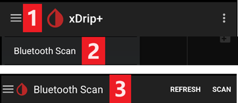

# Nastavení xDrip

Pokud ještě nemáte xDrip nastavený, stáhněte a nainstalujte nejnovější vydání xDrip ze [stránky s vydáními xDrip](https://github.com/NightscoutFoundation/xDrip/releases).

Pro aplikaci xDrip vypněte optimalizaci baterie a povolte činnost na pozadí.

## Základní nastavení pro všechny CGM & FGM systémy

### Vypněte nahrávání do Nightscoutu

Nedovolte žádné jiné aplikaci nahrávat data (glykémii a ošetření) do Nightscoutu.

→ Nabídka (☰) (1) → Settings (2) → Cloud Upload (3) -> Nightscout Sync (REST-API)(4) → přepněte `Enabled` na **OFF** (5)

#### Vypněte automatickou kalibraci a ošetření

Ujistěte se, že je `Automatic Calibration` (7) vypnutá. Pokud je políčko `Automatic Calibration` zaškrtnuté, jednou zapněte `Download treatments` (6), pak zrušte zaškrtnutí `Automatic Calibration` a `Download treatments` znovu vypněte.

Klepněte na `Extra Options`(8)

    {admonition} Bezpečnostní varování
    :class: warning
    V xDrip musíte vypnout „Upload treatments“, jinak se ošetření v AAPS mohou zdvojit a COB a IOB budou chybné.

Vypněte `Upload treatments`(9) a ujistěte se, že **NEBUDETE** používat `Back-fill data` (11).

Možnost `Alert on failures` by také měla být vypnutá (10). Jinak dostanete alarm každých 5 minut, když budou problémy s Wi-Fi/mobilní sítí nebo když server nebude dostupný.

### **Inter-app Settings** (vysílání)

Pokud budete používat AAPS a data se mají předávat např. do AAPS, musíte v xDrip v Inter-App settings zapnout vysílání.

→ Nabídka (☰) (1) → Settings (2) → Inter-app settings (3) → Broadcast locally **ON** (4)

Aby byly hodnoty v AAPS stejné jako v xDrip, zapněte `Send the displayed glucose value` (5).

Zapněte Compatible Broadcast (6).

Pokud jste v xDrip zapnuli také `Accept treatments` a v pluginu xDrip v AAPS `Enable broadcasts to xDrip`, bude xDrip z AAPS dostávat informace o inzulínu, sacharidech a bazální dávce.

Pokud zapnete `Accept Calibrations`, bude xDrip používat kalibrace z AAPS. Buďte opatrní, když tuto funkci používáte se senzory Dexcom: nejdříve si přečtěte [tento návod](https://navid200.github.io/xDrip/docs/Calibrate-G6.html).

Nezapomeňte vypnout Import Sounds, aby xDrip nevydával vyzváněcí tón pokaždé, když AAPS pošle změnu bazálu/profilu.

(xdrip-identify-receiver)=

#### Identify receiver

- Pokud zjistíte problémy s místním vysíláním (AAPS nedostává hodnoty glykémie z xDrip), jděte do → Nabídka (☰) (1) Settings (2) → Inter-app settings (3) → Identify receiver (7) a zadejte `info.nightscout.androidaps` pro sestavení AAPS (pokud používáte sestavení PumpControl, zadejte místo toho `info.nightscout.aapspumpcontrol`!!).
- Pozor: automatické opravy textu někdy mění písmeno i na velké I. Při psaní `info.nightscout.androidaps` (nebo `info.nightscout.aapspumpcontrol` pro PumpControl) **musíte použít jen malá písmena**. Velké I by zabránilo aplikaci přijímat hodnoty glykémie z xDrip.
    
    

## Kalibrace xDrip pomocí AAPS

- Pokud chcete kalibrovat pomocí AAPS, jděte v xDrip do Settings → Interapp Compatibility → Accept Calibrations a zvolte ON. 
- Můžete také zkontrolovat možnosti v Settings → Less Common Settings → Advanced Calibration Settings.

## Dexcom sensors

Vše, co se týká samotného senzoru a vysílače Dexcom (spuštění, zastavení, výměna, kalibrace, řešení problémů), je popsáno a průběžně aktualizováno v [dokumentaci xDrip pro Dexcom](https://navid200.github.io/xDrip/docs/Dexcom_page.html). Pro senzor se řiďte těmito pokyny; jediná část specifická pro AAPS je nastavení propojení xDrip s **AAPS** (popsané výše na této stránce).

### Dexcom G6 a ONE

- Nastavte xDrip podle [doporučeného nastavení](https://navid200.github.io/xDrip/docs/G6-Recommended-Settings.html).
- Vysílače Dexcom G6 a ONE mohou být současně spojeny s přijímačem Dexcom (nebo místo něj s pumpou t:slim) a s jednou aplikací v telefonu.
- Když používáte xDrip jako přijímač, nejdříve odinstalujte aplikaci Dexcom. **Nemůžete mít s vysílačem spojený xDrip a aplikaci Dexcom současně!**
- Pokud potřebujete Clarity a chcete využít funkce xDrip, použijte [Build Your Own Dexcom App](#DexcomG6-if-using-g6-with-build-your-own-dexcom-app) s místním vysíláním do xDrip, nebo použijte xDrip jako doprovodnou aplikaci, která čte oznámení z oficiální aplikace Dexcom (hodnoty glykémie mohou přicházet se zpožděním).

#### Restarty senzoru

- xDrip se současnými vysílači vždy používá [nativní algoritmus](https://navid200.github.io/xDrip/docs/Native-Algorithm.html) vysílače; není důvod ho vypínat.
- [Preventivní restarty](https://navid200.github.io/xDrip/docs/Preemptive-Restart.html) fungují jen se starými vysílači (firmware 1.6.5.25 nebo starší), kde jsou potřeba, aby se senzor nezastavil po 10 dnech. Novější vysílače (Firefly) je ignorují.
- Restart senzoru s vysílačem Firefly vyžaduje [odebrání vysílače](https://navid200.github.io/xDrip/docs/Remove-transmitter.html) a hodnoty mohou být po restartu výrazně chybné, což je při používání smyčky nebezpečné: přečtěte si celý návod [Restart a sensor](https://navid200.github.io/xDrip/docs/Restart-G6-sensor.html) a [kalibrujte opatrně](https://navid200.github.io/xDrip/docs/Calibrate-after-G6Restart.html).

(xdrip-connect-g6-transmitter-for-the-first-time)=

#### Spuštění, zastavení a výměna senzorů

Postupujte podle návodů:

- [Spuštění vysílače G6 nebo ONE](https://navid200.github.io/xDrip/docs/Starting-G6.html)
- [Zastavení a spuštění senzoru G6 nebo ONE](https://navid200.github.io/xDrip/docs/Dexcom/StartG6Sensor.html)
- [Odebrání vysílače ze senzoru](https://navid200.github.io/xDrip/docs/Remove-transmitter.html)
- [Životnost vysílače](https://navid200.github.io/xDrip/docs/Transmitter-lifetime.html) lze prodloužit ([hard reset](https://navid200.github.io/xDrip/docs/Hard-Reset.html)) jen u vysílačů s vyměněnou baterií nebo upravených vysílačů, ne u Firefly.

(xdrip-replace-transmitter)=

#### Výměna vysílače

- Vypněte původní přijímač Dexcom (pokud ho používáte) a nezapínejte ho znovu, dokud xDrip nezobrazuje hodnoty.
- Zapomeňte zařízení v xDrip (System Status → Forget Device) A v nastavení Bluetooth v chytrém telefonu (zobrazuje se jako Dexcom?? kde ?? jsou poslední dvě číslice sériového čísla vysílače).
- Starý vysílač udržujte mimo dosah Bluetooth, aby se znovu nepřipojil.
- Pak postupujte podle návodu [Spuštění vysílače G6 nebo ONE](https://navid200.github.io/xDrip/docs/Starting-G6.html).

### Dexcom G7, ONE+ a Stelo

- Postupujte podle [návodu pro G7, ONE+ a Stelo](https://navid200.github.io/xDrip/docs/Dexcom/G7.html) (je potřeba novější vydání xDrip – viz odkazovaná stránka).
- Podívejte se také na [stránku Dexcom G7, ONE+ a Stelo](../CompatibleCgms/DexcomG7.md), kde jsou dostupná nastavení s **AAPS**.

(xdrip-troubleshooting-dexcom-g5-g6-and-xdrip)=

### Řešení problémů s Dexcom a xDrip

- [Řešení problémů s připojením G6/ONE](https://navid200.github.io/xDrip/docs/Connectivity-troubleshoot.html)
- [Řešení problémů s G7/ONE+/Stelo](https://navid200.github.io/xDrip/docs/Dexcom/G7_Troubleshooting.html)
- [Problém při spuštění nového senzoru](https://navid200.github.io/xDrip/docs/Dexcom/SensorFailedStart.html)
- Úplný seznam: viz **Troubleshooting** na [stránce xDrip pro Dexcom](https://navid200.github.io/xDrip/docs/Dexcom_page.html).

## Libre 1

- Nastavení můstku NFC–Bluetooth v xDrip
    
    → Nabídka (☰) (1) → Settings (2) → Less common settings (3) → Bluetooth Settings (4)

- V Bluetooth Settings nastavte zaškrtávací políčka přesně jako na snímcích obrazovky níže (5)
    
    - Vypněte watchdogy, protože resetují Bluetooth v telefonu a přeruší spojení s pumpou.
    
    

- Můžete zkusit zapnout tato nastavení (7)
    
    - Použít vyhledávání
    - Trust Auto-Connect
    - Use Background Scans

- Pokud snadno ztrácíte spojení s můstkem nebo se spojení špatně obnovuje, **VYPNĚTE JE** (8).
    
    

- Všechny ostatní možnosti nechte vypnuté, pokud nevíte, proč je chcete zapnout.
    
    

### Úroveň baterie čtečky Libre

- Úroveň baterie můstků, jako jsou MiaoMiao a Bubble, lze zobrazit v AAPS (ne u Blucon).
- Podrobnosti najdete na [stránce se snímky obrazovky](#screens-sensor-level-battery).

### Připojte vysílač Libre a spusťte senzor

- Pokud to váš senzor vyžaduje (Libre 2 EU a Libre 1 US), nainstalujte nejnovější algoritmus „out of process“.

- Senzor už musí být spuštěný aplikací výrobce nebo čtečkou (xDrip neumí senzory Libre spouštět ani zastavovat).

- Nastavte zdroj dat na Libre Bluetooth.
    
    → Nabídka (☰) (1) → Settings (2) → v Hardware Data source vyberte Libre Bluetooth (3)
    
    

- Vyhledejte Bluetooth zařízení a připojte můstek.
    
    → Nabídka (☰) (1) → Scan Bluetooth (2) → Scan (3)
    
    - Pokud xDrip nemůže můstek najít, ujistěte se, že není připojený k aplikaci výrobce. Dejte ho nabíjet a resetujte ho.
    
    

- Spusťte senzor v xDrip.
    
        {admonition} Bezpečnostní varování
        :class: warning
        Nepoužívejte data senzoru, dokud neskončí hodinové zahřívání: hodnoty mohou být extrémně vysoké a vést k chybným rozhodnutím v AAPS.
    
    → Nabídka (☰) (1) → Start sensor (2) → Start sensor (3) → Nastavte přesný čas, kdy jste senzor spustili čtečkou nebo aplikací výrobce. Pokud jste ho nespustili dnes, odpovězte „Not Today“ (4).

(xdrip-libre2-patched-app)=

## Upravená aplikace Libre 2

- Nastavte zdroj dat na upravenou aplikaci Libre.
    
    → Nabídka (☰) (1) → Settings (2) → v Hardware Data source vyberte Libre (patched App) (3)
    
    

- Můžete přidat `BgReading:d,xdrip libre_receiver:v` v Less Common Settings->Extra Logging Settings->Extra tags for logging. Tím se budou zapisovat další chybové zprávy pro řešení problémů.

