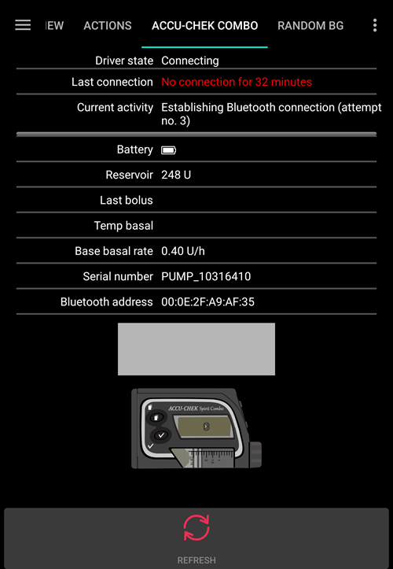

# Accu-Chek Combo

**Tento software je součástí DIY řešení a není to produkt, ale vyžaduje po vás, abyste si přečetli, naučili se a porozuměli systému včetně toho, jak ho používat. Není to něco, co by za vás spravovalo veškerou vaši cukrovku, ale umožňuje vám zlepšit vaši cukrovku a kvalitu života, pokud jste ochotni věnovat potřebný čas. Nespěchejte do toho, ale dopřejte si čas na učení. Jste jediní, kdo nese odpovědnost za to, co s tím uděláte.**

```{admonition} Accu-Chek Combo is being phased out
:class: note

Firma Roche odchází z trhu s inzulínovými pumpami, aby se v oblasti diabetu soustředila na CGM Accu-Chek SmartGuide. Oznámila konec prodeje pump Accu-Chek Combo i Accu-Chek Insight; postupně končí také její zbývající mikropumpa Accu-Chek Solo (poslední dodávky v Německu na konci roku 2025). Změna probíhá postupně podle regionů. Začíná v Německu a očekává se, že budou následovat další evropské trhy. Pokud jste na této pumpě závislí, naplánujte si včas přechod na podporovanou pumpu.
```

```{contents} Table of contents
:depth: 1
:local: true
```

## Možnosti pumpy s AAPS

* Komunikuje s **AAPS** přes vestavěný Bluetooth vašeho telefonu, bez dalšího komunikačního zařízení.
* Automatické zpracování letního času a časových pásem.

## Hardwarové a softwarové požadavky

* Roche Accu-Chek Combo (jakýkoliv firmware, funguje se všemi).
* Zařízení Smartpix nebo Realtyme spolu s 360 konfiguračním softwarem pro nastavení pumpy. (Roche poskytuje zařízení Smartpix a konfigurační software zdarma svým zákazníkům na vyžádání.)
* Kompatibilní telefon s Androidem 12 nebo novějším. Podrobnosti najdete v [poznámkách k vydání](#maintenance-android-version-aaps-version).
* Aplikace **AAPS** nainstalovaná ve vašem telefonu.

Některé telefony mohou pracovat lépe než jiné v závislosti na jejich kvalitě podpory technologie Bluetooth a na tom, zda mají doplňkové, velmi agresivní, metody úspory energie. Seznam telefonů najdete v dokumentu [Telefony](#Phones-list-of-tested-phones). Uvědomte si, že toto není úplný seznam a odráží osobní zkušenosti uživatelů. Doporučuje se také sdílet své zkušenosti a pomáhat tak ostatním (tyto projekty jsou o tom, jak si navzájem pomáhat).

(combov2-before-you-begin)=
## Než začnete

**BEZPEČNOST NA PRVNÍM MÍSTĚ** - nezkoušejte provést tento proces v prostředí, kde není možná obnova po chybě. Mějte své zařízení Smartpix / Realtyme po ruce, spolu s konfiguračním softwarem 360. Vyhraďte si přibližně hodinu na všechna nastavení a kontrolu, že všechno funguje v pořádku.

Mějte na paměti následující omezení:

* Prodloužený bolus a vícevlnný bolus nejsou v současné době podporovány (místo nich můžete použít [rozložené sacharidy](../DailyLifeWithAaps/ExtendedCarbs.md)).
* Je podporovaný pouze jeden (první) bazální profil.
* Nejnižší bazální dávka ve vašem **profilu** je 0,05 U/h. **AAPS** odmítne **profil** s nižší dávkou. Combo zaokrouhluje bazální dávky na své vlastní kroky (0,01 U/h pod 1 U/h, 0,05 U/h do 10 U/h, 0,1 U/h nad 10 U/h). **AAPS** počítá s dávkami, které pumpa skutečně podává.
* Dočasné bazály jsou omezeny na 500 % aktuální bazální dávky. **AAPS** s tímto limitem počítá.
* Pokud není na pumpě aktivovaný profil č. 1, smyčka je deaktivována. Tento stav trvá, dokud není aktivní profil č. 1. Až se tak stane, AAPS při příštím připojení (buď samo po nějaké době, nebo když klepnete na **Obnovit** na obrazovce pumpy Accu-Chek Combo) zjistí, že aktuální je profil č. 1, a smyčku znovu povolí.
* Pokud smyčka požaduje zrušení spuštěného dočasného bazálu, Combo nastaví dočasný bazál na 90 % nebo 110 % na dobu 15 minut. Důvodem je, že skutečné zrušení dočasného bazálu vyvolá na pumpě alarm, který vyvolá mnoho vibrací, které nelze vypnout.
* Stabilita bluetooth připojení se liší s různými telefony, což způsobuje upozornění "pumpa nedostupná", kdy již není navázáno žádné spojení s pumpou. Pokud k této chybě dojde, ujistěte se, že je zapnutý Bluetooth, a klepněte na **Obnovit** na obrazovce pumpy (**Spravovat** > **Pumpa**), abyste zjistili, zda šlo jen o přechodný problém. Pokud se spojení stále nenaváže, restartujte telefon, což to obvykle vyřeší.
* Jestliže restart nepomůže, existuje ještě další možnost. Stiskněte tlačítko na pumpě (což resetuje Bluetooth na pumpě), pumpa by měla znovu navázat spojení.
* Nastavení TBR na pumpě by se mělo vyhnout, protože smyčka přebírá kontrolu nad TBR. Detekce nového TBR na pumpě může trvat až 20 minut a účinek TBR bude počítán pouze od chvíle, kdy bude detekován, takže v nejhorším případě může být 20 minut TBR, který není zohledněn v IOB.

Ovladač v současné době podporuje na pumpě Combo tyto jazyky. (Toto nesouvisí s jazykem v AAPS - jedná se o jazyk zobrazený na samotném LCD pumpy Combo.)

* Angličtina
* Španělština
* Francouzština
* Italština
* Ruština
* Turečtina
* Polština
* Čeština
* Maďarština
* Slovenština
* Rumunština
* Chorvatština
* Nizozemština
* Řečtina
* Finština
* Norština
* Portugalština
* Švédština
* Dánština
* Němčina
* Slovinština
* Litevština

**Důležité**: Pokud je vaše pumpa nastavena na jazyk, který není v tomto seznamu, kontaktujte vývojáře a nastavte jazyk pumpy na jeden z nich. Jinak nebude ovladač fungovat správně.

## Nastavení telefonu

Je velmi důležité zajistit, aby byly vypnuty optimalizace baterie (úspora energie). AAPS již automaticky detekuje, když takovým optimalizacím podléhá, a ve svém uživatelském rozhraní vyžaduje jejich vypnutí. Ale na moderních telefonech s Androidem je _samotný Bluetooth_ aplikace (systémová aplikace). A obvykle je tato „Bluetooth aplikace“ spuštěna _s úsporami baterie ve výchozím nastavení_. V důsledku toho může Bluetooth odmítnout reagovat, když se telefon snaží šetřit energii a zastaví kvůli tomu Bluetooth aplikaci. To znamená, že v systémovém nastavení Bluetooth aplikace musí být optimalizace baterie také vypnuta. Bohužel, způsob jak najít tuto systémovou Bluetooth aplikaci se na různých telefonech liší. V základní verzi Android přejděte do Nastavení -> Aplikace -> Zobrazit všech N aplikací (N = počet aplikací ve vašem telefonu). Poté otevřete nabídku v pravém horním rohu, klepněte na položku "Zobrazit systém", "Zobrazit systémové aplikace" nebo "Všechny aplikace". Nyní ve zcela kompletním seznamu aplikací hledejte aplikaci "Bluetooth". Vyberte ji a v rozhraní "Informace o aplikaci" klepněte na "Baterie". Tam vypněte optimalizaci baterie (někdy nazývané "využití baterie").

## Nastavení pumpy Combo

* Nastavte pumpu pomocí konfiguračního softwaru Accu-Check 360. Pokud nemáte software, kontaktujte prosím svou Accu-Chek hotline. Obvykle posílají registrovaným uživatelům CD s "360° Pump Configuration Software" a zařízení SmartPix USB-infrazářič (zařízení Realtyme také funguje, pokud to máte).

  - **Požadované nastavení** (na snímcích obrazovky označeno zeleně):

     * Nastavte/nechte konfiguraci menu jako "Standard", toto zobrazí pouze podporovaná menu/akce na pumpě a skryje ty, které nejsou podporovány (rozšířené/multiwave bolusy, více bazálních dávek), což způsobuje omezení funkčnosti smyčky, když je používána, protože není možné bezpečně běžet smyčku, když je používána.
     * Ověřte, že _Quick Info Text_ je nastaven přesně na "QUICK INFO" (bez uvozovek, nastavení najdete pod _Insulin Pump Options_).
     * Nastavte maximální velikost dočasného bazálu (TBR) _Maximum Adjustment_ na 500%
     * Vypněte _Signal End of Temporary Basal Rate_ - alarm na konci dočasného bazálu
     * Nastavte _Časový přírůstek_ dočasného bazálu na 15 min
     * Povolte Bluetooth

  - **Doporučené nastavení** (na snímcích obrazovky označeno modře)

     * Nastavte alarm na nízkou kazetu podle vašich představ
     * Nakonfigurujte maximální bolus vhodný pro vaši terapii, abyste ochránili zařízení před chybami v softwaru
     * Podobně nastavte maximální dobu TBR jako ochranu. Povolte alespoň 3 hodiny, protože možnost odpojit pumpu na 3 hodiny nastaví 0% během těchto 3 hodin.
     * Povolte zámek kláves na pumpě, abyste zabránili bolusu z pumpy, obzvlášť když byla pumpa používána dříve a rychlý bolus byl obvyklým zvykem.
     * Nastavte časový limit pro displej a časový limit pro menu na minimum 5,5 a 5 sekund. To umožňuje AAPS rychleji se zotavit z chybových situací a snižuje množství vibrací, které mohou během těchto chyb nastat

  

  

  

  

## Aktivace ovladače a párování s pumpou Combo

* Otevřete **nabídku** (☰) v levém horním rohu, přejděte do [**Konfigurace** > **Pumpa**](../SettingUpAaps/ConfigBuilder.md) a vyberte **Accu-Chek Combo**.

  

  Po výběru se na kartě **Accu-Chek Combo** zobrazí dvě tlačítka, **Nastavení** a **Otevřít plugin**:

  

  **Nastavení** otevře nastavení ovladače Accu-Chek Combo (viz [Nastavení](#combov2-preferences) níže):

  

  **Otevřít plugin** (nebo **Spravovat** > **Pumpa**) otevře obrazovku pumpy Accu-Chek Combo. Dokud není pumpa spárovaná, zobrazuje **Není spárováno s pumpou**:

  

* Na obrazovce pumpy klepněte na **Párování**. Otevře se obrazovka **Párovat s pumpou**. Proveďte kroky zobrazené na obrazovce a pak klepněte na **Začít párovat**. Když se Android zeptá na povolení, aby byl telefon viditelný pro jiná zařízení Bluetooth, klepněte na **Povolit**. Nakonec Combo zobrazí na svém displeji 10místný párovací PIN a **AAPS** si o něj řekne. Zadejte tento PIN do pole **10místný PIN**.

  

  

  

  Další obrázky jsou ze starší verze **AAPS**. Kroky a texty jsou stejné, ale obrazovky vypadají trochu jinak.

  

  

  

* Pokud je PIN zadán špatně, **AAPS** zobrazí **PIN nefungoval. Zkontrolujte, zda jste neudělali překlep. Pokud se to stále děje, zrušte a opakujte párování.**

  

* Když se zobrazí **Úspěšně spárováno s Combo**, klepněte na **OK**. Vrátíte se na obrazovku pumpy, která nyní zobrazuje stav pumpy (viz [Obsah obrazovky pumpy Accu-Chek Combo](#combov2-tab-contents) níže). Tlačítko **Párování** se změní na **Odpárovat**.

* K ověření správného nastavení (ve chvíli, kdy je pumpa z důvodu bezpečnosti **odpojena** od jakékoli kanyly), použijte AAPS k nastavení dočasného bazálu (TBR) na 500 % po dobu 15 min a následně zkuste vydat malý bolus. Pumpa by nyní měla mít běžící TBR a bolus v historii. AAPS by také měla zobrazit aktivní TBR a dodaný bolus.

* Povolte zámek kláves na pumpě, abyste zabránili bolusu z pumpy, obzvlášť když byla pumpa používána dříve a rychlý bolus byl obvyklým zvykem.

## Poznámky k párování

Pumpa Accu-Chek Combo byla vyvinuta před vydáním Bluetooth 4.0 a pouhý rok po vydání úplně první verze Androidu. Z toho důvodu není způsob párování s dalšími zařízeními 100% kompatibilní s tím, jak se to dnes dělá v systému Android. Aby to bylo možné překonat, AAPS bude potřebovat úroveň systémových oprávnění, která je dostupná pouze pro systémové aplikace. Ty jsou do telefonů instalované jejich výrobci - uživatelé nemohou instalovat systémové aplikace.

Proto párování nikdy nebude na 100 % bez problémů. Zejména během párování se může na Androidu na chvíli zobrazit požadavek na zadání Bluetooth PIN, který automaticky zmizí. Ale někdy zůstane na obrazovce a žádá čtyřmístný PIN kód. (Toto nezaměňujte s desetimístným párovacím PIN kódem). Nezadávejte nic, jen stiskněte tlačítko Storno. Pokud párování nepokračuje, postupujte podle pokynů na obrazovce a zkuste spárování znovu.

(combov2-tab-contents)=
## Obsah obrazovky pumpy Accu-Chek Combo

Obrazovku pumpy otevřete přes **Spravovat** > **Pumpa**. Když je pumpa spárovaná, zobrazuje tyto informace (položky jsou uvedeny shora dolů):


1. **Stav ovladače**: Ovladač může být v jednom z následujících stavů:
   - **Odpojeno**: Není navázáno spojení přes Bluetooth; ovladač je v tomto stavu většinu času a k pumpě se připojuje jen v případě potřeby – šetří to energii
   - **Připojuji**
   - **Kontrola pumpy**: pumpa je připojena, ale ovladač právě provádí bezpečnostní kontroly, aby bylo vše v pořádku a aktuální
   - **Připraven**: ovladač je připraven přijímat příkazy z AAPS
   - **Pozastaveno**: pumpa je pozastavena (na pumpě Combo se zobrazuje jako „stopped“)
   - Popis právě prováděného příkazu, například **Nastavení bazálního profilu** nebo **Nahrávám stav pumpy**
   - **Chyba**: došlo k chybě; spojení bylo ukončeno a každý probíhající příkaz byl přerušen
2. **Poslední spojení**: Před kolika minutami se ovladač naposledy úspěšně připojil k pumpě Combo; pokud je to více než 30 minut, tato položka se zobrazí červeně
3. **Baterie**: Stav baterie; Combo hlásí pouze **Plně nabitá**, **Vybitá** nebo **Zcela vybitá** a nenabízí nic přesnějšího (například procenta), proto se zde zobrazují jen tyto tři stavy
4. **Zásobník**: Kolik jednotek inzulínu je v současné době v zásobníku Comba
5. **Poslední bolus**: Před kolika minutami byl podán poslední bolus; pokud od spuštění AAPS ještě žádný bolus podán nebyl, tato položka se nezobrazí
6. **Dočasný bazál**: Podrobnosti o právě aktivním dočasném bazálu; pokud žádný aktivní není, tato položka se nezobrazí
7. **Základní hodnota bazálu**: Právě aktivní základní bazální dávka („základní“ znamená bazální dávku bez vlivu aktivního dočasného bazálu)
8. **Sériové číslo**: Sériové číslo pumpy Combo, jak ho hlásí pumpa (odpovídá sériovému číslu na zadní straně pumpy Combo)
9. **Bluetooth MAC adresa**: 6bajtová adresa Bluetooth pumpy Combo, zobrazená ve formátu `XX:XX:XX:XX:XX:XX`

Když ovladač něco provádí (například nastavuje bazální profil), pod seznamem se zobrazí rámeček s popisem aktuální činnosti a tenký ukazatel průběhu.

Combo lze provozovat přes Bluetooth v režimu _vzdáleného terminálu_ nebo v _příkazovém režimu_. Režim dálkového terminálu odpovídá "dálkovému ovládání" Combo, který napodobuje LCD a čtyři tlačítka pumpy. Některé příkazy musí v tomto režimu provést ovladač, protože nemají žádný protějšek v příkazovém režimu. Tento druhý způsob je mnohem rychlejší, ale jak již bylo řečeno, má omezený rozsah. Když je aktivní režim vzdáleného terminálu, aktuální obrazovka vzdáleného terminálu se zobrazí v poli těsně nad obrázkem pumpy Combo. Pokud se ale ovladač přepne do příkazového režimu, toto pole zůstane prázdné.

(Toto nijak neovlivňujete; ovladač sám rozhoduje, který režim použije. Je to jen poznámka, abyste věděli, proč v tomto poli někdy vidíte obrazovky z pumpy Combo.)

Dole jsou tato tlačítka:

- **Obnovit**: Okamžitě spustí aktualizaci stavu pumpy. Slouží také k tomu, abyste AAPS dali vědět, že dříve zjištěná chyba je nyní opravená a že AAPS může znovu zkontrolovat, zda je vše v pořádku (více níže v [části o upozorněních](#combov2-alerts)). Klepnout na něj můžete jen tehdy, když je ovladač odpojený, pozastavený nebo v chybovém stavu.
- **Odpárovat**: Zruší párování pumpy Combo s **AAPS** a Androidem poté, co potvrdíte **Opravdu chcete odpárovat pumpu?**. Když není spárovaná žádná pumpa, toto tlačítko se změní na **Párování**.

(combov2-preferences)=
## Nastavení

Pro ovladač Combo jsou dostupná tato nastavení (**Konfigurace** > **Pumpa** > **Accu-Chek Combo** > **Nastavení**, nebo ikona nastavení (ozubené kolo) na obrazovce pumpy). Položky jsou uvedeny shora dolů:

1. **Délka hledání (v sekundách)**: Při párování ovladač nastaví telefon tak, aby ho pumpa mohla najít. Toto určuje, jak dlouho je zjistitelnost spuštěná. Ve výchozím nastavení je vybráno maximum (300 sekund = 5 minut). Android neumožňuje spustit tuto funkci na dobu neurčitou, takže je nutné zvolit dobu trvání.
2. **Detekovat a vložit automaticky výměnu zásobníku**: Pokud je zapnuto, ovladač zadá „výměnu zásobníku“, kterou byste jinak zadali sami přes **Spravovat** > **Plnění/doplňování**. Podrobněji je to vysvětleno [níže](#combov2-autodetections).
3. **Detekovat a vložit automaticky výměnu baterie**: Pokud je zapnuto, ovladač zadá „výměnu baterie“, kterou byste jinak zadali sami přes **Spravovat** > **Výměna baterie pumpy**. Podrobněji je to vysvětleno [níže](#combov2-autodetections).
4. **Povolit podrobné protokolování**: Výrazně zvýší množství záznamů, které ovladač zapisuje do logu. **UPOZORNĚNÍ**: Nezapínejte, pokud o to nepožádal vývojář. Jinak to může do logů **AAPS** přidat spoustu zbytečných záznamů a snížit jejich užitečnost.

Párování a zrušení párování se provádí na obrazovce pumpy, ne v nastavení (viz výše).

(combov2-autodetections)=
## Automatické zjištění a zadání výměny baterie a inzulínu

Ovladač je schopen rozpoznat výměnu baterie a zásobníku inzulínu sledováním úrovně jejich nabití/naplnění. Pokud Combo při poslední aktualizaci stavu hlásilo nízký stav nabití baterie, a nyní, při nové aktualizaci stavu, je úroveň nabití hlášena jako normální, ovladač dojde k závěru, že uživatel musel baterii vyměnit. Stejná logika se používá pro stav zásobníku inzulínu: pokud je nyní vyšší než dříve, je to vykládáno jako výměna zásobníku.

To funguje pouze v případě, že baterie nebo zásobník jsou vyměněny ve chvíli, kdy je jejich stav hlášen jako nízký _a zároveň_ jsou dostatečně naplněny.

Tuto automatickou detekci můžete vypnout v [nastavení](#combov2-preferences) ovladače.

(combov2-alerts)=
## Upozornění (varování a chyby) a způsob jejich zpracování

Combo zobrazuje upozornění jako obrazovky vzdáleného terminálu. Varování jsou zobrazena s kódem "Wx" (x je číslice), spolu s krátkým popisem. Například "W7", "TBR OVER". Chyby jsou zobrazovány obdobně, ale zobrazí se s kódem "Ex".

Některá varování jsou automaticky zamítnuta ovladačem. Jedná se o:

- W1 „reservoir low“: ovladač z něj udělá varování „málo inzulínu v zásobníku“, které se zobrazí na hlavní obrazovce AAPS
- W2 „battery low“: ovladač z něj udělá varování „slabá baterie“, které se zobrazí na hlavní obrazovce AAPS
- W3, W6, W7, W8 : tato varování jsou čistě informační pro uživatele, takže je pro ovladač může bezpečně automaticky zamítnout

Žádné další výstrahy _nejsou_ automaticky zamítnuty. Také chyby _nikdy nejsou_ automaticky zamítnuty. Oboje jsou zpracovány stejným způsobem: ovladač vytvoří výstražné dialogové okno nad rozhraním AAPS a přeruší vykonávání všech probíhajících příkazů. Ovladač se pak přepne do stavu „chyba“ (viz [Obsah obrazovky pumpy Accu-Chek Combo výše](#combov2-tab-contents)). Tento stav neumožňuje provádění jakýchkoli příkazů. Uživatel musí vyřešit chybu na pumpě; například chyba okluze může vyžadovat výměnu kanyly. Jakmile uživatel chybu vyřeší, běžný provoz lze obnovit klepnutím na **Obnovit** na obrazovce pumpy Accu-Chek Combo. Ovladač se pak spojí s pumpou Combo, zaktualizuje její stav a zkontroluje, zda není na obrazovce stále zobrazena chyba atd. Ovladač také po chvíli automaticky aktualizuje stav pumpy, takže ruční stisknutí tohoto tlačítka není povinné.

Zvláštní případ je dávkování bolusů. To probíhá v příkazovém režimu, který v průběhu podávání bolusu nereportuje, že se objevilo varování. Z toho důvodu ovladač nemůže automaticky zrušit varování _během_ podávání bolusu. To bohužel znamená, že pumpa bude v takovém případě pípat, dokud nebude ukončeno podávání bolusu. Nejčastější výstraha v průběhu bolusu je obvykle W1 "Reservoir low". V průběhu podávání bolusu **nevypínejte** upozornění přímo na pumpě. Riskujete tak přerušení podávání bolusu. Ovladač se o varování postará automaticky po dokončení bolusu.

Upozornění, která se objeví, zatímco ovladač není spojený s pumpou Combo, nebudou ovladačem zaznamenána. Combo nemá možnost automaticky odeslat tato upozornění do telefonu; spojení je vždy aktivováno na straně telefonu. Výsledkem je, že upozornění zůstane na pumpě, dokud se ovladač znovu nepřipojí. Můžete klepnout na **Obnovit** na obrazovce pumpy, abyste spustili připojení a nechali ovladač upozornění vyřešit hned (místo čekání, až se AAPS rozhodne připojit samo).

**DŮLEŽITÉ**: Pokud dojde k chybě nebo se zobrazí varování, které není automaticky vypnuto, ovladač se přepne do chybového stavu. V tomto stavu bude smyčka **ZABLOKOVÁNA** dokud není aktualizován stav pumpy! Smyčka se odblokuje, jakmile se aktualizuje stav pumpy (buď klepnutím na **Obnovit**, nebo automatickou aktualizací ovladače) a už se nezobrazuje žádná chyba.

## Na co dávat pozor při používání pumpy Combo

* Mějte na paměti, že se nejedná o produkt. Obzvlášť na začátku uživatel potřebuje monitorovat a pochopit systém, jeho limity a jeho možná selhání. Je důrazně doporučováno nepoužívat tento systém, pokud ho uživatel není schopen plně pochopit.
* Kvůli způsobu, jakým funguje vzdálené ovládání Comba, jsou některé operace (především nastavení bazálního profilu) ve srovnání s jinými pumpami pomalejší. Jde o nešťastné omezení pump Combo, které není možné překonat.
* Nenastavujte ani nerušte TBR na pumpě. Smyčka předpokládá, že řídí dočasné bazály a bez splnění tohoto předpokladu nemůže spolehlivě fungovat. Důvodem je, že nelze určit čas spuštění dočasného bazálu zadaného uživatelem přímo na pumpě.
* Jestliže probíhá komunikace mezi AAPS a pumpou (na pumpě je během připojení zobrazeno logo Bluetooth), nesmíte na pumpě mačkat žádná tlačítka. Došlo by k přerušení Bluetooth připojení. Dělejte to pouze tehdy, když jsou problémy s navázáním spojení (viz [část „Než začnete“ výše](#combov2-before-you-begin)).
* Nesmíte stisknout žádná tlačítka, pokud pumpa posílá bolus. Zejména se nepokoušejte zavřít upozornění stiskem tlačítek. Podrobnější vysvětlení, proč tomu tak je, najdete v [části o upozorněních](#combov2-alerts).

## Checklist pro případ, kdy nelze navázat spojení s pumpou Combo

Ovladač dělá maximum pro připojení ke Combu a používá pár triků k maximalizaci spolehlivosti. Přesto někdy nelze spojení navázat. Zde je několik kroků, které můžete podniknout k nápravě.

1. Stiskněte tlačítko na Combu. Někdy přestane Bluetooth modul v pumpě odpovídat a nepřijímá kvůli tomu spojení. Stisknutím tlačítka na pumpě přimějete LCD k rozsvícení a zároveň dojde k resetu Bluetooth modulu. Toto je většinou jediný krok, který je potřebný k opravě problémů s připojením.
2. Restartujte telefon. To může být nutné, pokud došlo k problému s Bluetooth modulem samotného telefonu.
3. Pokud je krytka baterie pumpy stará, zvažte její výměnu. Staré kryty baterií mohou způsobit problémy s napájením pumpy Combo, což ovlivňuje Bluetooth.
4. Pokud pokusy o připojení nadále selhávají, zvažte zrušení párování a nové spárování pumpy.

(combov2-tips-for-basic-usage)=
## Tipy pro běžné používání

### Jak zajistit bezproblémové používání

* Vždy **noste telefon u sebe** a v noci ho nechte vedle postele. Protože pumpa může během spánku ležet za vaším tělem nebo pod ním, je nejvhodnější vyšší poloha (na polici nebo stolku).
* Vždy se snažte mít baterii v pumpě co nejvíce nabitou. Tipy k baterii najdete v části o baterii.
* Kdykoli je to možné, ovládejte pumpu jen přes aplikaci AAPS. Aby to bylo snazší, zapněte na pumpě zámek kláves v **PUMP SETTINGS / KEY LOCK / ON**. Ovládat pumpu přímo je zpravidla potřeba pouze při výměně baterie nebo zásobníku.


### Pumpa není dostupná. Co s tím?

#### Nastavte si alarm při nedostupnosti pumpy
* V **AAPS** klepněte na ikonu **Nastavení** (ozubené kolo) vpravo nahoře na hlavní obrazovce, přejděte do **Místní výstrahy**, zapněte **Upozornit, pokud je pumpa nedostupná** a nastavte **Práh nedostupnosti pumpy** na **31** minut.
* Díky tomu se alarm nespustí, když odejdete z místnosti a telefon necháte na stole, ale upozorní vás, pokud pumpa není dostupná déle, než trvá dočasný bazál.

#### Obnovení komunikace s pumpou

* Když AAPS ohlásí alarm **pumpa nedostupná**, nejprve uvolněte zámek kláves a **stiskněte libovolné tlačítko na pumpě** (např. tlačítko „dolů“). Jakmile displej pumpy zhasne, klepněte na **Obnovit** na obrazovce pumpy Accu-Chek Combo (**Spravovat** > **Pumpa**). Toto často pomůže obnovit komunikaci.
* Když toto nepomůže, restartujte telefon. Po restartu se AAPS znovu spustí a naváže nové spojení s pumpou.

* Testy s různými telefony ukázaly, že některé telefony spouštějí chybu „pumpa nedostupná“ častěji než jiné. Úspěšně otestované telefony najdete v dokumentu [Telefony](#Phones-list-of-tested-phones).

#### Hlavní příčiny a důsledky častých poruch v komunikaci
* Na telefonech s **malou pamětí** (nebo s **agresivním šetřením energie**) systém AAPS často ukončí. Poznáte to tak, že se po otevření AAPS na hlavní obrazovce nezobrazují tlačítka ošetření (panel Rychlé spuštění), protože se systém teprve inicializuje. Kvůli těmto zastavením může být při startu vyvolán alarm „pumpa nedostupná“. V poli **Poslední spojení** na obrazovce pumpy (**Spravovat** > **Pumpa**) můžete zjistit, kdy AAPS naposledy komunikovalo s pumpou.



* Tato chyba může rychleji vybíjet baterii pumpy, protože se při restartu aplikace z pumpy načítá bazální profil.
* Zvyšuje také pravděpodobnost chyby, při které pumpa odmítá všechna příchozí spojení, dokud na ní nestisknete tlačítko.

### Selhání zrušení dočasného bazálu
* Občas AAPS nedokáže automaticky zrušit upozornění **TBR CANCELED**. Pak musíte buď klepnout na **Obnovit** na obrazovce pumpy Accu-Chek Combo, nebo potvrdit alarm na pumpě.

### Poznámky k baterii pumpy

#### Výměna baterie
* Po alarmu **slabá baterie** vyměňte baterii co nejdříve, aby pumpa měla vždy dost energie pro spolehlivou komunikaci přes Bluetooth s telefonem, i když je telefon od pumpy dál.
* I po alarmu **slabá baterie** lze baterii ještě poměrně dlouho používat. Přesto se doporučuje mít po alarmu „slabá baterie“ vždy u sebe novou baterii.
* Před výměnou baterie klepněte na hlavní obrazovce na symbol **Smyčka** a vyberte **Pozastavit smyčku** na 1 hodinu.
* Počkejte, až telefon dokončí komunikaci s pumpou a logo Bluetooth na pumpě zmizí.


* Uvolněte zámek kláves na pumpě, přepněte pumpu do režimu stop, potvrďte případně zrušený dočasný bazál a rychle vyměňte baterii.
* Po výměně baterie nemusíte znovu nastavovat hodiny pumpy: AAPS datum a čas pumpy aktualizuje automaticky.
* Pak přepněte pumpu zpět do režimu run a po klepnutí na ikonu **Pozastavená smyčka** na hlavní obrazovce vyberte **Obnovit**.
* AAPS znovu nastaví potřebný dočasný bazál, jakmile přijde další hodnota glykémie.

(Accu-Chek-Combo-Tips-for-Basic-usage-battery-type-and-causes-of-short-battery-life)=
#### Typy baterií a důvody krátké výdrže
* Intenzivní komunikace přes Bluetooth spotřebuje hodně energie, proto používejte jen **kvalitní baterie**, například Energizer Ultimate Lithium, baterie „Power One“ z „velkého“ servisního balení Accu-Chek, nebo pokud chcete nabíjecí baterii, použijte baterie Eneloop.

 

Typická doba výdrže baterie dle typu:
* **Energizer Ultimate Lithium**: 4 až 7 týdnů
* **Power One Alkaline** (Varta) ze servisního balení: 2 až 4 týdny
* Nabíjecí baterie **Eneloop rechargeable** (BK-3MCCE): 1 až 3 týdny

Pokud vaše baterie vydrží výrazně kratší dobu, než je uvedeno výše, zkontrolujte tyto možné příčiny:
* Některé varianty šroubovacího víčka baterie pumpy Combo baterie částečně zkratují a rychle je vybíjejí. Víčka, která tento problém nezpůsobují, poznáte podle toho, že jejich kontakty jsou pozlacené.
* Pokud hodiny pumpy „nepřežijí“ krátkou výměnu baterie, je pravděpodobné, že kondenzátor, který udržuje hodiny běžící během krátkého výpadku proudu, je rozbitý. V takovém případě může pomoci výměna pumpy firmou Roche, což v záruční době není problém.
* Výdrž baterie pumpy ovlivňuje také hardware a software telefonu (operační systém Android a Bluetooth modul), i když přesné faktory zatím nejsou úplně známé. Máte-li možnost, vyzkoušejte jiný telefon a porovnejte výdrž baterie.

### Prodloužený bolus, vícevlnný bolus
Algoritmus OpenAPS nepodporuje souběžný prodloužený bolus ani vícevlnný bolus. Podobné léčby ale můžete dosáhnout těmito způsoby:
* Při zadávání sacharidů nebo v bolusové kalkulačce použijte **eSacharidy**: zadejte sacharidy celého jídla a dobu, za kterou podle vás přejdou jako glukóza do krve. Systém pak vypočítá malé dávky sacharidů rovnoměrně rozložené na celou dobu. Díky tomu algoritmus podá odpovídající množství inzulínu a přitom stále průběžně kontroluje celkový růst nebo pokles glykémie. Pro postup podobný vícevlnnému bolusu můžete také zkombinovat menší okamžitý bolus s eSacharidy.
* Před jídlem nastavte na několik hodin dočasný cíl **Před jídlem** s glykémií 80 (klepněte na cíl na hlavní obrazovce nebo na **Spravovat** > **Dočasný cíl**). Dobu trvání zvolte podle intervalu, který byste zvolili pro prodloužený bolus. Váš cíl tak bude nižší než obvykle, a proto se podá více inzulínu.
* Pak v **Bolusové kalkulačce** zadejte všechny sacharidy jídla, ale nepoužijte přímo hodnoty, které navrhne. Pokud chcete podat bolus podobný vícevlnnému, snižte dávku inzulínu. Podle jídla teď musí algoritmus podat další SMB nebo vyšší dočasné bazály, aby vyrovnal růst glykémie. Zde je třeba s bezpečnostními limity bazálu (Max IE / h, Maximum basal IOB) velmi opatrně experimentovat a v případě potřeby je dočasně změnit.

* Nepoužívejte prodloužený ani vícevlnný bolus přímo na pumpě. Ovladač je nepodporuje (viz [Než začnete](#combov2-before-you-begin)); pokud je vícevlnný bolus na pumpě přesto podán, **AAPS** ho z historie pumpy zaznamená jako normální bolus plus prodloužený bolus, takže se započítá do IOB. Prodloužený bolus v uzavřené smyčce nefunguje (podrobnosti najdete na [této stránce](#extended-bolus-and-why-they-wont-work-in-closed-loop-environment)).

### Alarmy při podání bolusu
* Po každém bolusu ovladač přečte historii bolusů z pumpy. Je to bezpečnostní mechanismus pro správný výpočet aktivního inzulínu (IOB), i když je bolus podán přímo z pumpy.
* Pokud před bolusem historie pumpy obsahuje bolus, o kterém **AAPS** nevědělo (například bolus podaný přímo na pumpě), požadovaný bolus se **nepodá**, protože byl vypočítán bez tohoto inzulínu. **AAPS** zobrazí **Historie pumpy má bolus, o kterém AAPS nevěděl. Požadovaný bolus nebyl vydán...** Zkontrolujte historii bolusů na pumpě a svůj IOB. Pokud je bolus stále potřeba, vypočítejte ho znovu. Totéž platí, když se neznámý bolus najde při novém připojení.
* Pokud byl bolus podán, ale historie pumpy obsahovala i další bolusy, o kterých **AAPS** nevědělo, zaznamenají se nyní a **AAPS** vás požádá, abyste před dalším bolusem zkontrolovali IOB.
* Pokud se spojení s pumpou přeruší **během** bolusu, **AAPS** nezaznamená 0 U: ukáže, kolik pumpa do té doby podala, a varuje, že pumpa může zbytek ještě podat. **Nepodávejte bolus znovu.** **AAPS** přečte skutečné množství z historie pumpy při příštím připojení.
* Pokud se spojení přeruší ve chvíli, kdy **AAPS** bolus odesílá, není známo, zda ho pumpa přijala. Před dalším bolusem zkontrolujte historii bolusů na pumpě.
* Pokud **AAPS** nemůže potvrdit, že byl bolus podán, zobrazí **Provádění bolusu selhalo. Zdá se, že žádný bolus nebyl podán. Pro jistotu zkontrolujte pumpu, abyste se vyhnuli dvojitému bolusu, a pak pošlete bolus znovu.** Bolusy se nikdy automaticky neopakují.

## Kde získat pomoc

Vývoj ovladače Combo dělá komunita na **dobrovolnické** bázi. Než požádáte o pomoc:

1. **Přečtěte si** příslušnou část této dokumentace a ověřte, jak má funkce fungovat.
2. **Zeptejte se** na kanálu *#AAPS* na [Discordu](https://discord.gg/4fQUWHZ4Mw) nebo v jiném z [komunitních kanálů](../GettingHelp/WhereCanIGetHelp.md).
3. **Nahlaste chybu**: prohledejte [existující hlášení (issues)](https://github.com/nightscout/AndroidAPS/issues); pokud tam vaše chyba není, založte [nové hlášení (issue)](https://github.com/nightscout/AndroidAPS/issues) a přiložte své [log soubory](../GettingHelp/AccessingLogFiles.md).

Když žádáte o pomoc, uveďte značku a model telefonu, verzi Androidu, verzi **AAPS** a jednoduchý popis problému v angličtině (co se změnilo, kdy to naposledy fungovalo).
