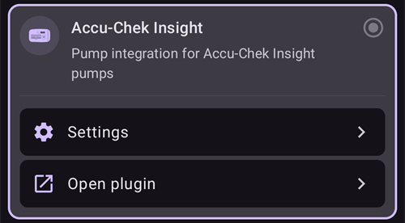
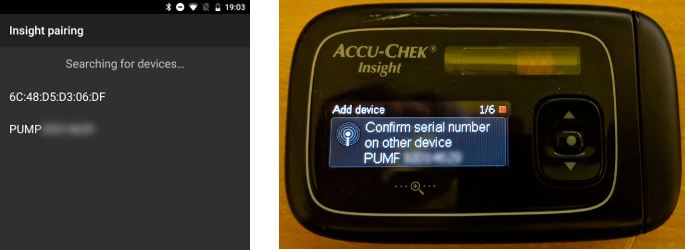

# Accu-Chek Insight

**Tento software je součástí DIY řešení umělé slinivky, nejedná se o výrobek. Před jeho používáním je důležité, abyste prostudovali a pochopili celý systém, včetně toho, jak ho používat. Není to něco, co za vás udělá veškerý management diabetu. Pokud do toho investujete potřebný čas, pomůže vám dojít k lepším výsledkům při léčbě vaší cukrovky, a tím zlepšit i kvalitu vašeho života. Zbytečně nespěchejte a vytvořte si čas na učení. Pouze vy jste zodpovědní za to, co s tím uděláte.**

```{admonition} Pumpa Accu-Chek Insight postupně končí :class: note

Firma Roche odchází z trhu s inzulínovými pumpami, aby se v oblasti diabetu soustředila na CGM Accu-Chek SmartGuide. Oznámila konec prodeje pump Accu-Chek Combo i Accu-Chek Insight; postupně končí také její zbývající mikropumpa Accu-Chek Solo (poslední dodávky v Německu na konci roku 2025). Změna probíhá postupně podle regionů. Začíná v Německu a očekává se, že budou následovat další evropské trhy. Podpora pumpy Insight je už uvedena jako ukončená (viz [Pumpy, které již nejsou v prodeji](./Future-possible-Pump-Drivers.md)). Pokud jste na této pumpě závislí, naplánujte si včas přechod na podporovanou pumpu.

    <br />```{note}
    Než měl **AAPS** vlastní ovladač pro Insight, pumpa Insight se ovládala přes samostatnou aplikaci [SightRemote](https://github.com/TebbeUbben/SightRemote). SightRemote už není potřeba a není udržována: pokud ji máte z té doby stále nainstalovanou, odinstalujte ji a používejte aktuální verzi **AAPS**.
    

```{contents} Obsah :depth: 1 :local: true

    <br />## Možnosti pumpy s AAPS
    
    * Komunikuje s **AAPS** přes vestavěný Bluetooth vašeho telefonu, bez dalšího komunikačního zařízení.
    * Automatické zpracování letního času a časových pásem.
    
    ## Požadavky na hardware a software
    
    * Pumpa Roche Accu-Chek Insight (jakýkoli firmware, fungují všechny)
    
    Poznámka: AAPS zapisuje data vždy do **prvního profilu bazální dávky v pumpě**.
    
    * Telefon s Androidem 12 nebo novějším (viz [Telefony](../Getting-Started/Phones.md))
    * Aplikace AAPS nainstalovaná ve vašem telefonu
    
    ## Nastavení
    
    * Pumpa Insight by měla být v jednu chvíli připojena jen k jednomu zařízení. Pokud jste dříve používali dálkové ovládání Insight (glukometr), musíte glukometr odebrat ze seznamu spárovaných zařízení pumpy: **Menu** > **Settings** > **Communication** > **Remove device**.
    
       
    
    * V [Konfigurace > Pumpa](#Config-Builder-pump) vyberte kartu **Accu-Chek Insight**. V jednu chvíli může být aktivní jen jedna pumpa.
    
       
    
       Po výběru se na kartě **Accu-Chek Insight** zobrazí dvě tlačítka, **Nastavení** a **Otevřít plugin**:
    
       
    
       **Nastavení** otevře nastavení ovladače Accu-Chek Insight (viz [Nastavení v AAPS](#Accu-Chek-Insight-Pump-settings-in-aaps)).
    
       **Otevřít plugin** (nebo **Spravovat → Pumpa**) otevře obrazovku pumpy Accu-Chek Insight. Před spárováním pumpy vypadá takto:
    
       
    
    (accu-chek-insight-pairing)=
    ### Párování
    
    * Na obrazovce pumpy klepněte na **Insight párování**. Otevře se průvodce párováním a vyhledá zařízení Bluetooth v okolí (horní část obrázku níže).
    * Na pumpě Insight přejděte do **Menu** > **Settings** > **Communication** > **Add Device**. Pumpa zobrazí následující obrazovku (dolní část obrázku níže) se sériovým číslem pumpy.
    
       
    
    * Zpět v telefonu klepněte v seznamu zařízení Bluetooth na sériové číslo pumpy. Pokud vás Android požádá o potvrzení párování, klepněte na **Spárovat**.
    
       
    
    * Pumpa i telefon zobrazí kód. Zkontrolujte, že jsou kódy na obou zařízeních stejné. Potvrďte na pumpě a v telefonu klepněte na **Ano**. (Pokud se kódy neshodují, klepněte na **Ne**.)
    
       
    
    * Telefon zobrazí **Párování dokončeno**. Klepnutím na **Konec** se vrátíte na obrazovku pumpy.
    
       
    
    * Pro kontrolu, že je vše v pořádku, se podívejte na obrazovku pumpy (**Spravovat → Pumpa**). Když je pumpa spárovaná, zobrazuje informace o pumpě, například **Sériové číslo**, **Datum výroby**, **Verze softwaru** a **Bluetooth MAC adresa**.
    
       
    
       ```{admonition} Starší snímky obrazovky
       :class: note
       Kromě horní části prvního obrázku jsou snímky párování výše ze starší verze **AAPS** a v **AAPS** 4 mohou vypadat jinak.
       ```
    
    * Párování zrušíte klepnutím na **Odpárovat** na obrazovce pumpy a potvrzením **Resetovat informace o párování?**. Pak se znovu zobrazí tlačítko **Insight párování**.
    
    Poznámka: Mezi pumpou a telefonem není trvalé spojení. **AAPS** se připojí jen v případě potřeby (například když nastavuje dočasný bazál, podává bolus nebo čte historii pumpy). Jinak by se baterie telefonu i pumpy vybíjely příliš rychle.
    
    (Accu-Chek-Insight-Pump-settings-in-aaps)=
    ## Nastavení v AAPS
    
    Nastavení otevřete tlačítkem **Nastavení** na kartě **Accu-Chek Insight** v **Konfigurace** > **Pumpa**, nebo ikonou ozubeného kola v pravém horním rohu obrazovky pumpy.
    
    
    
    V nastavení Insight v **AAPS** můžete zapnout tyto možnosti:
    
    * **Zaznamenat výměnu zásobníku**: automaticky zaznamená výměnu inzulínové kazety, když na pumpě spustíte program „fill cannula“.
    
    * **Zaznamenat výměnu hadičky**: přidá poznámku do databáze **AAPS**, když na pumpě spustíte program „tube filling“.
    
    * **Zaznamenat výměnu kanyly**: přidá poznámku do databáze **AAPS**, když na pumpě spustíte program „cannula filling“. **Poznámka: Výměna kanyly také resetuje Autosens.**
    
    * **Zaznamenat výměnu baterie**: zaznamená výměnu baterie, když do pumpy vložíte novou baterii.
    
    * **Zaznamenat změnu režimu provozu**: přidá poznámku do databáze **AAPS** pokaždé, když pumpu spustíte, zastavíte nebo pozastavíte.
    
    * **Zaznamenat výstrahy**: přidá poznámku do databáze **AAPS** pokaždé, když pumpa vydá výstrahu (kromě připomínek a zrušení bolusu a TBR, které se nezaznamenávají).
    
    * **Povolit emulaci dočasných bazálů**: pumpa Insight umí nastavit dočasné bazály (TBR) jen do 250 %. Aby se tento limit obešel, emulace TBR řekne pumpě, aby dodatečný inzulín podala jako prodloužený bolus, pokud je požadován TBR vyšší než 250 %.
    
      **Poznámka: Používejte vždy jen jeden prodloužený bolus. Více prodloužených bolusů současně může způsobit chyby.**
    
    * **Zakázat vibrace při ručním podání bolusu**: pumpa Insight nebude vibrovat, když podává ruční bolus (nebo prodloužený bolus). Dostupné jen s firmwarem Insight 3.x.
    
    * **Zakázat vibrace při automatickém podání bolusu**: pumpa Insight nebude vibrovat, když podává automatický bolus (SMB nebo dočasný bazál s emulací TBR). Dostupné jen s firmwarem Insight 3.x.
    
    * **Min. doba čekání na obnovení spojení [s]** a **Max. doba čekání na obnovení spojení [s]**: jak dlouho **AAPS** čeká po neúspěšném pokusu o připojení, než to zkusí znovu. Můžete vybrat 0 až 20 sekund. Pokud máte problémy s připojením, zvolte delší dobu čekání.
        <br><br>Příklad pro min. dobu čekání na obnovení spojení = 5 a max. dobu čekání na obnovení spojení = 20
        <br><br>žádné spojení -> čekat <b>5</b> s
          <br>  nový pokus -> žádné spojení -> čekat <b>6</b> s
          <br>  nový pokus -> žádné spojení -> čekat <b>7</b> s
          <br>  nový pokus -> žádné spojení -> čekat <b>8</b> s
          <br>...
          <br>nový pokus -> žádné spojení -> čekat <b>20</b> s
          <br>nový pokus -> žádné spojení -> čekat <b>20</b> s
          <br>...
    
    * **Limit pro odpojení [s]**: jak dlouho (v sekundách) **AAPS** po dokončení operace čeká, než se od pumpy odpojí. Můžete vybrat 0 až 15 sekund. Výchozí hodnota je 5 sekund.
    
    Za dobu, kdy byla pumpa zastavená, **AAPS** zaznamená dočasný bazál 0 %.
    
    ### Obrazovka pumpy
    
    Obrazovka pumpy Accu-Chek Insight (**Spravovat → Pumpa**) zobrazuje aktuální stav pumpy, například **Stav**, **Naposledy připojeno**, **Provozní režim**, **Baterie**, **Stav zásobníku**, dnešní celkové denní dávky (**CDD bolusů**, **CDD bazálů**), bazální dávky a poslední bolus. Když je pumpa spárovaná, má tato tlačítka:
    
    * **Obnovit**: obnoví stav pumpy.
    * **Povolit oznamování konce dočasného bazálu (nastavení pumpy)** / **Zakázat oznamování konce dočasného bazálu (nastavení pumpy)**: standardní pumpa Insight spustí alarm, když TBR skončí. Toto tlačítko tento alarm zapne nebo vypne bez nutnosti konfiguračního softwaru.
    * **Odpárovat**: zruší párování s pumpou (viz [Párování](#accu-chek-insight-pairing)).
    
    
    
    ```{admonition} Starší snímek obrazovky
    :class: note
    Snímek obrazovky výše je ze starší verze **AAPS**. V **AAPS** 4 vypadá obrazovka pumpy jinak a má také tlačítko **Odpárovat**.
    

## Nastavení v pumpě

Nastavení alarmů v pumpě:

* Menu > Nastavení > Nastavení zařízení > Nastavení režimu > Tichý > Signál > Zvuk
* Menu > Nastavení > Nastavení zařízení > Nastavení režimu > Tichý > Hlasitost > 0 (odeberte všechny sloupečky)
* Menu > Režimy > Režim signalizace > Tichý

To ztlumí všechny alarmy na pumpě a ponechá na AAPS rozhodnutí, jestli je alarm pro vás důležitý. Pokud AAPS alarm nepotvrdí, jeho hlasitost se zvýší (nejprve pípnutí, potom vibrace).

(Accu-Chek-Insight-Pump-vibration)=

### Vibrace

V závislosti na verzi firmwaru vaší pumpy bude Insight krátce vibrovat pokaždé, když je podán bolus (například když AAPS podá SMB nebo když emulace TBR podá prodloužený bolus).

* Firmware 1.x: Žádné vibrace z výroby
* Firmware 2.x: Vibrace nelze vypnout.
* Firmware 3.x: AAPS vydává bolus potichu.

Verzi firmwaru lze nalézt v menu.

## Výměna baterie

Výdrž baterie u pumpy Insight se při využívání smyčky pohybuje od 10 do 14 dnů, max. 20 dnů. Uživatel, který to uvádí, používá lithiové baterie Energizer.

Pumpa Insight má malou interní baterii udržující základní funkce, jako jsou vnitřní hodiny, zatímco vyměňujete hlavní baterii. Pokud výměna baterie trvá příliš dlouho, tato interní baterie se může vybít, hodiny se resetují a vy budete vyzváni, abyste po vložení nové baterie opětovně nastavili čas. Pokud se to stane, všechny záznamy v AAPS před výměnou baterie nebudou zahrnuty do kalkulací, protože nelze určit jejich správný čas.

(Accu-Chek-Insight-Pump-insight-specific-errors)=

## Specifické chyby Insight

### Prodloužený bolus

Používejte vždy jen jeden prodloužený bolus, protože více prodloužených bolusů současně může způsobit chyby.

### Časový limit

Někdy pumpa Insight neodpoví, když **AAPS** navazuje spojení. **AAPS** pak zobrazí oznámení „Vypršel limit spojení - resetujte Bluetooth“.


Pokud se to stane, vypněte Bluetooth na pumpě A v telefonu asi na 10 sekund a pak ho znovu zapněte.

## Změna časových pásem s pumpou Insight

Informace o cestování přes časová pásma najdete v části [Cestování přes časová pásma s pumpami](#timezone-traveling-insight).

## Kde získat pomoc

Vývoj ovladače Insight dělá komunita na **dobrovolnické** bázi. Než požádáte o pomoc:

1. **Přečtěte si** příslušnou část této dokumentace a ověřte si, jak má funkce fungovat.
2. **Zeptejte se** na kanálu *#AAPS* na [Discordu](https://discord.gg/4fQUWHZ4Mw) nebo v jiném z [komunitních kanálů](../GettingHelp/WhereCanIGetHelp.md).
3. **Nahlaste chybu**: prohledejte [existující issues](https://github.com/nightscout/AndroidAPS/issues); pokud tam vaše chyba není, založte [nové issue](https://github.com/nightscout/AndroidAPS/issues) a přiložte své [soubory záznamů](../GettingHelp/AccessingLogFiles.md).

Když žádáte o pomoc, uveďte značku a model telefonu, verzi Androidu, verzi **AAPS** a popis problému v angličtině jednoduchými slovy (co se změnilo, kdy to naposledy fungovalo).