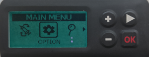

# DanaRS, Dana-i a Dana-i2

*Tento návod popisuje nastavení aplikace a pumpy, pokud máte DanaRS z roku 2017 nebo novější, Dana-i nebo Dana-i2. Pokud místo toho máte původní pumpu DanaR, přečtěte si stránku [Inzulínová pumpa DanaR](./DanaR-Insulin-Pump.md).*

**Dana-i2 lze používat od verze AAPS 4.0.** Používá stejný ovladač **Dana-i/RS** jako Dana-i.

* V pumpě DanaRS/i/i2 aplikace používá „BASAL A“. Stávající data budou přepsána.

    {contents} Obsah
    :depth: 1
    :local: true

## Možnosti pumpy s AAPS

* Komunikuje s **AAPS** přes vestavěný Bluetooth vašeho telefonu, bez dalšího komunikačního zařízení.
* Letní čas a změny časového pásma je nutné řešit ručně (viz [Cestování přes časová pásma](#timezone-traveling-danarv2-danars)).

(DanaRS-Insulin-Pump-pairing-pump)=

## Párování pumpy

* Otevřete **nabídku** (☰) v levém horním rohu hlavní obrazovky **AAPS** a vyberte **Konfigurace**.
* Klepněte na **Pumpa** a vyberte **Dana-i/RS**.
    
    
    
    Po výběru se na kartě **Dana-i/RS** zobrazí dvě tlačítka, **Nastavení** a **Otevřít plugin**:
    
    
    
    **Nastavení** otevře nastavení ovladače Dana-i/RS:
    
    
    
    **Otevřít plugin** (nebo **Spravovat** > **Pumpa**) otevře obrazovku pumpy Dana-i/RS. Před spárováním pumpy vypadá takto:
    
    

* Na obrazovce pumpy klepněte na **Párování**. **AAPS** vyhledá pumpy v okolí.

* Klepněte v seznamu na svou pumpu.
    
    

* **Párování musíte potvrdit na pumpě!** Funguje to stejně jako jiná párování přes Bluetooth, která možná znáte (například telefon a autorádio).
    
    

* Postupujte podle procesu párování na základě typu a firmwaru vaší pumpy:
    
    * U DanaRS v1 si **AAPS** vyžádá **Heslo pumpy (pouze v1)**. Zadejte heslo své pumpy (viz [Výchozí heslo](#DanaRS-Insulin-Pump-default-password)).
    * U DanaRS v3 vás **AAPS** požádá, abyste stiskli OK na pumpě a zadali 2 řady čísel a písmen zobrazené na pumpě. Dokud nedokončíte zadání, udržujte displej pumpy zapnutý stisknutím tlačítka minus. Pak klepněte na **Hotovo**.
    * U Dana-i a Dana-i2 se zobrazí standardní dialog párování Androidu. Zadejte šestimístné číslo zobrazené na pumpě.

* Když se zobrazí **Spárování úspěšné!**, klepněte na **Hotovo**.
    
    
    
    Jste zpět na obrazovce pumpy, která nyní zobrazuje stav vaší pumpy.
    
    

* V **Nastavení** vyberte **Rychlost bolusu**, pokud chcete změnit výchozí rychlost bolusu (12 s/U, 30 s/U nebo 60 s/U).

* Nastavte bazální krok na pumpě na 0,01 U/h pomocí lékařského menu (viz uživatelská příručka pumpy).
* Nastavte bolusový krok na pumpě na 0,05 U pomocí lékařského menu (viz uživatelská příručka pumpy). **AAPS** načte bazální a bolusový krok z pumpy a použije je pro každý bolus, takže bolus vždy odpovídá kroku nastavenému na pumpě. Obrazovka pumpy je zobrazuje v řádku **Bazální/bolusový krok**.
* Povolte prodloužené bolusy na pumpě

### Možnosti zobrazené jen u některých modelů

* **Automatické zamykání**: u Dana-i2 má obrazovka **Uživatelská nastavení** (na obrazovce pumpy, **Spravovat** > **Pumpa**) přepínač **Automatické zamykání** pro nastavení automatického zamykání pumpy. Po změně stiskněte **Uložit do pumpy**.
* **Jednoduchý režim**: u modelů pumpy, které mají jednoduchý režim nabídky, zobrazuje obrazovka pumpy řádek **Jednoduchý režim** s hodnotou **ZAP** nebo **VYP**.
* Pokud Dana-i2 bolus odmítne, **AAPS** zobrazí důvod, například *Pumpa není naplněna*, *Nedostatek inzulínu v zásobníku* nebo *Režim spánku je v pumpě zapnutý*.

(DanaRS-Insulin-Pump-default-password)=

### Výchozí heslo

* DanaRS s firmwarem v1 a v2 má výchozí heslo 1234.
* Pro DanaRS s firmwarem v3 nebo Dana-i je výchozí heslo odvozené od data výroby a vypočítá se jako MMDD, kde MM je měsíc a DD je den, kdy byla pumpa vyrobena (tj. '0124' představuje měsíc 01 a den 24).
    
    * Z hlavního menu vyberte REVIEW a pak SHIPPING INFORMATION z podnabídky.
    * Třetí číslo je datum výroby. 
    * Pro v3/i se toto heslo používá pouze pro uzamčení nabídky na pumpě. Nepoužívá se pro komunikaci a není nutné jej zadávat do AAPS.

(DanaRS-Insulin-Pump-change-password-on-pump)=

## Změna hesla pumpy

* Stiskněte tlačítko OK na pumpě
* V hlavní nabídce zvolte "Možnosti" (posuňte se vpravo několikrát stisknutím šipky)
    
    

* V nabídce možností vyberte "UŽIV. FUNKCE"
    
    

* Pomocí tlačítka šipky přejdete dolů na "11. heslo"
    
    

* Stiskněte OK pro zadání starého hesla.

* Zadejte **staré heslo** (výchozí heslo viz [výše](#DanaRS-Insulin-Pump-default-password)) a stiskněte OK
    
    

* Je-li zde zadáno chybné heslo, nebude zde žádná zpráva indikující selhání!

* Nastavte **nové heslo** (Změňte čísla pomocí + & - tlačítka / Přesunout vpravo pomocí šipky).
    
    

* Potvrďte pomocí tlačítka OK.

* Stisknutím OK uložíte nastavení.
    
    

* Přejděte dolů na "14. UKONČIT" a stiskněte tlačítko OK.
    
    

(DanaRS-Insulin-Pump-dana-rs-specific-errors)=

## Specifické chyby Dana RS

### Chyba během vydávání inzulínu

V případě, že dojde k přerušení spojení mezi AAPS a pumpou Dana RS v průběhu vydávání bolusu (např. odejdete mimo dosah telefonu, zatímco pumpa Dana RS vydává inzulín), zobrazí se následující zpráva a zazní akustická výstraha.

* Ve většině případů se jedná pouze o problém s komunikací, který se netýká vydaného inzulínu (je vydáno správné množství).
* V historii pumpy zkontrolujte, že byl podán správný bolus. Můžete to udělat přímo na pumpě, nebo v **AAPS** na obrazovce pumpy (**Spravovat** > **Pumpa**) > **Historie pumpy** > **Bolusy**.
* Pokud chcete, smažte chybný záznam v [ošetřeních](#screens-bolus-carbs).
* Skutečné množství se načte a zaznamená při příštím připojení. Chcete-li to vynutit, klepněte na obrazovce pumpy na **Obnovit**, nebo jen počkejte na další připojení.

## Zvláštní poznámka, pokud měníte telefon

Pokud měníte telefon za nový, je nezbytné, abyste provedli následující kroky:

* [Exportujte nastavení](../Maintenance/ExportImportSettings.md) na starém telefonu
* Přesuňte nastavení ze starého do nového telefonu

### DanaRS v1

* **Ručně spárujte** Danu RS s novým telefonem
* Pokud při importu zaškrtnete **Nahradit také nastavení pumpy**, naimportují se i nastavení připojení k pumpě a AAPS v novém telefonu už bude pumpu „znát“, takže nespustí vyhledávání Bluetooth. Proto je třeba nový telefon a pumpu spárovat ručně.
* Nainstalujte na novém telefonu AAPS.
* [Importujte nastavení](../Maintenance/ExportImportSettings.md) na novém telefonu

### DanaRS v3, Dana-i, Dana-i2

* Spusťte párování, jak je popsáno [výše](#DanaRS-Insulin-Pump-pairing-pump).
* Někdy může být nutné nejprve smazat informace o párování v **AAPS**. Na obrazovce pumpy (**Spravovat** > **Pumpa**) klepněte na **Odpárovat** a potvrďte **Reset párování?**. Pak znovu klepněte na **Párování**.

## Cestování přes časová pásma s pumpami DanaRS, Dana-i a Dana-i2

Informace o cestování přes časová pásma najdete v části [Cestování přes časová pásma s pumpami](#timezone-traveling-danarv2-danars).

## Kde získat pomoc

Vývoj ovladače DanaRS/Dana-i/Dana-i2 dělá komunita na **dobrovolnické** bázi. Než požádáte o pomoc:

1. **Přečtěte si** příslušnou část této dokumentace a ověřte si, jak má funkce fungovat.
2. **Zeptejte se** na kanálu *#AAPS* na [Discordu](https://discord.gg/4fQUWHZ4Mw) nebo v jiném z [komunitních kanálů](../GettingHelp/WhereCanIGetHelp.md).
3. **Nahlaste chybu**: prohledejte [existující issues](https://github.com/nightscout/AndroidAPS/issues); pokud tam vaše chyba není, založte [nové issue](https://github.com/nightscout/AndroidAPS/issues) a přiložte své [soubory záznamů](../GettingHelp/AccessingLogFiles.md).

Když žádáte o pomoc, uveďte značku a model telefonu, verzi Androidu, verzi **AAPS** a popis problému v angličtině jednoduchými slovy (co se změnilo, kdy to naposledy fungovalo).