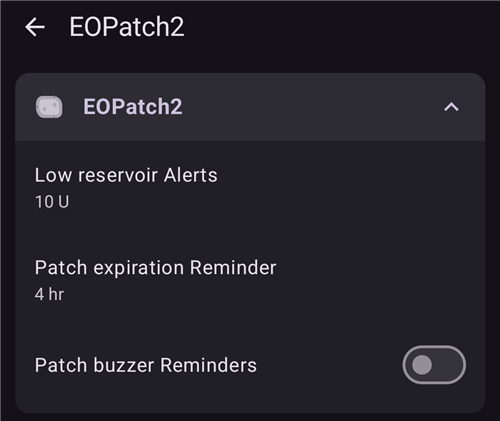
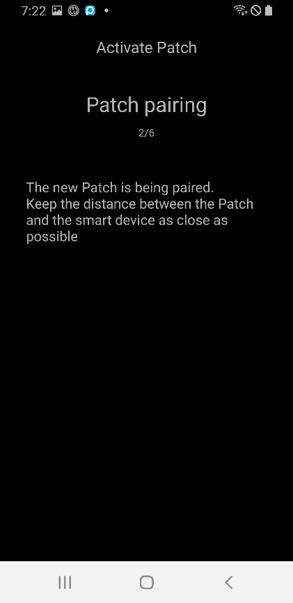

# EOPatch2

Patch potřebuje rychle působící inzulín U-100, například NovoRapid nebo Humalog. Používejte rychle působící inzulín, který vám předepsal lékař.

Nejmenší dávka, kterou patch umí vydat, je 0,05 U. Nastavte každou bazální dávku ve svém **profilu** alespoň na 0,05 U/h, v krocích po 0,05 U/h. Jinak **AAPS** zaokrouhlí každou dávku na nejbližších 0,05 U/h (nikdy dolů na 0) a použije dávky, které patch skutečně vydává, takže celkové množství inzulínu za den se mírně liší od vašeho **profilu**. Stejně tak musí mít bolusy alespoň 0,05 U.

```{contents} Table of contents
:depth: 1
:local: true
```

## Možnosti pumpy s AAPS

* Komunikuje s **AAPS** přes vestavěný Bluetooth vašeho telefonu, bez dalšího komunikačního zařízení.
* Letní čas a změny časového pásma musíte řešit ručně.

## Nastavení pumpy

1. Otevřete **nabídku** (☰) v levém horním rohu hlavní obrazovky **AAPS** a vyberte **Konfigurace**.
1. V sekci **Pumpa** vyberte **EOPatch2**.
1. Stisknutím tlačítka Zpět se vraťte na hlavní obrazovku.

 

Po výběru se na kartě **EOPatch2** zobrazí dvě tlačítka, **Nastavení** a **Otevřít plugin**:


## Nastavení

Nastavení EOPatch2 otevřete jedním ze dvou způsobů:

* stiskněte **Nastavení** na kartě **EOPatch2** v **Konfiguraci**, nebo
* otevřete obrazovku pumpy (**Spravovat** → **Pumpa**) a stiskněte ikonu ozubeného kola v pravém horním rohu.

Jsou zde tři nastavení:



### Nízký stav zásobníku

Varování se zobrazí, když množství inzulínu v patchi klesne na tuto hodnotu nebo níže. Můžete nastavit hodnotu od 10 do 50 U, v krocích po 5 U. Výchozí hodnota je 10 U.

### Připomenutí expirace pumpy

Připomene vám, kolik času zbývá do konce platnosti aktuálního patche. Můžete nastavit hodnotu od 1 do 24 hodin, v krocích po 1 hodině. Výchozí hodnota je 4 hodiny.

### Alarmy pumpy

Když je tato volba zapnutá, patch pípne při začátku a konci bolusu, prodlouženého bolusu nebo dočasného bazálu. Na váš běžný bazál nemá žádný vliv. Ve výchozím stavu je vypnutá.

## Aktivace nového patche

### Otevřete průvodce aktivací

Otevřete obrazovku pumpy pomocí **Spravovat** → **Pumpa** (nebo stiskněte **Otevřít plugin** na kartě **EOPatch2** v **Konfiguraci**). Když není aktivní žádný patch, obrazovka ukazuje **Neaktivováno** a dole tlačítko **Aktivovat pumpu**.

Stisknutím **Aktivovat pumpu** spustíte průvodce.


Průvodce vás provede každým krokem. Řada teček nahoře ukazuje, jak daleko jste.

```{note}
Pokud jste v **AAPS** ještě nikdy neaktivovali žádný **profil**, průvodce nejdříve zobrazí stránku **Vyžadován profil**. Vyberte profil, který chcete použít, a stiskněte **Aktivovat profil**.
```

### Plnění inzulínu

Zasuňte jehlu injekční stříkačky do plnicího otvoru na patchi. Pomalu tlačte píst a naplňte patch. Jakmile je v patchi více než 80 U, jednou pípne a spustí se (nabootuje).

Když uslyšíte pípnutí, stiskněte **Začít párovat**.


```{warning}
- Neotáčejte pákou jehly, dokud vám to průvodce neřekne. Příliš brzké otočení může způsobit vážné problémy při plnění nebo při kontrole bezpečnosti.
- Do patche se vejde 80 až 200 U. Pokud do něj dáte méně než 80 U, patch nebude fungovat.
- Vyndejte inzulín z lednice 15 až 30 minut před plněním, aby se ohřál na pokojovou teplotu. Inzulín musí mít alespoň 10 °C.
```

### Párování pumpy

**AAPS** se nyní pokusí s patchem automaticky spárovat. Během párování se zobrazí dvě žádosti Androidu o spárování přes Bluetooth. U první stiskněte **OK**. U druhé, která ukazuje přístupový klíč, stiskněte znovu **OK**.

```{warning}
- Při párování mějte patch a telefon ve vzdálenosti do 30 cm od sebe.
- Po nabootování patch pípá každé 3 minuty, dokud není párování dokončeno.
- Aktivaci patche musíte dokončit do 60 minut od jeho nabootování. Pokud to nestihnete, patch zahoďte.
```

  

```{admonition} Older screenshot
:class: note
Oba snímky obrazovky párování přes Bluetooth jsou ze starší verze **AAPS**: obrazovka **AAPS** za žádostí Androidu o spárování vypadá v **AAPS** 4 jinak.
```

### Výběr inzulínu

Vyberte inzulín, kterým jste patch naplnili, a stiskněte **Další**. **AAPS** po aktivaci provede přepnutí profilu s tímto inzulínem.

### Připravte se na připojení pumpy

Odstraňte z patche lepicí pásku a pak stiskněte **Další**.

Pokud jehla vyčnívá nebo je patch mokrý, špinavý či má ohnutou lepicí pásku, stiskněte místo toho **Zahodit** a použijte nový patch.


### Umístění

Tento krok se zobrazí, jen pokud je v nastavení rotace míst aplikace zapnutá volba **Spravovat střídání míst pumpy**. Klepněte na místo na schématu těla, kam patch připevníte, a stiskněte **Další**, nebo stiskněte **Přeskočit**.

### Připojení pumpy

Inzulín by měl jít do místa s tukovou tkání pod kůží, kde je málo nervů a cév. Dobrou volbou je břicho, paže nebo stehno. Místo vyčistěte a vysušte, pak patch přilepte na kůži.

Zkontrolujte infuzní místo a pak stiskněte **Spustit kontrolu bezpečnosti**.

```{warning}
- Okraje pásky patche rovnoměrně přitlačte, aby celý patch pevně držel na kůži.
- Pokud patch nedrží úplně, může se mezi patch a kůži dostat vzduch. To oslabuje lepidlo a voděodolnost patche.
```


### Kontrola bezpečnosti

Kontrola bezpečnosti trvá asi 30 sekund. Po jejím dokončení patch jednou pípne. Pokud selže, stiskněte **Opakovat**.

```{warning}
Pro bezpečné použití neotáčejte pákou jehly, dokud není kontrola bezpečnosti dokončena.
```

 

```{admonition} Older screenshot
:class: note
Snímky obrazovky od kroku **Připravte se na připojení pumpy** po **Kontrola bezpečnosti** jsou ze starší verze **AAPS** a v **AAPS** 4 mohou vypadat jinak.
```

### Vkládání jehly

Patch pevně držte. Otočte pákou jehly nahoru o více než 100°, aby se jehla zavedla. Když je jehla zavedena správně, patch jednou pípne. Pak pákou otáčejte dál až do konce, abyste ji odstranili. Stiskněte **Další**.

```{caution}
Pokud přejdete na další krok bez pípnutí, zobrazí se **Chyba při vložení jehly**. Ověřte pípnutí a stiskněte **Opakovat**. Pokud chyba trvá, stiskněte **Zahodit** a patch deaktivujte.
```

### Aktivace pumpy dokončena

Poslední stránka potvrdí, že je patch aktivní a že vás upozorní, když se bude blížit konec jeho platnosti. Stisknutím **Dokončit** se vrátíte na obrazovku pumpy.

## Zahození patche

Patch vyměňte, když v něm dochází inzulín, když vyprší jeho platnost nebo když je vadný. Doporučujeme používat každý patch nejvýše 84 hodin od jeho nabootování.

1. Otevřete obrazovku pumpy (**Spravovat** → **Pumpa**). Když je patch aktivní, stiskněte **Zahodit pumpu**.
1. Stránka **Zahodit pumpu** ukazuje zbývající čas a zbývající inzulín v patchi. Stiskněte **Zahodit pumpu**.
1. Dialog vás požádá o potvrzení. Stiskněte znovu **Zahodit pumpu**.
1. Po deaktivaci patche průvodce zobrazí **Zahození pumpy je dokončeno.** Sundejte patch z těla a stiskněte **Potvrdit**.

Potom průvodce pokračuje rovnou aktivací nového patche (viz výše). Pokud zde chcete skončit, stiskněte šipku zpět.

Dokud není aktivní žádný patch, **AAPS** ukazuje pumpu jako pozastavenou a zaznamená dočasný bazál 0 U/h, takže se do IOB nezapočítává žádný bazální inzulín, dokud není aktivován další patch.

   

```{admonition} Older screenshot
:class: note
Snímky obrazovky výše pocházejí ze starší verze **AAPS**. V **AAPS** 4 otevřete obrazovku pumpy přes **Spravovat** → **Pumpa** a tlačítko na ní má popis **Zahodit pumpu**.
```

```{admonition} If the patch does not respond
:class: warning
Pokud se **AAPS** nemůže s patchem spojit, může zobrazit stránku o ručním vypnutí alarmu patche: sundejte patch z těla, odlepte lepicí pásku a sponkou pevně zatlačte do otvoru vedle plnicího otvoru pro inzulín.

Stránka **Zahodit pumpu** má také tlačítko **Vynutit reset**. To pouze odstraní patch z **AAPS**, aniž by patchi poslalo jakýkoli příkaz. Patch dál vydává inzulín, dokud se nevybije jeho baterie nebo dokud ho ručně nevypnete. Použijte ho, jen pokud selže běžné zahození, a sundejte patch z těla.
```

## Pozastavení a obnovení výdeje inzulínu

Pozastavení výdeje inzulínu také zruší prodloužený bolus a dočasný bazál. Po obnovení se **nespustí** znovu. Během pozastavení výdeje inzulínu patch pípá každých 15 minut.

### Pozastavení dodávky inzulínu

1. Otevřete obrazovku pumpy (**Spravovat** → **Pumpa**) a stiskněte **Pozastavit pumpu**.
1. Dialog vysvětlí, co bude pozastaveno. Stiskněte **Potvrdit**.
1. V dialogu **Čas pozastavení pumpy** zvolte, na jak dlouho pozastavit: 30 min, 1 h, 1 h 30 min nebo 2 h. Stiskněte **Potvrdit**.

Výdej inzulínu je pozastaven na zvolenou dobu.

  

```{admonition} Older screenshot
:class: note
Snímky obrazovky výše pocházejí ze starší verze **AAPS**. V **AAPS** 4 otevřete obrazovku pumpy přes **Spravovat** → **Pumpa** a tlačítko na ní má popis **Pozastavit pumpu**.
```

### Obnovení dodávky inzulínu

1. Otevřete obrazovku pumpy (**Spravovat** → **Pumpa**) a stiskněte **Obnovit pumpu**.
1. V dialogu **Obnovit výdej inzulínu** stiskněte **Potvrdit**.

 

```{admonition} Older screenshot
:class: note
Snímky obrazovky výše pocházejí ze starší verze **AAPS**. V **AAPS** 4 otevřete obrazovku pumpy přes **Spravovat** → **Pumpa** a tlačítko na ní má popis **Obnovit pumpu**.
```

```{warning}
Když čas pozastavení skončí, **AAPS** zobrazí varování **Konec pozastavení inzulínu**. Výdej inzulínu se **nespustí** znovu, dokud to nepotvrdíte. Pokud to neuděláte, může u vás dojít k hyperglykémii.
```

(eopatch2-alarms-and-warnings)=

## Alarmy a varování

### Alarmy

Alarmy jsou pro naléhavé situace s nejvyšší prioritou a vyžadují váš okamžitý zásah. **AAPS** spustí alarm, který zní, dokud ho nepotvrdíte, a zobrazí zprávu jako oznámení na obrazovce **Přehled**. Alarm znamená, že je problém s používaným patchem. V mnoha případech je nutné patch zahodit a nahradit novým.

Když v oznámení stisknete **Potvrdit**, **AAPS** alarm zpracuje. U většiny alarmů se tím patch deaktivuje. U alarmu **Nevhodná teplota** je tlačítko **Opakovat**.

 

```{admonition} Older screenshot
:class: note
Snímky obrazovky alarmů jsou ze starší verze **AAPS** a v **AAPS** 4 mohou vypadat jinak.
```

Jednotlivé alarmy jsou vysvětleny níže.

| Alarm                                   | Vysvětlení                                                                                                                           |
| --------------------------------------- | ------------------------------------------------------------------------------------------------------------------------------------ |
| Prázdný zásobník                        | V patchi došel inzulín.                                                                                                              |
| Patch vypršel                           | Doba používání patche skončila a patch už nemůže vydávat inzulín.                                                                    |
| Okluze                                  | Cesta inzulínu v patchi je pravděpodobně ucpaná.                                                                                     |
| Selhání automatického testu při zapnutí | Patch při autotestu po nabootování zjistil neočekávanou chybu.                                                                       |
| Nevhodná teplota                        | Patch je mimo svou běžnou provozní teplotu během aktivace nebo používání. Přesuňte patch na místo s vhodnou teplotou (4,4 až 37 °C). |
| Chyba při vložení jehly                 | Jehla nebyla při aktivaci správně zavedena. Zkontrolujte, zda okraj patche pro vpich jehly a páka jehly jsou v přímce.               |
| Chyba baterie patche                    | Vnitřní baterie patche se brzy vybije a patch se vypne.                                                                              |
| Chyba aktivace patche                   | Patch nebyl plně aktivován do 60 minut od nabootování.                                                                               |
| Chyba patche                            | Patch zjistil neočekávanou chybu během aktivace nebo používání.                                                                      |

### Varování

Varování jsou pro situace se střední nebo nízkou prioritou. Varování se zobrazí jako oznámení na obrazovce **Přehled**.


```{admonition} Older screenshot
:class: note
Tento snímek obrazovky je ze starší verze **AAPS**: v **AAPS** 4 se varování zobrazí na hlavní obrazovce, která vypadá jinak.
```

Jednotlivá varování jsou vysvětlena níže.

| Varování                    | Vysvětlení                                                                                                              |
| --------------------------- | ----------------------------------------------------------------------------------------------------------------------- |
| Konec pozastavení inzulínu  | Zvolená doba pozastavení skončila. Stisknutím **Obnovit pumpu** v oznámení znovu spustíte výdej inzulínu.               |
| Nízký stav zásobníku        | Množství inzulínu v patchi je nižší než hodnota nastavená v **Nízký stav zásobníku**.                                   |
| Platnost patche vypršela    | Doba používání patche skončila.                                                                                         |
| Platnost patche brzy vyprší | Patch musíte zahodit do 1 hodiny.                                                                                       |
| Neúplná aktivace patche     | Aktivace patche byla po spárování přerušena na déle než 3 minuty. Otevřete obrazovku pumpy a dokončete aktivaci patche. |
| Nízká baterie patche        | Baterie patche je slabá.                                                                                                |

## Kde získat pomoc

Vývoj ovladače EOPatch2 provádí komunita na **dobrovolnické** bázi. Než požádáte o pomoc:

1. **Přečtěte si** příslušnou část této dokumentace a ověřte, jak má funkce fungovat.
2. **Zeptejte se** na kanálu *#AAPS* na [Discordu](https://discord.gg/4fQUWHZ4Mw) nebo v jiném z [komunitních kanálů](../GettingHelp/WhereCanIGetHelp.md).
3. **Nahlaste chybu**: prohledejte [existující hlášení (issues)](https://github.com/nightscout/AndroidAPS/issues); pokud tam vaše chyba není, založte [nové hlášení (issue)](https://github.com/nightscout/AndroidAPS/issues) a přiložte své [log soubory](../GettingHelp/AccessingLogFiles.md).

Když žádáte o pomoc, uveďte značku a model telefonu, verzi Androidu, verzi **AAPS** a jednoduchý popis problému v angličtině (co se změnilo, kdy to naposledy fungovalo).
