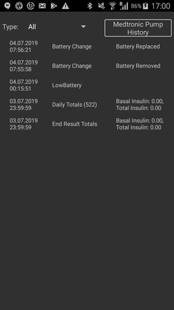

# Pumpy Medtronic

Ovladač nefunguje s žádnými novějšími modely, včetně všech modelů končících na G (530G, řada 600 [630G, 640G, 670G], řada 700 [770G, 780G] atd.).

Kompatibilní jsou tyto kombinace modelu a firmwaru:

- 512/712 (jakákoli verze firmwaru)
- 515/715 (jakákoli verze firmwaru)
- 522/722 (jakákoli verze firmwaru)
- 523/723 (firmware 2.4A nebo nižší)
- 554/754 EU verze (firmware 2.6A nebo nižší)
- 554/754 verze pro Kanadu (firmware 2.7A nebo nižší)

Jak zjistit verzi firmwaru pumpy, najdete v [dokumentaci OpenAPS](https://openaps.readthedocs.io/en/latest/docs/Gear%20Up/pump.html#how-to-check-pump-firmware-check-for-absence-of-pc-connect) nebo v [LoopDocs](https://loopkit.github.io/loopdocs/build/step3/#medtronic-pump-firmware).

    {contents} Obsah
    :depth: 1
    :local: true

## Možnosti pumpy s AAPS

* Ke komunikaci s **AAPS** potřebuje zařízení kompatibilní s RileyLink.
* Automatické zpracování letního času a časových pásem.

## Hardwarové a softwarové požadavky

- **Telefon:** Ovladač Medtronic by měl fungovat s jakýmkoli telefonem s Androidem, který podporuje připojení přes Bluetooth. **DŮLEŽITÉ: Výrobci telefonů implementují Bluetooth různě, a proto se každý model telefonu může chovat jinak. Například některé telefony zapínají a vypínají Bluetooth jinak. To může ovlivnit uživatelský zážitek, když se AAPS potřebuje znovu připojit k vašemu zařízení typu Rileylink.**
- **Zařízení kompatibilní s RileyLink:** Telefony s Androidem nemohou komunikovat s pumpami Medtronic bez samostatného zařízení, které komunikaci zajistí. Toto zařízení se spojí s vaším telefonem přes Bluetooth a s vaší pumpou přes kompatibilní rádiové spojení. První takové zařízení se jmenovalo Rileylink, ale nyní je k dispozici řada dalších možností, které mohou nabídnout další funkce.
    
    - Rileylink je k dispozici na [getrileylink.org](https://getrileylink.org/product/rileylink916)
    - Orangelink je k dispozici na [getrileylink.org](https://getrileylink.org/product/orangelink)
    - Emalink (více variant modelu) je k dispozici na [github.com](https://github.com/sks01/EmaLink)
    - Gnarl (vyžaduje další vlastní práci) – podrobnosti najdete na [github.com](https://github.com/ecc1/gnarl)

Srovnávací tabulku různých zařízení kompatibilních s Rileylink najdete na [getrileylink.org](https://getrileylink.org/rileylink-compatible-hardware-comparison-chart)

(MedtronicPump-configuration-of-the-pump)=

## Nastavení pumpy

Aby AAPS mohl na dálku posílat příkazy, nastavte na pumpě následující položky. Postup, jak provést každou změnu na pumpě Medtronic 715, je uveden v závorce u každého nastavení. Přesný postup se může lišit podle typu pumpy a/nebo verze firmwaru.

- **Zapněte na pumpě vzdálený režim** (na pumpě stiskněte Act a přejděte do Utilities -> Remote Options, vyberte On a na další obrazovce zvolte Add ID a přidejte libovolné ID, například 111111). Aby pumpa očekávala vzdálenou komunikaci, musí být na seznamu Remote ID alespoň jedno ID.
- **Nastavte maximální bazál** (na pumpě stiskněte Act, přejděte do Basal a vyberte Max Basal Rate). Pokud například nastavíte tuto hodnotu na čtyřnásobek své nejvyšší běžné bazální dávky, umožní to dočasný bazál 400 %. Nejvyšší hodnota, kterou pumpa dovolí, je 34,9 jednotek za hodinu.
- **Nastavte maximální bolus** (na pumpě stiskněte Act, přejděte do Bolus a vyberte Max Bolus). Je to největší bolus, který pumpa přijme. Nejvyšší hodnota, kterou pumpa dovolí, je 25.
- **Nastavte profil na Standard**. (na pumpě stiskněte Act, přejděte do Basal a potom Select Patterns) Pumpa potřebuje jen jeden profil, protože různé profily spravuje AAPS ve vašem telefonu. Další vzory (patterns) nejsou potřeba.
- **Nastavte typ dočasného bazálu** (na pumpě stiskněte Act, přejděte do Basal a potom Temp Basal Type). Vyberte Absolute (ne Percent).

## Nastavení Medtronic v telefonu / AAPS

- **Nepárujte zařízení kompatibilní s RileyLink přes nabídku Bluetooth ve vašem telefonu.** Spárování přes nabídku Bluetooth v telefonu způsobí, že AAPS vaše zařízení kompatibilní s Rileylink neuvidí, až budete postupovat podle návodu níže.
- Vypněte na telefonu automatické otáčení obrazovky. Na některých zařízeních automatické otáčení obrazovky způsobuje restart spojení Bluetooth, což by způsobilo problémy s vaší pumpou Medtronic. 
- Pumpu Medtronic můžete v AAPS nastavit dvěma způsoby:

1. Použití průvodce nastavením při nové instalaci
2. V **Konfigurace** > **Pumpa** výběrem **Medtronic**
    
    
    
    Po výběru se na kartě **Medtronic** zobrazí dvě tlačítka, **Nastavení** a **Otevřít plugin**:
    
    
    
    **Nastavení** otevře nastavení ovladače Medtronic:
    
    
    
    **Otevřít plugin** (nebo **Spravovat** > **Pumpa**) otevře obrazovku pumpy Medtronic. Před spárováním pumpy vypadá takto:
    
    

Při nastavování pumpy Medtronic v průvodci nastavením se může stát, že nastavení nedokončíte kvůli problémům s Bluetooth (např. se nepodaří připojit k pumpě). Pokud se to stane, vyberte virtuální pumpu, abyste mohli nastavení dokončit, a problém pak řešte pomocí možnosti 2.

Při nastavení AAPS pro práci s vaší pumpou Medtronic musíte v **Nastavení** nastavit tyto položky (viz obrázek nastavení výše):

- **Sériové číslo pumpy**: Je uvedeno na zadní straně pumpy a začíná písmeny SN. Zadejte jen 6 zobrazených číslic bez písmen (např. 123456).
- **Typ pumpy**: Model pumpy, který používáte (např. 522). 
- **Frekvence pumpy**: Jsou dvě možnosti podle toho, kde byla vaše pumpa původně prodána. Pokud si nejste jistí, kterou možnost vybrat, podívejte se do [Nejčastějších dotazů](#MedtronicPump-faq)): 
    - pro USA & Kanadu je frekvence 916 MHz
    - pro zbytek světa je frekvence 868 MHz
- **Max. bazál na pumpě (U/h)**: Musí odpovídat nastavení ve vaší pumpě (viz Nastavení pumpy výše). I toto nastavení vybírejte pečlivě, protože určuje, kolik inzulínu může AAPS podat přes bazální dávku. Tím se ve skutečnosti nastaví nejvyšší dočasný bazál. Pokud například nastavíte tuto hodnotu na čtyřnásobek své nejvyšší běžné bazální dávky, umožní to dočasný bazál 400 %. Nejvyšší hodnota, kterou pumpa dovolí, je 34,9 jednotek za hodinu.
- **Max. bolus na pumpě (U)** (za hodinu): Musí odpovídat nastavení ve vaší pumpě (viz Nastavení pumpy výše). Toto nastavení pečlivě zvažte, protože určuje, jak velký bolus může AAPS vůbec nastavit.
- **Prodleva před spuštěním bolusu (s)**: Počet sekund od zadání bolusu do chvíle, kdy se příkaz skutečně odešle do pumpy. Během této doby může uživatel bolus zrušit, pokud byl příkaz k bolusu odeslán omylem. Bolus, který byl spuštěn přes AAPS, nelze zrušit. Bolus, který už začal, lze zrušit jen tak, že pumpu ručně pozastavíte a potom znovu spustíte.
- **Kódování Medtronic**: Určuje, kde se provádí kódování Medtronic. Doporučuje se hardwarové kódování (tj. provádí ho zařízení kompatibilní s Rileylink), protože se tak odesílá méně dat. Softwarové kódování (tj. provádí ho AAPS) může pomoci, pokud dochází k častému odpojování. Pokud máte na zařízení Rileylink firmware verze 0.x, toto nastavení se ignoruje.
- **Typ baterie (Zobrazení napájení)**: Aby bylo možné správně určit zbývající kapacitu baterie, vyberte typ používané baterie AAA. Pokud vyberete jinou hodnotu než jednoduché zobrazení, AAPS zobrazí zbývající vypočtenou úroveň baterie v procentech a ve voltech. K dispozici jsou tyto možnosti:
    
    - Nevybráno (Jednoduché)
    - Alkalické (Rozšířené)
    - Lithiové (Rozšířené)
    - NiZn (Rozšířené)
    - NiMH (Rozšířené)
- **Použít vyhledávání**: Před připojením k vašemu zařízení kompatibilnímu s Rileylink zapne vyhledávání přes Bluetooth. To by mělo zlepšit spolehlivost spojení se zařízením.

- **Zobrazit úroveň baterie reportovanou OrangeLinkem/EmaLinkem/DiaLinkem**: Tato funkce je podporována jen u novějších zařízení, jako je EmaLink nebo OrangeLink. Hodnota se zobrazuje jako **Baterie RileyLink** na obrazovce pumpy Medtronic.
- **Nastavit neutrální dočasný bazál**: Pumpy Medtronic ve výchozím stavu na začátku každé hodiny pípnou, pokud běží dočasný bazál. Zapnutí této možnosti může snížit počet pípnutí: dočasný bazál se při změně hodiny přeruší, aby pumpa nepípla.

(pairing-your-rileylink-compatible-device)=

### Spárování zařízení kompatibilního s RileyLink

Zařízení kompatibilní s RileyLink se páruje z obrazovky pumpy Medtronic, ne z nabídky Bluetooth ve vašem telefonu:

- Otevřete obrazovku pumpy (**Spravovat** > **Pumpa** nebo **Otevřít plugin** na kartě Medtronic v **Konfigurace** > **Pumpa**).
- Klepněte na **Spárovat RileyLink**. **AAPS** vyhledá zařízení kompatibilní s RileyLink v okolí.
- Klepněte na své zařízení v seznamu. Když se zobrazí **RileyLink byl úspěšně spárován**, klepněte na **OK**.

## Obrazovka pumpy Medtronic

Obrazovku pumpy Medtronic otevřete přes **Spravovat** > **Pumpa**. Obrazovka pumpy zobrazuje aktuální informace o stavu pumpy a některé akce specifické pro Medtronic (viz obrázek obrazovky pumpy výše).

- **Status RileyLink**: Aktuální stav spojení mezi vaším telefonem a zařízením kompatibilním s Rileylink. Mělo by zde být stále zobrazeno Připojeno. Jakýkoli jiný stav může vyžadovat zásah uživatele. 
- **Baterie RileyLink**: Aktuální stav baterie vašeho zařízení EmaLink nebo OrangeLink. Zobrazí se jen tehdy, když je v nastavení Medtronic zapnuto **Zobrazit úroveň baterie reportovanou OrangeLinkem/EmaLinkem/DiaLinkem**.
- **Stav pumpy**: Aktuální stav spojení s pumpou. Protože pumpa není připojena stále, bude zde většinou zobrazena ikona spánku. Může se zobrazit řada dalších stavů, například „Probouzení“, když se AAPS pokouší odeslat příkaz, nebo další možné příkazy pumpy, jako „Načítání času“, „Nastavit dočasný bazál“ atd.
- **Baterie**: Zobrazuje stav baterie podle hodnoty zvolené v **Typ baterie (Zobrazení napájení)** v nastavení Medtronic.
- **Poslední spojení**: Jak dávno proběhlo poslední úspěšné spojení s pumpou.
- **Poslední bolus**: Jak dávno byl podán poslední úspěšný bolus.
- **Základní hodnota bazálu**: Základní bazální dávka, která v tuto hodinu běží na pumpě podle vašeho aktivního profilu.
- **Dočasný bazál**: Právě podávaný dočasný bazál, který může být i 0 jednotek za hodinu.
- **Zásobník**: Kolik inzulínu je v zásobníku (aktualizováno nejméně každou hodinu).
- **Chyby**: Chyba, pokud existuje (většinou ukazuje, zda došlo k chybě v konfiguraci).

Ve spodní části obrazovky jsou tato tlačítka:

- **Obnovit** slouží k obnovení aktuálního stavu pumpy. Používejte ho jen tehdy, když bylo spojení delší dobu přerušené, protože to vyžaduje úplné obnovení dat (načtení historie, načtení/nastavení času, načtení profilu, stavu baterie atd.).
- **Spárovat RileyLink**: Najde a spáruje vaše zařízení kompatibilní s RileyLink (viz [výše](#pairing-your-rileylink-compatible-device)).
- **Historie pumpy**: Zobrazí historii pumpy (viz [níže](#MedtronicPump-pump-history)).
- **Statistiky RL**: Zobrazí statistiky RL (viz [níže](#MedtronicPump-rl-status-rileylink-status)).
- **Probuzení a spojování** a **Resetovat RileyLink**: Viz [Akce](#medtronic-actions) níže.
- **Vymazat blokování bolusu**: Zobrazí se jen na krátkou dobu po bolusu, kdy **AAPS** čeká, až pumpa dokončí jeho podání. Klepnutím toto čekání ukončíte.

(MedtronicPump-pump-history)=

## Historie pumpy

Historie pumpy se načítá každých 5 minut a ukládá se místně. Ukládá se jen historie za posledních 24 hodin. Umožňuje pohodlně zobrazit chování pumpy, pokud je to potřeba. Ukládají se jen položky důležité pro AAPS, nezahrnují se konfigurační funkce, které nemají význam.

Otevřete ji klepnutím na **Historie pumpy** na obrazovce pumpy. Ve výchozím stavu je vybráno **Vše**. Klepnutím na jedno z tlačítek filtrů nahoře (například **Bolusy**, **Bazály** nebo **Alarmy**) zobrazíte jen jeden typ záznamů.

(MedtronicPump-rl-status-rileylink-status)=

## Stav RL (Stav RileyLink)

 

Dialog Stav RL má dvě karty:

- **Nastavení**: Zobrazuje nastavení zařízení kompatibilního s RileyLink: nastavenou adresu, připojené zařízení, stav připojení, chybu připojení a verze firmwaru RileyLink. „Typ zařízení“ je vždy Medtronic, „model“ bude váš model, „sériové číslo“ je konfigurované sériové číslo, „frekvence“ udává, jakou frekvenci používáte, „poslední frekvence“ je poslední použitá frekvence.
- **Historie**: Zobrazuje historii komunikace, položky u RileyLink ukazují změny stavu pro RileyLink a položky Medtronic ukazují, které příkazy byly odeslány do pumpy.

(medtronic-actions)=

## Akce

Když se používá ovladač Medtronic, jsou na obrazovce pumpy (**Spravovat** > **Pumpa**) k dispozici dvě další akce:

- **Probuzení a spojování** – Pokud se AAPS delší dobu nespojil s vaší pumpou (měl by se spojit každých 5 minut), můžete spojení (tune up) vynutit. Pokusí se spojit s vaší pumpou tak, že prohledá všechny rádiové frekvence, které může vaše pumpa používat. Pokud se spojení podaří, úspěšná frekvence se nastaví jako výchozí. Během spojování (tune-up) to ukazuje stav RileyLink na obrazovce pumpy. Pokud spojování (tune-up) selže (například proto, že pumpa byla mimo dosah), **AAPS** to sám zkusí znovu přibližně každých 10 minut.
- **Resetovat RileyLink** – Pokud resetujete své zařízení kompatibilní s RileyLink, možná budete muset použít tuto akci, aby se zařízení znovu nastavilo (nastavení frekvence, typu frekvence a kódování).

## Důležité poznámky

### Je potřeba zvláštní pozornost při nastavení NS

AAPS používá k synchronizaci sériové číslo a sériové číslo je viditelné v NS. Protože znalost sériového čísla staré pumpy Medtronic lze zneužít k ovládání pumpy na dálku, věnujte zvláštní péči zabezpečení stránky NS, aby sériové číslo vaší pumpy neuniklo. Viz https://nightscout.github.io/nightscout/security/

### Uživatelé OpenAPS

Uživatelé OpenAPS by měli vědět, že AAPS s pumpou Medtronic používá úplně jiný přístup než OpenAPS. S AAPS se pumpa ovládá hlavně přes váš telefon. Při běžném používání budete nabídku pumpy pravděpodobně potřebovat jen při výměně zásobníku. To je velmi odlišné od OpenAPS, kde se obvykle alespoň část bolusu podává tlačítky rychlého bolusu. Pokud pumpou ručně podáte bolus, mohou vzniknout problémy, když se AAPS pokusí podat bolus ve stejnou dobu. Existují kontroly, které se snaží problémům v takových případech zabránit, přesto byste se tomu měli pokud možno vyhnout.

### Logování

Pokud potřebujete řešit problémy s funkcí pumpy Medtronic, vyberte ikonu nabídky v levém horním rohu obrazovky, zvolte Údržba a Nastavení logování. Při řešení jakýchkoli problémů s Medtronic kontrolujte Pump, PumpComm a PumpBTComm.

### CGM Medtronic

CGM Medtronic zatím NENÍ podporováno.

### Ruční použití pumpy

Nepodávejte bolusy ani nenastavujte dočasné bazály ručně na pumpě. Všechny takové příkazy byste měli posílat přes AAPS. Pokud ruční příkazy použijete, musí mezi nimi být prodleva alespoň 3 minuty, aby se snížilo riziko problémů.

### Změny časového pásma a letní čas nebo cestování s pumpou Medtronic a AAPS

AAPS automaticky zjistí změnu časového pásma a aktualizuje čas v pumpě, když telefon přejde na nový čas.

Cestování na východ znamená, že k aktuálnímu času přidáváte hodiny (např. z GMT+0 na GMT+2), což nezpůsobí žádné problémy, protože nedojde k překryvu (např. nebude možné mít stejnou hodinu dvakrát). Cestování na západ však může způsobit problémy, protože se ve skutečnosti vracíte v čase, což může vést k nesprávným údajům IOB.

Vývojáři o problémech při cestování na západ vědí a na možném řešení se pracuje. Další podrobnosti najdete zde: https://github.com/andyrozman/RileyLinkAAPS/issues/145 Zatím prosím počítejte s tím, že se tento problém může objevit, a při změně časového pásma vše pečlivě sledujte.

### Je GNARL plně kompatibilní zařízení kompatibilní s Rileylink?

Kód GNARL plně podporuje všechny funkce, které ovladač Medtronic v AAPS používá, takže je plně kompatibilní. Je důležité vědět, že to vyžaduje další práci: musíte si opatřit kompatibilní hardware a pak do zařízení nahrát kód GNARL.

**Poznámka od autora:** Všimněte si prosím, že software GNARL je stále experimentální, není dostatečně otestovaný a neměl by být považován za bezpečný pro použití jako RileyLink.

(MedtronicPump-faq)=

## Nejčastější dotazy

(MedtronicPump-what-to-do-if-i-loose-connection-to-rileylink-and-or-pump)=

### Co mám dělat, když ztratím spojení s RileyLink a/nebo pumpou?

Problémy se spojením můžete zkusit vyřešit několika způsoby.

- Klepněte na **Probuzení a spojování** na obrazovce pumpy (**Spravovat** > **Pumpa**), jak je popsáno výše.
- Vypněte na telefonu Bluetooth, počkejte 10 sekund a pak ho znovu zapněte. Tím se zařízení Rileylink musí znovu připojit k telefonu.
- Resetujte zařízení Rileylink. Potom musíte klepnout na **Resetovat RileyLink** na obrazovce pumpy (**Spravovat** > **Pumpa**).
- Ostatním uživatelům pomohly obnovit spojení tyto kroky, když jiné způsoby nezabraly: 
    1. Restartujte telefon
    2. *Během* restartu telefonu restartujte zařízení Rileylink
    3. Otevřete AAPS a nechte spojení obnovit

### Jak určit, jakou frekvenci má moje pumpa používat

Na zadní straně pumpy najdete řádek s číslem modelu a zvláštním třípísmenným kódem. První dvě písmena určují typ frekvence a poslední písmeno barvu. Zde jsou možné hodnoty pro frekvence:

- NA - Severní Amerika (ve výběru frekvence je třeba vybrat „US & Canada (916 MHz)“)
- CA - Kanada (ve výběru frekvence je třeba vybrat „US & Canada (916 MHz)“)
- WW - celosvětová verze (ve výběru frekvence je třeba vybrat „Celosvětové (868 Mhz)“)

(MedtronicPump-pump-unreachable)=

### Jak opravit chybu „pumpa nedostupná“ („pump unreachable“)

Některé pumpy Medtronic hlásí po aktualizaci **AAPS** chybu „pumpa nedostupná“ („pump unreachable“). Opravíte ji změnou typu kódování:

1. Přejděte do **Konfigurace** > **Pumpa** a na kartě **Medtronic** klepněte na **Nastavení**.
2. Nastavte **Kódování Medtronic** na **Hardwarové 4b6b kódování**.

## Kde získat pomoc

Vývoj ovladače Medtronic dělá komunita na **dobrovolné** bázi. Než požádáte o pomoc:

1. **Přečtěte si** příslušnou část této dokumentace a ověřte si, jak má funkce fungovat.
2. **Zeptejte se** na kanálu *#AAPS* na [Discordu](https://discord.gg/4fQUWHZ4Mw) nebo v jiném z [komunitních kanálů](../GettingHelp/WhereCanIGetHelp.md).
3. **Nahlaste chybu**: prohledejte [existující issues](https://github.com/nightscout/AndroidAPS/issues); pokud tam vaše chyba není, založte [nové issue](https://github.com/nightscout/AndroidAPS/issues) a přiložte své [soubory záznamů](../GettingHelp/AccessingLogFiles.md).

Když žádáte o pomoc, uveďte značku a model telefonu, verzi Androidu, verzi **AAPS** a popis problému v angličtině jednoduchými slovy (co se změnilo, kdy to naposledy fungovalo).