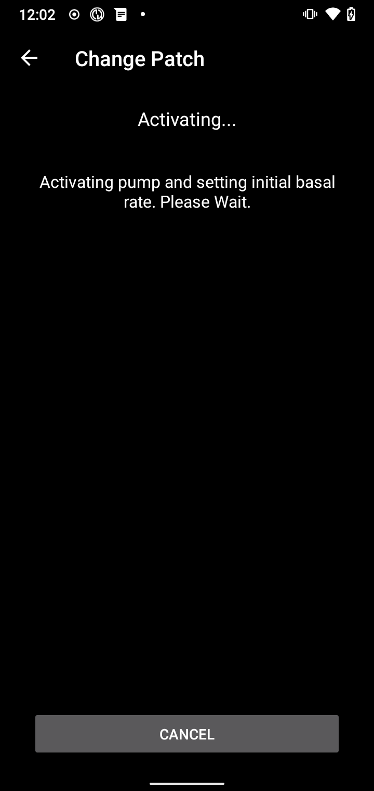

(medtrum-nano-300u)=
# Medtrum Nano 200U / 300U

Tyto pokyny slouží ke konfiguraci inzulínové pumpy Medtrum.

```{contents} Table of contents
:depth: 1
:local: true
```

## Možnosti pumpy s AAPS
* Podpora všech funkcí smyčky (SMB, TBR atd.)
* Automatická detekce letního času a časových pásem
* Prodloužený bolus není ovladačem pro AAPS podporován

## Hardwarové a softwarové požadavky
* **Kompatibilní základny a zásobníky (patche) Medtrum**
    - Aktuálně podporováno:
        - Medtrum TouchCare Nano 200U se základnou s číslem REF: **MD0201** a **MD8201**.
        - Medtrum TouchCare 300U se základnou s číslem REF: **MD8301**.
        - Pokud máte nepodporovaný model a jste ochotni darovat hardware nebo pomoci s testováním, kontaktujte nás prostřednictvím discordu [zde](https://discordapp.com/channels/629952586895851530/1076120802476441641).
* **AAPS sestavené a nainstalované** podle návodu [Sestavení AAPS](../SettingUpAaps/BuildingAaps.md).
* **Kompatibilní telefon s Androidem** s připojením Bluetooth BLE
    - Viz [Poznámky k vydání](../Maintenance/ReleaseNotes.md) AAPS

## Než začnete

**BEZPEČNOST PŘEDEVŠÍM** Nepokoušejte se používat zařízení v prostředí, ve kterém nedokážete snadno opravit případné chyby (dodatečné patche, inzulín a zařízení pro ovládání pumpy jsou nezbytností).

**PDM a aplikace Medtrum nebudou fungovat, je-li patch aktivován pomocí AAPS.** Dříve bylo možné odesílat pomocí PDM nebo aplikace Medtrum příkazy do pumpy. Z bezpečnostních důvodů můžete používat aktivovaný patch pouze se zařízením nebo aplikací, které byly použity k jeho aktivaci.

*To neznamená, že byste měli PDM vyhodit. Je doporučeno mít jej někde bezpečně uložený jako zálohu pro případ nouze, například pokud ztratíte telefon nebo AAPS nefunguje správně.*

**Vaše pumpa nepřestane vydávat inzulín, pokud není připojena k AAPS.** Výchozí bazální dávky jsou naprogramovány v pumpě tak, jak je definováno v aktuálním aktivním profilu. Pokud je AAPS v provozu, bude odesílat dočasné příkazy pro úpravy bazálních dávek, které poběží maximálně 120 minut. Pokud z nějakého důvodu pumpa neobdrží žádné nové příkazy (například kvůli ztrátě komunikace kvůli vzdálenosti mezi pumpou a telefonem), pumpa se vrátí k výchozí bazální dávce naprogramované v pumpě, jakmile skončí aktuální dočasný bazál.

**Profil AAPS nepodporuje bazální dávky po 30 minutách** Pokud s AAPS začínáte a nastavujete svůj bazální profil poprvé, vězte, že bazální dávky začínající v půlhodinu nejsou podporovány. Svůj bazální profil musíte upravit tak, aby dávky začínaly v celou hodinu. Například pokud máte bazální dávku 1,1 jednotky, která začíná v 09:30 a trvá 2 hodiny do 11:30, nebude to fungovat. Tuto bazální dávku 1,1 jednotky musíte změnit na časový úsek buď 9:00–11:00, nebo 10:00–12:00. Ačkoli pumpa Medtrum sama o sobě podporuje 30minutové intervaly pro nastavení bazálu, AAPS momentálně kvůli používaným algoritmům toto neumožňuje.

**Profily s 0U/h bazály NEJSOU v AAPS podporovány.** Zatímco pumpa Medtrum nulový bazál podporuje, AAPS používá násobky bazálního profilu k určení automatizované léčby, a proto nemůže fungovat s nulovým bazálem. Nejnižší bazální dávka v profilu je 0,05 U/h.

Dočasného nulového bazálu můžete dosáhnout funkcí „Odpojit pumpu“ nebo kombinací Zakázat smyčku/Dočasný bazál nebo Pozastavit smyčku/Dočasný bazál.

## Nastavení

```{caution}
Když aktivujete patch pomocí **AAPS**, **MUSÍTE** vypnout všechna ostatní zařízení, která mohou komunikovat se základnou pumpy Medtrum, například aktivní PDM nebo aplikaci Medtrum.
```

### Krok 1: Vyberte pumpu Medtrum

#### Možnost 1: Nové instalace

Pokud instalujete **AAPS** poprvé, provede vás nastavením **Průvodce nastavením**. Až se dostanete ke kroku **Pumpa**, vyberte **Medtrum**.

Pokud si nejste jistí, můžete také vybrat **Virtuální pumpa** a **Medtrum** vybrat později, po nastavení **AAPS** (viz možnost 2).


#### Možnost 2: Obrazovka Konfigurace

Ve stávající instalaci můžete pumpu **Medtrum** vybrat v [Konfigurace > Pumpa](#Config-Builder-pump):

Otevřete **nabídku** (☰) vlevo nahoře, klepněte na **Konfigurace** > **Pumpa** a vyberte kartu **Medtrum**. V jednu chvíli může být aktivní jen jedna pumpa.


Po výběru se na kartě **Medtrum** zobrazí dvě tlačítka, **Nastavení** a **Otevřít plugin**:


**Otevřít plugin** (nebo **Spravovat → Pumpa**) otevře obrazovku pumpy Medtrum. Na ní měníte patche a vidíte stav pumpy. Před aktivací patche vypadá takto:


(medtrum-step-2)=
### Krok 2: Změňte nastavení Medtrum

Klepněte na **Nastavení** na kartě **Medtrum** v **Konfigurace** > **Pumpa**. Můžete také klepnout na ikonu ozubeného kola v pravém horním rohu obrazovky pumpy Medtrum. Otevře se **Nastavení pumpy Medtrum**:


```{note}
Nastavení **Sériové číslo** už neexistuje. **AAPS** najde vaši základnu pumpy vyhledáváním přes Bluetooth při první aktivaci patche (viz [Krok 3](#medtrum-activate-patch)) a zapamatuje si její sériové číslo. Pokud chcete použít jinou základnu pumpy, viz [Odpárovat](#medtrum-unpair).
```

#### Nastavení alarmů

***Výchozí: Pípnutí.***

Toto nastavení mění způsob, jakým vás pumpa upozorní na varování nebo chybu.

- **Pípnutí**: patch při alarmech a varováních pípá.
- **Tiché**: patch vás na alarmy a varování neupozorní.

Poznámka: V tichém režimu **AAPS** alarm přesto ohlásí, podle nastavení hlasitosti telefonu. Pokud na alarm nereagujete, patch nakonec pípne.

#### Oznámení o varování pumpy

***Výchozí: Povoleno.***

Toto nastavení mění způsob, jakým **AAPS** zobrazuje oznámení u nekritických varování pumpy. Když je zapnuto, telefon zobrazí oznámení při varování pumpy, například:
- Slabá baterie
- Nízký stav zásobníku (20 jednotek)
- Patch brzy vyprší

Pokud máte alarmy pumpy nastavené na **Tiché**, doporučujeme nechat toto nastavení zapnuté. V obou případech se tato varování zobrazují také na obrazovce pumpy Medtrum v řádku [Aktivní alarmy](#medtrum-active-alarms).

(medtrum-patch-expiration)=
#### Vypršení platnosti patche

***Výchozí: Povoleno.***

Toto nastavení změní chování patche. Když je zapnuto, patch vyprší po 3 dnech a vydá zvukové varování, pokud máte zapnutý zvuk. Po 3 dnech a 8 hodinách patch přestane fungovat.

Pokud je toto nastavení vypnuté, patch vás před zastavením nevaruje. S novějším firmwarem základny pumpy vydrží patch nejvýše 5 dní.

#### Varování před vypršením platnosti pumpy [hodiny]

***Výchozí: 72 hodin.***

Toto nastavení mění čas varování před vypršením. Když je zapnuto [Vypršení platnosti Patche](#medtrum-patch-expiration), **AAPS** zobrazí oznámení po tomto počtu hodin od aktivace.

#### Hodinové maximum inzulínu [U]

***Výchozí: 25 U.***

Tímto nastavením se mění maximální množství inzulínu, které může být dodáno během jedné hodiny. Pokud se tento limit překročí, patch se pozastaví a spustí alarm. Alarm můžete resetovat tlačítkem **Resetovat alarmy** na obrazovce pumpy, viz [Resetovat alarmy](#nano-reset-alarms).

Nastavte na rozumnou hodnotu dle svých potřeb.

#### Denní maximum inzulínu [U]

***Výchozí: 80 U.***

Tímto nastavením se mění maximální množství inzulínu, které může být dodáno během jednoho dne. Pokud se tento limit překročí, patch se pozastaví a spustí alarm. Alarm můžete resetovat tlačítkem **Resetovat alarmy** na obrazovce pumpy, viz [Resetovat alarmy](#nano-reset-alarms).

Nastavte na rozumnou hodnotu dle svých potřeb.

#### Provést skenování při chybách připojení

***Výchozí: Vypnuto.***

Najdete ho v **Rozšířená nastavení**.

Zapněte ho jen tehdy, když máte problémy s připojením. Když je zapnuto, ovladač před dalším pokusem o připojení pumpu znovu vyhledá. Ujistěte se, že oprávnění Poloha pro **AAPS** je nastaveno na „Povolit vždy“ („Allow all the time“).

### Krok 2b: Nastavení výstrah AAPS

Tato nastavení nejsou součástí ovladače Medtrum. Otevřete je ikonou **Nastavení** (ozubené kolo) v pravém horním rohu hlavní obrazovky. Více viz [Nastavení](../SettingUpAaps/Preferences.md).

#### BT Watchdog

Otevřete **Nastavení** > **Pumpa**:


**BT Watchdog** vypne Bluetooth telefonu na jednu sekundu, pokud se **AAPS** nemůže připojit k pumpě. To může pomoci u některých telefonů, kde Bluetooth zamrzá.

Zapněte toto nastavení, pokud máte s pumpou často problémy s připojením.

#### Místní výstrahy

Otevřete **Nastavení** > **Místní výstrahy**:


##### Upozornit, pokud je pumpa nedostupná

***Výchozí: Povoleno.***

Když je zapnutý ovladač Medtrum, je toto nastavení vždy zapnuté. Upozorní vás, když je pumpa nedostupná. To se může stát, když je pumpa mimo dosah nebo když neodpovídá kvůli vadnému patchi nebo základně pumpy, například když mezi základnu pumpy a patch pronikne voda.

Z bezpečnostních důvodů toto nastavení nelze deaktivovat.

##### Práh nedostupnosti pumpy

***Výchozí hodnota: 30 min.***

Toto nastavení mění, jak dlouho **AAPS** čeká, než vás upozorní, že je pumpa nedostupná.

S pumpou Medtrum toto nastavení můžete změnit, ale z bezpečnostních důvodů doporučujeme ponechat 30 minut.

(medtrum-activate-patch)=
### Krok 3: Aktivace patche

**Než budete pokračovat:**
- Připravte si základnu pumpy Medtrum a nový patch se zásobníkem.
- Vypněte ostatní zařízení, která mohou komunikovat s pumpou Medtrum (PDM a aplikaci Medtrum).
- Ideálně mějte **AAPS** nastavené a [aktivovaný profil](../DailyLifeWithAaps/ProfileSwitch-ProfilePercentage.md). Pokud není aktivní žádný profil, aktivace začne krokem **Vyžadován profil**, kde vyberete profil k aktivaci.

#### Zahájení aktivace

Otevřete [obrazovku pumpy Medtrum](#nano-overview) (**Spravovat → Pumpa**) a klepněte na **Vyměnit patch**. Pokud máte nastavenou [ochranu nastavení](#Preferences-protection), musíte nejdřív zadat heslo nebo PIN.

Pokud je už nějaký patch aktivní, budete požádáni, abyste ho nejdřív deaktivovali, viz [Deaktivace patche](#nano-deactivate-patch).

Aktivace je průvodce krok za krokem. Postupujte podle pokynů pro naplnění a aktivaci nového patche. V kterémkoli kroku ji můžete zastavit klepnutím na **Zrušit**.

```{important}
Patch si nalepte na tělo a kanylu zaveďte až tehdy, když vás k tomu průvodce vyzve (po dokončení plnění).
```

První kroky, které uvidíte, závisí na vašem nastavení:

1. **Vyžadován profil**: jen pokud není aktivní žádný profil. Vyberte profil, který se má použít, a pokračujte.
2. **Najít pumpu**: jen poprvé nebo po použití [Odpárovat](#medtrum-unpair). Připojte základnu pumpy k novému patchi, aby se zapnula. **AAPS** vyhledá základny pump Medtrum v okolí (jejich názvy začínají na `MT`). Klepněte v seznamu na tu svou. **AAPS** uloží její sériové číslo a pak přejde rovnou k plnění patche.

   

3. **Aktivovat Patch**: jen když **AAPS** už vaši základnu pumpy zná. Na obrazovce je text „Žádný aktivní Patch. Stiskněte **Další** pro zahájení aktivačního procesu.“ Ujistěte se, že základna pumpy ještě **není** připojená k patchi, a klepněte na **Další**.


#### Připojení a naplnění patche


Připojte základnu pumpy k patchi, odstraňte zbývající vzduch a naplňte patch inzulínem. K aktivaci je potřeba alespoň 70 jednotek. Obrazovka ukazuje stav zásobníku. Patch si zatím nelepte na tělo.

Když je patch rozpoznán a naplněn, objeví se tlačítko **Další**. Klepněte na něj.

#### Výběr inzulínu

Tento krok se objeví jen tehdy, když máte v **AAPS** nastaveno více než jeden inzulín. Vyberte inzulín, kterým patch plníte. **AAPS** po aktivaci provede přepnutí profilu s tímto inzulínem.

#### Naplnit patch


**Neodstraňujte** bezpečnostní pojistku. Napůl stiskněte tlačítko jehly na patchi a pak klepnutím na **Další** spusťte plnění.


Počkejte, až se plnění dokončí.


Po dokončení plnění pokračujte klepnutím na **Další**.

#### Rotace míst aplikace

Tento krok se objeví jen tehdy, když spravujete místa pumpy pomocí [Rotace míst aplikace](#Aapsscreens-site-rotation) (nastavení **Spravovat střídání míst pumpy**). Vyberte, kam na tělo patch umístíte, nebo tento krok přeskočte.

#### Připojit patch


Očistěte kůži a odstraňte ochranné fólie. Odstraňte bezpečnostní pojistku, nalepte patch na tělo a stisknutím tlačítka jehly zaveďte kanylu.

Klepnutím na **Další** patch aktivujete.

#### Aktivovat patch



**AAPS** aktivuje pumpu a nastaví počáteční bazální dávku. Počkejte prosím. Po dokončení aktivace se zobrazí tato obrazovka:


```{admonition} Older screenshot
:class: note
Kromě kroku **Najít pumpu** jsou snímky obrazovky aktivace výše z dřívější verze **AAPS** a v **AAPS** 4 mohou vypadat jinak.
```

Ukazuje, kolik jednotek v patchi zbývá. Klepnutím na **OK** se vrátíte na obrazovku pumpy.

```{tip}
Po nové aktivaci [exportujte svá nastavení](../Maintenance/ExportImportSettings.md). Díky tomu můžete tuto relaci patche později obnovit, například v novém telefonu.
```

(nano-deactivate-patch)=

### Deaktivace patche

Chcete-li aktivní patch deaktivovat, otevřete [obrazovku pumpy Medtrum](#nano-overview) (**Spravovat → Pumpa**) a klepněte na **Vyměnit patch**.


Budete požádáni o potvrzení, že chcete aktuální patch deaktivovat. **Tento krok nelze vrátit zpět.** Klepnutím na **Další** patch deaktivujete, klepnutím na **Zrušit** se vrátíte na obrazovku pumpy.


Pokud **AAPS** nemůže patch deaktivovat (například proto, že základna pumpy už byla z patche odpojena), klepnutím na **Zahodit** aktuální relaci patche zapomenete. Potom můžete aktivovat nový patch.


Po dokončení deaktivace zatáhněte jehlu a odstraňte patch z těla. Odpojte základnu pumpy a použitý patch zlikvidujte. Klepnutím na **OK** se vrátíte na obrazovku pumpy, klepnutím na **Další** zahájíte aktivaci nového patche.

(nano-resume-interrupted-activation)=

### Obnovení přerušené aktivace

Pokud se aktivace patche přeruší, například protože se vybije baterie telefonu, můžete v ní pokračovat. Otevřete [obrazovku pumpy Medtrum](#nano-overview) (**Spravovat → Pumpa**) a klepněte na **Vyměnit patch**.


Klepnutím na **Další** v aktivaci pokračujete. Klepnutím na **Zahodit** resetujete stav aktivace, takže můžete aktivovat nový patch.


```{admonition} Older screenshot
:class: note
Snímky obrazovky v částech **Deaktivace patche** a **Obnovení přerušené aktivace** jsou z dřívější verze **AAPS** a v **AAPS** 4 mohou vypadat jinak.
```

Ovladač načte stav aktivace z pumpy. Pokud se to podaří, průvodce pokračuje od kroku, kde se zastavil.

(nano-overview)=

## Obrazovka pumpy

Obrazovka pumpy Medtrum (**Spravovat → Pumpa**) ukazuje aktuální stav patche Medtrum. Má také tlačítka pro výměnu patche, resetování alarmů a obnovení stavu. Pruh nahoře ukazuje důležité stavy, například **Patch není aktivován** nebo **Pumpa je pozastavena**.


Obrazovka může zobrazovat tyto řádky. Některé řádky se zobrazí jen tehdy, když mají hodnotu.

- **Poslední spojení**: jak dávno se **AAPS** naposledy spojil s pumpou.
- **Poslední bolus**: poslední podaný bolus.
- **Baterie**: aktuální napětí baterie patche.
- **Zásobník**: aktuální stav zásobníku.
- **Sériové číslo**: sériové číslo vaší základny pumpy.
- **Stav pumpy**: aktuální stav pumpy. Například **Aktivní** (patch je aktivován a běží normálně) nebo **Zastaveno** (patch není aktivován).
- **Základní hodnota bazálu**: bazální dávka z vašeho profilu, která právě běží.
- **Dočasný bazál**: dočasný bazál, pokud nějaký běží.
- **Aktivní bolus**: bolus, který se právě podává.
- **Aktivní alarmy**: viz [níže](#medtrum-active-alarms).
- **Typ pumpy**: model vaší základny pumpy.
- **Verze FW**: verze firmwaru základny pumpy.
- **Č. patche**: pořadové číslo aktivovaného patche. Při každé aktivaci nového patche se zvýší o jedna.
- **Aktivace**: datum a čas aktivace patche a jak dávno to bylo.
- **Patch vyprší**: datum a čas, kdy patch vyprší. Pokud je [Vypršení platnosti Patche](#medtrum-patch-expiration) vypnuté, zobrazí se **Nepovoleno**.

(medtrum-active-alarms)=
### Aktivní alarmy

Tento řádek ukazuje alarmy, které jsou právě aktivní, například nízký stav zásobníku nebo brzké vypršení patche.

### Obnovit

Toto tlačítko obnoví stav patche. Je dostupné jen tehdy, když je patch aktivní a **AAPS** není právě připojen k pumpě.

### Vyměnit patch

Toto tlačítko spustí průvodce výměnou patche. Více informací najdete v části [Aktivace patche](#medtrum-activate-patch).

(medtrum-unpair)=
### Odpárovat

Toto tlačítko se zobrazí jen tehdy, když **AAPS** zná nějakou základnu pumpy. Vymaže uložené sériové číslo základny pumpy a odpojí ji. Při příští aktivaci patche bude **AAPS** znovu hledat základnu pumpy (krok **Najít pumpu**). Použijte ho, pokud přecházíte na jinou základnu pumpy. Dělejte to jen tehdy, když není aktivní žádný patch.

(nano-reset-alarms)=

### Resetovat alarmy

Tlačítko **Resetovat alarmy** se na obrazovce pumpy zobrazí jen tehdy, když se patch sám pozastavil, například po alarmu maximální denní dávky inzulínu. Klepnutím na něj resetujete alarmy a obnovíte podávání inzulínu.


```{admonition} Older screenshot
:class: note
Snímek obrazovky výše je ze starší verze **AAPS**. V **AAPS** 4 vypadá obrazovka pumpy jinak, ale tlačítko **Resetovat alarmy** funguje stejně.
```

## Výměna telefonu, export/import nastavení

Při přechodu na nový telefon postupujte takto:
* Na starém telefonu proveďte [export nastavení](../Maintenance/ExportImportSettings.md).
* Přeneste soubor s nastavením ze starého telefonu do nového a importujte ho do **AAPS**. Na obrazovce importu zaškrtněte **Nahradit také nastavení pumpy**, jinak se relace patche do nového telefonu nepřenese.

Importovaný soubor s nastavením musí být z relace patche, kterou právě používáte, jinak se patch nepřipojí (viz [Pumpy bez hadičky](#ExportImportSettings-tubeless-pumps)).

Po importu nastavení ovladač synchronizuje historii s pumpou. Může to chvíli trvat, podle stáří souboru s nastavením. Průběh („Synchronizace záznamů, ... zbývá“) se zobrazuje na hlavní obrazovce:


(medtrum-nano-troubleshooting)=

## Řešení problémů

### Problémy s připojením

Pokud dochází k vypršení časového limitu připojení nebo k jiným problémům s připojením:
- V nastavení aplikace **AAPS** v Androidu nastavte oprávnění Poloha na „Povolit vždy“ („Allow all the time“).
- Zkuste zapnout **Provést skenování při chybách připojení** (nastavení Medtrum > **Rozšířená nastavení**) a **BT Watchdog** (**Nastavení** > **Pumpa**), viz [Krok 2](#medtrum-step-2).

### Problémy s Bluetooth
Známé problémy s připojením Bluetooth, výpadky pump nebo podů a problémy s aktivací a připojením najdete na stránce [Problémy související s Bluetooth](../GettingHelp/BluetoothTroubleshooting.md)

### Aktivace přerušena

Pokud se aktivace přeruší, například vybitím baterie telefonu nebo pádem telefonu, můžete v ní pokračovat. Klepněte na **Vyměnit patch** na obrazovce pumpy a postupujte podle kroků v části [Obnovení přerušené aktivace](#nano-resume-interrupted-activation).

### Jak předejít chybám patche

Patch může způsobit různé chyby. Chcete-li zabránit častým chybám:
- Ujistěte se, že je základna pumpy správně umístěna v patchi a nejsou viditelné žádné mezery.
- Při plnění patche nevyvíjejte na píst stříkačky nadměrný tlak. Nepokoušejte se naplnit patch více než na maximální hodnotu udanou pro váš model.

## Kde získat pomoc

Veškerý vývoj ovladače pro Medtrum je prováděn komunitou na **dobrovolnické** bázi; žádáme vás, abyste měli tuto skutečnost na paměti a než požádáte o pomoc, abyste vyzkoušeli následující:

-  **Úroveň 0:** Přečtěte si příslušnou část této dokumentace, abyste pochopili, jak má fungovat funkce, se kterou máte potíže.
-  **Úroveň 1:** Pokud přetrvávají problémy, které nejste schopni vyřešit použitím tohoto dokumentu, pak přejděte na kanál *#Medtrum* na **Discordu** pomocí [tohoto odkazu s pozvánkou](https://discord.gg/4fQUWHZ4Mw).
-  **Úroveň 2:** Prohledejte existující hlášení v [Issues](https://github.com/nightscout/AAPS/issues), zda už váš problém někdo nenahlásil. Pokud ano, potvrďte ho, přidejte komentář nebo doplňte informace o svém problému. Pokud ne, vytvořte prosím [nové hlášení (issue)](https://github.com/nightscout/AndroidAPS/issues) a přiložte [své log soubory](../GettingHelp/AccessingLogFiles.md).
-  **Buďte trpěliví – většina členů naší komunity jsou ochotní dobrovolníci a řešení problémů často vyžaduje čas a trpělivost od uživatelů i vývojářů.**