# Omnipod DASH

Tyto pokyny platí pro nastavení pumpy generace **Omnipod DASH** **(NE Omnipod Eros)**. Ovladač DASH je osvědčený způsob, jak používat smyčku s Omnipodem.

```{contents} Table of contents
:depth: 1
:local: true
```

## Specifikace Omnipod DASH

Hlavní vlastnosti **Omnipod DASH** („DASH“):

- Pody DASH poznáte podle **modrého krytu jehly** (starší pod EROS má průhledný kryt jehly). Jinak jsou pody fyzicky stejně velké.
- DASH nepotřebuje žádné zařízení pro propojení přes BLE (není potřeba RileyLink, OrangeLink ani EmaLink).
- Připojení Bluetooth u DASH se používá jen při odeslání příkazu (např. bolusu) a hned po odeslání příkazu se odpojí.
- **AAPS** počká, až bude pod dostupný, a pak odešle příkazy.
- Při aktivaci podu **AAPS** najde nový pod DASH a připojí se k němu.
- Očekávaný dosah od telefonu: 5–10 metrů (může se lišit).

(omnipod-dash-constraints)=

## Známá omezení a problémy Omnipod DASH v AAPS
- Obecně se doporučuje používat **AAPS** na Androidu 14 nebo 16. U Androidu 15 komunita nahlásila mnoho [problémů](https://github.com/nightscout/AndroidAPS/issues/3471). Pokud ale používáte Android 15, nejspíš budete muset zapnout **Bluetooth párování** (v části **Rozšířená nastavení** v [nastavení Dash](#omnipod-dash-advanced-settings)), abyste mohli pody úspěšně aktivovat a používat. Více informací o nastavení párování najdete v části [Obecné řešení problémů](../GettingHelp/GeneralTroubleshooting.md).
- Změny letního času a časového pásma se nepoužijí automaticky. Po změně času musíte pod aktualizovat ručně: stiskněte **Obnovit** na obrazovce pumpy DASH a pak stiskněte **Nastavit čas** (zobrazí se, když se časové pásmo podu a telefonu liší), nebo proveďte **přepnutí profilu** (viz [Změna časového pásma pro Omnipod Dash](#timezone-traveling-with-pumps)).
- Dash podporuje bazál jen v krocích po 0,05 U/h. Pokud se pokusíte nastavit v **profilu AAPS** bazál v krocích po 0,01, AAPS vás nevaruje, i když pod dávku zaokrouhlí nahoru na kroky po 0,05. Když na obrazovce pumpy DASH otevřete **Historie Podu**, zobrazí se, že byl nastaven bazál 0,05. To také znamená, že nejnižší bazál, který DASH v **AAPS** dovolí, je 0,05 U/h.
- Soubor s nastavením obsahuje aktivní relaci podu. Po každé aktivaci podu exportujte svá nastavení a před importem nastavení si přečtěte část [Export a import nastavení](#omnipod-dash-export-import).
- Při nastavení nového bazálního profilu DASH pozastaví výdej, než nastaví nový bazální **profil**. Pokud dojde k přerušení komunikace nebo k chybě, bazální profil se automaticky znovu nespustí. Podrobnosti najdete v části [Obnovení výdeje inzulínu](#omnipod-dash-resuming-insulin-delivery).
- Pokud jsou nastavené výstrahy a pod se blíží konci životnosti, pod bude pípat, dokud výstrahy neztišíte. Podrobnosti najdete v části [Ztišení výstrah podu](#omnipod-dash-silencing-pod-alerts).
- Existuje několik známých problémů s Bluetooth, které mohou způsobit potíže s aktivací podu. Známý problém a jeho řešení najdete na stránce [Problémy související s Bluetooth](../GettingHelp/BluetoothTroubleshooting.md).

(hardware-software-requirements)=

(omnipod-dash-hardware-software-requirements)=
## Hardwarové a softwarové požadavky

- Omnipod DASH poznáte podle modrého krytu jehly.


- **Kompatibilní telefon s Androidem** s Bluetooth Low Energy (BLE) (více informací viz [Telefony](../Getting-Started/Phones.md)). Následující informace vám navíc pomohou s dalšími důležitými věcmi pro úspěšnou aktivaci a používání DASH na kompatibilním telefonu:
    -  Ovladač Omnipod Dash v **AAPS** se s podem DASH spojuje přes Bluetooth.  
      **AAPS** automaticky naváže nové připojení Bluetooth k podu pokaždé, když potřebuje odeslat příkaz (např. bolus). Po odeslání příkazu se připojení Bluetooth hned odpojí.
       - **POZNÁMKA:**
         - Připojení Bluetooth mohou přerušit nebo rušit jiná zařízení Bluetooth spojená s telefonem, na kterém běží **AAPS**, například sluchátka atd. Taková zařízení mohou na některých modelech telefonů způsobit chyby připojení nebo problémy s aktivací podu. Při výběru telefonu pro Omnipod DASH je dobré projít seznam [otestovaných sestav hardwaru](https://docs.google.com/spreadsheets/u/1/d/e/2PACX-1vScCNaIguEZVTVFAgpv1kXHdsHl3fs6xT6RB2Z1CeVJ561AvvqGwxMhlmSHk4J056gMCAQE02sAWJvT/pubhtml?gid=683363241&single=true), kde najdete ověřené funkční konfigurace.
         - Existuje několik známých problémů s Bluetooth, které mohou způsobit potíže s aktivací podu (rady k dalším problémům s Bluetooth najdete v části [Řešení problémů](#troubleshooting)), konkrétně v části [Problémy související s Bluetooth](#omnipod-dash-bluetooth-related-issues).
    - Telefon musí mít **Android 12 nebo novější** a **AAPS** sestavené a nainstalované podle návodu [**Sestavení AAPS**](../SettingUpAaps/BuildingAaps.md). Vždy používejte nejnovější vydanou verzi.
- Podporovaný [**systém kontinuálního monitorování glukózy (CGM)**](../Getting-Started/CompatiblesCgms.md)

Následující pokyny vysvětlují, jak pomocí **AAPS** aktivovat novou relaci podu. Počkejte, až se váš současný pod bude blížit konci životnosti, protože budete muset aktivovat nový pod s **AAPS**. Jakmile je pod deaktivován, nelze ho znovu použít ani znovu aktivovat. Deaktivace je konečná.

## Než začnete

Ujistěte se, že jste si přečetli a pochopili celý tento návod, část **Než začnete** a také **[Omezení a problémy Omnipodu a AAPS](#omnipod-dash-constraints)**, abyste nenarazili na známý problém.

### **BEZPEČNOST NA PRVNÍM MÍSTĚ** – **NEZKOUŠEJTE** poprvé připojit **AAPS** k podu, pokud nemáte k dispozici všechno z následujícího:
1. Náhradní pody (3 nebo více)
2. Náhradní inzulín a pomůcky pro léčbu inzulínovými pery (MDI)
3. Funkční Omnipod PDM (pro případ, že **AAPS** selže)
4. Podporovaný telefon je nutnost! (Viz [Požadavky na hardware a software](#hardware-software-requirements))
5. Správná verze AAPS sestavená a nainstalovaná

### Poté, co ovladač Dash v AAPS aktivuje váš pod, nebudete PDM pro Omnipod Dash potřebovat.
- Před používáním **AAPS** jste vy nebo váš pečovatel ovládali pod pomocí Omnipod PDM (nebo v některých zemích pomocí aplikace v telefonu) a posílali příkazy do DASH (např. bolus).
- DASH dokáže obsloužit jen jedno připojení Bluetooth zařízení (např. PDM nebo telefon) pro ovládání a posílání příkazů.
- Zařízení, které pod úspěšně aktivuje, je od té chvíle jediné zařízení, které s tímto podem smí komunikovat. To znamená, že jakmile aktivujete DASH svým telefonem s Androidem pomocí **AAPS**, **už nebudete moci s tímto podem používat svůj PDM!** Po dobu, kdy je pod aktivní, je novým PDM pro váš pod ovladač Dash v **AAPS** ve vašem telefonu s Androidem.
- **PDM NEVYHAZUJTE!** Doporučujeme si ho nechat jako zálohu a pro nouzové situace, například když ztratíte telefon nebo když **AAPS** nefunguje správně.

### Váš pod **NEPŘESTANE** vydávat inzulín, když není připojený k AAPS.
Výchozí bazální dávky se do podu naprogramují při aktivaci podle aktuálně aktivního [**profilu**](../SettingUpAaps/YourAapsProfile.md).  
Dokud **AAPS** funguje, posílá příkazy k úpravě bazální dávky, které běží maximálně 120 minut.  
Když pod z nějakého důvodu nedostane žádné nové příkazy (například protože se ztratila komunikace kvůli vzdálenosti pod ➜ telefon), pod se automaticky vrátí k výchozím bazálním dávkám podle vašeho [**profilu**](../SettingUpAaps/YourAapsProfile.md).

### Profily AAPS nepodporují bazální dávky v 30minutových časových úsecích
Pokud jste v **AAPS** noví a nastavujete svůj bazální [**profil**](../SettingUpAaps/YourAapsProfile.md) poprvé, mějte na paměti, že bazální dávky začínající v půlhodině nejsou podporované. Například pokud máte v Omnipod PDM bazální dávku 1,1 jednotky, která začíná v 09:30 a trvá 2 hodiny do 11:30, není možné tento přesný bazální **profil** v **AAPS** zopakovat.  
Tuto bazální dávku 1,1 jednotky budete muset změnit na časový úsek buď 9:00–11:00, nebo 10:00–12:00. I když samotný hardware DASH podporuje 30minutové kroky v bazálním **profilu**, **AAPS** tuto funkci NEPODPORUJE.

### Bazální dávky 0 U/h v profilu AAPS NEPODPORUJE
DASH sice podporuje nulovou bazální dávku, ale **AAPS** používá násobky bazální dávky z uživatelova **profilu** k určení automatické léčby; s nulovou bazální dávkou fungovat nemůže.  
Dočasného nulového bazálu můžete místo toho dosáhnout funkcí „Odpojit pumpu“ nebo kombinací Zakázat smyčku/dočasný bazál nebo Pozastavit smyčku/dočasný bazál.  
**POZNÁMKA:** Nejnižší bazální dávka, kterou DASH v **AAPS** dovolí, je 0,05 U/h.

## Výběr Dash v AAPS

Ovladač Omnipod DASH můžete v **AAPS** vybrat **dvěma** způsoby:

### Možnost 1: Nové instalace

Když **AAPS** instalujete poprvé, **Průvodce nastavením** vás provede hlavními funkcemi a požadavky na instalaci **AAPS**. Když se dostanete ke kroku **Pumpa**, vyberte **Omnipod Dash**.


Pokud si zatím nejste jistí, můžete teď vybrat **Virtuální pumpa** a **Omnipod Dash** vybrat později, po nastavení **AAPS** (viz Možnost 2).

(omnipod-dash-option-2-config-builder)=
### Možnost 2: Obrazovka Konfigurace

U stávající instalace můžete pumpu **Omnipod Dash** vybrat na obrazovce **Konfigurace**:

1. Otevřete **nabídku** (☰) v levém horním rohu hlavní obrazovky a vyberte **Konfigurace**.
2. Klepněte na **Pumpa** a vyberte přepínač u **Omnipod Dash** (*„Integrace pumpy pro Omnipod Dash (nový model s funkcí Bluetooth a modrým krytem).“*).

3. Po výběru se na kartě **Omnipod Dash** zobrazí dvě tlačítka:
   - **Nastavení** otevře [nastavení Dash](#omnipod-dash-settings).
   - **Otevřít plugin** otevře [obrazovku pumpy DASH](#omnipod-dash-tab).

   

### Ověření výběru ovladače Omnipod

Abyste ověřili, že je vybraný **Omnipod Dash**, otevřete **Spravovat** (spodní navigace na hlavní obrazovce) a klepněte na **Pumpa**. Otevře se obrazovka pumpy DASH, jak ukazuje další část.

(omnipod-dash-tab)=

## Obrazovka pumpy DASH

Na obrazovce pumpy DASH spravujete své pody: aktivujete je a deaktivujete, obnovujete stav podu, ztišujete výstrahy a prohlížíte historii podu. Otevřete ji přes **Spravovat** > **Pumpa** nebo tlačítkem **Otevřít plugin** na kartě **Omnipod Dash** v **Konfigurace** > **Pumpa**.

Takto vypadá obrazovka bez aktivního podu:


A takto vypadá obrazovka s aktivním podem:

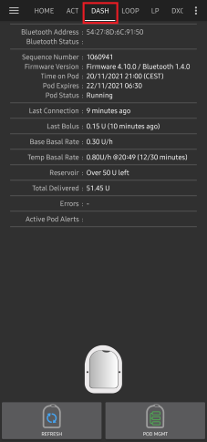

Ikona **Nastavení** (ozubené kolo) v pravém horním rohu otevře [nastavení Dash](#omnipod-dash-settings).

***POZNÁMKA:** Pokud některé pole na obrazovce pumpy ukazuje (neznámé), stiskněte **Obnovit** pro aktualizaci stavu podu.*

### Pole

- **Adresa Bluetooth:** Bluetooth adresa podu.

- **Kvalita připojení:** Jak spolehlivě se **AAPS** připojuje k podu. Zobrazuje se jako *úspěšná připojení / všechny pokusy o připojení :: úspěšnost*, například `412/420 :: 98.10 %`. Po více než 50 úspěšných připojeních se hodnota zbarví žlutě pod 90 % a červeně pod 70 %. Nízká hodnota ukazuje na problém s Bluetooth (viz [Problémy související s Bluetooth](#omnipod-dash-bluetooth-related-issues)).

- **Stav doručení:** Nezpracovaný stav výdeje, který hlásí pod. Toto pole se zobrazuje jen v sestaveních s inženýrským režimem.

- **Unikátní ID:** Unikátní ID, které **AAPS** přidělilo podu při aktivaci.

- **Číslo šarže:** Výrobní číslo šarže podu.

- **Pořadové číslo:** Pořadové číslo podu.

- **Verze firmwaru:** Verze firmwaru a Bluetooth podu.

- **Čas na Podu:** Aktuální čas v podu včetně jeho časového pásma. Text se zbarví červeně, když se časové pásmo podu liší od časového pásma telefonu, a žlutě, když se čas podu liší o více než 10 minut.

- **Expirace Podu:** Datum a čas, kdy pod vyprší (72 hodin po aktivaci). Text se zbarví žlutě během posledních 4 hodin před tímto časem. Nikdy se nezbarví červeně, protože pod po tomto čase dál vydává inzulín.

- **Definitivní konec podu:** Konec doby tolerance podu (8 hodin po **Expirace Podu**, maximální životnost podu je tedy 80 hodin). Text se zbarví žlutě, když začne doba tolerance (v čase **Expirace Podu**), a červeně během posledních 4 hodin před definitivním koncem. Během doby tolerance ukazuje také zbývající čas, například *(zbývá 17 min)*. Při definitivním konci pod přestane vydávat inzulín a musí se vyměnit.

- **Stav Podu:** Stav podu: **Žádný aktivní Pod**, **Probíhá nastavování**, **Běží**, **Pozastaveno** nebo po chybě podu **ALARM**.

- **Poslední připojení:** Před jakou dobou **AAPS** naposledy komunikovalo s podem.

  - *před chvílí* – před méně než 10 sekundami.

  - *Před méně než minutou* – před 10 až 60 sekundami.

  - *před XX minut* – před více než 1 minutou (a po hodině *před X hodin a XX minut*).

- **Poslední bolus:** Množství posledního bolusu odeslaného do podu a před jakou dobou byl podán. Nepotvrzený bolus je označen (neznámé).

- **Základní hodnota bazálu:** Bazální dávka naprogramovaná pro aktuální čas ve vašem bazálním **profilu**.

- **Dočasná bazální dávka:** Dočasný bazál (TBR), který právě běží, s časem začátku a trváním. Toto pole se zobrazuje jen tehdy, když běží TBR.

- **Zásobník:** Ukazuje *Zbývá více než 50 U*, když v zásobníku zbývá více než 50 jednotek. Pod 50 jednotek se zobrazuje přesné množství. Pod 20 jednotek se hodnota zbarví červeně.

- **Celkem vydáno:** Celkové množství inzulínu vydaného ze zásobníku. To zahrnuje i inzulín použitý na plnění.

- **Výstrahy aktivního Podu:** Výstrahy, které jsou na podu právě aktivní, například *Životnost Podu brzy skončí* nebo *Nízký stav zásobníku*.

- **Chyby:** Chyba podu, pokud pod selhal. Zobrazuje se červeně jako *Chyba Podu:* a za tím kód a název chyby, například *Chyba Podu: 020 ALARM_OCCLUDED*. Starší chyby a podrobnější informace najdete v [historii podu](#omnipod-dash-view-pod-history) a v log souborech. Viz [Selhání podu](#omnipod-dash-pod-failures).

- **Oznámení PDM:** Zobrazuje se jen po chybě podu. Ukazuje chybu tak, jak by ji zobrazil Omnipod PDM: název (například *Detekována okluze*, *Prázdný zásobník* nebo *Pod vypršel*), co se stalo (například *Doručení inzulínu bylo zastaveno. Nyní změňte Pod.*) a kód *Ref:*.

### Tlačítka

Tlačítka ve spodní části obrazovky pumpy se mění podle stavu podu. Zobrazují se jen tlačítka, která mají v danou chvíli smysl.

- **Obnovit:** Zeptá se podu na jeho aktuální stav.
  - *Použijte ho k aktualizaci stavu podu a k vyčištění polí, která ukazují (neznámé).*
  - *Více informací najdete níže v části [Řešení problémů](#omnipod-dash-troubleshooting).*

- **Ztišit výstrahy:** Zastaví pípání výstrah podu (například při konci životnosti podu nebo nízkém stavu zásobníku). Zobrazuje se jen tehdy, když má pod aktivní výstrahu. Viz [Ztišení výstrah podu](#omnipod-dash-silencing-pod-alerts).

- **Obnovit dodávání inzulínu:** Obnoví výdej inzulínu na pozastaveném podu. Zobrazuje se jen tehdy, když je výdej pozastavený. Viz [Obnovení výdeje inzulínu](#omnipod-dash-resuming-insulin-delivery).

- **Nastavit čas:** Nastaví pod na časové pásmo vašeho telefonu tak, že znovu odešle váš bazální **profil**. Zobrazuje se jen tehdy, když se časové pásmo podu liší od časového pásma vašeho telefonu.

- [**Aktivovat Pod**](#omnipod-dash-activate-pod): Naplní a aktivuje nový pod. Zobrazuje se, když není aktivní žádný pod.

- [**Deaktivovat Pod**](#omnipod-dash-deactivate-pod): Deaktivuje aktivní pod. Zobrazuje se, jakmile je pod spárovaný s **AAPS**, také když se aktivace zastavila v polovině (například protože pod během aktivace selhal). **AAPS** vás před deaktivací podu požádá o potvrzení.

- **Přehrát testovací pípnutí:** Pod jednou testovací pípne.

- [**Historie Podu**](#omnipod-dash-view-pod-history): Zobrazí historii činností aktivního podu.

- **Vyřadit Pod:** Odstraní nedokončený pod z **AAPS**. Zobrazuje se jen tehdy, když se aktivace podu zastavila v polovině. **AAPS** vás požádá o potvrzení. Po vyřazení už **AAPS** s tímto podem nemůže komunikovat: sundejte ho z těla.


```{admonition} Older screenshot
:class: note
Snímek obrazovky výše je ze starší verze **AAPS**, která měla samostatnou nabídku **Pod Management** (správa podu). V **AAPS** 4 jsou všechny tyto akce, včetně **Aktivovat Pod**, **Deaktivovat Pod**, **Přehrát testovací pípnutí** a **Historie Podu**, tlačítka s textovými popisky přímo na obrazovce pumpy.
```

(omnipod-dash-activate-pod)=

## Aktivovat Pod

1. Otevřete obrazovku pumpy DASH (**Spravovat** > **Pumpa**) a stiskněte **Aktivovat Pod**. Otevře se průvodce aktivací.

   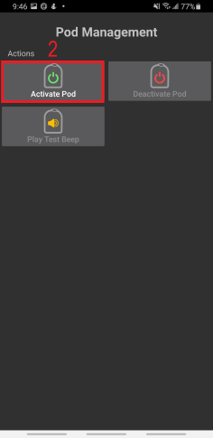

   ```{admonition} Older screenshot
   :class: note
   Snímek obrazovky výše je ze starší verze **AAPS**. V **AAPS** 4 je **Aktivovat Pod** tlačítko přímo na obrazovce pumpy DASH, ne v nabídce **Pod Management**.
   ```

   Pokud jste v **AAPS** ještě nikdy neaktivovali **profil**, průvodce nejdřív zobrazí krok **Vyžadován profil**: vyberte profil, který se má použít při aktivaci, a pokračujte.

2. Zobrazí se krok **Naplnit Pod**. Naplňte nový pod dostatkem inzulínu na 3 dny, **alespoň 80 jednotkami**. Poslouchejte, zda pod dvakrát pípne: znamená to, že bylo naplněno minimální množství 80 jednotek. Stříkačku vyprázdněte úplně, i když už jste slyšeli dvě pípnutí. Kryt jehly podu zatím nesundávejte.

   ***POZNÁMKA:** Při výpočtu množství inzulínu na 3 dny pamatujte, že plnění podu spotřebuje asi 3–10 jednotek.*

   

   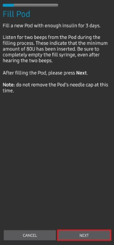

   Ujistěte se, že nový pod a telefon s **AAPS** jsou blízko sebe, a stiskněte **Další**.

3. Pokud v **AAPS** používáte více než jeden inzulín, zobrazí se krok **Vybrat inzulín**. Ukazuje inzulín, který je **Aktuálně aktivní**. Pokud jste pod naplnili jiným inzulínem, stiskněte **Změnit** a vyberte ho. Po dokončení aktivace **AAPS** provede **přepnutí profilu** s tímto inzulínem. Stiskněte **Další**.

   

4. V kroku **Inicializovat Pod** se **AAPS** spáruje s novým podem a naplní ho. Uslyšíte cvaknutí a po něm sérii tikavých zvuků, jak se pod sám plní. Když to úspěšně skončí, objeví se tlačítko **Další**. Stiskněte **Další**.

       

   ***POZNÁMKA**: Pokud se objeví chybová zpráva, například _Skenování se nezdařilo_ nebo _'Could not find an available pod for activation'_ (to se může stát), nepanikařte. Stiskněte **Opakovat**. Ve většině případů pak aktivace úspěšně pokračuje.*

   

   Pokud pod selhal (například protože byl překročen čas jeho aktivace), místo **Opakovat** se zobrazí **Deaktivovat Pod**. Použijte ho a začněte znovu s novým podem.

   Pokud stisknete **Zrušit** před dokončením aktivace, **AAPS** vás požádá o potvrzení, že chcete průvodce ukončit. Stiskněte **OK** pro opuštění průvodce, nebo **Zrušit** pro setrvání.

   

5. Pokud v **AAPS** spravujete střídání míst pumpy (**Spravovat střídání míst pumpy** v nastavení [Rotace míst aplikace](#Aapsscreens-site-rotation)), zobrazí se krok **Umístění**. Na schématu těla vyberte, kam pod umístíte, a stiskněte **Další**, nebo stiskněte **Přeskočit**.

   

6. Dále připravte místo vpichu pro nový pod. Umyjte si ruce, abyste se vyhnuli riziku infekce. Očistěte místo vpichu mýdlem a vodou nebo alkoholovým tamponem a před pokračováním nechte kůži úplně oschnout na vzduchu. Pokud vám lepidlo dráždí kůži, zvažte použití ochranného ubrousku nebo ochranného spreje.

   V kroku **Nasaďte Pod** sundejte z podu modrý plastový kryt jehly. Pokud z podu vyčnívá kanyla nebo cokoli jiného, nebo pokud pod vypadá neobvykle, **ZASTAVTE**: stiskněte **Zrušit** a začněte znovu s novým podem. Pokud vše vypadá **v pořádku**, sloupněte z lepicí vrstvy bílý papír a nalepte pod na zvolené místo na těle.

   Až budete hotovi, stiskněte **Další**.

   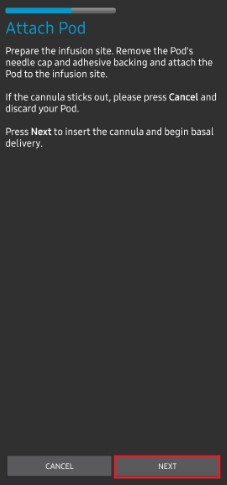

7. Zobrazí se potvrzovací dialog: *Když stisknete OK, kanyla se vloží.* **Stiskněte OK JEN tehdy, když jste připraveni kanylu vložit!**

   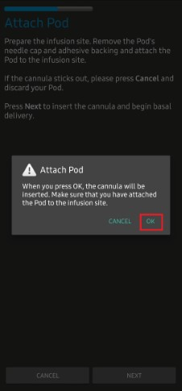

8. V kroku **Vložit kanylu** **AAPS** nastaví váš bazální rozpis a pod vloží kanylu. Může to chvíli trvat (maximálně 1–2 minuty). **Buďte trpěliví!**

   ***POZNÁMKA:** Je dobré stisknout kůži v okolí místa vpichu kanyly, než se kanyla vloží. Jehla pak vnikne hladce a snižuje se riziko okluze (ucpání).*

       

9. Když je kanyla úspěšně vložena, objeví se tlačítko **Další**. Stiskněte **Další**.

   

10. Zobrazí se krok **Pod aktivován**. Zkontrolujte, že kanyla byla vložena správně, a pokud si myslíte, že ne, pod vyměňte.

    Stiskněte **Dokončit**.

    Gratulujeme! Nyní jste zahájili novou relaci podu.

    

11. Jste zpět na obrazovce pumpy DASH. Nyní ukazuje informace o vašem aktivním podu, včetně aktuální bazální dávky, stavu zásobníku, vydaného inzulínu, chyb a výstrah podu. **Aktivovat Pod** je nahrazeno tlačítkem **Deaktivovat Pod**: další pod nemůžete aktivovat, dokud nedeaktivujete ten aktivní.

    ***POZNÁMKA:** Podrobnosti o zobrazených informacích najdete v části [Obrazovka pumpy DASH](#omnipod-dash-tab).*

    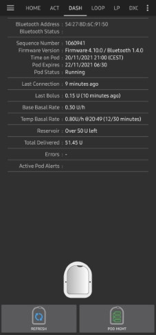

    ***POZNÁMKA:** Je dobré exportovat nastavení AŽ PO aktivaci podu. Exportujte svá nastavení po každé výměně podu a jednou za měsíc. Zkopírujte soubor s exportem nastavení do cloudového úložiště (například na Disk Google) nebo jinam mimo telefon pro případ, že telefon ztratíte (viz [**Vytváření a obnova záloh**](../Maintenance/ExportImportSettings.md)).*

Pokud se dřívější aktivace zastavila až po naplnění podu, stisknutí **Aktivovat Pod** pokračuje od kroku **Nasaďte Pod**.

(omnipod-dash-deactivate-pod)=

## Deaktivovat Pod

Za normálních okolností vydrží pod tři dny (72 hodin) plus dobu tolerance 8 hodin po varování o konci životnosti podu: celkem 80 hodin.

Deaktivace podu (protože vypršel nebo protože selhal):

1. Otevřete obrazovku pumpy DASH (**Spravovat** > **Pumpa**) a stiskněte **Deaktivovat Pod**.

   

2. V kroku **Deaktivovat Pod** stiskněte **Další**. Dialog se zeptá: *Deaktivovaný pod nelze znovu použít. Chcete nyní deaktivovat tento pod?* Stiskněte **OK** pro zahájení deaktivace podu, nebo **Zrušit**, pokud si ho chcete ponechat. Deaktivace pozastaví veškerý výdej inzulínu a nelze ji vrátit zpět.

   

3. Během deaktivace podu v **AAPS** se zobrazí krok **Deaktivace Podu**. Pod pípne na potvrzení, že deaktivace proběhla úspěšně.

   

   ```{admonition} Older screenshot
   :class: note
   Snímek obrazovky výše je ze starší verze **AAPS**. V **AAPS** 4 průvodce ukazuje průběh jako řadu teček nahoře místo ukazatele průběhu.
   ```

   Když deaktivace úspěšně skončí, objeví se tlačítko **Další**. Stiskněte **Další**.

   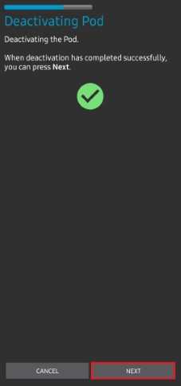

   Pokud deaktivace selže, zobrazí se chybová zpráva a tlačítko **Vyřadit Pod**. Než ho použijete, přečtěte si níže část [Vyřazení podu](#omnipod-dash-discard-pod). Můžete také stisknout **Zrušit** a zkusit **Deaktivovat Pod** znovu později.

4. Zobrazí se krok **Pod deaktivován**. Sundejte pod z těla a stiskněte **Dokončit**.

   

5. Jste zpět na obrazovce pumpy DASH. Zkontrolujte, že pole **Stav Podu** ukazuje **Žádný aktivní Pod** a že se znovu zobrazuje tlačítko **Aktivovat Pod**.

   

(omnipod-dash-discard-pod)=

### Vyřazení podu

Pod vyřaďte jen tehdy, když veškerá komunikace s ním opakovaně selhává. Pokud **AAPS** s podem stále dokáže komunikovat, použijte místo toho **Deaktivovat Pod**.

- **AAPS** vás před vyřazením podu požádá o potvrzení.
- Poté už **AAPS** s tímto podem nemůže komunikovat.
- **Výdej inzulínu NEBYL pozastaven**, protože pod nebyl řádně deaktivován. **Sundejte pod z těla!**
- Krok **Pod vyřazen** potvrzuje, že stav podu byl vyřazen. Stiskněte **Dokončit**. Nyní můžete aktivovat nový pod.

(omnipod-dash-resuming-insulin-delivery)=

## Obnovení výdeje inzulínu

**POZNÁMKA**: Během **přepnutí profilu** musí **AAPS**, stejně jako PDM, pozastavit výdej v podu, než nastaví nový bazální **profil**. Pokud komunikace mezi příkazy pro pozastavení a obnovení selže, výdej může zůstat pozastavený. Více podrobností najdete v části [**Výdej pozastaven**](#omnipod-dash-delivery-suspended) v řešení problémů.

Když je výdej inzulínu pozastavený, musíte podu říct, aby výdej inzulínu obnovil. Když je příkaz úspěšně zpracován, pod znovu vydává inzulín podle bazální dávky pro aktuální čas z vašeho aktivního bazálního **profilu**. Pod opět přijímá příkazy pro bolus, **TBR** a **SMB**.

1. Otevřete obrazovku pumpy DASH a zkontrolujte, že pole **Stav Podu** ukazuje **Pozastaveno**. Stiskněte **Obnovit dodávání inzulínu**, aby pod obnovil normální výdej inzulínu.

   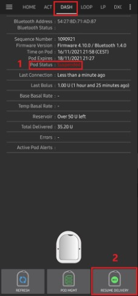

2. Když byl příkaz úspěšný, pole **Stav Podu** ukazuje **Běží** a tlačítko **Obnovit dodávání inzulínu** zmizí.

   

   

   ```{admonition} Older screenshot
   :class: note
   Snímky obrazovky výše jsou ze starší verze **AAPS**, která zobrazovala potvrzovací dialog. V **AAPS** 4 výsledek ověříte na obrazovce pumpy DASH: pole **Stav Podu** ukazuje **Běží** a tlačítko **Obnovit dodávání inzulínu** zmizelo.
   ```

   Pokud příkaz selže, **AAPS** zobrazí varovný dialog, který začíná textem *Nepodařilo se obnovit výdej*. Stiskněte **Obnovit** a zkuste to znovu.

   

(omnipod-dash-silencing-pod-alerts)=

## Ztišení výstrah podu

Tato část vysvětluje, jak zastavit pípání podu, když se pod blíží konci své životnosti. Kdy pípání začne, závisí na nastavení **Výstrahy** (viz [Nastavení Dash](#omnipod-dash-settings)):

- **Připomenutí v hodinách před vypršením platnosti (72 hodin):** kolik hodin před vypršením po 72 hodinách začne pod pípat.
- **Upozornění v hodinách před vypnutím (80 hodin):** kolik hodin před vypnutím po 80 hodinách pod pípne znovu.

Maximální životnost podu je 80 hodin (3 dny a 8 hodin). Výrobce podu ale doporučuje nepřekračovat 72 hodin (3 dny).

***POZNÁMKA**: Tlačítko **Ztišit výstrahy** se na obrazovce pumpy DASH zobrazuje jen tehdy, když má pod aktivní výstrahu, například při konci životnosti podu nebo nízkém stavu zásobníku. Pokud se tlačítko **Ztišit výstrahy** nezobrazuje, ale slyšíte pípání podu, stiskněte **Obnovit**.*

1. Když nastane čas připomenutí, pod pípáním oznámí, že brzy vyprší a že ho musíte vyměnit. Na obrazovce pumpy DASH ukazuje pole **Expirace Podu (1)** přesný čas, kdy pod vyprší (72 hodin po aktivaci). Text se zbarví žlutě 4 hodiny před tímto časem. Potom se **Definitivní konec podu** zbarví žlutě a ukazuje zbývající čas, než pod přestane vydávat inzulín. Pole **Výstrahy aktivního Podu (2)** ukazuje **Životnost Podu brzy skončí** a zobrazí se tlačítko **Ztišit výstrahy (3)**.

   

2. Stiskněte **Ztišit výstrahy**. **AAPS** odešle podu příkaz, aby přestal pípat kvůli konci životnosti.

   

   ```{admonition} Older screenshot
   :class: note
   Snímek obrazovky výše je ze starší verze **AAPS**, kde tato obrazovka byla kartou **DASH**. V **AAPS** 4 je tlačítko **Ztišit výstrahy** na obrazovce pumpy DASH (**Spravovat** > **Pumpa**).
   ```

3. Když jsou výstrahy ztišeny, výstraha se už nezobrazuje v poli **Výstrahy aktivního Podu**, tlačítko **Ztišit výstrahy** zmizí a pod přestane pípat kvůli konci životnosti.

   

   ```{admonition} Older screenshot
   :class: note
   Snímek obrazovky výše je ze starší verze **AAPS**, která zobrazovala potvrzovací dialog. V **AAPS** 4 výsledek ověříte na obrazovce pumpy DASH: výstraha zmizela z pole **Výstrahy aktivního Podu**.
   ```

   Pokud příkaz selže, **AAPS** zobrazí varovný dialog, který začíná textem *Nezdařilo se potvrdit výstrahy*. Stiskněte **Obnovit** a zkuste to znovu.

Výstraha na nízký stav zásobníku funguje stejně. Když množství inzulínu v podu klesne na hodnotu **Počet jednotek** nastavenou v nastavení **Výstrahy**, pod pípne. Pole **Zásobník** ukazuje zbývající množství, pole **Výstrahy aktivního Podu** ukazuje **Nízký stav zásobníku** a zobrazí se tlačítko **Ztišit výstrahy**. Stiskněte **Ztišit výstrahy**, abyste zastavili pípání, a naplánujte si další výměnu podu.


(omnipod-dash-view-pod-history)=

## Zobrazení historie podu

Tato část vysvětluje, jak si prohlédnout historii aktivního podu a filtrovat ji podle typu akce. Historie podu ukazuje příkazy odeslané do aktivního podu a jejich výsledky během jeho třídenní životnosti (72–80 hodin).

Hodí se ke kontrole bolusů, TBR a bazálních příkazů, které byly do podu odeslány. Ostatní kategorie pomáhají při řešení problémů a ukazují pořadí událostí, které vedly k selhání.

***POZNÁMKA:** **Nejistý může být jen poslední příkaz**. Nové příkazy *se neodesílají*, dokud se **poslední „nejistý“ příkaz nestane „potvrzeným“ nebo „zamítnutým“**. Abyste nejistý příkaz „opravili“, stiskněte **Obnovit** na obrazovce pumpy DASH.*

1. Otevřete obrazovku pumpy DASH a stiskněte **Historie Podu**.

   

   ```{admonition} Older screenshot
   :class: note
   Snímek obrazovky výše je ze starší verze **AAPS**. V **AAPS** 4 je **Historie Podu** tlačítko přímo na obrazovce pumpy DASH, ne v nabídce **Pod Management**.
   ```

2. Otevře se obrazovka **Historie Podu** s vybraným filtrem **Vše**. Obsahuje všechny příkazy s časem a výsledkem, nejnovější nahoře, seskupené podle dnů. Pomocí tlačítek filtru nahoře (například **Bolusy** nebo **Bazály**) zobrazíte jen jeden typ příkazů. Stisknutím šipky zpět se vrátíte na obrazovku pumpy DASH.

   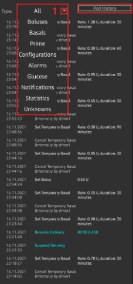 

   ```{admonition} Older screenshot
   :class: note
   Druhý snímek obrazovky výše je ze starší verze **AAPS**, kde se typ příkazu vybíral ze seznamu **Type** (typ). V **AAPS** 4 používáte tlačítka filtru, která ukazuje první snímek obrazovky.
   ```

   U bolusů následuje za množstvím typ bolusu, pokud nejde o normální bolus, například *0,05 U (SMB)* nebo *0,05 U (Korekce bazálu)*. Korekce bazálu je velmi malý bolus (jeden pulz podu, 0,05 U), který ovladač posílá sám; vy jste o něj nežádali.

   ```{admonition} Why basal corrections happen
   :class: note
   Pod vydává bazální inzulín v pulzech po 0,05 U, které časuje vnitřní hodiny. Při každé změně bazální dávky (například když smyčka nastaví nový **TBR**) pod tyto hodiny restartuje a pulz, ke kterému se zrovna blížil, se ztratí. Protože smyčka mění bazální dávku často, zvlášť v noci, může pod nakonec vydat méně bazálního inzulínu, než se čekalo.

   **AAPS** porovnává bazální inzulín, který pod hlásí jako vydaný, s tím, co měl vydat. Když chybějící množství dosáhne poloviny pulzu nebo víc, ovladač vydá jeden pulz navíc jako korekci bazálu, takže stále dostanete bazální inzulín, který požadoval váš profil a smyčka. Žádná korekce se neposílá, když je pod pozastavený nebo když běží nulový **TBR**.
   ```

(omnipod-dash-settings)=

## Nastavení Dash

Nastavení ovladače Dash můžete otevřít dvěma způsoby:

- Stiskněte ikonu **Nastavení** (ozubené kolo) v pravém horním rohu [obrazovky pumpy DASH](#omnipod-dash-tab).
- Otevřete **nabídku** (☰) v levém horním rohu hlavní obrazovky a vyberte **Konfigurace** > **Pumpa**. Na kartě **Omnipod Dash** stiskněte **Nastavení**.

Nastavení jsou rozdělená do čtyř rozbalovacích částí: **Potvrzovací pípnutí**, **Výstrahy**, **Oznámení** a **Rozšířená nastavení**. Klepnutím část otevřete:


Většina nastavení jsou přepínače zap./vyp.

### Potvrzovací pípnutí

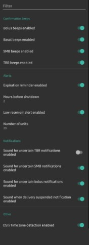

Potvrzovací pípnutí podu při výdeji a změnách bolusu, bazálu, SMB a TBR.

**Pípnutí při bolusu povoleno:**    Pod pípne, když je vydán bolus. Ve výchozím stavu zapnuto.

**Pípnutí při bazálu povoleno:**    Pod pípne, když je nastavena nová bazální dávka nebo když je aktivní bazální dávka zrušena nebo změněna. Ve výchozím stavu vypnuto.

**Pípnutí při SMB povoleno:**  Pod pípne, když je vydán SMB. Ve výchozím stavu zapnuto.

**Pípnutí při TBR povoleno:**  Pod pípne, když je TBR nastaven nebo zrušen. Ve výchozím stavu vypnuto.

### Výstrahy


```{admonition} Older screenshot
:class: note
Snímek obrazovky výše je ze starší verze **AAPS**. V **AAPS** 4 jsou tato nastavení v rozbalovací části **Výstrahy**.
```

Výstrahy podu pro konec životnosti, vypnutí a nízký stav zásobníku. Když tato nastavení změníte při aktivním podu, **AAPS** odešle nové nastavení výstrah do podu.

***POZNÁMKA:** Oznámení **AAPS** se zobrazí VŽDY pro každou výstrahu, jakmile **AAPS** po spuštění výstrahy komunikuje s podem. Zavřením oznámení se výstraha podu NEZASTAVÍ. Abyste výstrahu zastavili, otevřete obrazovku pumpy DASH a stiskněte **Ztišit výstrahy**.*

**Připomenutí vypršení platnosti povoleno:**    Když je zapnuto, pod pípne, když nastane čas připomenutí. Ve výchozím stavu zapnuto.

**Připomenutí v hodinách před vypršením platnosti (72 hodin):** Kolik hodin před vypršením podu po 72 hodinách začne připomenutí (1 až 24 hodin; výchozí 4).

**Upozornění na vypršení platnosti povoleno:**   Když je zapnuto, pod pípne, když nastane čas upozornění, a znovu 1 hodinu před vypnutím. Ve výchozím stavu zapnuto.

**Upozornění v hodinách před vypnutím (80 hodin):**  Kolik hodin před vypnutím podu po 80 hodinách začne upozornění (1 až 8 hodin; výchozí 8).

**Upozornění na nízký stav zásobníku povoleno:**    Pod vás upozorní, když množství inzulínu v zásobníku klesne na hodnotu v **Počet jednotek**. Ve výchozím stavu zapnuto.

**Počet jednotek:**    Počet jednotek, při kterém se spustí výstraha na nízký stav zásobníku (5 až 50 jednotek; výchozí 20).

### Oznámení


Zvolte, zda má **AAPS** přehrát zvuk se svými oznámeními, když si není jisté, zda byl TBR, SMB nebo bolus vydán, a když je výdej pozastavený.

***POZNÁMKA:** Jde jen o oznámení v telefonu; samotný pod nepípá.*

**Zvuk pro nejistý dočasný bazál povolen:**  Přehraje zvuk s oznámením, když si **AAPS** není jisté, zda byl TBR nastaven.

**Zvuk oznámení pro nejistý SMB povolen:**  Přehraje zvuk s oznámením, když si **AAPS** není jisté, zda byl SMB vydán.

**Zvuk oznámení pro nejistý bolus povolen:**    Přehraje zvuk s oznámením, když si **AAPS** není jisté, zda byl bolus vydán.

**Zvuk oznámení o pozastavení výdeje povolen:**     Přehraje zvuk s oznámením, když je výdej inzulínu pozastavený.

(omnipod-dash-advanced-settings)=

### Rozšířená nastavení


**Bluetooth párování:**  Spáruje pod s telefonem přes Bluetooth (bonding). Zkuste to jen tehdy, když pod nedokáže udržet stabilní připojení, například na Androidu 15 (viz [Známá omezení a problémy Omnipod DASH v AAPS](#omnipod-dash-constraints)). Když je zapnuto, telefon zobrazí žádosti o spárování, které musíte přijmout. Pokud se pod připojuje bez problémů, nechte to vypnuté. Pod Androidem 15 to nemá žádný účinek. Ve výchozím stavu vypnuto.

## Stáří inzulínu a kanyly

[Stavový řádek](#screens-sensor-level-battery) na hlavní obrazovce ukazuje stáří vašeho inzulínu a kanyly. U Omnipodu to funguje trochu jinak než u pump s hadičkou.

**AAPS** při každé aktivaci podu automaticky zaznamená výměnu kanyly a výměnu inzulínu. Tím se stáří **Inzulín** a **Kanyla** po každé výměně podu vynuluje. Nemusíte je zaznamenávat sami pomocí **Plnění/doplňování**. Je to proto, že pod zavádí kanylu přímo do kůže v místě, kde je nalepený: Omnipod nepoužívá hadičku.

Stáří **Baterie pumpy** se nehlásí: baterie i zásobník inzulínu jsou součástí každého podu a baterie vždy vydrží déle než samotný pod (maximálně 80 hodin).


```{admonition} Older screenshot
:class: note
Snímek obrazovky výše je ze starší verze **AAPS**, kde se tato stáří zobrazovala v části **Péče** na kartě **Akce**. V **AAPS** 4 se zobrazují ve stavovém řádku na hlavní obrazovce.
```

### Úroveň

**Množství inzulínu**

Zobrazené množství inzulínu je množství, které hlásí pod. Pod ale hlásí skutečný stav zásobníku, až když je pod 50 jednotek. Do té doby se zobrazuje *Zbývá více než 50 U*. Hlášené množství není přesné: když pod hlásí „prázdný“, ve většině případů v zásobníku ještě zbývá několik jednotek inzulínu.

Obrazovka pumpy DASH ukazuje stav takto:

  * **Zbývá více než 50 U** – Pod hlásí v zásobníku více než 50 jednotek.
  * **Pod 50 jednotek** – Přesné množství inzulínu, které v zásobníku zbývá, jak ho hlásí pod.

Další poznámka:
  * **SMS** – V odpovědích SMS vrací hodnotu, nebo 50+U, když je to přes 50 jednotek.
  * **Nightscout** – Když je to přes 50 jednotek, nahrává do Nightscoutu hodnotu 50 (verze 14.07 a starší). Novější verze hlásí hodnotu 50+, když je to přes 50 jednotek.

(omnipod-dash-troubleshooting)=

## Řešení problémů

Tato část popisuje běžné známé problémy a jejich řešení při používání Omnipod DASH s AAPS. V dokumentaci je také část [Obecné řešení problémů](../GettingHelp/GeneralTroubleshooting.md), kterou byste si měli projít, protože pokrývá témata důležitá i pro některé problémy s pody.

---

(omnipod-dash-bluetooth-related-issues)=

## Problémy související s Bluetooth

Známé problémy s připojením Bluetooth, výpadky pump nebo podů a problémy s aktivací a připojením najdete na stránce [Problémy související s Bluetooth](../GettingHelp/BluetoothTroubleshooting.md)

---

(omnipod-dash-delivery-suspended)=

### Výdej pozastaven

  - Tlačítko pro pozastavení už neexistuje. Pokud chcete pod „pozastavit“, můžete nastavit nulový **TBR** na x minut.
  - Během **přepnutí profilu** musí DASH pozastavit výdej, než nastaví nový bazální **profil**. Pokud komunikace mezi oběma příkazy selže, výdej může zůstat pozastavený. Když se to stane:
     - Nebude se vydávat žádný inzulín, to zahrnuje bazál, SMB, ruční bolusy atd.
     - Může se zobrazit oznámení, že jeden z příkazů není potvrzený: záleží na tom, kdy k selhání došlo.
     - **AAPS** se bude každých 15 minut pokoušet nastavit nový bazální profil.
     - Pokud výdej zůstává pozastavený (obnovení výdeje selhalo), **AAPS** každých 15 minut zobrazí oznámení, že výdej je pozastavený.
     - Pokud chcete výdej obnovit ručně, na obrazovce pumpy DASH se zobrazuje tlačítko [**Obnovit dodávání inzulínu**](#omnipod-dash-resuming-insulin-delivery).
     - Pokud **AAPS** nedokáže obnovit výdej samo (stane se to, když je pod nedostupný, zvuk je ztlumený atd.), pod začne pípat 4krát za minutu po dobu 3 minut a pak to opakuje každých 15 minut, pokud je výdej pozastavený déle než 20 minut.
  - U nepotvrzených příkazů stiskněte **Obnovit** na obrazovce pumpy DASH, abyste je potvrdili nebo zamítli.

*****POZNÁMKA:** Když slyšíte pípání podu, nepředpokládejte, že výdej bude pokračovat, aniž byste zkontrolovali telefon. Výdej může zůstat pozastavený, ***takže to musíte zkontrolovat!******

---
(omnipod-dash-pod-failures)=

### Selhání podu

- Pody občas selžou z různých důvodů, včetně hardwarových problémů samotného podu.
- Je dobré nezakládat u společnosti Insulet reklamace ani žádosti o výměnu, protože AAPS není schválený způsob používání podů.
- Seznam chybových kódů, který pomůže určit příčinu, [**najdete zde**](https://github.com/openaps/openomni/wiki/Fault-event-codes).

Když pod selže, přestane vydávat inzulín a nepřetržitě pípá. **AAPS** zobrazí na hlavní obrazovce oznámení s kódem a názvem chyby a kódem *Ref:*, například *Chyba Podu: 020 ALARM_OCCLUDED*. Stisknutím **Zavřít** oznámení zavřete. Pípání podu to nezastaví.

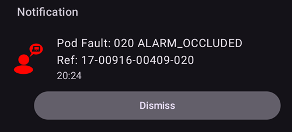

Na obrazovce pumpy DASH ukazuje pole **Stav Podu** hodnotu **ALARM**, pole **Chyby** ukazuje chybu podu a pole **Oznámení PDM** ji vysvětluje, například *Detekována okluze. Doručení inzulínu zastaveno. Vyměňte Pod. Zkontrolujte glykémii*.


Pod, který selhal, nelze znovu použít. Zkontrolujte glykémii, pak [pod deaktivujte](#omnipod-dash-deactivate-pod) a aktivujte nový.

---
### Prevence selhání podu s chybou 49

Toto selhání souvisí s nesprávným stavem podu pro daný příkaz nebo s chybou během příkazu pro výdej inzulínu. Stane se to, když se ovladač a pod neshodnou na skutečném stavu. Pod (jako vestavěné bezpečnostní opatření) pak zareaguje neopravitelným chybovým kódem 49 (0x31) a skončí jako takzvaný „screamer“: dlouhé otravné pípání, které lze zastavit jen propíchnutím otvoru na správném místě na zadní straně podu. Přesnou příčinu „selhání podu 49“ je často těžké dohledat. V situacích, kdy hrozí podezření na toto selhání (například při pádu aplikace, při používání vývojové verze nebo při přeinstalaci).

---

### Výstrahy „Pumpa nedostupná“

Když se s podem po předem nastavenou dobu nepodaří navázat komunikaci, zobrazí se výstraha „Pumpa nedostupná“. Výstrahy „Pumpa nedostupná“ můžete nastavit tak, že stisknete ikonu **Nastavení** (ozubené kolo) vpravo nahoře na hlavní obrazovce a vyberete **Místní výstrahy** ➜ **Práh nedostupnosti pumpy**. Doporučená hodnota je výstraha po **120** minutách.

---
(omnipod-dash-export-import)=
### Export a import nastavení

Export nastavení **AAPS** vám umožní obnovit všechna nastavení a cíle, například po přeinstalaci **AAPS** nebo na novém telefonu. **Exportujte nastavení hned po každé aktivaci podu** a zkopírujte soubor na bezpečné místo mimo telefon (například na Disk Google), aby šlo obnovit i aktivní pod. Viz [Vytváření a obnova záloh](#ExportImportSettings-Settings-Export).

```{admonition} Importing settings can end your active Pod
:class: warning
Na telefonu, na kterém pod už běží, nechte **Nahradit také nastavení pumpy** nezaškrtnuté: relace podu se zachová a importují se jen ostatní nastavení. Zaškrtněte to jen na novém telefonu, se souborem exportovaným během podu, který právě nosíte. Viz [Pumpy bez hadičky](#ExportImportSettings-tubeless-pumps).
```

Pokud importovaná nastavení obsahují pod, který už není aktivní, přečtěte si další část.

---
### Import nastavení, která obsahují stav neaktivního podu

Když importujete nastavení s daty podu, který už není aktivní, AAPS se k němu pokusí připojit, což samozřejmě selže. V této situaci nemůžete aktivovat nový pod.

Odstranění staré relace podu:
1. Na obrazovce pumpy DASH stiskněte **Deaktivovat Pod**. Deaktivace nejspíš selže.
2. Když selže, stiskněte **Vyřadit Pod** a potvrďte (viz [Vyřazení podu](#omnipod-dash-discard-pod)).
3. Jakmile je starý pod odstraněn, můžete aktivovat nový pod.

### Generic error: java.lan.illegalStateException: Trying to set a Bluetooth Address to ***, but it is already set to ***.

Pokud se tato chyba objeví při pokusu o inicializaci nového podu, **AAPS** selhává, protože má v konfiguraci stále uložená nastavení starého podu.


Může se to stát, když obnovujete ze zálohy nebo když selže deaktivace podu.

Abyste to vyřešili, stiskněte **Zrušit** a aktivaci opusťte. Na obrazovce pumpy DASH stiskněte **Vyřadit Pod**, pokud se zobrazuje. Jinak stiskněte **Deaktivovat Pod**, a když deaktivace selže, stiskněte **Vyřadit Pod** (viz [Vyřazení podu](#omnipod-dash-discard-pod)).

Nyní byste měli být schopni aktivovat nový pod.

---
### Přeinstalace AAPS

Když odinstalujete **AAPS**, přijdete o všechna nastavení, cíle i aktuální relaci podu. **Abyste je mohli obnovit, mějte k dispozici nedávný soubor s exportem nastavení!**

Při aktivním podu použijte export vytvořený během aktuální relace podu (viz [Export a import nastavení](#omnipod-dash-export-import)).

1. Exportujte svá nastavení a uložte kopii na bezpečné místo (např. Disk Google).
2. Odinstalujte **AAPS** a restartujte telefon.
3. Nainstalujte novou verzi **AAPS**.
4. Importujte svá nastavení.
5. Zkontrolujte všechny předvolby (případně znovu importujte nastavení).
6. Aktivujte nový pod.
7. Po dokončení: exportujte aktuální nastavení.

---
### Aktualizace AAPS na novější verzi

Ve většině případů není potřeba odinstalovat. Můžete provést instalaci „na místě“ tak, že spustíte instalaci nové verze. To je možné i při aktivní relaci podu.

1. Exportujte svá nastavení.
2. Nainstalujte novou verzi **AAPS**.
3. Zkontrolujte, že instalace proběhla úspěšně
4. Obnovte výdej podu (OBNOVIT), nebo aktivujte nový pod.
5. Po dokončení: exportujte aktuální nastavení.

---
### Výstrahy ovladače Omnipod

Ovladač Omnipod Dash zobrazuje na **hlavní obrazovce** různé jedinečné výstrahy. Většina z nich je informativní a lze je zavřít, některé ale vyžadují, abyste něco udělali a odstranili příčinu výstrahy.

Níže je přehled hlavních výstrah, se kterými se můžete setkat:

- *Chyba Podu: XXX NÁZEV* a za tím *Ref: ...*: pod selhal a přestal vydávat inzulín. Vyměňte pod. Viz [Selhání podu](#omnipod-dash-pod-failures).
- *Žádný aktivní Pod*: nebyla nalezena žádná relace podu. Toto oznámení se bude stále vracet, dokud neaktivujete nový pod. Jakmile je pod aktivován, oznámení automaticky zmizí.
- *Výdej inzulínu pozastaven*: pod pozastavil výdej inzulínu. Viz [Obnovení výdeje inzulínu](#omnipod-dash-resuming-insulin-delivery).
- *Nastavení bazálního profilu se možná nezdařilo. Výdej může být pozastaven! Prosím ručně obnovte stav podu na záložce Omnipod a obnovte podávání pokud je to potřeba.* Nastavení bazálního **profilu** v podu se možná nezdařilo. Stiskněte **Obnovit** na obrazovce pumpy DASH (zpráva stále uvádí „záložka Omnipod“) a stiskněte **Obnovit dodávání inzulínu**, pokud se zobrazuje.
- *Nelze ověřit, zda byl bolus SMB (X U) úspěšně vydán. Aktualizujte stav podu pro potvrzení nebo zamítnutí tohoto příkazu.* **AAPS** nemohlo potvrdit, že byl **SMB** vydán. Stiskněte **Obnovit** na obrazovce pumpy DASH a zkontrolujte pole **Poslední bolus**.
- *Stav bolusu je nejistý. Aktualizujte stav podu pro potvrzení nebo zamítnutí.* Totéž platí pro normální bolus: stiskněte **Obnovit** na obrazovce pumpy DASH.
- *Časové pásmo podu se liší od časového pásma v telefonu. Bazál je nesprávný. Přepněte profil pro opravu* Viz poznámku o letním čase a časovém pásmu v části [Známá omezení a problémy Omnipod DASH v AAPS](#omnipod-dash-constraints).

(omnipod-dash-where-to-get-help-for-dash)=

## Kde získat pomoc

Veškerou vývojovou práci na DASH dělá komunita **dobrovolně**; mějte to prosím na paměti a před žádostí o pomoc postupujte podle těchto pokynů:

-  **Úroveň 0:** Přečtěte si příslušnou část této dokumentace, abyste pochopili, jak má fungovat funkce, se kterou máte potíže.
-  **Úroveň 1:** Pokud máte stále problémy, které pomocí této dokumentace nevyřešíte, jděte prosím na kanál *#AAPS* na **Discordu** pomocí [tohoto odkazu s pozvánkou](https://discord.gg/4fQUWHZ4Mw). Ptát se můžete také v mnoha skupinách na Facebooku a jinde (viz [**Kde mohu získat pomoc?**](../GettingHelp/WhereCanIGetHelp.md))
-  **Úroveň 2:** Prohledejte existující issue, zda váš problém už někdo nenahlásil, na [Issues](https://github.com/nightscout/AndroidAPS/issues) pokud existuje, potvrďte ho, okomentujte nebo doplňte informace o svém problému. Pokud ne, vytvořte prosím [nové hlášení (issue)](https://github.com/nightscout/AndroidAPS/issues) a přiložte [své log soubory](../GettingHelp/AccessingLogFiles.md).
-  **Buďte trpěliví – většina členů naší komunity jsou ochotní dobrovolníci a řešení problémů často vyžaduje čas a trpělivost od uživatelů i vývojářů.**

Když žádáte o pomoc, připravte si následující informace, aby vám komunita mohla pomoci s vašimi konkrétními otázkami a problémy:
- Značka a model telefonu s Androidem
- Verze systému Android (např. 15 nebo 16)
  - Aktualizovali jste nedávno verzi systému Android?
- Verze **AAPS**, kterou používáte
- Jednoduchý popis problému, který řešíte, s ohledem na některé z následujících bodů
   - Fungovalo to dříve?
   - Kdy to fungovalo a kdy ne?
   - Změnili jste něco v konfiguraci nebo v nastavení profilu?
   - Spárovali jste nové zařízení Bluetooth?
   - Aktualizovali nebo nainstalovali jste novou aplikaci?
   - Jak dlouho to fungovalo, než to přestalo fungovat?
