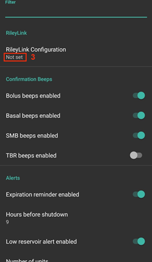
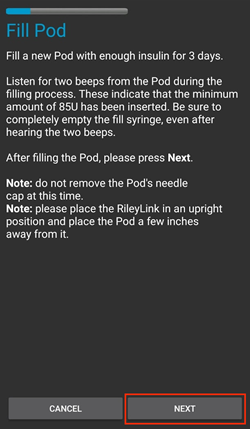
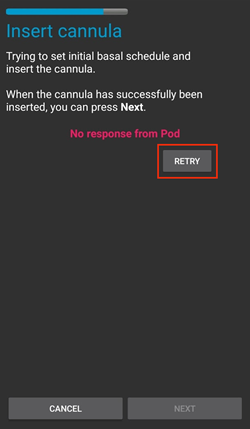
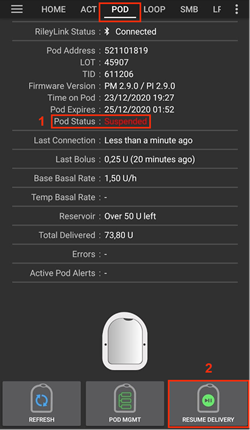
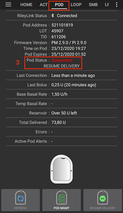
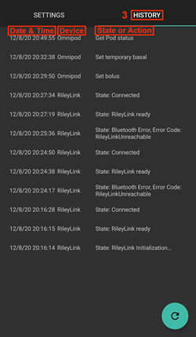
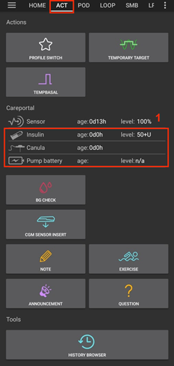

# Omnipod Eros

Tento návod popisuje nastavení pumpy Omnipod generace Eros (**NE Omnipod Dash**).

```{admonition} Omnipod Eros is being phased out
:class: note

[Systém Omnipod](https://www.omnipod.com/current-podders/resources/omnipod-system) (původní Omnipod, který tvoří osobní diabetický manažer (PDM) a pod) se přestává vyrábět. Datum ukončení se v jednotlivých zemích liší. Například v Kanadě už nebude k dispozici po 30. červnu 2026. Pokud spoléháte na pumpu Eros, naplánujte si včas přechod na podporovanou pumpu.
```

**Tento software je součástí DIY řešení umělé slinivky. Nejde o hotový produkt, ale vyžaduje, abyste si VY přečetli, naučili se a pochopili celý systém včetně toho, jak ho používat. Jste jediní, kdo nese odpovědnost za to, co s tím uděláte.**

```{contents} Table of contents
:depth: 1
:local: true
```

## Hardwarové a softwarové požadavky

- **Komunikační zařízení pro pod**

> Součást, která zprostředkuje komunikaci mezi vaším telefonem s AAPS a pody generace Eros.
> 
> > -   [Web OrangeLink](https://getrileylink.org/product/orangelink)
> > -  [433MHz RileyLink](https://getrileylink.org/product/rileylink433)
> > -   [Web Emalink](https://github.com/sks01/EmaLink) - [Kontakt](mailto:getemalink@gmail.com)
> > -   DiaLink - [Kontakt](mailto:Boshetyn@ukr.net)
> > -   [Web LoopLink](https://www.getlooplink.org/) - [Kontakt](https://jameswedding.substack.com/) - Netestováno

-   **Mobilní telefon**

> Součást, na které běží AAPS a která posílá ovládací příkazy do komunikačního zařízení pro pod.
> 
> > - Podporovaný [telefon s Androidem](#Phones-list-of-tested-phones) s nastaveným **AAPS** a souvisejícími součástmi.

-   **Zařízení pro podávání inzulínu**

> Součást, která zpracovává příkazy přijaté z komunikačního zařízení pro pod. Tyto příkazy pocházejí z vašeho telefonu s AAPS.
> 
> > - Nový pod Omnipod (generace Eros - **NE DASH**)

Tento návod předpokládá, že začínáte novou relaci podu. Pokud tomu tak není, buďte prosím trpěliví a začněte s tímto postupem při příští výměně podu.

Na této stránce **RileyLink** znamená kterékoli z komunikačních zařízení pro pod uvedených výše.

## Než začnete

**BEZPEČNOST PŘEDEVŠÍM** - nepokoušejte se používat zařízení v prostředí, ve kterém nedokážete snadno opravit případné chyby (dodatečné pody, inzulín, musíte mít k dispozici možnost nabití RileyLink a telefonu).

**Váš Omnipod PDM přestane fungovat, jakmile ovladač Omnipod v AAPS aktivuje váš pod**. Dříve jste používali Omnipod PDM k odesílání příkazů do pumpy Omnipod Eros. Ale Omnipod Eros umožňuje připojení pouze jediného zařízení, se kterým komunikuje. Zařízení, které pod úspěšně aktivuje, je od té chvíle jediné, které s ním smí komunikovat. To znamená, že jakmile aktivujete pod Omnipod Eros pomocí RileyLinku přes ovladač Omnipod v AAPS, **už nebudete moci se svým podem používat PDM**. AAPS s ovladačem pro pumpu Omnipod a RileyLink představuje váš nový PDM. *To NEZNAMENÁ, že máte PDM vyhodit. Doporučujeme si ho nechat jako zálohu a pro nouzové situace, kdy AAPS nefunguje správně.*

**S podem může v jednu chvíli komunikovat jen jeden RileyLink.** **AAPS** si pamatuje jeden spárovaný RileyLink. Pokud spárujete jiný, nahradí ten předchozí.

**Když je RileyLink mimo dosah, váš pod se nevypne.** Když je RileyLink mimo dosah nebo je signál pro komunikaci s aktivním podem blokován, pod dál podává bazální inzulín. Po spojení AAPS s pumpou se bazální profil nadefinovaný v AAPS přenese do nové pumpy. Pokud dojde ke ztrátě spojení s pumpou, vrátí se nastavení bazálu k tomuto původnímu profilu. Nebudete moci zadávat nové pokyny pumpě, dokud RileyLink nebude v dosahu a znovu nenaváže spojení.

**Bazální profily s 30minutovými úseky AAPS NEPODPORUJE.** Pokud s AAPS začínáte a nastavujete svůj bazální profil poprvé, mějte na paměti, že bazální dávky začínající v půl hodiny nejsou podporovány. Bazální profil musíte upravit tak, aby dávky začínaly v celou hodinu. Například, pokud potřebujete nastavit bazální dávku 1,1 jednotky, která začíná v 9:30 a má trvání dvě hodiny a končí v 11:30, tak to není možné.  Budete muset nastavit bazální hodnotu buďto na časový interval 9:00–11:00, nebo na 10:00–12:00.  I když samotný hardware Omnipod 30minutové úseky bazálního profilu podporuje, AAPS je zatím ve svých algoritmech zohlednit neumí.

## Povolení Omnipod ovladače v AAPS

V AAPS můžete nastavit ovládání Omnipod pumpy **dvěma způsoby**:

### Možnost 1: Průvodce nastavením

Po instalaci nové verze AAPS se automaticky spustí **Průvodce nastavením**. Pokud jste už dříve exportovali nastavení z předchozí instalace, můžete je v průvodci importovat. U nové instalace pokračujte níže.

Projděte [Průvodce nastavením](../SettingUpAaps/SetupWizard.md) až ke kroku **Pumpa** a pak vyberte **Omnipod Eros** (popis zní „Integrace pumpy pro Omnipod Eros“).


Průvodce nastavením váš RileyLink nespáruje. Po dokončení průvodce otevřete obrazovku pumpy Omnipod a spárujte RileyLink podle popisu v [části Nastavení RileyLinku](#OmnipodEros-rileylink-setup).

**NEBO**

### Možnost 2: Obrazovka Konfigurace

Otevřete vlevo nahoře **nabídku** (☰) > **Konfigurace** > **Pumpa** a vyberte **přepínač** u **Omnipod Eros**.

Po výběru se na kartě **Omnipod Eros** zobrazí dvě tlačítka, **Nastavení** a **Otevřít plugin**:


**Nastavení** otevře nastavení ovladače Omnipod (viz [Nastavení Omnipodu](#OmnipodEros-omnipod-settings)):


**Otevřít plugin** otevře obrazovku pumpy Omnipod. Kdykoli ji můžete otevřít také z hlavní obrazovky přes **Spravovat** > **Pumpa**. Na této stránce jí říkáme **obrazovka pumpy Omnipod**. Než spárujete RileyLink a aktivujete pod, vypadá takto:


### Ověření výběru ovladače Omnipod

Abyste ověřili, že jste ovladač Omnipod povolili, otevřete z hlavní obrazovky **Spravovat** > **Pumpa**. Měli byste vidět obrazovku pumpy **Omnipod Eros** zobrazenou výše. Pokud jste ještě nespárovali RileyLink, **Status RileyLink** ukazuje **Nezahájeno** a **Stav Podu** ukazuje **Žádný aktivní Pod**.

## Konfigurace Omnipodu

Všechny funkce podu a RileyLinku jsou tlačítka na [obrazovce pumpy Omnipod](#OmnipodEros-omnipod-pod-tab) (**Spravovat** > **Pumpa**). Některá tlačítka se zobrazují jen v určitých situacích, například když je aktivní pod.

>  Obnovit spojení s podem a jeho stav
> 
>  Správa podu (aktivace, deaktivace, přehrání testovacího pípnutí, statistika RileyLink a historie podu)

```{admonition} Older screenshot
:class: note
Snímky obrazovky výše pocházejí ze starší verze **AAPS**. V **AAPS** 4 už není tlačítko **POD MGMT** ani nabídka Správa Podu: **Obnovit** a všechny akce správy podu jsou tlačítka na obrazovce pumpy Omnipod.
```

(OmnipodEros-rileylink-setup)=

### Nastavení RileyLinku

Pokud už máte RileyLink spárovaný, pokračujte níže [částí Aktivace podu](#OmnipodEros-activating-a-pod).

*Poznámka: Dobrým viditelným znakem, že RileyLink není připojený, je to, že na hlavní obrazovce chybí tlačítka ošetření (panel Rychlé spuštění). To se stane také přibližně prvních 30 sekund po spuštění AAPS, protože se AAPS právě připojuje k RileyLinku.*

1. Ujistěte se, že je RileyLink plně nabitý a zapnutý.

2. Umístěte RileyLink [blízko telefonu](#OmnipodEros-optimal-omnipod-and-rileylink-positioning) (asi 30 cm nebo méně).

3. Otevřete obrazovku pumpy Omnipod (**Spravovat** > **Pumpa**) a stiskněte **Spárovat RileyLink**.

4. Obrazovka **Spárovat RileyLink** ihned začne vyhledávat zařízení Bluetooth. V seznamu nalezených zařízení klepněte na svůj RileyLink.

   

5. Když se zobrazí **RileyLink byl úspěšně spárován** s názvem a adresou vašeho zařízení, stiskněte **OK**.

6. Po návratu na obrazovku pumpy Omnipod zkontrolujte, že se **Status RileyLink** změní na **Připojeno**. **Stav Podu** by měl ukazovat **Žádný aktivní Pod**. Pokud se RileyLink nepřipojí, stiskněte **Resetovat RileyLink** nebo restartujte **AAPS**.

 

 


```{admonition} Older screenshot
:class: note
Šest snímků obrazovky výše (po kroku 6) pochází ze starší verze **AAPS**. V **AAPS** 4 párujete RileyLink tlačítkem **Spárovat RileyLink** na obrazovce pumpy Omnipod, a ne přes **RileyLink Configuration** v nastavení Omnipodu. Vyhledávání se spustí automaticky.
```

```{note}
Pokud chcete přejít na jiný RileyLink (například záložní zařízení), stiskněte znovu **Spárovat RileyLink** a vyberte nové zařízení. Nahradí to dříve spárované zařízení. Staré zařízení nemusíte nejdříve odebírat.
```

(OmnipodEros-activating-a-pod)=

### Aktivace podu

Než budete moci aktivovat pod, ujistěte se, že je RileyLink spárovaný a **Status RileyLink** ukazuje **Připojeno**. Tlačítko **Aktivovat Pod** zůstane neaktivní, dokud nebude RileyLink připravený.

*PŘIPOMENUTÍ: Při aktivaci a párování podu probíhá komunikace jen na krátkou vzdálenost. Je to bezpečnostní opatření. Před spárováním je rádiový signál podu slabší. Po spárování ale pod pracuje s plným výkonem signálu. Během těchto postupů se ujistěte, že je pod* [v těsné blízkosti](#OmnipodEros-optimal-omnipod-and-rileylink-positioning) *(asi 30 cm nebo méně), ale ne na RileyLinku ani těsně vedle něj.*

01. Otevřete obrazovku pumpy Omnipod (**Spravovat** > **Pumpa**) a stiskněte **Aktivovat Pod**.

    Pokud jste ještě nikdy neaktivovali profil, nejdříve se zobrazí krok **Vyžadován profil**. Vyberte profil, který se použije při aktivaci.

    >   
    > 
    > ```{admonition} Older screenshot
    >     :class: note
    >     Snímky obrazovky výše pocházejí ze starší verze **AAPS**. V **AAPS** 4 je **Aktivovat Pod** tlačítko na obrazovce pumpy Omnipod, a ne položka v nabídce **POD MGMT**.
    > ```

02. Zobrazí se obrazovka **Naplnit Pod**. Naplňte nový pod dostatkem inzulínu na 3 dny a poslouchejte, až zazní dvě pípnutí. Znamenají, že bylo naplněno minimální množství 80 jednotek. Stříkačku vyprázdněte úplně, i když už jste slyšeli dvě pípnutí. Když počítáte celkové množství inzulínu, které potřebujete na 3 dny, nezapomeňte, že plnění podu spotřebuje 12 až 15 jednotek. Kryt jehly podu zatím nesundávejte.

    > 
    > 
    > Ujistěte se, že jsou nový pod a RileyLink v těsné blízkosti (asi 30 cm nebo méně), a stiskněte **Další**.

03. **Vybrat inzulín** (zobrazí se jen tehdy, když máte nastaveno více inzulínů): vyberte inzulín, kterým pod plníte, a stiskněte **Další**. Po aktivaci se použije přepnutí profilu s tímto inzulínem.

04. Na obrazovce **Inicializovat Pod** se pod začne plnit (uslyšíte cvaknutí a pak sérii tikavých zvuků, jak se pod sám plní). Pokud je RileyLink mimo dosah aktivovaného podu, zobrazí se chybová zpráva **Žádná odezva z Podu**. Pokud se to stane, [přesuňte RileyLink blíž](#OmnipodEros-optimal-omnipod-and-rileylink-positioning) k podu (asi 30 cm nebo méně), ale ne na pod ani těsně vedle něj, a stiskněte **Opakovat**.

    >  

05. Po úspěšném naplnění se zobrazí zelené zaškrtnutí a tlačítko **Další** bude aktivní. Stiskněte **Další**.

    > 

06. **Umístění** (zobrazí se jen tehdy, když je v [Rotace míst aplikace](#Aapsscreens-site-rotation) povoleno **Spravovat střídání míst pumpy**): vyberte, kam na těle pod umístíte, a stiskněte **Další**.

07. Zobrazí se obrazovka **Nasaďte Pod**. Připravte místo vpichu pro nový pod. Sundejte z podu plastový kryt jehly a bílý papír z lepicí plochy a nalepte pod na zvolené místo na těle. Pokud kanyla vyčnívá, stiskněte **Zrušit** a pod vyhoďte. Až budete hotovi, stiskněte **Další**.

    > 

08. Zobrazí se potvrzovací dialog: „Když stisknete OK, kanyla se vloží“. **Stiskněte OK JEN tehdy, když jste připraveni zavést kanylu**.

    > 

09. Na obrazovce **Vložit kanylu** může chvíli trvat, než Omnipod odpoví a zavede kanylu (maximálně 1–2 minuty), buďte tedy trpěliví.

    > Pokud je RileyLink mimo dosah aktivovaného podu, zobrazí se chybová zpráva **Žádná odezva z Podu**. Pokud se to stane, přesuňte RileyLink blíž k podu (asi 30 cm nebo méně), ale ne na pod ani těsně vedle něj, a stiskněte **Opakovat**.
    > 
    > Pokud je RileyLink mimo dosah Bluetooth nebo nemá aktivní spojení s telefonem, zobrazí se chybová zpráva **Žádná odpověď od RileyLinku**. Pokud se to stane, přesuňte RileyLink blíž k telefonu a stiskněte **Opakovat**.
    > 
    > *POZNÁMKA: Před zavedením kanyly je dobré stisknout kůži v blízkosti místa vpichu kanyly. Jehla se tak zavede hladce a snížíte riziko vzniku okluzí (ucpání).*
    > 
    > 
    > 
    >  

10. Po úspěšném zavedení kanyly se zobrazí zelené zaškrtnutí a tlačítko **Další** bude aktivní. Stiskněte **Další**.

    > 

11. Zobrazí se obrazovka **Pod aktivován**. Zkontrolujte, že byla kanyla zavedena správně. Pokud si myslíte, že ne, pod vyměňte. Stiskněte **Dokončit**. Gratulujeme! Nyní jste zahájili novou relaci aktivního podu.

    >  
    > 
    > ```{admonition} Older screenshot
    >     :class: note
    >     Snímky obrazovky v krocích 2 až 11 pocházejí ze starší verze **AAPS** a v **AAPS** 4 mohou vypadat jinak. Kroky **Vybrat inzulín** a **Umístění** na obrázcích nejsou.
    > ```

12. Vrátíte se na obrazovku pumpy Omnipod. Tlačítko **Aktivovat Pod** se nahradí tlačítkem **Deaktivovat Pod**, protože další pod nelze aktivovat bez deaktivace toho aktivního.

    Obrazovka pumpy nyní zobrazuje informace o aktivním podu, mimo jiné aktuální bazální dávku, stav zásobníku, podaný inzulín, chyby podu a výstrahy. Podrobnosti najdete v části [Obrazovka pumpy Omnipod](#OmnipodEros-omnipod-pod-tab).

     

    ```{admonition} Older screenshot
    :class: note
    Snímky obrazovky výše pocházejí ze starší verze **AAPS**. V **AAPS** 4 už není nabídka Správa Podu: vrátíte se přímo na obrazovku pumpy Omnipod, kde **Deaktivovat Pod** nahradí **Aktivovat Pod**.
    ```

```{note}
Pokud byla aktivace po naplnění přerušena (například byla aplikace zavřena), stiskněte znovu **Aktivovat Pod**. Průvodce bude pokračovat kroky zavedení kanyly.
```

### Deaktivace podu

Za normálních okolností by pod měl vydržet tři dny (72 hodin) a dalších 8 hodin po varování o vypršení platnosti podu, celkem tedy 80 hodin používání.

Deaktivace podu (po vypršení platnosti nebo při selhání podu):

1. Otevřete obrazovku pumpy Omnipod (**Spravovat** > **Pumpa**) a stiskněte **Deaktivovat Pod**.

   >   
   > 
   > ```{admonition} Older screenshot
   >    :class: note
   >    Snímky obrazovky výše pocházejí ze starší verze **AAPS**. V **AAPS** 4 je **Deaktivovat Pod** tlačítko na obrazovce pumpy Omnipod, a ne položka v nabídce **POD MGMT**.
   > ```

2. Na obrazovce **Deaktivovat Pod** se nejdříve ujistěte, že je RileyLink v těsné blízkosti podu, ale ne na podu ani těsně vedle něj. Pak stiskněte **Další**. Dialog se zeptá: *Deaktivovaný pod nelze znovu použít. Chcete nyní deaktivovat tento pod?* Stiskněte **OK** pro zahájení deaktivace podu, nebo **Zrušit**, pokud si ho chcete ponechat. Deaktivace pozastaví veškerý výdej inzulínu a nelze ji vrátit zpět.

   > 

3. Zobrazí se obrazovka **Deaktivace Podu** a pod potvrdí úspěšnou deaktivaci pípnutím.

   > 
   > 
   > **POKUD deaktivace selže** a potvrzovací pípnutí neuslyšíte, může se zobrazit zpráva **Žádná odpověď od RileyLinku** nebo **Žádná odezva z Podu**. Stiskněte **Opakovat** a zkuste deaktivaci znovu. Pokud deaktivace stále selhává, stiskněte **Vyřadit Pod** a potvrďte. **AAPS** pak pod zapomene. Podávání inzulínu **nebylo** pozastaveno, proto pod sundejte z těla. Pokud pod vydává pronikavý alarm, možná ho budete muset ztišit ručně (špendlíkem nebo kancelářskou sponkou), protože **Vyřadit Pod** ho neztiší.
   > 
   > >   

4. Po úspěšné deaktivaci se zobrazí zelené zaškrtnutí. Stisknutím **Další** zobrazíte obrazovku **Pod deaktivován**. Nyní můžete pod sundat, protože aktivní relace byla deaktivována.

   > 

5. Stisknutím **Dokončit** se vrátíte na obrazovku pumpy Omnipod.

   >  
   > 
   > ```{admonition} Older screenshot
   >    :class: note
   >    Snímky obrazovky v krocích 2 až 5 pocházejí ze starší verze **AAPS** a v **AAPS** 4 mohou vypadat jinak.
   > ```

6. Na obrazovce pumpy Omnipod zkontrolujte, že **Status RileyLink** ukazuje **Připojeno** a **Stav Podu** ukazuje **Žádný aktivní Pod**.

   >    
   > 
   > ```{admonition} Older screenshot
   >    :class: note
   >    Snímky obrazovky výše pocházejí ze starší verze **AAPS**. V **AAPS** 4 vás **Dokončit** vrátí přímo na obrazovku pumpy Omnipod. Nabídka Správa Podu ani karta **Omnipod (POD)** už neexistují.
   > ```

### Pozastavení a obnovení dodávky inzulínu

Níže je popsán postup, jak pozastavit a obnovit podávání inzulínu.

*POZNÁMKA – pokud nevidíte tlačítko **Pozastavit***, je ve výchozím stavu skryté. Povolte **Zobrazit tlačítko „Pozastavit dodávku“ na záložce Omnipod** v [nastavení Omnipodu](#OmnipodEros-omnipod-settings) v části **Jiné**.

#### Pozastavení podávání inzulínu

Tento příkaz převede aktivní pod do stavu pozastavení. V tomto stavu pod nepodává žádný inzulín. Tento příkaz napodobuje funkci pozastavení, kterou původní Omnipod PDM posílá aktivnímu podu.

1. Otevřete obrazovku pumpy Omnipod (**Spravovat** > **Pumpa**) a stiskněte **Pozastavit**. Příkaz k pozastavení se pošle přes RileyLink do aktivního podu.

2. Když pod pozastaví veškeré podávání inzulínu, **Stav Podu** ukazuje **Pozastaveno** a tlačítko **Pozastavit** se nahradí tlačítkem **Obnovit dodávání inzulínu**.

   >  
   > 
   > 
   > 
   >  
   > 
   > ```{admonition} Older screenshot
   >    :class: note
   >    Snímky obrazovky výše pocházejí ze starší verze **AAPS**. V **AAPS** 4 tyto kroky probíhají na obrazovce pumpy Omnipod místo na kartě **Omnipod (POD)** a výsledek se zobrazí ve **Stav Podu**.
   > ```

Pokud příkaz selže, zobrazí se dialog **Varování** se zprávou „Nepodařilo se pozastavit výdej“ a důvodem. Zkontrolujte spojení s RileyLinkem a zkuste to znovu.

#### Obnovení výdeje inzulínu

Tímto příkazem dáte aktivnímu, právě pozastavenému podu pokyn, aby obnovil podávání inzulínu. Po úspěšném zpracování příkazu se obnoví běžné podávání inzulínu. Použije se aktuální bazální dávka podle aktuálního času z aktivního bazálního profilu. Pod bude znovu přijímat příkazy pro bolus, TBR a SMB.

1. Otevřete obrazovku pumpy Omnipod a zkontrolujte, že **Stav Podu** ukazuje **Pozastaveno**. Stiskněte **Obnovit dodávání inzulínu**.

2. Když příkaz uspěje, **Stav Podu** znovu ukazuje **Běží** a tlačítko **Obnovit dodávání inzulínu** zmizí (tlačítko **Pozastavit** se znovu zobrazí, pokud ho máte povolené).

   >  
   > 
   > 
   > 
   >  
   > 
   > ```{admonition} Older screenshot
   >    :class: note
   >    Snímky obrazovky výše pocházejí ze starší verze **AAPS**. V **AAPS** 4 tyto kroky probíhají na obrazovce pumpy Omnipod místo na kartě **Omnipod (POD)** a výsledek se zobrazí ve **Stav Podu**.
   > ```

Pokud příkaz selže, zobrazí se dialog **Varování** se zprávou „Nepodařilo se obnovit výdej“ a důvodem. Zkontrolujte spojení s RileyLinkem a zkuste to znovu.

### Ztišení výstrah podu

*POZNÁMKA – Tlačítko **Ztišit výstrahy** se na obrazovce pumpy Omnipod zobrazí jen tehdy, když má pod aktivní výstrahu (například výstrahu o vypršení platnosti podu nebo o nízkém stavu zásobníku), a jen pokud je vypnuté **Automaticky potvrzovat výstrahy Podu**.*

Níže je popsán postup, jak ztišit pípání podu, které začne, když pod dosáhne času varování před vypršením platnosti. Tento čas varování nastavíte v nastavení Omnipodu **Výstrahy** pomocí **Upozornění v hodinách před vypnutím (80 hodin)**. Maximální životnost podu je 80 hodin (3 dny a 8 hodin). Insulet ale doporučuje nepřekračovat limit 72 hodin (3 dny).

*POZNÁMKA – Pokud jste v nastavení Omnipodu **Výstrahy** povolili **Automaticky potvrzovat výstrahy Podu**, **AAPS** výstrahu ztiší automaticky při příští komunikaci s podem a ručně to dělat NEMUSÍTE.*

1. Když nastane čas varování, pod začne pípat, aby vás upozornil, že mu brzy vyprší platnost a je třeba ho vyměnit. Na obrazovce pumpy Omnipod ukazuje **Expirace Podu** přesný čas, kdy podu vyprší platnost (72 hodin po aktivaci). 4 hodiny předtím se zbarví **žlutě**. **Definitivní konec podu** ukazuje, kdy pod přestane podávat inzulín. **Výstrahy aktivního Podu** ukazují **Životnost Podu brzy skončí** a objeví se tlačítko **Ztišit výstrahy**. **AAPS** také zobrazí oznámení o blížícím se vypršení platnosti podu.

   >   
   > 
   > ```{admonition} Older screenshot
   >    :class: note
   >    Snímky obrazovky výše pocházejí ze starší verze **AAPS**. V **AAPS** 4 se tlačítko **ACK ALERTS** jmenuje **Ztišit výstrahy** a je na obrazovce pumpy Omnipod.
   > ```

2. Stiskněte **Ztišit výstrahy**. RileyLink pošle podu příkaz, aby přestal vydávat výstražná pípnutí o vypršení platnosti.

   >  
   > 
   > ```{admonition} Older screenshot
   >    :class: note
   >    Snímek obrazovky výše je ze starší verze **AAPS**. V **AAPS** 4 se tlačítko jmenuje **Ztišit výstrahy**.
   > ```

3. Po ztišení výstrah pod dvakrát pípne. **Výstrahy aktivního Podu** už varování neukazují, tlačítko **Ztišit výstrahy** zmizí a pod přestane vydávat výstražná pípnutí o vypršení platnosti.

   >  
   > 
   > ```{admonition} Older screenshot
   >    :class: note
   >    Snímek obrazovky výše je ze starší verze **AAPS**. V **AAPS** 4 se výsledek zobrazí na obrazovce pumpy Omnipod: varování zmizí z **Výstrahy aktivního Podu**.
   > ```

Pokud příkaz selže (například když je RileyLink mimo dosah podu), zobrazí se dialog **Varování** se zprávou „Nezdařilo se potvrdit výstrahy“ a důvodem. Přesuňte RileyLink blíž k podu a zkuste to znovu.


```{admonition} Older screenshot
:class: note
Snímek obrazovky výše je ze starší verze **AAPS**. V **AAPS** 4 dialog **Varování** zobrazí zprávu „Nezdařilo se potvrdit výstrahy“ a důvod.
```

(OmnipodEros-view-pod-history)=

### Zobrazení historie podu

Tato část ukazuje, jak si prohlédnout historii aktivního podu a filtrovat ji podle různých kategorií akcí. Nástroj historie podu vám umožní zobrazit akce a jejich výsledky, které byly provedeny na aktuálně aktivním podu během jeho třídenní životnosti (72–80 hodin).

Tato funkce je užitečná pro kontrolu bolusů, TBR a změn bazálu, u kterých si nejste jistí, zda byly dokončeny. Ostatní kategorie jsou obecně užitečné při řešení problémů a při zjišťování pořadí událostí, které vedly k selhání.

*POZNÁMKA:* V historii podu se zobrazí i **nejisté** příkazy. Kvůli jejich povaze ale nelze zaručit, že jsou přesné.

1. Otevřete obrazovku pumpy Omnipod (**Spravovat** > **Pumpa**) a stiskněte **Historie Podu**.

   >   
   > 
   > ```{admonition} Older screenshot
   >    :class: note
   >    Snímky obrazovky výše pocházejí ze starší verze **AAPS**. V **AAPS** 4 je **Historie Podu** tlačítko na obrazovce pumpy Omnipod, a ne položka v nabídce **POD MGMT**.
   > ```

2. Obrazovka **Historie Podu** zobrazuje všechny akce podu a jejich výsledky, od nejnovějších, seskupené podle dnů. Ve výchozím stavu je vybráno **Vše**. Klepnutím na jedno z tlačítek filtru nahoře zobrazíte jen jednu kategorii. Šipkou zpět vlevo nahoře se vrátíte na obrazovku pumpy Omnipod.

   > 

   >  
   > 
   > ```{admonition} Older screenshot
   >    :class: note
   >    Druhý snímek obrazovky pochází ze starší verze **AAPS** a v **AAPS** 4 může vypadat jinak.
   > ```

### Zobrazení nastavení a historie RileyLinku

Obrazovka **Statistika RileyLink** zobrazuje nastavení vašeho RileyLinku a aktivního podu a historii komunikace obou zařízení. Má dvě karty: **Nastavení** a **Historie**.

Tlačítko **Statistika RileyLink** je ve výchozím stavu skryté. Pokud ho chcete zobrazit na obrazovce pumpy Omnipod, povolte **Zobrazit tlačítko Statistika RileyLinku v nabídce Správa Podu** v [nastavení Omnipodu](#OmnipodEros-omnipod-settings) v části **Jiné**.

#### Ruční obnovení Bluetooth spojení s komunikačním zařízením pro pod

Pokud bylo vaše komunikační zařízení pro pod nějakou dobu mimo dosah Bluetooth telefonu, může **Status RileyLink** na obrazovce pumpy Omnipod hlásit **RileyLink nedostupný**. **AAPS** se obvykle znovu připojí samo, když je zařízení zpět v dosahu. Pokud ne:

1. Ujistěte se, že je RileyLink zapnutý, nabitý a blízko telefonu.

2. Na obrazovce pumpy Omnipod stiskněte **Resetovat RileyLink**. Zpráva potvrdí **Konfigurace RileyLinku resetována**. Viz [poznámky k Resetovat RileyLink](#OmnipodEros-reset-rileylink-config-notes) níže.

3. Pokud se **Bluetooth spojení** neobnoví, zkuste ručně **vypnout** a znovu **zapnout** Bluetooth v telefonu.

4. Pokud se stále nepřipojí, stiskněte **Spárovat RileyLink** a znovu vyberte svůj RileyLink.

5. Po úspěšném opětovném připojení ukazuje **Status RileyLink** hodnotu **Připojeno**. Můžete také zkontrolovat **Stav připojení** na kartě **Nastavení** obrazovky **Statistika RileyLink**. Gratulujeme, právě jste znovu připojili své nastavené komunikační zařízení pro pod k AAPS!

 


```{admonition} Older screenshot
:class: note
Snímky obrazovky výše pocházejí ze starší verze **AAPS**. V **AAPS** 4 se znovu připojíte tlačítkem **Resetovat RileyLink** nebo **Spárovat RileyLink** na obrazovce pumpy Omnipod, a ne tlačítkem obnovení na obrazovce nastavení RileyLinku.
```

#### Nastavení komunikačního zařízení pro pod a aktivního podu

Tato obrazovka zobrazuje informace a stav aktuálně spárovaného komunikačního zařízení pro pod i aktuálně aktivního podu Omnipod Eros. Informace se obnovují automaticky.

1. Otevřete obrazovku pumpy Omnipod (**Spravovat** > **Pumpa**) a stiskněte **Statistika RileyLink**. Karta **Nastavení** zobrazuje aktuálně spárovaný **RileyLink** a aktivní pod (**Zařízení**).

   >   
   > 
   > ```{admonition} Older screenshot
   >    :class: note
   >    Snímky obrazovky výše pocházejí ze starší verze **AAPS**. V **AAPS** 4 je **Statistika RileyLink** tlačítko na obrazovce pumpy Omnipod, a ne položka v nabídce **POD MGMT**.
   > ```

   > 

##### Pole RileyLinku

> - **Adresa:** MAC adresa spárovaného komunikačního zařízení pro pod.
> - **Jméno:** Bluetooth název spárovaného komunikačního zařízení pro pod.
> - **Stav nabití baterie:** Aktuální stav baterie připojeného komunikačního zařízení pro pod. Zobrazí se jen tehdy, když je povoleno **Zobrazit úroveň baterie reportovanou OrangeLinkem/EmaLinkem/DiaLinkem**.
> - **Stav připojení**: Aktuální stav Bluetooth spojení mezi komunikačním zařízením pro pod a telefonem s AAPS.
> - **Chyba spojení:** Pokud dojde k chybě Bluetooth spojení s komunikačním zařízením pro pod, zobrazí se zde podrobnosti.
> - **Verze firmwaru:** Aktuální verze firmwaru nainstalovaná v připojeném komunikačním zařízení pro pod.

##### Pole zařízení – s aktivním podem

> - **Typ zařízení:** Typ zařízení, které komunikuje s komunikačním zařízením pro pod (Omnipod (Eros)).
> - **Model nastaveného zařízení:** Model zařízení nastaveného pro komunikaci s komunikačním zařízením pro pod.
> - **Model připojeného zařízení:** Model zařízení, které právě komunikuje s komunikačním zařízením pro pod.
> - **Sériové číslo pumpy:** Sériové číslo aktuálně aktivovaného podu.
> - **Frekvence pumpy:** Rádiová frekvence, která se používá pro komunikaci s podem.
> - **Poslední použitá frekvence:** Poslední známá rádiová frekvence, kterou pod použil pro komunikaci s komunikačním zařízením pro pod.
> - **Poslední spojení se zařízením:** Datum a čas posledního spojení podu s komunikačním zařízením pro pod.

(omnipod-eros-rileylink-and-active-pod-history)=
#### Historie RileyLinku a aktivního podu

Tato karta zobrazuje, od nejnovějších, každý stav nebo akci RileyLinku nebo aktuálně připojeného podu. Historie je k dispozici jen pro aktuálně aktivní pod. Po výměně podu se tato historie vymaže a zaznamenávají a zobrazují se jen události nově aktivovaného podu.

1. Otevřete obrazovku pumpy Omnipod (**Spravovat** > **Pumpa**), stiskněte **Statistika RileyLink** a pak klepněte na kartu **Historie**.

   >   
   > 
   > ```{admonition} Older screenshot
   >    :class: note
   >    Snímky obrazovky výše pocházejí ze starší verze **AAPS**. V **AAPS** 4 je **Statistika RileyLink** tlačítko na obrazovce pumpy Omnipod, a ne položka v nabídce **POD MGMT**.
   > ```

   > 

##### Pole

Každý záznam zobrazuje:

> - **Zařízení:** Zařízení, ke kterému se akce nebo stav vztahuje.
> - **Čas:** Čas události.
> - **Stav nebo akce:** Stav zařízení nebo akce, kterou provedlo.

(OmnipodEros-omnipod-pod-tab)=

## Obrazovka pumpy Omnipod

Níže je vysvětlení stavových polí a tlačítek na **obrazovce pumpy Omnipod** (**Spravovat** > **Pumpa** nebo **Konfigurace** > **Pumpa** > **Otevřít plugin**).

Ikona ozubeného kolečka vpravo nahoře otevře [nastavení Omnipodu](#OmnipodEros-omnipod-settings).

*POZNÁMKA: Pokud některé stavové pole ukazuje (neznámé), stiskněte **Obnovit**. Stav podu se obnoví a údaj zmizí.*


```{admonition} Older screenshot
:class: note
Snímek obrazovky výše pochází ze starší verze **AAPS**, kde tato obrazovka byla kartou **Omnipod (POD)**. V **AAPS** 4 je to obrazovka pumpy Omnipod a některé názvy polí a tlačítek se liší.
```

### Pole

- **Status RileyLink:** Zobrazuje aktuální stav spojení s RileyLinkem. Chyby se zobrazují červeně.

- *Nezahájeno* - zatím není spárovaný žádný RileyLink nebo spojení ještě nezačalo.
- *RileyLink nedostupný* - komunikační zařízení pro pod je buď mimo dosah Bluetooth telefonu, vypnuté, nebo má poruchu, která brání komunikaci přes Bluetooth.
- *RileyLink připraven* - komunikační zařízení pro pod je zapnuté a právě navazuje Bluetooth spojení.
- *Připojeno* - komunikační zařízení pro pod je zapnuté, připojené a může aktivně komunikovat přes Bluetooth.

- **Unikátní ID:** Zobrazuje adresu aktivního podu.

- **Číslo šarže:** Zobrazuje číslo šarže (LOT) aktivního podu.

- **Pořadové číslo:** Zobrazuje sériové číslo (TID) podu.

- **Verze firmwaru:** Zobrazuje verzi firmwaru aktivního podu.

- **Čas na Podu:** Zobrazuje aktuální čas na aktivním podu. Zvýrazní se, když se od času v telefonu liší o více než 5 minut.

- **Expirace Podu:** Zobrazuje datum a čas, kdy aktivnímu podu vyprší platnost. Text se zbarví žlutě během posledních 4 hodin před tímto časem. Nikdy se nezbarví červeně, protože pod po tomto čase dál vydává inzulín.

- **Definitivní konec podu:** Zobrazuje konec doby odkladu podu (8 hodin po **Expirace Podu**, celková maximální životnost podu je tedy 80 hodin). Text se zbarví žlutě, když začne doba tolerance (v čase **Expirace Podu**), a červeně během posledních 4 hodin před definitivním koncem. Během doby tolerance ukazuje také zbývající čas, například *(zbývá 17 min)*. Při definitivním konci pod přestane vydávat inzulín a musí se vyměnit.

- **Stav Podu:** Zobrazuje stav aktivního podu (například **Žádný aktivní Pod**, **Běží** nebo **Pozastaveno**).

- **Poslední připojení:** Zobrazuje, kdy naposledy proběhla komunikace s aktivním podem. Text zčervená, když je překročen [práh nedostupnosti pumpy](#OmnipodEros-troubleshooting).

- *před chvílí* - před méně než 20 sekundami.
- *Před méně než minutou* - před více než 20 sekundami, ale méně než 60 sekundami.
- *před 1 minutou* - před více než 60 sekundami, ale méně než 120 sekundami (2 min)
- *před XX minutami* - před více než 2 minutami, přesný počet udává hodnota XX

- **Poslední bolus:** Zobrazuje dávku posledního bolusu poslaného do aktivního podu a v závorce, jak dávno byl podán.

- **Základní hodnota bazálu:** Zobrazuje bazální dávku naprogramovanou pro aktuální čas podle bazálního profilu.

- **Dočasná bazální dávka:** Zobrazí se jen tehdy, když běží dočasný bazál. Zobrazuje se v tomto formátu:

- Jednotky/hodinu @ čas zadání TBR (uplynulé minuty / celková doba TBR v minutách)
- *Příklad:* 0,00U/h @18:25 ( 90/120 minut)

- **Zásobník:** Zobrazuje **Více než 50 U**, když v zásobníku zbývá více než 50 jednotek. Pod touto hodnotou se zobrazuje přibližný počet jednotek. Text zčervená, když hodnota klesne pod mez nízkého stavu zásobníku nastavenou v [nastavení výstrah](#OmnipodEros-omnipod-settings).

- **Celkem vydáno:** Zobrazuje celkový počet jednotek inzulínu vydaných ze zásobníku. *Jde jen o přibližnou hodnotu, protože plnění podu není přesný proces.*

- **Výstrahy aktivního Podu:** Vyhrazeno pro výstrahy, které právě běží na aktivním podu. Obvykle se používá, když životnost podu přesáhla 72 hodin a pod vydává vlastní výstražná pípnutí.

- **Chyby:** Zobrazuje poslední zjištěnou chybu (červeně). Projděte si [historii podu](#OmnipodEros-view-pod-history), [historii RileyLinku](#omnipod-eros-rileylink-and-active-pod-history) a log soubory, kde najdete dřívější chyby a podrobnější informace.

### Tlačítka

Tlačítka ve spodní části obrazovky pumpy se mění podle situace. Tlačítka, která teď nelze použít, jsou zašedlá, například když RileyLink není připojený.

**Tlačítka stavu podu** (zobrazí se, když je pod aktivní):

- **Obnovit:** Pošle aktivnímu podu příkaz k obnovení, aby se aktualizoval jeho stav. Použijte ho k obnovení stavu podu a k vymazání stavových polí s textem (neznámé). Další informace najdete níže v [části Řešení problémů](#OmnipodEros-troubleshooting).

  

  ```{admonition} Older screenshot
  :class: note
  Snímek obrazovky výše pochází ze starší verze **AAPS**. V **AAPS** 4 je to textové tlačítko **Obnovit** na obrazovce pumpy Omnipod.
  ```

- **Ztišit výstrahy:** Ztiší pípání a oznámení o vypršení platnosti podu a o nízkém stavu zásobníku. Zobrazí se jen tehdy, když má pod aktivní výstrahu a **Automaticky potvrzovat výstrahy Podu** je vypnuté. Po ztišení výstrah tlačítko zmizí.

  

  ```{admonition} Older screenshot
  :class: note
  Snímek obrazovky výše pochází ze starší verze **AAPS**. V **AAPS** 4 se toto tlačítko jmenuje **Ztišit výstrahy**.
  ```

- **Nastavit čas:** Nastaví čas na podu podle aktuálního času v telefonu. Zobrazí se jen tehdy, když se čas na podu liší od času v telefonu o více než 5 minut.

  

  ```{admonition} Older screenshot
  :class: note
  Snímek obrazovky výše pochází ze starší verze **AAPS**. V **AAPS** 4 je to textové tlačítko **Nastavit čas** na obrazovce pumpy Omnipod.
  ```

- **Pozastavit:** Pozastaví podávání inzulínu na aktivním podu. Zobrazí se jen tehdy, když je povoleno v nastavení (**Zobrazit tlačítko „Pozastavit dodávku“ na záložce Omnipod**).

  

  ```{admonition} Older screenshot
  :class: note
  Snímek obrazovky výše pochází ze starší verze **AAPS**. V **AAPS** 4 je to textové tlačítko **Pozastavit** na obrazovce pumpy Omnipod.
  ```

- **Obnovit dodávání inzulínu:** Obnoví podávání inzulínu na aktivním podu, který je právě pozastavený. Zobrazí se jen tehdy, když je pod pozastavený.

  

  ```{admonition} Older screenshot
  :class: note
  Snímek obrazovky výše pochází ze starší verze **AAPS**. V **AAPS** 4 je to textové tlačítko **Obnovit dodávání inzulínu** na obrazovce pumpy Omnipod.
  ```

**Tlačítka pro správu podu a RileyLinku:**


```{admonition} Older screenshot
:class: note
Snímek obrazovky výše je ze starší verze **AAPS**. V **AAPS** 4 už není nabídka Správa Podu: tyto akce jsou tlačítka přímo na obrazovce pumpy Omnipod.
```

- **Aktivovat Pod:** Naplní a aktivuje nový pod. Zobrazuje se, když není aktivní žádný pod. Je aktivní, jen když je RileyLink připojený.

  

  ```{admonition} Older screenshot
  :class: note
  Snímek obrazovky výše pochází ze starší verze **AAPS**. V **AAPS** 4 je **Aktivovat Pod** tlačítko na obrazovce pumpy Omnipod, a ne položka v nabídce Správa Podu.
  ```

- **Deaktivovat Pod:** Deaktivuje aktuálně aktivní pod. Zobrazí se, jakmile je pod spárovaný, a také když se aktivace zastavila v polovině (například protože pod během aktivace selhal). Je aktivní, jen když je RileyLink připojený. **AAPS** vás před deaktivací podu požádá o potvrzení.

- Použijte tento příkaz k deaktivaci „ječícího“ podu (chyba 49).
- Pokud deaktivace selže, průvodce deaktivací nabídne možnost **Vyřadit Pod**.

  

  ```{admonition} Older screenshot
  :class: note
  Snímek obrazovky výše pochází ze starší verze **AAPS**. V **AAPS** 4 je **Deaktivovat Pod** tlačítko na obrazovce pumpy Omnipod, a ne položka v nabídce Správa Podu.
  ```

- **Přehrát testovací pípnutí:** Po stisknutí pod jednou zkušebně pípne. Zobrazí se, když je pod spárovaný.

  

  ```{admonition} Older screenshot
  :class: note
  Snímek obrazovky výše pochází ze starší verze **AAPS**. V **AAPS** 4 je **Přehrát testovací pípnutí** tlačítko na obrazovce pumpy Omnipod, a ne položka v nabídce Správa Podu.
  ```

- **Historie Podu:** Zobrazí historii činnosti aktivního podu. Viz [Zobrazení historie podu](#OmnipodEros-view-pod-history).

  

  ```{admonition} Older screenshot
  :class: note
  Snímek obrazovky výše pochází ze starší verze **AAPS**. V **AAPS** 4 je **Historie Podu** tlačítko na obrazovce pumpy Omnipod, a ne položka v nabídce Správa Podu.
  ```

- **Spárovat RileyLink:** Vyhledá vaše komunikační zařízení pro pod a spáruje ho. Viz [Nastavení RileyLinku](#OmnipodEros-rileylink-setup).

- **Statistika RileyLink:** Otevře obrazovku Statistika RileyLink se dvěma kartami. Zobrazí se jen tehdy, když je povoleno v nastavení (**Zobrazit tlačítko Statistika RileyLinku v nabídce Správa Podu**).

- **Nastavení** - zobrazí informace o nastavení RileyLinku a aktivního podu
- **Historie** - zobrazí historii komunikace RileyLinku a podu

  

  ```{admonition} Older screenshot
  :class: note
  Snímek obrazovky výše pochází ze starší verze **AAPS**. V **AAPS** 4 je **Statistika RileyLink** tlačítko na obrazovce pumpy Omnipod, a ne položka v nabídce Správa Podu.
  ```

- **Resetovat RileyLink:** Resetuje konfiguraci aktuálně připojeného komunikačního zařízení pro pod. Při zahájení komunikace se do RileyLinku pošlou a nastaví určitá data:

- Nastaví se paměťové registry
- Nastaví se komunikační protokoly
- Nastaví se vyladěná rádiová frekvence
  > 
  > Viz [další poznámky](#OmnipodEros-reset-rileylink-config-notes) níže.

  

  ```{admonition} Older screenshot
  :class: note
  Snímek obrazovky výše pochází ze starší verze **AAPS**. V **AAPS** 4 se toto tlačítko jmenuje **Resetovat RileyLink** a je na obrazovce pumpy Omnipod.
  ```

- **Vyřadit Pod:** Po potvrzení zahodí stav podu, který neodpovídá. Zobrazí se jen tehdy, když byl pod spuštěn, ale není úplně spárovaný, protože správná deaktivace už není možná:

- **Pod není úplně spárovaný**, a proto ignoruje příkazy k deaktivaci.
- **Pod se zasekl** během párování mezi jednotlivými kroky.
- **Pod se vůbec nespáruje.**
  > 
  > Po vyřazení podu s ním **AAPS** už nemůže komunikovat. Sundejte pod z těla.

  

  ```{admonition} Older screenshot
  :class: note
  Snímek obrazovky výše pochází ze starší verze **AAPS**. V **AAPS** 4 je **Vyřadit Pod** tlačítko na obrazovce pumpy Omnipod, a ne položka v nabídce Správa Podu.
  ```

(OmnipodEros-reset-rileylink-config-notes)=

#### *Poznámky k Resetovat RileyLink*

- Tato funkce se hlavně používá, když aktuálně aktivní komunikační zařízení pro pod neodpovídá a komunikace se zasekla.
- Pokud komunikační zařízení pro pod vypnete a znovu zapnete, stiskněte **Resetovat RileyLink**, aby se tyto komunikační parametry v komunikačním zařízení pro pod znovu nastavily.
- Pokud to NEUDĚLÁTE, bude potřeba AAPS po vypnutí a zapnutí komunikačního zařízení pro pod restartovat.
- Při přechodu mezi různými komunikačními zařízeními pro pod toto tlačítko stisknout **NEMUSÍTE**.

(OmnipodEros-omnipod-settings)=

## Nastavení Omnipodu

Nastavení ovladače Omnipod otevřete takto:

- stiskněte ikonu ozubeného kolečka vpravo nahoře na obrazovce pumpy Omnipod (**Spravovat** > **Pumpa**), nebo
- otevřete vlevo nahoře **nabídku** (☰) > **Konfigurace** > **Pumpa** a na kartě **Omnipod Eros** stiskněte **Nastavení**.


```{admonition} Older screenshot
:class: note
Snímek obrazovky výše je ze starší verze **AAPS**. V **AAPS** 4 otevřete nastavení tlačítkem **Nastavení** na kartě **Omnipod Eros** nebo ikonou ozubeného kolečka na obrazovce pumpy Omnipod, a ne ozubeným kolečkem v **Konfigurace** nebo nabídkou se 3 tečkami.
```

Nastavení jsou rozdělena do skupin uvedených níže. Klepnutím skupinu rozbalíte. Většina položek jsou přepínače, které můžete zapnout nebo vypnout:


*POZNÁMKA: Hvězdička (\*) označuje, že nastavení je ve výchozím stavu povoleno.*

### RileyLink

Nastavení komunikačního zařízení pro pod. Samotné zařízení spárujete tlačítkem **Spárovat RileyLink** na obrazovce pumpy (viz [Nastavení RileyLinku](#OmnipodEros-rileylink-setup)).

- **Použít vyhledávání:** Před připojením k OrangeLinku vyhledá zařízení. To může zlepšit spojení. V případě potřeby to lze použít i s jinými klony RileyLinku.

- **Zobrazit úroveň baterie reportovanou OrangeLinkem/EmaLinkem/DiaLinkem:** Hlásí skutečný stav baterie OrangeLinku/EmaLinku/DiaLinku. Všem uživatelům OrangeLink/EmaLink/DiaLink **důrazně doporučujeme** toto nastavení povolit.

- NEFUNGUJE s původním RileyLinkem.
- Nemusí fungovat s alternativami RileyLinku.
- Povoleno - hlásí aktuální stav baterie u podporovaných komunikačních zařízení pro pod.
- Zakázáno - hlásí hodnotu n/a.

- **Povolit zaznamenávání výměny baterie v Akcích:** K dispozici jen tehdy, když je povoleno výše uvedené nastavení hlášení baterie. Některá komunikační zařízení pro pod mohou používat běžné baterie, které lze vyměnit. Když je toto nastavení povolené, můžete zapsat [záznam péče](#aaps-screens-careportal) **Výměna baterie pumpy**, abyste výměnu zaznamenali a vynulovali stáří baterie.

### Potvrzovací pípnutí

Pod vydává potvrzovací pípnutí při podání a změnách bolusu, bazálu, SMB a TBR.

- **\*Pípnutí při bolusu povoleno:** Povolí nebo zakáže potvrzovací pípnutí při podání bolusu.
- **Pípnutí při bazálu povoleno:** Povolí nebo zakáže potvrzovací pípnutí při nastavení nové bazální dávky, zrušení aktivní bazální dávky nebo změně aktuální bazální dávky.
- **\*Pípnutí při SMB povoleno:** Povolí nebo zakáže potvrzovací pípnutí při podání SMB.
- **Pípnutí při TBR povoleno:** Povolí nebo zakáže potvrzovací pípnutí při nastavení nebo zrušení TBR.

### Výstrahy

Poskytuje výstrahy v AAPS a oznámení v Nightscoutu o vypršení platnosti podu, o jeho vypnutí a o nízkém stavu zásobníku podle nastaveného počtu jednotek.

*Poznámka: Oznámení v AAPS se VŽDY zobrazí pro každou výstrahu, a to po první komunikaci s podem od chvíle, kdy byla výstraha spuštěna. Zavřením oznámení se výstraha NEZTIŠÍ, POKUD není povoleno **Automaticky potvrzovat výstrahy Podu**. Pokud chcete výstrahu ztišit RUČNĚ, otevřete obrazovku pumpy Omnipod a stiskněte **Ztišit výstrahy**.*

- **\*Připomenutí vypršení platnosti povoleno:** Když je povoleno, pod pípá po dosažení času nastaveného níže.
- **Upozornění v hodinách před vypnutím (80 hodin):** Počet hodin před vypnutím podu (80 hodin po aktivaci), kdy se spustí připomenutí vypršení platnosti (1 až 8 hodin, výchozí 8).
- **\*Upozornění na nízký stav zásobníku povoleno:** Povolí nebo zakáže výstrahu, když zbývající množství inzulínu v podu klesne na limit nízkého stavu zásobníku. Limit nastavíte v poli Počet jednotek.
- **Počet jednotek:** Počet jednotek, při kterém se spustí výstraha podu o nízkém stavu zásobníku (5 až 50, výchozí 20).
- **Automaticky potvrzovat výstrahy Podu:** Když je povoleno, oznámení se stále zobrazí, ale výstraha se automaticky ztiší při první komunikaci s podem po spuštění výstrahy.

### Oznámení

Poskytuje oznámení v AAPS a zvukové výstrahy telefonu, když není jisté, zda byly události TBR, SMB nebo bolus úspěšné.

*POZNÁMKA: Jde jen o oznámení, pod nevydává žádná pípnutí.*

- **\*Zvuk pro nejistý dočasný bazál povolen:** Povolte nebo zakažte toto nastavení. Spouští zvukovou výstrahu a vizuální oznámení, když si AAPS není jistý, zda byl TBR úspěšně nastaven.
- **\*Zvuk oznámení pro nejistý SMB povolen:** Povolte nebo zakažte toto nastavení. Spouští zvukovou výstrahu a vizuální oznámení, když si AAPS není jistý, zda byl SMB úspěšně podán.
- **\*Zvuk oznámení pro nejistý bolus povolen:** Povolte nebo zakažte toto nastavení. Spouští zvukovou výstrahu a vizuální oznámení, když si AAPS není jistý, zda byl bolus úspěšně podán.

### Jiné

Poskytuje pokročilá nastavení, která pomáhají při ladění chyb.

- **Zobrazit tlačítko „Pozastavit dodávku“ na záložce Omnipod:** Skryje nebo zobrazí tlačítko **Pozastavit** na obrazovce pumpy Omnipod.
- **Zobrazit tlačítko Pulzní log v menu Správa Podu:** Toto nastavení je stále v seznamu, ale aktuální verze obrazovky pumpy tlačítko **Protokol pulzů** nemá.

- **Zobrazit tlačítko Statistika RileyLinku v nabídce Správa Podu:** Skryje nebo zobrazí tlačítko **Statistika RileyLink** na obrazovce pumpy Omnipod.
- **\*Detekce letního času / časového pásma povolena:** Umožní automaticky zjistit změny časového pásma, pokud telefon používáte v oblasti, kde se přechází na letní čas.

### Výměna nebo odebrání aktivního komunikačního zařízení pro pod (RileyLink)

Existuje mnoho alternativ k původnímu RileyLinku (například OrangeLink nebo EmaLink). Také můžete potřebovat více nebo záložních kusů stejného komunikačního zařízení pro pod. Proto možná budete muset přejít na jiné zařízení.

Pokud chcete přejít, otevřete obrazovku pumpy Omnipod (**Spravovat** > **Pumpa**), stiskněte **Spárovat RileyLink** a vyberte nové zařízení podle popisu v [Nastavení RileyLinku](#OmnipodEros-rileylink-setup). Nové zařízení nahradí dříve spárované zařízení.

 


 

```{admonition} Older screenshot
:class: note
Snímky obrazovky výše pocházejí ze starší verze **AAPS**. V **AAPS** 4 přidáte zařízení tlačítkem **Spárovat RileyLink** na obrazovce pumpy Omnipod, a ne přes **RileyLink Configuration** v nastavení Omnipodu. Vyhledávání se spustí automaticky.
```

Samostatné tlačítko pro odebrání spárovaného zařízení neexistuje. Pokud RileyLink přestanete používat, jednoduše spárujte nový, až ho budete potřebovat.


```{admonition} Older screenshot
:class: note
Snímky obrazovky výše pocházejí ze starší verze **AAPS**. V **AAPS** 4 už není tlačítko **Odebrat**: spárování nového RileyLinku nahradí ten předchozí.
```

## Stavový řádek a Péče

Několik věcí je specifických kvůli tomu, jak se pod Omnipod liší od pump s hadičkou, zvlášť po nasazení nového podu.

Stáří **inzulínu** a **kanyly** ve [stavovém řádku](#screens-sensor-level-battery) hlavní obrazovky se **po každé výměně podu** **vynuluje** na 0 dní a 0 hodin. Je to dáno tím, jak je pumpa Omnipod sestrojena a jak funguje. **Baterie pumpy** a **zásobník inzulínu** jsou součástí každého podu. Protože pod zavádí kanylu přímo do kůže v místě, kde je pod nalepený, pumpy Omnipod nepoužívají klasickou hadičku. *Proto se po výměně podu stáří každé z těchto hodnot automaticky vynuluje.* **Stáří baterie v pumpě** se nehlásí, protože baterie v podu vždy vydrží déle než samotný pod (maximálně 80 hodin).



```{admonition} Older screenshot
:class: note
Snímek obrazovky výše pochází ze starší verze **AAPS**, kde se tato stáří zobrazovala v části **Péče** na kartě **Akce (ACT)**. V **AAPS** 4 se zobrazují ve stavovém řádku hlavní obrazovky.
```

### Zásoby

**Množství inzulínu**

Údaj o množství inzulínu v podu Omnipod Eros není přesný. Je to proto, že není přesně známo, kolik inzulínu bylo do podu naplněno. Víme jen, že když při plnění podu zazní 2 pípnutí, bylo naplněno nejméně 80 jednotek. Pod pojme maximálně 200 jednotek. Odchylky může způsobit i plnění, protože to není přesný proces. S ohledem na oba tyto faktory je ovladač Omnipod napsán tak, aby co nejlépe odhadl zbývající množství inzulínu v zásobníku.

> - **Nad 50 jednotek** - hlásí hodnotu 50+U, když je v zásobníku více než 50 jednotek.
> - **Pod 50 jednotek** - hlásí přibližnou vypočítanou hodnotu zbývajícího inzulínu v zásobníku.
> - **SMS** - v odpovědích SMS vrací hodnotu nebo 50+U
> - **Nightscout** - při více než 50 jednotkách nahraje do Nightscoutu hodnotu 50 (verze 14.07 a starší).  Novější verze hlásí při více než 50 jednotkách hodnotu 50+.

**Stav baterie**

Hlášení stavu baterie je nastavení, které můžete povolit. Pak se zobrazuje aktuální stav baterie komunikačních zařízení pro pod, jako je OrangeLink, EmaLink nebo DiaLink.  Hardware RileyLink neumí hlásit stav své baterie.  Stav baterie se hlásí po každé komunikaci s podem, takže při nabíjení nemusíte vidět plynulý nárůst.  Ruční obnovení aktualizuje aktuální stav baterie.  Když je podporované komunikační zařízení pro pod odpojené, hlásí se hodnota 0 %.

> - **Hardware RileyLink NEUMÍ hlásit stav baterie**
> - **Aby se hlásily hodnoty stavu baterie, MUSÍ být v nastavení Omnipodu povoleno nastavení „Zobrazit úroveň baterie reportovanou OrangeLinkem/EmaLinkem/DiaLinkem“**
> - **Hlášení stavu baterie funguje POUZE u zařízení OrangeLink, EmaLink a DiaLink**
> - **Hlášení stavu baterie MŮŽE fungovat i u jiných zařízení (kromě RileyLinku)**
> - **SMS** - vrací aktuální stav baterie jako odpověď, pokud je skutečná hodnota k dispozici. Hodnota n/a se nevrací
> - **Nightscout** - stav baterie se hlásí, pokud je skutečná hodnota k dispozici. Hodnota n/a se nehlásí

(OmnipodEros-troubleshooting)=

## Řešení problémů

### Selhání podu

Pody občas selžou z různých důvodů, včetně hardwarových problémů samotného podu. Je lepší tyto chyby nehlásit společnosti Insulet, protože používání s AAPS není schválené. Seznam chybových kódů, který pomůže zjistit příčinu, najdete [zde](https://github.com/openaps/openomni/wiki/Fault-event-codes).

### Prevence selhání podu s chybou 49

Toto selhání souvisí s nesprávným stavem podu pro daný příkaz nebo s chybou během příkazu pro výdej inzulínu. Doporučujeme nastavit synchronizaci s Nightscoutem na *pouze nahrávání*: v nastavení synchronizace klienta Nightscoutu nechte všechny možnosti „Přijímat … z NS“ vypnuté (viz [Nightscout](../SettingUpAaps/Nightscout.md)), abyste předešli možným chybám.

### Výstrahy „Pumpa nedostupná“

Doporučujeme nastavit výstrahy nedostupnosti pumpy na **120 minut**. Stiskněte ikonu **Nastavení** (ozubené kolečko) vpravo nahoře na hlavní obrazovce, vyberte **Místní výstrahy** > **Práh nedostupnosti pumpy** a nastavte **120**.

(OmnipodEros-import-settings-from-previous-aaps)=
### Import nastavení z předchozí verze AAPS

```{admonition} Importing settings can end your active Pod
:class: warning
Na telefonu, na kterém pod už běží, nechte **Nahradit také nastavení pumpy** nezaškrtnuté: relace podu se zachová a importují se jen ostatní nastavení. Zaškrtněte ho jen u souboru, který byl exportován během podu, který právě nosíte. Viz [Pumpy bez hadičky](#ExportImportSettings-tubeless-pumps).
```

Nejbezpečnější je přeinstalovat **AAPS** mezi dvěma pody:

1. Deaktivujte relaci podu. Ověřte, že nemáte aktivní relaci podu.
2. Exportujte nastavení a uložte kopii na bezpečné místo.
3. Odinstalujte předchozí verzi AAPS a restartujte telefon.
4. Nainstalujte novou verzi AAPS a ověřte, že nemáte aktivní relaci podu.
5. Importujte nastavení a aktivujte nový pod.

### Výstrahy ovladače Omnipod

Ovladač Omnipod zobrazuje na **hlavní obrazovce** řadu vlastních výstrah. Většina z nich je jen informativní a lze je zavřít. Některé ale uživateli říkají, co má udělat, aby příčinu výstrahy vyřešil. Níže je přehled hlavních výstrah, se kterými se můžete setkat:

#### Žádný aktivní Pod

Nebyla zjištěna žádná aktivní relace podu. Tuto výstrahu můžete dočasně odložit stisknutím **SNOOZE** (odložit). Bude se ale spouštět znovu, dokud neaktivujete nový pod. Po aktivaci se tato výstraha automaticky ztiší.

#### Pod pozastavený

Informační výstraha, že pod byl pozastaven.

#### Nastavení bazálního profilu selhalo. Výdej může být pozastaven! Prosím ručně obnovte stav podu na kartě Omnipod a v případě potřeby obnovte výdej.

Informační výstraha, že nastavení bazálního profilu podu selhalo. Otevřete obrazovku pumpy Omnipod a stiskněte **Obnovit**, pak v případě potřeby **Obnovit dodávání inzulínu**.

#### Nelze ověřit, zda byl bolus SMB úspěšný. Pokud jste si jisti, že bolus nebyl úspěšný, měli byste ručně odstranit položku SMB z Ošetření.

Výstraha, že nebylo možné ověřit úspěšnost bolusu SMB. Zkontrolujte pole **Poslední bolus** na obrazovce pumpy Omnipod a zjistěte, zda byl SMB úspěšný. Pokud nebyl, odstraňte záznam z ošetření.

#### Není jisté, zda byl „úkol bolus/TBR/SMB“ dokončen. Ověřte prosím ručně, zda byl úspěšný.

Kvůli způsobu, jakým RileyLink a Omnipod komunikují, mohou nastat situace, kdy je *nejisté*, zda byl příkaz úspěšně zpracován. Bylo proto nutné uživatele o této nejistotě informovat.

Níže je několik příkladů, kdy se může nejisté oznámení objevit.

- **Bolusy** - nejisté bolusy nelze automaticky ověřit. Oznámení zůstane až do dalšího bolusu, ale ruční obnovení stavu podu zprávu smaže. *Ve výchozím nastavení jsou u tohoto typu oznámení povolena výstražná pípnutí, protože je uživatel bude muset ručně ověřit.*
- **TBR, stavy podu, přepnutí profilu, změny času** - ruční obnovení stavu podu zprávu smaže.
- **Odchylka času podu -** Když se čas na podu a čas v telefonu příliš liší, smyčka AAPS těžko funguje a nedokáže dělat přesné predikce a doporučení dávek. Pokud je rozdíl času mezi podem a telefonem větší než 5 minut, objeví se na obrazovce pumpy Omnipod tlačítko **Nastavit čas**. Stisknutím **Nastavit čas** synchronizujete čas na podu s časem v telefonu. Pokud pak **Stav Podu** ukazuje **Pozastaveno**, stiskněte **Obnovit dodávání inzulínu**, aby pod pokračoval v běžném provozu.

## Doporučené postupy

(OmnipodEros-optimal-omnipod-and-rileylink-positioning)=

### Optimální umístění Omnipodu a RileyLinku

RileyLink komunikuje s podem Omnipod pomocí šroubovicové (spirálové) antény pro 433 MHz. Díky své konstrukci vyzařuje všesměrový signál ve tvaru trojrozměrného „donutu“, kde osa z představuje svisle stojící anténu. To znamená, že pro RileyLink existují optimální polohy, zvlášť při aktivaci a deaktivaci podu.


> *(Obr. 1. Grafické znázornění všesměrového vyzařování šroubovicové antény*)

Z bezpečnostních důvodů musí *aktivace* podu proběhnout na *kratší vzdálenost (asi 30 cm nebo méně)* než jiné operace, například podání bolusu, nastavení TBR nebo obyčejné obnovení stavu podu. Kvůli povaze vysílání signálu z antény RileyLinku se NEDOPORUČUJE dávat pod přímo na RileyLink nebo těsně vedle něj.

Obrázek níže ukazuje optimální polohu RileyLinku při aktivaci a deaktivaci podu. Pod se může aktivovat i v jiných polohách, ale s polohou na obrázku níže budete mít největší úspěch.

*Poznámka: Pokud komunikace selže i po optimálním umístění podu a RileyLinku, příčinou může být slabá baterie, která snižuje dosah antény RileyLinku. Abyste tomu předešli, ujistěte se, že je RileyLink během tohoto postupu dobře nabitý nebo přímo připojený k nabíjecímu kabelu.*


## Kde získat pomoc

Veškerou vývojovou práci na ovladači Omnipod dělá komunita dobrovolně. Prosíme vás proto o ohleduplnost a o dodržování těchto pokynů, když žádáte o pomoc:

- **Úroveň 0:** Přečtěte si příslušnou část této dokumentace, abyste pochopili, jak má fungovat funkce, se kterou máte potíže.
- **Úroveň 1:** Pokud stále máte problémy, které nedokážete pomocí tohoto dokumentu vyřešit, přejděte prosím na kanál *#androidaps* na **Discordu** pomocí [tohoto pozvánkového odkazu](https://discord.gg/4fQUWHZ4Mw).
- **Úroveň 2:** Prohledejte existující issues, zda už váš problém nebyl nahlášen. Pokud ne, vytvořte prosím nové [issue](https://github.com/nightscout/AndroidAPS/issues) a přiložte své [log soubory](../GettingHelp/AccessingLogFiles.md).
- **Buďte trpěliví – většina členů naší komunity jsou ochotní dobrovolníci a řešení problémů často vyžaduje čas a trpělivost od uživatelů i vývojářů.**
