# Obrazovky AAPS

```{contents}
:backlinks: entry
:depth: 2
```

(the-homescreen)= (AapsScreens-the-homescreen)=

## Hlavní obrazovka

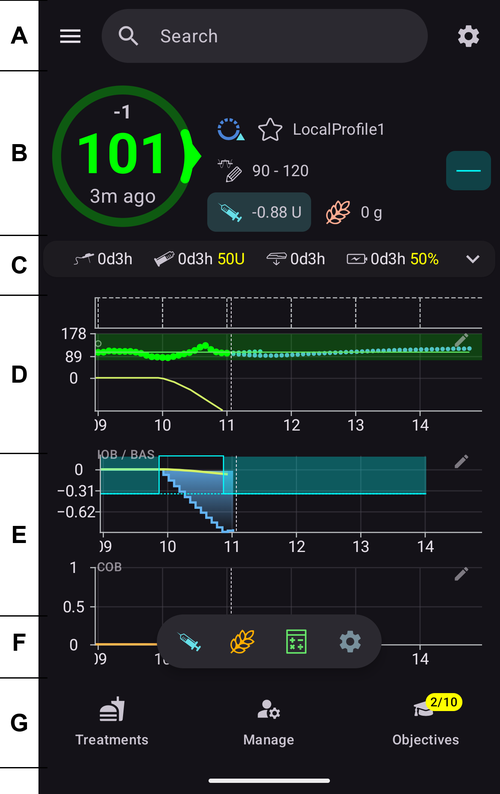

Toto je první obrazovka, kterou uvidíte po otevření **AAPS**, a obsahuje většinu informací, které budete denně potřebovat.

### Část A – Horní lišta

* **Nabídka** (☰) vlevo otevře navigační panel s položkami **Historie ošetření**, **Prohlížeč historie**, **Statistiky**, **Pomocník s profilem**, **Údržba**, **Průvodce nastavením**, **Konfigurace** a dalšími.
* **Vyhledávací pole** najde nastavení, dialogy i dokumentaci – stačí začít psát (viz [Globální vyhledávání](../DailyLifeWithAaps/GlobalSearch.md)).
* Ikona **Nastavení** (ozubené kolo) vpravo otevře všechna [nastavení](../SettingUpAaps/Preferences.md).

(aaps-screens-profile--target)=

### Část B – Stavový blok

#### Aktuální hodnota glykémie

Poslední hodnota glykémie z vašeho CGM je zobrazena ve velkém kruhu vlevo, spolu s rozdílem oproti předchozí hodnotě (delta) a stářím hodnoty.

Barva hodnoty glykémie ukazuje, jak se hodnota má k nastavenému [rozsahu](#Preferences-range-for-visualization).

* zelená = v rozsahu
* červená = pod rozsahem
* žlutá = nad rozsahem

  

(loop-status)= (AapsScreens-loop-status)=

#### Stav smyčky


Vedle kruhu glykémie ukazuje ikona režim smyčky (na obrázku shora dolů):

1. Zelený kruh = [uzavřená smyčka](#KeyAapsFeatures-ClosedLoop), smyčka běží
2. Fialový kruh s tečkovanou čarou = [ochrana před nízkou glykémií (LGS)](#KeyAapsFeatures-LGS)
3. Modrý kruh s tečkovanou čarou = [otevřená smyčka](#KeyAapsFeatures-OpenLoop)
4. Červený kruh s křížkem = smyčka zakázána (trvale nefunguje)
5. Červená ikona pauzy = smyčka pozastavena (dočasně zastavena, ale bazální inzulín se podává) – vedle ikony je zobrazen zbývající čas
6. Šedý kruh se zástrčkou = pumpa odpojena (dočasně se nepodává vůbec žádný inzulín) – vedle ikony je zobrazen zbývající čas

Stisknutím ikony otevřete dialog Smyčka. Obsah dialogu závisí na aktuálním stavu:

* Když smyčka **běží** (uzavřená, otevřená nebo LGS), můžete přepnout režim smyčky (Uzavřená smyčka, Ochrana před nízkou glykémií, Otevřená smyčka nebo Zakázat smyčku), **pozastavit** smyčku nebo **odpojit** pumpu na zvolenou dobu.
* Když je smyčka **zakázána**, můžete ji znovu povolit výběrem režimu smyčky, nebo odpojit pumpu.
* Když je smyčka **pozastavena**, můžete ji **obnovit**, odpojit pumpu nebo vybrat novou dobu v části **Pozastavit smyčku** a pozastavení tak prodloužit.
* Když je pumpa **odpojena**, můžete pumpu **znovu připojit** nebo vybrat novou dobu v části **Odpojit pumpu** a odpojení tak prodloužit.

Když prodloužíte pozastavení nebo odpojení, nová doba **začíná od teď**: nahradí zbývající čas, nepřičte se k němu. Nemusíte smyčku nejdřív obnovit ani pumpu znovu připojit.

Dialog, když smyčka běží jako uzavřená smyčka:


Dialog, když je smyčka pozastavena, s tlačítkem **Obnovit** a dobami pro prodloužení pozastavení:


Dialog, když je pumpa odpojena, s tlačítkem **Znovu připojit pumpu** a dobami pro prodloužení odpojení:


Dialog v režimu Ochrana před nízkou glykémií, při otevřené smyčce a při zakázané smyčce se liší jen nabízenými režimy smyčky:


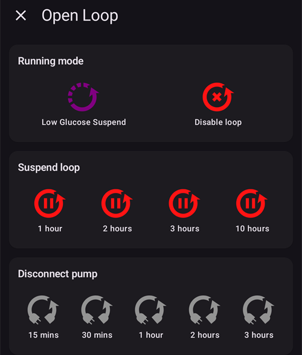


Takto vypadá hlavní obrazovka v jednotlivých režimech. Barevný pruh v horní části grafu se změní v okamžiku přepnutí.

Ochrana před nízkou glykémií:


Otevřená smyčka:


Smyčka zakázána:


Smyčka pozastavena – vedle ikony je zobrazen zbývající čas:


Pumpa odpojena – vedle ikony je zobrazen zbývající čas. Tlačítka ošetření zůstávají v panelu nástrojů QuickLaunch, takže můžete dál zaznamenávat inzulín podaný perem nebo sacharidy:

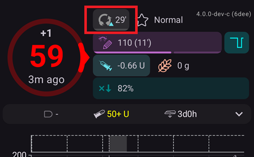

Po každém výběru je potřeba potvrzení.

```{admonition} Alarm: pumpa nepřijala nulový dočasný bazál :class: warning Když je pumpa odpojená, udržuje **AAPS** na pumpě nulový dočasný bazál a nastaví ho znovu, pokud chybí. Pokud se to nepodaří ani po 10 minutách, spustí **AAPS** naléhavý alarm: *„Pumpa nepřijala nulový dočasný bazál. Může stále dávat bazální inzulín. Zkontrolujte pumpu.“* Alarm se opakuje každých 15 minut, dokud není nulový dočasný bazál nastaven nebo dokud odpojení neskončí. Pokud ho uvidíte, zkontrolujte pumpu: může dávat bazální inzulín, i když ji **AAPS** ukazuje jako odpojenou.

    <br />Poznámka: nabízené režimy závisí na tom, jak daleko jste v [Cílech](../SettingUpAaps/CompletingTheObjectives.md) – Uzavřená smyčka a LGS jsou dostupné až po splnění příslušných cílů.
    
    (aaps-screens-bg-warning-sign)=
    #### Varovná značka glykémie
    
    Pokud **AAPS** zjistí problém s hodnotami glykémie, které dostává, objeví se ve spodní liště hlavní obrazovky zkratka k vašemu zdroji glykémie (pojmenovaná podle něj, například **xDrip+ glykémie**) s červeným varovným odznakem. Klepnutím na ni otevřete [obrazovku zdroje glykémie](#aaps-screens-bg-source).
    
    ##### Duplicitní data glykémie
    
    Červená varovná značka vás vyzývá, abyste hned jednali: dostáváte **duplicitní data glykémie**, která brání smyčce správně pracovat. **AAPS** nedokáže z duplicitních hodnot spolehlivě vypočítat trend glykémie, a proto přestane provádět korekce.
    
    Pokud byla smyčka uzavřená, přepne ji **AAPS** do režimu [Ochrana před nízkou glykémií (LGS)](#KeyAapsFeatures-LGS): ikona smyčky zfialoví.
    
      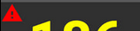
    
    Stiskněte ikonu smyčky: karta **Omezení** nahoře vám řekne proč: „BgQualityCheck: Režim LGS v důsledku duplicitních hodnot ve zdroji glykémie“.
    
      
    
    ```{admonition} Vaše smyčka běží v režimu Ochrana před nízkou glykémií
    :class: note
    Smyčka dál běží, ale jen aby vás chránila před hypoglykémií: **AAPS** může stále snížit nebo pozastavit bazál, ale nepodá žádný korekční inzulín, dokud tento problém nevyřešíte!
    

Musíte zjistit, proč dostáváte duplicitní hodnoty glykémie:

* Máte na svém webu Nightscout zapnutý Dexcom bridge? Vypněte bridge v administraci své instance Nightscout: upravte proměnnou "enable" a odstraňte z ní část "bridge". (Pro heroku [najdete podrobnosti zde](https://nightscout.github.io/troubleshoot/troublehoot/#heroku-settings).)
* Nahrává vaši glykémii do Nightscoutu více zdrojů? Pokud používáte aplikaci BYODA, povolte nahrávání v **AAPS**, ale nepovolujte ho v xDripu, pokud ho používáte.
* Máte sledující, kteří vaši glykémii přijímají, ale zároveň ji znovu nahrávají do vašeho Nightscoutu?
* Poslední možnost: v [nastavení NSClient](#Preferences-nsclient) vyberte nastavení Synchronizace a vypněte volbu „Přijímat data CGM z NS“.

Chcete-li varování hned odstranit a znovu umožnit smyčce provádět korekce, smažte duplicitní záznamy na obrazovce zdroje glykémie: klepněte na zkratku ve spodní liště. Duplicitní hodnota je zvýrazněna červeně. Dlouhým stiskem hodnoty začnete výběr, označte duplicity a klepněte na ikonu koše vpravo nahoře.


Pokud je ale duplicit hodně, může být jednodušší

* [zálohovat nastavení](../Maintenance/ExportImportSettings.md),
* resetovat databázi v nabídce Údržba a
* [znovu importovat nastavení](../Maintenance/ExportImportSettings.md)

    {admonition} Přepněte zpět na uzavřenou smyčku sami
    :class: important
    **AAPS** se po odstranění duplicit nevrátí do režimu **Uzavřená smyčka** samo. Stiskněte ikonu smyčky na hlavní obrazovce a znovu vyberte **Uzavřená smyčka**.

##### Neměnná data glykémie

U některých zdrojů glykémie (Libre 1, AiDEX, Glutec, Medtronic a zdroje, které neuvádějí typ senzoru) **AAPS** kontroluje také hodnoty, které se nemění: pokud se vaše glykémie po dobu 45 minut změnila o méně než 2 mg/dl (0,1 mmol/l), považují se data za chybná. Zkratka zdroje glykémie pak ukazuje červený odznak plochého trendu a smyčka zruší každý vysoký dočasný bazál a nepodá žádný korekční inzulín, dokud se hodnoty znovu nezačnou měnit. Zkontrolujte senzor a aplikaci, která hodnoty odesílá.

##### Nepravidelná data glykémie

Když hodnoty přicházejí v nepravidelných intervalech nebo některé chybí, **AAPS** přepočítá z dostupných hodnot 5minutové hodnoty. To se stává například po výměně senzoru nebo u senzorů Libre, jejichž časování se každých několik hodin posune o minutu nebo dvě. Smyčka dál funguje a nemusíte nic dělat. **AAPS** 4 už kvůli tomu nezobrazuje žlutou varovnou značku.

#### Aktuální profil

Aktuální profil je zobrazen vedle ikony hvězdičky.

Klepnutím na název profilu otevřete [obrazovku Profil](#aaps-screens-profile), kde si můžete prohlédnout podrobnosti profilu a [přepínat mezi různými profily](../DailyLifeWithAaps/ProfileSwitch-ProfilePercentage.md).

Chcete-li **změnit procento profilu** (a jeho trvání), klepněte na název profilu a pak na kulaté tlačítko **▶** (Aktivovat) vpravo dole na obrazovce Profil. V **AAPS** 3.x se tato obrazovka otevírala dlouhým stiskem názvu profilu; v **AAPS** 4 dlouhý stisk nic nedělá. Postup krok za krokem: [Změna procenta profilu](#ProfileSwitch-change-percentage).

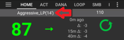

1. Běžné zobrazení při aktivaci standardního profilu.
2. Přepnutí profilu s procentem 90 % a zbývající dobou 9 minut – během dočasného přepnutí profilu je název profilu žlutý.
3. Přepnutí profilu s časovým posunem 1 hodina a zbývající dobou 9 minut.

#### Cíl

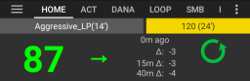

Pod názvem profilu je zobrazena aktuální cílová glykémie.

Krátkým stiskem cíle otevřete obrazovku **[Dočasný cíl](../DailyLifeWithAaps/TempTargets.md)**.

1. Běžné zobrazení: cílový rozsah nastavený ve vašem profilu.
2. Pokud je nastaven dočasný cíl, cíl zežloutne/zoranžoví, zobrazí se ikona použité předvolby a v závorce zbývající čas v minutách.

(AapsScreens-visualization-of-dynamic-target-adjustment)=

#### Vizualizace dynamické úpravy cíle

Když používáte [algoritmus SMB](#Config-Builder-aps) a funkci [Autosens](#Open-APS-features-autosens), může **AAPS** dynamicky upravovat váš cíl podle citlivosti.

V [nastavení OpenAPS SMB](#Preferences-openaps-smb-settings) povolte jednu nebo obě tyto volby:

* „Citlivost zvyšuje cíl“ a/nebo
* „Rezistence snižuje cíl“

Pokud **AAPS** zjistí rezistenci nebo citlivost, cíl se změní oproti hodnotě z profilu a zobrazený cíl změní barvu, aby úpravu ukázal.

(aaps-screens-iob-cob-basal-sens)=

#### IOB, COB, bazál a citlivost

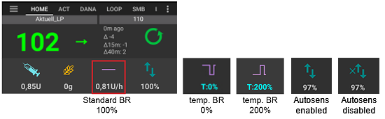

1. **Injekční stříkačka**: aktivní inzulín (IOB) – množství aktivního inzulínu ve vašem těle  
    Pokud by běžel jen váš standardní bazál a nezbýval žádný inzulín z předchozích bolusů, byla by hodnota aktivního inzulínu nulová. 
    * IOB může být i záporný, pokud byl dříve aktivován snížený bazál.
    * Stiskem této položky zobrazíte rozdělení na bolusový a bazální inzulín (první dialog na obrázku – zde se záporným IOB po období sníženého bazálu)
2. **Klas**: [zbývající sacharidy (COB)](../DailyLifeWithAaps/CobCalculation.md) – dosud nevstřebané sacharidy, které jste snědli dříve
3. Tyrkysové tlačítko vpravo ukazuje **aktuální podávání bazálu**: rovnou čáru, když běží bazál z profilu, a změněnou ikonu, když je aktivní dočasný bazál
4. **Řádek s procentem** ukazuje aktuální citlivost ([Autosens](#Open-APS-features-autosens) / [DynamicISF](../DailyLifeWithAaps/DynamicISF.md)). Když smyčka mění vaši citlivost (ISF), ukazuje řádek také ISF z profilu, šipku a ISF, kterou smyčka používá teď, například „80% 2.0 ↗ 2.5“. Stiskem zobrazíte hodnotu Autosens a účinnou ISF (druhý dialog na obrázku). Pokud smyčka pracuje s jinou hodnotou než s posledním výsledkem Autosens (například protože dočasný cíl mění vaši citlivost), dialog tuto hodnotu ukáže také jako **Autosens v algoritmu**. Když je Autosens vypnutý, smyčka používá ISF z profilu a účinná ISF se nezobrazuje.

Dialog IOB, otevřený stiskem položky IOB:


Stiskem tyrkysového tlačítka zobrazíte běžící dočasný bazál, kdy začal a jak dlouho už běží:


(aaps-screens-carbs-required)=

#### Požadavek sacharidů


Návrhy sacharidů jsou uvedeny v případě, že algoritmus detekuje potřebu sacharidů.

To je situace, kdy si algoritmus oref myslí, že vás nemůže zachránit nulovým dočasným bazálem, a k nápravě budete potřebovat sacharidy.

Oznámení o sacharidech jsou mnohem propracovanější než oznámení z bolusové kalkulačky. Návrh sacharidů můžete vidět i tehdy, když bolusová kalkulačka chybějící sacharidy neukazuje.

V případě potřeby může být notifikace vyžadovaných sacharidů odeslána do Nightscoutu. Notifikace se pak zobrazí v Nightscoutu a bude vysílána.

### Část C – Stavový řádek

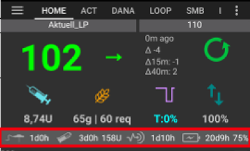

Stavový řádek vizuálně upozorňuje na

* Stáří kanyly
* Stáří inzulínu (kolik dní se používá zásobník) a množství v zásobníku (jednotky)
* Stáří senzoru
* Stáří a úroveň baterie pumpy (%)

Pokud dojde k dosažení prahové hodnoty, zobrazí se hodnoty žlutě.

Pokud dojde k dosažení kritické prahové hodnoty, hodnoty se zobrazí červeně.

Meze můžete změnit malou ikonou **Nastavení**, která se zobrazí, když je stavový řádek **rozbalený** (šipka vpravo) – viz [Stavové indikátory](#Preferences-status-lights).

Rozbalený stavový panel má na konci některých řádků také tlačítko pro záznam výměny, které vynuluje příslušné stáří: **Přidat** na řádku **Senzor** zaznamená zavedení senzoru. Pokud to vaše pumpa podporuje, zobrazí se **Plnění/doplňování** na řádcích **Kanyla** (nebo **Patch pumpa**) a **Inzulín** a **Přidat** na řádku **Baterie pumpy**.


Podle toho, jakou pumpu používáte, nemusíte mít všechny tyto ikony.

(screens-sensor-level-battery)=

#### Úroveň senzoru (baterie)

Funguje u CGM s přídavným vysílačem, například MiaoMiao 2. (Technicky musí senzor posílat informaci o stavu baterie do xDripu.)

Meze můžete nastavit ve [Stavových indikátorech](#Preferences-status-lights).

(aaps-screens-main-graph)=

### Část D – Hlavní graf


Graf ukazuje vaši glykémii (BG) tak, jak ji načetl váš glukózový monitor (CGM).

Posouváním a roztažením dvěma prsty v grafu změníte zobrazený časový úsek.

Zelená plocha zobrazuje váš cílový rozsah.

Tento graf ukazuje také tyto informace:

* Ruční bolusy: modrý trojúhelník těsně nad křivkou glykémie, který ukazuje dolů na hodnotu v daném okamžiku, s množstvím inzulínu
* Záznamy sacharidů: oranžový trojúhelník těsně pod křivkou glykémie, který ukazuje nahoru na hodnotu, s množstvím sacharidů. Jídlo zadané spolu s bolusem vypadá jako jedna značka, kterou hodnota rozdělí.
* Trojúhelníky mají tři velikosti (malá, střední, velká) podle množství ve srovnání s největším množstvím daného dne. Pokud v daném čase není žádná hodnota glykémie (výpadek senzoru), trojúhelník se vykreslí ve spodní části grafu.
* Kontroly glykémie a kalibrace: vykreslí se na své naměřené hodnotě, takže je můžete porovnat s křivkou senzoru
* Cíl podle profilu nebo upravený dočasným cílem: zelená čára
* Přepnutí profilu: ikony hvězdičky v horní části grafu
* Stav smyčky: barevný pruh v horní části grafu, když je [režim smyčky](#AapsScreens-loop-status) jiný než uzavřená smyčka: modrá = otevřená smyčka, fialová = LGS, červená = smyčka zakázána, žlutá = smyčka pozastavena, šedá = pumpa odpojena, oranžová = superbolus (na snímku obrazovky: fialová, pak žlutá). Historie těchto změn je uvedena v části [Režim smyčky](#AapsScreens-running-mode)
* [SMB](#Open-APS-features-super-micro-bolus-smb) se v grafu glykémie nevykreslují (byly by tam každých pár minut): jsou zobrazeny v [grafu IOB](#aaps-screens-iob).

Klepnutím na **kontrolu glykémie** v grafu zobrazíte její hodnotu a poznámku, pokud jste ji napsali.

(aaps-screens-graph-press-and-hold)=

#### Zobrazení hodnot v určitém čase

**Stiskněte a podržte** chvíli graf glykémie, abyste viděli hodnoty u jedné hodnoty glykémie. Tečka označí nejbližší hodnotu, ve všech grafech se v tomto čase vykreslí přerušovaná čára a vyskakovací okno v horní části grafu ukáže:

* čas a hodnotu glykémie
* IOB, COB (jen když je vyšší než 0 g) a bazální dávku v daném čase – ikona bazálu ukazuje, zda běžel dočasný bazál, stejně jako na hlavní obrazovce
* každý bolus, SMB nebo sacharidy v daném čase, se stejnými trojúhelníky jako v grafech

Držte prst na obrazovce a posouvejte ho doleva nebo doprava, abyste přešli z jedné hodnoty na další. U každé hodnoty ucítíte lehké zavibrování a graf se při tom neposouvá. Vyskakovací okno zůstane zobrazené 2 sekundy po zvednutí prstu.

Stejně to funguje i v [doplňkových grafech](#aaps-screens-additional-graphs) pod grafem glykémie (IOB, COB...): stiskněte a podržte kterýkoli z nich.


(AapsScreens-activate-optional-information)=

#### Aktivovat volitelné informace

Stiskem ikony **tužky** v pravém horním rohu grafu otevřete nastavení grafu:

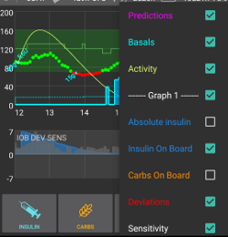

* **Výška grafu** mění výšku vykresleného grafu.
* **AKT** přidá křivku aktivity inzulínu: plná žlutozelená čára <span style="background:#141218;color:#D3F166;padding:0 0.3em;border:1px solid #141218;border-radius:4px">━━━━</span> (nezaměňujte s tečkovanou žlutou predikcí UAM)
* **PRED** přidá [predikční křivky](#aaps-screens-prediction-lines) (viz níže)

(aaps-screens-prediction-lines)=

#### Predikční křivky

Když je **PRED** zapnuté, kreslí AAPS své predikce jako **tečkované čáry** vpravo od čáry „teď“. Každá predikce má svou barvu. Tmavý motiv používá světlejší odstíny stejných barev a čára uvnitř zeleného cílového rozsahu může vypadat trochu zelenější.

| Křivka                     | Světlý motiv                                                                                                                      | Tmavý motiv                                                                                                                        | Co předpovídá                           |
| -------------------------- | --------------------------------------------------------------------------------------------------------------------------------- | ---------------------------------------------------------------------------------------------------------------------------------- | --------------------------------------- |
| **IOB** (modrá)            | <span style="background:#FFFFFF;color:#1E88E5;padding:0 0.3em;border:1px solid #CCCCCC;border-radius:4px">●●●●</span>             | <span style="background:#141218;color:#64B5F6;padding:0 0.3em;border:1px solid #141218;border-radius:4px">●●●●</span>              | jen inzulín                             |
| **COB** (oranžová)         | <span style="background:#FFFFFF;color:#FB8C00;padding:0 0.3em;border:1px solid #CCCCCC;border-radius:4px">●●●●</span>             | <span style="background:#141218;color:#FFB74D;padding:0 0.3em;border:1px solid #141218;border-radius:4px">●●●●</span>              | zbývající sacharidy                     |
| **UAM** (žlutá)            | <span style="background:#FFFFFF;color:#C9BD60;padding:0 0.3em;border:1px solid #CCCCCC;border-radius:4px">●●●●</span>             | <span style="background:#141218;color:#E6D39A;padding:0 0.3em;border:1px solid #141218;border-radius:4px">●●●●</span>              | neoznámené jídlo                        |
| **ZT** (azurová)           | <span style="background:#FFFFFF;color:#00D2D2;padding:0 0.3em;border:1px solid #CCCCCC;border-radius:4px">●●●●</span>             | <span style="background:#141218;color:#4DD4D4;padding:0 0.3em;border:1px solid #141218;border-radius:4px">●●●●</span>              | nulový dočasný bazál (inzulín zastaven) |
| **aCOB** (světle oranžová) | <span style="background:#FFFFFF;color:rgba(251,140,0,0.5);padding:0 0.3em;border:1px solid #CCCCCC;border-radius:4px">●●●●</span> | <span style="background:#141218;color:rgba(255,183,77,0.5);padding:0 0.3em;border:1px solid #141218;border-radius:4px">●●●●</span> | jen starší algoritmus AMA               |

Když dvě predikce dávají stejné hodnoty, jejich tečky se překrývají a vidíte jen jednu z barev (například UAM přes IOB, když je glykémie stabilní).

* Křivka **COB** (oranžová): [zbývající sacharidy](CobCalculation) (oranžová se v celém AAPS používá pro COB a sacharidy)
    
    Tato predikční křivka ukazuje, kam se bude ubírat vaše glykémie (ne samotný COB!) podle aktuálního nastavení **profilu**, za předpokladu, že odchylky způsobené vstřebáváním sacharidů zůstanou stejné. Tato linka se zobrazí pouze v případě, že je známý COB.

* Křivka **IOB** (modrá): aktivní inzulín (modrá se v celém AAPS používá pro IOB a inzulín)
    
    Tato predikční křivka ukazuje, co by se stalo jen pod vlivem inzulínu. Například pokud jste si podali inzulín a pak nesnědli žádné sacharidy.

* Křivka **ZT** (azurová): nulový dočasný bazál (předpokládaná glykémie, kdyby byl nastaven dočasný bazál 0 %)
    
    Tato predikční křivka ukazuje, jak by se změnil průběh glykémie, kdyby pumpa zastavila veškerý výdej inzulínu (dočasný bazál 0 %). Křivka končí, jakmile vystoupá nad váš cíl.
    
    *Tato křivka se zobrazí jen tehdy, když používáte algoritmus [SMB](#Config-Builder-aps).*

* Křivka **UAM** (žlutá): [neoznámená jídla](#SensitivityDetectionAndCob-sensitivity-oref1)
    
    Neoznámená jídla znamenají, že je zjištěn výrazný nárůst glykémie v důsledku jídla, adrenalinu nebo jiných vlivů. Tato predikční křivka je podobná **oranžové křivce COB**, ale předpokládá, že odchylky budou klesat stálou rychlostí (prodloužením současné rychlosti poklesu).
    
    *Tato křivka se zobrazí jen tehdy, když používáte algoritmus [SMB](#Config-Builder-aps), v nastavení OpenAPS SMB je zapnuté **Povolit UAM** a glykémie stoupá víc, než vysvětluje samotný inzulín.*

* Křivka **aCOB** (bledá, průhledná oranžová): zrychlené vstřebávání sacharidů
    
    Podobná COB, ale předpokládá stálou rychlost vstřebávání sacharidů 10 mg/dl/5 min (-0,555 mmol/l/5 min). Zastaralé a jen málo užitečné.
    
    *Tato křivka se zobrazí jen tehdy, když používáte starší algoritmus [AMA](#Config-Builder-aps).*

Obvykle vaše skutečná křivka glykémie končí uprostřed těchto linek nebo blízko k té, jejíž předpoklady se nejvíce podobají vaší situaci.

(aaps-screens-how-predictions-become-a-dosing-decision)=

#### Jak AAPS mění predikce v rozhodnutí o dávce

AAPS nedávkuje inzulín jen podle vaší aktuální glykémie – v každém cyklu smyčky (zhruba každých 5 minut) se podívá na všechny výše uvedené predikční křivky najednou a určí nejbezpečnější postup.

Základní pravidlo je **bezpečnost především**: pokud *kterákoli* predikční křivka v jakémkoli časovém úseku klesne pod vaši dolní bezpečnostní mez, nastaví AAPS nulový dočasný bazál (dočasný bazál 0 %) a další inzulín nepodá, i když je vaše aktuální glykémie vysoká. AAPS zváží podání dalšího inzulínu, až když všechny predikční křivky zůstávají nad touto mezí.

Když je bezpečné podat další inzulín, podívá se AAPS, kde má glykémie podle spojených predikcí nakonec skončit (**konečná glykémie**), a vypočítá, jak velká korekce je potřeba, aby se tato konečná glykémie vrátila k cíli – podá ji buď jako zvýšený dočasný bazál, nebo (pokud je zapnutý algoritmus oref1/[SMB](#Open-APS-features-super-micro-bolus-smb)) jako malý okamžitý bolus. Pokud je glykémie teď vysoká, ale už sama dostatečně klesá, AAPS počká, nebo dokonce může bazál snížit, místo aby přidal inzulín, který by pozdější hypoglykémii jen prohloubil.

Příklady této rozhodovací logiky se skutečnými snímky obrazovky najdete ve [scénářích dávkování v Průvodci pro lékaře](#clinicianguide-dosing-scenarios) – byly napsány pro lékaře, ale platí pro každého uživatele AAPS.

*Úplný technický popis toho, jak se tyto predikce a výsledné rozhodnutí o dávce počítají, najdete v [dokumentaci OpenAPS k determine-basal](https://openaps.readthedocs.io/en/latest/docs/While%20You%20Wait%20For%20Gear/Understand-determine-basal.html).*

#### Bazály

**Nepřerušovaná modrá** linka ukazuje bazál z pumpy, který se aktuálně vydává.

**Tečkovaná modrá** linka ukazuje, jaký bazál by se vydával, pokud by nedocházelo k žádné úpravě dočasného bazálu (TBR).

Když se podává standardní bazální dávka, je plocha pod křivkou zobrazena tmavě modře. Když je bazální dávka dočasně upravena (zvýšena nebo snížena), je plocha pod křivkou zobrazena světle modře.

#### Aktivita

**Tenká žlutá** linka ukazuje aktivitu inzulínu.

Je založena na očekávaném poklesu glykémie odpovídajícímu množství inzulínu, pokud nebyly přítomny žádné jiné faktory (jako např. sacharidy).

(AapsScreens-section-g-additional-graphs)= (aaps-screens-additional-graphs)=

### Část E – Doplňkové grafy

Pod hlavním grafem můžete zapnout doplňkové grafy. V [Zjednodušeném režimu](#preferences-simple-mode) jsou doplňkové grafy přednastavené a nelze je změnit. Pokud chcete doplňkové grafy nastavit sami, vypněte **Zjednodušený režim**.

Doplňkové grafy sledují hlavní graf: když posouváte nebo zvětšujete graf glykémie, pohybují se s ním. Posunutí do strany v doplňkovém grafu posune také všechny grafy. Nemají vlastní časové popisky – čas čtěte v grafu glykémie.

Chcete-li doplňkový graf nastavit, stiskněte ikonu **tužky** v jeho pravém horním rohu:

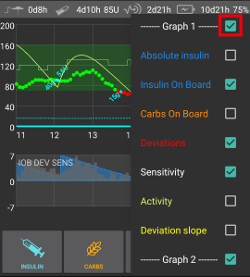

Vyberte položky odpovídající datům, která chcete v tomto grafu vidět; tlačítko **Odebrat** graf smaže.

Chcete-li vytvořit další graf, stiskněte **Přidat graf** pod posledním grafem a stejným způsobem vyberte jeho položky:


Nový graf se přidá pod ostatní – zde druhý doplňkový graf se **SENZ%** a **ODCH**:


Většině uživatelů vyhovuje toto nastavení doplňkových grafů:

* Graf 1 s IOB, COB a změnou citlivosti
* Graf 2 s odchylkami a BGI.

#### Absolutní inzulín (ABS)

Aktivní inzulín včetně bolusů **a bazálu**.

(aaps-screens-iob)=

#### Aktivní inzulín (IOB)

Zobrazuje vydaný inzulín, který je aktivní (= aktivní inzulín v těle). Zahrnuje inzulín z bolusu a dočasného bazálu (**ale nezahrnuje bazální dávky nastavené ve vašem profilu**).

Pokud by během doby DIA nebyly žádné [SMB](#Open-APS-features-super-micro-bolus-smb), žádné bolusy a žádný dočasný bazál, byla by hodnota nulová.

SMB jsou v tomto grafu zobrazeny jako modré trojúhelníky ve třech velikostech podle množství ve srovnání s největším SMB daného dne.

IOB může být záporný, pokud již není aktivní žádný bolus a po delší dobu byl nastaven nulový/nízký dočasný bazál.

Odbourávání závisí na vašem [nastavení DIA a typu inzulínu](#Config-Builder-insulin-dia).

#### Zbývající sacharidy (COB)

Zobrazuje zkonzumované sacharidy (= aktivní, dosud nevstřebané sacharidy v těle).

Odbourávání závisí na [odchylkách, které algoritmus zjistí](../DailyLifeWithAaps/CobCalculation.md).

Pokud se zjistí vyšší absorpce, než se očekávalo, může dojít k vydání inzulínu. To bude mít za následek zvýšení IOB (zda více či méně závisí na vašich bezpečnostních nastaveních).

#### Změna citlivosti (SENZ%)

Ukazuje citlivost, kterou zjistil [Autosens](#Open-APS-features-autosens).

Citlivost je výpočet citlivosti na inzulín v důsledku pohybu, hormonů atd.

Pozor: aby detekce citlivosti/[Autosens](#Open-APS-features-autosens) mohla automaticky upravovat množství podaného inzulínu, musíte být v [Cíli 8](#objectives-objective8). Než tohoto cíle dosáhnete, slouží čára v grafu jen pro informaci.

### Proměnná citlivost (VSEN)

Ukazuje citlivost vypočtenou funkcí [DynamicISF](../DailyLifeWithAaps/DynamicISF.md). Vyplní se jen tehdy, když tuto funkci používáte.

(screen-heart-rate-steps)=

#### Tepová frekvence (TF) a kroky

Tato data mohou být k dispozici, když používáte [chytré hodinky s Wear OS](../WearOS/WearOsSmartwatch.md). Povolte je v aplikaci **AAPS** Wear a udělte oprávnění k údajům o zdraví.

#### Odchylky (ODCH)

* **Šedé** sloupce ukazují odchylku způsobenou sacharidy.
* **Zelené** sloupce ukazují, že glykémie je vyšší, než algoritmus očekával. Zelené sloupce se v [Autosens](#Open-APS-features-autosens) používají ke zvýšení rezistence.
* **Červené** sloupce ukazují, že glykémie je nižší, než algoritmus očekával. Červené sloupce se v [Autosens](#Open-APS-features-autosens) používají ke zvýšení citlivosti.
* **Žluté** sloupce ukazují odchylku způsobenou UAM.
* **Černé** sloupce ukazují malé odchylky, které se pro citlivost neberou v úvahu

#### Vliv na hladinu glukózy (-BGI)

Tato čára ukazuje, jak moc by glykémie „měla“ stoupat nebo klesat jen podle aktivity inzulínu.


Je dobré zobrazit tuto čáru spolu se sloupci odchylek. Mají stejné měřítko, ale jiné než ostatní volitelná data, proto je dobré zobrazit je v samostatném grafu, jak je ukázáno výše. Porovnání čáry BGI a sloupců odchylek je další způsob, jak pochopit, jak **glykémie** kolísá. Zde v čase označeném **1** jsou sloupce odchylek vysoko nad čarou BGI: glykémie stoupá víc, než vysvětluje samotná aktivita inzulínu (například po sacharidech). V čase označeném **2** jsou sloupce odchylek pod nulou (červené): glykémie je nižší, než algoritmus očekával.

### Část F – Panel nástrojů QuickLaunch

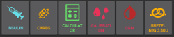

Plovoucí panel nástrojů ve spodní části obrazovky obsahuje vaše akce **[Rychlého spuštění](../DailyLifeWithAaps/QuickLaunch.md)**. Malé **ozubené kolo** otevře nastavení QuickLaunch, kde vyberete, která tlačítka se zobrazí (ošetření, záznamy péče, akce CGM, obrazovky z panelu **Spravovat**, tlačítka [Rychlý bolus](../DailyLifeWithAaps/QuickWizards.md), [Scény](../DailyLifeWithAaps/Scenes.md) a další).

Výše je ukázáno běžné nastavení: **Inzulín**, **Sacharidy** a **Bolusová kalkulačka**.

Když je pumpa **odpojena**, tlačítka ošetření zůstávají v panelu nástrojů, například abyste mohli zaznamenat inzulín podaný perem (viz [Inzulín](#aaps-screens-buttons-insulin) níže). Stejné akce jsou dostupné také v [panelu Ošetření](#aaps-screens-treatments-sheet) spodní navigace.

(aaps-screens-buttons-insulin)=

#### Inzulín

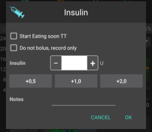

Pro podání určitého množství inzulínu bez použití [bolusové kalkulačky](#aaps-screens-bolus-wizard).

Zapnutím volby **Spustit dočasný cíl Před jídlem** můžete automaticky spustit [dočasný cíl „Před jídlem“](#TempTargets-eating-soon-temp-target).

Pokud nechcete podat bolus pumpou, ale jen zaznamenat množství inzulínu (např. inzulín podaný perem), zapněte „**Bolus nebude pumpou vydán, pouze zaznamenán**“. Další řádek **Čas**, nastavený na **Nyní**, umožňuje zaznamenat injekci inzulínu podanou v minulosti: změňte ho tlačítky **-** / **+**, nebo klepněte na šipku a zadejte minuty nebo vyberte datum a čas.

 

Tlačítky **+0.5 / +1.0 / +2.0** můžete rychle zvýšit množství inzulínu. Hodnoty přírůstků můžete změnit v [nastavení bolusové kalkulačky](#Preferences-deliver-this-part-of-bolus-wizard-result).

Dialog Inzulín můžete použít i tehdy, když je pumpa pozastavená nebo odpojená, např. pro záznam inzulínu podaného perem. V takovém případě je volba „**Bolus nebude pumpou vydán, pouze zaznamenán**“ vynuceně zapnutá (zobrazená červeně) a objeví se další pole pro výběr typu inzulínu a posunu **Čas** pro injekci podanou v minulosti:


#### Sacharidy

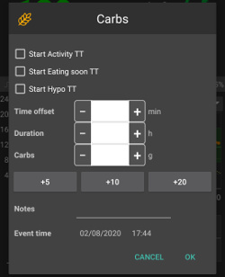

Zadání sacharidů bez podání bolusu.

Některé [přednastavené dočasné cíle](#TempTargets-hypo-temp-target) (Hypoglykémie, Před jídlem, Aktivita) můžete spustit přímo přepínači nahoře.

**Čas sacharidů**: Kdy budete jíst / kdy jste jedli sacharidy.

**Trvání**: Používá se pro [„rozložené sacharidy“](ExtendedCarbs). Tento řádek je sbalený, abyste do něj omylem nezadali gramy: změňte ho tlačítky **-** / **+**, nebo klepněte na šipku, řádek otevřete a zadejte hodnotu.

Tlačítky **+5 / +10 / +20** můžete rychle zvýšit množství sacharidů.

#### Rychlý bolus

Snadno zadáte množství sacharidů a nastavíte základ výpočtu jedním předem nastaveným tlačítkem.

Podrobnosti se nastavují v části [Rychlý bolus](../DailyLifeWithAaps/QuickWizards.md).

(aaps-screens-treatments-sheet)=

### Část G – Spodní navigace

Spodní navigační lišta nabízí:

* **Ošetření** – panel rychlých akcí s vašimi akcemi ošetření:
    
    

* **Scény** – zobrazí se, jen když máte aspoň jednu [scénu](../DailyLifeWithAaps/Scenes.md) nebo pravidlo **Automatizace** označené jako **Uživatelská akce**. Otevře panel, ze kterého je můžete spustit; odznak ukazuje, kolik jich můžete spustit právě teď. **Tužka** v horní části panelu otevře **Spravovat → Scény**.

* **Spravovat** – centrum pro vše, co v **AAPS** spravujete: Profil, Nastavení inzulínu, Dočasný cíl, Rychlý bolus, Scény, Automatizace, Potraviny, Rotace míst aplikace, Pumpa a Autorizovaní klienti. Pod nimi jsou akce pro zařízení a bazál, například Výměna senzoru a Dočasný bazál. Některé položky se zobrazí, jen když se týkají vašeho nastavení – například Plnění/doplňování a výměna baterie závisí na vaší pumpě a Dočasný bazál, Prodloužený bolus a záznamy Péče jsou v [Zjednodušeném režimu](#preferences-simple-mode) skryté:
    
    

* **Cíle** – váš postup v [Cílech](../SettingUpAaps/CompletingTheObjectives.md); odznak ukazuje, kolik jich je splněno. Tato položka zmizí, jakmile jsou splněny všechny cíle, a v **AAPSClient** není.

(aaps-screens-notifications)=

#### Oznámení

Nad spodní lištou vpravo se může objevit **bublina oznámení**. Shromažďuje aktivní oznámení **AAPS**; malé číslo ukazuje, kolik jich je. Její barva odpovídá nejdůležitějšímu z nich: červená pro naléhavou zprávu, zelená pro běžnou informaci.


Klepnutím na bublinu otevřete panel **Oznámení**. U každé zprávy je uveden čas, kdy vznikla. Stiskem **Zavřít** pod zprávou ji odstraníte; některé zprávy mají místo toho jiné tlačítko, které vás přenese k nastavení, jež vyžaduje vaši pozornost.


(bolus-wizard)= (aaps-screens-bolus-wizard)=

## Bolusová kalkulačka

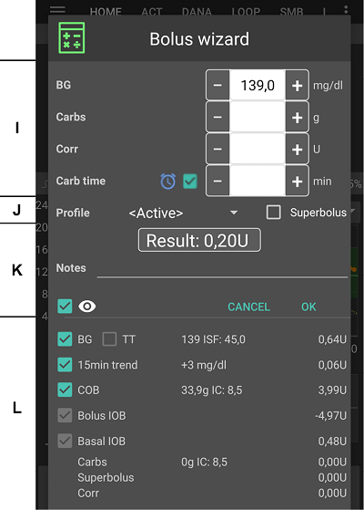

Když chcete podat bolus na jídlo, obvykle ho podáte odsud.

### Část I

Záhlaví **Výpočet** ukazuje vypočtený bolus. Pokud množství již aktivního inzulínu v krvi převyšuje vypočtený bolus, pak se jen zobrazí doporučené množství sacharidů k jeho pokrytí.

Bolusovou kalkulačku můžete použít při jakékoli aktuální **glykémii**, i když je příliš vysoká nebo příliš nízká. Pokud je **glykémie** nad cílem, přidá se k bolusu na jídlo korekce. Pokud je **glykémie** pod cílem, bolus se sníží, a pokud je aktivního inzulínu už víc, než je potřeba, kalkulačka místo návrhu inzulínu ukáže, kolik sacharidů je ještě potřeba.

Řada ikon pod záhlavím ukazuje, které vstupy se do výpočtu započítávají (glykémie, trend, IOB, dočasný cíl, COB). Stiskem ikony tento vstup do výpočtu zahrnete / vyřadíte; ikona **(i)** ukazuje podrobná čísla, ze kterých výpočet vychází.

#### Kombinace COB a IOB a jejich význam

* Z bezpečnostních důvodů nelze vstup IOB vypnout, když je zapnutý COB, protože byste riskovali příliš mnoho inzulínu – **AAPS** by nepočítal s tím, co už bylo podáno.
* Když zapnete COB i IOB, započítají se nevstřebané sacharidy, které ještě nejsou pokryty inzulínem, a veškerý inzulín podaný jako dočasný bazál (TBR) nebo SMB.
* Když zapnete IOB bez COB, **AAPS** započítá už podaný inzulín, ale neodečte ho proti sacharidům, které se ještě budou vstřebávat. To vede k oznámení o 'chybějících sacharidech'.
* Pokud podáváte bolus na **další jídlo** krátce po bolusu na jídlo (např. dezert navíc), může být užitečné **vypnout všechny vstupy**. Tak lze přidat pouze nově zkonzumované sacharidy, jelikož hlavní jídlo dosud nemusí být stráveno, takže IOB krátce po bolusu k jídlu nebude přesně odpovídat množství COB.
* Z bezpečnostních důvodů se **dočasný cíl** započítá do výpočtu, jen když jeho vstup zapnete ručně.

(AapsScreens-section-j)=

### Část J – Vstupní pole

Do pole **Sacharidy** zadáte odhad množství sacharidů **v gramech**, na které chcete podat bolus; tlačítka **+** pod ním sacharidy rychle přidávají. **AAPS** pracuje jen s gramy: pokud počítáte ve výměnných jednotkách (*např.* výměnné jednotky DAFNE „CHO“), převeďte je před zadáním na gramy. Viz [poznámku o výměnných jednotkách](#your-aaps-profile-insulin-to-carbs-ratio) na stránce o profilu.

#### Typ sacharidů: chléb, koláč nebo pizza

Tlačítka **Chléb**, **Koláč** a **Pizza** pod polem **Sacharidy** říkají **AAPS**, jak rychle se jídlo vstřebává. U volby **Koláč** a **Pizza** pokryje bolus teď jen část sacharidů a zbytek se přidá později jako eSacharidy. Procenta a časování najdete v části [Typ sacharidů: chléb, koláč nebo pizza](#AapsScreens-carbs-type) na stránce Rozložené sacharidy.

Řádek **Korekce** slouží k úpravě výsledné dávky, pokud ji z nějakého důvodu chcete změnit.

Vždy otevřené je jen pole **Sacharidy**. Ostatní řádky (**Korekce**, **Čas sacharidů**, **Glykémie** a **Použít procenta**) jsou sbalené: ukazují svou hodnotu s tlačítky **-** / **+**, takže ji můžete měnit po malých krocích. Klepnutím na šipku řádek otevřete a zadáte hodnotu, dalším klepnutím ho zavřete. Tak omylem nezadáte gramy do pole **Korekce**.


Klepnutím kamkoli na řádek **Profil** otevřete seznam svých profilů; klepnutím na název pak použijete daný profil pro tento výpočet.


Pole **Čas sacharidů** slouží pro předstihový bolus: můžete systému říct, že sacharidy přijdou až za nějakou dobu. Můžete zde zadat i záporné číslo, pokud později dopichujete bolus k dříve zkonzumovaným sacharidům.

**Nastavit alarm** (připomínka jídla): když zadáte čas sacharidů v budoucnosti, objeví se přepínač „**Nastavit alarm**“, aby vám v zadaný čas připomněl, že máte sníst sacharidy, které jste zadali do **AAPS**:

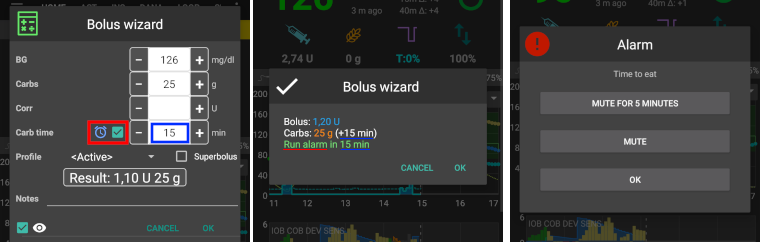

Připomínka zazní jako alarm **AAPS**. Nevytváří časovač v aplikaci hodin v telefonu a funguje také tehdy, když byl bolus zadán z **AAPSClient** a **AAPS** běžel na pozadí.

Pole **Glykémie** je obvykle už vyplněné poslední hodnotou z vašeho CGM. Pokud právě nemáte senzor v provozu, pak bude pole prázdné. Když je hodnota čerstvá, zůstává řádek **Glykémie** sbalený.

Tlačítko s výsledkem dole ukazuje navržený bolus; po jeho stisknutí se před podáním inzulínu zobrazí žádost o potvrzení.

Dobré vědět:

* Pokud je vypočtený bolus vyšší než váš **[Maximální bolus](#Preferences-maximum-bolus)**, sníží se na maximální bolus a v potvrzení se zobrazí varování „Použito omezení bolusu“. [Rychlý bolus](../DailyLifeWithAaps/QuickWizards.md) se v takovém případě odmítne.
* Když se bolus jen zaznamenává (například když je pumpa odpojená), zůstává varování „**Bolus nebude pumpou vydán, pouze zaznamenán**“ v horní části dialogu, i když posouváte.
* Bolus, který podáte ručně, má přednost před [SMB](#Open-APS-features-super-micro-bolus-smb), který čeká na podání: SMB se zruší a smyčka počítá znovu. Pokud se SMB právě podává, váš bolus se odmítne se zprávou „Právě nyní se vydává SMB. Zkuste to znovu po dokončení výdeje.“ Nepodá se žádný inzulín a sacharidy zadané s tímto bolusem se neuloží: chvíli počkejte a zadejte je znovu.

(AapsScreens-wrong-cob-detection)=

#### Chybná detekce COB


Pokud po použití bolusové kalkulačky uvidíte výše uvedené varování, **AAPS** zjistil, že vypočtená hodnota COB může být chybná. Pokud tedy chcete znovu podat bolus po předchozím jídle s COB, dejte si pozor na předávkování!

Podrobnosti najdete v radách na stránce [Kalkulace COB](#CobCalculation-detection-of-wrong-cob-values).

Hledáte kartu **Akce** z **AAPS** 3.x? Její funkce se přesunuly na hlavní obrazovku, do panelu **Spravovat** a do panelu nástrojů QuickLaunch: viz [Kam zmizela karta Akce?](#screens-action-tab).

(aaps-screens-careportal)=

## Záznamy péče

Stáří a úrovně zobrazené ve [stavovém řádku](#screens-sensor-level-battery) (senzor, inzulín, kanyla, baterie pumpy) vycházejí ze záznamů péče: **Plnění/doplňování** (zaznamenává výměnu místa aplikace a zásobníku inzulínu), **Výměna senzoru** a **Výměna baterie pumpy**.

Můžete je zaznamenat z rozbaleného stavového panelu na hlavní obrazovce, z panelu **Spravovat** nebo tlačítky [Rychlého spuštění](../DailyLifeWithAaps/QuickLaunch.md).

**Plnění/doplňování** zaznamená výměnu místa aplikace pumpy a/nebo výměnu zásobníku inzulínu a může podat dávku pro naplnění:

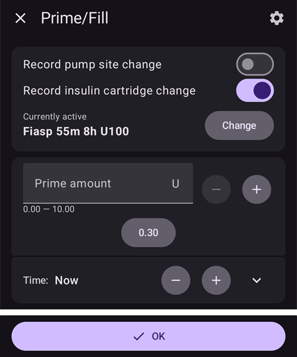

**Výměna senzoru** a **Výměna baterie pumpy** se ptají jen na čas události:


 Záznamy cvičení, oznámení, otázky a poznámky odpovídají careportalu v Nightscoutu a jsou zvláštní formou poznámek.

V panelu **Spravovat** sjeďte dolů a stiskněte **Péče**, abyste zobrazili tyto záznamy: **Kontrola glykémie**, **Poznámka**, **Cvičení**, **Otázka** a **Oznámení**.


**Kontrola glykémie**, **Otázka** a **Oznámení** vám umožní zadat hodnotu glykémie (z glukometru, senzoru nebo jiného zdroje), poznámku a čas události. V **Otázce** a **Oznámení** je řádek glykémie sbalený a vedle hodnoty ukazuje typ měření: pokud hodnotu změníte, typ se změní ze **Senzor** na **Glukoměr**.


**Poznámka** a **Cvičení** vám umožní zadat dobu trvání (sbalený řádek: použijte **-** / **+**, nebo klepněte na šipku a zadejte ji), poznámku a čas události:


Ve všech těchto dialozích (**Plnění/doplňování**, **Výměna senzoru**, **Výměna baterie pumpy** a záznamy péče) se pro čas události používá stejný řádek **Čas** jako v [dialogu Inzulín](#aaps-screens-buttons-insulin) a v bolusové kalkulačce: tlačítky **-** / **+** posunete čas po 5 minutách (až o jeden týden zpět a 12 hodin dopředu), nebo klepnutím na šipku vyberete libovolné datum a čas.

## Rotace míst aplikace

**Spravovat → Rotace míst aplikace** zaznamenává na mapě těla, kam byla umístěna každá kanyla a každý senzor, abyste mohli místa střídat: viz [Rotace míst aplikace](#Aapsscreens-site-rotation) na stránce o pumpách a kanylách.

**CDD** (celková denní dávka) a orientační pravidlo pro poměr bazálu a bolusu jsou vysvětleny u [karty Inzulín ve Statistikách](#reviewing-tdd).

(AapsScreens-insulin-profile)=

## Inzulín


**Spravovat → Nastavení inzulínu** zobrazuje a spravuje vaše konfigurace inzulínu. Každá konfigurace je zobrazena na kartě s **časem vrcholu** a **[DIA](#Config-Builder-insulin-dia)**; ta, která se používá, je označena **AKTIVNÍ**. Pod kartou vidíte křivku aktivity. Přezdívku, vrchol a DIA můžete upravit u každé konfigurace kromě aktivní: chcete-li změnit inzulín, který používáte, [přidejte novou konfiguraci a aktivujte ji](#Config-Builder-insulin-change-active).

Co to je a jak ji nastavit, se dozvíte v části [Doba působnosti inzulínu](#Config-Builder-insulin-dia).

## Stav pumpy


**Spravovat → Pumpa** (nebo **Konfigurace → Pumpa → Otevřít plugin**) ukazuje stav vaší pumpy: poslední spojení, základní bazální dávku, baterii, zásobník...

* Zobrazené informace závisí na modelu vaší pumpy.
* Podrobnosti najdete na [stránce o pumpách](../Getting-Started/CompatiblePumps.md).

## Smyčka, AMA / SMB

**Konfigurace → Smyčka → Otevřít plugin** (a **Konfigurace → APS → Otevřít plugin**) ukazují podrobnosti o výpočtech algoritmu a o tom, proč **AAPS** jedná tak, jak jedná: poslední běh, výsledný požadavek a omezení. Obrazovka **Smyčka** uvádí jen omezení, která skutečně omezila podaný dočasný bazál nebo SMB (a proč není povolena uzavřená smyčka, pokud tomu tak je); obrazovka **APS** uvádí všechna omezení, která vstoupila do výpočtu.

Výpočty probíhají pokaždé, když systém dostane z CGM novou hodnotu.

Další podrobnosti najdete v [části APS na stránce Konfigurace](#Config-Builder-aps).

(aaps-screens-profile)=

## Profil

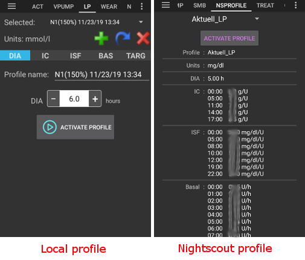

**Spravovat → Profil** (nebo klepnutí na název profilu na hlavní obrazovce) otevře obrazovku Profil: vaše profily jako karusel karet, mezi kterými můžete přejíždět, s tlačítky pro přidání, úpravu, klonování, smazání a **aktivaci** profilu.

Profil obsahuje informace o vašem individuálním nastavení pro diabetes, podrobnosti najdete na stránce **[Profil](../SettingUpAaps/YourAapsProfile.md)**.

## Automatizace


**Spravovat → Automatizace** zobrazuje seznam vašich pravidel automatizace. Viz samostatnou stránku [zde](../DailyLifeWithAaps/Automations.md).

## NSClient

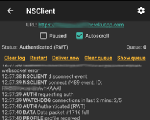

**Konfigurace → Komunikace → NSClientV3 → Otevřít plugin** zobrazuje stav spojení s vaším webem Nightscout: URL, stav websocketu, frontu a záznam synchronizace.

Nastavení můžete změnit v [nastavení NSClient](#Preferences-nsclient).

Řešení problémů najdete na této [stránce](../GettingHelp/TroubleshootingNsClient.md).

(aaps-screens-bg-source)=

## Zdroj glykémie – xDrip, BYODA...

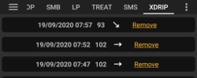

**Konfigurace → Zdroj glykémie → Otevřít plugin** ukazuje historii hodnot z CGM a nabízí možnost odstranit hodnoty v případě chyby (např. falešně nízké hodnoty při stlačení senzoru) nebo duplicitní hodnoty.

## Historie ošetření

Otevřete **nabídku** (☰) a vyberte **Historie ošetření**, kde můžete zobrazit, zkontrolovat a opravit vše, co **AAPS** zaznamenal: sacharidy a bolusy, dočasné bazály, dočasné cíle, přepnutí profilu, záznamy péče, změny režimu smyčky a uživatelské záznamy. Viz [Historie ošetření](#aaps-screens-treatments) na stránce Kontrola dat.

## Prohlížeč historie


Otevřete **nabídku** (☰) a vyberte **Prohlížeč historie**.

Umožňuje vrátit se zpět v historii **AAPS**. Viz samostatnou stránku [Kontrola dat > Prohlížeč historie](../Maintenance/Reviewing.md).

(aaps-screens-statistics)=

## Statistiky


Otevřete **nabídku** (☰) a vyberte **Statistiky**.

Na čtyřech kartách zobrazuje statistiky celkové denní dávky, času v cíli, průběhu glykémie během dne (AGP) a vzorce vašeho inzulínového cyklu. Viz samostatnou stránku [Kontrola dat > Statistiky](#reviewing-statistics).

(aaps-screens-profile-helper)=

## Profile Helper

Otevřete **nabídku** (☰) a vyberte **Pomocník s profilem**.


Pomocník s profilem umožňuje porovnat profily a vytvořit výchozí profily pro děti. Viz [Váš profil AAPS](../SettingUpAaps/YourAapsProfile.md) – části [Vytvoření profilu pro dítě od začátku](#your-aaps-profile-profile-from-scratch-for-a-kid) a [Porovnání dvou profilů](#your-aaps-profile-compare-profiles).

(aaps-screens-widgets)=

## Widgety na domovské obrazovce

**AAPS** nabízí pět widgetů, které si můžete přidat na domovskou obrazovku telefonu a vidět svá data bez otevření aplikace. Viz samostatnou stránku [Widgety na domovské obrazovce](../DailyLifeWithAaps/Widgets.md).

