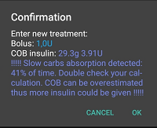

# Kalkulace COB

## Jak AAPS počítá hodnotu COB?

Když uživatel zadá sacharidy jako součást jídla nebo jako korekční sacharidy, **AAPS** je přičte k aktuálním aktivním sacharidům (**COB**). **AAPS** pak počítá vstřebávání sacharidů uživatele podle pozorovaných odchylek jeho **glykémie**. Rychlost vstřebávání závisí na faktoru citlivosti na sacharidy (**„CSF**“). Nejde o nastavení v **profilu** uživatele. **AAPS** ho počítá z nastavení **ISF/I:C** a udává, o kolik mg/dl zvýší 1 g sacharidů **glykémii** uživatele.

## Faktor citlivosti na sacharidy

**AAPS** používá tento vzorec:

- absorbed_carbs = deviation * ic / isf.

Vliv na **profil** uživatele:

- _zvýšení_ **IC** – zvýší množství sacharidů vstřebaných každých 5 minut, a tím zkrátí celkovou dobu vstřebávání;

- _zvýšení_ **ISF** – sníží množství sacharidů vstřebaných každých 5 minut, a tím prodlouží celkovou dobu vstřebávání; a

- _změna_ **procenta profilu** – zvýší/sníží obě hodnoty, a proto nemá na dobu vstřebávání sacharidů žádný vliv.

Pokud má například uživatel v **profilu** **ISF** 100 a **I:C** 5, jeho faktor citlivosti na sacharidy bude 20. Za každých 20 mg/dl, o které **glykémie** uživatele stoupne, **AAPS** započítá 1 g sacharidů jako vstřebaný. Výpočet **COB** ovlivňuje také kladný **IOB**. Pokud tedy **AAPS** předpovídá, že **glykémie** uživatele kvůli **IOB** klesne o 20 mg/dl, a místo toho zůstane stabilní, **AAPS** také započítá 1 g sacharidů jako vstřebaný.

Sacharidy se budou vstřebávat také způsoby popsanými níže, podle toho, jaký algoritmus citlivosti si uživatel v **AAPS** vybral.

## Citlivost sacharidů – Oref1

Nevstřebané sacharidy se po zadané době odříznou:


```{admonition} Older screenshot
:class: note
Snímek obrazovky výše je ze starší verze **AAPS** – v **AAPS** 4 vypadají grafy trochu jinak, ale graf **COB** obsahuje stejné informace.
```


## Citlivost sacharidů – WeightedAverage

Vstřebávání se počítá tak, aby po zadané době bylo COB = 0:


Pokud se místo hodnoty vypočtené z odchylek **glykémie** použije minimální vstřebávání sacharidů (min_5m_carbimpact), objeví se v grafu **COB** oranžová tečka.

(CobCalculation-detection-of-wrong-cob-values)=
## Zjišťování nesprávných hodnot COB

Pokud algoritmus vyhodnotí aktuální výpočet **COB** jako nesprávný, **AAPS** uživatele upozorní, když se chystá podat bolus s **COB** z předchozího jídla. V takovém případě uživateli po použití bolusové kalkulačky zobrazí na potvrzovací obrazovce další nápovědu.

### Jak AAPS zjišťuje nesprávné hodnoty COB?

Za normálních okolností __AAPS__ zjišťuje vstřebávání sacharidů podle odchylek **glykémie**. Pokud uživatel zadal sacharidy, ale **AAPS** nedokáže jejich odhadované vstřebávání zjistit z odchylek **glykémie**, použije k výpočtu vstřebávání metodu [min_5m_carbimpact](#Preferences-min_5m_carbimpact) (takzvaný „fallback“, náhradní výpočet). Protože tato metoda počítá jen minimální vstřebávání sacharidů a nebere v úvahu odchylky **glykémie**, může vést k nesprávným hodnotám COB.



Na snímku obrazovky výše se 66 % času počítalo vstřebávání sacharidů pomocí min_5m_carbimpact místo hodnoty zjištěné z odchylek. To znamená, že uživatel mohl mít méně **COB**, než vypočítal algoritmus.

### Jak se vypořádat s tímto varováním?

- Zvažte zrušení ošetření – stiskněte „Zrušit“ místo OK.
- Spočítejte nadcházející jídlo znovu v bolusové kalkulačce a nechte **COB** nezaškrtnuté.
- Pokud potřebujete korekční bolus, zadejte ho ručně.
- Dávejte pozor, abyste nepodali příliš mnoho inzulínu a aby se inzulín nehromadil (insulin stacking)!


### Proč algoritmus nedetekuje COB správně?

Může to být proto, že:
- Uživatel možná při zadávání sacharidů jejich množství přecenil.
- Aktivita / cvičení po předchozím jídle.
- Inzulínosacharidový poměr (I:C) je potřeba upravit.
- Hodnota pro min_5m_carbimpact je chybná (doporučeno je 8 s SMB, 3 s AMA).


## Ruční korekce zadaných sacharidů

Pokud bylo množství sacharidů přeceněno nebo podceněno, lze to opravit na obrazovce **Historie ošetření**, jak je popsáno [zde](#screens-bolus-carbs).


## Korekce sacharidů – jak smazat záznam sacharidů z ošetření


Obrazovku **Historie ošetření** lze použít k opravě chybného záznamu sacharidů tak, že ho smažete. Může to být proto, že uživatel zadal příliš mnoho nebo příliš málo sacharidů:


1. Zkontrolujte a zapamatujte si aktuální **COB** a **IOB** na hlavní obrazovce **AAPS**.
2. Otevřete **Historii ošetření** (postranní nabídka → *Historie ošetření*), karta **Sacharidy a bolusy**. Podle typu pumpy se sacharidy mohou zobrazit společně s inzulínem na jednom řádku, nebo jako samostatný záznam (např. u Dana RS).
3. **Dlouze stiskněte** chybný záznam sacharidů – seznam se přepne do **režimu výběru** se zaškrtávacím políčkem na každém řádku a záznam bude zaškrtnutý (označeno **1** výše). Zaškrtněte i všechny další záznamy, které chcete odstranit.
4. Klepněte na ikonu **🗑 Smazat** v horní liště (označeno **2**) a potvrďte – potvrzovací dialog přesně ukáže, co se odstraní.
5. Zkontrolujte, že se sacharidy úspěšně odstranily, tak, že znovu zkontrolujete **COB** na hlavní obrazovce **AAPS**.
6. Totéž udělejte pro **IOB**, pokud je jen jeden řádek se sacharidy i inzulínem.
7. Pokud se sacharidy neodstraní správně a přidají se další sacharidy podle postupu v této části, bude hodnota **COB** příliš vysoká a **AAPS** by mohl podat příliš mnoho inzulínu.
8. Zadejte správné množství sacharidů v dialogu **Sacharidy** (**Ošetření** → **Sacharidy**) a nastavte správný čas události.
9. Pokud byl jen jeden řádek se sacharidy i inzulínem, měl by uživatel znovu přidat i množství inzulínu. Nezapomeňte nastavit správný čas události a po potvrzení nového záznamu zkontrolujte **IOB** na hlavní obrazovce.

