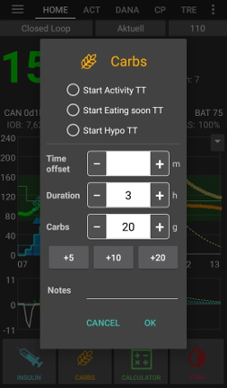
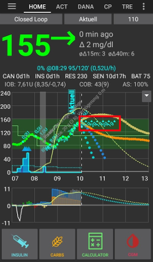

(Extended-Carbs-extended-carbs-ecarbs)=
# Rozložené sacharidy / „eCarbs“

## Co jsou eSacharidy a kdy jsou užitečné?

S běžnou léčbou pomocí inzulínové pumpy je prodloužený bolus dobrý způsob, jak řešit tučná nebo jinak pomalu vstřebávaná jídla, která zvyšují glykémii déle, než působí inzulín. V rámci smyčky ale prodloužené bolusy nedávají moc smysl (a způsobují technické potíže), protože jsou to v podstatě pevné vysoké dočasné bazály (TBR). To je proti principu smyčky, která bazální dávky upravuje dynamicky. Podrobnosti najdete níže v části [prodloužený bolus](#extended-bolus-and-why-they-wont-work-in-closed-loop-environment).

Potřeba řešit taková jídla však stále zůstává. Proto AAPS podporuje takzvané rozložené sacharidy neboli eSacharidy.

eSacharidy jsou sacharidy rozdělené do několika hodin. U běžných jídel s více sacharidy než tuky/bílkovinami obvykle stačí zadat sacharidy předem (a v případě potřeby snížit počáteční bolus), aby se zabránilo příliš brzkému podání inzulínu.  Ale pro pomaleji vstřebávaná jídla, kde zadání všech sacharidů předem způsobí příliš velké IOB z SMB, mohou být použity eSacharidy, aby se přesněji simulovalo vstřebávání sacharidů (a jakýchkoliv ekvivalentů, které zadáte pro ostatní makroživiny). Výsledkem je přesnější simulace průběhu glykémie v krvi. Díky těmto informacím může smyčka podávat SMB k těmto sacharidům postupně, což lze chápat jako dynamický prodloužený bolus (mělo by to fungovat i bez SMB, ale pravděpodobně méně účinně).

**Poznámka:** eSacharidy nejsou určené jen pro jídla bohatá na tuky nebo bílkoviny: můžete je použít v každé situaci, kdy glykémii zvyšují jiné vlivy, např. jiné léky, jako jsou kortikosteroidy.

## Jak eSacharidy fungují

Pro zadání eSacharidů otevřete dialog **Sacharidy** (**Ošetření** → **Sacharidy**), zadejte celkové sacharidy, nastavte **Trvání** a případně posuňte začátek pomocí **Čas sacharidů** (*čísla níže jsou jen příklady, musíte si vyzkoušet vlastní hodnoty, abyste u svých situací dosáhli uspokojivé reakce glykémie*):

eSacharidy na hlavní obrazovce: číslo v závorce v poli **COB** ukazuje sacharidy, které teprve přijdou, a graf **COB** ukazuje každý budoucí záznam eSacharidů jako oranžovou značku. Pokud graf **COB** nevidíte, přidejte ho pomocí **Přidat graf** pod grafy (viz [Obrazovky AAPS](../DailyLifeWithAaps/AapsScreens.md)).

(AapsScreens-carbs-type)=
## Typ sacharidů v bolusové kalkulačce: chléb, koláč nebo pizza

V [bolusové kalkulačce](#aaps-screens-bolus-wizard) můžete třemi tlačítky pod polem **Sacharidy** zvolit, jak rychle se vaše jídlo vstřebává. Jedno vyberte před potvrzením. Podle typu vezme **AAPS** část zadaných sacharidů jako běžné sacharidy a u pomalých, vydatných jídel přidá později [rozložené sacharidy („eSacharidy“)](#Extended-Carbs-extended-carbs-ecarbs). Klepnutím na ikonu **(i)** vedle tlačítek zobrazíte typická jídla pro vybraný typ a to, co typ s vašimi sacharidy udělá.

| Typ                 | Typická jídla (jak je uvádí aplikace)                                                                           | Sacharidy hned, použité pro bolus | Přidané eSacharidy                                       |
| ------------------- | --------------------------------------------------------------------------------------------------------------- | --------------------------------- | -------------------------------------------------------- |
| **Chléb** (výchozí) | Chléb, slané pečivo, jogurt, ovoce, brambory, rýže, ovesné vločky, zelenina                                     | 100 %                             | Žádný                                                    |
| **Koláč**           | Knedlíky, těstoviny, asijská jídla bohatá na sacharidy a tuky, sladké a kynuté pečivo, cereálie, med, marmeláda | 90 %                              | 20 %, začínají o 60 minut později, rozložené na 2 hodiny |
| **Pizza**           | Lasagne, pizza, hamburgery, hranolky, pečené brambory, chipsy                                                   | 80 %                              | 35 %, začínají o 60 minut později, rozložené na 3 hodiny |

**Příklad**: zadáte 100 g a zvolíte **Pizza**. Bolus se spočítá pro 80 g, které se zaznamenají hned. 35 g eSacharidů začne o 1 hodinu později a rozloží se na 3 hodiny.

Dobré vědět:
* Nejde o prosté rozdělení: u typů **Koláč** a **Pizza** je součet zaznamenaných sacharidů **vyšší, než jste zadali** (110 % a 115 %). Navíc přidané sacharidy jsou jen v eSacharidech.
* Bolus pokrývá jen sacharidy zaznamenané hned. **AAPS** na eSacharidy předem nepodává bolus: smyčka s nimi počítá, až začnou, stejně jako s jinými [eSacharidy](#Extended-Carbs-extended-carbs-ecarbs).
* Pokud nastavíte **Čas sacharidů**, eSacharidy začnou 60 minut po tomto čase.
* Potvrzovací dialog ukazuje eSacharidy na samostatném řádku, _např._ „eSacharidy 35 g / 3 h (+60 min)“.
* Gramy se zaokrouhlují dolů na celá čísla.
* Procenta, zpoždění a doby trvání jsou pevné; v nastavení je nelze změnit.
* Volba se nepamatuje: kalkulačka se pokaždé otevře s volbou **Chléb**.

______________________________________________________________________

Jeden způsob, jak pomocí této funkce řešit tuky a bílkoviny, je popsán zde (anglicky): [https://adriansloop.blogspot.com/2018/04/page-margin-0.html](https://adriansloop.blogspot.com/2018/04/page-margin-0.html)

______________________________________________________________________

## Doporučené nastavení, příklad situace a důležité poznámky

Doporučené nastavení je použít plugin OpenAPS SMB APS s povoleným SMB a se zapnutou volbou *Povolit SMB s COB*.

Například u pizzy můžete podat (částečný) bolus předem pomocí *bolusové kalkulačky* a pak v dialogu *Sacharidy* zadat zbývající sacharidy s trváním 4–6 hodin, se začátkem po 1 nebo 2 hodinách.

Pro rychlejší začátek může eSacharidy přidat *bolusová kalkulačka*: pod polem **Sacharidy** zvolte [typ sacharidů](#AapsScreens-carbs-type) **Koláč** nebo **Pizza** (viz výše). Množství a časování jsou pevné, takže pokud chcete jiné hodnoty, použijte místo toho dialog *Sacharidy*.

**Důležité poznámky:** Samozřejmě budete muset vyzkoušet, jaké konkrétní hodnoty vám vyhovují. Pro agresivnější nebo méně agresivní chování algoritmu můžete také opatrně upravit nastavení *Max minut bazálu pro omezení SMB*. Pro jídla s nízkým obsahem sacharidů a s vysokým obsahem tuků/bílkovin může být dostačující použít jenom eSacharidy bez ručních bolusů (viz blogový příspěvek výše). Když se eSacharidy vytvoří, vytvoří se také poznámka v Péči, která zaznamená všechny zadané údaje, aby bylo snazší je postupně upravovat a zlepšovat.

(extended-bolus-and-why-they-wont-work-in-closed-loop-environment)=
## Prodloužený bolus a proč nebude fungovat v uzavřené smyčce?

Jak bylo uvedeno výše, prodloužené nebo vícevlnné bolusy v uzavřené smyčce ve skutečnosti nefungují. Podrobnosti [najdete níže](#why-extended-boluses-wont-work-in-a-closed-loop-environment)

(Extended-Carbs-extended-bolus-and-switch-to-open-loop-dana-and-insight-pump-only)=
### Prodloužený bolus a přepnutí na otevřenou smyčku – jen pro pumpy Dana a Insight

Někteří lidé chtěli mít možnost používat prodloužený bolus v AAPS i tak, protože chtěli řešit určitá jídla tak, jak jsou zvyklí.

Proto **AAPS** nabízí uživatelům pump Dana a Insight prodloužený bolus: otevřete **Spravovat** a vyberte **Prodloužený bolus**.

**AAPS** vás nejdříve upozorní, že po dobu běhu prodlouženého bolusu bude uzavřená smyčka zastavena. Pokračujte klepnutím na **OK**:

Zadejte množství **Inzulín** a **Trvání**, pak klepněte na potvrzovací tlačítko dole a na **OK**:

U pumpy Insight je prodloužený bolus *nedostupný*, pokud se používá [emulace TBR](#Accu-Chek-Insight-Pump-settings-in-aaps).

Dokud prodloužený bolus běží, smyčka pracuje v režimu **Otevřená smyčka** (ikona smyčky na hlavní obrazovce se změní). Po skončení prodlouženého bolusu se uzavřená smyčka automaticky znovu zapne:

Nabídka **Spravovat** ukazuje tlačítko **Zrušit** s rychlostí a uplynulým / celkovým časem (například **Zrušit 2,00 U/h 1/60'**). Klepnutím na něj prodloužený bolus předčasně ukončíte:

(why-extended-boluses-won-t-work-in-a-closed-loop-environment)=
### Proč prodloužené bolusy v uzavřené smyčce nefungují

1. Smyčka určí, že se teď má podávat 1,55 U/h. Pro algoritmus nehraje roli, zda se to podá jako prodloužený bolus, nebo jako dočasný bazál (TBR). Některé pumpy ve skutečnosti prodloužený bolus používají. Co by se pak mělo stát? Většina ovladačů pump pak prodloužený bolus zastaví -> Vůbec jste ho nemuseli spouštět.

2. Pokud byste prodloužený bolus zadali jako vstup, co by se mělo stát v modelu?

   1. Měl by se brát jako neutrální spolu s bazální dávkou (BR) a smyčka by s ním počítala? Pak by smyčka měla mít možnost bolus i snížit, pokud se například dostanete příliš nízko a veškerý „neutrální“ inzulín se odebere?
   2. Měl by se prodloužený bolus prostě přičíst? Měla by tedy smyčka prostě pokračovat? I při té nejhorší hypoglykémii? To nepovažuji za dobré: hypoglykémie se předpovídá, ale nesmí se jí zabránit?

3. IOB, které prodloužený bolus vytvoří, se projeví po 5 minutách při dalším běhu smyčky. Smyčka by proto podala méně bazálu. Takže se toho moc nezmění... jen se ztratí možnost předejít hypoglykémii.
