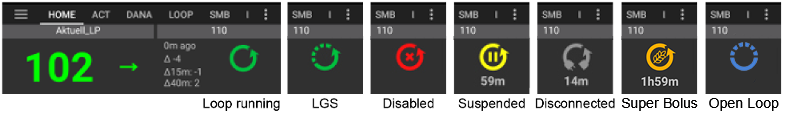
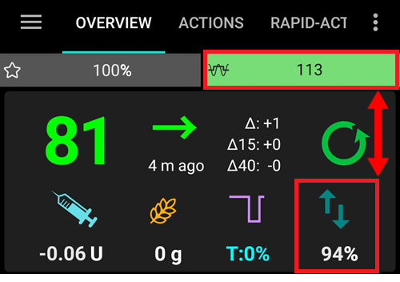

# Klíčové funkce AAPS

## Režim smyčky

Stav smyčky se zobrazuje na hlavní obrazovce jednou z níže uvedených ikon.

**AAPS** nabízí několik režimů smyčky, například Uzavřená smyčka (1), Ochrana před nízkou glykémií (LGS – 2) a Otevřená smyčka (3).

Informace o tom, jak zvolit režim smyčky, a o dalších ikonách na obrázku (4 až 6) najdete v části [Obrazovky AAPS > Hlavní obrazovka > Stav smyčky](#AapsScreens-loop-status).

(KeyAapsFeatures-OpenLoop)=

### Otevřená smyčka

**AAPS** průběžně vyhodnocuje všechna dostupná data (IOB, COB, glykémie...) a navrhuje ošetření (dočasné bazály), jak v případě potřeby upravit léčbu.

Návrhy se neprovedou automaticky (jako v uzavřené smyčce). Návrhy musí uživatel zadat do pumpy ručně (pokud používá virtuální pumpu), nebo je potvrdit tlačítkem, pokud je **AAPS** připojen ke skutečné pumpě.

Když má **AAPS** návrh, objeví se ve spodní navigaci hlavní obrazovky položka **Smyčka** s odznakem. Klepněte na ni, přečtěte si návrh („Přijmout nový dočasný bazál“) s dávkou, dobou trvání a důvodem a pak klepněte na **Provést**:

Návrh platí jen několik minut. Pokud je starší než asi 9 minut, nebo pokud byla mezitím smyčka pozastavena či pumpa odpojena, **AAPS** ho odmítne a do pumpy se nic neodešle (*„Tento návrh je příliš starý. Nic nebylo odesláno do pumpy. Počkejte na další.“*). Počkejte na další návrh.

Tato možnost je určena k seznámení s tím, jak **AAPS** funguje, nebo pro případ, že používáte nepodporovanou pumpu. Bez ohledu na to, co zde zvolíte, budete až do konce **[cíle 5](#objectives-objective5)** v otevřené smyčce.

(KeyAapsFeatures-LGS)=

### Ochrana před nízkou glykémií (LGS)

V tomto režimu je [maxIOB](#Open-APS-features-maximum-total-iob-openaps-cant-go-over) nastaven na nulu.

To znamená, že když glykémie klesá, **AAPS** může bazál snížit. Pokud ale glykémie stoupá, neprovede se žádná automatická korekce. Vaše bazální dávky zůstanou stejné, jak jsou nastavené ve vašem aktuálním **Profilu**. Další inzulín se ke snížení **glykémie** podá jen tehdy, když je IOB záporný (z předchozí Ochrany před nízkou glykémií).

Tento režim je dostupný od **[cíle 6](#objectives-objective6)**.

Kromě ručního výběru může **AAPS** do tohoto režimu přepnout i sám: během plnění **[cíle 6](#objectives-objective6)** a vždy, když zjistí duplicitní hodnoty glykémie (viz [výstražný znak glykémie](#aaps-screens-bg-warning-sign)).

(KeyAapsFeatures-ClosedLoop)=

### Uzavřená smyčka

**AAPS** průběžně vyhodnocuje všechna dostupná data (IOB, COB, glykémie...) a v případě potřeby automaticky upravuje léčbu (*tj.* bez vašeho dalšího zásahu), aby dosáhl nastaveného [cílového rozmezí nebo hodnoty](#profile-glucose-targets) (podání bolusu, dočasný bazál, vypnutí inzulínu pro předejití hypoglykémii atd.).

Uzavřená smyčka pracuje v rámci mnoha bezpečnostních limitů, které lze nastavit individuálně.

Uzavřená smyčka je možná, jen pokud jste v **[cíli 7](#objectives-objective7)** nebo vyšším a používáte podporovanou pumpu.

(autosens)= (Open-APS-features-autosens)=

## Autosens

- Autosens je algoritmus, který sleduje odchylky glykémie (kladné/záporné/neutrální).
- Pokusí se zjistit, jak citlivý(-á)/rezistentní jste na základě těchto odchylek.
- Realizace algoritmu oref v ** OpenAPS ** pracuje s kombinací dat za 24 a 8 hodin. Používá ta, která jsou více senzitivní.
- Pokud uživatelé pocházejí z Oref1, pravděpodobně si všimnou toho, že systém může být méně dynamický na změny, v závislosti na citlivosti za 24 nebo 8 hodin.
- Výměna kanyly nebo změna profilu vrátí poměr Autosens zpět na 100 % (procentuální přepnutí profilu s dobou trvání Autosens neresetuje).
- Autosens upravuje váš bazál a ISF (tj. napodobuje to, co dělá posun profilu).
- Pokud jíte sacharidy nepřetržitě po delší dobu, bude Autosens v této době méně účinný, protože sacharidy jsou z výpočtů delty **glykémie** vyloučeny.
- Odchylky se převádějí na **poměr citlivosti** (procento): poměr pod 100 % znamená, že AAPS vás považuje za citlivější na inzulín, než předpokládá váš **Profil** (proto sníží účinný bazál a ISF), zatímco poměr nad 100 % znamená, že jste rezistentnější (proto je zvýší).
- Ve výchozím nastavení se tento poměr drží mezi 0,7 (70 %, citlivější) a 1,2 (120 %, rezistentnější), takže série neobvyklých dat nemůže vaše dávkování posunout příliš daleko od **Profilu**. Tyto meze lze upravit v rozšířených nastaveních detekce citlivosti.
- Autosens a [Autotune](../AdvancedOptions/Autotune.md) řeší stejný základní problém v různých časových měřítcích: Autosens jemně upravuje vaše *aktuální* dávkování minutu po minutě podle posledních 8–24 h, zatímco Autotune pomalu přepisuje samotný *Profil* podle historie za několik týdnů. Používání obou je normální a očekávané – navzájem se doplňují, nezdvojují se.

*Podrobný technický popis algoritmu Autosens najdete v [dokumentaci OpenAPS k Autosens](https://openaps.readthedocs.io/en/latest/docs/Customize-Iterate/autosens.html).*

(Open-APS-features-super-micro-bolus-smb)=

## Super Micro Bolus (SMB)

**SMB**, zkratka pro **Super micro bolus**, je funkce OpenAPS zavedená od roku 2018 v rámci algoritmu Oref1. Na rozdíl od **AMA** nepoužívá **SMB** k řízení glykémie dočasné bazály, ale hlavně **malé super mikro bolusy**. V situacích, kdy by **AMA** přidal 1,0 U inzulínu pomocí dočasného bazálu, podá **SMB** několik super mikro bolusů po malých krocích v **5minutových intervalech**, např. 0,4 U, 0,3 U, 0,2 U a 0,1 U. Zároveň se z bezpečnostních důvodů na určitou dobu nastaví bazální dávka na 0 U/h, aby se zabránilo předávkování (**„zero-temping“**, nulový dočasný bazál). Díky tomu může systém upravit glykémii rychleji než zvýšením dočasného bazálu u **AMA**.

Díky SMB může u jídel, která obsahují jen „pomalé“ sacharidy, stačit, když systému zadáte plánované množství sacharidů a zbytek necháte na **AAPS**. To však může vést k vyšším postprandiálním vrcholům (po jídle), protože předstihový bolus není možný. Nebo můžete podat (v případě potřeby jako předstihový bolus) **úvodní bolus**, který **jen částečně** pokryje sacharidy (např. 2/3 odhadovaného množství), a zbytek inzulínu nechat podat pomocí **SMB**.

SMB se zobrazují v [grafu IOB](#aaps-screens-iob) jako modré trojúhelníky. [Podržte prst](#aaps-screens-graph-press-and-hold) na grafu u trojúhelníku, abyste viděli, kolik inzulínu bylo podáno, nebo použijte [Historii ošetření](#aaps-screens-treatments).

Funkce **SMB** obsahují několik bezpečnostních mechanismů:

1. **Největší jednotlivá dávka SMB**  
  Největší jednotlivá dávka SMB může být jen nejmenší z těchto hodnot:
  
        * hodnota odpovídající aktuální bazální dávce (upravené funkcí Autosens) za dobu nastavenou v „Max minut bazálu pro omezení SMB“, např. množství bazálu na dalších 30 minut, nebo
        * polovina aktuálně potřebného množství inzulínu, nebo
        * zbývající část vaší hodnoty maxIOB v nastavení.
      

2. **Nízké dočasné bazály**  
  Nízké dočasné bazály (tzv. „low temps“) nebo dočasné bazály 0 U/h (tzv. „zero-temps“) se při **SMB** spouštějí častěji. Je to tak záměrně z bezpečnostních důvodů a nemá to žádné negativní účinky, pokud je **Profil** nastaven správně. V hlavním grafu má křivka IOB (tenká žlutá čára) větší vypovídací hodnotu než průběh dočasných bazálů.

3. **Neoznámená jídla**  
  Další výpočty pro předpověď průběhu glykémie, např. pomocí **UAM** (neoznámená jídla). I bez ručního zadání sacharidů dokáže **UAM** automaticky rozpoznat výrazný vzestup glykémie způsobený jídlem, adrenalinem nebo jinými vlivy a pokusí se ho vyrovnat pomocí **SMB**. V zájmu bezpečnosti to funguje i opačně a SMB se může zastavit dříve, pokud dojde k neočekávaně rychlému poklesu glykémie. To je důvod, proč by funkce UAM měla být při používání SMB vždy aktivní.

SMB samo nerozhoduje, že je potřeba inzulín – vychází ze stejných kombinovaných predikcí glykémie (eventual BG, zero-temp, COB, UAM), které jsou popsány v části [jak AAPS mění predikce v rozhodnutí o dávkování](#aaps-screens-how-predictions-become-a-dosing-decision). SMB a nulový dočasný bazál jsou jen dva nástroje, kterými AAPS toto rozhodnutí provádí.

**Abyste mohli používat SMB, musíte mít zahájený [cíl 9](#objectives-objective9).**

Viz také [dokumentaci OpenAPS k oref1/SMB](https://openaps.readthedocs.io/en/latest/docs/Customize-Iterate/oref1.html#understanding-super-micro-bolus-smb) s podrobným technickým popisem, nebo [Timovy informace o SMB](https://www.diabettech.com/artificial-pancreas/understanding-smb-and-oref1/) sepsané komunitou.

Nastavení pro OpenAPS SMB jsou popsána níže.

(Open-APS-features-max-u-h-a-temp-basal-can-be-set-to)=

### Maximální bazální dávka (max. U/h pro dočasný bazál)

Toto bezpečnostní omezení stanoví maximální dočasný bazál, který může pumpa podat. Je také známá jako **max-basal**.

Hodnota se udává v jednotkách za hodinu (U/h). Doporučuje se nastavit toto na rozumnou hodnotu. Dobré doporučení pro nastavení tohoto parametru je:

**MAX-BASAL = NEJVYŠŠÍ BAZÁLNÍ DÁVKA x 4**

Například: pokud je nejvyšší bazální dávka ve vašem profilu 0,5 U/h, po vynásobení 4 dostanete hodnotu 2 U/h.

**AAPS** omezuje tuto hodnotu „pevným limitem“ podle [Nastavení > Bezpečnost > Věk pacienta](#preferences-patient-type). Pevné limity jsou tyto:

- Dítě: 2
- Dospívající: 5
- Dospělý: 10
- Dospělý s nízkou citlivostí: 12
- Těhotná: 25

*Viz také [přehled pevně naprogramovaných limitů](#Open-APS-features-overview-of-hard-coded-limits).*

(Open-APS-features-maximum-total-iob-openaps-cant-go-over)=

### Maximální celkový IOB, který OpenAPS nepřekročí

Tato hodnota určuje maximální **aktivní inzulín** (IOB z bazálu i bolusu), pod kterým **AAPS** zůstane, když běží v režimu uzavřené smyčky. Je také známá jako **maxIOB**.

Pokud je aktuální IOB (např. po bolusu na jídlo) nad nastavenou hodnotou, smyčka přestane podávat inzulín, dokud IOB neklesne pod tuto hodnotu.

Dobrý začátek pro nastavení tohoto parametru je:

      maxIOB = průměrný bolus na jídlo + 3x maximální denní bazální dávka
    

Při úpravě **max-IOB** buďte opatrní a trpěliví. Hodnota je pro každého jiná a může záviset i na průměrné celkové denní dávce (CDD).

**AAPS** omezuje tuto hodnotu „pevným limitem“ podle [Nastavení > Bezpečnost > Věk pacienta](#preferences-patient-type). Pevné limity jsou tyto:

- Dítě: 7
- Dospívající: 13
- Dospělý: 22
- Dospělý s nízkou citlivostí: 30
- Těhotná: 70

*Viz také [přehled pevně naprogramovaných limitů](#Open-APS-features-overview-of-hard-coded-limits).*

Poznámka: Při použití **SMB** se **max-IOB** počítá jinak než u AMA. U **AMA** je maxIOB bezpečnostní parametr pro bazální **IOB**, zatímco v režimu SMB zahrnuje i IOB z bolusů.

### Použít dynamickou citlivost

Toto je funkce [DynamicISF](../DailyLifeWithAaps/DynamicISF.md). Po zapnutí jsou k dispozici nová nastavení. Nastavení jsou vysvětlena na stránce [DynamicISF](#dyn-isf-preferences).

### Použít Autosens

Toto je funkce [Autosens](#Open-APS-features-autosens). Při použití DynamicISF nelze Autosens používat, protože jde o dva různé algoritmy, které mění stejnou proměnnou (citlivost).

Autosens sleduje odchylky glykémie (kladné/záporné/neutrální). Na základě těchto odchylek se pokusí zjistit, jak moc jste citliví/rezistentní, a podle toho upraví bazální dávku a ISF.

Po zapnutí jsou k dispozici nová nastavení.

#### Citlivost zvyšuje cíl

Pokud je tato možnost zapnutá, detekce citlivosti (Autosens) může zvýšit cíl, když zjistí citlivost (pod 100 %). V tomto případě se váš cíl zvýší o procento zjištěné citlivosti.

Pokud je cíl upraven kvůli detekci citlivosti, zobrazí se na hlavní obrazovce se zeleným pozadím.

Toto nastavení je dostupné, když je zapnuté „Použít dynamickou citlivost“ nebo „Použít Autosens“.

#### Rezistence snižuje cíl

Pokud je tato možnost zapnutá, detekce citlivosti (Autosens) může snížit cíl, když zjistí rezistenci (nad 100 %). V tomto případě se váš cíl sníží o procento zjištěné rezistence.

Toto nastavení je dostupné, když je zapnuté „Použít dynamickou citlivost“ nebo „Použít Autosens“.

### Povolit SMB

Zapněte, pokud chcete používat funkci SMB. Pokud je vypnuto, nebudou se podávat žádné **SMB**.

Po zapnutí jsou k dispozici nová nastavení.

(Open-APS-features-enable-smb-with-high-temp-targets)=

#### Povolit SMB při vysokém dočasném cíli

Pokud je toto nastavení zapnuté, budou se **SMB** podávat, i když uživatel zvolil vysoký **dočasný cíl** (to je 100 mg/dl nebo 5,6 mmol/l a více, bez ohledu na cíl v **Profilu**). Při zapínání buďte opatrní: **SMB** mohou být příliš agresivní, pokud vaše nastavení nejsou dobře vyladěná nebo pokud se váš **Profil** často mění (například u dětí).

Tato možnost slouží k vypnutí SMB, když je toto nastavení vypnuté. Pokud je například tato možnost vypnutá, lze **SMB** vypnout nastavením **dočasného cíle** 100 mg/dl nebo 5,6 mmol/l a více. Tato možnost také vypne **SMB** bez ohledu na to, jaká jiná podmínka se snaží SMB povolit – kromě nízkého **dočasného cíle**, jako je **Před jídlem** (nebo jakéhokoli **dočasného cíle** 98 mg/dl nebo 5,4 mmol/l a nižšího), při kterém se **SMB** mohou dál podávat, aby se **glykémie** dostala k cíli.

Pokud je toto nastavení zapnuté, bude **SMB** při vysokém dočasném cíli povoleno, jen pokud je zapnuté také **Povolit SMB při nízkém dočasném cíli**.

(Open-APS-features-enable-smb-always)=

#### Povolit SMB vždy

Pokud je toto nastavení zapnuté, SMB je povoleno vždy (nezávisle na COB, dočasných cílech nebo bolusech). Pokud je toto nastavení zapnuté, ostatní níže uvedená nastavení pro povolení SMB nemají žádný vliv. Pokud je však vypnuté **Povolit SMB při vysokém dočasném cíli** a je nastaven vysoký dočasný cíl, SMB budou vypnuté.

Toto nastavení je dostupné, jen pokud **AAPS** zjistí, že používáte [spolehlivý zdroj glykémie](#GettingStarted-TrustedBGSource) s pokročilým filtrováním. FreeStyle Libre 1 se nepovažuje za spolehlivý zdroj, protože při poruše senzoru hrozí, že se budou donekonečna opakovat stará data glykémie.

Zašuměná data by mohla **AAPS** přimět k domněnce, že glykémie roste opravdu rychle, a vést k podání zbytečných SMB. Více informací o šumu a vyhlazování dat najdete [zde](../CompatibleCgms/SmoothingBloodGlucoseData.md).

#### Povolit SMB s COB

Pokud je toto nastavení zapnuté, SMB je povoleno, když je COB větší než 0.

Toto nastavení není vidět, pokud je zapnuté „Povolit SMB vždy“.

#### Povolit SMB při nízkém dočasném cíli

Pokud je toto nastavení zapnuté, SMB je povoleno, když je nastaven dočasný cíl (před jídlem, aktivita, hypo, vlastní). Pokud je toto nastavení zapnuté, ale **Povolit SMB při vysokém dočasném cíli** je vypnuté, SMB bude povoleno při nízkém dočasném cíli (98 mg/dl nebo 5,4 mmol/l a nižším), ale vypnuté při vysokém dočasném cíli.

Toto nastavení není vidět, pokud je zapnuté „Povolit SMB vždy“.

#### Povolit SMB po sacharidech

Pokud je zapnuté, SMB je povoleno 6 h po zadání sacharidů, i když COB už kleslo na 0.

Z bezpečnostních důvodů je toto nastavení dostupné, jen pokud **AAPS** zjistí, že používáte spolehlivý zdroj glykémie. Není vidět, pokud je zapnuté „Povolit SMB vždy“.

Toto nastavení je dostupné, jen pokud **AAPS** zjistí, že používáte [spolehlivý zdroj glykémie](#GettingStarted-TrustedBGSource) s pokročilým filtrováním. FreeStyle Libre 1 se nepovažuje za spolehlivý zdroj, protože při poruše senzoru hrozí, že se budou donekonečna opakovat stará data glykémie.

Zašuměná data by mohla **AAPS** přimět k domněnce, že glykémie roste opravdu rychle, a vést k podání zbytečných SMB. Více informací o šumu a vyhlazování dat najdete [zde](../CompatibleCgms/SmoothingBloodGlucoseData.md).  
Toto nastavení není vidět, pokud je zapnuté „Povolit SMB vždy“.

#### Interval SMB

Tato funkce omezuje četnost SMB. Tato hodnota určuje minimální čas mezi SMB. Smyčka se spouští pokaždé, když přijde hodnota glykémie (obvykle každých 5 minut). Odečtěte 2 minuty, aby měla smyčka čas na dokončení. Např. pokud chcete, aby se SMB podávalo při každém běhu smyčky, nastavte 3 minuty.

Výchozí hodnota: 3 min.

(Open-APS-features-max-minutes-of-basal-to-limit-smb-to)=

#### Max minut bazálu pro omezení SMB

Jedná se o důležité bezpečnostní nastavení. Tato hodnota určuje, kolik SMB lze podat podle množství bazálního inzulínu za danou dobu, pokud je pokryto COB.

Vyšší hodnota umožní, aby SMB bylo agresivnější. Začněte s výchozí hodnotou 30 minut. Až získáte zkušenosti, zvyšujte hodnotu po 15 minutách a sledujte účinek během několika jídel.

Nedoporučuje se nastavovat hodnotu vyšší než 90 minut, protože pak by algoritmus nemusel zvládnout klesající glykémii ani s bazálem 0 U/h („zero-temp“). Měli byste si také nastavit alarmy, zvláště pokud teprve zkoušíte nová nastavení, aby vás varovaly dlouho před hypoglykémií.

Výchozí hodnota: 30 min.

#### UAM max minut bazálu pro omezení SMB

Toto nastavení umožňuje upravit sílu SMB během UAM, když už nejsou žádné sacharidy.

Výchozí hodnota: stejná jako **Max minut bazálu pro omezení SMB**.

Toto nastavení je vidět, jen pokud je zapnuté „Povolit SMB“ a „Povolit UAM“.

(enable-uam)=

### Povolit UAM

Je-li tato možnost povolena, algoritmus SMB dokáže rozpoznat neoznámená jídla. Pomůže, když zapomenete **AAPS** zadat sacharidy, špatně je odhadnete a zadané množství je chybné, nebo když jídlo s velkým množstvím tuku a bílkovin působí déle, než se čekalo. I bez zadání sacharidů dokáže UAM rozpoznat rychlý vzestup glykémie způsobený sacharidy, adrenalinem atd. a snaží se ho vyrovnat pomocí SMB. Funguje to i opačně: pokud glykémie rychle klesá, může SMB zastavit dříve.

**Proto by měla být při používání SMB funkce UAM vždy povolena.**

(key-aaps-features-minimal-carbs-required-for-suggestion)=

### Práh požadovaných sacharidů

Minimální počet gramů sacharidů, při kterém se zobrazí upozornění s návrhem sacharidů. Když algoritmus zjistí, že jsou potřeba sacharidy, navrhne snědení dalších sacharidů. V tomto případě obdržíte oznámení, které může být odloženo na 5, 15 nebo 30 minut.

V případě potřeby může být notifikace vyžadovaných sacharidů odeslána do Nightscoutu. Notifikace se pak zobrazí v Nightscoutu a bude vysílána.

V každém případě se požadované sacharidy zobrazí v sekci COB na hlavní obrazovce.

### Rozšířená nastavení

Úplný přehled parametrů (včetně nastavení, která zde nejsou popsána) najdete v [dokumentaci OpenAPS k předvolbám a bezpečnostním nastavením](https://openaps.readthedocs.io/en/latest/docs/While%20You%20Wait%20For%20Gear/preferences-and-safety-settings.html).

**Vždy používat krátkou průměrnou deltu místo jednoduchých dat** Pokud tuto funkci zapnete, **AAPS** použije krátkou průměrnou deltu/glykémii z posledních 15 minut, což je obvykle průměr posledních tří hodnot. Díky tomu je **AAPS** stabilnější u zašuměných zdrojů dat, jako jsou xDrip a Libre.

**Maximální denní bezpečnostní násobitel** Toto je důležité bezpečnostní omezení. Výchozí nastavení (které pravděpodobně nebude potřeba upravovat) je 3. To znamená, že **AAPS** nikdy nesmí nastavit dočasný bazál vyšší než trojnásobek nejvyšší hodinové bazální dávky naprogramované v pumpě a/nebo profilu uživatele. Příklad: pokud je vaše nejvyšší bazální dávka 1,0 U/h a maximální denní bezpečnostní násobitel je 3, může **AAPS** nastavit dočasný bazál nejvýše 3,0 U/h (= 3 x 1,0 U/h).

Výchozí hodnota: 3 (neměňte ji, pokud to opravdu nepotřebujete a nevíte, co děláte)

**Aktuální bezpečnostní násobitel bazálu** Toto je další důležité bezpečnostní omezení. Výchozí nastavení (které pravděpodobně také nebude potřeba upravovat) je 4. To znamená, že **AAPS** nikdy nesmí nastavit dočasný bazál vyšší než čtyřnásobek aktuální hodinové bazální dávky naprogramované v pumpě a/nebo profilu uživatele.

Výchozí hodnota: 4 (neměňte ji, pokud to opravdu nepotřebujete a nevíte, co děláte)

* * *

(Open-APS-features-auto-isf)=

## Auto ISF

**Auto ISF** je **experimentální** algoritmus pro pokročilé uživatele. Je postavený na OpenAPS SMB a přidává pravidla, která podle chování glykémie zesilují nebo zeslabují citlivost na inzulín (ISF).

Jde o vývojovou funkci: lze ji zapnout jen ve [vývojovém sestavení](../AdvancedOptions/DevBranch.md) se zapnutým **inženýrským režimem**. V běžném sestavení (release) zůstává vynuceně vypnutá, a proto se v **Konfigurace → APS** nezobrazuje. Splnění [cílů](../SettingUpAaps/CompletingTheObjectives.md) ji neodemkne.

Po jejím výběru obsahují její **Nastavení** nastavení OpenAPS SMB a navíc skupinu **Nastavení AutoISF**:

- **Povolit AutoISF**: zapne úpravy ISF. Bez něj se algoritmus chová jako OpenAPS SMB.
- **AutoISF min** a **AutoISF max**: jak slabá a jak silná smí ISF být, podobně jako limity Autosens. S výchozí hodnotou 1,0 je účinek vypnutý.
- **Váhy**: každá řídí jedno pravidlo a výchozí hodnota 0,0 pravidlo vypíná. 
  - když se glykémie **zrychluje**, ISF se zesílí (více inzulínu);
  - když se glykémie **zpomaluje**, ISF se zeslabí (méně inzulínu);
  - když je glykémie **pod cílem**, ISF se zeslabí;
  - když je glykémie **nad cílem**, ISF se zesílí;
  - váha **po jídle** (post-prandial) a váha **trvání** působí po jídle a když glykémie zůstává dlouho vysoká.
- **Poměr podávání SMB** (s minimem, maximem a rozsahem glykémie): jaký podíl potřebného inzulínu lze podat jako SMB.
- **SMB max rozšíření rozsahu**: kolikrát smí být překročen obvyklý limit velikosti SMB ([max minut bazálu](#Open-APS-features-max-minutes-of-basal-to-limit-smb-to), obvykle 120 minut). Výchozí hodnota 1 nic nemění; možné je až 5. Tuto experimentální hodnotu zvyšujte pomalu a opatrně.
- **Procento prahu IOB**: procento max IOB, nad kterým se SMB vypnou.

    {admonition} Jen pro zkušené uživatele
    :class: danger
    S výchozími hodnotami Auto ISF nic nemění. Každá hodnota, kterou zvýšíte, dělá **AAPS** agresivnějším. Měňte vždy jen jednu hodnotu, po malých krocích, a sledujte výsledek několik dní. S hodnotou **AutoISF max** nad 2,5 buďte nesmírně opatrní.

(Open-APS-features-advanced-meal-assist-ama)=

## Advanced Meal Assist (AMA)

AMA je zkratka pro „advanced meal assist“ (pokročilý pomocník s jídlem), což je funkce OpenAPS z roku 2017 (oref0). OpenAPS Advanced Meal Assist (AMA) umožňuje systému po bolusu na jídlo rychleji nastavit vysoký dočasný bazál, pokud spolehlivě zadáváte sacharidy.

Více informací najdete v [dokumentaci OpenAPS](https://newer-docs.readthedocs.io/en/latest/docs/walkthrough/phase-4/advanced-features.html#advanced-meal-assist-or-ama).

### Maximální bazální dávka (OpenAPS „max-basal“)

Toto bezpečnostní nastavení zajistí, že **AAPS** nikdy nebude moci nastavit nebezpečně vysokou bazální dávku, a omezí dočasný bazál na x U/h. Doporučuje se nastavit toto na rozumnou hodnotu. Doporučuje se vzít nejvyšší bazální dávku z vašeho profilu a vynásobit ji 4, nejméně však 3. Například: máte-li ve svém profilu nejvyšší hodnotu bazálu 1,0 U/h, dostanete po vynásobení 4 hodnotu 4 U/h. Nastavte tedy 4 jako svůj bezpečnostní parametr.

Nelze zvolit libovolnou hodnotu: z bezpečnostních důvodů platí „pevný limit“, který závisí na věku pacienta. „Pevný limit“ pro maxIOB je u AMA nižší než u SMB. Pro děti je hodnota nejnižší, pro dospělé s nízkou citlivostí nejvyšší.

Pevně nastavené parametry v **AAPS** jsou:

- Dítě: 2
- Dospívající: 5
- Dospělý: 10
- Dospělý s nízkou citlivostí: 12
- Těhotná: 25

*Viz také [přehled pevně naprogramovaných limitů](#Open-APS-features-overview-of-hard-coded-limits).*

### Maximální bazální IOB, který OpenAPS může podat \[U\] (OpenAPS „max-iob“)

Tento parametr omezuje maximální bazální IOB, při kterém **AAPS** ještě pracuje. Pokud je IOB vyšší, přestane se podávat další bazální inzulín, dokud bazální IOB neklesne pod limit.

Výchozí hodnota je 2, ale tento parametr byste měli zvyšovat pomalu, abyste viděli, jak moc na vás působí a která hodnota vám nejlépe vyhovuje. Hodnota je pro každého jiná a závisí také na průměrné celkové denní dávce (CDD). Z bezpečnostních důvodů jsou nastaveny limity vycházející z věku pacientů. „Pevný limit“ pro maxIOB je u AMA nižší než u SMB.

- Dítě: 3
- Dospívající: 5
- Dospělý: 7
- Dospělý s nízkou citlivostí: 12
- Těhotná: 25

*Viz také [přehled pevně naprogramovaných limitů](#Open-APS-features-overview-of-hard-coded-limits).*

### Použít Autosens (AMA)

Zde můžete zvolit, zda chcete používat [detekci citlivosti](../DailyLifeWithAaps/SensitivityDetectionAndCob.md) Autosens, nebo ne.

### Autosens upravuje cíle

Pokud je tato možnost zapnutá, může Autosens upravovat také cíle (vedle bazálu a ISF). Tím může **AAPS** pracovat „agresivněji“, nebo ne. Aktuálně nastaveného cíle lze s touto funkcí dosáhnout rychleji.

### Rozšířená nastavení

- Za normálních okolností nemusíte nastavení v tomto dialogu měnit!
- Pokud je přesto chcete změnit, ujistěte se, že rozumíte tomu, co děláte – úplný přehled parametrů najdete v [dokumentaci OpenAPS k předvolbám a bezpečnostním nastavením](https://openaps.readthedocs.io/en/latest/docs/While%20You%20Wait%20For%20Gear/preferences-and-safety-settings.html).

**Vždy používat krátkou průměrnou deltu místo jednoduchých dat** Pokud tuto funkci zapnete, **AAPS** použije krátkou průměrnou deltu/glykémii z posledních 15 minut, což je obvykle průměr posledních tří hodnot. Díky tomu pracuje **AAPS** stabilněji u zašuměných zdrojů dat, jako jsou xDrip a Libre.

**Maximální denní bezpečnostní násobitel** Toto je důležité bezpečnostní omezení. Výchozí nastavení (které pravděpodobně nebude potřeba upravovat) je 3. To znamená, že **AAPS** nikdy nesmí nastavit dočasný bazál vyšší než trojnásobek nejvyšší hodinové bazální dávky naprogramované v pumpě uživatele. Příklad: pokud je vaše nejvyšší bazální dávka 1,0 U/h a maximální denní bezpečnostní násobitel je 3, může **AAPS** nastavit dočasný bazál nejvýše 3,0 U/h (= 3 x 1,0 U/h).

Výchozí hodnota: 3 (neměňte ji, pokud to opravdu nepotřebujete a nevíte, co děláte)

**Aktuální bezpečnostní násobitel bazálu** Toto je další důležité bezpečnostní omezení. Výchozí nastavení (které pravděpodobně také nebude potřeba upravovat) je 4. To znamená, že **AAPS** nikdy nesmí nastavit dočasný bazál vyšší než čtyřnásobek aktuální hodinové bazální dávky naprogramované v pumpě uživatele.

Výchozí hodnota: 4 (neměňte ji, pokud to opravdu nepotřebujete a nevíte, co děláte)

**Dělitel bolus snooze DIA** Funkce „bolus snooze“ funguje po bolusu na jídlo. **AAPS** po jídle nenastavuje nízké dočasné bazály po dobu DIA vydělenou parametrem „bolus snooze“. Výchozí hodnota je 2. To znamená, že s DIA 5 h by trvání parametru „bolus snooze“ bylo 5 h : 2 = 2,5 h.

Výchozí hodnota: 2

* * *

(Open-APS-features-overview-of-hard-coded-limits)=

## Přehled pevně naprogramovaných limitů

|            | Dítě | Dospívající | Dospělý | Dospělý s nízkou citlivostí | Těhotná |
| ---------- | ---- | ----------- | ------- | --------------------------- | ------- |
| MAXBOLUS   | 5    | 10          | 17      | 25                          | 60      |
| MINDIA     | 5    | 5           | 5       | 5                           | 5       |
| MAXDIA     | 9    | 9           | 9       | 9                           | 10      |
| MINIC      | 2    | 2           | 2       | 2                           | 0.3     |
| MAXIC      | 100  | 100         | 100     | 100                         | 100     |
| MAXIOB_AMA | 3    | 5           | 7       | 12                          | 25      |
| MAXIOB_SMB | 7    | 13          | 22      | 30                          | 70      |
| MAXBASAL   | 2    | 5           | 10      | 12                          | 25      |