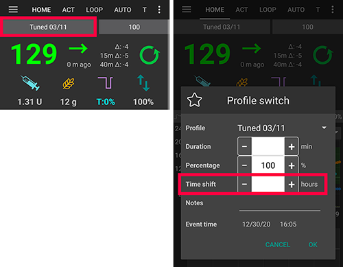

# Změna časového pásma a letní čas

Když se změní časové pásmo telefonu, **AAPS** asi 10 sekund po změně znovu od začátku vypočítá **IOB**, bazál a citlivost za minulé období. Během tohoto výpočtu může chvíli trvat, než se grafy a hodnoty na hlavní obrazovce aktualizují.

(timezone-traveling-with-pumps)=

## Změna časového pásma u Omnipod Dash

* Obnovte stav pumpy v **Spravovat → Pumpa**
* Dočasně vyberte jiný **Profil** a pak se přepněte zpět na svůj původní nebo požadovaný **Profil**

## Změna časového pásma u DanaR, korejské DanaR

Se změnou časového pásma v telefonu není žádný problém, protože tyto pumpy nepoužívají historii

(timezone-traveling-danarv2-danars)=

## Změna časového pásma u DanaRv2, DanaRS, Dana-i

Tyto pumpy vyžadují zvláštní péči, protože **AAPS** používá historii z pumpy, ale záznamy v pumpě nemají údaj o časovém pásmu. **To znamená, že pokud v telefonu změníte časové pásmo, záznamy se načtou s jiným časovým pásmem a budou zdvojené.**

Abychom se tomu vyhnuli, existují dvě možnosti:

### Možnost 1: Ponechat původní čas a posunout profil

* V nastavení telefonu vypněte „Automatické datum a čas“ (ruční změna časového pásma).

* Telefon musí po celou dobu cesty udržovat váš standardní domácí čas.

* Posuňte svůj **Profil** v čase podle časového rozdílu mezi domácím časem a časem v cíli cesty.
   
   * Klepnutím na název **Profilu** na hlavní obrazovce otevřete [obrazovku Profil](#ProfileSwitch-manage-v4)
   * Vyberte svůj **Profil** a klepněte na **▶ Aktivovat**
   * Nastavte „**Posun času**“ podle cíle cesty a klepněte na **Aktivovat**.
   
   
   
   * např. Vídeň -> New York: **Přepnutí profilu** +6 hodin
   * např. Vídeň -> Sydney: **Přepnutí profilu** -8 hodin

### Možnost 2: Vymazat historii pumpy

* Na telefonu v nastavení vypněte 'Automatická změna data a času' (ruční změna časového pásma)

Když vysednete z letadla:

* vypněte pumpu
* změňte časové pásmo na telefonu
* vypněte telefon, zapněte pumpu
* vymažte historii v pumpě
* změňte čas na pumpě
* zapněte telefon
* nechejte telefon spojit se s pumpou a sladit se s jejím časem

(timezone-traveling-insight)=

## Změna časového pásma u Insight

Ovladač automaticky upravuje čas v pumpě podle času v telefonu.

Insight také do historie zaznamenává, v kterém okamžiku byl čas změněn a z jakého (starého) času na jaký (nový) čas. Díky tomu lze v **AAPS** i přes změnu času určit správný čas.

Může to způsobit nepřesnosti v **CDD**. Neměl by to však být problém.

Uživatel pumpy Insight se tedy nemusí obávat změn časového pásma a změn času. K tomuto pravidlu existuje jedna výjimka: pumpa Insight má malou vnitřní baterii k napájení času atd. zatímco měníte "skutečnou" baterii. Pokud výměna baterie trvá příliš dlouho, tato interní baterie se může vybít, hodiny se resetují a vy budete vyzváni, abyste po vložení nové baterie opětovně nastavili čas. V takovém případě se všechny záznamy před výměnou baterie ve výpočtech AAPS vynechají, protože správný čas nelze spolehlivě určit.

## Změna časového pásma u Accu-Chek Combo

[Ovladač Combo](../CompatiblePumps/Accu-Chek-Combo-Pump-v2.md) automaticky upravuje čas pumpy podle času telefonu. Combo neumí ukládat časová pásma, jen místní čas, a to je přesně to, co do pumpy nastavuje ovladač. Kromě toho ukládá časové pásmo do místních předvoleb AAPS, aby mohl převést místní čas pumpy na úplné časové razítko s posunem časového pásma. Uživatel nemusí nic dělat; pokud se čas v pumpě Combo příliš liší od aktuálního času telefonu, čas pumpy se automaticky upraví.

Upozorňujeme však, že to chvíli trvá, protože to lze provést jen v režimu vzdáleného terminálu, který je obecně pomalý. Je to omezení pumpy Combo, které nelze obejít.

## Změna časového pásma u Medtrum

Ovladač automaticky upravuje čas v pumpě podle času v telefonu.

Změny časového pásma ponechají historii neporušenou, ovlivněna může být jen CDD. Ruční změna času v telefonu může způsobit problémy s historií a **IOB**. Pokud měníte čas ručně, **IOB** důkladně zkontrolujte.

Při změně časového pásma nebo času se běžící **dočasné bazály (TBR)** ukončí.

(time-adjustment-daylight-savings-time-dst)=

## LETNÍ ČAS (DST)

Úprava času při přechodu na letní čas.

V závislosti na vaší pumpě a nastavení CGM mohou skoky v čase způsobit, že **AAPS** nebude správně fungovat. U některých pump je lepší upravit časové pásmo ještě před přechodem na letní čas, dokud jste vzhůru, a ne během noci.

### Automatická úprava letního času u většiny pump

* **Smyčka** však bude deaktivována na 3 hodiny PO přechodu na letní čas (obvykle od 1:00) a **AAPS** se vrátí k výchozímu bazálu podle vašeho **Profilu**. Děje se tak z bezpečnostních důvodů – **IOB** může být příliš vysoké kvůli zdvojenému bolusu před změnou letního času.
* Po přechodu na letní čas proveďte **Přepnutí profilu** na požadovaný **Profil**, aby se **Smyčka** zapnula: klepněte na název profilu na hlavní obrazovce a pak na kulaté tlačítko **▶** (viz [Aktivace profilu](#ProfileSwitch-manage-v4)).
* Před změnou letního času také dostanete na hlavní obrazovce **AAPS** upozornění, že **Smyčka** byla dočasně zakázána. Tato zpráva se zobrazí bez pípnutí, vibrace nebo podobného zvuku.

Pokud dáváte bolus pomocí kalkulačky **AAPS**, nepoužívejte prosím údaje **COB** a **IOB**, pokud si nejste jistí, že jsou naprosto správné. Buďte opatrní a tuto funkci několik hodin po přechodu na letní/zimní čas nepoužívejte.

### Letní čas u Accu-Chek Insight

* Změna letního času se provádí automaticky. Není vyžadována žádná akce.

### Letní čas u Accu-Chek Combo

* Změna letního času se provádí automaticky. Není vyžadována žádná akce.

### Letní čas u Medtrum

* Změna letního času se provádí automaticky. Není vyžadována žádná akce.

### Letní čas u Omnipod Dash

* Buď nechte **AAPS** po přechodu na letní čas dočasně přejít na výchozí bazál, jak je popsáno výše.
* Nebo, pokud nechcete, aby **AAPS** přes noc dočasně přešel na výchozí bazál, můžete časové pásmo změnit den před přechodem na letní čas a vyhnout se tak nočnímu výpadku. POZOR, TATO MOŽNOST MŮŽE ZPŮSOBIT PŘEDČASNÉ VYPRŠENÍ PODU. POKUD ZVOLÍTE NÍŽE POPSANOU MOŽNOST, MĚJTE S SEBOU NÁHRADNÍ POMŮCKY.

#### Co udělat před změnou času

1. Vypněte všechna nastavení telefonu, která automaticky nastavují časové pásmo, aby mohl uživatel přepnout na požadované časové pásmo, které letní čas nepoužívá. Jak to zapnout, záleží na vašem telefonu a verzi Androidu.
   
   * Některé telefony mají dvě nastavení, jedno pro automatické nastavení času (které by ideálně mělo zůstat zapnuté) a jedno pro automatické nastavení časového pásma (které musíte VYPNOUT: **Nastavit automaticky** v části **Časové pásmo** na snímku obrazovky níže).
   * Některé verze Androidu bohužel mají jediný přepínač pro automatické nastavení času i časového pásma zároveň. Prozatím to budete muset vypnout.

2. Najděte časové pásmo, které má stejný čas jako vaše aktuální poloha, ale nepoužívá letní čas.
   
   * Seznam těchto zemí je k dispozici na [https://greenwichmeantime.com/countries](https://greenwichmeantime.com/countries/)
   * Pro středoevropský čas (SEČ) by to mohlo být „Brazzaville“ (Kongo). Změňte časové pásmo telefonu na Kongo.

3. V **AAPS** obnovte pumpu a přepněte na požadovaný **Profil**.

4. Zkontrolujte **IOB** a **COB** v **AAPS**, a pokud jsou nepřesné, zakažte **Smyčku** alespoň na dobu jedné DIA nebo maximální doby vstřebávání sacharidů – podle toho, která je delší.

5. Co udělat po změně času. Vhodná chvíle pro návrat k místnímu časovému pásmu je při nízkém **IOB**. Např. hodinu před jídlem, jako je snídaně. Ideálně by **COB** i **IOB** měly být blízko nuly.