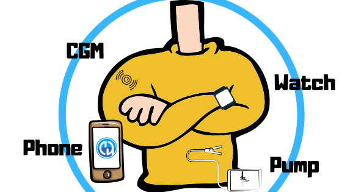

# Přehled komponent

**AAPS** není jen (doma sestavená) aplikace; je to jeden z několika modulů vašeho systému uzavřené smyčky. Než se rozhodnete pro komponenty, je dobré si prohlédnout jejich dokumentaci.



```{admonition} IMPORTANT SAFETY NOTICE
:class: important

Základ bezpečnostních funkcí **AAPS**, které popisuje tato dokumentace, stojí na bezpečnostních funkcích hardwaru, ze kterého svůj systém sestavíte. Pro uzavřenou smyčku s automatickým dávkováním inzulínu je velmi důležité používat jen inzulínovou pumpu a CGM, které jsou otestované, plně funkční a schválené oficiálními úřady ve vaší zemi. Hardwarové nebo softwarové úpravy těchto komponent mohou způsobit neočekávané dávkování inzulínu, což může znamenat pro uživatele významné riziko. Pokud najdete nebo dostanete nabídku na poškozené, upravené nebo podomácku vyrobené inzulínové pumpy nebo přijímače CGM, **nepoužívejte** je pro vytvoření systému **AAPS**.

Kromě toho je stejně důležité používat pouze originální spotřební materiál, jako jsou sety a zásobníky, schválené výrobcem pro použití s vaší pumpou nebo CGM. Použití nevyzkoušeného nebo upraveného spotřebního materiálu může způsobit nepřesné hodnoty CGM a chyby v dávkování inzulínu. Inzulín je velmi nebezpečný, když není dávkovaný správně – prosím, nehazardujte se svým životem tím, že budete upravovat spotřební materiál.

V neposlední řadě nesmíte užívat SGLT-2 inhibitory (glifloziny), protože snižují hladinu glykémie nepředvídatelným způsobem. Kombinace se systémem, který snižuje bazální dávky, aby se zvýšila glykémie, je zvláště nebezpečná. Kvůli gliflozinu totiž glykémie nemusí stoupnout a může dojít k nebezpečnému nedostatku inzulínu. [Více informací zde](#PreparingForAaps-no-sglt-2-inhibitors).
```

## Nezbytné moduly

### Správný individuální algoritmus dávkování pro léčbu vašeho diabetu

I když to není nic, co byste vytvořili nebo koupili, je to asi nejvíce podceňovaný „modul“ – a přitom je nezbytný. Když necháte algoritmus pomáhat s léčbou diabetu, musí znát správná nastavení, aby nedělal vážné chyby. I když vám ještě chybí další moduly, můžete už ve spolupráci se svým diabetologickým týmem ověřit a upravit svůj **Profil**.

**Profil** obsahuje:

- BR (bazální dávky): zajišťují bazální inzulín;
- ISF (citlivost na inzulín): o kolik se sníží vaše glykémie po 1 jednotce inzulínu;
- CR (sacharidový poměr): kolik gramů sacharidů pokryje jedna jednotka inzulínu.

Většina uživatelů smyčky používá cirkadiánní bazál, ISF a CR, které zohledňují hormonální změny citlivosti na inzulín během dne.

Kromě **Profilu** musíte také nastavit svůj **inzulín** v **Spravovat → Nastavení inzulínu**, včetně jeho DIA (doby působnosti inzulínu) – viz [Nastavení inzulínu](#Config-Builder-insulin-dia).

Více informací o **Profilu** najdete [na samostatné stránce](../SettingUpAaps/YourAapsProfile.md).

### Telefon

Viz samostatná stránka [Telefony](../Getting-Started/Phones.md).

### Inzulínová pumpa

Viz samostatná stránka [Kompatibilní pumpy](../Getting-Started/CompatiblePumps.md).

**Výhody a nevýhody některých modelů pump**

Combo, Insight a starší Medtronic jsou spolehlivé pumpy a dají se použít ve smyčce. Výhodou Comba je mnohem větší výběr infuzních setů, protože má standardní Luer-Lock. A baterie je běžná, koupíte ji na každé benzínce nebo v nonstop obchodě. A když opravdu musíte, můžete si ji „půjčit“ z dálkového ovladače v hotelovém pokoji ;-).

Výhody DanaR/RS a Dana-i oproti Combu jako zvolené pumpě jsou však tyto:

- Počáteční spárování je u Dana-i/RS jednodušší. Ale to obvykle děláte pouze jednou, takže to ovlivňuje pouze situace, pokud chcete testovat nové funkce s různými pumpami.
- Combo zatím pracuje s převodem obrazu do strojově čitelné podoby. Obecně to funguje skvěle, ale je to pomalé. Pro smyčku to tolik nevadí, vše pracuje na pozadí. Přesto musíte být připojeni mnohem déle, a tak je i více času, kdy se může spojení Bluetooth přerušit. To není jednoduché, když od telefonu odejdete během bolusu a vaření.
- Combo vibruje na konci dočasných bazálů (TBR), DanaR vibruje (nebo pípá) při SMB. V noci budete pravděpodobně používat více dočasné bazály (TBR) než SMB.  Dana-i/RS lze nastavit tak, aby nepípala ani nevibrovala.
- Načtení historie z Dana-i/RS včetně sacharidů trvá jen několik sekund. Díky tomu můžete snadno vyměnit telefon i bez internetu a pokračovat ve smyčce, jakmile přijdou nějaké hodnoty z CGM.
- Všechny pumpy, se kterými **AAPS** umí komunikovat, jsou při dodání vodotěsné. Pouze pumpy Dana jsou také „vodotěsné v rámci záruky“, protože mají utěsněný prostor pro baterii a utěsněný systém plnění zásobníku.

### Zdroj glykémie

Viz samostatná stránka [Kompatibilní CGM](../Getting-Started/CompatiblesCgms.md).

### Soubor **AAPS**-.apk

Hlavní součást systému. Abyste mohli aplikaci nainstalovat, musíte si nejprve sami sestavit soubor apk. Návod najdete [zde](../SettingUpAaps/BuildingAaps.md).

### Reportovací server

Reportovací server zobrazuje vaše data o glykémii a ošetřeních a vytváří přehledy pro podrobnou analýzu. S AAPS lze nyní použít dva reportovací servery: [Nightscout](#SettingUpTheReportingServer-nightscout) a [Tidepool](#SettingUpTheReportingServer-tidepool). Oba umožňují zobrazit data o vašem diabetu v čase a poskytují statistiky o **čase v rozsahu** (TIR) a další ukazatele.

Reportovací server je nezávislý na ostatních modulech. Pokud reportovací server používat nechcete, vězte, že pro dlouhodobý provoz **AAPS** není povinný. Přesto ho musíte nastavit, protože je potřeba ke splnění [**Cíle 1**](#objectives-objective1).

Další informace o nastavení reportovacího serveru najdete [zde](../SettingUpAaps/SettingUpTheReportingServer.md).

## Volitelné moduly

### Chytré hodinky

Můžete si vybrat jakékoli chytré hodinky se systémem **Wear OS 3** nebo novějším. Podrobnosti najdete v části [Hodinky](../Getting-Started/Watches.md).

Uživatelé vytvářejí [seznam otestovaných telefonů a hodinek](#Phones-list-of-tested-phones). Pro **AAPS** existují různé ciferníky, najdete je [zde](../WearOS/WearOsSmartwatch.md).

### xDrip

I když aplikaci xDrip nepotřebujete jako **Zdroj glykémie**, můžete ji přesto používat, například pro alarmy nebo jiné zobrazení glykémie. Můžete mít tolik alarmů, kolik chcete, určit čas, kdy má být alarm aktivní, zvolit, zda může přebít tichý režim, atd. Některé informace o xDrip najdete [zde](../CompatibleCgms/xDrip.md). Upozorňujeme, že dokumentace k této aplikaci není vždy aktuální, protože se aplikace rychle mění.

## Co dělat při čekání na moduly

Získat všechny moduly pro uzavření smyčky někdy chvíli trvá. Ale žádné obavy, je mnoho věcí, které můžete při čekání udělat. Je **nutné** zkontrolovat a (kde je to vhodné) upravit bazální dávky (BR), inzulínosacharidový poměr (IC), citlivost na inzulín (ISF) atd. A otevřená smyčka může být dobrý způsob, jak systém vyzkoušet a seznámit se s **AAPS**. V tomto režimu vám **AAPS** dává doporučení k léčbě, která můžete provést ručně.

Můžete dál číst tuto dokumentaci, spojit se s dalšími uživateli smyčky online i osobně, [číst](../UsefulLinks/BackgroundReading.md) dokumentaci nebo to, co píší jiní uživatelé smyčky (i když musíte být opatrní, ne všechno je správné nebo vhodné, abyste to opakovali).

**Hotovo?** Pokud máte všechny komponenty **AAPS** pohromadě (gratulujeme!) nebo alespoň dost na to, abyste začali v režimu otevřené smyčky, měli byste si před každým novým cílem nejprve přečíst [popis cílů](../SettingUpAaps/CompletingTheObjectives.md) a nastavit svůj hardware.
