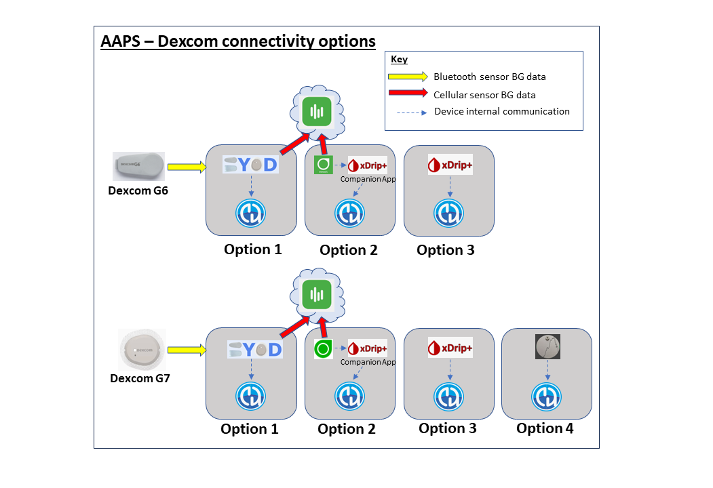

# Příprava na začátek s AAPS

Vítejte. Tato dokumentace provede uživatele, kteří se připravují na nastavení a používání systému Android Artificial Pancreas System (**AAPS**).

## Orientace v dokumentaci

**Index** a vysvětlení struktury dokumentace můžete najít [zde](../index.md) a můžete se k němu také dostat klepnutím na symbol **AAPS** v levém horním rohu. Zde naleznete přehled účelu jednotlivých sekcí dokumentace. Můžete také použít nadpisy nalevo od této stránky k navigaci dokumentací. A nakonec je tu praktické vyhledávání, přímo pod symbolem **AAPS**.

Snažíme se, abyste snadno pochopili možnosti i omezení **AAPS**. Po investování času do čtení dokumentace může být zklamáním zjistit, že třeba nemáte kompatibilní inzulínovou pumpu nebo CGM, nebo že **AAPS** nabízí jinou funkcionalitu než jste očekávali.

Mnoho detailů v **AAPS** dokumentaci dává větší smysl, když **AAPS** skutečně používáte. Stejně jako je těžké naučit se sport jen čtením pravidel, je potřeba nejprve se naučit základní pravidla pro bezpečné používání **AAPS** a pak se učit, jak je co nejlépe používat, když s **AAPS** začnete.

(preparing-safety-first)=

## Bezpečnost především
"S velkou mocí přichází velká odpovědnost..."

### Technická bezpečnost
**AAPS** má rozsáhlou sadu bezpečnostních prvků. Tato vynucená omezení jsou postupně uvolňována díky plnění série [cílů](../SettingUpAaps/CompletingTheObjectives.md), které zahrnují testování konkrétních parametrů a otázky s více možnými odpověďmi. Funkce **AAPS** se odemykají postupně, jak úspěšně plníte cíle. Tento postup umožňuje uživateli bezpečný postup od otevřené k uzavřené smyčce, zatímco se učí o různých funkcích **AAPS**.

[Cíle](../SettingUpAaps/CompletingTheObjectives.md) jsou navržené tak, aby vás s **AAPS** seznámily co nejlépe. Berou v úvahu typické chyby a obecné trendy, které vývojáři **AAPS** pozorovali u nových uživatelů. Chyby se mohou stát, protože začátečník nemá zkušenosti a chce s **AAPS** začít příliš rychle, nebo přehlédl důležité body. [Cíle](../SettingUpAaps/CompletingTheObjectives.md) mají tyto problémy co nejvíce omezit.

### Zdravotní bezpečnost
```{admonition} Avoid permanent and painful damage to your eyes and nerves
:class: danger
Pozor na rychlé zlepšení kontroly glykémie a rychlé snížení HbA1c 
```

Důležité bezpečnostní upozornění: **rychlé snížení HbA1c a zlepšení kontroly glykémie u lidí, kteří měli delší dobu vysokou glykémii, může způsobit trvalé poškození**. Mnoho lidí s diabetem o tom neví a ne všichni lékaři na to své pacienty upozorní.

Tato poškození mohou zahrnovat **ztrátu zraku a trvalou neuropatii (bolesti)**. Tomuto poškození se dá předejít, pokud budete průměrnou glykémii snižovat pomaleji. Pokud máte nyní vysoké HbA1c a přecházíte na **AAPS** (nebo jiný systém uzavřené smyčky), _prosím_ proberte toto riziko se svým lékařským týmem ještě před začátkem a domluvte se s ním na časovém plánu, ve kterém budete cílovou glykémii snižovat postupně a bezpečně. Na začátku můžete v **AAPS** snadno nastavit vyšší cílovou glykémii (nejvyšší cíl, který nyní můžete zvolit, je 11,1 mmol/l, ale v případě potřeby můžete také záměrně používat slabší profil) a pak cíl během měsíců postupně snižovat.

#### Jak rychle můžu snížit můj HbA1c bez rizika trvalých následků?

Jedna retrospektivní [studie](https://pubmed.ncbi.nlm.nih.gov/1464975/) 76 pacientů uvádí, že riziko zhoršení retinopatie se zvýšilo 1,6krát, 2,4krát a 3,8krát, pokud HbA1c kleslo o 1 %, 2 % nebo 3 % během 6 měsíců. Autoři studie navrhli, že **"snížení hodnoty HbA1c během jakéhokoli šestiměsíčního období by mělo být omezeno na méně než 2%, aby se zabránilo postupu retinopatie... Příliš rychlý úvodní pokles glykémie by mohl způsobit silné nebo dočasné zhoršení postupu retinopatie."**

Poznámka: Pokud používáte jiné jednotky HbA1c (mmol/mol místo %), kalkulačku HbA1c najdete [zde](https://www.diabetes.co.uk/hba1c-units-converter.html).

V jiném retrospektivním [vyhodnocení](https://academic.oup.com/brain/article/138/1/43/337923) 954 pacientů výzkumníci poznamenali:

**„S poklesem HbA1c o 2–3 procentní body za 3 měsíce bylo absolutní riziko vzniku neuropatie vyvolané léčbou diabetu 20 %, s poklesem HbA1c o >4 procentní body za 3 měsíce překročilo absolutní riziko vzniku neuropatie vyvolané léčbou diabetu 80 %.“**

[Komentář](https://academic.oup.com/brain/article/138/1/2/340563) k této práci souhlasí, že aby se předešlo komplikacím, **cílem by mělo být snížit A1c o <2 % za 3 měsíce.** Další přehledové články na toto téma najdete [zde](https://www.ncbi.nlm.nih.gov/pmc/articles/PMC6587545/pdf/DOM-21-454.pdf) a [zde](https://www.mdpi.com/1999-4923/15/7/1791).

Obecně se uznává, že lidé s _nově_ zjištěným diabetem 1. typu (kteří mají při diagnóze, před zahájením léčby inzulínem, často velmi vysoké HbA1c) mohou HbA1c hned po diagnóze rychle snížit, aniž by jim tato rizika hrozila ve stejné míře, protože vysokou glykémii neměli tak dlouho. Nicméně stále je to otázka, kterou byste měli prodiskutovat se svým lékařem.

(PreparingForAaps-no-sglt-2-inhibitors)=
### Žádné SGLT-2 inhibitory

```{admonition} NO SGLT-2 inhibitors
:class: danger
SGLT-2 inhibitory, nazývané také glifloziny, brání zpětnému vstřebávání glukózy v ledvinách. Glifloziny snižují glykémii nepředvídatelně, a proto je při používání systému uzavřené smyčky, jako je AAPS, NESMÍTE užívat! Znamenalo by to značné riziko ketoacidózy nebo hypoglykémie! Kombinace těchto léků se systémem, který snižuje bazální dávky, aby glykémii zvýšil, je obzvlášť nebezpečná. 

Stručně řečeno:
- **Příklad 1: riziko hypoglykémie**
>Při obědě si v **AAPS** pošlete bolus na 45 g glukózy, které sníte. Problém je v tom, že inhibitory způsobí, že tělo část sacharidů vyloučí, a AAPS o tom neví. V těle je pak příliš mnoho inzulínu ve srovnání se vstřebanými sacharidy a dojde k hypoglykémii.

- **Příklad 2: riziko ketoacidózy**
>Inhibitory na pozadí vylučují část sacharidů, a tím snižují vaši glykémii. **AAPS** automaticky řekne pumpě, aby podávala méně inzulínu, včetně bazálu. Postupem času může vaše glykémie zůstávat pod cílovou hodnotou tak dlouho, až tělo nemá dost bazálního inzulínu na zpracování sacharidů, a dojde ke ketoacidóze. Ketoacidóza u lidí s diabetem 1. typu obvykle vzniká kvůli poruše pumpy. To by spustilo upozornění v telefonu a bylo by to vidět na vysoké glykémii. U gliflozinů je ale nebezpečné to, že AAPS žádné upozornění nezobrazí, protože pumpa dál funguje a glykémie může zůstat v cílovém rozmezí.

Běžné obchodní názvy SGLT-2 inhibitorů jsou například: Invokana, Farxiga, Jardiance, Glyxambi, Synjardy, Steglatro, Xigduo XR a další.
```


### Klíčové principy smyčky s AAPS

Před použitím **AAPS** musíte porozumět hlavním principům a pojmům smyčky. Toho lze dosáhnout obětováním vašeho času k přečtení dokumentace **AAPS** a dokončením cílů, které jsou zaměřené na poskytnutí pevných základů pro bezpečné a efektivní používání **AAPS**. Objem **AAPS** dokumentace se může zprvu zdát nepřekonatelný, ale když budete trpělivý a budete věřit postupu, dostanete se do cíle!

Rychlost postupu bude záviset na jednotlivci, ale uvědomte si, že splnění všech cílů obvykle trvá 6-9 týdnů. Mnoho lidí začíná **AAPS** sestavovat, instalovat a nastavovat dlouho předtím, než ho začnou používat. K tomu má systém "virtuální pumpu", kterou můžete využít během plnění počátečních cílů, abyste se mohli seznámit s **AAPS**, aniž byste ho skutečně používali k dávkování inzulínu. Podrobný časový plán najdete níže. Uvědomte si, že u cíle 7 v **AAPS** už používáte uzavřenou smyčku. Další cíle přidávají funkce jako **SMB** a **automatizace**, které jsou pro některé uživatele užitečné, ale pro základní funkci **AAPS** nejsou nutné.

Úspěch s **AAPS** vyžaduje aktivní přístup, ochotu přemýšlet o datech glykémie a pružnost při úpravách nastavení **AAPS**, abyste zlepšili své výsledky. Stejně jako je téměř nemožné naučit se nějaký sport jen čtením pravidel, platí totéž i pro **AAPS**.

#### Počítejte se zpožděním a drobnými problémy při nastavování a spouštění

V počátečních fázích zahájení provozu **AAPS** může docházet k potížím se zprovozněním všech komponent smyčky, správným zajištěním jejich vzájemné komunikace (a s potenciálními sledujícími) a při ladění nastavení. Některé problémy není možné vyřešit, dokud **AAPS** denně nevyužíváte, ale ve Facebookové skupině nebo na Discordu získáte veškerou potřebnou pomoc a podporu. Řešení zádrhelů a problémů si zkuste naplánovat na vhodnou dobu, jako například klidné víkendové ráno (takže raději ne pozdě v noci, když jste unavení, nebo před důležitou schůzkou či cestou).

#### Technologická kompatibilita

**AAPS** je kompatibilní pouze s určitými typy inzulínových pump, senzorů a telefonů a některé technologie nemusí být dostupné ve všech zemích. Abyste se vyhnuli zklamání nebo frustraci, přečtěte si prosím v dokumentaci oddíly [CGM](../Getting-Started/CompatiblesCgms.md), [Inzulínové pumpy](../Getting-Started/CompatiblePumps.md) a [Telefony](../Getting-Started/Phones.md).

#### Čas potřebný k sestavení aplikace a postup k plné smyčce

Čas potřebný na sestavení aplikace **AAPS** závisí na vašich znalostech a technických schopnostech. Nezkušenému uživateli může sestavení **AAPS** trvat (s pomocí komunity) půl dne až celý den. Jak budete v průběhu času získávat více zkušeností, postup sestavení nových verzí **AAPS** se výrazně urychlí.

Se sestavením vám pomohou tyto části dokumentace:

- [Sestavení AAPS](../SettingUpAaps/BuildingAaps.md) vás krok za krokem provede sestavením aplikace a její instalací do telefonu;

- [Nejčastější otázky uživatelů APS](../UsefulLinks/FAQ.md) odpovídají na běžné otázky a vysvětlují chyby, které se objevují nejčastěji;

- rozcestník [Řešení problémů](../GettingHelp/GeneralTroubleshooting.md) shromažďuje řešení nejčastějších problémů, seřazená podle témat.

Jak dlouho potrvá, než se dostanete k uzavřené smyčce, záleží na každém z vás. Přibližný časový plán, jak se s **AAPS** dostat k plné smyčce, najdete [níže](#preparing-how-long-will-it-take).


#### Úložiště klíčů a soubor s exportem nastavení

Úložiště klíčů (keystore) je heslem chráněný šifrovaný soubor jedinečný pro vaši kopii **AAPS**. Telefon s Androidem ho používá k tomu, aby nikdo jiný nemohl aktualizovat vaši kopii bez tohoto úložiště klíčů. Stručně řečeno, při sestavení **AAPS** byste měli:

1.  uložit soubor úložiště klíčů (soubor .jks, kterým se podepisuje vaše aplikace) na bezpečné místo;

2.  Zaznamenat si heslo k vašemu souboru úložiště klíčů.

Jak úložiště klíčů uložíte, záleží na způsobu sestavení:

- **Sestavení v Android Studiu (počítač)**: úložiště klíčů se vytvoří během sestavení – kam ho uložit, najdete v části [Generate signed APK](#Building-APK-generate-signed-apk).
- **AAPS Builder**: uschovejte si záložní soubor `aaps-keystore.jks`, který vám stránka nastavení nabídla při vytvoření klíče, spolu s jeho heslem a aliasem. Pokud jste nahráli vlastní úložiště klíčů, uschovejte si tento soubor.
- **Sestavení v prohlížeči s forkem**: pomocí workflow [Export keystore](#ci-keystore-export) si stáhněte kopii na svůj Disk Google.

Díky tomu budete moci použít stejný soubor úložiště klíčů pokaždé, když sestavíte novou verzi **AAPS**. V průměru budou potřebné 2 aktualizace **AAPS** ročně.

**AAPS** navíc umožňuje [exportovat všechna vaše nastavení](../Maintenance/ExportImportSettings.md). To vám umožní bezpečně obnovit váš systém s minimálním výpadkem v případě změny telefonu, aktualizace/přeinstalování aplikace. 

#### Řešení problémů

Pokud si s něčím nejste jistí, neváhejte se obrátit na komunitu AAPS – hloupé otázky neexistují! Všichni uživatelé, bez ohledu na úroveň jejich zkušeností, mohou klást otázky podle potřeby. Díky množství **AAPS** uživatelů dostanete obvykle odpovědi na vaše otázky poměrně rychle.

##### [zeptejte se ve facebookové skupině AAPS](https://www.facebook.com/groups/AndroidAPSUsers/)

##### [zeptejte se na Discord kanálu AAPS](https://discord.gg/4fQUWHZ4Mw)


#### [Kde získat pomoc?](../UsefulLinks/BackgroundReading.md)

Cílem této sekce je poskytnout novým uživatelům odkazy na zdroje, aby získali pomoc včetně přístupu ke komunitní podpoře složené z nových i zkušených uživatelů, kteří mohou objasnit otázky, a vyřešit obvyklé nástrahy, které přicházejí s AAPS.

#### [Oddíl pro lékaře](../UsefulLinks/ClinicianGuideToAaps.md)

Toto je [oddíl určený přímo lékařům](../UsefulLinks/ClinicianGuideToAaps.md), kteří se chtějí dozvědět více o AAPS a o technologii umělé slinivky s otevřeným zdrojovým kódem. Doporučení, [jak mluvit se svým lékařským týmem](#introduction-how-can-i-approach-discussing-aaps-with-my-clinical-team), najdete také v Úvodu.

## Co budeme sestavovat a instalovat?

Tento diagram poskytuje přehled klíčových komponent (jak hardwarových, tak softwarových) systému **AAPS**:


Kromě tří základních hardwarových součástí (telefon, pumpa, senzor glykémie) potřebujeme také: 1) Aplikaci **AAPS** 2) Reportovací server a 3) Aplikaci pro kontinuální monitorování glykémie (CGM)

### 1) Aplikace pro Android telefon: **AAPS**

**AAPS** je aplikace pro chytré telefony a další zařízení s Androidem. Aplikaci **AAPS** (soubor apk) si sestavíte sami podle návodu krok za krokem: stáhnete zdrojový kód **AAPS** z GitHubu, nainstalujete do počítače potřebné programy (Android Studio, GitHub Desktop) a sestavíte si vlastní kopii aplikace **AAPS**. Aplikaci **AAPS** pak přenesete do svého chytrého telefonu (e-mailem, USB kabelem _apod._) a nainstalujete ji.

### 2) Reportovací server: Nightscout (Tidepool*)

Abyste mohli **AAPS** plně využívat, musíte si nastavit server Nightscout. Můžete to [udělat sami](https://nightscout.github.io/nightscout/new_user/#free-diy), nebo za malý poplatek využít [spravovanou službu Nightscout](https://nightscout.github.io/#nightscout-as-a-service), která vše nastaví za vás. Nightscout se používá pro průběžný sběr dat z **AAPS**, ze kterých může vytvářet podrobné zprávy související s CGM a inzulínovými schematy. Pečovatelé mohou přes Nightscout s aplikací **AAPS** komunikovat na dálku a dohlížet na léčbu diabetu svého dítěte. Možnosti vzdálené komunikace zahrnují monitoring úrovní glukózy a inzulínu v reálném čase, vzdálené posílání bolusů (pomocí textových zpráv) a zadávání jídel. Hodnotit léčbu diabetu jen podle dat z CGM bez dat z pumpy je jako řídit auto, jehož řidič je slepý a spolujezdec mu popisuje, co vidí. Jako alternativu k Nightscoutu můžete použít také Tidepool.

### 3) Aplikace senzoru CGM

V závislosti na vašem glukózovém senzoru/CGM budete potřebovat kompatibilní aplikaci pro příjem měření glukózy a jejich odesílání do **AAPS**. Různé možnosti jsou zobrazeny níže a více informací je uvedeno v sekci [Kompatibilní CGM](../Getting-Started/CompatiblesCgms.md):

  

### Údržba **AAPS** systému

**Nightscout** i **AAPS** je potřeba aktualizovat přibližně jednou ročně, když vyjdou nové verze. V některých případech je možné aktualizaci odložit, zatímco v jiných se z bezpečnostních důvodů důrazně doporučuje aktualizaci provést bezodkladně. Upozornění na dostupnou aktualizaci jsou zveřejňována ve Facebook skupinách a na Discord serveru. Z poznámek k vydání bude vždy jasné, o jakou situaci jde. V čase aktualizace bude pravděpodobně mnoho lidí klást obdobné otázky a budete mít podporu při provedení aktualizace.

(preparing-how-long-will-it-take)=
## Jak dlouho bude trvat všechno nastavit?

Jak už bylo řečeno, používání **AAPS** je spíše „cesta“, která od vás vyžaduje váš vlastní čas. Nejde o jednorázové nastavení. Podle současných odhadů trvá sestavení **AAPS**, instalace a nastavení **AAPS** a softwaru pro **CGM** a cesta od otevřené smyčky k hybridní uzavřené smyčce s **AAPS** celkem asi 4 až 6 měsíců. Proto doporučujeme začít co nejdříve se sestavením aplikace **AAPS** a s plněním prvních cílů, i když ještě používáte jiný systém pro podávání inzulínu (virtuální pumpu můžete používat až do cíle 5).

U některých cílů musí uplynout určitý počet dní, abyste novým funkcím dobře porozuměli. Tuto čekací dobu nelze obejít. Minimální čekací doby jsou nastavené kvůli vaší bezpečnosti.

Zde je přibližný časový rámec:

| Úlohy                                                          |        Odhadovaný čas         |
| -------------------------------------------------------------- |:-----------------------------:|
| Úvodní přečtení dokumentace                                    |            1-2 dny            |
| Nastavení GitHubu pro sestavení v prohlížeči                   |          1–4 hodiny           |
| Nastavení reportovacího serveru                                |           1 hodina            |
| Instalace aplikace pro CGM (xDrip, BYODA, …)                   |           1 hodina            |
| Prvotní nastavení CGM → xDrip → AAPS                           |           1 hodina            |
| Prvotní nastavení AAPS → pumpa                                 |           1 hodina            |
| Nastavení AAPS → Nightscout/Tidepool (pouze reporty)           |           1 hodina            |
| Volitelné: nastavení NightScout ↔ **AAPS** a NSFollowers       |           1 hodina            |
| Cíl 1: Nastavit vizualizaci a monitoring                       |           1 hodina            |
| Cíl 2: Naučte se, jak ovládat AAPS                             |           2 hodiny            |
| Cíl 3: Prokažte své znalosti                                   |           až 14 dní           |
| Cíl 4: Začít s otevřenou smyčkou                               |         Nejméně 7 dní         |
| Cíl 5: Porozumět otevřené smyčce                               |             7 dnů             |
| Cíl 6: Spustit uzavřenou smyčku (Ochrana před nízkou glykémií) |   Nejméně 5, nejvýše 14 dní   |
| Cíl 7: Ladění uzavřené smyčky                                  | Nejméně 1 den, nejvýše 7 dní  |
| Cíl 8: Upravit bazály a poměry, povolit Autosens               | Nejméně 7 dní, nejvýše 14 dní |
| Cíl 9: Povolit Super Micro Bolus (SMB)                         |        Nejméně 28 dní         |
| Cíl 10: Automatizace                                           |        Nejméně 28 dní         |

I když už **AAPS** plně používáte, musíte své nastavení dál pravidelně dolaďovat, abyste zlepšili celkovou léčbu diabetu.

## Požadavky

### Lékařská hlediska

Kromě lékařských varování popsaných v oddíle [Bezpečnost](#preparing-safety-first) existují také další parametry, které jsou závislé na typu inzulínu, který používáte v pumpě.

#### Výběr inzulínu

Výpočty **AAPS** vycházejí z koncentrace inzulínu 100 U/ml (stejně jako standard pump). Inzulín nastavíte v **Spravovat → Nastavení inzulínu**: nastavte hodnoty **Vrchol** a **Doba působnosti inzulínu** (DIA), nebo použijte **Načíst vrchol z** a doplňte standardní čas vrcholu jednoho z přednastavených inzulínů:

- **Novorapid** (také pro Humalog a NovoLog)
- **Fiasp**
- **Lyumjev**

Pokročilí uživatelé mohou zadat libovolný čas vrcholu (35 až 120 minut) přímo, například pro směs inzulínů. Viz [Nastavení inzulínu](#Config-Builder-insulin).


### Technická hlediska

Cílem této dokumentace je snížení potřebné technické odbornosti na absolutní minimum. Aplikaci **AAPS** můžete sestavit několika způsoby – přehled najdete v části [Sestavení AAPS](../SettingUpAaps/BuildingAaps.md):

- **Sestavení v prohlížeči** (doporučeno): aplikaci sestavíte přímo z telefonu pomocí GitHub Actions, bez počítače a bez Android Studia. S [AAPS Builderem](../SettingUpAaps/BrowserBuildAapsBuilder.md) potřebujete jen účet na GitHubu: aplikaci stáhnete přímo z GitHubu. Metoda s forkem potřebuje také účet Google, aby mohla aplikaci uložit na váš Disk Google.
- **Sestavení v Android Studiu**: aplikaci sestavíte v počítači pomocí Android Studia. Tento způsob používají hlavně vývojáři, kteří chtějí měnit kód.
- **Sestavení z příkazové řádky**: pro uživatele, kteří chtějí sestavovat ve svém počítači bez instalace Android Studia.

Kromě sestavení aplikace musíte také nastavit reportovací server, nastavit několik aplikací v telefonu s Androidem a získat znalosti o léčbě diabetu. Zvládnete to, když budete postupovat krok za krokem, budete trpěliví a využijete pomoc komunity **AAPS**. Pokud se umíte pohybovat na internetu a spravovat svůj e-mail v Gmailu, sestavení **AAPS** zvládnete. Jen nepospíchejte.

### Chytré telefony

#### AAPS a verze Androidu

Aktuální verze **AAPS** (4.0) vyžaduje chytrý telefon s **Androidem 12.0 nebo novějším**. Pokud plánujete koupit nový telefon, doporučujeme (k lednu 2026) Android 16.<br/> Z bezpečnostních důvodů důrazně doporučujeme udržovat vaše sestavení **AAPS** aktuální. Uživatelé, kteří nemohou používat zařízení s Androidem 12.0 nebo novějším, mohou dál používat starší verze **AAPS** pro starší verze Androidu, viz [Poznámky k vydání](#maintenance-android-version-aaps-version).

#### Výběr modelu telefonu
Přesný model, který kupujete, závisí na požadovaných funkcích. Na stránce [Telefony](../Getting-Started/Phones.md) najdete doporučení a zkušenosti uživatelů s funkčními sestavami.

Doporučujeme udržovat Android v telefonu aktuální, včetně bezpečnostních aktualizací. Pokud jste ale s **AAPS** noví nebo nejste technický expert, možná budete chtít aktualizaci telefonu odložit, dokud ji neprovedou ostatní a nepotvrdí na našich fórech, že je bezpečná.

```{admonition} Delaying Samsung phone updates
:class: warning
Samsung bohužel do svých telefonů často vynucuje aktualizace, které mohou způsobit problémy s připojením přes Bluetooth. Chcete-li tyto vynucené aktualizace vypnout, musíte telefon přepnout do „režimu vývojáře“:

1. Přejděte do **Nastavení** > **O telefonu** > **Informace o softwaru** a pak opakovaně klepejte na **Číslo sestavení**, dokud telefon nepotvrdí, že je režim vývojáře odemčený.
2. Vraťte se do hlavní nabídky **Nastavení**, kde uvidíte novou položku **Možnosti vývojáře**.
3. Otevřete **Možnosti vývojáře**, najděte položku **Automatické aktualizace systému** a vypněte ji.
```

```{admonition} Google Play Protect potential issue
:class: warning
Několik uživatelů hlásilo, že Google Play Protect každé ráno bez důvodu vypnul **AAPS**. Pokud se vám to stane, musíte v nastavení Google Play vypnout **Google Play Protect**. Netýká se to všech modelů telefonů ani všech verzí Androidu.
```

```{admonition} Android developer verification
:class: note
Od září 2026 Google postupně zavádí [ověřování vývojářů Androidu](#android-developer-verification), které mění způsob instalace vlastnoručně sestavené aplikace do telefonu. Sestavení **AAPS** se to netýká a bezplatné způsoby instalace zůstávají dostupné – podrobnosti najdete na odkazované stránce.
```

