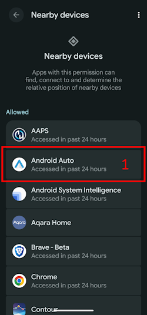
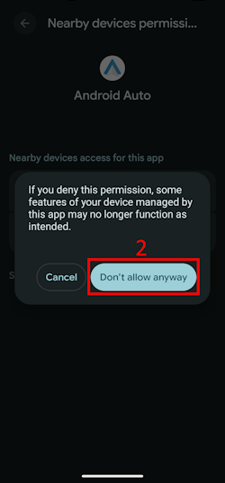

(bluetoothtroubleshooting-bluetooth-related-issues)=

# Bluetooth related issues

Někteří uživatelé narazili na problémy s Bluetooth: selhání aktivace Omnipod DASH, potíže s připojením Medtrum Nano a další chyby podů. Mnoho z těchto problémů má příčinu v jedné z následujících situací.

Některé z těchto problémů se pravděpodobně týkají i jiných inzulínových pump s Bluetooth. Medtrum Nano má známé problémy s oprávněním „Zařízení v okolí“, stejně jako Omnipod DASH.

---

(bluetoothtroubleshooting-cannot-start-omnipod-with-android-16)=

## Omnipod nelze spustit s Androidem 16
- Pro správnou funkci Omnipod DASH potřebuje Android 16 alespoň **AAPS** verze 3.3.2.1. Tato verze obsahuje opravy přímo pro známé problémy, které Android 16 u Omnipodu způsobil.

---

(bluetoothtroubleshooting-bluetooth-battery-optimisation)=

## Optimalizace baterie pro Bluetooth

Novější verze Androidu mají pro systémovou aplikaci Bluetooth zapnutou optimalizaci baterie. O tomto nastavení je známo, že způsobuje některé problémy u pump a CGM s Bluetooth.

Pokud jste postupovali podle [Průvodce nastavením](../SettingUpAaps/SetupWizard) a podle nastavení v části [Optimalizace baterie pro Bluetooth](#setup-wizard-bluetooth-battery-optimisation), mělo by být toto nastavení správné. Pokud jste ale postupovali podle starší verze tohoto návodu, je možné, že jste toto nastavení nezměnili.

Pokud se vám pumpa nebo CGM odpojuje, zkontrolujte, zda je toto nastavení správné.

---

(bluetoothtroubleshooting-apps-using-nearby-device-permission)=

## Aplikace, které používají oprávnění Androidu „Zařízení v okolí“, mohou způsobit výpadky spojení a problémy s aktivací Podu

Android vám pomocí oprávnění umožňuje určit, co může každá aplikace v telefonu dělat nebo k čemu má přístup. U každé nainstalované aplikace můžete povolit nebo zakázat konkrétní oprávnění, např. přístup k souborům v zařízení, přístup k Bluetooth, vyhledávání zařízení v okolí apod.

**AAPS** potřebuje ke své funkci řadu konkrétních oprávnění. Jedním z nich, které je nutné pro správnou funkci Podů, je oprávnění „Zařízení v okolí“. Toto oprávnění vyžaduje i mnoho jiných aplikací. Komunita zjišťuje, že řada aplikací, když toto oprávnění dostane, může na některých zařízeních způsobit problémy s aktivací nových Podů.

(bluetoothtroubleshooting-apps-using-nearby-device-permission-known-apps)=

### Aplikace, které používají oprávnění „Zařízení v okolí“ a o kterých je známo, že způsobily problémy:

O aplikacích v tomto seznamu se v komunitě na jednom nebo více místech mluvilo jako o příčině problémů se zařízeními Omnipod DASH a v některých případech i s Medtrum Nano.

```{admonition} Updating the list
:class: note
Pokud chcete navrhnout další aplikace do tohoto seznamu, napište @XiTatiON na kanálu #omnipod-dash na Discordu.
```

- **myBMW** Aplikace MyBMW rušila Medtrum Nano a Omnipod DASH. Aplikace MyBMW žádá o oprávnění „najít zařízení v okolí“ jen jednou. Pokud ho neudělíte, funguje i tak naprosto v pořádku.

- **Amazon Alexa**  Odebrání oprávnění „Zařízení v okolí“ aplikaci Alexa u některých lidí problém vyřešilo, ale znemožní párování zařízení IoT se standardem Matter.

- **Aplikace MINI**  Zdá se, že aplikace vychází z aplikace myBMW, a proto se může chovat stejně.

- **BM2** Aplikace pro sledování solární baterie, používaná v některých obytných dodávkách a solárních sestavách pro kempování. Když aplikace běžela, bránila aktivaci nového Podu. Problém lze obejít tak, že aplikaci během aktivace nového Podu vynuceně ukončíte. Spuštění aplikace potom už funkci Dash zřejmě nerušilo (na Pixelu 8 Pro s Androidem 16).

(bluetoothtroubleshooting-revoke-nearby-device-permission)=

### Jak odebrat oprávnění „Zařízení v okolí“ ostatním aplikacím:
Pokud máte problémy s aktivací nového Podu a používáte správnou podporovanou verzi **AAPS** pro svou verzi Androidu: Může být nutné během aktivace nového Podu odebrat toto oprávnění ostatním aplikacím.

Postupujte takto, abyste oprávnění „Zařízení v okolí“ odebrali všem aplikacím kromě **AAPS**:

```{admonition} Menus and settings
:class: note
Snímky obrazovky a pokyny v tomto návodu pocházejí z čistého Androidu 16 (Vanilla) na telefonu Google Pixel 8 Pro. U jiných výrobců a zařízení se nabídky a popisy nastavení pravděpodobně nebudou přesně shodovat. Upravte kroky podle svého zařízení. Pokud si nevíte rady, podívejte se do části [Kde získat pomoc pro Dash](#omnipod-dash-where-to-get-help-for-dash), jak požádat komunitu o podporu.
```

1. V telefonu otevřete nastavení Androidu, posuňte se dolů a klepněte na **Zabezpečení a ochrana soukromí (1)**.

    

2. Posuňte se dolů a klepněte na **Ovládací prvky ochrany soukromí (1)**.

   

3. Klepněte na **Správce oprávnění (1)**.

   

3. Posuňte se dolů a klepněte na **Zařízení v okolí (1)**.

   

4. Projděte seznam aplikací a klepněte na aplikaci, které chcete oprávnění **Zařízení v okolí** odebrat.

   V tomto návodu odebereme oprávnění aplikaci **Android Auto (1)**.

   Abyste nezničili další pody, doporučujeme na začátku odebrat oprávnění všem aplikacím kromě **AAPS**.

```{admonition} Which app to select?
:class: tip
Pokud si nejste jistí, která aplikace problém způsobuje, zakažte oprávnění všem (podívejte se také na seznam známých problémových aplikací a začněte jimi). Pokud si můžete dovolit přijít o několik podů, povolte oprávnění vždy jedné další aplikaci před každou novou aktivací Podu, dokud nezjistíte, která aplikace problémy s Podem způsobuje. Pokud najdete nové problémové aplikace, dejte nám prosím vědět na kanálu #omnipod-dash na Discordu.
```

   

5. Oprávnění odeberete klepnutím na **Nepovolovat (1)** a potom na **Přesto nepovolit (2)**. Pokud jste vše udělali správně, uvidíte jako vybranou možnost **Nepovolovat (3)**. Nyní se můžete vrátit do nabídky **Zařízení v okolí** klepnutím na **šipku Zpět (4)** a v případě potřeby změnit toto nastavení u dalších aplikací.

      

(bluetoothtroubleshooting-re-enable-nearby-device-permission)=

### Jak znovu povolit oprávnění „Zařízení v okolí“ systémovým a ostatním aplikacím:

1. V případě potřeby se podívejte do části **„Jak odebrat oprávnění Zařízení v okolí ostatním aplikacím“**, kde najdete, jak se dostat do nastavení soukromí aplikací. Až budete v nastavení **Zařízení v okolí**, pokračujte krokem 2.

2. Projděte seznam aplikací a klepněte na aplikaci, které chcete oprávnění **Zařízení v okolí** povolit.

   V tomto návodu povolíme oprávnění aplikaci **Android Auto (1)**.

   Všimnete si, že po odebrání oprávnění aplikace **Android Auto (1)** v seznamu aplikací chybí. Je to proto, že **Android Auto** je **systémová aplikace** a systémové aplikace jsou ve výchozím stavu skryté.

   

3. Skryté systémové aplikace zobrazíte klepnutím na **nabídku se třemi tečkami (⋮) (1)** v pravém horním rohu a potom na **„Zobrazit systémové“ (2)**. Nyní byste měli v seznamu vidět skrytou systémovou aplikaci **Android Auto (3)**.

```{admonition} Find your app
:class: tip
Pokud bylo aplikaci oprávnění odebráno, musíte se posunout dolů, dokud neuvidíte seznam aplikací bez oprávnění níže v seznamu.
```

     

5. Pro opětovné povolení oprávnění u každé aplikace postupujte podle části **„Jak odebrat oprávnění Zařízení v okolí ostatním aplikacím“** v opačném pořadí.

---

(bluetoothtroubleshooting-android-15-bluetooth-connection-problems)=

## Android 15: časté problémy s připojením Bluetooth

Po aktualizaci Androidu nebo přechodu na novější telefon **AAPS** často ztrácí spojení Bluetooth s pumpou. Po restartu telefonu problém na čas zmizí. Pokud používáte **Omnipod DASH** a váš telefon má Android 15, může zapnutí nastavení **Bluetooth párování** pomoci zlepšit stabilitu spojení Bluetooth. Jak ho zapnout:

```{admonition} Android 16
:class: warning
**Bluetooth párování** zapínejte jen na Androidu 15 a jen tehdy, když máte problémy se spojením. Na Androidu 16 párování (bonding) NEZAPÍNEJTE.
```

1. Otevřete [nastavení Dash](#omnipod-dash-settings): otevřete obrazovku pumpy DASH přes **Spravovat** > **Pumpa** a klepněte na ikonu **Nastavení** (ozubené kolo) v pravém horním rohu.

   

2. Otevřete část **Rozšířená nastavení** a zapněte **Bluetooth párování**.

   

3. Pokud telefon zobrazí žádost o spárování, přijměte ji.

4. Restartujte telefon.
