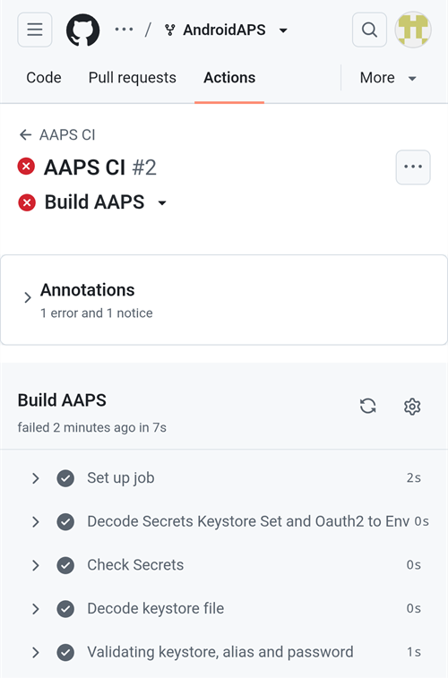

(aaps-ci-troubleshooting)=

# Sestavení v prohlížeči: řešení problémů

```{note}
This page collects troubleshooting tips for the [Browser build](../SettingUpAaps/BrowserBuild.md).
```

(aaps-builder-troubleshooting)=

## AAPS Builder

### Step 1: the repository

(aaps-builder-ts-repo-exists)=

#### "my-aaps already exists in this account"


You already have this repository, for example from an earlier attempt. Close the GitHub tab, keep that name in step 1 of the setup page and go on. If you already did steps 2 and 3 for it, your key is still in it: continue with [step 4](#aaps-builder-step4). If it was made with an earlier version of the setup page, update its workflow once as explained in [Updating AAPS](#aaps-builder-updates). You prefer a fresh start? Type another name, for example `my-aaps-2`, and use the same keystore in step 2.

(aaps-builder-ts-user-not-found)=

#### "No GitHub user with this name"


- **„No GitHub user with this name“** v kroku 1: zadejte své uživatelské jméno na GitHubu tak, jak je uvedeno ve vašem profilu GitHub, ne e-mail.
- **Chybí tlačítko „Build AAPS“ nebo „Run workflow“, nebo je repozitář prázdný**: repozitář nebyl vytvořen ze šablony. Smažte ho (**Settings** → konec stránky → **Delete this repository**) a proveďte [krok 1](#aaps-builder-step1) znovu pomocí tlačítka **Create my private repository**.

### Step 3: the secret

(aaps-builder-ts-404)=

#### "Page not found" (404)


- **„Page not found“ (404), když stránka nastavení otevře GitHub**: přihlaste se na github.com ve stejném prohlížeči (GitHub ukazuje 404 u soukromých repozitářů, když nejste přihlášeni). Pokud jste přihlášeni, uživatelské jméno nebo název repozitáře v kroku 1 stránky nastavení neodpovídá vašemu repozitáři. Zadejte přesné názvy.

### Step 4: the build

(aaps-builder-ts-workflow-not-found)=

#### "This workflow does not exist"


Right after the repository is created, GitHub may not have read its workflow file yet: **Build AAPS** is missing from the **Actions** tab, and there is no **Run workflow** button. Any small change to the file makes GitHub read it:

1. In your repository, open **Code**, then the folder `.github`, then `workflows`, then the file `build.yml`.
2. Tap the **⋯** menu at the top right of the file, then **Edit file… In place** (on a computer, click the pencil).

   

3. Tap at the very end of the text and add an empty line (Enter). Tap **Commit changes…** at the top.

   

4. Tap **Commit changes** again.

   

5. Open the **Actions** tab again: **Build AAPS** is now in the list of workflows (on a phone, the list opens with the icon at the left of **All workflows**). Tap it, then **Run workflow**.

   

(aaps-builder-ts-build-failed)=

#### The build failed (red cross)

1. On the setup page, tap **Open my builds** and tap the build with the red cross.

   

2. The page of the build shows **Failure**, and which part failed: **AAPS / Check** (the repository, the secret, the version or the variant: nothing was built) or **AAPS / Build AAPS**.

   

3. Scroll down to **Annotations**, with your finger on the text, not on the diagram. The red lines explain the problem: tap **Show more** to read the whole message, then find it below.

   

- **„Secret KEYSTORE_SET is missing“**: proveďte krok 3 stránky nastavení.
- **Sestavení se zastaví se zprávou „This repository is PUBLIC“**: ve svém repozitáři otevřete **Settings** → **General** → **Danger Zone** → **Change visibility** → **Private** a potom sestavte znovu.
- **"Version … does not exist"**: only released versions of **AAPS** can be built, the ones on the [tags page](https://github.com/nightscout/AndroidAPS/tags) of nightscout/AndroidAPS, such as `3.3.2.0`. A branch name such as `dev` doesn't work. Use `latest`, or type a tag exactly as listed.
- **„Variant … is not supported“**: váš soubor workflow je ve starší verzi. Nahraďte ho podle části [Aktualizace AAPS](#aaps-builder-updates).
- **„The secret is too short“**, **„The secret is not a valid code“** nebo **„The secret does not contain a keystore“**: do secretu byl vložen špatný text, často samotné slovo `KEYSTORE_SET` nebo jen část kódu. Ve svém repozitáři otevřete **Settings** → **Secrets and variables** → **Actions**, upravte `KEYSTORE_SET` a znovu vložte dlouhý kód z **Copy secret** (pokud jste stránku nastavení zavřeli, nejprve zopakujte její krok 2).
- **„Keystore, password or alias is wrong“**: zkontrolujte heslo a alias svého úložiště klíčů a potom zopakujte kroky 2 a 3 stránky nastavení.
- **„Google Drive access has expired or was revoked“**: zopakujte [krok 6](#aaps-builder-google-drive) a aktualizujte secret `GDRIVE_OAUTH2`.
- **"Process completed with exit code 1" and a red line with only a link to `services.gradle.org`**, after less than a minute: the build could not download Gradle, a tool it needs to build the app. The Gradle website was not responding. Your repository and your settings are fine. Wait half an hour, then [run the build again](#aaps-ci-rerun).
- **Another error**: [read the build log](#aaps-ci-read-the-logs), then [run the build again](#aaps-ci-rerun). If it fails again the same way, ask for help with the name of the failed step and the error lines. Nikdy nesdílejte obsah svých secretů.

### Step 5: the app

- **Chybí odkaz Download, nebo se otevřela aplikace GitHub**: aplikace GitHub neumí stahovat sestavení. Otevřete sestavení v Chromu podle [kroku 5](#aaps-builder-step5). Aby se odkazy GitHubu neotevíraly v aplikaci: v Androidu **Nastavení** → **Aplikace** → **GitHub** → **Otevírat ve výchozím nastavení** → vypněte **Otevírat podporované odkazy**.

## Řešení problémů s AAPS-CI

(aaps-ci-read-the-logs)=
### Nejdřív: zjistěte, co se pokazilo

Když sestavení selže, GitHub uchová záznam (log) každého kroku. Z logu zjistíte, který krok selhal a proč. Přečtěte si ho dřív, než zkusíte cokoli jiného: chybovou zprávu hledáte na této stránce a právě na ni se vás budou ptát ti, kdo vám pomáhají.

1. Ve své kopii AndroidAPS na GitHubu otevřete **Actions**. Neúspěšné sestavení má červený křížek. Klepněte na jeho název.

   

2. Souhrn běhu ukazuje **Failure** a pod ním úlohu, která selhala (**Build AAPS** s červeným křížkem).

   

3. Sjeďte dolů na **Annotations** a klepněte na červený řádek **Build AAPS**.

   

4. Otevře se úloha. Kroky s šedým zatržítkem proběhly v pořádku. Krok s červeným křížkem je ten, který selhal: GitHub ho pro vás otevře. Kroky po něm byly přeskočeny (šedé kolečko).

   

5. Přečtěte si řádky těsně nad `Error: Process completed with exit code 1.`: ty vysvětlují problém. V tomto příkladu selhal krok **Retrieving Google Drive access token** s chybou `invalid_grant` a `Token has been expired or revoked.`, viz [Vypršel Google Refresh Token](#aaps-ci-google-token-expired).

   

```{tip}
Žádáte o pomoc? Sdílejte název kroku, který selhal, a řádky s chybou (stačí snímek obrazovky jako ten výše). Nikdy nesdílejte obsah svých secretů.
```

(aaps-ci-update-secret)=
#### Aktualizace secretu

Mnoho oprav znamená nahradit hodnotu secretu. Ve své kopii AndroidAPS na GitHubu přejděte na **Settings** → **Secrets and variables** → **Actions** a klepněte na tužku vedle secretu.


Zadejte nebo vložte novou hodnotu a klepněte na **Update secret**. GitHub nikdy nezobrazí starou hodnotu: pole je vždy prázdné.


(aaps-ci-rerun)=
#### Opětovné spuštění sestavení po opravě

Když jste opravili příčinu, nemusíte začínat od začátku: otevřete neúspěšný běh, klepněte na **...** (vpravo nahoře) a pak na **Re-run failed jobs**.


Klepněte na **Re-run jobs**. Nové sestavení můžete také spustit jako obvykle přes **Run workflow**.


(aaps-ci-preparation-web)=
### Webová stránka aaps-ci-preparation
  - Přípravnou stránku zobrazuje dočasný místní server (například Simple Web Server na počítači), který také přijímá obnovovací token (refresh token) Google.
  - Pokud vidíte obrazovku níže, místní server se zastavil nebo není dostupný.
  - Zavřete přípravnou stránku, zkontrolujte, že místní server běží, pak znovu otevřete aaps-ci-preparation.html stejným způsobem jako v Kroku 2 a dokončete zbývající kroky. To je potřeba hlavně při prvním propojení s Googlem během nastavení.

  

(aaps-ci-google-token-expired)=
### Vypršel Google Refresh Token
  - Obnovovací tokeny (refresh token) Google OAuth2 vyprší, pokud nejsou použity 6 měsíců. Mohou být také neplatné z jiných důvodů (např. jste změnili heslo k účtu Google nebo jste přístup ručně zrušili). Více informací najdete v [dokumentaci Google OAuth2](https://developers.google.com/identity/protocols/oauth2).
  - V [logu sestavení](#aaps-ci-read-the-logs) selže krok **Retrieving Google Drive access token** s chybou `invalid_grant` a `Token has been expired or revoked.`:

  

  - Pokud sestavení selže kvůli vypršelému nebo zrušenému obnovovacímu tokenu Google, musíte znovu provést kroky [Google Drive Auth](#aaps-ci-google-drive-auth), abyste získali nový token `GDRIVE_OAUTH2`, pak [aktualizovat secret](#aaps-ci-update-secret) ve svém repozitáři na GitHubu a [spustit sestavení znovu](#aaps-ci-rerun).
  - Pokud autorizace znovu selže nebo se vás Google už neptá na souhlas, nejprve odeberte stávající přístup AAPS ze svého účtu Google, viz [níže](#aaps-ci-google-remove-access).

(aaps-ci-google-remove-access)=
### Odebrání přístupu AAPS z vašeho účtu Google a nová autorizace
  - Pokud autorizace Disku Google stále selhává nebo chcete začít znovu od čistého stavu, nejprve odeberte přístup, který jste dříve dali AAPS, a pak autorizaci proveďte znovu.
  - V telefonu otevřete [https://myaccount.google.com](https://myaccount.google.com), klepněte na **Zabezpečení** (Security), sjeďte dolů na **Vaše propojení s aplikacemi a službami třetích stran** (Your connections to third-party apps & services) a otevřete seznam propojených aplikací. Můžete také přejít přímo na [https://myaccount.google.com/connections](https://myaccount.google.com/connections).
  - V seznamu klepněte na **AAPS**.

  

  - Stránka ukazuje přístup, který jste dali AAPS (soubory na Disku Google, které aplikace používá). Klepnutím na **Smazat vše** (Delete all) propojení odeberete. Klepnutím na **Zobrazit podrobnosti** (See details) si ho můžete nejprve prohlédnout.

  

  - Na stránce podrobností klepněte na **Odebrat veškerý přístup** (Remove all access).

  

  - Klepněte na **Potvrdit** (Confirm).

  

  - Google potvrdí, že AAPS už nemá přístup. AAPS se už v seznamu propojených aplikací nezobrazuje.

  

  - Nyní spusťte autorizaci znovu od začátku: zavřete **obojí**, přípravnou stránku i aplikaci správce souborů, znovu otevřete aaps-ci-preparation.html ze správce souborů a znovu proveďte kroky [Google Drive Auth](#aaps-ci-google-drive-auth). Google vás znovu požádá o udělení přístupu a stránka vám poskytne nový token `GDRIVE_OAUTH2`.
  - [Aktualizujte secret `GDRIVE_OAUTH2`](#aaps-ci-update-secret) ve svém repozitáři na GitHubu novým tokenem a pak [spusťte sestavení znovu](#aaps-ci-rerun).

(aaps-ci-disable-software)=
### Vypněte software, který může rušit ověření OAuth
  - Než se pokusíte získat klíč OAuth, vypněte v telefonu všechny VPN a bezpečnostní aplikace (firewall, antimalware, ...).

(aaps-ci-actions-permission)=
### Zkontrolujte nastavení oprávnění GitHub Actions
  - Ujistěte se, že zásady GitHub Actions jsou nastaveny na „Allow all actions and reusable workflows“ (Settings → Actions → General). Pokud to změníte, stiskněte **Save** pod možnostmi.

  

`actions/checkout@v4` and `actions/setup-java@v4` are not allowed to be used in `xxxxx/AndroidAPS`. Actions in this workflow must be: within a repository owned by `xxxxx`

(aaps-ci-workflow-permissions)=
### Zkontrolujte nastavení oprávnění workflow na GitHubu
  - Pokud sestavení hned selže s chybou „Invalid workflow file“ podobnou té níže, jsou výchozí oprávnění workflow ve vašem repozitáři příliš omezená:

```
Invalid workflow file
The workflow is not valid. .github/workflows/aaps-ci.yml (Line: 361, Col: 3):
Error calling workflow 'xxxxx/AndroidAPS/.github/workflows/cleanup-workflow-runs.yml@...'.
The nested job 'cleanup' is requesting 'actions: write', but is only allowed 'actions: none'.
```

  - Ujistěte se, že oprávnění workflow jsou nastavena na „Read and write permissions“ (Settings → Actions → General → Workflow permissions), pak uložte a sestavovací workflow spusťte znovu.

  

(aaps-ci-password-special-characters)=
### Sestavení selže při kontrole hesla úložiště klíčů
  - V [logu sestavení](#aaps-ci-read-the-logs) selže krok **Validating keystore, alias and password** s chybou `Either KEYSTORE_BASE64, KEYSTORE_PASSWORD, KEY_PASSWORD, or KEY_ALIAS is incorrect`, po které následuje `Keystore was tampered with, or password was incorrect`. Sestavení se tam zastaví: úložiště klíčů a hesla se kontrolují dřív, než se AAPS sestaví.

  

  - Sestavovací workflow zachová každý znak vašich hesel beze změny. Zadejte `KEYSTORE_PASSWORD` a `KEY_PASSWORD` přesně tak, jak jsou, bez přidaného zpětného lomítka nebo jiného escapovacího znaku. Pokud jste zpětná lomítka přidali, [aktualizujte secrety](#aaps-ci-update-secret) s heslem přesně tak, jak je. Níže uvedený příklad je chybný: heslo je `Example2026`, zpětné lomítko bylo přidáno.

  

  - Pokud sestavení při podepisování APK stále selhává, i když je heslo správné, a heslo obsahuje `$`, zpětný apostrof (backtick), `"` nebo `\`, je soubor workflow ve vašem forku starší než září 2026 a tyto znaky ještě zpracovává. [Synchronizujte svůj fork](#Update-to-new-version-update-your-repo) s nejnovější verzí dev a pak sestavovací workflow spusťte znovu.
  - Svislá čára `|` je zvláštní případ. Přípravná stránka [Možnosti 1](#aaps-ci-option1) spojí úložiště klíčů, hesla a alias do jednoho secretu `KEYSTORE_SET`, oddělené znakem `|`, a workflow je podle tohoto znaku zase rozdělí. Heslo vytvořené přípravnou stránkou obsahuje jen písmena a číslice, takže u Možnosti 1 se to stát nemůže. Může se to stát jen tehdy, když jste si secret `KEYSTORE_SET` sestavili sami z hesla, které obsahuje `|`. V takovém případě smažte `KEYSTORE_SET` a místo něj zadejte samostatné secrety z [Možnosti 2](#aaps-ci-option2).
