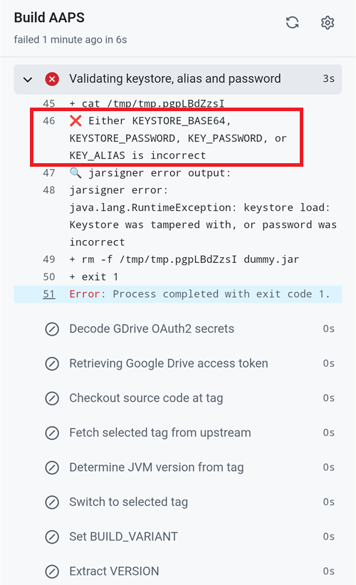
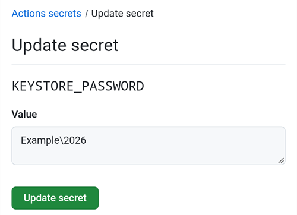

(aaps-ci-troubleshooting)=

# Sestavení v prohlížeči: řešení problémů

```{note}
Na této stránce najdete tipy pro řešení problémů se [Sestavením v prohlížeči](../SettingUpAaps/BrowserBuild.md).

Používáte **AAPS Builder**? Začněte jeho vlastní [částí o řešení problémů](#aaps-builder-troubleshooting). Níže uvedené části o Disku Google platí i pro něj.
```

## Řešení problémů s AAPS-CI

(aaps-ci-read-the-logs)=
### Nejdřív: zjistěte, co se pokazilo

Když sestavení selže, GitHub uchová záznam (log) každého kroku. Z logu zjistíte, který krok selhal a proč. Přečtěte si ho dřív, než zkusíte cokoli jiného: chybovou zprávu hledáte na této stránce a právě na ni se vás budou ptát ti, kdo vám pomáhají.

1. Ve své kopii AndroidAPS na GitHubu otevřete **Actions**. Neúspěšné sestavení má červený křížek. Klepněte na jeho název.

   

2. Souhrn běhu ukazuje **Failure** a pod ním úlohu, která selhala (**Build AAPS** s červeným křížkem).

   

3. Sjeďte dolů na **Annotations** a klepněte na červený řádek **Build AAPS**.

   

4. Otevře se úloha. Kroky s šedým zatržítkem proběhly v pořádku. Krok s červeným křížkem je ten, který selhal: GitHub ho pro vás otevře. Kroky po něm byly přeskočeny (šedé kolečko).

   

5. Přečtěte si řádky těsně nad `Error: Process completed with exit code 1.`: ty vysvětlují problém. V tomto příkladu selhal krok **Retrieving Google Drive access token** s chybou `invalid_grant` a `Token has been expired or revoked.`, viz [Vypršel Google Refresh Token](#aaps-ci-google-token-expired).

   

```{tip}
Žádáte o pomoc? Sdílejte název kroku, který selhal, a řádky s chybou (stačí snímek obrazovky jako ten výše). Nikdy nesdílejte obsah svých secretů.
```

(aaps-ci-update-secret)=
#### Aktualizace secretu

Mnoho oprav znamená nahradit hodnotu secretu. Ve své kopii AndroidAPS na GitHubu přejděte na **Settings** → **Secrets and variables** → **Actions** a klepněte na tužku vedle secretu.


Zadejte nebo vložte novou hodnotu a klepněte na **Update secret**. GitHub nikdy nezobrazí starou hodnotu: pole je vždy prázdné.


(aaps-ci-rerun)=
#### Opětovné spuštění sestavení po opravě

Když jste opravili příčinu, nemusíte začínat od začátku: otevřete neúspěšný běh, klepněte na **...** (vpravo nahoře) a pak na **Re-run failed jobs**.


Klepněte na **Re-run jobs**. Nové sestavení můžete také spustit jako obvykle přes **Run workflow**.


(aaps-ci-preparation-web)=
### Webová stránka aaps-ci-preparation
  - Přípravnou stránku zobrazuje dočasný místní server (například Simple Web Server na počítači), který také přijímá obnovovací token (refresh token) Google.
  - Pokud vidíte obrazovku níže, místní server se zastavil nebo není dostupný.
  - Zavřete přípravnou stránku, zkontrolujte, že místní server běží, pak znovu otevřete aaps-ci-preparation.html stejným způsobem jako v Kroku 2 a dokončete zbývající kroky. To je potřeba hlavně při prvním propojení s Googlem během nastavení.

  

(aaps-ci-google-token-expired)=
### Vypršel Google Refresh Token
  - Obnovovací tokeny (refresh token) Google OAuth2 vyprší, pokud nejsou použity 6 měsíců. Mohou být také neplatné z jiných důvodů (např. jste změnili heslo k účtu Google nebo jste přístup ručně zrušili). Více informací najdete v [dokumentaci Google OAuth2](https://developers.google.com/identity/protocols/oauth2).
  - V [logu sestavení](#aaps-ci-read-the-logs) selže krok **Retrieving Google Drive access token** s chybou `invalid_grant` a `Token has been expired or revoked.`:

  

  - Pokud sestavení selže kvůli vypršelému nebo zrušenému obnovovacímu tokenu Google, musíte znovu provést kroky [Google Drive Auth](#aaps-ci-google-drive-auth), abyste získali nový token `GDRIVE_OAUTH2`, pak [aktualizovat secret](#aaps-ci-update-secret) ve svém repozitáři na GitHubu a [spustit sestavení znovu](#aaps-ci-rerun).
  - Pokud autorizace znovu selže nebo se vás Google už neptá na souhlas, nejprve odeberte stávající přístup AAPS ze svého účtu Google, viz [níže](#aaps-ci-google-remove-access).

(aaps-ci-google-remove-access)=
### Odebrání přístupu AAPS z vašeho účtu Google a nová autorizace
  - Pokud autorizace Disku Google stále selhává nebo chcete začít znovu od čistého stavu, nejprve odeberte přístup, který jste dříve dali AAPS, a pak autorizaci proveďte znovu.
  - V telefonu otevřete [https://myaccount.google.com](https://myaccount.google.com), klepněte na **Zabezpečení** (Security), sjeďte dolů na **Vaše propojení s aplikacemi a službami třetích stran** (Your connections to third-party apps & services) a otevřete seznam propojených aplikací. Můžete také přejít přímo na [https://myaccount.google.com/connections](https://myaccount.google.com/connections).
  - V seznamu klepněte na **AAPS**.

  

  - Stránka ukazuje přístup, který jste dali AAPS (soubory na Disku Google, které aplikace používá). Klepnutím na **Smazat vše** (Delete all) propojení odeberete. Klepnutím na **Zobrazit podrobnosti** (See details) si ho můžete nejprve prohlédnout.

  

  - Na stránce podrobností klepněte na **Odebrat veškerý přístup** (Remove all access).

  

  - Klepněte na **Potvrdit** (Confirm).

  

  - Google potvrdí, že AAPS už nemá přístup. AAPS se už v seznamu propojených aplikací nezobrazuje.

  

  - Nyní spusťte autorizaci znovu od začátku: zavřete **obojí**, přípravnou stránku i aplikaci správce souborů, znovu otevřete aaps-ci-preparation.html ze správce souborů a znovu proveďte kroky [Google Drive Auth](#aaps-ci-google-drive-auth). Google vás znovu požádá o udělení přístupu a stránka vám poskytne nový token `GDRIVE_OAUTH2`.
  - [Aktualizujte secret `GDRIVE_OAUTH2`](#aaps-ci-update-secret) ve svém repozitáři na GitHubu novým tokenem a pak [spusťte sestavení znovu](#aaps-ci-rerun).

(aaps-ci-disable-software)=
### Vypněte software, který může rušit ověření OAUTH
  - Než se pokusíte získat klíč OAUTH, vypněte v telefonu každou VPN nebo bezpečnostní aplikaci (firewall, antimalware,...).

(aaps-ci-actions-permission)=
### Zkontrolujte nastavení oprávnění GitHub Actions
  - Ujistěte se, že zásady GitHub Actions jsou nastaveny na „Allow all actions and reusable workflows“ (Settings → Actions → General). Pokud to změníte, stiskněte **Save** pod možnostmi.

  

`actions/checkout@v4` and `actions/setup-java@v4` are not allowed to be used in `xxxxx/AndroidAPS`. Actions in this workflow must be: within a repository owned by `xxxxx`

(aaps-ci-workflow-permissions)=
### Zkontrolujte nastavení oprávnění workflow na GitHubu
  - Pokud sestavení hned selže s chybou „Invalid workflow file“ podobnou té níže, jsou výchozí oprávnění workflow ve vašem repozitáři příliš omezená:

```
Invalid workflow file
The workflow is not valid. .github/workflows/aaps-ci.yml (Line: 361, Col: 3):
Error calling workflow 'xxxxx/AndroidAPS/.github/workflows/cleanup-workflow-runs.yml@...'.
The nested job 'cleanup' is requesting 'actions: write', but is only allowed 'actions: none'.
```

  - Ujistěte se, že oprávnění workflow jsou nastavena na „Read and write permissions“ (Settings → Actions → General → Workflow permissions), pak uložte a sestavovací workflow spusťte znovu.

  

(aaps-ci-password-special-characters)=
### Sestavení selže při kontrole hesla úložiště klíčů
  - V [logu sestavení](#aaps-ci-read-the-logs) selže krok **Validating keystore, alias and password** s chybou `Either KEYSTORE_BASE64, KEYSTORE_PASSWORD, KEY_PASSWORD, or KEY_ALIAS is incorrect`, po které následuje `Keystore was tampered with, or password was incorrect`. Sestavení se tam zastaví: úložiště klíčů a hesla se kontrolují dřív, než se AAPS sestaví.

  

  - Sestavovací workflow zachová každý znak vašich hesel beze změny. Zadejte `KEYSTORE_PASSWORD` a `KEY_PASSWORD` přesně tak, jak jsou, bez přidaného zpětného lomítka nebo jiného escapovacího znaku. Pokud jste zpětná lomítka přidali, [aktualizujte secrety](#aaps-ci-update-secret) s heslem přesně tak, jak je. Níže uvedený příklad je chybný: heslo je `Example2026`, zpětné lomítko bylo přidáno.

  

  - Pokud sestavení při podepisování APK stále selhává, i když je heslo správné, a heslo obsahuje `$`, zpětný apostrof (backtick), `"` nebo `\`, je soubor workflow ve vašem forku starší než září 2026 a tyto znaky ještě zpracovává. [Synchronizujte svůj fork](#Update-to-new-version-update-your-repo) s nejnovější verzí dev a pak sestavovací workflow spusťte znovu.
  - Svislá čára `|` je zvláštní případ. Přípravná stránka [Možnosti 1](#aaps-ci-option1) spojí úložiště klíčů, hesla a alias do jednoho secretu `KEYSTORE_SET`, oddělené znakem `|`, a workflow je podle tohoto znaku zase rozdělí. Heslo vytvořené přípravnou stránkou obsahuje jen písmena a číslice, takže u Možnosti 1 se to stát nemůže. Může se to stát jen tehdy, když jste si secret `KEYSTORE_SET` sestavili sami z hesla, které obsahuje `|`. V takovém případě smažte `KEYSTORE_SET` a místo něj zadejte samostatné secrety z [Možnosti 2](#aaps-ci-option2).
