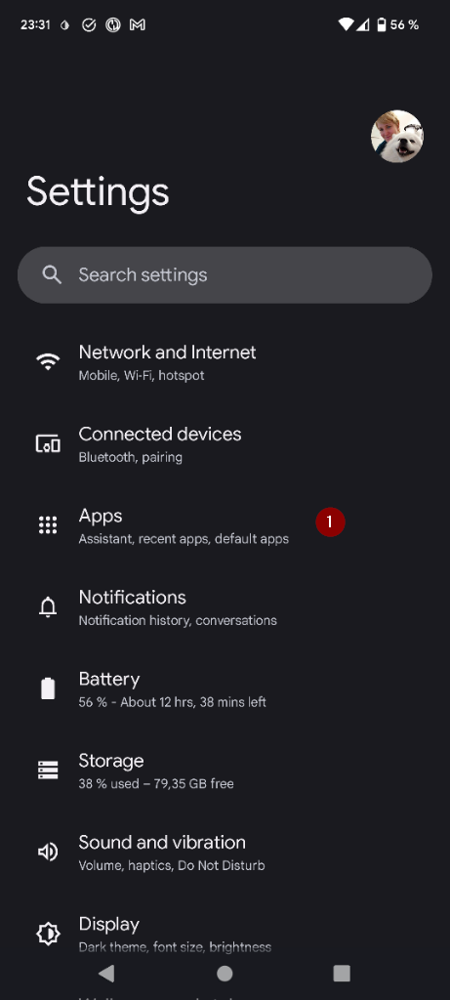
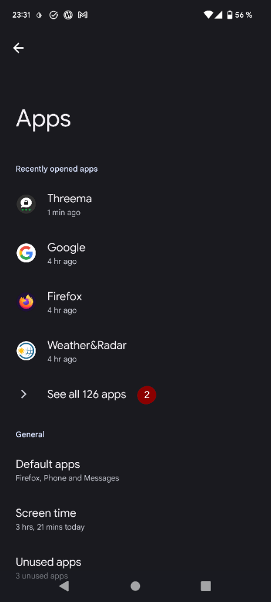
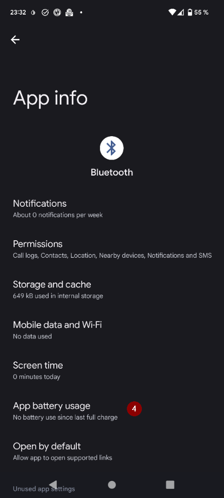
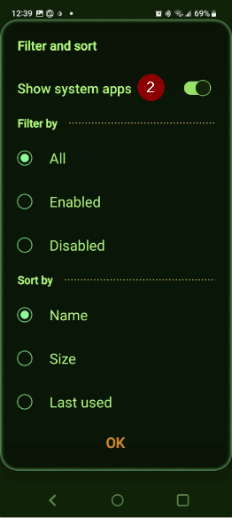
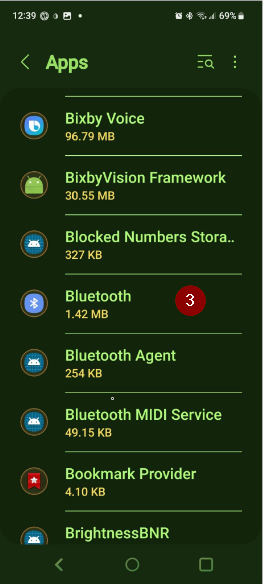
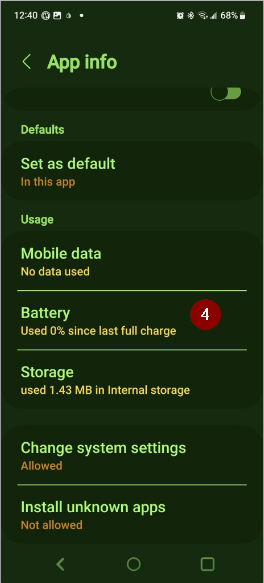
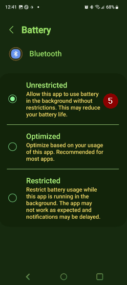

(generaltroubleshooting)=

# Řešení problémů

**Když něco nefunguje, začněte zde.** Informace o řešení problémů jsou na mnoha stránkách v celé dokumentaci. Tato stránka je spojuje: je to jeden seznam odkazů seřazený podle témat, který vám pomůže vyřešit nejčastější problémy.

Pokud zde odpověď nenajdete, podívejte se také na:

* [Nejčastější otázky uživatelů APS](../UsefulLinks/FAQ.md) s odpověďmi na časté dotazy a
* návod [Ladění profilu AAPS](ProfileTuning.md), pokud vaše smyčka běží, ale kontrolu glykémie je potřeba zlepšit.

```{admonition} Still stuck?
:class: tip
Pokud vám žádný z odkazů nepomůže, podívejte se na stránku [Kde mohu získat pomoc?](WhereCanIGetHelp.md) a zeptejte se komunity (Facebook, Discord), nebo pošlete vývojářům své [soubory záznamů](AccessingLogFiles.md).
```

---

(generaltroubleshooting-aaps-app)=

## Aplikace AAPS

### Sestavení a aktualizace

* Pokud sestavení selže, podívejte se na [Pokud sestavení selže](#building-aaps-troubleshooting): najdete tam sekci řešení problémů pro každý způsob sestavení:
  * [AAPS Builder](#aaps-builder-troubleshooting)
  * [Sestavení v prohlížeči](#aaps-ci-troubleshooting)
  * [Android Studio](TroubleshootingAndroidStudio.md)
* Ztracené nebo nové úložiště klíčů: [Přeinstalace AAPS](#reinstall-aaps)
* Aktualizace **AAPS**: [pomocí AAPS Builder](#aaps-builder-updates), [sestavením v prohlížeči (fork)](#update-browser-build-troubleshooting), [pomocí Android Studia](#update-computer-build-troubleshooting)

### Instalace

* [Varování Google Play Protect](#transferring-installing-play-protect-warning): aplikace je označena jako nebezpečná.
* Instalace je **zablokována** se zprávou o neověřeném vývojáři: bezplatné způsoby instalace najdete v části [Ověřování vývojářů Androidu](#android-developer-verification).

### Nastavení

* [Profil: „Bazál není kompatibilní s aktuální pumpou“](#your-aaps-profile-basal-not-compatible)
* [Pumpa: „Data přicházejí z jiné pumpy“](#config-builder-wrong-pump-data)
* [Nightscout Client](TroubleshootingNsClient.md)

### Použití

* [Chybné hodnoty sacharidů (pomalé vstřebávání sacharidů)](#CobCalculation-detection-of-wrong-cob-values)
* [Automatizace](#automations-troubleshooting)
* [Plně uzavřená smyčka](#full-closed-loop-troubleshooting)

---

(generaltroubleshooting-bluetooth-related-issues)=


## Problémy související s Bluetooth

Známé problémy s připojením Bluetooth, výpadky pump nebo podů a problémy s aktivací a připojením najdete na stránce [Problémy související s Bluetooth](../GettingHelp/BluetoothTroubleshooting.md)

---

(generaltroubleshooting-android-related-issues)=

## Problémy související s Androidem

### Optimalizace baterie

**AAPS** vám pomůže najít správná nastavení pro váš telefon: otevřete **nabídku** (☰) > **O aplikaci** a klepněte na **Nezabíjet mou aplikaci?**. Otevře se návod pro značku vašeho telefonu na webu [Don't kill my app](https://dontkillmyapp.com/). Také [průvodce nastavením](#setup-wizard-bluetooth-battery-optimisation) vás požádá o vypnutí optimalizace baterie pro **AAPS** a Bluetooth.

Android má nastavení pro úsporu baterie, která jsou ve výchozím stavu zapnutá. Tato nastavení automaticky uspávají/pozastavují aplikace, které nejsou nutné pro chod systému, aby šetřila energii baterie spotřebovanou aplikacemi, které nemusí běžet pořád.

Pokud je zapnutá, velmi pravděpodobně způsobí problémy **AAPS** a dalším podpůrným aplikacím, jako je **xDrip**.

Je důležité vypnout optimalizaci baterie, aby **AAPS** a další podpůrné aplikace zůstaly stále aktivní.

Podle modelu a výrobce telefonu může být potřeba toto vypnout na více místech a ve více nastaveních.

***POZNÁMKA:** Pokud má váš telefon tuto možnost, vypněte podle kroků níže optimalizaci baterie pro službu Bluetooth. Stejné kroky můžete použít i pro **AAPS** a další aplikace, snímky obrazovky ale ukazují jen postup pro službu Bluetooth.*

#### Telefony Pixel (čistý Android)

* Přejděte do nastavení Androidu a vyberte „Aplikace“.

  

* Vyberte „Zobrazit všechny aplikace“

  

* V nabídce vpravo vyberte „Zobrazit systémové aplikace“.

  

* Nyní vyhledejte a vyberte aplikaci „Bluetooth“.

  

* Klepněte na „Využití baterie aplikací“ a vyberte „Neomezeno“ (na některých starších verzích Androidu „Neoptimalizováno“).

  


#### Telefony Samsung

* Přejděte do nastavení Androidu a vyberte „Aplikace“

* Na ikoně, která by měla měnit způsob řazení (1), vyberte „Zobrazit systémové aplikace“ (2).

  

  

* Nyní vyhledejte aplikaci Bluetooth a vyberte ji, abyste viděli její nastavení.

  

* Vyberte „Baterie“.

  

* Nastavte ji na „Neomezeno“ (na některých starších verzích Androidu „Neoptimalizováno“).

  

#### Telefony Huawei

Viz tento návod pro [Huawei: Bluetooth a optimalizace baterie](../CompatiblePhones/Huawei.md)

---

(generaltroubleshooting-cgm)=

## Kontinuální monitor glukózy (CGM)

Užitečné odkazy na známé problémy s CGM a postupy, jak je vyřešit.

* [Obecné](#general-cgm-troubleshooting)
* [Dexcom G6](#DexcomG6-troubleshooting-g6)
* [Libre 2 s Minimal Looper](#minimallooper-troubleshooting)
* [Libre 3](#libre3-experiences-and-troubleshooting)
* [xDrip – žádná data z CGM](#xdrip-identify-receiver)
* [xDrip – řešení problémů s Dexcomem](#xdrip-troubleshooting-dexcom-g5-g6-and-xdrip)

---

(generaltroubleshooting-pumps)=

## Pumpy

Užitečné odkazy na známé problémy s pumpami a postupy, jak je vyřešit

* [Accu-Chek Combo](#combov2-tips-for-basic-usage)
* [Accu-Chek Insight](#Accu-Chek-Insight-Pump-insight-specific-errors)
* [CareLevo](#carelevo-alarms-and-notifications)
* [DanaRS](#DanaRS-Insulin-Pump-dana-rs-specific-errors)
* [Diaconn G8](#diaconn-g8-bluetooth-troubleshooting)
* [EOPatch2](#eopatch2-alarms-and-warnings)
* [Medtronic + RileyLink](#MedtronicPump-what-to-do-if-i-loose-connection-to-rileylink-and-or-pump)
* [Medtrum Nano](#medtrum-nano-troubleshooting)
* [Omnipod DASH](#omnipod-dash-troubleshooting)
* [Omnipod Eros](#OmnipodEros-troubleshooting)

---

(generaltroubleshooting-phones)=

## Telefony

Užitečné odkazy na známé problémy s telefony a postupy, jak je vyřešit

* [Seznam vyzkoušených sestav telefonů a zařízení](https://docs.google.com/spreadsheets/u/1/d/e/2PACX-1vScCNaIguEZVTVFAgpv1kXHdsHl3fs6xT6RB2Z1CeVJ561AvvqGwxMhlmSHk4J056gMCAQE02sAWJvT/pubhtml?gid=683363241&single=true)
* [Jelly](../CompatiblePhones/Jelly.md)
* [Huawei: Bluetooth a optimalizace baterie](../CompatiblePhones/Huawei.md)

---

(generaltroubleshooting-remote-control)=

## Vzdálené ovládání

* [AAPSClient a vzdálené ovládání (párování, příkazy nedorazí)](#client-master-control-troubleshooting)
* [Problémy s „Přístupovým tokenem Nightscoutu“](#remotecontrol-nightscout-access-token)
* [SMS příkazy](#SMSCommands-troubleshooting)
* [Android Auto](#android-auto-troubleshooting)

---

(generaltroubleshooting-smartwatches)=

## Chytré hodinky

Užitečné odkazy na známé problémy s chytrými hodinkami a postupy, jak je vyřešit

* [Řešení problémů s aplikací Wear](#Watchfaces-troubleshooting-the-wear-app)
* [Hodinky a telefon spolu nekomunikují](#wear-os-watch-phone-communication)
* [Wear OS 5](#wear-os-5-troubleshooting)
* [Sestavení aplikace Wear](#building-aaps-wear-os-troubleshooting)
