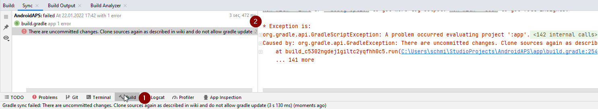
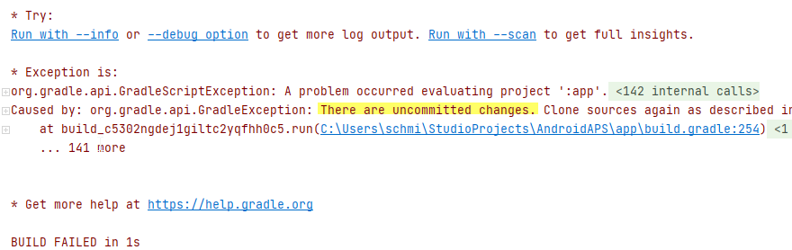
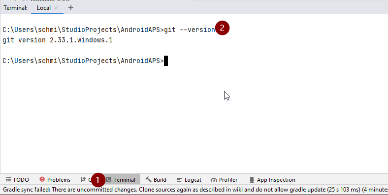
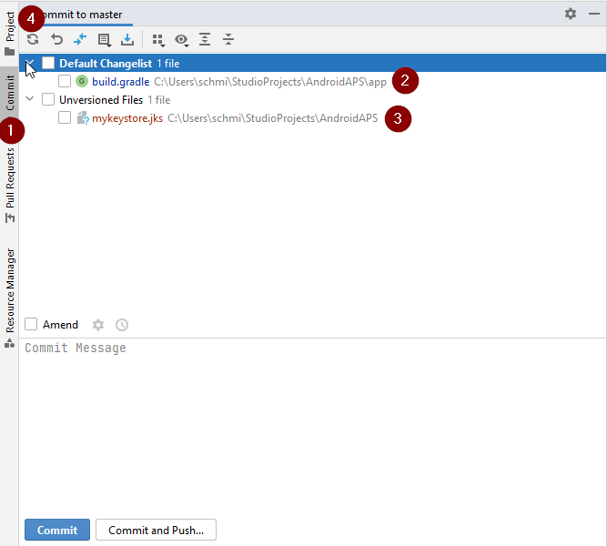
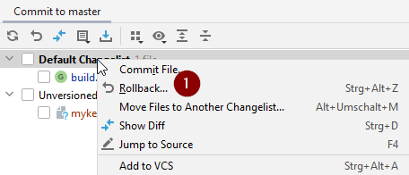
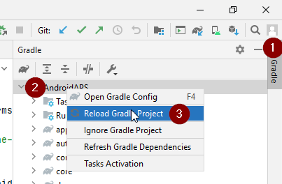
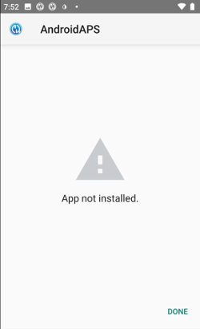

(troubleshooting_androidstudio-troubleshooting-android-studio)=

# Řešení problémů s Android Studiem

```{contents} List of common issues
:depth: 2
:local: true
```

(troubleshooting_androidstudio-lost-keystore)=
## Ztráta úložiště klíčů
Pokud jste ztratili úložiště klíčů nebo heslo k němu, apk podepsané novým úložištěm klíčů nemůže aktualizovat vaši současnou aplikaci **AAPS**: musíte ji odinstalovat a znovu nainstalovat. Viz [Přeinstalace AAPS s novým úložištěm klíčů](#reinstall-aaps).

## Selhala synchronizace Gradle (Gradle Sync failed)
Gradle Sync může selhat z různých důvodů. Když se zobrazí zpráva „gradle sync failed“, otevřete kartu „Build“ (1) ve spodní části Android Studia a zkontrolujte, jaká chybová zpráva (2) se zobrazuje.



```{contents} Likely reasons for gradle sync failures are:
:depth: 1
:local: true
```

*Důležité*: Když dokončíte postup pro svůj konkrétní problém, musíte znovu spustit [synchronizaci gradle](#gradle-resync).

(troubleshooting_androidstudio-uncommitted-changes)=
### Neprovedené změny

Pokud se zobrazí podobná chybová zpráva:



```
Build file 'C:\Data\50-Android\AndroidAPS\app\build.gradle.kts' line: 243

There are uncommitted changes.
Clone sources again as described in wiki and do not allow gradle update
```

#### Krok 1 - Zkontrolujte instalaci Gitu
  * Otevřete kartu terminálu (1) ve spodní části Android Studia a následující text zkopírujte a vložte nebo napište do terminálu (2).
    ```
    git --version
    ```

    

    Poznámka: Mezi git a version je mezera a dvě pomlčky!

  * Musí se zobrazit zpráva s nainstalovanou verzí Gitu, jak vidíte na snímku obrazovky výše. V takovém případě přejděte na [Krok 2](#troubleshooting-android-studio-check-for-uncommitted-changes).

  * Pokud se zobrazí zpráva
    ```
    Git: command not found
    ```
    není vaše instalace Gitu v pořádku.

  * [Kontrola instalace Gitu](#BuildingAaps-steps-for-installing-git)

  * Pokud používáte Windows a Git jste právě nainstalovali, restartujte po instalaci počítač, aby byl Git dostupný v celém systému

  * Pokud je Git nainstalovaný, restartovali jste (ve Windows) a Git stále nelze najít:

  * Vyhledejte v počítači soubor „git.exe“.

    Poznamenejte si, ve kterém adresáři je uložený.

  * Ve Windows otevřete Proměnné prostředí (Environment variables), vyberte proměnnou „PATH“ a klikněte na Upravit (edit). Přidejte adresář, ve kterém jste našli instalaci Gitu.

  * Uložte a zavřete.

  * Restartujte Android Studio.

(troubleshooting-android-studio-check-for-uncommitted-changes)=
#### Krok 2: Zkontrolujte neprovedené změny.

  * V Android Studiu otevřete kartu „Commit“ (1) na levé straně. 
  * Uvidíte buď „Changes“ (ve starších verzích Android Studia „Default changeset“) (2), nebo „Unversioned Files“ (3):

    * U „Changes“ jste pravděpodobně aktualizovali Gradle nebo omylem změnili obsah některých souborů.

    * Klikněte pravým tlačítkem na „Changes“ a vyberte „Rollback…“ (1)

      

    * Soubory se znovu stáhnou ze serveru Git. Pokud na kartě Commit nejsou žádné další změny, přejděte na [Krok 3](#gradle-resync).

  * Pokud vidíte „Unversioned Files“, možná jste omylem uložili soubory do adresáře se zdrojovým kódem. Mohou to být důležité soubory, například soubor úložiště klíčů, který byste měli přesunout jinam. Pokud nevíte, co jsou tyto soubory zač, a sami jste je nevytvořili, můžete je smazat.

    * Pomocí běžného správce souborů v počítači přesuňte tento soubor (nebo ho vyjměte a vložte) na bezpečné místo.

    * Vraťte se do Android Studia a klikněte na tlačítko Refresh (4) na kartě Commit, abyste se ujistili, že soubor už není uložený v adresáři **AAPS**.

      Pokud na kartě Commit nejsou žádné další změny, přejděte na [Krok 3](#gradle-resync).


#### Krok 3: Znovu synchronizujte Gradle

Postupujte podle návodu v části [Nová synchronizace Gradle](#gradle-resync).

### Git Pull selhal - Please tell me who you are

Pokud vidíte tuto zprávu, Git potřebuje, abyste se identifikovali.


Otevřete terminál a zadejte následující dva příkazy, jeden po druhém.

```
git config --global user.name "Your name here"
git config --global user.email your.email@here.com
```

Vaše jméno musí být napsané v uvozovkách.


(troubleshooting_androidstudio-android-gradle-plugin-requires-java-11-to-run)=

(incompatible-gradle-jvm)=
### Nekompatibilní Gradle JVM


```
Your build is currently configured to use incompatible Java 21.0.3 and Gradle 8.2.
Cannot sync the project.

We recommend upgrading to Gradle version 8.9.

The minimum compatible Gradle version is 8.5.

The maximum compatible Gradle JVM version is 19.
```

Nebo:

```
Cause: error: invalid source release: 21
```

Pokud se zobrazí výše uvedená chybová zpráva, musíte před novým pokusem o sestavení stáhnout správnou verzi JVM:

1.  V [tabulce požadavků](#Building-APK-recommended-specification-of-computer-for-building-apk-file) zjistěte, jakou verzi JVM potřebujete pro verzi **AAPS**, kterou sestavujete, a poznamenejte si ji.

2. Otevřete zobrazení Gradle kliknutím na slona (1) na pravé straně Android Studia, otevřete nastavení (2) a vyberte **Gradle Settings** (3):


3.  V poli **Gradle JDK** zkontrolujte, zda je vybraná správná verze (1). Pokud ne, klikněte na pole a podívejte se, zda už je v seznamu k dispozici. Příklad níže ukazuje, že JVM 21 je označené jako „jbr-21“. Pokud ji najdete, stačí ji vybrat a máte hotovo. Pokud není k dispozici, vyberte **Download JDK** (2).


4. V poli Version (1) vyberte JDK, které vyžaduje vaše verze **AAPS** (tu, kterou jste si poznamenali při kontrole tabulky požadavků). V poli Vendor (2) vyberte libovolného dodavatele. Location (3): neměňte. Klikněte na **Download** (4).


5.  Zavřete dialog **Settings** tlačítkem **OK**.
6. Nyní musíte znovu spustit Gradle Sync. Postupujte podle návodu v části [Nová synchronizace Gradle](#gradle-resync).

(incompatible-version-of-android-gradle-plugin)=
### Nekompatibilní verze Android Gradle pluginu

  Pokud se zobrazí následující chybová zpráva

`The project is using an incompatible version (AGP x.x.x) of the Android Gradle plugin. Latest supported version is AGP x.x.x`

  

  Používáte zastaralou verzi Android Studia. V nabídce přejděte na Help > Check for updates a nainstalujte všechny nalezené aktualizace Android Studia a jeho pluginů.

(troubleshooting_androidstudio-could-not-resolve-no-cached-version)=
### Could not resolve / No cached version

  Může se zobrazit tato chybová zpráva:


  * Na pravé straně otevřete kartu Gradle (1).

    Ujistěte se, že tlačítko označené (2) *NENÍ* zapnuté.

    

  * Nyní musíte spustit [novou synchronizaci Gradle](#gradle-resync)

(troubleshooting_androidstudio-unable-to-start-daemon-process)=
### Unable to start daemon process

  Pokud vidíte zmíněnou chybovou zprávu, pravděpodobně používáte 32bitový systém Windows 10. Android Studio 3.5.1 a novější tuto možnost nepodporuje a vývojáři **AAPS** s tím bohužel nemohou nic udělat!

  Na internetu najdete informace o tom, jak zjistit, zda máte 32bitový nebo 64bitový operační systém – například [tento návod](https://support.microsoft.com/en-us/windows/32-bit-and-64-bit-windows-frequently-asked-questions-c6ca9541-8dce-4d48-0415-94a3faa2e13d).

  

(gradle-resync)=
### Nová synchronizace Gradle

  Pokud stále vidíte zprávu, že gradle sync selhala, klikněte nyní na odkaz **Try again** (1). 


  Pokud už zprávu nevidíte, můžete synchronizaci spustit i ručně:

  * Otevřete kartu Gradle (1) na pravém okraji Android Studia.

    

  * Klikněte pravým tlačítkem na AAPS (2)

  * Klikněte na „Reload Gradle Project“ (3)

## Generate Signed APK: úspěšně vytvořeno s 0 variantami sestavení

Když vytváříte podepsané apk, může se zobrazit oznámení, že vytvoření bylo úspěšné, ale s informací, že bylo vytvořeno „0 build variants“ (0 variant sestavení):


Toto je falešné varování. Zkontrolujte adresář, který jste vybrali jako „Destination folder“ (cílová složka) pro vytvoření (krok [Generate Signed APK](#Building-APK-generate-signed-apk)), a vytvořené apk tam najdete!


## Aplikace byla vytvořena s varováními kompilátoru/kotlinu

Pokud sestavení proběhlo úspěšně, ale zobrazí se varování kompilátoru nebo kotlinu (označená žlutým nebo modrým vykřičníkem), můžete tato varování jednoduše ignorovat.

 

Vaše apk bylo úspěšně sestaveno a můžete ho přenést do telefonu!


## AAPS nepřijímá žádná data z CGM

* Pokud používáte upravenou aplikaci Dexcom G6: tato aplikace je zastaralá. Místo ní použijte aplikaci [BYODA](#DexcomG6-if-using-g6-with-build-your-own-dexcom-app).

* Pokud používáte xDrip: nastavte identifikaci přijímače (identify receiver) podle [stránky s nastavením xDrip](#xdrip-identify-receiver).


## Apk není nainstalováno



* Ujistěte se, že jste do telefonu přenesli soubor „app-full-release.apk“.
* Tato chyba obvykle znamená, že nové apk je podepsané jiným úložištěm klíčů než vaše nainstalovaná aplikace **AAPS**. Pokud ještě máte své předchozí úložiště klíčů, vyberte ho a sestavte znovu. Jinak viz [Přeinstalace AAPS s novým úložištěm klíčů](#reinstall-aaps).
* Pokud se na telefonu zobrazí "Aplikace není nainstalována", postupujte následovně:

1. [Exportujte nastavení](../Maintenance/ExportImportSettings.md) (ve verzi AAPS, která je už nainstalovaná v telefonu)
2. Odinstalujte **AAPS** z telefonu.
3. Zapněte režim letadlo a vypněte Bluetooth.
4. Nainstalujte novou verzi (“app-full-release.apk”)
5. [Importujte nastavení](../Maintenance/ExportImportSettings.md)
6. Znovu zapněte Bluetooth a vypněte režim letadlo

## Apk je nainstalováno, ale ve staré verzi

Pokud jste aplikaci úspěšně sestavili, přenesli do telefonu a úspěšně nainstalovali, ale číslo verze zůstává stejné, pravděpodobně jste zapomněli [aktualizovat svou místní kopii](#Update-to-new-version-update-your-local-copy)

## Nic z výše uvedeného nepomohlo

Pokud vám žádný z výše uvedených tipů nepomohl, zkuste sestavit apk úplně znovu:

1. [Exportujte nastavení](../Maintenance/ExportImportSettings.md) (ve verzi AAPS, která je už nainstalovaná v telefonu)

2. Připravte si heslo ke klíči a heslo k úložišti klíčů.

    Nebo můžete vytvořit a použít nové úložiště klíčů.

3. Sestavte apk úplně znovu, jak je popsáno [zde](#Building-APK-download-AAPS-code).

4. Když apk úspěšně sestavíte, smažte stávající apk v telefonu, přeneste nové apk do telefonu a nainstalujte ho.
5. Znovu [importujte nastavení](../Maintenance/ExportImportSettings.md), abyste obnovili své cíle a nastavení.
6. Zkontrolujte nastavení optimalizace baterie a znovu ji vypněte.

## Nejhorší případ

Pokud výše uvedené váš problém se sestavením nevyřeší, můžete zkusit Android Studio úplně odinstalovat a sestavit vše znovu od začátku.  Někteří uživatelé zjistili, že to může jejich problém se sestavením vyřešit.  Při mazání Android Studia nemažte uživatelská nastavení Androidu a **nezapomeňte odinstalovat všechny soubory, které k Android Studiu patří.** Pokud Android Studio neodstraníte úplně, včetně všech skrytých souborů, může odinstalace místo vyřešení stávajících problémů způsobit nové. Návody na úplnou odinstalaci najdete na internetu, například

[https://stackoverflow.com/questions/39953495/how-to-completely-uninstall-android-studio-from-windowsv10](https://stackoverflow.com/questions/39953495/how-to-completely-uninstall-android-studio-from-windowsv10).

Nainstalujte Android Studio úplně znovu, jak je popsáno [zde](#Building-APK-install-android-studio).
