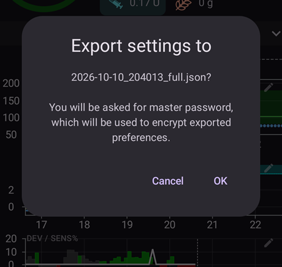
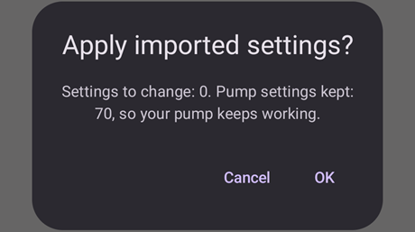

# Vytváření a obnova záloh

Když si AAPS nainstalujete do telefonu, stane se z něj „zdravotnický prostředek“, na který se každý den spoléháte. Velmi doporučujeme mít připravený nouzový záložní plán pro případ, že se telefon porouchá, bude ukraden nebo ho ztratíte. Proto je nutné se připravit a zeptat se sami sebe: „Co když?“

Abyste mohli obnovit své nastavení AAPS na stávajícím nebo novém telefonu, je důležité mít následující položky uložené na bezpečném místě (tedy ne v telefonu). Nejlepší je mít alespoň dvě samostatné zálohy: na místním pevném disku, USB disku a (nejlépe) v cloudovém úložišti, jako je Disk Google nebo Microsoft 365 OneDrive. Když zálohy uložíte do cloudu, budete mít vždy vše potřebné dostupné z telefonu a můžete své nastavení obnovit kdekoli a kdykoli.

Zvažte pořízení druhého, záložního telefonu a vyzkoušejte si na něm obnovu AAPS, abyste si ověřili, že záložní telefon funguje podle očekávání. Díky tomuto kroku budete mít jistotu, že váš nouzový plán funguje a že můžete plynule pokračovat v používání AAPS, i když hlavní telefon nebude k dispozici.

Pro obnovu je důležité mít po ruce tyto položky:

- Váš **soubor úložiště klíčů z Android Studia** a příslušné **heslo**: Jsou potřeba pro (opětovné) sestavení instalačního souboru AAPS .APK.
- Aktuální kopie **instalačního souboru AAPS .APK**
- Aktuální soubor s **exportem nastavení**: Pro obnovu důležitých nastavení (včetně vašich cílů!).
- Vaše **hlavní heslo AAPS**
- Zálohy dalších pomocných aplikací: například BYODA a/nebo xDrip.
- Osobní poznámky k vašemu nastavení.

Níže jsou položky, které se doporučuje zálohovat.

## Vytváření záloh

### Soubor úložiště klíčů z počítače, na kterém jste sestavili APK
Když sestavujete instalační soubor .APK v Android Studiu, použije se **soubor úložiště klíčů a heslo k podepsání instalačního souboru .APK**. Abyste mohli aktualizovat stávající instalaci AAPS, musí být instalační soubor .APK s aktualizací podepsán stejným úložištěm klíčů, jaké bylo použito při první instalaci. Při aktualizaci zůstanou zachována všechna nastavení i databáze AAPS. Bez toho musíte nejprve stávající aplikaci odinstalovat a potom AAPS [znovu nainstalovat](#reinstall-aaps) a nastavit.

Když si úložiště klíčů a příslušné heslo uschováte, budou budoucí aktualizace APK mnohem jednodušší, hlavně pokud budete muset aplikaci sestavit na novém počítači. Podrobnosti o použití úložiště klíčů při sestavení nového APK najdete v části [Aktualizace AAPS](../Maintenance/UpdateToNewVersion.md).

**Kdy zálohovat:** Úložiště klíčů zálohujte poté, co poprvé sestavíte instalační soubor **AAPS** .APK.

**Jak zálohovat:** Najděte cestu k úložišti klíčů. Pokud si ji nepamatujete, najdete ji v Android Studiu volbou **Build > APK > Next**. Cesta bude uvedena v poli „Key store path“. Pomocí správce souborů přejděte na tuto cestu a vytvořte si kopii souboru úložiště klíčů (s příponou `.jks`). Uložte ho na bezpečné místo v cloudu pro případ, že by váš počítač přestal být dostupný. Nezapomeňte si také poznamenat heslo k úložišti klíčů, alias klíče a heslo klíče.

### Kopie nejnovějšího APK
Když hlavní telefon s **AAPS** ztratíte nebo se poškodí, díky kopii APK budete moci rychle pokračovat v používání **AAPS** na novém telefonu. Poznámka: budete také potřebovat zálohu předvoleb, jak je popsáno níže.

**Kdy zálohovat:** Uchovávejte si zálohu nejnovějšího APK, které jste nainstalovali do hlavního telefonu s **AAPS**. Můžete si také ponechat jednu starší verzi pro případ, že byste se k ní z nějakého důvodu potřebovali vrátit.

**Jak zálohovat:** Uchovávejte si kopii na počítači, na kterém jste APK sestavili v Android Studiu. Navíc se doporučuje uložit kopii instalačního APK na cloudovou platformu. Ujistěte se, že v případě potřeby obě zálohy najdete. Zvažte vytvoření samostatných složek pro tyto zálohy.

### Soubor s nastavením AAPS (označovaný také jako „Předvolby“)

```{admonition} Where are preferences stored on my phone?
:class: tip
Svá nastavení najdete v **Adresáři AAPS**, který jste vybrali při [nastavení AAPS](#SetupWizard-StoragePermission).</br>
**Adresář AAPS** můžete také změnit na obrazovce **Údržba** (**nabídka** (☰) > **Údržba**), viz [Nastavení místního adresáře AAPS](#preferences-maintenance-logdirectory).
```

S kopií instalačního souboru APK (viz výše) a souborem **Nastavení** můžete rychle začít používat AAPS na stávajícím nebo novém telefonu.

Soubor **Nastavení** slouží k přizpůsobení aplikace AAPS vašemu konkrétnímu nastavení. Obsahují například vaše nastavení **Konfigurace**, stav cílů, nastavení komunikace se službami třetích stran (např. Nightscout, Tidepool), automatizace a profily.

Export nastavení AAPS do souboru vám umožní obnovit konfiguraci k určitému okamžiku. Jak už bylo řečeno, kromě všech nastavení konfigurace obsahuje soubor s exportem také stav vašich cílů, který potřebujete obnovit při **(opětovné) instalaci** AAPS. Bez něj budete muset pro povolení uzavřené smyčky splnit všechny cíle znovu od začátku. Soubory s nastavením vám také umožní obnovit „poslední známé dobré“ nastavení a vrátit tak změny v konfiguraci.

**Kdy zálohovat nastavení AAPS:**
* Pokaždé, když splníte cíl, abyste nepřišli o svůj postup. _Bez kopie vašeho **Nastavení** budete muset znovu splnit všechny cíle, pokud budete muset AAPS přeinstalovat nebo vyměnit telefon._

* Kdykoli plánujete větší změny v konfiguraci (změna nastavení SMB, změna typu inzulínu, změna pumpy, změny v automatizacích), zálohujte své **Nastavení** před změnami i po nich. Tak budete mít nejnovější nastavení i kopii nastavení před změnami, kdybyste se k nim potřebovali vrátit.

* Pouze pro uživatele pump bez hadičky (např. Omnipod a Medtrum): soubor **Nastavení** obsahuje údaje o spojení s vaším aktuálním podem a lze ho použít k obnovení spojení s tímto podem na novém telefonu. Pokud nemáte kopii předvoleb exportovanou po spuštění aktuálního podu, budete muset při výměně telefonu spustit nový pod.

**Jak zálohovat ručně:**

1. Pokud importujete nebo exportujete **Nastavení** poprvé, musíte nastavit hlavní heslo v [Nastavení > Ochrana](#Preferences-master-password). Nastavte heslo a uložte si ho na bezpečné místo. _Bez tohoto hesla se ke zálohám **Nastavení** nedostanete._

2. Na hlavní obrazovce **AAPS** otevřete **nabídku** (☰) > **Údržba**. Pomocí štítků **Lokálně** a **Cloud** vedle položky **Exportovat nastavení** zvolte, kam se soubor uloží (viz **Export nebo import nastavení** níže), a potom klepněte na **Exportovat nastavení**. **AAPS** ukáže, kam se soubor uloží: u volby **Lokálně** název souboru, u volby **Cloud** text **Google Drive**. Klepněte na **OK**.

   

   

   Zadejte hlavní heslo nastavené výše a klepněte na **OK**.

   

   Export potvrdí zpráva **Nastavení exportováno** (lokálně) nebo **Export do cloudu úspěšný** (cloud).

   

   

3. Pomocí správce souborů v telefonu (obvykle se jmenuje „Soubory“ nebo „Moje soubory“) přejděte do Interní úložiště > AAPS > preferences. Zde uvidíte kopii všech exportovaných souborů s předvolbami. Název souboru by měl být `YYYY-MM-DD_Time_appname.json`. Nahrajte tento soubor na cloudovou platformu podle svého výběru. Potom si z cloudové platformy stáhněte kopii také do svého počítače.

(ExportImportSettings-Settings-Export)=

## Export nastavení

```{admonition} Where are preferences stored on my phone?
:class: tip
Svá nastavení najdete v **Adresáři AAPS**, který jste vybrali při [nastavení AAPS](#SetupWizard-StoragePermission).</br>
**Adresář AAPS** můžete také změnit na obrazovce **Údržba** (**nabídka** (☰) > **Údržba**), viz [Nastavení místního adresáře AAPS](#preferences-maintenance-logdirectory).
```

Doporučujeme exportovat nastavení pravidelně, hlavně před změnami konfigurace a po nich. Exporty můžete provádět **ručně nebo (lépe) pomocí automatizace**. Nezapomeňte si poznamenat hlavní heslo AAPS a zálohovat soubory s nastavením tak, že je zkopírujete z telefonu, například do cloudového úložiště.

**Poznámka**: _Exportovaná nastavení budou zašifrována vaším hlavním heslem AAPS: bez hlavního hesla použitého při exportu nebudete moci soubor s nastavením importovat!_

### Export nebo import nastavení
Chcete-li exportovat nebo importovat nastavení, otevřete **nabídku** (☰) a vyberte **Údržba**. V části **Správa souborů** určují štítky **Lokálně** a **Cloud** vedle položek **Exportovat nastavení** a **Importovat nastavení**, kam se soubor s nastavením uloží nebo odkud se načte: **Lokálně** je adresář AAPS v telefonu, **Cloud** je k dispozici, jakmile nastavíte [Cloudový adresář](#preferences-maintenance-cloud). Klepnutím štítek zapnete nebo vypnete; alespoň jeden zůstane vždy vybraný a oba řádky sdílejí stejnou volbu. Potom klepněte přímo na **Exportovat nastavení** nebo **Importovat nastavení** a spusťte akci.


(ExportImportSettings-Automating-Settings-Export)=
### Automatizace exportu nastavení

Pro automatický export nastavení [(**viz Automatizace**)](../DailyLifeWithAaps/Automations.md#automating-preference-settings-export) otevřete [**Nastavení** > **Údržba**](#preferences-maintenance-settings), rozbalte **Bezobslužný export nastavení** a zapněte **Povolit automatický export nastavení**.

Nyní můžete nastavit [automatizaci](../DailyLifeWithAaps/Automations.md#automating-preference-settings-export), která bude exportovat nastavení buď pravidelně (_např._ každý týden), nebo po výměně podu.

_**Poznámka:** Při importu nastavení musí uživatel vždy zadat heslo AAPS!_


(ExportImportSettings-restoring-from-your-backups-on-a-new-phone-or-fresh-installation-of-aaps)=
## Obnova ze záloh na novém telefonu nebo při nové instalaci AAPS

```{admonition} Where are preferences stored on my phone?
:class: tip
Svá nastavení najdete v **Adresáři AAPS**, který jste vybrali při [nastavení AAPS](#SetupWizard-StoragePermission).</br>
**Adresář AAPS** můžete také změnit na obrazovce **Údržba** (**nabídka** (☰) > **Údržba**), viz [Nastavení místního adresáře AAPS](#preferences-maintenance-logdirectory).</br>
Pokud **AAPS** ztratí přístup k tomuto adresáři (může se to stát po přeinstalaci nebo po vymazání úložiště aplikace), zobrazí oznámení **Přístup do adresáře AAPS byl ztracen** a přestane ukládat nastavení do telefonu, dokud [adresář znovu nevyberete](#preferences-maintenance-logdirectory).
```

Tento návod použijte, pokud máte zálohu APK a **Nastavení** a chcete je nahrát do nového telefonu, nebo pokud jste z nějakého důvodu museli APK ve stávajícím telefonu smazat a znovu nainstalovat.

_Pokud aktualizujete **AAPS** pomocí APK sestaveného se stejným úložištěm klíčů, tento postup byste neměli potřebovat. Přesto se doporučuje vytvořit si zálohu, než aktualizaci provedete._

Pokud aktualizujete **AAPS** poté, co jste ztratili nebo nahradili původní úložiště klíčů (např. při použití nového počítače pro sestavení bez přenesení úložiště klíčů), zálohujte nejprve všechna nastavení podle popisu výše a potom stávající verzi **AAPS** v telefonu odinstalujte. Celý postup najdete v části [Přeinstalace AAPS s novým úložištěm klíčů](#reinstall-aaps).

V případě potřeby [nastavte přijímač zdroje CGM/glykémie](../Getting-Started/CompatiblesCgms.md) ještě před kroky uvedenými níže

(ExportImportSettings-tubeless-pumps)=
```{admonition} Tubeless pumps (Omnipod and Medtrum) users
:class: warning
Soubor **Předvolby** obsahuje relaci podu nebo patche, který byl aktivní v době exportu.
- **Exportujte hned po každé aktivaci podu nebo patche** a zkopírujte soubor mimo telefon.
- **Stejný telefon, pod stále běží:** volbu **Nahradit také nastavení pumpy** nechte nezaškrtnutou. Váš aktuální pod zůstane zachován a importují se jen ostatní nastavení.
- **Nový telefon přebírá pod:** zaškrtněte **Nahradit také nastavení pumpy** a použijte jen soubor exportovaný během podu, který máte právě nasazený. Soubor z dřívějšího podu nahradí relaci vašeho aktuálního podu a budete muset spustit nový pod.
- **Omylem byla importována stará relace podu:** **AAPS** se stále snaží spojit s tímto podem a nový pod nemůžete aktivovat. Deaktivujte ho; pokud to nejde, zahoďte ho (viz například [Zahození podu](#omnipod-dash-discard-pod) pro Omnipod DASH).
```

```{admonition} Pump settings are kept unless you say otherwise
:class: note
Import ve výchozím stavu nastavení pumpy nemění: pumpa vybraná v **Konfiguraci**, její spárování i všechna ostatní nastavení zůstanou v tomto telefonu tak, jak jsou. Volbu **Nahradit také nastavení pumpy** na obrazovce importu zaškrtněte jen tehdy, když obnovujete nastavení do nového telefonu, který má převzít stejnou pumpu. Nastavení, která v souboru nejsou, import nikdy nesmaže.
```

1. Pomocí záložní kopie APK (viz výše) postupujte podle návodu pro [novou instalaci](../SettingUpAaps/TransferringAndInstallingAaps.md)

2. Spusťte **AAPS** a povolte všechna požadovaná oprávnění

3. Ukončete Průvodce nastavením. Všechna potřebná nastavení naimportujeme ze záložní kopie **Nastavení**

4. Na hlavní obrazovce **AAPS** vyberte Požadavek a povolte všechna oprávnění uvedená červeně nahoře

5. Na hlavní obrazovce **AAPS** nastavte v [Nastavení > Ochrana](#Preferences-master-password) hlavní heslo na stejné heslo, jaké jste použili pro zálohy.

6. Pokud jste to ještě neudělali, [nastavte **Adresář AAPS**](#preferences-maintenance-logdirectory): na hlavní obrazovce **AAPS** otevřete **nabídku** (☰) > **Údržba** > **Adresář AAPS**.

7. Na hlavní obrazovce **AAPS** otevřete **nabídku** (☰) > **Údržba** > **Exportovat nastavení** > zadejte hlavní heslo nastavené výše > **OK**. Tím se v telefonu vytvoří složka preferences, pokud ještě neexistuje.

8. Stáhněte si ze své cloudové platformy zálohu souboru **Předvolby**.

9. Pomocí správce souborů (obvykle se jmenuje „Soubory“ nebo „Moje soubory“) přesuňte soubor ze stažených souborů do `/internal storage/AAPS/preferences`, pokud je váš **Adresář AAPS** nastaven na `/internal storage/AAPS`

10. Na hlavní obrazovce **AAPS** otevřete **nabídku** (☰) > **Údržba** a klepněte na **Importovat nastavení**. Vyberte soubor s předvolbami, ze kterého chcete obnovit nastavení (nejnovější je nahoře). Dbejte na výběr správného souboru s předvolbami, zobrazí se všechny soubory .json ze složky preferences (nebo z cloudového adresáře, pokud použijete **Cloud**).

    

    **AAPS** zobrazí podrobnosti o souboru. Zadejte hlavní heslo nastavené výše a klepněte na **Dešifrovat a zkontrolovat**.

11. Po dešifrování souboru se rozhodněte, co udělat s nastavením pumpy. Na novém telefonu, který přebírá stejnou pumpu, zaškrtněte **Nahradit také nastavení pumpy**, aby se spárování a nastavení pumpy převzaly ze souboru. Pokud chcete ponechat pumpu, se kterou je tento telefon už spárovaný, nechte políčko nezaškrtnuté. Potom klepněte na **Importovat**.

    

12. **AAPS** se zeptá **Použít importovaná nastavení?** a sdělí vám, kolik nastavení se změní, a pokud jste políčko nechali nezaškrtnuté, také kolik nastavení pumpy zůstane zachováno. Zatím se nic nezapsalo, takže **Zrušit** ponechá telefon přesně v původním stavu. Klepnutím na **OK** nastavení použijete.

    

13. **AAPS** použije importovaná nastavení okamžitě, bez restartu. Restartují se jen pluginy, jejichž nastavení se změnilo. Během této doby **AAPS** zobrazuje **Používání nastavení…**; pokud je pumpa zaneprázdněná, zobrazí **Čekání na pumpu…** a nastavení použije, jakmile bude pumpa volná. Pokud je pumpa zaneprázdněná i po jedné minutě, **AAPS** nabídne další pokus. Zpráva **Nastavení byla použita** potvrdí, že se importovaná nastavení používají. Každé ošetření, které jste zadali do fronty během importu, se zahodí a **AAPS** vám oznámí, že bylo zrušeno, takže se nic nepošle do pumpy dvakrát.

    

Pokud soubor obsahuje pumpu, kterou tato verze **AAPS** nemá, **AAPS** přepne na **Virtuální pumpu** a oznámí vám to. V **Konfiguraci** znovu vyberte svou pumpu a zkontrolujte její nastavení.

14. Pouze pro uživatele pump bez hadičky (Omnipod a Medtrum) – pokud jste zaškrtli **Nahradit také nastavení pumpy** a vaše **Předvolby** nebyly zálohovány ze stejného podu, který právě používáte, budete muset pro zahájení podávání inzulínu spustit nový pod.

**Řešení problémů:** pokud se vám nedaří nastavit aktivní profil, na hlavní obrazovce **AAPS** otevřete **nabídku** (☰) vlevo nahoře > **Konfigurace** > **Pumpa** > přepněte na **Virtuální pumpu** > a potom přepněte zpět na svůj typ pumpy

### Poznámka pro uživatele Dana RS

- Pokud jste zaškrtli **Nahradit také nastavení pumpy**, importuje se i nastavení připojení k pumpě: **AAPS** na novém telefonu už bude pumpu „znát“, a proto nespustí vyhledávání přes Bluetooth.
- Nový telefon a pumpu prosím spárujte ručně.