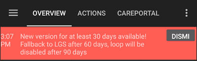
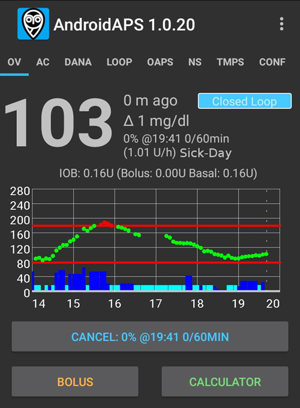

# Poznámky k vydání

```{toctree}
:hidden:

Update2_7.md
Update3_0.md
UpdateAaps3204.md
```

Pro aktualizaci na novou verzi postupujte podle pokynů v [návodu k aktualizaci](UpdateToNewVersion). Sekce řešení problémů na stránce návodu k aktualizaci se věnuje i nejčastějším potížím při aktualizaci **AAPS**.

```{admonition} Upgrading from AAPS v3?
:class: tip
Důležité změny chování – funkce, které se přesunuly, byly přejmenovány nebo odstraněny – najdete na stránce [Co se změnilo v AAPS v4](V4Changes.md).
```

Když bude k dispozici nová aktualizace, dostanete oznámení, jako je toto:



Pokud neaktualizujete do data vypršení platnosti, **AAPS** se přepne do otevřené smyčky.

Data konce podpory jednotlivých verzí AAPS najdete na stránce [Konec podpory](EndOfLife.md).

**Oznámení neignorujte.** Nové verze **AAPS** přinášejí důležité bezpečnostní opravy. Proto musí každý uživatel **AAPS** co nejdříve aktualizovat na nejnovější verzi. Cílem je zlepšit bezpečnost každého uživatele **AAPS** i celé DIY komunity. Děkujeme za pochopení.

(maintenance-android-version-aaps-version)=

## Verze Androidu a verze AAPS

Pokud váš telefon používá Android starší než Android 12, nebudete moci používat AAPS v3.4 a novější, protože vyžaduje alespoň Android 12.

Aby bylo uživatelům se starším Androidem umožněno používat starší verzi AAPS, byla upravena pouze kontrola verzí. Jiné změny neobsahuje.

Najděte svou verzi Androidu v tabulce níže a použijte odpovídající verzi **AAPS**. Kód se stahuje z <https://github.com/nightscout/AndroidAPS> z uvedené větve (branch).

| Vaše verze Androidu  | Verze AAPS, kterou použít | Větev ke stažení                                                 |
| -------------------- | ------------------------- | ---------------------------------------------------------------- |
| Android 12 a novější | Nejnovější verze          | [master](https://github.com/nightscout/AndroidAPS) (výchozí)     |
| Android 11           | **3.3.2.1**               | [3.3.2.1](https://github.com/nightscout/AndroidAPS/tree/3.3.2.1) |
| Android 9, 10        | **3.2.0.4**               | [3.2.0.4](https://github.com/nightscout/AndroidAPS/tree/3.2.0.4) |
| Android 8            | **2.8.2.1**               | [2.8.2.1](https://github.com/nightscout/AndroidAPS/tree/2.8.2.1) |
| Android 7            | **2.6.2**                 | [2.6.2](https://github.com/nightscout/AndroidAPS/tree/2.6.2)     |

## Verze pro WearOS

- AAPS vyžaduje WearOS 3.0, 3.2 nebo 3.5 (Android 11, API level 30) nebo novější. Hodinky s WearOS 2 nejsou podporované.

```{tip}
WearOS 5, API level 34 (Android 14) má [omezení](#BuildingAapsWearOs-WearOS5).
```

(latestrelease)=

(version400)=

## Verze 4.0.0

Datum vydání: 31. 10. 2026

### Nové funkce
- Nové uživatelské rozhraní: aplikace pro telefon přestavěna v Jetpack Compose @MilosKozak
- [Globální vyhledávání](../DailyLifeWithAaps/GlobalSearch.md) @MilosKozak
- Migrace na Kotlin Multiplatform, klient pro Windows, Mac, Linux desktop a iOS @MilosKozak
- [Scény](../DailyLifeWithAaps/Scenes.md): uložte si sadu akcí a spusťte je najednou @MilosKozak
- [Ovládání master ↔ klient](../RemoteFeatures/ClientMasterControl.md): posílání příkazů z telefonu klienta do hlavního zařízení @MilosKozak
  - [Role klientů](#client-master-control-roles): Pouze pro čtení, Jídlo, Pečovatel nebo Admin pro každého klienta @MilosKozak
  - [Zabezpečený režim](#client-master-control-hardened-mode): se zapnutým ovládáním z klienta přijímá hlavní zařízení změny jen od spárovaných klientů @MilosKozak
  - Párování pomocí QR kódu, který na klientovi zároveň nastaví Nightscout, nebo pomocí PINu; tajný klíč pro párování se hned po spárování vymění @MilosKozak
  - [Vlastní token Nightscoutu](#client-master-control-own-token) pro každého klienta, jen s právy, která klient potřebuje @MilosKozak
- Podpora [koncentrace inzulínu](../AdvancedOptions/InsulinConcentration.md) (U200, U500) v pumpách, kalkulačce a profilech @Philoul @MilosKozak
- Správa inzulínů: katalog inzulínů, přezdívky, výběr v profilu a v kalkulačce @Philoul
- Plugin kalibrace @MilosKozak
- [Vyhlazování](../CompatibleCgms/SmoothingBloodGlucoseData.md): Unscented Kalmanův filtr (UKF) @piecycle
- [Rotace míst aplikace](#Aapsscreens-site-rotation): sledování a střídání míst infuze @Philoul @MilosKozak
- Přepracovaný [Autotune](../AdvancedOptions/Autotune.md) @Philoul
- Nové [widgety](../DailyLifeWithAaps/Widgets.md) @MilosKozak @t1dude
- Přístupnost: aplikace pro telefon funguje se čtečkou obrazovky – pojmenované ovládací prvky, hlasový stav, popisy grafů a nadpisy pro rychlou orientaci @MilosKozak
- [Import nastavení](../Maintenance/ExportImportSettings.md): může zachovat nastavení pumpy @MilosKozak
- Trvalé oznámení používá živé aktualizace Androidu, s podporou Samsung Now bar a s deltou @premnirmal
- Graf glykémie: [stiskněte a podržte](#aaps-screens-graph-press-and-hold) a uvidíte hodnoty v daném čase, na každém grafu v přehledu @t1dude @olorinmaia
- Vylepšení výkonu @MilosKozak
- Automatické eSacharidy v bolusové kalkulačce @MilosKozak

### Nová zařízení
- **CareLevo**: nový [ovladač pumpy](../CompatiblePumps/CareLevo.md) @Kisu-Choi @MilosKozak
- **Dana-i2**: podpora @MilosKozak
- **Instara**: nový zdroj CGM @leohunt

### Vylepšení ovladačů pump
- Přestavěné obrazovky přehledu pump pro Insight, Medtronic, Medtrum, Omnipod, Dana, Diaconn a Equil @MilosKozak
- **Omnipod Dash**: Ref kódy jako v PDM a srozumitelné popisy poruch, kompenzace driftu vždy zapnutá, lepší hlášení typu bolusu @nl-ruud
- **Omnipod**: pevné datum konce pro Dash a Eros @mcnelson
- **DanaR, RS**: emulátor pumpy pro testování @MilosKozak
- **Equil**: emulátor pumpy pro testování @MilosKozak
- Mnoho oprav pump a smyčky @MilosKozak a další

### Wear OS
- [Aplikace pro hodinky](../WearOS/WearOsSmartwatch.md) přestavěna v Compose, nové dlaždice a komplikace, automatická instalace ciferníku (Watch Face Push) na Wear OS 6+ @olorinmaia @Philoul
- CustomWatchface je k dispozici pro WearOS 6.0 (GW7, GW8, GW9...) s vyhrazeným ciferníkem WFF @Philoul @olorinmaia
- CustomWatchface teď může obsahovat 5 pozic pro komplikace, které si můžete přizpůsobit (nová funkce dostupná jen pro starší hodinky) @Philoul
- Nový [ciferník WFF založený na komplikacích AAPS](#wearos-complications-watchface-setup) @olorinmaia
- Opravy ve výsledku bolusové kalkulačky a Rychlého bolusu @olorinmaia
- Nová aktivita Graf glykémie a Režim smyčky v hlavní nabídce @olorinmaia
- Bolusová kalkulačka: stránka [typ jídla](#WearOsSmartwatch-wizard-meal-type), která rozdělí sacharidy jako kalkulačka v telefonu, a [čas sacharidů](#WearOsSmartwatch-wizard-carb-time) s připomínkou *čas jíst* na hodinkách @olorinmaia
- [Alarmy z telefonu na hodinkách](#WearOsSmartwatch-phone-alarms): hodinky zobrazí alarm a nabídnou Ztišit a Ztlumit na 5 minut @olorinmaia

### Sestavení
- CI workflow pro sestavení z tagu/větve, mapování verzí JDK @Angus-repo

### Přispěvatelé
@MilosKozak @Philoul @olorinmaia @Kisu-Choi @leohunt @piecycle @Angus-repo @mcnelson @t1dude @premnirmal @nl-ruud

Úplný seznam změn: <https://github.com/nightscout/AndroidAPS/compare/3.4.2.6...4.0.0>

(version3426)=

## Verze 3.4.2.6

- Equil: vyšší stabilita @MilosKozak

(version3425)=

## Verze 3.4.2.5

- Equil: oprava souběhu (race condition) @MilosKozak

(version3424)=

## Verze 3.4.2.4

- Opravy Equil @MilosKozak
- Oprava synchronizace profilu z NS @MilosKozak

(version3423)=

## Verze 3.4.2.3
- Dash: řešení driftu @nl-ruud
- NSClientV3: oprava mezery v datech po opětovném připojení @MilosKozak
- Automatizace: oprava deserializace @MilosKozak
- Equil: oprava hlášení baterie @MilosKozak
- Úklid workflow @vanelsberg
- Equil: vylepšené zotavení po chybě @MilosKozak
- DanaRS: oprava komunikace s domácí (korejskou) verzí pumpy @MilosKozak
- Insight: oprava synchronizace TBR @MilosKozak
- Dash: oprava chyby při aktivaci @nl-ruud

(version3422)=

## Verze 3.4.2.2

- Opravy problémů s Equil a Medtronic
- Vyšší bezpečnost Medtrum

(version3421)=

## Verze 3.4.2.1

- Equil: oprava párování a dialogu průběhu @MilosKozak

(version3420)=

## Verze 3.4.2.0

Datum vydání: 04. 02. 2026

- Equil: oprava odporu pro různé modely @hhfcvmars
- Tidepool: oprava relace @MilosKozak
- Medtrum: oprava průběhu aktivace – zabránění dvojitému plnění @MilosKozak
- COB: oprava výpočtu COB (řeší nebezpečný okrajový případ) @MilosKozak

(version3410)=

## Verze 3.4.1.0

Datum vydání: 03. 08. 2026

### Jádro
- Oprava zpracování letního času @MilosKozak
- Vylepšené a sjednocené určení normálního cíle (mg/dl > 99, mmol > 5,5) @MilosKozak
- SMS: RESTART chráněn PINem @MilosKozak
- Údržba: varování při výběru špatného adresáře @MilosKozak

### Vylepšení ovladačů pump
- **Omnipod Dash**: kód ovladače BLE přesunut do modulu omnipod/common @jwoglom
- **Omnipod Dash**: pokus o opravu stavu připojení @MilosKozak
- **Omnipod**: kontrola profilu před aktivací podu, aby se neplýtvalo pody (#4534) @brianV
- **Medtronic**: oprava stejného typu kódování zobrazeného v dialogu nastavení @mifi100
- **Medtronic**: příprava společných tříd pump (příprava na Tandem) @andy-rozman
- **RileyLink**: oprava kódování (#4519) @mifi100
- **Equil**: rozšířená kompatibilita inzulínových pump podle prefixu sériového čísla (#4510) @hhfcvmars
- **Equil**: přidáno logování @MilosKozak
- **Diaconn G8**: oprava chyby při synchronizaci logu a podpora firmwaru 3.58+ @miyeongkim
- **Diaconn**: oprava převodu jednotky trvání TBR @miyeongkim
- **Diaconn**: pro synchronizaci historie se používá commandQueue.loadEvents() @miyeongkim
- Možnost podat inzulín, když je smyčka pozastavená, ale pumpa je dostupná @cschuijt

### Cloud / záloha
- Přidána záloha na Disk Google @Angus-repo
- Upozornění v UI při změně chybového stavu cloudového úložiště @Angus-repo
- Možnost používat místní i cloudové úložiště současně @Angus-repo

### Tidepool
- Vylepšená migrace na Tidepool OAuth2 @MilosKozak
- Oprava trvalého stavu BLOCKED u Tidepoolu, oprava odmítání prázdných SSID @michaeln-synapse

### NSClient
- NSCv3: vylepšené opětovné připojení @MilosKozak

### Wear OS
- Zobrazení nového IOB ve výsledku kalkulačky, pokud se IOB používá ve výpočtu @olorinmaia
- Oprava průběhu bolusu na hodinkách s celkovým množstvím @Philoul

### UI
- Vylepšená ikona ic_none pro rotaci míst aplikace @Philoul
- Oprava: nastavení pumpy pro správu rotace míst aplikace se nepoužívalo @samfundev

### Přispěvatelé
@MilosKozak @Philoul @olorinmaia @jwoglom @mifi100 @andy-rozman @Angus-repo @brianV @cschuijt @hhfcvmars @miyeongkim @samfundev @michaeln-synapse

(version3400)=

## Verze 3.4.0.0

Datum vydání: 31. 12. 2025

### Před aktualizací:
* Tato verze vyžaduje Android 12.0 nebo novější. Před aktualizací zkontrolujte verzi Androidu v telefonu.
* Aktualizujte na nejnovější Android Studio, nebo raději použijte sestavení v prohlížeči.

### Nové funkce
* Režim smyčky @MilosKozak
  * Zobrazení [historie stavu smyčky](#AapsScreens-running-mode) na kartách ošetření
  * Zobrazení a možnost změny [stavu smyčky z AAPSClientu](#RemoteControl_aapsclient).<br>Pozn.: vyžaduje nastavení [NSClient > Synchronizace > Přijímat provozní režim z NS](#Preferences-nsclient-synchronization)
* [Nové CGM](../Getting-Started/CompatiblesCgms.md): Glunovo, Intelligo, Sinocare
* Podpora [rotace míst aplikace](#Aapsscreens-site-rotation) @Philoul
* Nová [akce automatizace](#automations-automation-action): zapnutí nebo vypnutí SMB @MilosKozak
* CGM Syai je [důvěryhodný zdroj glykémie](#GettingStarted-TrustedBGSource) a podporuje rozšířené filtrování @MilosKozak

### Vylepšení Wear OS
* výrazně nižší spotřeba baterie @MilosKozak
* vylepšení a opravy UI @olorinmaia
* téměř úplně přepsaný kód, aby odpovídal aktuální úrovni knihoven (dříve WearOS 2) @MilosKozak
* 2 nové komplikace pro rozšířená data @Philoul
* Přechod na moderní poskytovatele komplikací s DataStore @MilosKozak

### Opravy úniků paměti
* Opraveny úniky paměti v kódu @MilosKozak
* Přidáno hlášení úniků paměti LeakCanary do Firebase Crashlytics @MilosKozak

### Vylepšení ovladačů pump
* **DanaI**: opraveny problémy s odpojováním @MilosKozak
* **RileyLink**: rychlejší komunikace díky kratším prodlevám @mifi100
* **Medtrum**: přidáno zobrazení času aktivace a stáří patche @vanelsberg, oprava velkých písmen v hesle @MilosKozak
* **Combo**: opraveny souběhy (race conditions) v testech @MilosKozak @dv1
* **Equil**: optimalizované připojení, nižší spotřeba baterie @MilosKozak

### Synchronizace s Nightscoutem
* Vylepšená deduplikace při selhání NS @MilosKozak

### Vylepšení UI/UX
* různá vylepšení @MilosKozak @Philoul @olorinmaia

### Automatizace
* Nová akce pro ovládání SMB – zapnutí/vypnutí SMB pomocí automatizace @MilosKozak

### Testování
* Přidány rozsáhlé unit testy pro pumpy Equil, Eopatch, Dana a Medtronic @MilosKozak
* Vylepšená stabilita a pokrytí testů v několika modulech @MilosKozak

### Tidepool
* Tidepool OAUTH2 (podpora nového ověřování Tidepool) @MilosKozak

(version3321)=

## Verze 3.3.2.1

Datum vydání: 13. 08. 2025

- Opraveno připojení Bluetooth k Omnipodu na Androidu 16
- Proces CI (sestavení v prohlížeči)
- Oprava převodu mmol–mg/dl
- Oprava špatného výběru času v dialozích v některých časových pásmech
- Oprava čtení klíčů ve zjednodušeném režimu
- Oprava chybějících predikcí na hodinkách
- Vylepšená Konfigurace
- Vylepšená plná synchronizace NSCv3

(version3300)=

## Verze 3.3.2.0

Datum vydání: 27. 03. 2025

### Jak aktualizovat

* K sestavení této verze je potřeba [Android Studio verze „Meerkat“](#Building-APK-recommended-specification-of-computer-for-building-apk-file) nebo novější. Pokud jste už sestavili některou verzi 3.3.x, musíte Android Studio znovu aktualizovat.

(version-enforcement)=

### Od této verze jsou oznámení a vynucování verze zjednodušené a mírnější a fungují takto:
*  Když je zařízení offline (bez připojení k internetu), platnost nevyprší. To znamená, že už neexistují lhůty 60 a 90 dní.
*  Po vypršení platnosti se vynutí režim LGS
*  Varování/oznámení budete dostávat méně často:
   - zbývá 28 a více dní: každých 7 dní
   - zbývá 27–14 dní: každé 3 dny
   - pak jednou denně
   - Oznámení se zobrazí až po poledni, aby vás nerušilo v noci
* Existují jen 2 druhy oznámení
   - Je k dispozici nová verze (nemá žádný vliv na AAPS)
   - Platnost aplikace vyprší k určitému datu v budoucnu (stále bez vlivu na AAPS) / platnost vypršela (AAPS přejde do režimu LGS)

### Novinky

* SMS příkaz RESTART @MilosKozak
* Parametry přepnutí profilu z hodinek @olorinmaia
* Tmavý režim ciferníku AAPS V2 @olorinmaia
* Vylepšená výměna dat s G7 @olorinmaia
* Konfigurace widgetu @MilosKozak
* Vylepšení UI přepínačů (radiobuttons) @olorinmaia
* Automatizace: výběr polohy z mapy @MilosKozak
* Verze je vidět na hlavních obrazovkách @MilosKozak
* Je vynucena kompilace s existujícím systémem git (žádné stahování zip)
* Zobrazení verze na hlavní obrazovce @MilosKozak
* Vylepšení nahrávání do Tidepoolu @ConstantinMatheis

### Opravy chyb

* Oprava rušení bondingu u Dash @Andreas
* Opravy Garmin @robertbuessow @suside
* Oprava zobrazení IOB v dialozích @olorinmaia
* Opravy pravopisu a vylepšené ověřování v Cílech @MilosKozak
* Opraveno vykreslování emulovaných TBR @MilosKozak
* Opraveno obcházení zabezpečení @tdrkDev

## Verze 3.3.1.3

Datum vydání: 21. 01. 2025

### Opravy chyb

* Dash: bonding je volitelný (ve výchozím stavu vypnutý) @MilosKozak
* Equil: opraven bolus 10+ U, vylepšené alarmy @EquilHack
* Garmin: vylepšení hodinek @swissalpine
* Vylepšení hodinek @olorinmaia
* Ovládání stavu smyčky z hodinek @tdrkDev
* Vylepšení stability

*  **Může být potřeba nové [nastavení Authenticatoru](#sms-commands-authenticator-setup).**

## Verze 3.3.1.2

Datum vydání: 15. 01. 2025

### Jak aktualizovat

* K sestavení této verze je potřeba [Android Studio verze „Ladybug Feature Drop“](#Building-APK-recommended-specification-of-computer-for-building-apk-file) nebo novější. **Není to totéž jako obyčejný „Ladybug“.** Pokud jste už sestavili některou verzi 3.3.x, musíte Android Studio znovu aktualizovat.

### Opravy chyb

* Dash: na Androidu 15+ se používá bonding
* Obnoveno tlačítko Dexcom v Přehledu
* Equil: možnost odebrat nefunkční pumpu
* Varování, když je faktor úpravy DynISF nulový
* NSCv3: vyřešena komunikace přes websocket na telefonech s mírně odlišným časem
* SMS příkazy: oprava OneTimePassword. **Může být potřeba nové [nastavení Authenticatoru](#sms-commands-authenticator-setup).**
* Oprava problému, kdy některé předvolby už nešlo upravit.
* Oprava resetu hlavního hesla u virtuální pumpy.
* Opraven import velkých souborů se zálohou nastavení.

## Verze 3.3.1.0

Datum vydání: 06. 01. 2025

### Změny v UI

* [Přidány barvy pro rozlišení AAPSClient a AAPSClient2](#RemoteControl_aapsclient) @MilosKozak
* Vylepšené rozložení a ikony uživatelských akcí

### Další funkce

* Nový spouštěč automatizace: [počet kroků](#screen-heart-rate-steps) @Roman Rihter
* Možnost přijmout vše při plné synchronizaci NSCv3 (včetně dat, která se dříve nesynchronizovala, např. TBR) @MilosKozak
* NSClient v3: zprovozněno Oznámení (_tj._ z AAPSClientu do AAPS) @MilosKozak

### Technické změny a opravy chyb

* Oprava pádu Insight @philoul
* Oprava vytváření nadměrného počtu záznamů deviceStatus v Nightscoutu @MilosKozak
* Oprava vstřebávání sacharidů @MilosKozak
* Opravena barva RadioButtons a CheckBoxes @MilosKozak
* Opravena chyba v migraci procenta DynISF @MilosKozak
* Vyřešeno špatně umístěné oznámení DynISF @MilosKozak
* Opravena chyba v cifernících @philoul

## Verze 3.3.0.0

Datum vydání: 29. 12. 2024

### Hlavní funkce

* Funkce **[Dynamická ISF](../DailyLifeWithAaps/DynamicISF.md)** už není samostatný plugin, ale je nyní součástí pluginu [OpenAPS SMB](#Config-Builder-aps) jako jeho volba, spolu s několika změnami v chování:
  * **Přepnutí profilu** a **procento profilu** se nyní u **Dynamické ISF** berou v úvahu pro sílu dynamické citlivosti
  * Vypočítá se průměrná **ISF** za posledních 24 h a tato hodnota se používá pro bolusovou kalkulačku a výpočet **COB**. Hodnota **ISF z profilu** se vůbec nepoužívá (kromě záložního výpočtu, když nejsou k dispozici data z historie)
  * Stránka dokumentace k Dynamické ISF byla přepsána. Přečtěte si prosím důležitou sekci [Co zvážit při aktivaci Dynamické ISF](#dyn-isf-things-to-consider-when-activating-dynamicisf).
* [Povolení „SMB vždy“ a „SMB po sacharidech“](#Open-APS-features-enable-smb-always) pro uživatele FreeStyle Libre 2 a Libre 3
  * Poznámka: vyžaduje nejnovější verzi xDrip+ nebo Juggluco.
* Nové spouštěče **automatizace**
* Automatický export nastavení

### Jak aktualizovat

* Před aktualizací:
  * **<span style="color:red">Tato verze vyžaduje Android 11.0 nebo novější</span>**. Před aktualizací zkontrolujte verzi Androidu v telefonu.
  * Pokud používáte „starý“ ovladač Combo se zařízením ruffy, přejděte před aktualizací na [nativní ovladač Combo](../CompatiblePumps/Accu-Chek-Combo-Pump-v2.md)
  * Při aktualizaci přijdete o své [doplňkové grafy](#AapsScreens-section-g-additional-graphs) na hlavní obrazovce: v případě potřeby si ručně poznamenejte jejich aktuální nastavení, abyste je po aktualizaci mohli znovu vytvořit.
  * [Problémy s připojením Bluetooth, které někteří lidé mají na Androidu 15](../Getting-Started/Phones.md), tato verze **NEŘEŠÍ** (jde o problém Androidu, ne **AAPS**). Oprava je k dispozici ve verzi 3.3.1.2.
  * Tlačítko BYODA na hlavní obrazovce už kvůli omezením Androidu není k dispozici. Ve verzi 3.3.1.2 je to opraveno.
* Postup aktualizace: řiďte se návodem [Aktualizace na novou verzi nebo větev (branch)](../Maintenance/UpdateToNewVersion.md).
  * K sestavení této verze je potřeba [Android Studio verze „Ladybug“](#Building-APK-recommended-specification-of-computer-for-building-apk-file) nebo novější. Pokud už máte nainstalovanou starší verzi Android Studia, možná budete muset <span style="color:red">nastavit verzi JVM na 21</span>. Viz [Řešení problémů s Android Studiem > Incompatible Gradle JVM](#incompatible-gradle-jvm).
  * Tip – pokud nechcete přijít o historii **AAPS**, VŽDY proveďte AKTUALIZACI, a NE ODINSTALACI/INSTALACI. Pro jistotu si zálohujte aktuální nastavení **AAPS** a staré APK, abyste se mohli vrátit ke staré verzi, kdyby se něco pokazilo.
* Po aktualizaci:
  * Nastavte nové [nastavení „Adresář AAPS“](#preferences-maintenance-logdirectory) na kartě Údržba.

### Podrobné změny

#### CGM a pumpy

* [Povolení „SMB vždy“ a „SMB po sacharidech“](#Open-APS-features-enable-smb-always) pro uživatele FreeStyle Libre 2 a Libre 3 @MilosKozak
* Vylepšení [ovladače Medtrum](../CompatiblePumps/MedtrumNano.md) @jbr77rr
  * Vylepšení komunikace, včetně nového nastavení, které obchází problémy na některých telefonech
  * Zobrazení stavu zásobníku na začátku aktivace
  * Oprava chyby, kdy se aktivace vrátila na začátek a uživatel ji nemohl dokončit
  * Zpětná vazba ke stavu synchronizace a další upřesnění
* Nově podporovaná pumpa: [Equil 5.3](../CompatiblePumps/Equil5.3.md) @EquilHack
* Nově podporované CGM: [Ottai](../CompatibleCgms/OttaiM8.md) @ottai-developer a [Syai Tag](../CompatibleCgms/SyaiTagX1.md) @syai-dev
* Ovladač Insight přepsán do Kotlinu @Philoul
* Odstraněn starý ovladač Combo závislý na ruffy

#### Změny v UI

* [Zjednodušený režim](#preferences-simple-mode) je při nové instalaci ve výchozím stavu zapnutý @MilosKozak
* Nové možnosti [Rychlého bolusu](#Preferences-quick-wizard) @radicalb
  * Rychlý bolus nyní používá pro výpočet a zobrazení bolusu stejnou logiku jako kalkulačka. Pole „Čas sacharidů“ v Rychlém bolusu teď můžete použít pro předstihový bolus.
* Nová [nabídka měřítka grafu](#aaps-screens-main-graph); vylepšení UI [nabídky doplňkových grafů](#AapsScreens-activate-optional-information) @Philoul
* [Vylepšené rozložení Konfigurace](../SettingUpAaps/ConfigBuilder.md) @MilosKozak
  * Sekce jsou nyní ve výchozím stavu sbalené. Rozbalíte je šipkou.
* Proměnná citlivost je vidět v AAPSClientu
* Vylepšení UI bolusové kalkulačky @kenzo44
* Oprava zobrazení textu na kartách pump při světlém motivu @jbr77rr

#### Další funkce

* [Automatický export nastavení](#ExportImportSettings-Automating-Settings-Export) @vanelsberg
* Nový [spouštěč automatizace](#automations-automation-triggers) @vanelsberg
  * Aktivace podu (jen patch pumpy)
* Nové [spouštěče automatizace](#automations-automation-triggers) @jbr77rr
  * Stáří kanyly, Stáří inzulínu, Stáří baterie, Stáří senzoru, Stav zásobníku, Úroveň nabití baterie pumpy
* Možnost zadat záporné sacharidy @MilosKozak
* Nový parametr [„Adresář AAPS“](#preferences-maintenance-settings) pro výběr jiného adresáře pro ukládání, než je výchozí.
* Možnost zadat [záznamy inzulínu, když je pumpa pozastavená](#aaps-screens-buttons-insulin) @jbr77rr
* Upravený [Cíl 2](#objectives-objective2) @MilosKozak
  * Kontrola, že je nastavené hlavní heslo a že ho znáte
* Náhodné sacharidy v testovacím režimu @MilosKozak
* Opravena chyba ve výpočtu CDD @MilosKozak
* SMS příkazy: možnost [**neposílat** SMS při změně profilu](#sms-commands-too-many-messages) z NS @MilosKozak

#### Chytré hodinky

* vylepšení hodinek a ciferníků @Philoul @MilosKozak @olorinmaia
* Dlaždice na hodinkách z akcí automatizace @Philoul
* Kombinované ciferníky z AAPS, AAPSClient a AAPSClient2 pro sledování více pacientů @Philoul @MilosKozak
* EXTRA: show\_user\_actions\_on\_watch\_only @MilosKozak

#### Technické změny

* [změna umístění log souborů](#Accessing-logfiles-accessing-logfiles)
* nová interní struktura modulů @MilosKozak
* vrstva ukládání dat oddělena od hlavního kódu @MilosKozak
* sestavovací soubory přepsány do kts @MilosKozak
* algoritmy přepsány do Kotlinu kvůli lepšímu výkonu @MilosKozak
* spousta nových unit testů @MilosKozak a další
* další kód převeden do Kotlinu @MilosKozak
* nová správa předvoleb, xml \-\> kotlin @MilosKozak
* nová konfigurace CI, CI běží na vlastních serverech @MilosKozak
* knihovny aktualizovány na nejnovější verze, toml @MilosKozak
* migrace na kotlin 2.0, java 21 @MilosKozak

(version3204)=

## [Verze 3.2.0.4](https://github.com/nightscout/AndroidAPS/releases/tag/3.2.0.4)

Datum vydání: 27. 02. 2024

Tato verze je poslední, která podporuje Android 10. Pokud nemůžete přejít na Android 11, [aktualizujte AAPS na verzi 3.2.0.4](#update-aaps-3204).

### Změny

- Podpora xDrip G7
- Opravy Medtrum
- Oprava ikony automatizace
- Oprava plnění cíle 1

(version3200)=

## Verze 3.2.0.0 věnována @Philoul

Datum vydání: 23. 10. 2023

### Důležité poznámky

- Je vyžadován NS verze 15
- Při používání websocketů v pluginu Nightscout v3 nejsou ošetření zadaná přes rozhraní NS (tlačítko +) a dalšími aplikacemi, které používají API v1, odeslána do AAPS. To bude opraveno v některé následující verzi NS. Dokud NS interně úplně nepřejde na v3, používejte v AAPS i v AAPSClientu vždy stejného klienta (v1 nebo v3). To samé platí i pro AAPS a samotný AAPSClient.
- Websockety v pluginu v3 fungují podobně jako v pluginu v1. Bez zapnutých websocketů AAPS pravidelně plánuje stahování z NS. To by mělo snížit spotřebu energie, protože NS není trvale připojen. Na druhou stranu to znamená zpoždění při výměně dat. Než ji začnete používat, přečtěte si prosím [zde](#Important-comments-on-using-v3-versus-v1-API-for-Nightscout-with-AAPS) důležité poznámky od vývojářů!
- Pokud jako zdroj CGM používáte xDrip, musíte ho po aktualizaci kvůli interním změnám znovu vybrat
- Tidepool lze použít místo NS ke splnění prvního cíle
- Pokud odesíláte data do xDrip+, musíte nastavit plugin synchronizace xDrip. Aby xDrip přijímal glykémie z AAPS, musí být jako zdroj vybráno „xDrip+ Sync Follower“
- Pokud chcete přejít na ovladač ComboV2, musíte odinstalovat Ruffy a pumpu znovu spárovat s AAPS
- Abyste mohli použít plugin DynISF, musíte zahájit Cíl 11 (všechny předchozí cíle musí být dokončené, aby šlo Cíl 11 zahájit)


### Změny

- Ovladač pumpy EOPatch2 / GlucomenDay @jungsomyeonggithub @MilosKozak
- Ovladač pumpy ComboV2 (bez potřeby Ruffy) @dv1
- Ovladač Medtrum Nano @jbr7rr
- Podpora korejské DanaI @MilosKozak
- Podpora CGM Glunovo @christinadamianou
- Podpora G7 @MilosKozak @rICTx-T1D @khskekec
- Plugin NSClient v3 @MilosKozak
- Podpora Tidepool @MilosKozak
- Plugin vyhlazování @MilosKozak, @justmara, Exponenciální vyhlazování @nichi (Tsunami), Průměrovací vyhlazování @jbr7rr
- Plugin DynamicISF @Chris Wilson, @tim2000s
- Ciferník pro Garmin a podpora srdečního tepu @buessow
- Nové logo @thiagomsoares
- Nový ciferník @Philoul
- opraveno mnoho chyb z verze 3.1
- možnost přidat poznámky na více místech @Sergey Zorchenko
- Opravy UI @MilosKozak @osodebailar @Andries-Smit @yodax @Philoul @dv1 @paravoid
- nové SMS příkazy LOOP LGS/CLOSED @pzadroga
- překlady pro hodinky @Andries-Smit
- komunikace s xDrip přesunuta do samostatného modulu @MilosKozak
- interní změny: aktualizované verze knihoven, migrace na rx3, nová struktura modulů @MilosKozak
- opravy ovladače Diaconn @miyeongkim
- více možností údržby databáze @MilosKozak
- AAPSClient ukazuje, zda je hlavní telefon připojen k nabíječce @MilosKozak
- Změna v bolusové kalkulačce. Pokud CGM není k dispozici, procento se ignoruje (tj. použije se 100 %)
- migrace na sestavovací systém kts @MilosKozak
- vylepšená integrace CI @MilosKozak @buessow
- úklid testů @ryanhaining @MilosKozak
- přes 110 tisíc nových řádků kódu, 240 tisíc změněných řádků, 6884 změněných souborů

(Important-comments-on-using-v3-versus-v1-API-for-Nightscout-with-AAPS)=
### Důležité poznámky k používání API v3 a v1 pro Nightscout s AAPS

v1 je starý protokol pro výměnu dat mezi webem NS a serverem NS. Má mnoho omezení
- v1 posílá jen data za 2 dny
- v1 posílá všechna data za 2 dny při každém novém připojení
- websockety jsou povinné = trvalé připojení, vyšší spotřeba baterie
- při častém odpojování se spojení s NS pozastaví na 15 minut, aby se zabránilo vysoké spotřebě dat

v3 je nový protokol. Bezpečnější a efektivnější
- při používání tokenů můžete lépe nastavit přístupová práva
- protokol je efektivnější na obou stranách (AAPS i NS)
- Umí z NS načíst data až za 3 měsíce
- na každém zařízení si můžete vybrat, zda websockety použijete, nebo ne (s nimi jsou aktualizace rychlejší, bez nich je nižší spotřeba energie, ale aktualizace jsou pomalejší, tj. v minutách)
- NSClient se při odpojení nepozastavuje

OMEZENÍ
- S AAPS 3.2 se musí používat NS 15
- v3 nevidí změny provedené protokolem v1 (pravděpodobně to bude vyřešeno v některé budoucí verzi NS)
- naopak v1 změny provedené přes v3 vidí, protože používá starou, neefektivní metodu sledování změn
- pamatujte, že NS zatím interně stále používá v1, takže pokud používáte v3, nelze zadávat data přes webové rozhraní NS. Pokud chcete zadávat data na dálku, musíte použít AAPSClient nebo SMS

DOPORUČENÉ NASTAVENÍ
- kvůli všemu výše uvedenému byste si měli vybrat jen jednu metodu a používat ji na všech zařízeních (pamatujte, že všechny ostatní uploadery v době psaní tohoto textu používají v1). Pokud se rozhodnete přejít na v3, vyberte v3 v AAPS i ve všech AAPSClientech
- v3 je doporučená kvůli efektivitě
- zda s v3 použijete websockety, nebo ne, záleží na vás
- VELMI se doporučuje nechat AAPS shromažďovat všechna data a pak je nahrávat do NS jako jediný uploader. Všechna ostatní zařízení/aplikace by měly z NS jen číst. Tím zabráníte konfliktům a chybám synchronizace. To platí i pro posílání dat glykémie do NS přes konektor Dexcom Share apod.

(version3100)=

## Verze 3.1.0

Datum vydání: 19. 07. 2022

[Poznámky k vydání](https://github.com/nightscout/AndroidAPS/releases/tag/3.1.0)

## Verze 3.0.0

Datum vydání: 31. 01. 2022

[Poznámky k vydání](https://github.com/nightscout/AndroidAPS/releases/tag/3.0.0)

## Verze 2.8.2

Datum vydání: 23. 01. 2021

[Poznámky k vydání](https://github.com/nightscout/AndroidAPS/releases/tag/2.8.2)

(version-2811)= (important-hints-2-8-1-1)=

## Verze 2.8.1.1

Datum vydání: 12. 01. 2021

[Poznámky k vydání](https://github.com/nightscout/AndroidAPS/releases/tag/2.8.1.1)

(Releasenotes-version-2-8-0)=

## Verze 2.8.0

Datum vydání: 01. 01. 2021

[Poznámky k vydání](https://github.com/nightscout/AndroidAPS/releases/tag/2.8.0)

(Releasenotes-version-2-7-0)=

## Verze 2.7.0

Datum vydání: 24. 09. 2020

[Poznámky k vydání](https://github.com/nightscout/AndroidAPS/releases/tag/2.7.0)

(Releasenotes-version-2-6-1-4)=

## Verze 2.6.1.4

Datum vydání: 04. 05. 2020

[Poznámky k vydání](https://github.com/openaps/AndroidAPSdocs/blob/e7e2e73cae3dd16af3391ce770fb48b3b3388c1b/docs/EN/Maintenance/ReleaseNotes.md#version-2614)

## Verze 2.6.1.3

Datum vydání: 03. 05. 2020

[Poznámky k vydání](https://github.com/openaps/AndroidAPSdocs/blob/e7e2e73cae3dd16af3391ce770fb48b3b3388c1b/docs/EN/Maintenance/ReleaseNotes.md#version-2613)

## Verze 2.6.1.2

Datum vydání: 19. 04. 2020

[Poznámky k vydání](https://github.com/openaps/AndroidAPSdocs/blob/e7e2e73cae3dd16af3391ce770fb48b3b3388c1b/docs/EN/Maintenance/ReleaseNotes.md#version-2612)

## Verze 2.6.1.1

Datum vydání: 06. 04. 2020

[Poznámky k vydání](https://github.com/openaps/AndroidAPSdocs/blob/e7e2e73cae3dd16af3391ce770fb48b3b3388c1b/docs/EN/Maintenance/ReleaseNotes.md#version-2611)

## Verze 2.6.1

Datum vydání: 21. 03. 2020

[Poznámky k vydání](https://github.com/openaps/AndroidAPSdocs/blob/e7e2e73cae3dd16af3391ce770fb48b3b3388c1b/docs/EN/Maintenance/ReleaseNotes.md#version-261)

(Releasenotes-version-2-6-0)=

## Verze 2.6.0

Datum vydání: 29. 02. 2020

[Poznámky k vydání](https://github.com/openaps/AndroidAPSdocs/blob/e7e2e73cae3dd16af3391ce770fb48b3b3388c1b/docs/EN/Maintenance/ReleaseNotes.md#version-260)

## Verze 2.5.1

Datum vydání: 31. 10. 2019

[Poznámky k vydání](https://github.com/openaps/AndroidAPSdocs/blob/e7e2e73cae3dd16af3391ce770fb48b3b3388c1b/docs/EN/Maintenance/ReleaseNotes.md#version-251)

(Releasenotes-version-2-5-0)=

## Verze 2.5.0

Datum vydání: 26. 10. 2019

[Poznámky k vydání](https://github.com/openaps/AndroidAPSdocs/blob/e7e2e73cae3dd16af3391ce770fb48b3b3388c1b/docs/EN/Maintenance/ReleaseNotes.md#version-250)

## Verze 2.3

Datum vydání: 25. 04. 2019

[Poznámky k vydání](https://github.com/openaps/AndroidAPSdocs/blob/e7e2e73cae3dd16af3391ce770fb48b3b3388c1b/docs/EN/Maintenance/ReleaseNotes.md#version-23)

## Verze 2.2.2

Datum vydání: 07. 04. 2019

[Poznámky k vydání](https://github.com/openaps/AndroidAPSdocs/blob/e7e2e73cae3dd16af3391ce770fb48b3b3388c1b/docs/EN/Maintenance/ReleaseNotes.md#version-222)

## Verze 2.2

Datum vydání: 29. 03. 2019

[Poznámky k vydání](https://github.com/openaps/AndroidAPSdocs/blob/e7e2e73cae3dd16af3391ce770fb48b3b3388c1b/docs/EN/Maintenance/ReleaseNotes.md#version-22)

## Verze 2.1

Datum vydání: 03. 03. 2019

[Poznámky k vydání](https://github.com/openaps/AndroidAPSdocs/blob/e7e2e73cae3dd16af3391ce770fb48b3b3388c1b/docs/EN/Maintenance/ReleaseNotes.md#version-21)

## Verze 2.0

Datum vydání: 03. 11. 2018

[Poznámky k vydání](https://github.com/openaps/AndroidAPSdocs/blob/e7e2e73cae3dd16af3391ce770fb48b3b3388c1b/docs/EN/Maintenance/ReleaseNotes.md#version-20)

## Verze 1.0

```{admonition} First version of **AAPS**
:class: note

První testovací verze vznikla v roce 2015 a první vydání bylo v roce 2016.

Přesná chronologie těchto vydání zatím není k dispozici, ale protože se na to lidé ptali už několikrát, uvádíme to zde.

```

