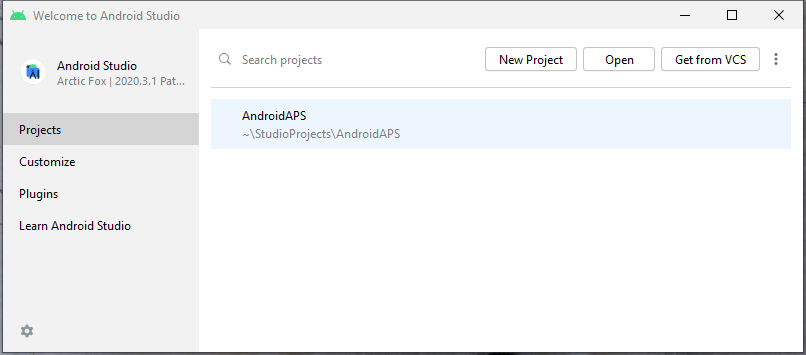
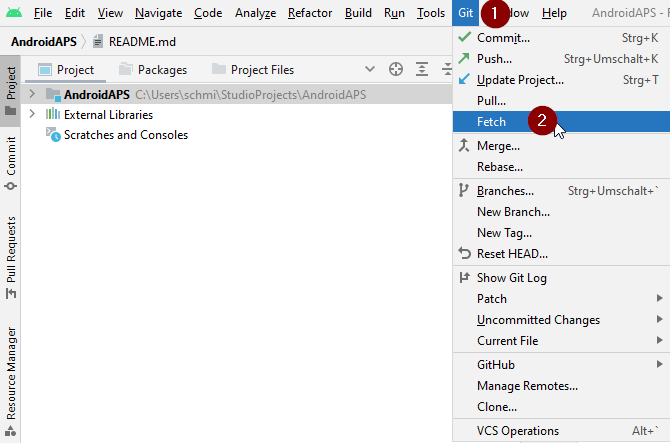
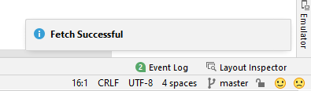
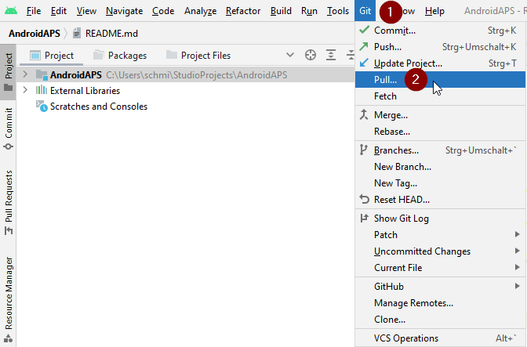
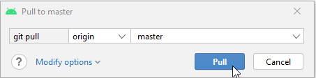
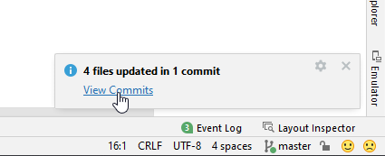
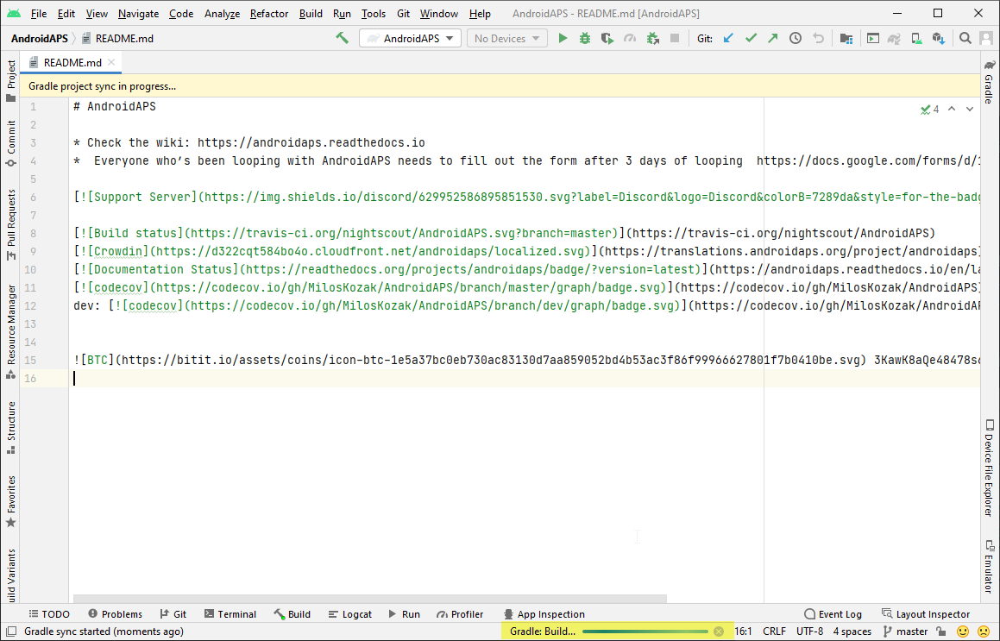

# Aktualizace pomocí Android Studia

## Sestavte si aplikaci sami, místo stažení

**AAPS** nelze stáhnout kvůli předpisům pro zdravotnické prostředky. Sestavit si aplikaci pro vlastní použití je legální, ale nesmíte dávat kopii jiným! Podrobnosti najdete na stránce [Nejčastější otázky uživatelů APS](../UsefulLinks/FAQ.md).

```{note}
Pokud chcete sestavit **AAPS** na novém počítači: zkopírujte záložní soubor úložiště klíčů do nového počítače. Potom místo tohoto návodu postupujte podle [postupu pro první sestavení **AAPS**](../SettingUpAaps/BuildingAaps.md). Jediný rozdíl je v tom, že místo vytvoření nového úložiště klíčů můžete vybrat to, které jste zkopírovali do nového počítače.
```

## Přehled aktualizace na novou verzi AAPS pomocí Android Studia

```{contents} Steps for updating to a new version of AAPS
:depth: 1
:local: true
```

Pokud narazíte na problémy, podívejte se na samostatnou stránku [Řešení problémů s Android Studiem](../GettingHelp/TroubleshootingAndroidStudio.md).

### Exportujte své nastavení

Exportujte nastavení ze stávající verze **AAPS** ve svém telefonu. Možná ho nebudete potřebovat, ale opatrnosti není nikdy dost.

Pokud si nepamatujete, jak to udělat, podívejte se na stránku [Export a import nastavení](ExportImportSettings.md).

### Zkontrolujte verzi Android Studia

Minimální požadovaná verze je popsána v [návodu k sestavení](#Building-APK-recommended-specification-of-computer-for-building-apk-file). Pokud je vaše verze starší, [nejprve aktualizujte Android Studio](#Building-APK-install-android-studio)!

(Update-to-new-version-update-your-local-copy)=
### Aktualizujte svou místní kopii

* Otevřete svůj stávající projekt AAPS v Android Studiu. Možná budete muset vybrat svůj projekt. Klikněte (dvakrát) na projekt AAPS.

  

* V nabídce Android Studia vyberte Git -> Fetch

   

* V pravém dolním rohu uvidíte zprávu, že Fetch proběhl úspěšně.

   

* Nyní v nabídce vyberte Git -> Pull

   

* Všechny možnosti nechte, jak jsou (origin/master), a vyberte Pull

   

* Počkejte, než stahování skončí. Průběh uvidíte jako informaci ve spodní liště. Po dokončení uvidíte zprávu o úspěchu.

  ```{note}
  Aktualizované soubory se mohou lišit! Nic to neznamená
  ```

   

* Spustí se synchronizace Gradle (Gradle Sync), která stáhne některé závislosti. Počkejte, až skončí.

  

### Zkontrolujte verzi JVM

Tato kontrola je důležitá hlavně tehdy, pokud jste na stejném počítači už sestavili předchozí verzi **AAPS**.

V [návodu k sestavení](#Building-APK-recommended-specification-of-computer-for-building-apk-file) si ověřte požadovanou verzi JVM pro verzi **AAPS**, kterou právě sestavujete. Potom postupujte podle kroků popsaných v části [Incompatible Gradle JVM](#incompatible-gradle-jvm) a ujistěte se, že používáte správnou verzi.

(Update-to-new-version-build-the-signed-apk)=
### Sestavte podepsané APK

Váš zdrojový kód je nyní v aktuální vydané verzi a všechny předpoklady jsou zkontrolované. Nyní je čas sestavit podepsané APK podle popisu v [části o sestavení podepsaného APK](#Building-APK-generate-signed-apk).

(Update-to-new-version-transfer-and-install)=

### Přeneste a nainstalujte APK
APK musíte přenést do telefonu, abyste ho mohli nainstalovat.

```{note}
Pokud jste sestavení dokončili se stejným stávajícím úložištěm klíčů v Android Studiu, nemusíte stávající aplikaci z telefonu odstraňovat. Při instalaci APK postupujte podle výzev k instalaci aktualizace.
V jiných případech, například když jste pro podepsané APK vytvořili v Android Studiu nové úložiště klíčů, musíte starou aplikaci před instalací APK smazat. **Nezapomeňte exportovat nastavení!**
```

Viz návod [Přenos a instalace AAPS](../SettingUpAaps/TransferringAndInstallingAaps.md). Tam, kde Google vyžaduje [ověřování vývojářů Androidu](#android-developer-verification) (od září 2026, podle vaší země), instalujte pomocí [ADB](#android-developer-verification-adb) místo klepnutí na soubor APK.

Pokračujte [zde](#Update-to-new-version-check-aaps-version-on-phone).

(update-computer-build-troubleshooting)=

## Troubleshooting

Pokud se něco pokazí, nepanikařte.

Nadechněte se!

Potom se podívejte na samostatnou stránku [Řešení problémů s Android Studiem](../GettingHelp/TroubleshootingAndroidStudio.md), zda už váš problém není popsaný!

Pokud potřebujete další pomoc, obraťte se na ostatní uživatele **AAPS** na [Facebooku](https://www.facebook.com/groups/AndroidAPSUsers) nebo [Discordu](https://discord.gg/4fQUWHZ4Mw).