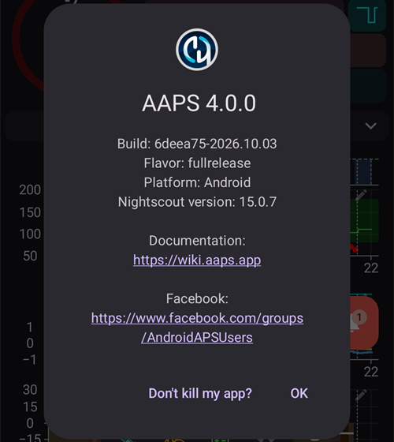

# Aktualizace na novou verzi nebo větev (branch)

## Sestavte si aplikaci sami, místo stažení

**AAPS** není kvůli předpisům pro zdravotnické prostředky k dispozici ke stažení. Sestavit si aplikaci pro vlastní použití je legální, ale nesmíte dávat kopii jiným! Podrobnosti najdete na stránce [Nejčastější otázky uživatelů APS](../UsefulLinks/FAQ.md).

## Důležité poznámky

- Jakmile vyjde nová verze **AAPS**, aktualizujte na ni prosím co nejdříve.
- Když je k dispozici nová verze, zobrazí se přímo v aplikaci **AAPS** informační banner o nové verzi.
- Nová verze bude v době vydání oznámena také na Facebooku.
- Po vydání si prosím podrobně přečtěte [Poznámky k vydání](ReleaseNotes.md) a případné dotazy si vyjasněte s komunitou na Facebooku nebo Discordu, než začnete s aktualizací.
- Nezapomeňte exportovat nastavení **AAPS**.

## Aktualizace AAPS sestavením v prohlížeči

Už jste aplikaci AAPS sestavili v prohlížeči? Postupujte podle návodu pro metodu, kterou jste použili:

- **AAPS Builder** (váš soukromý repozitář, obvykle pojmenovaný `my-aaps`): [Aktualizace AAPS pomocí AAPS Builder](#aaps-builder-updates). Není třeba synchronizovat žádný fork.
- **Fork a přípravný soubor** (vaše vlastní kopie AndroidAPS): [Aktualizace v prohlížeči (fork)](./UpdateBrowserBuild.md).

## Aktualizace AAPS pomocí Android Studia

Postupujte podle [tohoto návodu](./UpdateComputerBuild.md).

## Aktualizace AAPS z příkazové řádky

Použijte [stejný návod](../SettingUpAaps/CLIBuild.md) jako při předchozím sestavení AAPS, ale nové změny si stáhněte pomocí git.

(Update-to-new-version-check-aaps-version-on-phone)=

### Zkontrolujte verzi AAPS na telefonu

V [Poznámkách k vydání](../Maintenance/ReleaseNotes.md) zkontrolujte, zda po aktualizaci neplatí nějaké zvláštní pokyny.

Po instalaci nového APK:

- verzi **AAPS** v telefonu zkontrolujete tak, že otevřete **nabídku** (☰) vlevo nahoře a potom **O aplikaci** (viz snímek obrazovky níže). Aktuální verzi **AAPS** si můžete zobrazit;
- ujistěte se, že byl proveden import nastavení; a
- zkontrolujte prosím nastavení **AAPS** v části **Nastavení** a ověřte, že jsou stále správná.

