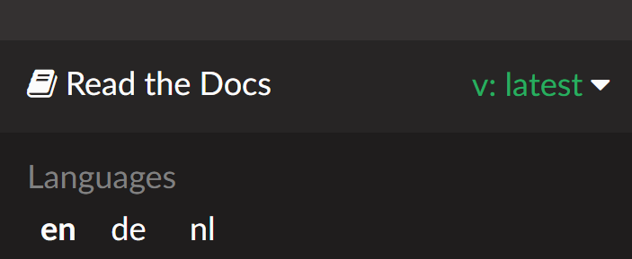

# Změna jazyka a verze

Dokumentace, kterou právě čtete, je k dispozici v několika jazycích a platí pro určitou verzi **AAPS**. Jazyk i verzi můžete změnit v nabídce vpravo dole na obrazovce.

```{note}
Klikněte na lištu vpravo dole na obrazovce. Otevře se nabídka pro výběr jazyka a verze.
```



## Změnit jazyk

V nabídce vyberte jazyk, ve kterém chcete dokumentaci číst.

Rádi uvítáme, když se přidáte k překladatelům a korektorům na [Crowdinu](https://crowdin.com/project/androidapsdocs) a pomůžete přeložit dokumentaci do svého jazyka.

## Změna verze

Aktuální verze je zobrazena vpravo dole na obrazovce. Pro přepnutí na jinou verzi klikněte na aktuální verzi a vyberte verzi, kterou potřebujete.

```{warning}
Při změně jazyka nebo verze se může zobrazit chyba 404 – Stránka nenalezena, pokud stránka v daném jazyce nebo verzi neexistuje. To se často stává při přepnutí verze, ale nemělo by se to stát při změně jazyka: pokud stránka ještě není přeložená, zobrazí se v angličtině.
```
