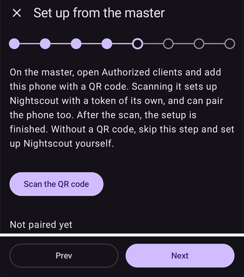
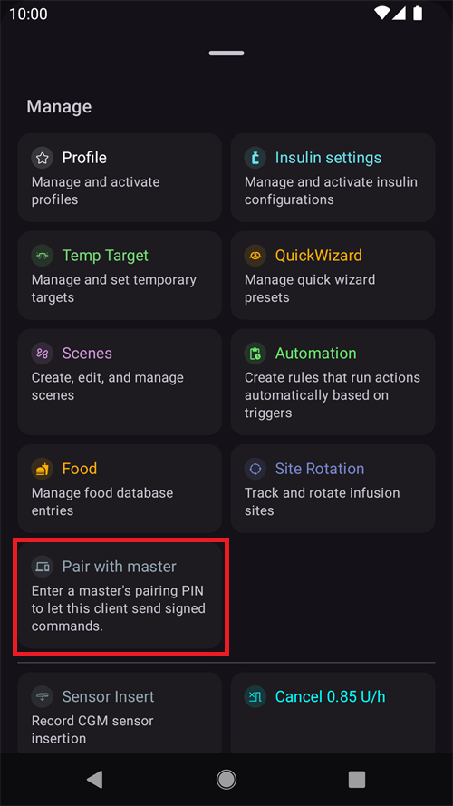

(aapsclient-app)=
# Aplikace AAPSClient

**AAPSClient** je doplňková aplikace k **AAPS**: doprovodná aplikace pro druhý telefon – obvykle telefon pečovatele –, která **sleduje** osobu používající **AAPS**. Od verze 4 **AAPS** může pečovatel smyčku také na dálku **ovládat** pomocí podepsaných příkazů. Oba telefony spolu komunikují přes váš web **Nightscout**; přímé spojení mezi telefony není potřeba.

```{admonition} Wording used on this page
:class: note
- **Klient** = telefon, na kterém běží **AAPSClient**.
- **Hlavní zařízení** (master) = hlavní telefon s **AAPS**, který ovládá pumpu a řídí smyčku.
```

```{admonition} Which devices can run AAPSClient?
:class: note
From **AAPS** version 4, **AAPSClient** runs on Android phones and tablets, on Wear OS watches and on computers (Windows, Mac and Linux). On an iPhone there is no ready-made download: you build the app yourself. See the [table of downloads by device](#aapsclient-platforms).
```

```{contents} Table of contents
:depth: 2
:local: true
```

## Co AAPSClient je (a co není)

**AAPSClient** vypadá a chová se jako **AAPS**, ale **nemá vlastní smyčku**:

- Neobsahuje **žádný algoritmus APS**, žádné **Cíle** a **žádné ovladače pump** – sám nikdy inzulín nedávkuje.
- Nejsou v něm ani pluginy, které používá jen hlavní aplikace (**SMS komunikátor**, **Tidepool**, **Open Humans**).
- Co *obsahuje*: synchronizaci **NSClientV3**, pluginy zdrojů glykémie, vysílání pro **xDrip+** a konektory pro **Wear OS** / **Garmin** – vše, co je potřeba ke sledování a k předávání příkazů. Hodinky **Garmin** připojené ke klientovi mohou zobrazovat data, ale sacharidy z nich odeslané se nezadají a nemohou pumpu připojit ani odpojit: klient zobrazí zprávu a vy je místo toho zadáte v **AAPS**.

Vše, co spustíte z **AAPSClient**, hlavní zařízení (telefon s pumpou) zkontroluje, omezí, potvrdí a **provede**. Jak to funguje, vysvětluje samostatná stránka [Ovládání master ↔ klient](ClientMasterControl.md): jak spárovat oba telefony, jak hlavní zařízení napíše text potvrzení, který vidíte, jak se vydá bolus spuštěný na klientovi a co se stane, když je hlavní zařízení offline.

## Verze: AAPSClient, AAPSClient2 a AAPSClient3

Na stejném telefonu sledujícího mohou být vedle sebe nainstalovány až tři klientské aplikace a každá sleduje **jinou** osobu: **AAPSClient** (ikona se žlutou sovou), **AAPSClient2** (modrá sova) a – nově od verze 4 **AAPS** – **AAPSClient3** (zelená sova). Funkčně jsou stejné. Liší se jen názvem a barvou (ikona aplikace, pozadí widgetu a stavová část na hlavní obrazovce), abyste je mohli rozlišit. Každá aplikace je spárovaná se svým vlastním hlavním zařízením. Podrobnosti najdete v části [O AAPSClient, AAPSClient2 a AAPSClient3](#remotecontrol-aapsclient-versions).

(aapsclient-platforms)=
## Jak aplikaci získat

All the ready-made files are in the *Assets* list of the latest release on [GitHub](https://github.com/nightscout/AndroidAPS/releases/) (click *Assets* at the bottom of the release to expand it). In the table, *x.y.z* stands for the version number. Choose the file that matches your device:

| Device                  | File to download                    | Poznámky                                                                                                                                                                                     |
| ----------------------- | ----------------------------------- | -------------------------------------------------------------------------------------------------------------------------------------------------------------------------------------------- |
| Android phone or tablet | `app-aapsclient-release_x.y.z.apk`  | Install it like the main app: see [Download and installation of AAPSClient](#RemoteControl_aapsclient) and [Transferring and installing](../SettingUpAaps/TransferringAndInstallingAaps.md). |
| Wear OS watch           | `wear-aapsclient-release_x.y.z.apk` | Goes with the AAPSClient app on the phone. See [Wear OS smartwatch](../WearOS/WearOsSmartwatch.md).                                                                                          |
| Windows computer        | `AAPSClient-x.y.z.msi`              | Open the file to install.                                                                                                                                                                    |
| Mac                     | `AAPSClient-x.y.z.dmg`              | See the note on macOS below the table.                                                                                                                                                       |
| Linux (Debian, Ubuntu)  | `aapsclient_x.y.z_amd64.deb`        | Install it with your package manager.                                                                                                                                                        |
| iPhone                  | nic                                 | There is no App Store version and no download. You build the app yourself, see [AAPSClient on an iPhone](#aapsclient-iphone).                                                                |

**Following two people?** Each file above also exists as *aapsclient2* / *AAPSClient2*. It is a second client app that installs next to the first one, so one device can follow two people (see [About AAPSClient, AAPSClient2 and AAPSClient3](#remotecontrol-aapsclient-versions)). **AAPSClient3** is not in the release assets: build it yourself ([build variants](#browserbuild-variant)).

**Files to ignore:** the *pumpcontrol* files (`app-pumpcontrol-release_…`, `wear-pumpcontrol-release_…`) are not a client. Leave them out.

**Mac: the first start.** The app is not notarized by Apple, so macOS blocks it the first time you open it. Click *Done*, then open *System Settings → Privacy & Security*, scroll down and click *Open Anyway*.

**Computer: how to connect.** A computer has no camera, so the QR code cannot be scanned. Set up **Nightscout** in the client, then on the master add the client with a **PIN** and type the 8-digit PIN in the client (**Pair with master**). See [Pairing with the master](#aapsclient-pairing-with-the-master).

**Same version everywhere.** The master and all its clients must run the same **AAPS** version. When you update the master, update the clients too.

(aapsclient-iphone)=
### AAPSClient on an iPhone

There is no **AAPSClient** in the App Store and no ready-made file to download, so you build the app yourself:

- You need a Mac with **Xcode** and an Apple developer account.
- The project is the `ios` folder of the [AndroidAPS repository on GitHub](https://github.com/nightscout/AndroidAPS/tree/master/ios).
- A build for a real iPhone is signed with your own Apple developer team. A build for the iPhone simulator does not need one.
- There is no step-by-step guide yet. This page will be updated when there is one.

The iPhone version pairs with the master like the others. Unlike the computer versions, the iPhone can scan the master's QR code with its camera.

## První spuštění: kratší Průvodce nastavením

Při prvním spuštění **AAPSClient** projde stejným **Průvodcem nastavením**, jaký znáte z **AAPS**, ale s mnohem méně kroky – na telefonu sledujícího se nenastavuje profil, inzulín, pumpa, APS ani cíle:

1. **Vítejte**, **licenční smlouva**, **oprávnění** a **hlavní heslo** – stejné jako v hlavní aplikaci, viz [Průvodce nastavením AAPS](../SettingUpAaps/SetupWizard.md).
2. Klient se **neptá** na **jednotky** ani na **dolní/horní značku**: převezme je z hlavního telefonu, jakmile se připojí k Nightscoutu. Později je uvidíte v **Nastavení**, kde malá **ikona telefonu** ukazuje, že jsou [synchronizované s hlavním telefonem](#client-master-config-prefs). Upravit je lze jen tehdy, když je hlavní zařízení dostupné.
3. **Nastavit z hlavního zařízení** – na hlavním zařízení otevřete **Spravovat → Autorizovaní klienti**, přidejte tento telefon pomocí **QR kódu** a zde klepněte na **Naskenujte QR kód**. Jedno naskenování nastaví Nightscout s vlastním tokenem tohoto telefonu a pokud jde o kód pro párování, telefon také spáruje. Telefon také převezme jméno, pod kterým byl přidán na hlavním zařízení, jako název své instance (písmena s diakritikou se změní na písmena bez diakritiky, „Miloš“ se změní na „Milos“). **Po naskenování je nastavení hotové**: průvodce se zavře, protože další kroky by jen ukazovaly, co kód nastavil. Bez QR kódu tento krok přeskočte. (Not on a computer: it has no camera, see [Getting the app](#aapsclient-platforms).)

   

4. **Komunikace** – seznam pluginů nabízí jen to, co sledující potřebuje (NSClientV3, xDrip+, Wear, Externí aplikace, Garmin). Pokud jste nenaskenovali QR kód, povolte **NSClientV3** a zadejte **stejnou URL Nightscoutu** jako na hlavním telefonu a přístupový token, se zapnutými **websockety** – přesně jak je popsáno v části [Synchronizace](#RemoteControl_aapsclient).

   

5. **Párovat s hlavním zařízením** – tento krok existuje **jen** na klientovi. Pomocí PIN připojí toto zařízení k hlavnímu zařízení přes zabezpečený příkazový kanál a stejně jako QR kód převezme jméno, pod kterým byl telefon přidán na hlavním zařízení. **Po spárování je nastavení hotové.** Krok můžete také přeskočit a spárovat kdykoli později v **Spravovat → Párovat s hlavním zařízením**.

   

6. **Kdo používá tento telefon?** – jen pokud jste v průvodci nespárovali: jméno osoby, která tento telefon používá. Podle něj se tato instance rozliší v reportech a při synchronizaci.

(aapsclient-pairing-with-the-master)=

## Párování s hlavním zařízením

Na **hlavním zařízení** otevřete **Spravovat → Autorizovaní klienti** a přidejte klienta. Spárovat lze dvěma způsoby:

- **Pomocí QR kódu** (nejrychlejší, pokud má telefon fotoaparát): naskenujte kód v kroku průvodce „**Nastavit z hlavního zařízení**“ nebo v **Spravovat → Párovat s hlavním zařízením → Naskenovat QR kód** a potvrďte tlačítkem „**Použít**“. Nastaví i Nightscout.
- **Pomocí PIN**: na **klientovi** otevřete výše uvedený krok průvodce (nebo **Spravovat → Párovat s hlavním zařízením**), zadejte jednorázový PIN zobrazený na hlavním zařízení a stiskněte „**Spárovat**“. Klient pak ukáže, komu bude důvěřovat – potvrďte tlačítkem „**Spárovat**“:


Pokud párujete z průvodce, úspěšné spárování dokončí nastavení a otevře hlavní obrazovku. Na hlavním zařízení se klient zobrazí jako **Aktivní** v seznamu [Autorizovaní klienti](#client_master_master_setup). Poté **Spravovat → Párovat s hlavním zařízením** zobrazí „*Již spárováno*“, roli telefonu a to, zda je zapnutý zabezpečený režim:

 Celý postup párování, podrobnosti o zabezpečení a řešení problémů najdete na stránce [Ovládání master ↔ klient](#client_master_client_setup).

Po spárování dostane klient od hlavního zařízení vlastní token pro Nightscout (pokud má hlavní zařízení token správce), jen s právy, která klient potřebuje, a přestane používat token, který jste případně zadali. **AAPSClient** nikdy sám nezapisuje do Nightscoutu ošetření ani glykémie: vše, co udělá, posílá hlavnímu zařízení, které to zapíše. Viz [Vlastní Nightscout token klienta](#client-master-control-own-token).

Co smí tento telefon dělat, určuje hlavní zařízení jeho **[rolí](#client-master-control-roles)** (Pouze pro čtení, Jídlo, Pečovatel nebo Admin). **Spravovat → Párovat s hlavním zařízením** zobrazí roli telefonu.

## Hlavní obrazovka

Hlavní obrazovka klienta zrcadlí sledovanou smyčku:


- **Glykémie, grafy, IOB/COB a profil** přicházejí z Nightscoutu přesně tak, jak je nahrálo hlavní zařízení.
- Zobrazený **stav smyčky** je stav **hlavního zařízení** (klient nemá vlastní smyčku). Dokud klient nedostane z Nightscoutu režim smyčky hlavního zařízení, ukazuje štítek režimu smyčky **otazník** (neznámý).
- **Stavová karta** ukazuje zásobník a baterii **sledované pumpy** a baterii nahrávajícího telefonu, převzaté ze stavu zařízení v Nightscoutu – klient nemá pumpu, takže v aplikaci nikde není místní stav pumpy ani správa pumpy.
- Spodní lišta nabízí **Ošetření**, **Scény** a **Spravovat**, jakmile je klient spárovaný (před spárováním jen **Spravovat**) – záložky pumpy ani cílů zde nejsou.

## Ošetření a akce

Vše v části **Spravovat** funguje jako v hlavní aplikaci, s jedním důležitým rozdílem: na klientovi jsou akce, které by změnily léčbu (bolus, sacharidy, dočasné cíle, scény…), **skryté, dokud zařízení není spárované**, a po spárování se **předávají hlavnímu zařízení** k potvrzení a provedení – viz [Používání vzdáleného ovládání](#client-master-control).

Výjimkou je položka **Profil**: zobrazuje se i na **nespárovaném** klientovi, ale otevře se **jen pro čtení** – klient ukazuje profily, které dostává přes Nightscout (potřebuje je pro vlastní výpočty), bez tlačítek pro úpravu nebo aktivaci. Jakmile je klient **spárovaný**, seznam profilů se synchronizuje s hlavním zařízením a profily můžete z klienta upravovat a aktivovat jako jakoukoli jinou vzdálenou akci.

Na **nespárovaném** klientovi nabízí **Spravovat** jen **Profil** a **Párovat s hlavním zařízením**:


Červený banner „*Hlavní zařízení je nedostupné. Úprava je zakázána, dokud není připojení obnoveno.*“ se zobrazuje i na nespárovaném klientovi. To je v pořádku: zatím neexistuje žádné hlavní zařízení, ke kterému by se klient připojil. Banner zmizí, jakmile je klient spárovaný a hlavní zařízení je online.

Jakmile je klient spárovaný, objeví se akce pro léčbu:



**Položka Pumpa zde není** – klient nemá pumpu.

Pokud hlavní zařízení není dostupné, zobrazí se stejný banner i na spárovaném klientovi: akce pro léčbu jsou zašedlé a vše, o co se pokusíte, se zablokuje ještě před odesláním. Klient zjistí, že je hlavní zařízení offline, když se pokusíte o akci, a jakmile je hlavní zařízení znovu online, akce opět povolí.


## Nastavení synchronizovaná s hlavním zařízením

Aktivní **konfigurace** pluginů a mnoho **předvoleb** se udržuje synchronizovaných mezi hlavním zařízením a jeho spárovanými klienty; synchronizované položky jsou označené malou **ikonou telefonu** a jsou zakázané (s bannerem „*Hlavní zařízení je nedostupné*“), dokud hlavní zařízení není dostupné. Popis najdete v části [Změna konfigurace a předvoleb](#client-master-config-prefs).

## AAPSClient na chytrých hodinkách

Hodinky s Wear OS lze spárovat s telefonem **klienta**; jejich akce se předávají přes klienta hlavnímu zařízení. Viz [Nastavení AAPS na hodinkách s Wear OS](../WearOS/WearOsSmartwatch.md) a [možnosti chytrých hodinek ve vzdáleném ovládání](#RemoteControl_smartwatches).
