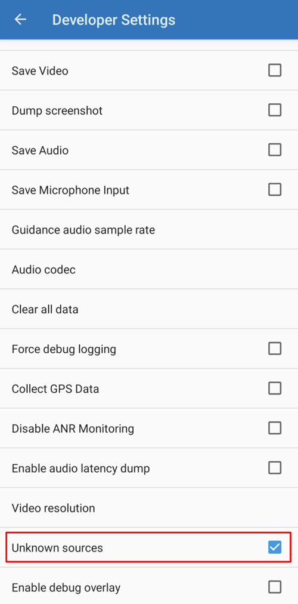

# Android Auto

**AAPS** vám může posílat informace o vašem aktuálním stavu jako zprávu přímo do Android Auto ve vašem autě.

## Požadavky

**AAPS** využívá funkci Android Auto, která umožňuje přesměrovat zprávy z aplikací v mobilu na displej audiosystému v autě.

To znamená, že:

* Android musí aplikaci **AAPS** povolit zobrazovat oznámení a
* Protože **AAPS** není oficiální aplikace, povolte v Android Auto použití „neznámých zdrojů“.

## Check that AAPS can show notifications

**AAPS** vždy zobrazuje stavové oznámení s vaší aktuální glykémií, IOB a COB. Toto oznámení Android Auto zobrazuje v autě. V **AAPS** není potřeba nic zapínat, ale Android musí aplikaci **AAPS** povolit zobrazovat oznámení.

V telefonu otevřete **Nastavení** > **Aplikace** > **AAPS** > **Oznámení** a ujistěte se, že je zapnuté **Všechna oznámení aplikace AAPS**.

Sjeďte dolů a ujistěte se, že je zapnutý **Průběžný stav**: to je kanál stavového oznámení.

Než půjdete k autu, zkontrolujte prosím, že v telefonu vidíte stavové oznámení **AAPS**!

## Allow the use of "unknown sources" with Android Auto.

Protože **AAPS** není oficiální aplikace pro Android Auto, musí být oznámení v Android Auto povolena pro „neznámé zdroje“. K tomu se používá režim vývojáře, který vám zde ukážeme.

Jděte do auta a připojte mobil k audiosystému auta.

Nyní byste měli vidět obrazovku podobnou této.

Konfiguraci spustíte klepnutím na ikonu **nastavení**.

Sjeďte dolů na konec stránky a vyberte **see more in the phone** (zobrazit více v telefonu).

Nyní na mobilu zapneme režim vývojáře.

První obrazovka vypadá takto. Sjeďte dolů na konec stránky.

Tam uvidíte uvedenou verzi Android Auto. Klepněte 10krát (slovy desetkrát) na verzi Android Auto. Touto skrytou kombinací jste nyní zapnuli režim vývojáře.

V dialogu „Allow development settings?“ („Povolit nastavení pro vývojáře?“) potvrďte, že chcete zapnout režim vývojáře.

V **nastavení pro vývojáře** zapněte „Neznámé zdroje“ („Unknown sources“).

Nyní můžete režim vývojáře opustit, pokud chcete. Chcete-li jej opustit, klepněte na tři tečky vpravo nahoře.

## Zobrazení oznámení v autě

Klepněte na **ikonu s číslem** vpravo dole v Android Auto ve vašem autě.

Vaše data z CGM se zobrazí takto:

(android-auto-troubleshooting)=

## Poradce při potížích:

* Pokud oznámení nevidíte, zkontrolujte, zda jste v Androidu [povolili AAPS zobrazovat oznámení](#check-that-aaps-can-show-notifications) a zda má [Android Auto přístupová práva k oznámením](#allow-the-use-of-unknown-sources-with-android-auto).