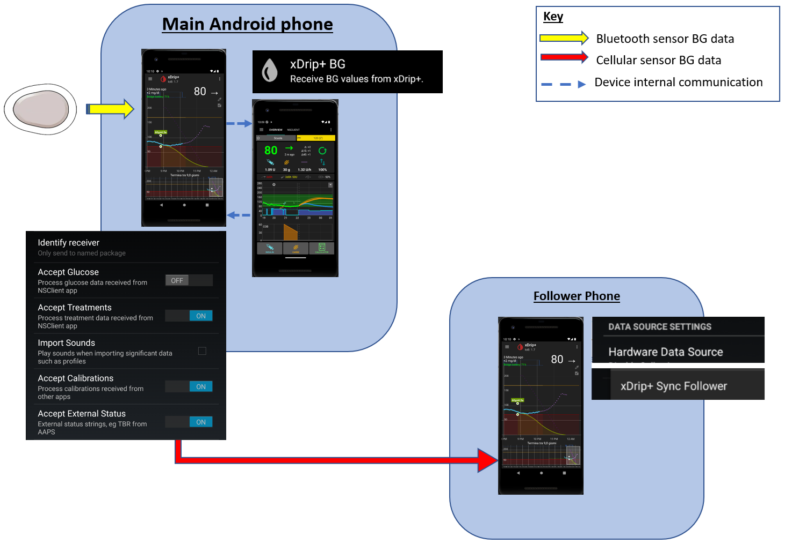

# Sledování AAPS (bez interakce s AAPS systémem)

Kromě řady možností pro vzdálené ovládání _a_ sledování **AAPS**, které jsou popsány na stránce [Vzdálené ovládání AAPS](../RemoteFeatures/RemoteControl.md), existuje několik dalších aplikací a zařízení vyvinutých komunitou, které slouží jen ke sledování hodnot (glykémie a dalších informací) bez interakce s **AAPS**.

Dobrý přehled mnoha možností sledování **AAPS** najdete na webové stránce [Nightscout follower](https://nightscout.github.io/nightscout/downloaders/#).

```{contents} Table of contents
:depth: 1
:local: true
```

Nejběžnější strategie používané ve spojení s **AAPS** jsou podrobněji vysvětleny níže.

## Aplikace pro chytré telefony

```{contents} These are some of the main “follower” apps used by **AAPS** users. All of these apps are “free”: 
:depth: 1
:local: true
```

### Dexcom Follow ([Android](https://play.google.com/store/apps/details?id=com.dexcom.follow.region2.mgdl) a [iOS](https://apps.apple.com/fr/app/dexcom-follow-mg-dl-dxcm2/id1032203080))


* Dexcom Follow je kompatibilní s širokou škálou telefonů (jak Android, tak iPhone). Dexcom Follow lze použít i v případě, že nepoužíváte oficiální aplikaci Dexcom pro příjem dat senzoru.

* Mnoho pečovatelů Dexcom Follow zná a dává přednost jeho přehlednému rozhraní před něčím složitějším.

* Dexcom Follow je velmi vhodný pro učitele, prarodiče a lidi, kteří o diabetu a hladinách cukru vědí velmi málo. Má nastavitelné výstrahy (úroveň glykémie, jaký zvuk přehrát atd.). Alarmy lze v případě potřeby úplně vypnout. To je velmi užitečné, pokud máte senzor, který se teprve usazuje a ukazuje mnoho falešně nízkých hodnot.

#### Nastavení Dexcom Follow: průvodce

Pokud k příjmu dat ze senzoru používáte neoficiální aplikaci Dexcom BYODA, možná můžete pozvánky sledujícím posílat přímo z aplikace BYODA.

Z aplikací třetích stran už nelze sledujícím Dexcomu posílat e-maily s pozvánkou. V xDripu žádost o pozvánku skončí jen zprávou „invite not sent“ (pozvánka nebyla odeslána).

Musíte nainstalovat oficiální aplikaci Dexcom, odeslat pozvánku a poté ji můžete opět odinstalovat.

K tomu je třeba provést tyto kroky:

1) Nainstalujte oficiální aplikaci „Dexcom“ na _libovolný_ chytrý telefon (Android/iPhone). Pokud je to pohodlnější, může to být telefon sledujícího. 2) Přihlaste se pomocí vašeho Dexcom uživatelského jména a hesla, toto jsou stejné přihlašovací údaje, které byste mohli použít pro Dexcom Clarity, pokud jste již aktuálním zákazníkem Dexcom/Clarity. Pokud přihlašovací údaje Dexcom nemáte, můžete si je v tomto kroku vytvořit.   
3) Projděte úvodní obrazovky. 4) Jako kód senzoru zadejte „no code“ (bez kódu). 5) V části Transmitter SN vyberte „enter manually“ (zadat ručně) a zadejte jakýkoli platný kód vysílače (pokud nějaký znáte, použijte kód některého z vašich vysloužilých vysílačů, aby to neovlivnilo běh vašeho současného vysílače; kódy mají určitý formát čísel a písmen: „NLNNNL“ a používají jen určité kombinace, proto je nejjednodušší použít kód, o kterém už víte, že je platný). 6) Jakmile se aplikace snaží najít vysílač a senzor, můžete pozvat sledující: vyberte tři malé tečky vlevo nahoře v aplikaci a přidejte nového sledujícího. Tento krok můžete použít také tehdy, když si některý ze sledujících vyměnil telefon a potřebuje novou pozvánku: zde ho můžete smazat ze seznamu sledujících a znovu mu poslat e-mail s pozvánkou, kterou použije na novém telefonu. 7) Na telefon sledujícího nainstalujte Dexcom Follow z App Store (iPhone) nebo z Obchodu Play (Android). Nastavte aplikaci Dexcom Follow. Aplikace vás vyzve, abyste v e-mailu našli pozvánku ke sledování.    
8) Nyní můžete oficiální aplikaci Dexcom G6 smazat.

Pro Dexcom Follow se pak data ze senzoru exportují z telefonu s **AAPS** buď přímo z BYODA, nebo z xDripu, podle toho, kterou aplikaci používáte.


### [Nightguard](https://apps.apple.com/fr/app/nightguard/id1116430352) (iOS)


Výhody (podle zkušeností uživatelů):

* K dispozici v [App Store](https://apps.apple.com/us/app/nightguard/id1116430352), jednoduché a přívětivé rozhraní.

* Přejetím tlačítka nebo zatřesením telefonem lze alarmy odložit na různě dlouhou dobu, od 5 min do 24 hodin

* Nastavitelné alarmy (vysoká, nízká glykémie, chybějící hodnoty, když 15–45 minut nepřijdou data).

* Rychlý vzestup/pokles během 2–5 po sobě jdoucích hodnot (volíte vy). Lze také zvolit rozdíl (delta) mezi dvěma jednotlivými hodnotami

* Chytré odložení – neupozorní, pokud se glykémie mění správným směrem

* Je zde záložka Care, která zřejmě umožňuje nastavit nový dočasný cíl na určitou dobu, dočasný cíl smazat nebo zadat sacharidy.

Nevýhody (podle zkušeností uživatelů)

* Dostupné jen pro iOS

* Dočasný cíl se zobrazuje jako 5 mmol bez ohledu na to, jaká hodnota dočasného cíle je nastavena

* Nikdy nezobrazuje hodnotu dočasného bazálu, i když ukazuje TB

### [Nightwatch](https://play.google.com/store/apps/details?id=se.cornixit.nightwatch) (Android)


* Nightwatch se představuje jako klient Nightscoutu a sleduje glykémie uživatele z Nightscoutu na telefonu nebo tabletu s Androidem.

* Aplikaci lze stáhnout z [Obchodu Play](https://play.google.com/store/apps/details?id=se.cornixit.nightwatch) a zobrazuje data glykémie v reálném čase.

* Uživatel může být upozorněn nastavitelnými hlasitými alarmy pro nízkou a vysokou glykémii.

* Glykémii lze zobrazit v mmol/l nebo mg/dl.

* Vyžaduje Android 5.0 nebo novější.

* It has a dark UI, large readings and buttons, designed for usage at night.

### xDrip (Android)

xDrip můžete používat jako aplikaci pro sledování.

#### S Nightscoutem

Nastavte xDrip jako sledujícího Nightscoutu (Nightscout Follower). Dostanete glykémie a ošetření, ale ne bazál.


#### Bez Nightscoutu – xDrip jako zdroj glykémie

Pokud je vaším zdrojem dat pro **AAPS** xDrip (nebo pokud xDrip umí přijímat glykémie i z jiné aplikace, např. BYODA, Juggluco...), můžete ho na hlavním telefonu použít ke sdílení dat se sledujícími v xDripu; zobrazují se glykémie, ošetření a bazální dávky.



#### Bez Nightscoutu – xDrip v režimu doprovodné aplikace

Pokud vaším zdrojem dat pro **AAPS** není xDrip, ale xDrip umí zobrazit data glykémie ze zdroje dat Companion App (doprovodná aplikace), můžete ho na hlavním telefonu použít ke sdílení dat se sledujícími v xDripu; zobrazují se glykémie, ošetření a bazální dávky.


### xDrip4iOS (iOS)


xDripSwift was created from porting the original xDrip app to iOS and evolved into "xDrip for iOS", written as **xDrip4iOS**.

```{admonition} Further detail about how to attempt to obtain the original **xDrip4iOS** app
:class: dropdown
Hlavní komunitní podporou pro xDrip4iOS a Shuggah je [Facebooková skupina xDrip4iOS](https://www.facebook.com/groups/853994615056838/announcements). **xDrip4iOS** se umí připojit k mnoha různým systémům CGM a vysílačům a zobrazovat hodnoty glykémie, grafy a statistiky a také spouštět alarmy. Umí také nahrávat data do Nightscoutu nebo fungovat jako [aplikace pro sledování Nightscoutu](https://xdrip4ios.readthedocs.io/en/latest/connect/follower/). 

„Jak dostanu **xDrip4iOS** do svého iPhonu?“
Jsou dvě možnosti:

1. Pokud máte Mac a účet Apple Developer (99 EUR/USD ročně), můžete si xDrip4iOS sestavit sami [podle návodu](https://xdrip4ios.readthedocs.io/en/latest/install/build/).

Pokud chcete, můžete se pak stát „releaserem“ a [sdílet osobní Testflight xDrip4iOS](https://xdrip4ios.readthedocs.io/en/latest/install/personal_testflight/) až se 100 dalšími lidmi a pomoci jim.

2. Připojíte se k [Facebookové skupině xDrip4iOS](https://www.facebook.com/groups/853994615056838/announcements) a v připnutých příspěvcích si přečtete aktuální způsoby, jak aplikaci získat. **Nežádejte o pozvánku do aplikace** (přečtěte si pravidla skupiny).
```


„Co je **Shuggah**?“ Skupina ukrajinských vývojářů zkopírovala kód projektu xDrip4iOS (který je veřejně sdílený na GitHubu) a vydala ho v App Store pod firemním účtem. Vydání Shuggah vývojáři xDrip4iOS nijak nespravují.

[Facebooková skupina xDrip4iOS](https://www.facebook.com/groups/853994615056838/announcements) poskytuje podporu pro xDrip4iOS a odpovídající aplikace pro Apple Watch.

### [Sugarmate](https://apps.apple.com/fr/app/sugarmate/id1111093108) (iOS)


[Sugarmate](https://sugarmate.io/) si můžete stáhnout do iPhonu z App Store. Sugarmate je kompatibilní s:
* Apple iPhone (vyžaduje verzi systému 13.0 nebo novější)
* Apple iPad (vyžaduje verzi systému 13.0 nebo novější)
* Google Android (webovou aplikaci si uložte na domovskou obrazovku)

Uživatelé Sugarmate uvádějí, že v USA ji lze používat s Apple CarPlay a během řízení zobrazovat hodnoty glykémie. Zatím není známo, zda je to možné i v jiných zemích než v USA. If you know more about this, please add details in here to the documentation by completing a [pull request](../SupportingAaps/HowToEditTheDocs.md), which is quick and easy to do.


### [Spike](https://spike-app.com/) (iOS)


Spike lze používat jako hlavní přijímač nebo jako aplikaci pro sledování a poskytuje glykémii, alarmy, IOB a další.

Web a aplikace se už nevyvíjejí. Podporu najdete na [Facebooku](https://www.facebook.com/groups/1973791946274873) a [Gitteru](https://gitter.im/SpikeiOS/Lobby).

## Chytré hodinky pro **sledování AAPS** (všechna data profilu, nebo jen glykémie), když **AAPS** běží v telefonu.

Viz [zde](../Getting-Started/Watches.md).


## Zařízení pro sledování AAPS

```{contents} Devices include:
:depth: 1
:local: true
```

### M5Stack


M5Stack je malá krabička, kterou lze naprogramovat pro mnoho použití. Martinův projekt [M5Stack NightscoutMon](https://github.com/mlukasek/M5_NightscoutMon/wiki) zobrazuje hodnoty glukózy ze senzoru a trendy, IOB a COB. Je v plastové krabičce a má barevný displej, slot na kartu micro SD, 3 tlačítka, reproduktor a vnitřní baterii. Je to skvělý monitor glykémie a jeho nastavení je poměrně snadné, pokud máte účet Nightscout. Uživatelé ho obvykle provozují na domácí Wi-Fi, ale někteří ho používají i jako displej při jízdě na motorce, připojený k Wi-Fi hotspotu z telefonu.

### SugarPixel

SugarPixel je zařízení, které slouží jako druhý displej a systém výstrah pro kontinuální monitorování glukózy. Připojuje se k aplikaci Dexcom nebo k Nightscoutu v telefonu uživatele. Zařízení zobrazuje hodnoty glykémie v reálném čase. Tento hardwarový monitor CGM nabízí zvukové výstrahy s náhodně generovanými tóny (jsou neuvěřitelně hlasité), vibrační výstrahy pro sluchově postižené, nastavitelné možnosti zobrazení a vestavěné sledování více uživatelů.


* SugarPixel má několik možností zobrazení v mg/dl a mmol/l, aby vyhověl potřebám uživatele, s barevně odlišenými hodnotami glykémie.
* Standardní ciferník zobrazuje glykémii, šipku trendu a deltu. Delta je změna (+ nebo -) oproti poslední hodnotě.
* SugarPixel lze přizpůsobit pro používání při nízkém jasu s ciferníkem BG and Time (glykémie a čas), takže uživatel vidí na nočním stolku svou glykémii a aktuální čas.
* Barevný ciferník SugarPixel využívá celý displej k zobrazení jedné barvy, která odpovídá hodnotě glykémie. Uživatel tak vidí hodnoty glykémie z dálky oknem, když si venku hraje na zahradě, na terase nebo u bazénu.
* Ciferník Big BG (velká glykémie) se hodí pro uživatele, kteří ho mají na nočním stolku a nosí brýle nebo kontaktní čočky.

### Nightscout Clock na Ulanzi TC001

**Nightscout Clock** je software s otevřeným zdrojovým kódem, který běží na zařízení **Ulanzi TC001**. Připojuje se k serverům Dexcom nebo k Nightscoutu a zobrazuje hodnoty glykémie v reálném čase.


* Hodiny podporují jednotky mmol/l i mg/dl a mají zvukové alarmy.
* Several displays are available, see [Github nightscout-clock](https://github.com/ktomy/nightscout-clock?tab=readme-ov-file#more-information-for-people-who-needs-it) for an overview.
* Nastavení a konfigurace zařízení zahrnuje jen několik jednoduchých kroků. Po nastavení potřebuje ke své funkci jen napájení a Wi-Fi.
* Zařízení Ulanzi TC001 je výrazně levnější než SugarPixel.
* Software i s návodem k instalaci najdete na [Github nightscout-clock](https://github.com/ktomy/nightscout-clock?tab=readme-ov-file).
* Vyvíjí a spravuje ho Artiom Kenibasov, který poskytuje podporu ve [facebookové skupině AAPS Users](https://www.facebook.com/groups/cgminthecloud/posts/8776932509094594/).

### PC (TeamViewer)
Někteří uživatelé používají pro plnohodnotný vzdálený přístup aplikace jako je [TeamViewer](https://www.teamviewer.com/), který je užitečný i pro pokročilé řešení problémů na dálku.
